# 01 - Build a Governed Project Workspace

**Your assignment:** Prepare a usable project filing system and an access plan that distinguishes ownership, editing, review and publication.

**Target allocation:** 60 minutes: 18 demonstration and discussion, 25 guided build, 12 independent challenge, 5 verification and repair. These are design allocations, not measured completion times. Finish the challenge and checks before moving on; finishing the guided clicks is not completion of the lab.

**Status:** core workspace stages captured in the real apps. Upload used the connected Drive tool because the browser extension blocked local-file selection. Shared Drive membership, reviewer allowed/denied tests and the independent challenge remain untested. Timings remain unvalidated for learners.

## What You Will Learn

- Design a folder structure and recognise the source of truth for each output.
- Convert and inspect a starter workbook rather than relying on its filename.
- Find a file by name and type, distinguish shortcuts from copies, and assess access requirements.
- Explain how Shared Drive membership differs from a personal folder.

## Before You Begin

Read [project-facts.txt](../../shared/sample-files/project-facts.txt). You need Drive, Docs and Sheets. If Shared Drives are unavailable, complete the My Drive route and record the governance difference rather than claiming a Shared Drive test.

Use the [copy-paste page](./prompts.md) and [shared practice files](../../shared/sample-files/README.md). Keep fictional role names as text. Use only trainer-assigned test identities for any access test.

## 1.1 Plan the Information Flow

1. Create a Doc named `GW - Project Reporting Pilot - Workspace Register`. Label it **Fictional training material**.

2. Read the fact sheet and list the four deliverables. Beside each, identify what it is authoritative for: agreed brief wording, task rows, presentation narrative or navigation.

3. Add a table with columns Asset, Source file, Maintainer role, Intended reader role and Review gate. Use Aina as coordinator and Farid as sponsor only where the source supports those roles; mark unassigned responsibilities as **Proposed**.

4. Draw a simple text flow: Tasks → Summary chart → Brief and Slides → Hub. Add a note explaining that a linked chart requires a refresh check.

5. Separate the budget proposal from the task cost dataset. Record that neither a file name nor a folder location proves approval.

What should you see?

The register identifies four outputs, their source relationships and unresolved ownership decisions. No reader is treated as an editor just because they need to see a report.

<!-- VERIFY: run expanded section 1.1; capture images/c01-01-01.jpg from the real app after success. -->

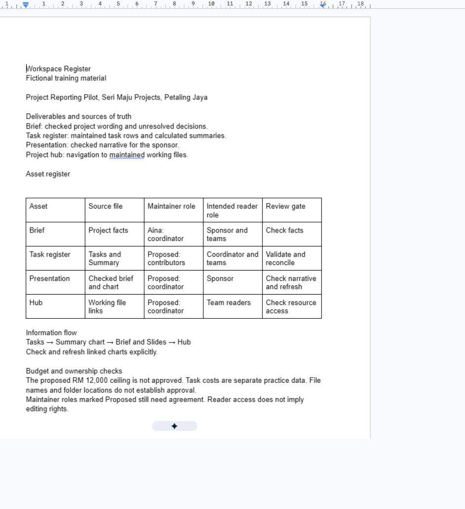

## 1.2 Create and Inspect the Workspace

1. In Drive choose **New**, then **New folder**. Name it `GW - Project Reporting Pilot`. Inside create `01 Sources`, `02 Working` and `03 Review`.

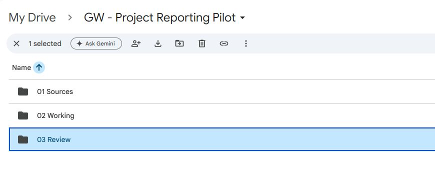

2. Upload project-facts.txt, meeting-record.txt and TaskRegister.xlsx into **01 Sources**. Keep these starter inputs unchanged.

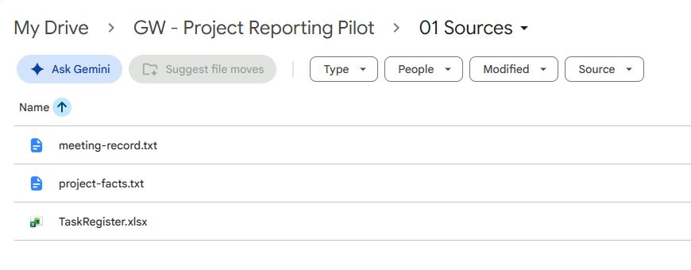

3. Open TaskRegister.xlsx in Google Sheets. Use **File**, then **Save as Google Sheets** if it is still an Office file. Move the native version into **02 Working** and name it `GW - Pilot Task Register`.

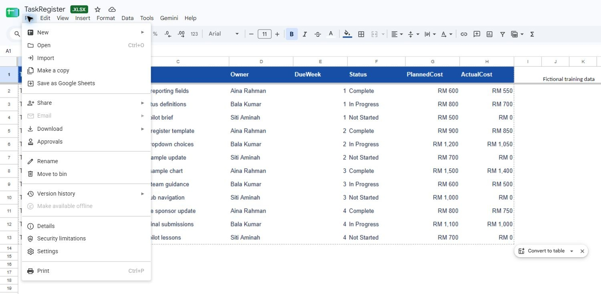

4. Inspect **Tasks** A1:H13 and **Summary** A1:B4. Confirm 12 TaskIDs, three team names, relative week values, numeric costs and three existing status labels. Do not fill the blank Summary formulas yet.

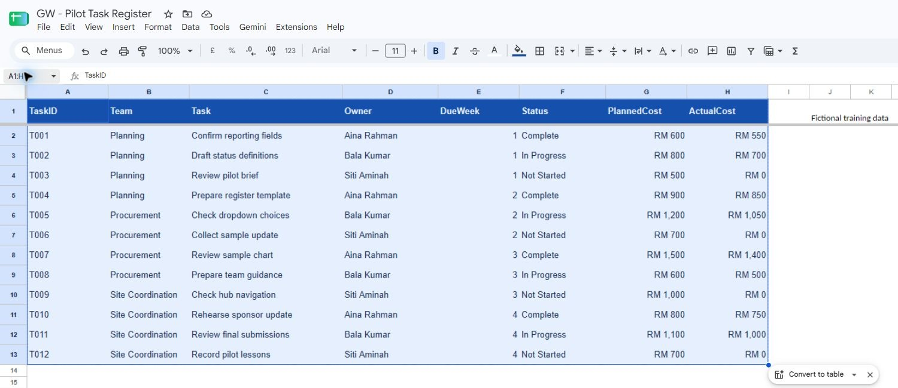

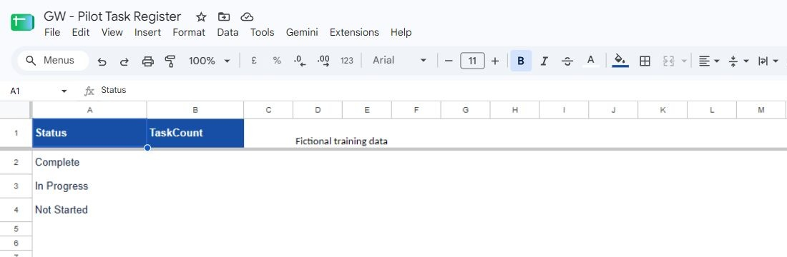

5. Move the Workspace Register into **02 Working**. Paste links to the source fact sheet and native tracker in its asset table.

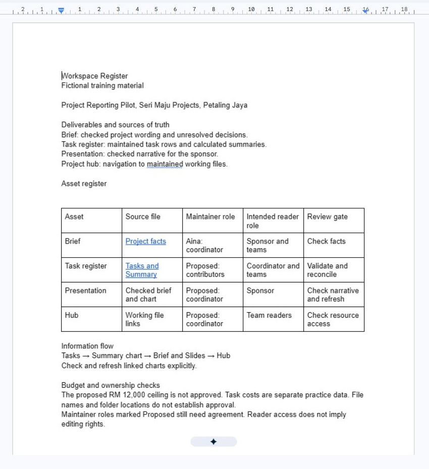

6. Use Drive search to find the native tracker by its distinctive name and the **Spreadsheets** type. Open the result and confirm it has the expected two tabs rather than opening the original XLSX.

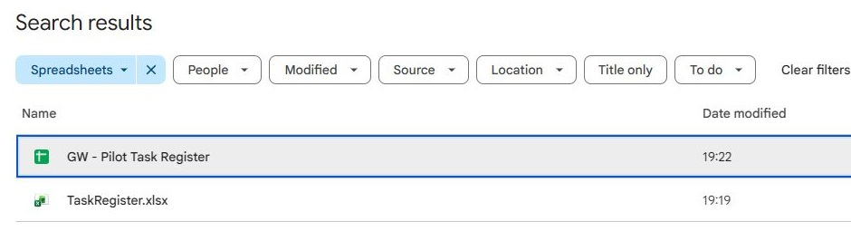

What should you see?

The original workbook and a separate native spreadsheet are easy to distinguish. The register links to the native working source. Twelve task rows remain intact.

<!-- VERIFY: run expanded section 1.2; capture images/c01-01-02.jpg from the real app after success. -->

## 1.3 Inspect Access and File Identity

1. Open **Share** for the working folder and native tracker. Record their current **General access** setting and who owns them. Keep them restricted during individual practice.

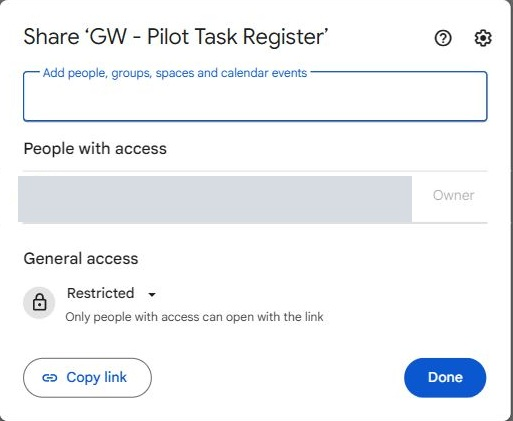

2. In the register create an access matrix for coordinator, sponsor, team contributor and hub visitor. Write the minimum proposed role for each asset and explain one difference between viewing and editing.

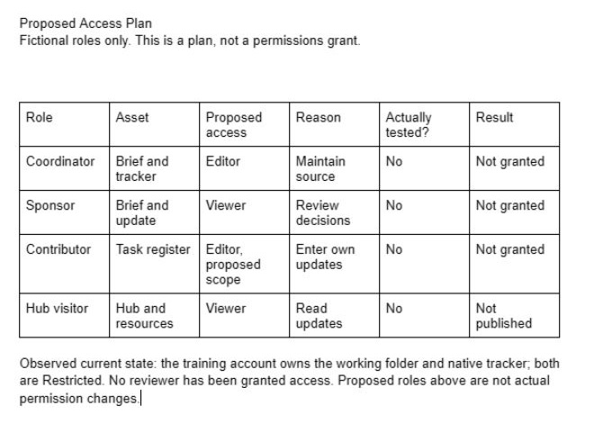

If the matrix splits awkwardly across pages, insert a page break before its heading so the table stays readable. This changes layout only.

3. Choose **Organise**, then **Add shortcut** on the tracker if available. Place a shortcut in **03 Review**. Open it and compare the URL with the original. If the command is unavailable, record the dependency and use a normal link.

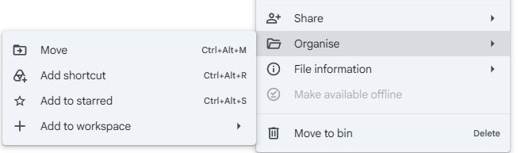

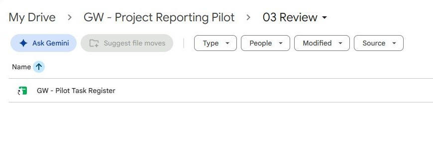

4. Explain why copying the tracker for each reviewer would create competing sources. Label the shortcut as a route to the working file, not an archive snapshot.

5. Observe the trainer inspecting Shared Drive roles and inherited membership in an assigned sandbox, if available. In your register compare who holds the content with My Drive ownership. Record **Not tested** if no sandbox exists.

6. If the trainer has assigned a test reviewer, grant only the agreed role, test through that identity, then remove the temporary grant and retest. Otherwise complete a proposed access plan and clearly label the access test as pending.

What should you see?

Links and shortcuts resolve to the intended source. Your record distinguishes inspected settings, tested access and proposed roles. Shared Drive membership is not inferred from a My Drive exercise.

<!-- VERIFY: run expanded section 1.3; capture images/c01-01-03.jpg from the real app after success. -->

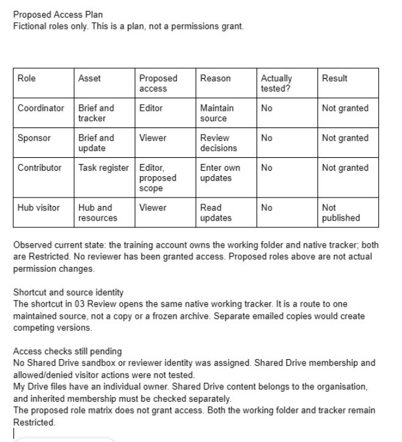

## Independent Challenge

A reviewer asks you to email separate copies of every working file and says that anyone who sees the hub should edit the tracker. Without following a new click sequence, propose a better handover in the Workspace Register: a single source link, an appropriate review route and the minimum roles. Then find the tracker again without using **Recent**, and prove you opened the native working source. With an assigned test identity, demonstrate one allowed and one denied action; otherwise explain precisely what remains untested.

## Evidence to Hand Over

- Workspace Register with asset inventory, source flow and proposed access matrix.
- Original inputs plus a clearly named native working tracker.
- One identity check and an access-test result or explicit pending test.

## Troubleshooting

| Symptom | Repair to investigate |
|---|---|
| Two similarly named trackers | Compare type, location and URL; rename the working native file clearly. |
| A viewer can still access a file | Inspect inherited folder or Shared Drive membership as well as direct grants. |
| A shortcut is mistaken for an archive | Open both routes and compare the file identity; a shortcut is not a frozen copy. |

## Check Yourself

Explain one error you found, how you proved the correction, and which downstream result it could affect. A finished-looking file alone is not evidence that it is correct.
