# 02 - Create, Review and Revise a Checked Brief

**Your assignment:** Produce a structured brief with traceable facts, a decision table, a review history and a checked PDF.

> **Prompts:** the [prompts page](./prompts.md) has every value and prompt for this chapter, each with a Copy button.

**Estimated time:** 65 minutes, planned as 20 demonstration and discussion, 25 guided build, 15 independent practice and 5 verification and repair. Not yet timed with learners. Finish the challenge and checks before moving on; finishing the guided clicks is not completion of the lab.

> **Status:** core sections 2.1–2.3 executed and captured in a fresh private document: ten fact checks, eight section headings, decision table, verified links, two named versions, an accepted editorial suggestion, a rejected factual distortion, an open review thread and a three-page PDF inspected page by page. The independent challenge and classroom timings remain unvalidated.

---

## What You Will Learn

- Ground an AI draft in supplied facts and independently audit it.
- Use paragraph styles, document navigation, tables and source links.
- Distinguish a comment, an editorial suggestion and an actual project approval.
- Preserve a baseline and inspect an exported copy.

## Before You Begin

Use the workspace from Lab 1. Have [project-facts.txt](../../shared/sample-files/project-facts.txt), [checked-brief.txt](../../shared/sample-files/checked-brief.txt) and [review-examples.txt](../../shared/sample-files/review-examples.txt) available. If Gemini is unavailable, use checked-brief.txt for the draft and perform the same factual audit and revision tasks manually.

Use the [prompts page](./prompts.md) and [shared practice files](../../shared/sample-files/README.md). Keep fictional role names as text. Use only trainer-assigned test identities for any access test.

## 2.1 Draft and Audit the Facts

1. In **02 Working** click **New > Google Docs > Blank document**, name it `GW - Project Reporting Pilot - Brief` and type `Fictional training material` as the first line.

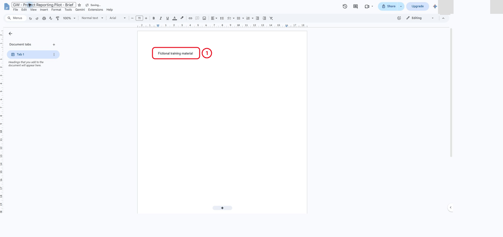

*A fresh labelled brief before any AI draft, audit table or headings have been added.*

2. If available, open **Ask Gemini** and use the panel-only prompt on the prompts page with the full fact sheet. If it proposes an in-place edit, inspect it before accepting. Reject any replacement of known facts with placeholders; use the recovery prompt.

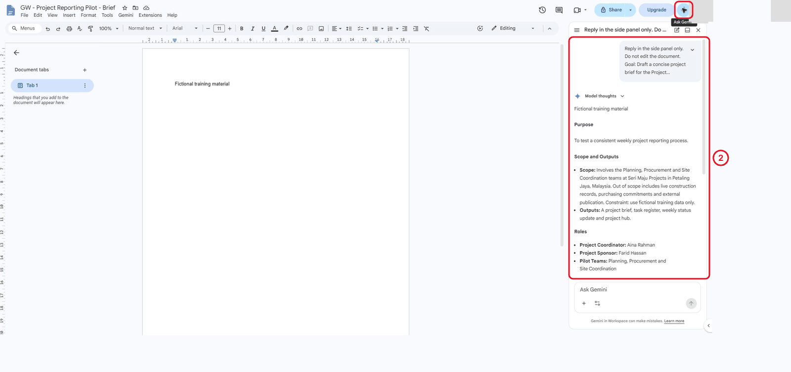

*The draft stays in Gemini while the document contains only its fictional-material label.*

3. At the end of the document type `Fact Audit`, then insert a 3-column, 11-row table with the headings Claim, Source wording and Verdict (Part 7 of the prompts page). Check duration, teams, coordinator, sponsor, budget condition, reporting cadence, risk and success measure.

4. Check the unresolved start date and budget approval separately. Use the AI audit prompt only as a second opinion; compare its answer with your own table.

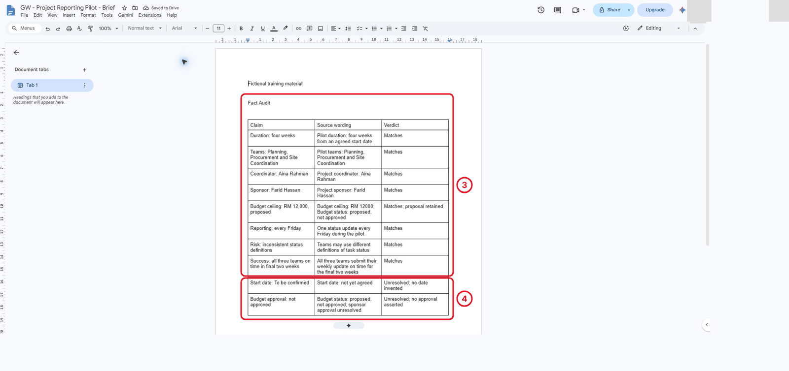

*Ten source-backed checks before inserting the draft; unresolved facts remain unresolved.*

5. Insert the checked brief. Remove unsupported benefits, suppliers or approvals. If no AI is available, paste the text of checked-brief.txt instead and still complete all ten factual checks.

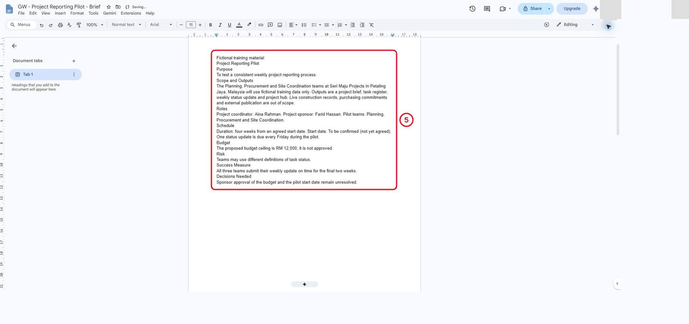

*Checked plain text before paragraph styles, decision tables, source links or comments exist.*

What should you see?

The brief preserves the four-week duration and proposed RM 12,000 ceiling. It does not invent a start date, approval or benefit percentage. The audit records source evidence, not just “AI says correct”.

<!-- CAPTURED: core section 2.1 on 17 October 2026; independent challenge and learner timing pending. -->

## 2.2 Build Navigation and Decision Structure

1. Apply **Title** to the project title and **Heading 1** to Purpose, Scope and Outputs, Roles, Schedule, Budget, Risk, Success Measure and Decisions Needed.

2. Open the document outline and navigate to Budget and Decisions Needed. Confirm these are real headings, not bold body text.

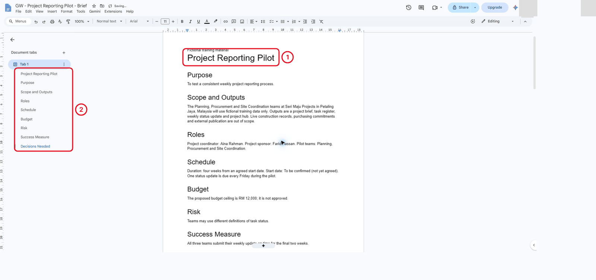

*The Title and eight section headings appear in the outline before review comments or suggestions.*

3. Under **Decisions Needed**, insert a 4-column, 3-row table: Decision, Decision-maker, Current state and Evidence required. Add the budget ceiling and start date as two unresolved decisions. The sponsor decides budget approval; mark the start-date decision-maker **To be confirmed** unless the source names one.

If the decision heading and table split across pages, insert a page break before **Decisions Needed**. Keep the completed audit on its own page.

4. Add a source link to the fact sheet. Add a link or file chip for the native task register. Open each and verify its identity.

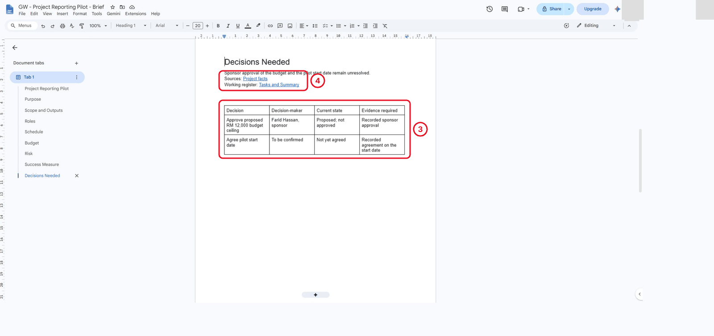

*The decision table and verified source links before editorial review begins.*

5. Use **File**, **Version history**, **Name current version** and name it `Brief checked against source facts`. This baseline precedes the independent editorial revision.

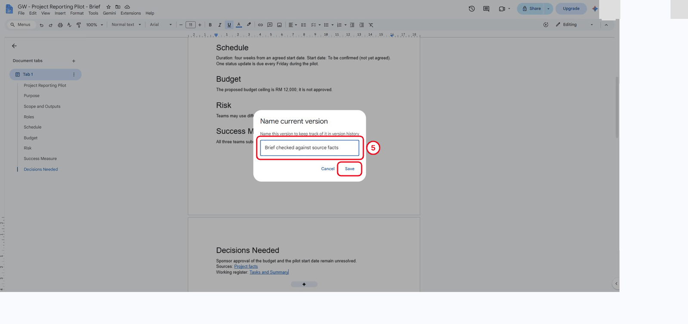

*Name the checked baseline before accepting or rejecting suggestions.*

What should you see?

Eight main headings navigate correctly. The decision table keeps open items open. A file chip provides navigation, not an access grant.

<!-- CAPTURED: core section 2.2 on 17 October 2026; independent challenge and learner timing pending. -->

## 2.3 Practise Review and Export

1. Select a sentence about the budget and add a comment asking what evidence would establish approval. Do not @mention or assign a fictional person.

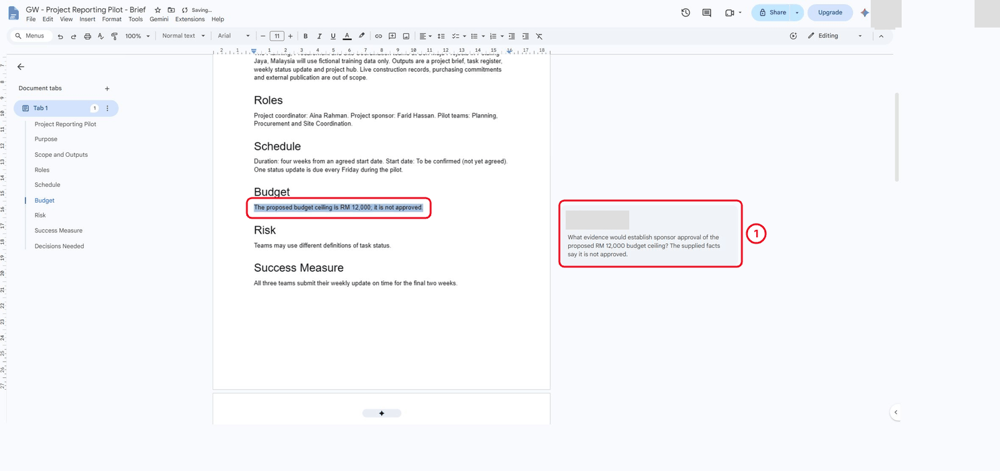

*The first budget evidence question before later suggestions or replies; reviewer identity is masked.*

2. Switch from **Editing** to **Suggesting**. Propose a clearer purpose sentence without changing facts. Inspect the suggestion, then accept it only if the meaning is preserved.

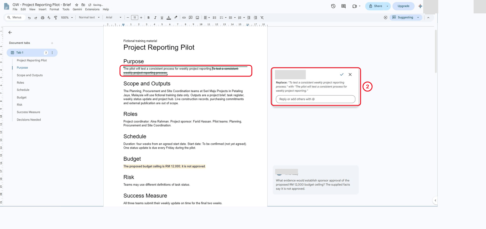

*Inspect the proposed purpose replacement before accepting it; reviewer identity is masked.*

3. Add a second suggestion that incorrectly removes the word **proposed** from the budget. Reject it and explain why this is a factual change rather than an editorial improvement.

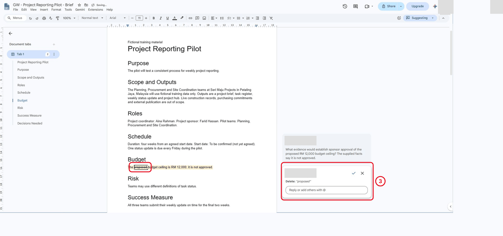

*The incorrect deletion is still pending here, immediately before rejection; reviewer identities are masked.*

4. Reply to the budget comment that approval evidence is still missing. Leave that issue open. Name a new version `Brief reviewed - decisions still open`.

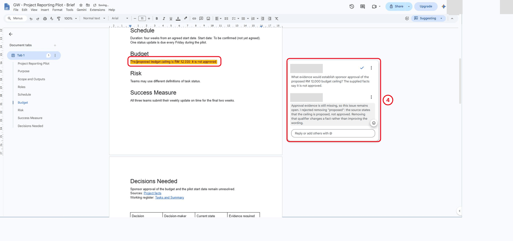

*The restored proposed-budget wording and open review thread after rejecting the factual distortion.*

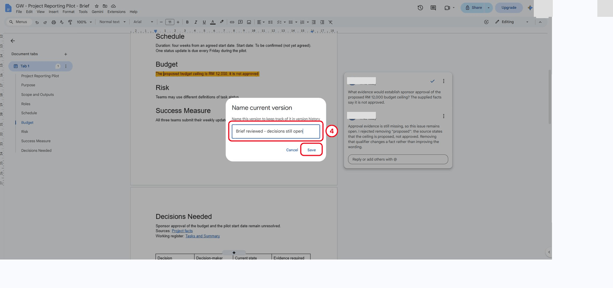

*Name the reviewed version while project decisions remain open.*

5. Choose **File**, **Download**, **PDF Document**. Open the exported PDF and inspect every page, table break and heading. Compare its budget wording with the native document.

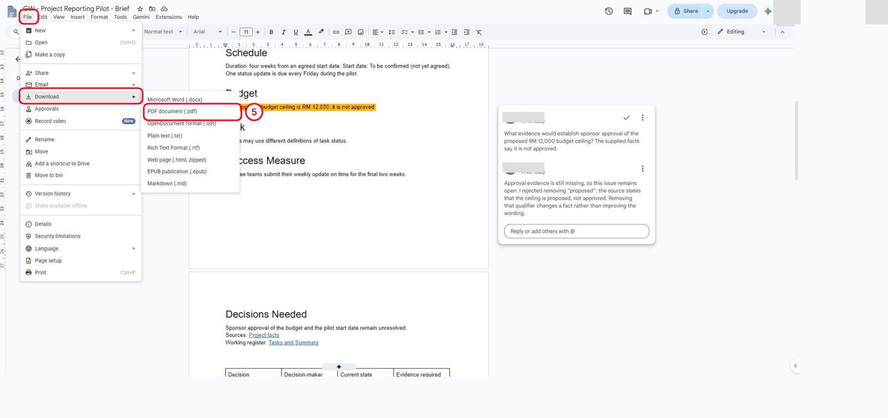

*The real File > Download menu before creating the PDF snapshot.*

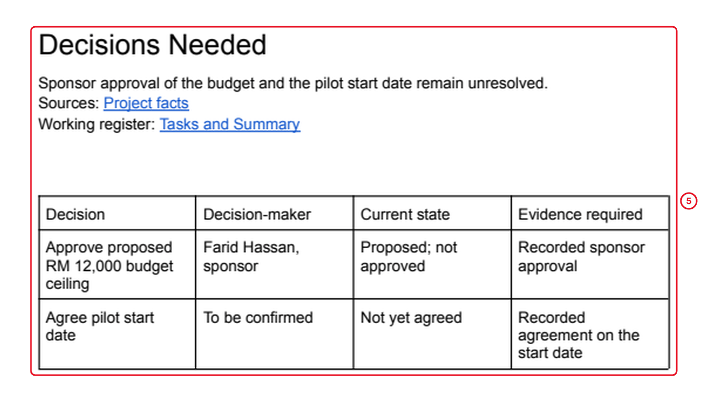

*Page two of the actual exported PDF: the unresolved decisions and table remain readable and together.*

6. Record which file is maintained and which is a snapshot. After a later revision, the PDF must be regenerated; it does not track the native document.

What should you see?

There is a demonstrable accepted suggestion, a rejected factual distortion and an unresolved comment. The PDF is readable and retains the source caveats.

<!-- CAPTURED: core section 2.3 on 17 October 2026; independent challenge and learner timing pending. -->

## Independent Practice

Read review-examples.txt. Create a **Review Response** section identifying each unsupported claim, its correction and the missing evidence. Independently write an 80 to 100 word sponsor update that preserves the proposed budget and unresolved start date. Give a partner the source and your update to audit, or perform a second-pass audit if working alone. Correct one issue or document why no correction was needed, then name the revised version. Do not treat completion of this exercise as sponsor approval.

### Evidence to Hand Over

- Native brief with eight main headings, source links and a decision table.
- Ten factual checks, review response and independently written sponsor update.
- Version names, visible review evidence and inspected PDF.

## Troubleshooting

| Symptom | Repair to investigate |
|---|---|
| Gemini removes known facts | Reject the proposal and use the explicit panel-only recovery request. |
| Headings do not appear in the outline | Apply named paragraph styles to entire heading paragraphs. |
| The PDF differs from the working file | Re-export after changes and inspect the new copy. |

## Lesson Summary

**Check yourself:** Explain one error you found, how you proved the correction, and which downstream result it could affect. A finished-looking file alone is not evidence that it is correct.
