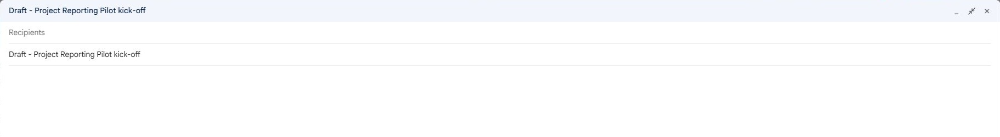
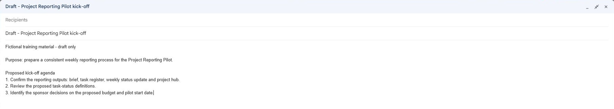
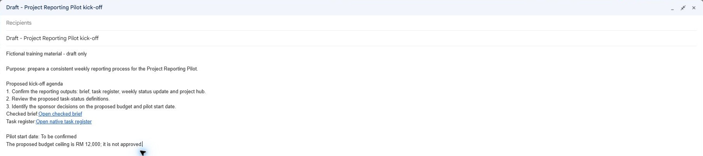
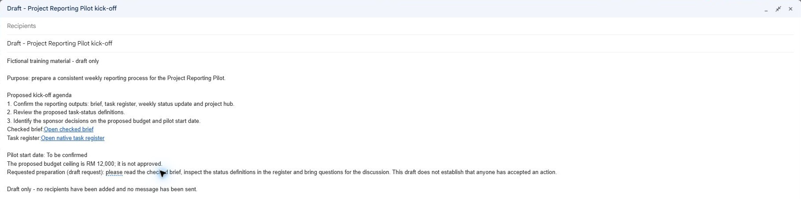
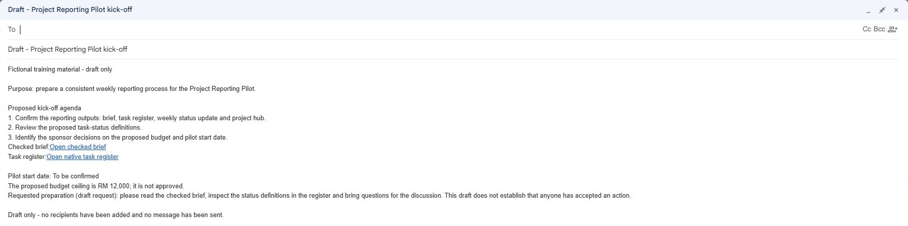
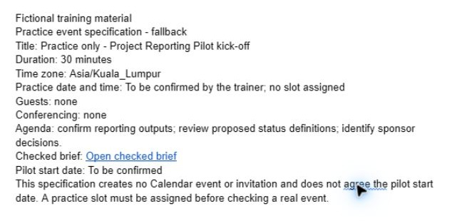
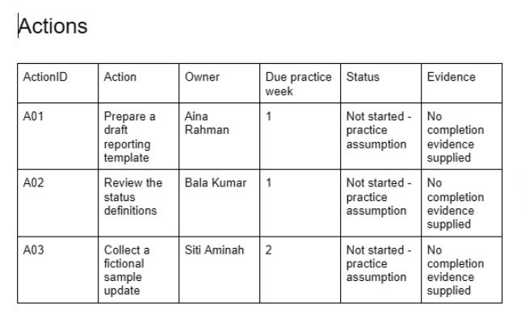
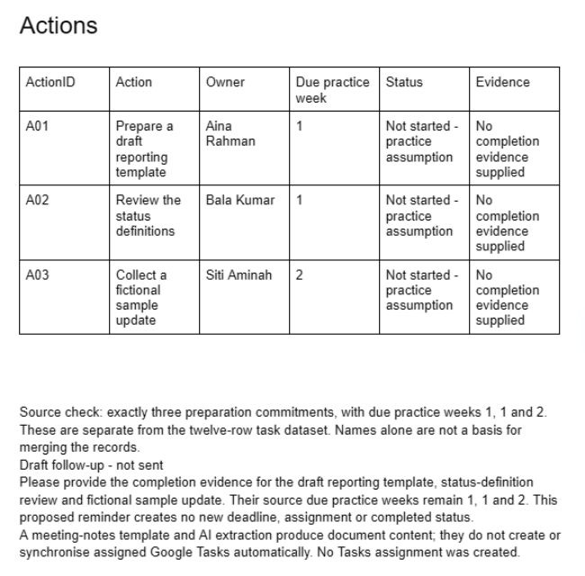
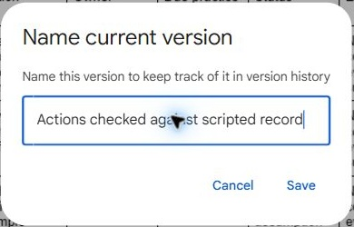

# 03 - Turn a Meeting Record into Accountable Actions

**Your assignment:** Prepare an unsent kick-off message, a private practice event and a checked action register with a follow-up process.

> **Prompts:** the [prompts page](./prompts.md) has every value and prompt for this chapter, each with a Copy button.

**Estimated time:** 55 minutes, planned as 17 demonstration and discussion, 18 guided build, 15 independent practice and 5 verification and repair. Not yet timed with learners. Finish the challenge and checks before moving on; finishing the guided clicks is not completion of the lab.

> **Status:** the unsent Gmail draft was saved and reopened with recipients empty. The meeting record contains three manually checked actions, an unsent follow-up and a named baseline. Calendar uses the documented event-specification fallback because no practice slot was assigned; no actual event, time-zone UI test or invitation is claimed. Independent challenge and learner timing remain unvalidated.

---

## What You Will Learn

- Translate a brief into an agenda and decision-focused message.
- Handle Calendar time zones and scheduling without implying an agreed pilot date.
- Extract owners and relative deadlines while distinguishing actions from decisions.
- Maintain action status and an escalation note without inventing commitments.

## Before You Begin

Use the checked brief and [meeting-record.txt](../../shared/sample-files/meeting-record.txt). You need Gmail, Calendar and Docs. Use a trainer-assigned future practice slot for the Calendar test; this is not the pilot start date. If Calendar is unavailable, build and label an event specification in the meeting Doc instead.

Use the [prompts page](./prompts.md) and [shared practice files](../../shared/sample-files/README.md). Keep fictional role names as text. Use only trainer-assigned test identities for any access test.

## 3.1 Prepare the Communication

1. In Gmail choose **Compose**, leave recipients blank and use subject `Draft - Project Reporting Pilot kick-off`.

*Fresh unsent draft with an empty recipient field, before body content is added.*

2. Write the purpose and a three-part agenda: confirm reporting outputs, review proposed status definitions and identify sponsor decisions.

*Purpose and agenda before links, approval caveats and preparation instructions are added.*

3. Include links to the checked brief and tracker. Write **Pilot start date: To be confirmed** and preserve the proposed budget wording.

*Source links and unresolved project decisions before the preparation paragraph.*

4. Add a requested preparation paragraph: read the brief, inspect the status definitions and bring questions. Treat this as a draft request, not proof that someone accepted an action.

*The preparation request is labelled as a draft, with no recipients or accepted commitments.*

5. Close the compose window, reopen the saved draft and check subject, links and unresolved decisions. Keep recipients empty and leave it unsent.

*Reopened saved draft with the To field empty; no message has been sent.*

What should you see?

The saved draft contains a purpose, agenda, preparation request and useful links. It does not turn a proposed date or budget into a commitment.

<!-- CAPTURED: core section 3.1; independent challenge and learner timing pending. -->

## 3.2 Prepare a Private Calendar Test

1. In Calendar choose **Create**, then **Event**. Title it `Practice only - Project Reporting Pilot kick-off`.

2. Use the assigned 30-minute practice slot. Check the event time zone against **Asia/Kuala_Lumpur**, and inspect whether the displayed start and end match the intended local time.

3. Leave guests empty. Remove automatically added conferencing if it is not needed for this private test. Add the agenda and brief link in the description, labelled as fictional practice.

4. Save the private event, reopen it and compare its title, duration, local time, guest list and description with your draft. If the class has no assigned slot, keep an event specification in the Doc instead of choosing a real project date.

5. Record why scheduling this private practice item does not agree the pilot start date. After the lab, delete only your own practice event if it is no longer needed.

*The permitted event-specification fallback before the meeting record or action table exists; no Calendar event is claimed.*

What should you see?

A private practice event, or clearly labelled fallback specification, has the correct duration and time zone. No guest has been invited.

<!-- CAPTURED: section 3.2 documented event-specification fallback only; real Calendar event and time-zone UI checks pending an assigned slot. -->

## 3.3 Create and Verify the Action Register

1. Create `GW - Pilot Meeting Record` in **02 Working**. Add headings Agenda, Discussion, Decisions Needed and Actions. Insert the supplied scripted record under Discussion and link to the brief.

Keep **Actions** and its table together; insert a page break before the heading if needed.

2. Under Actions insert a table: ActionID, Action, Owner, Due practice week, Status and Evidence. Manually extract the three preparation commitments, or use the supplied extraction prompt then audit each row.

3. Compare every owner and due week against the source. Distinguish these three preparation commitments from the separate 12-row task dataset. Do not merge them by matching names.

4. Set action status to **Not started - practice assumption** and evidence to **No completion evidence supplied**. Keep budget approval and start-date agreement in Decisions Needed, not in the completed-action list.

*Exactly three scripted actions before adding the follow-up paragraph; status and missing evidence are explicit.*

5. Add a draft follow-up paragraph for any action with no completion evidence. A reminder is proposed communication, not a new due date or a sent message.

*The action table and unsent follow-up preserve source weeks and do not create assignments or deadlines.*

6. Name a version `Actions checked against scripted record`. Explain why a meeting-notes template and an AI extraction do not create or synchronise assigned Tasks automatically.

*Name the action baseline after checking all three source commitments.*

What should you see?

Exactly three source commitments have traceable owners and due weeks. Unknown completion status is labelled as a practice assumption, and both project decisions remain unresolved.

<!-- CAPTURED: core section 3.3; independent challenge and learner timing pending. -->

## Independent Practice

Use the Lab 3 change card in masterclass-challenges.txt. A later message says that Bala’s review is delayed, but provides no replacement week. Update the action record without inventing a deadline. Prepare an unsent escalation paragraph for the coordinator and add a proposed decision-focused agenda for the next review. Demonstrate which source changed, which status is your assumption and which items still need confirmation. Recheck the private event for an accidental guest or changed time zone.

### Evidence to Hand Over

- Reopened unsent Gmail draft and a checked private event or fallback specification.
- Meeting record with three traceable actions and two unresolved project decisions.
- Delay-handling revision, escalation paragraph and clear separation of source facts and assumptions.

## Troubleshooting

| Symptom | Repair to investigate |
|---|---|
| Calendar fills an unexpected time | Check the event time zone and the assigned practice slot before saving. |
| AI supplies a new deadline | Remove it unless the change card supplies one; retain **To be confirmed**. |
| Action extraction seems to assign Tasks | Inspect the actual destination; extracted text is not an assigned task. |

## Lesson Summary

**Check yourself:** Explain one error you found, how you proved the correction, and which downstream result it could affect. A finished-looking file alone is not evidence that it is correct.
