# 04 - Clean, Calculate and Stress-Test a Reporting Dashboard

**Your assignment:** Build a validated tracker, cost calculations, two summaries and a linked chart that survives a new-record test.

> **Prompts:** the [prompts page](./prompts.md) has every value and prompt for this chapter, each with a Copy button.

**Estimated time:** 80 minutes, planned as 24 demonstration and discussion, 30 guided build, 20 independent practice and 6 verification and repair. Not yet timed with learners. Finish the challenge and checks before moving on; finishing the guided clicks is not completion of the lab.

> **Status:** core sections 4.1–4.3 executed and captured with the twelve-task baseline: preserved intake strings, rejecting validation, relative row formulas, reconciled counts and costs, two charts, a saved filter view and a changed/restored linked-chart test. The new-record card and conditional-formatting test were also executed as a scripted reference run, preserving each before/after stage. T013 is retained for the next lab. This does not establish independent learner performance or classroom timings; the optional pivot-table extension remains untested.

---

## What You Will Learn

- Audit text categories and apply validation.
- Use relative references, COUNTIF and SUMIF for a live summary.
- Distinguish task costs, variance and an unapproved budget ceiling.
- Investigate range failures and verify a linked chart after changing records.

## Before You Begin

Use your native tracker from Lab 1, or convert a fresh [TaskRegister.xlsx](../../shared/sample-files/TaskRegister.xlsx). Use commas in formulas; use semicolons for argument separators if required by your locale. You need the checked brief as a linked-chart destination.

Use the [prompts page](./prompts.md) and [shared practice files](../../shared/sample-files/README.md). Keep fictional role names as text. Use only trainer-assigned test identities for any access test.

## 4.1 Audit and Validate the Input

1. In **Tasks** inspect A1:H13. Freeze row 1 using **View**, **Freeze**, **1 row**. Format G:H as currency with a clearly identified RM unit.

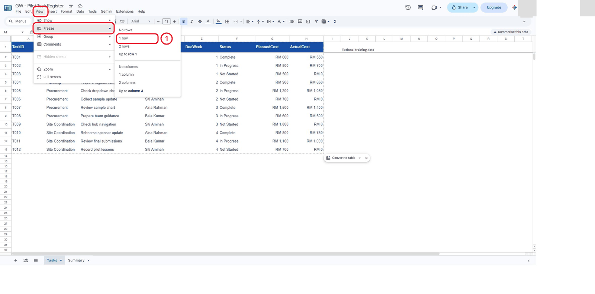

*View > Freeze > 1 row before creating any intake tab, validation or variance formulas.*

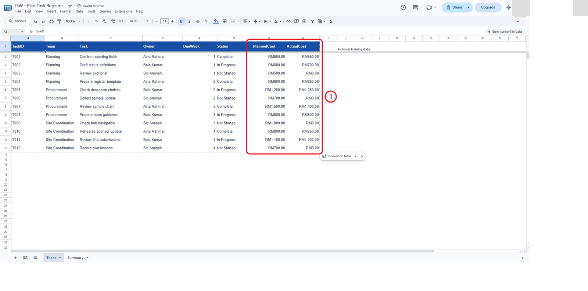

*The twelve source tasks with RM cost formatting before later calculations or charts.*

2. Create a tab named **Status Intake**. Type the headings from Part 3 of the [prompts page](./prompts.md) in A1:D1, then paste the four dirty records from the Lab 4 card in [masterclass-challenges.txt](../../shared/sample-files/masterclass-challenges.txt) into A2:B5. Preserve the raw status in column B; add Normalised status in C and Reason in D.

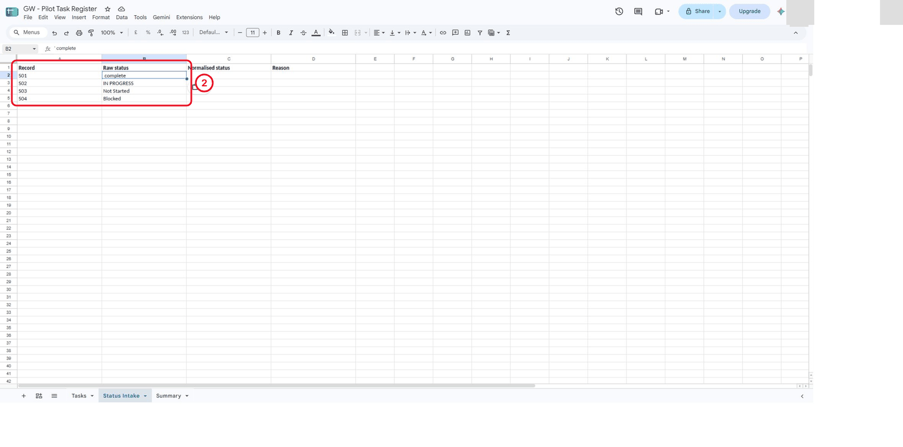

*Raw intake values are preserved while the normalised-status and reason cells are still blank.*

If pasting trims S01’s leading space, enter it as literal text with a leading apostrophe: `' complete`. Verify that the stored value still begins with a space. Keep this raw value unchanged when recording its correction in column C.

3. Compare each raw entry with the definitions in [reporting-guidance.txt](../../shared/sample-files/reporting-guidance.txt). Remove unnecessary spaces and standardise case only when the intended category is clear. Leave **Blocked** as **Needs clarification** rather than silently treating it as complete.

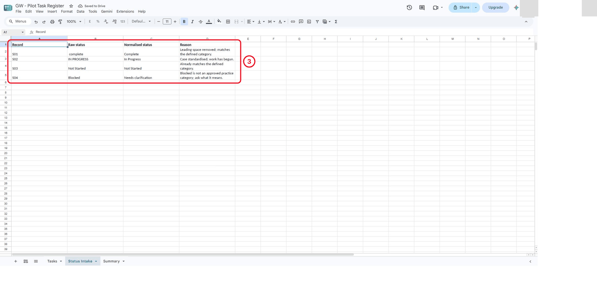

*The completed intake audit explains each correction and preserves Blocked for clarification.*

4. On **Tasks** select F2:F13. Choose **Data**, **Data validation** and add a dropdown for Complete, In Progress and Not Started. Select the setting that rejects invalid input.

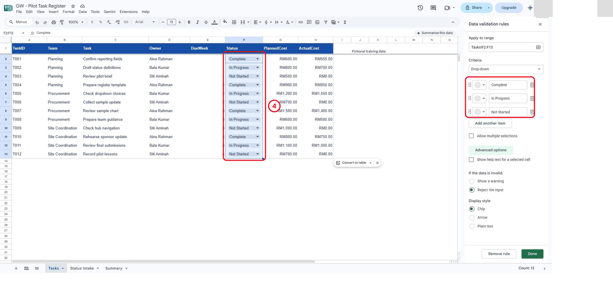

*Validation applies to Tasks F2:F13 with only the three defined statuses.*

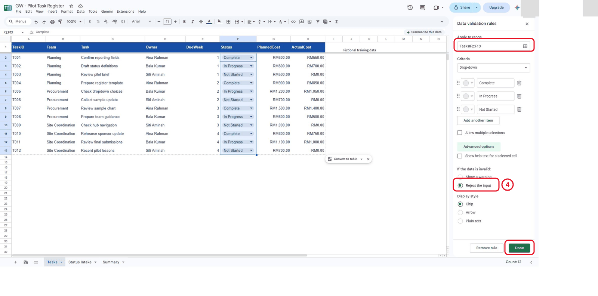

*Advanced options explicitly select Reject the input before the invalid-value test.*

5. Test an invalid entry on a spare cell with the copied validation rule. Undo or clear the test. Recheck that all 12 original task statuses are unchanged.

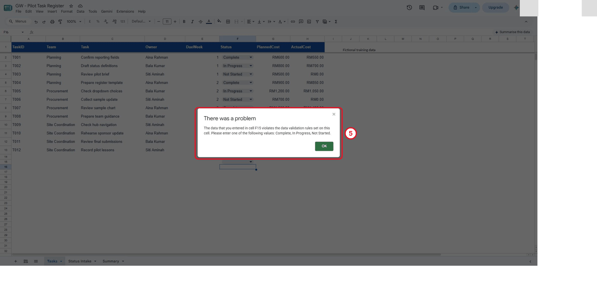

*The copied rule rejects the invalid F15 entry; original task statuses are untouched.*

6. Add **Variance** in I1. In I2 enter `=H2-G2` and fill to I13. Inspect I3 to prove that both row references moved. Add a note that negative values mean actual costs are below planned costs, not proof of a realised saving.

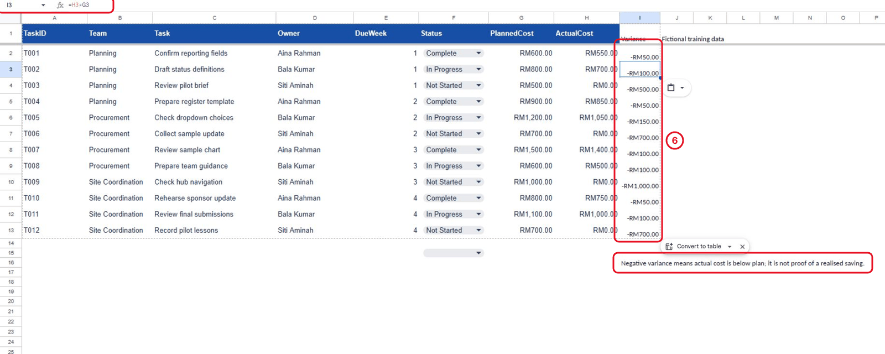

*I3 uses H3 minus G3; the source still has twelve tasks and no later new-record card.*

What should you see?

Twelve source tasks remain intact, each variance calculates from its own row, and the intake audit explains why an ambiguous category needs clarification.

<!-- CAPTURED: core section 4.1, twelve-task baseline; new-record challenge and learner timing pending. -->

## 4.2 Build Two Summaries

1. On **Summary** use the existing status labels in A2:A4. In B2 enter `=COUNTIF(Tasks!$F$2:$F$13,A2)` and fill to B4. Add **Total tasks** in A6 and `=SUM(B2:B4)` in B6.

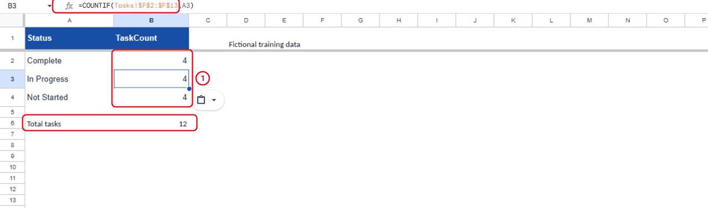

*The first status counts are 4, 4 and 4, totalling 12, before any team-cost table or chart exists.*

2. In D1:G1 enter Team, Planned, Actual and Variance. In D2:D4 enter Planning, Procurement and Site Coordination.

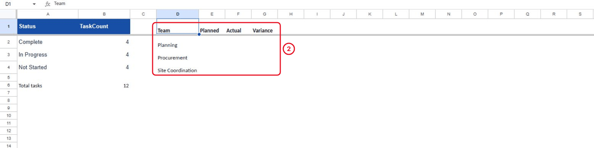

*Team-summary labels before adding SUMIF calculations.*

3. In E2 enter `=SUMIF(Tasks!$B$2:$B$13,D2,Tasks!$G$2:$G$13)`. In F2 enter `=SUMIF(Tasks!$B$2:$B$13,D2,Tasks!$H$2:$H$13)`. In G2 enter `=F2-E2`. Fill E2:G2 down to row 4.

4. Type `Total` in D6 and add totals in E6:G6 using SUM. In H2 type `Independent checks`, then use H3:I7 to total Tasks G2:G13 and H2:H13 directly and compare them with the team totals (labels in Part 2 of the prompts page).

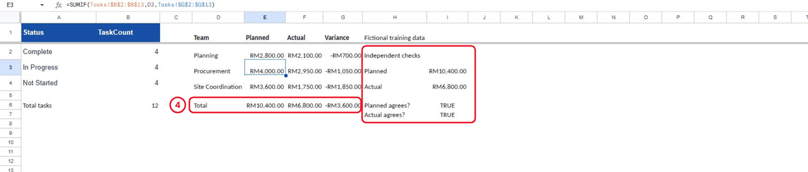

*RM 10,400 planned and RM 6,800 actual reconcile to independent source sums before charts are inserted.*

5. Select A1:B4 and choose **Insert**, **Chart**. Use a column chart titled `Pilot task status`. Build a second chart from D1:F4 to compare planned and actual costs by team.

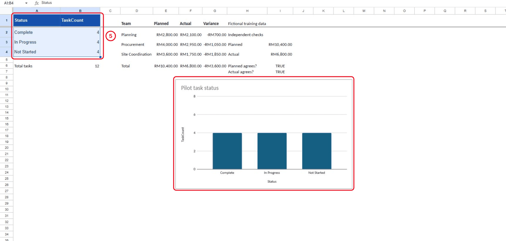

*The first status chart exists before the second cost chart is created.*

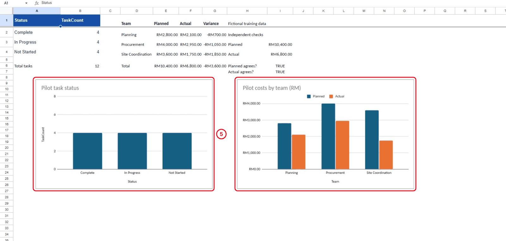

*Both source charts after setting titles and separating their positions.*

Current UI: choose **Data**, **Create filter view**, then **Save view** to name it. With a header selected, **Ctrl+Alt+R** opens its filter menu.

6. Create a named **Filter view** through **Data** for the Procurement rows with status other than Complete. Close the view and confirm all 12 source records are still present. Filtering must not delete records.

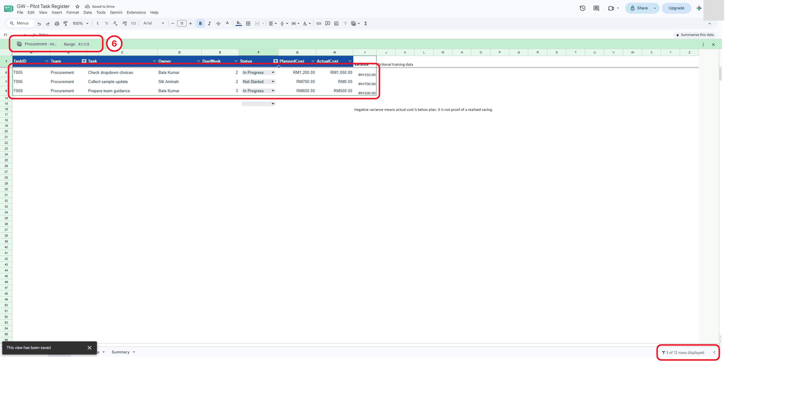

*The saved Procurement view shows only T005, T006 and T008; it changes visibility, not records.*

What should you see?

At baseline the three status counts are 4 each, planned costs total RM 10,400 and actual costs total RM 6,800. Team totals reconcile to the source. A filter view changes visibility rather than the underlying record set.

<!-- CAPTURED: core section 4.2, twelve-task baseline; new-record challenge and learner timing pending. -->

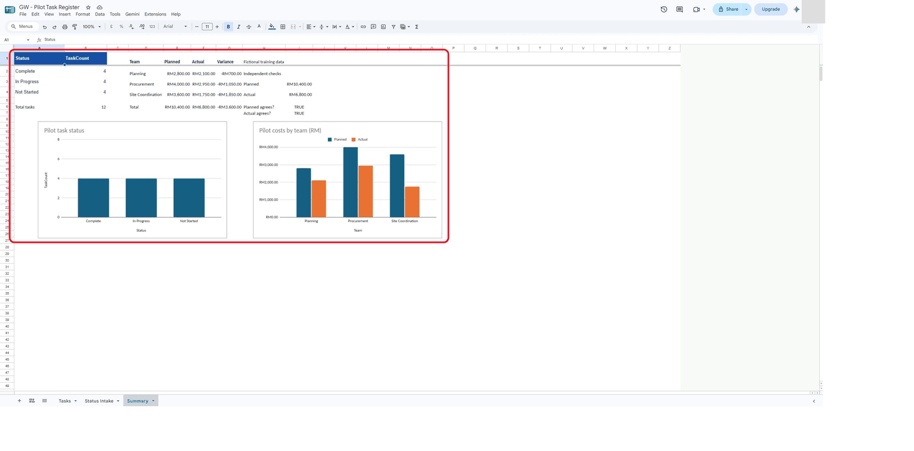

*The reconciled twelve-task dashboard after closing the filter, before any downstream status-change test.*

## 4.3 Verify the Downstream Snapshot

1. In the chart's three-dot menu choose **Copy chart**. In the brief, type `Status Snapshot` on a new line, then paste below it. Choose **Link to spreadsheet** when offered. Verify it points to your working tracker.

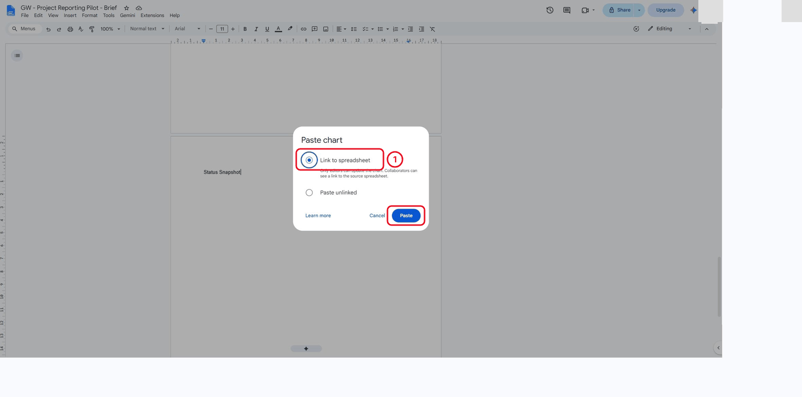

*Link to spreadsheet is selected before the chart is inserted into the brief.*

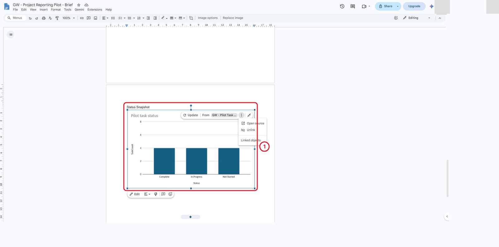

*The linked baseline chart shows 4, 4 and 4 before changing T003; its source opens the working tracker.*

2. Temporarily change T003 from Not Started to Complete in **Tasks**. Inspect the source summary before touching the document.

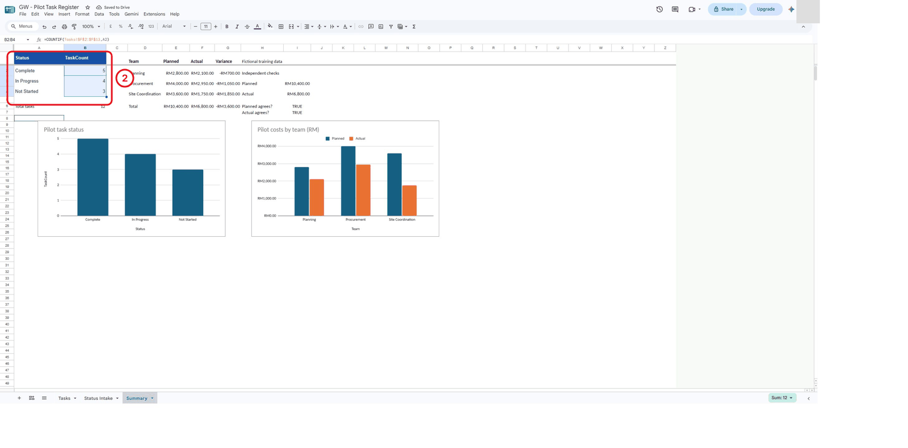

*The source recalculates to 5, 4 and 3 before the brief chart is refreshed.*

3. In the brief select the linked chart and choose **Update** if offered. Compare its values with the source, then restore T003 and refresh again.

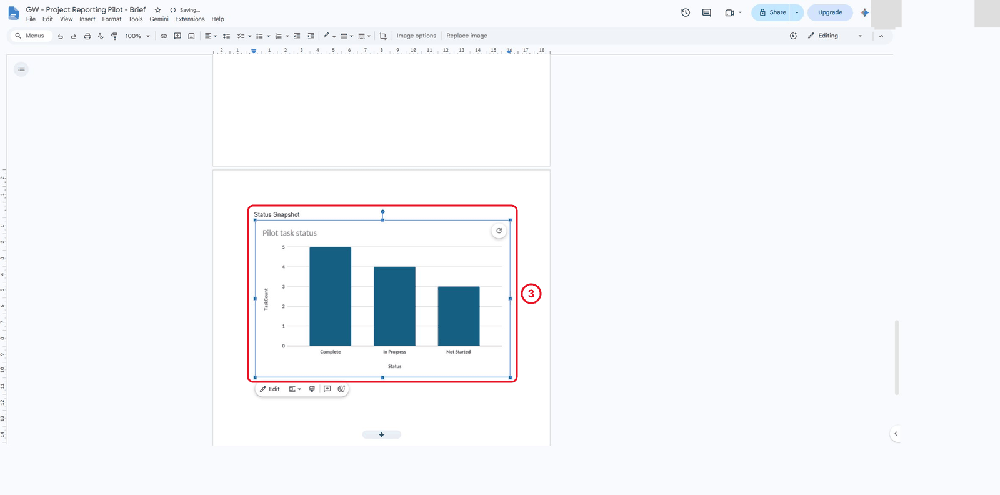

*The brief chart after refreshing the temporary change, before restoring the source.*

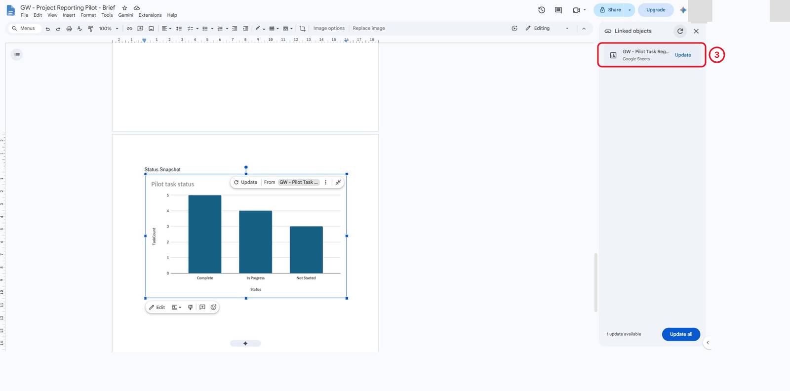

*Linked objects can refresh its status and offer the update after T003 has been restored.*

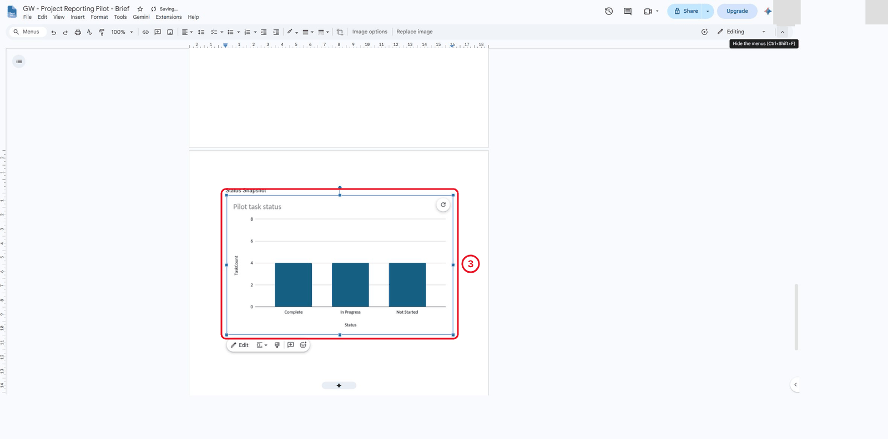

*The brief chart returns to 4, 4 and 4 after refreshing the restored source.*

If **Update** is not yet offered after restoration, open **Linked chart options**, **Linked objects**, then **Refresh** and **Update chart**. Verify the destination values after updating.

4. Under the label `Refresh Log`, add a 4-column, 3-row table to the brief: Source change, Source checked, Destination refreshed and Result. Record both the changed and restored states.

5. Explain that a reader can see a linked chart in a document without necessarily having access to the source spreadsheet. Use aggregated fictional data and inspect the intended document audience.

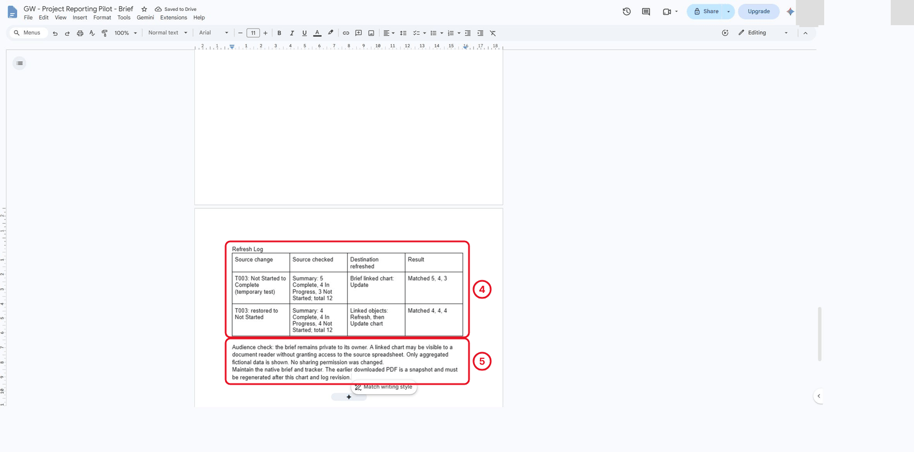

*Refresh log records both checks and the distinction between chart visibility and source access.*

What should you see?

The source and destination both change to 5, 4, 3, then return to 4, 4, 4. The refresh log records a check rather than assuming that pasted content is always current.

<!-- CAPTURED: core section 4.3, twelve-task baseline; new-record challenge and learner timing pending. -->

## Independent Practice

Use the Lab 4 card in [masterclass-challenges.txt](../../shared/sample-files/masterclass-challenges.txt) without copying a completed formula solution.

1. Add T013 as a new row in **Tasks**, with the supplied fields. Extend the status validation and variance formula to that row.

*T013 has been added and its row formula and validation extended; the summary ranges have not yet been repaired.*

2. Predict which status count and cost total should change. Inspect whether the existing fixed-range formulas actually include the row.

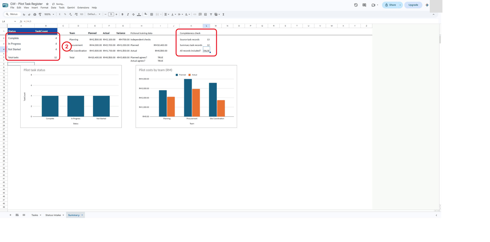

*The completeness test exposes 13 source records but only 12 summary records before repair.*

3. Repair the COUNTIF, SUMIF and independent control ranges to include all 13 records. Explain why adding the row did not automatically repair every reference. Recheck both charts and refresh the brief.

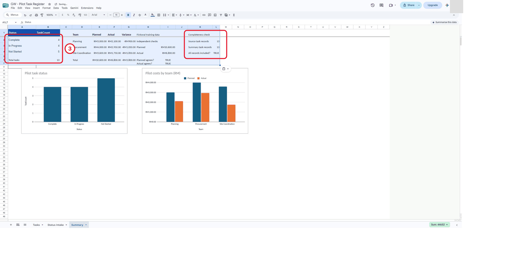

*Repaired ranges produce 4, 4, 5 and RM 10,600 planned while all reconciliation and completeness checks pass.*

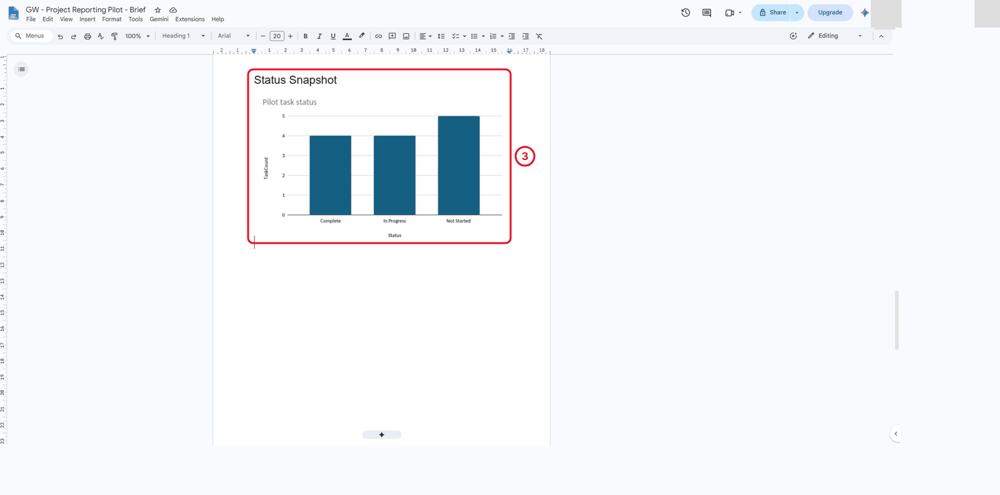

*The brief chart reflects the repaired thirteen-task summary with 4, 4 and 5.*

4. Apply conditional formatting to I2:I14 so positive actual-minus-planned variance is easy to identify. Use a temporary over-plan value on the new record to test it, then restore the card’s value and prove restoration.

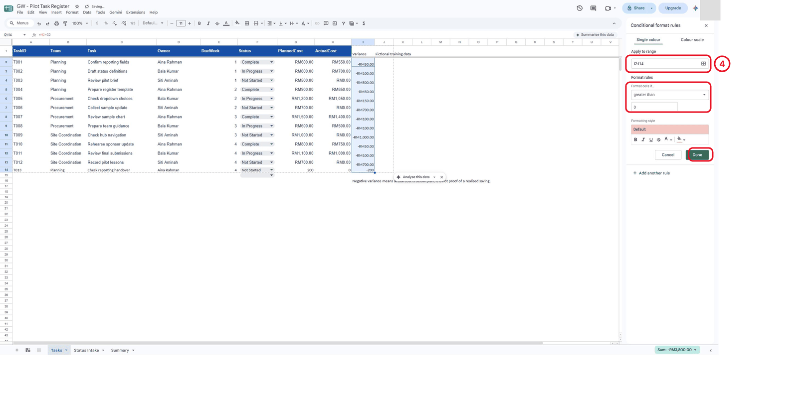

*The positive-variance rule covers I2:I14 and uses a red background when the value is greater than zero.*

*Temporary T013 actual cost 250 produces positive variance 50 and the red highlight, before restoring the card value.*

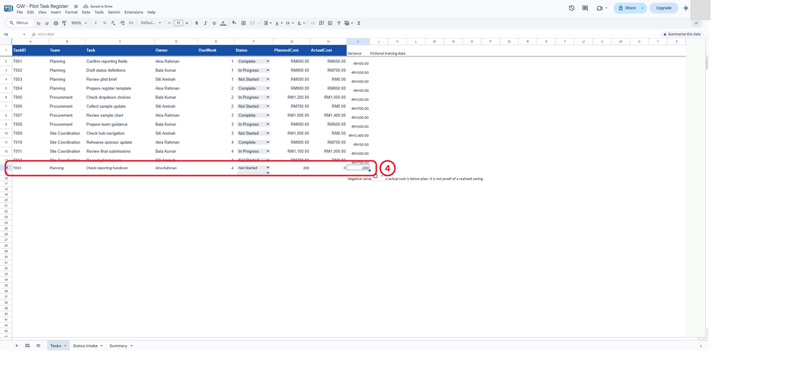

*Restored T013 actual cost 0 produces variance -200 and clears the positive highlight.*

5. Leave T013 in place for Labs 5 and 6. Record the final totals, row count and the changed ranges in your refresh log.

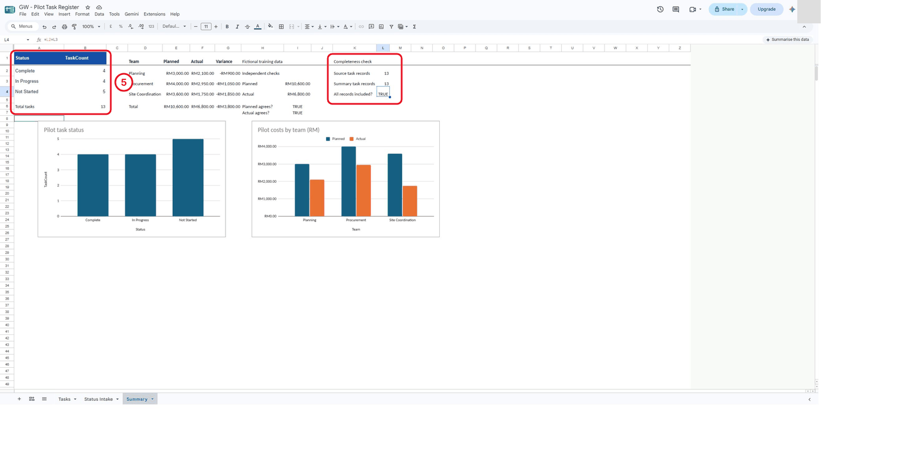

*Final thirteen-task source after restoration: 4, 4, 5 with RM 10,600 planned, RM 6,800 actual and variance -RM 3,800.*

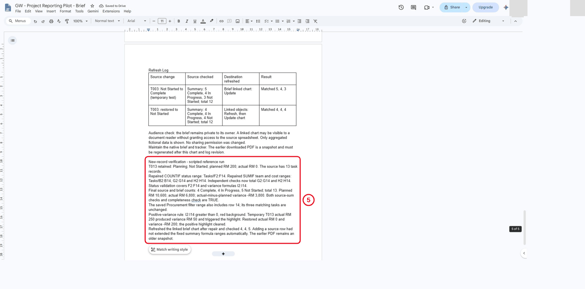

*The new-record log records the repaired ranges and both the temporary and restored variance tests.*

If you finish early, build a pivot table that summarises planned and actual cost by team and reconcile it with SUMIF. This is an extension, not a replacement for the range-repair challenge.

### Evidence to Hand Over

- Status Intake audit with justified normalisation and an unresolved category.
- 13-row tracker, validation, row formulas, status summary, team costs and two charts.
- Independent reconciliation and a refresh log showing the baseline test and final new-record state.

## Troubleshooting

| Symptom | Repair to investigate |
|---|---|
| The new task is absent from a chart | Inspect the summary formula ranges first, then the chart source range. |
| SUMIF gives zero for a team | Compare the team text and criteria cell; inspect spaces and numeric cost types. |
| Every variance uses row 2 | Remove accidental absolute row references and inspect a copied formula. |
| A pasted chart has no Update control | Verify whether it was inserted as a linked object rather than an image. |

## Lesson Summary

**Check yourself:** Explain one error you found, how you proved the correction, and which downstream result it could affect. A finished-looking file alone is not evidence that it is correct.
