# 05 - Build an Evidence-Based Sponsor Update

**Your assignment:** Create and rehearse a five-slide decision-focused update with live data, source links and checked speaker notes.

**Target allocation:** 60 minutes: 18 demonstration and discussion, 22 guided build, 15 independent challenge, 5 verification and repair. These are design allocations, not measured completion times. Finish the challenge and checks before moving on; finishing the guided clicks is not completion of the lab.

**Status:** five-slide native reference deck captured in sequence, with source notes, two linked charts, editable process shapes, presentation inspection, a named baseline and two inspected five-page PDF snapshots. The cost-correction card was executed as a scripted prerequisite for Lab 6. Partner rehearsal, independent reviewer comparison, independent learner performance and classroom timings remain unvalidated.

## What You Will Learn

- Select a message and layout for a specific audience.
- Use linked evidence and distinguish totals from unsupported benefits.
- Create a repeatable visual style and readable chart.
- Handle a change request, refresh evidence and check an exported deck.

## Before You Begin

Use the checked brief and the 13-task tracker from Lab 4. Recovery: convert the starter workbook and complete the Lab 4 new-record card before preparing the deck. If Slides AI features are unavailable, author the same deck manually.

Use the [copy-paste page](./prompts.md) and [shared practice files](../../shared/sample-files/README.md). Keep fictional role names as text. Use only trainer-assigned test identities for any access test.

## 5.1 Plan the Story Before Formatting

1. Create `GW - Pilot Sponsor Update` in **02 Working**. Plan five slides: Purpose and scope; Current task status; Planned and actual costs; Risk and response; Decisions requested.

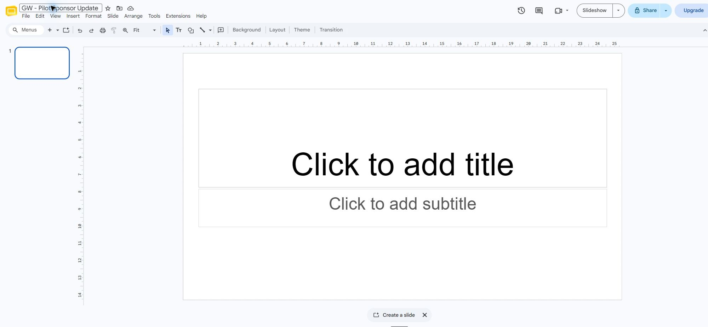

2. For each slide write one audience takeaway and its source in the speaker notes. Label proposed mitigations as proposals.

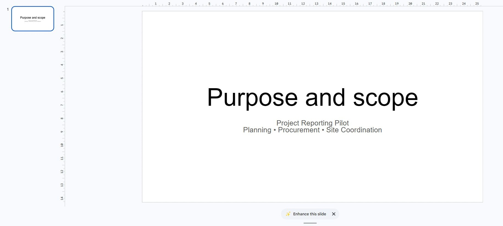

3. Use the optional AI outline prompt only after pasting checked facts and final summary values. Compare the outline with your five planned messages; reject invented progress percentages or approvals.

4. Write the two decision requests explicitly. Keep budget approval and pilot start-date agreement unresolved. Do not present a Calendar practice slot as the project schedule.

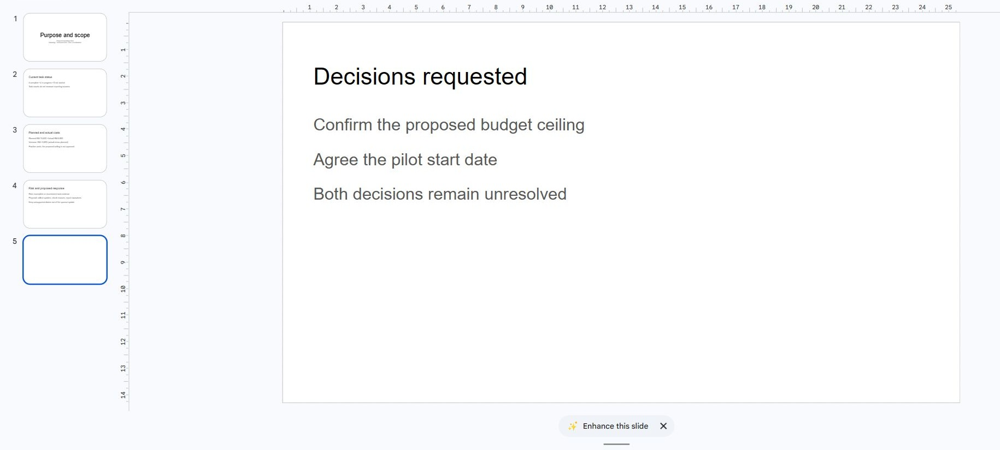

What should you see?

The deck tells a decision-focused story with a source for every numeric or factual claim. Task counts do not establish a time-based success measure.

<!-- CAPTURED: 5.1 blank deck, first message and five-message source plan. -->

## 5.2 Build Readable and Traceable Slides

1. Choose a simple theme. Use consistent title and body layouts, readable text sizes and a restrained colour palette. Replace dense prose with short points, retaining factual qualifications.

2. On slide 2 choose **Insert**, **Chart**, **From Sheets** and select your working tracker’s status chart with **Link to spreadsheet** enabled. On slide 3 insert the team-cost chart the same way.

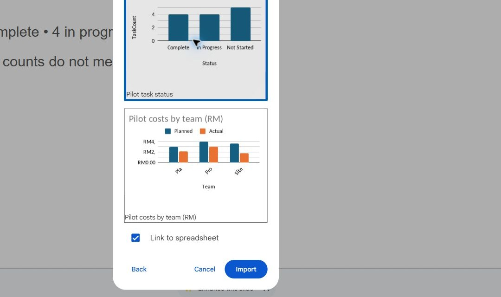

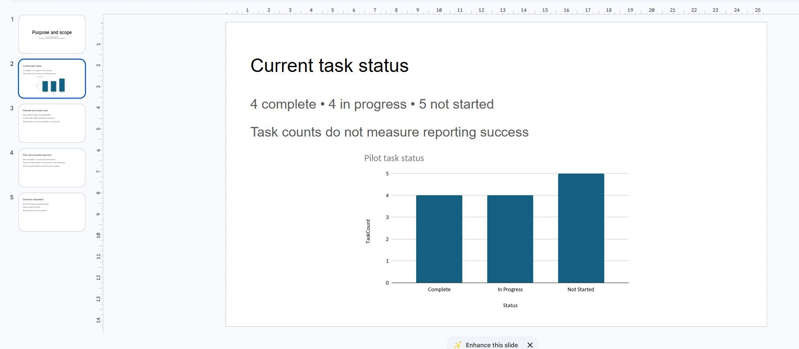

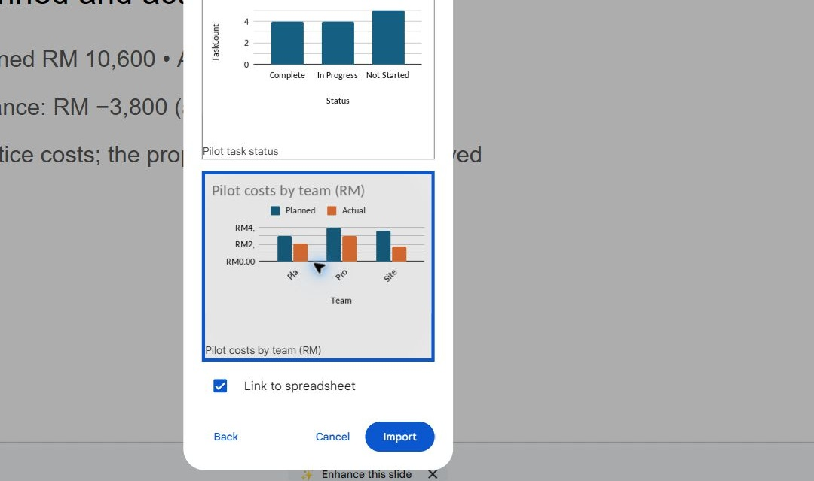

3. Check category labels, title and contrast at presentation size. Avoid a colour-only status distinction by retaining explicit labels.

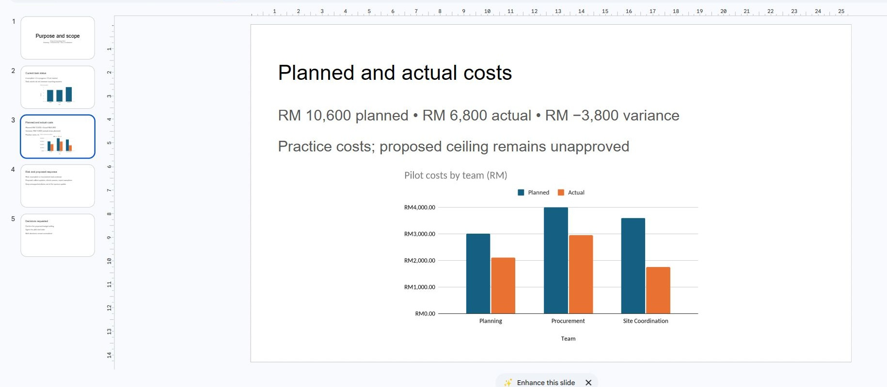

4. In speaker notes record the source link, 13-task dataset scope and the actual-minus-planned variance definition. State that the task costs are practice data and the proposed ceiling is not approved.

5. Create a simple three-step process diagram with shapes for Collect, Check and Report. Give it a short text explanation. If using a decorative AI image, label it illustrative and record its origin; it must not substitute for data.

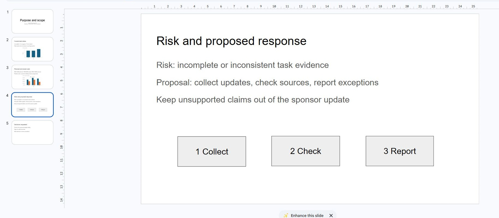

6. Use **Present** to check every slide. Inspect any clipped labels and notes that accidentally became slide text. Remove effects that make the chart harder to read.

What should you see?

Five slides have coherent layouts, two linked charts and useful notes. Both source scope and unresolved decisions are clear at presentation size.

<!-- CAPTURED: 5.2 linked-chart selections, baseline layouts, editable process and presentation check. -->

## 5.3 Rehearse, Review and Export

1. Deliver a two-minute sponsor update to a partner or rehearse aloud. Explain the evidence and ask for the two unresolved decisions.

2. Ask the reviewer to identify one unsupported statement and one unclear label. If none is found, have them point to the evidence for the most consequential claim.

3. Correct the deck and name the version `Sponsor update - checked baseline` through **File**, **Version history**.

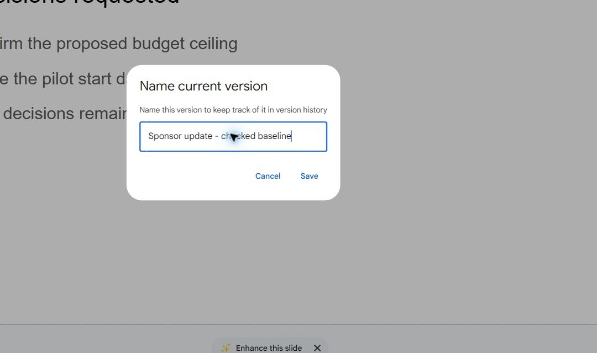

4. Download a PDF through **File**, **Download**. Open every page and inspect charts and layout. Record that the PDF is a dated snapshot and will need a new export after source updates.

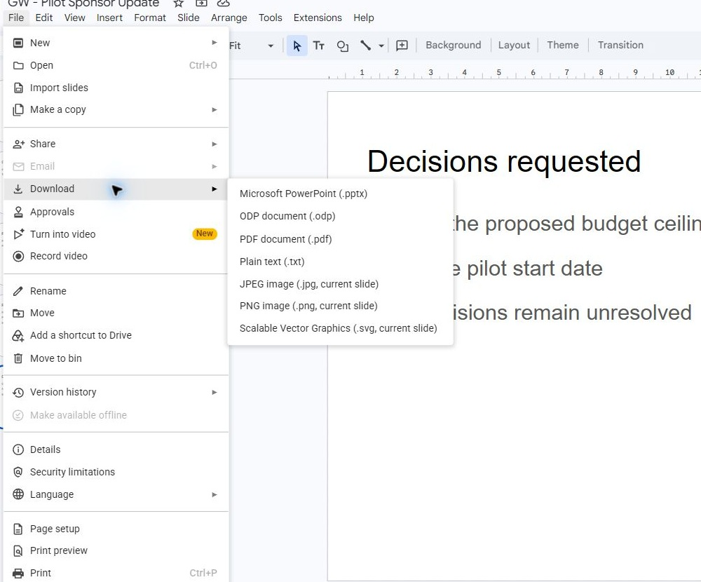

What should you see?

The learner can explain the figures and limitations without reading raw slide text. The exported copy matches the checked native baseline.

<!-- CAPTURED: version, PDF menu and actual PDF. Partner rehearsal and reviewer validation pending. -->

## Independent Challenge

Use the Lab 5 cost-correction card.

> **Reference run:** The following captures are a scripted reference run; learners should make their own predictions before inspecting the result.

1. Locate T013 in the source and record its current actual cost before editing.

2. Correct only T013 ActualCost from 0 to 150. Predict the affected team and totals. Keep status and planned cost unchanged.

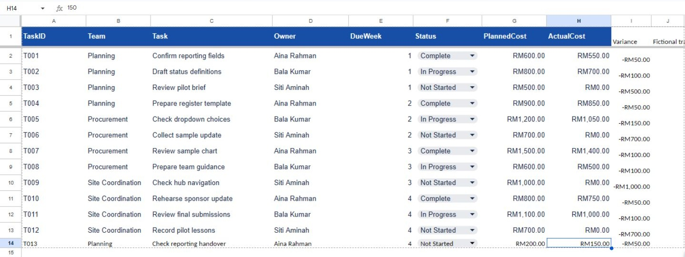

3. Reconcile the summary and independent checks before refreshing a report.

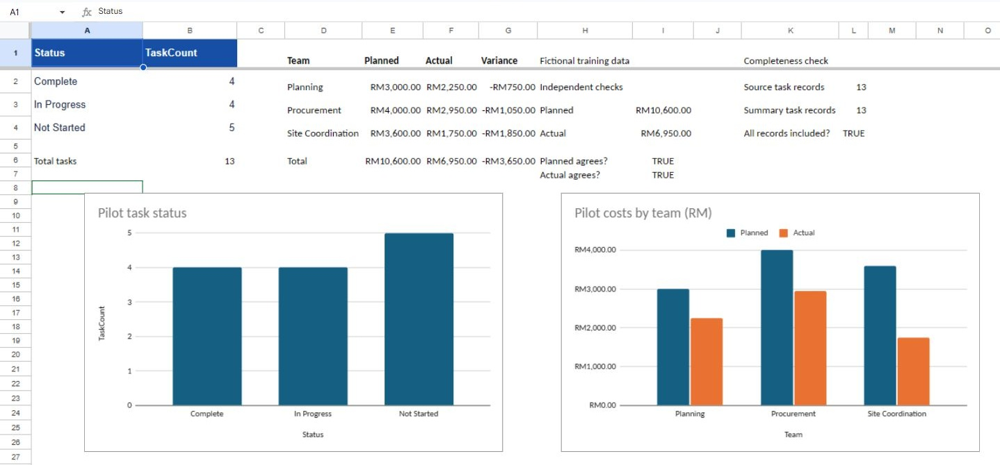

4. In Slides open **Tools**, **Linked objects**, choose **Refresh**, then **Update all** for available changes. Check both chart links. A cost-only correction leaves the status chart unchanged, so only one update may be offered.

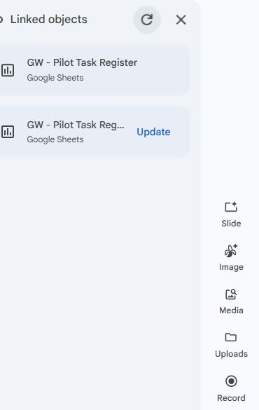

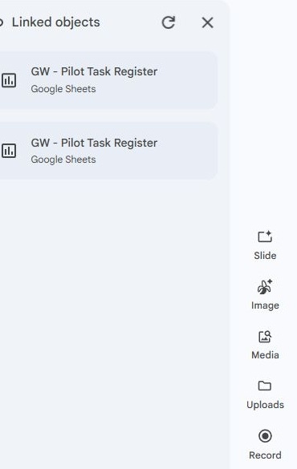

5. Rewrite the cost-slide takeaway and speaker notes to explain the changed figure consistently.

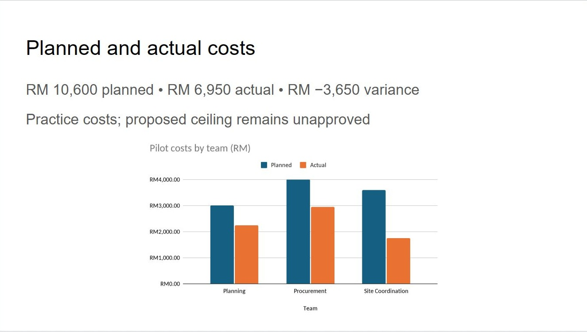

6. Refresh the brief's linked-object panel too. Its status chart should still show 4, 4, 5. Record why no status change was expected and update the refresh log.

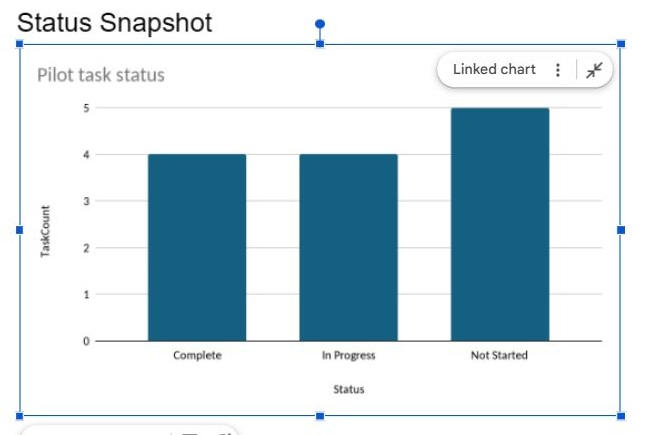

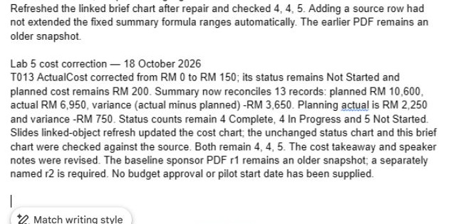

7. Check whether the previously downloaded PDF changed. It is a snapshot: keep `Pilot-Sponsor-Update-r1.pdf`, then issue `Pilot-Sponsor-Update-r2.pdf` from the refreshed native deck. Open every revised page and compare the cost slide with the source.

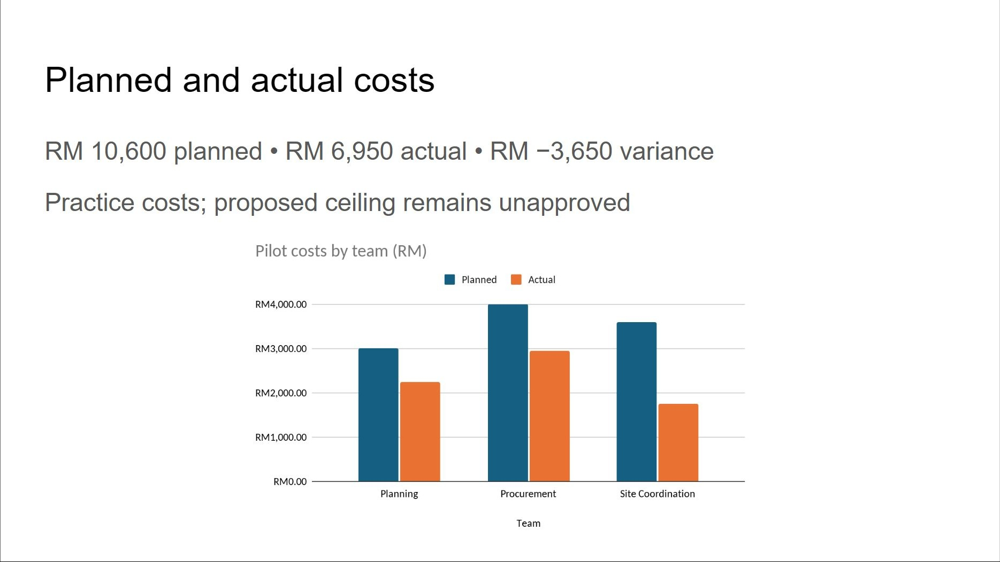

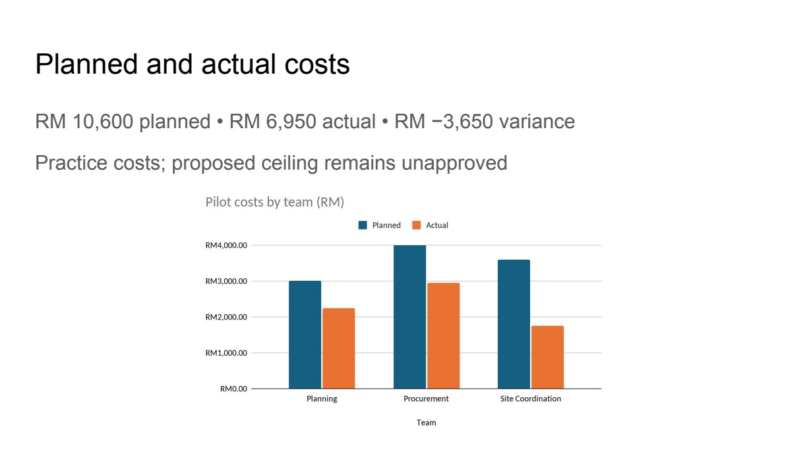

8. Ask a reviewer to compare source, native deck and revised export. Leave T013 with actual cost 150 for the handover lab. Record the review result separately from the scripted reference result.

## Evidence to Hand Over

- Five-slide native deck with two linked charts, source notes and explicit decision requests.
- Two-minute explanation and a recorded review correction or supported no-change finding.
- Source-change trace and a separately named revised PDF.

## Troubleshooting

| Symptom | Repair to investigate |
|---|---|
| The chart shows an earlier task count | Confirm the chart source file and refresh after the summary recalculates. |
| A favourable variance is called a saving | Check whether the source proves completed scope and realised benefit; use neutral cost wording. |
| A PDF still shows old values | Refresh the native deck first, then generate and inspect a new export. |

## Check Yourself

Explain one error you found, how you proved the correction, and which downstream result it could affect. A finished-looking file alone is not evidence that it is correct.
