# 06 - Assemble the Hub and Prove the Handover

**Your assignment:** Build a navigable draft project hub, audit resource access and complete a source-to-report change rehearsal.

**Target allocation:** 70 minutes: 20 demonstration and discussion, 25 guided build, 20 independent challenge, 5 verification and repair. These are design allocations, not measured completion times. Finish the challenge and checks before moving on; finishing the guided clicks is not completion of the lab.

**Status:** partial real-app reference route captured: three-page unpublished Site, two native embeds, direct resource links, separately inspected Site/tracker/deck permissions, verified resource matrix, five opened operating-guide links and an author navigation improvement. Desktop and phone Preview remained blank, so responsive layout and visitor navigation are unverified. The independent change/restoration rehearsal, partner handover, visitor-access test and classroom timings remain pending.

## What You Will Learn

- Build a useful Sites page hierarchy rather than a list of embeds.
- Design navigation, ownership notes and a refresh procedure.
- Distinguish site access, embedded-file access and displayed linked content.
- Diagnose an integrated change and hand the workflow to another person.

## Before You Begin

Use the workspace register, checked brief, meeting record, final tracker and revised Slides deck. You need Google Sites. If Sites is disabled, produce an equivalent linked hub Doc and mark Sites creation and preview as untested. Publishing is outside this private draft exercise.

Use the values beside the steps below and [shared practice files](../../shared/sample-files/README.md). Keep fictional role names as text. Use only trainer-assigned test identities for any access test.

## 6.1 Design the Hub for Its Visitors

1. In Google Sites create a blank site named `GW - Project Reporting Pilot Hub`. Add a banner **Fictional training material - draft hub**.

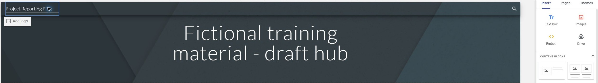


2. Create pages **Overview**, **Reporting** and **Decisions and Actions**. Write one sentence on each explaining the visitor’s next useful action.

**Copy: Hub Pages**

```text
Overview
Reporting
Decisions and Actions
```


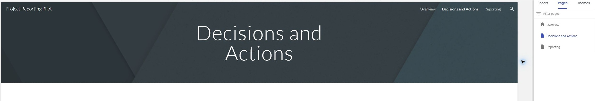

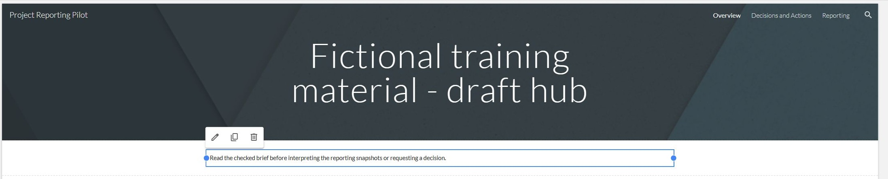


3. On Overview add the project purpose, unresolved start date and proposed budget caveat. Link to the checked brief. Avoid copying long sections that could become stale.

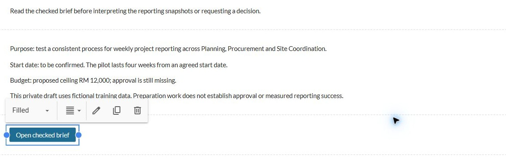


4. On Reporting add a short status-definition guide and the Friday reporting cadence. Explain where to edit source records and where readers should look for checked updates.

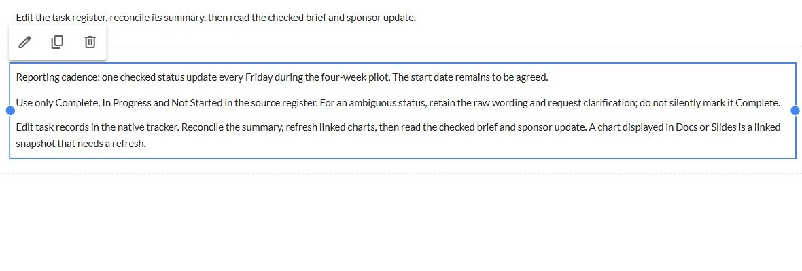


5. On Decisions and Actions add links to the meeting record and the brief’s decision section. Keep open decisions visibly separate from completed preparation work.

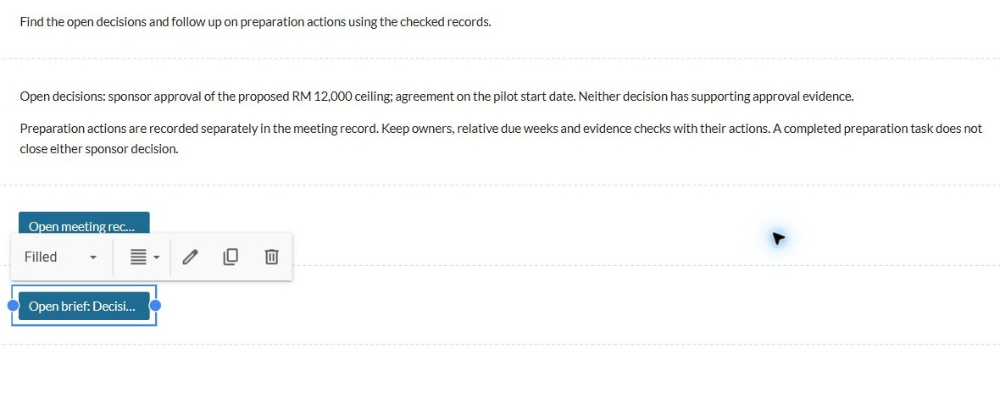


<details markdown="1">
<summary>What should you see?</summary>

The draft hub has three distinct purposes and useful navigation. It directs editing to the source and does not imply that decisions have been approved.

</details>

<!-- CAPTURED: 6.1 progressive banner, pages, actions and checked context. -->

## 6.2 Connect Resources and Check Access Dependencies

1. On Reporting use the available **Insert** controls to add the native tracker and Slides deck. Include clear text links beneath the embeds as an alternative way to open each resource.

**Copy: Handover Links**

```text
Checked brief
Native task register
Meeting record
Sponsor update
Project working folder
```
Use actual file links from your own practice workspace. Keep account-specific URLs out of public course source.


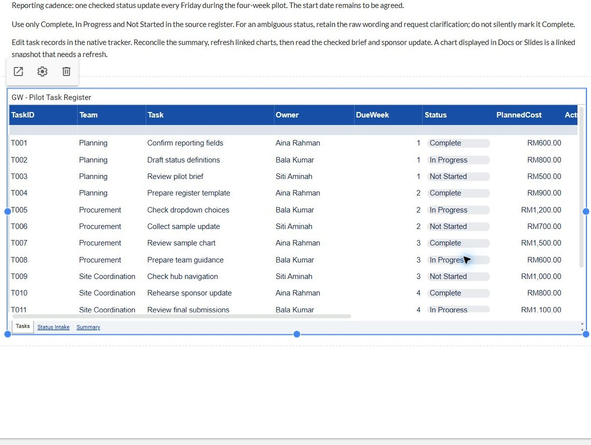

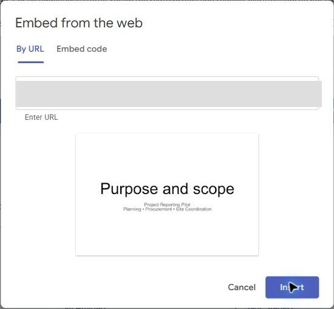

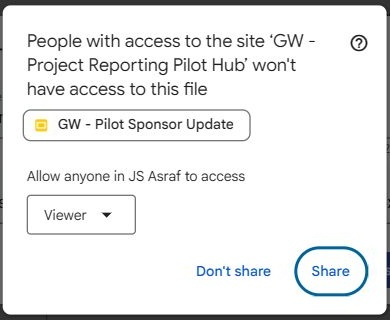


2. Add a link to the project working folder. Embed the practice calendar only if an assigned training calendar exists; otherwise include a clearly labelled **Calendar integration pending** note. Do not expose a personal calendar.

3. For each resource add a short caption: purpose, source file and who should maintain it. Label any not-yet-assigned maintainer as proposed.

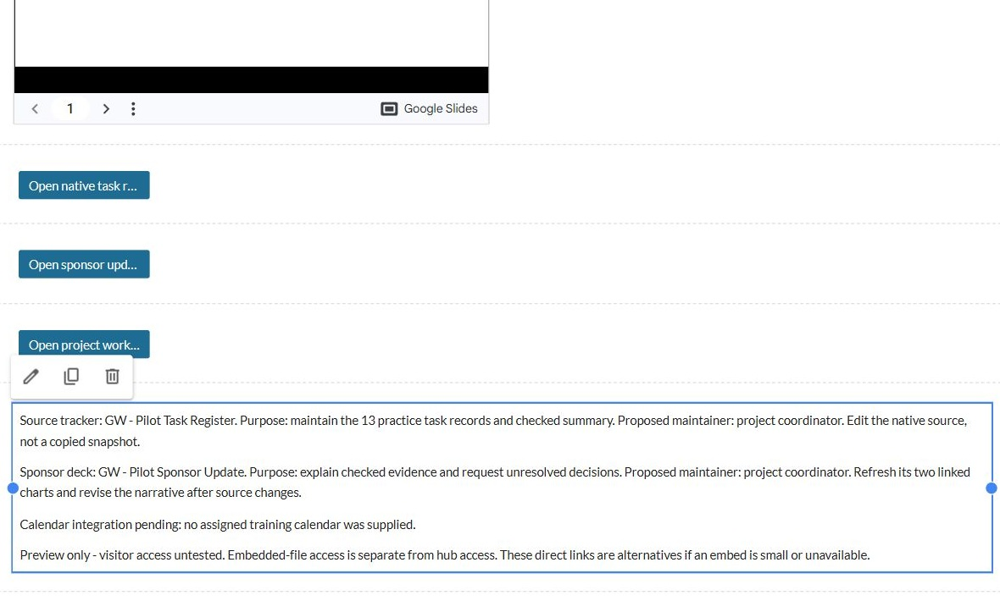


4. Update the Workspace Register with a resource matrix: resource URL, intended audience, current file access, hub access, test performed and result.

**Copy: Resource Matrix**

```text
Resource URL | Intended audience | Current file access | Hub access | Test performed | Result
```


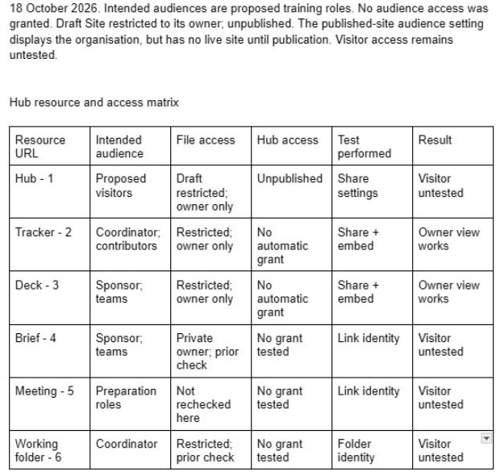


5. Inspect the Site sharing settings and each embedded file’s **Share** dialog separately. If using a training Shared Drive, inspect inherited membership too. Site access does not itself grant direct access to every embedded file.

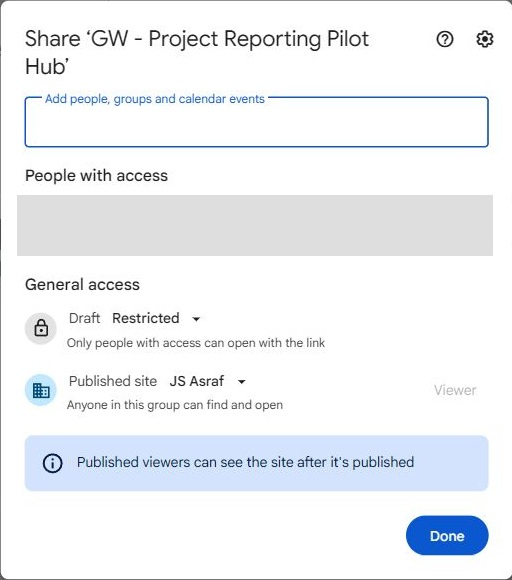

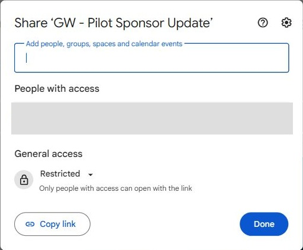

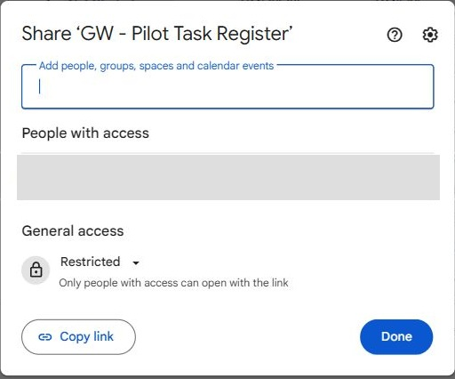


6. If an assigned test viewer and an authorised restricted published sandbox already exist, test that route and log the actual result. Otherwise record **Preview only - visitor access untested**. A preview in your own editor account cannot prove a visitor’s access.

<details markdown="1">
<summary>What should you see?</summary>

Every embed has a useful caption and direct link. The resource matrix separates inspected settings from tested visitor access; no public access is assumed.

</details>

<!-- CAPTURED: 6.2 native embeds, captions, matrix and separate access settings; visitor test pending. -->

## 6.3 Preview and Write the Operating Procedure

1. Choose **Preview** and inspect desktop and narrow-screen views. Check navigation order, chart legibility, broken or obscured embeds and text-link fallbacks.

**Reference-run limitation:** desktop and phone Preview opened with a blank content frame in this browser, including after reloading the saved draft and retrying desktop. Those layout and navigation checks remain unverified. The two native embeds rendered for the owner in the editor. Keep a failed preview distinct from a successful visitor test; do not publish or widen access to hide the limitation.


2. Open the text links and confirm each resolves to the intended working file. Record whether a displayed chart is a linked snapshot in Docs/Slides or a direct spreadsheet embed.

3. In the Workspace Register add a handover checklist: update task record, inspect validation and formulas, reconcile summary, refresh linked objects, revise narrative, export a new snapshot and check hub resources.

4. Add an exception route for ambiguous statuses and unresolved decisions: record the issue and ask the responsible role for clarification. Do not silently map ambiguity to Complete.

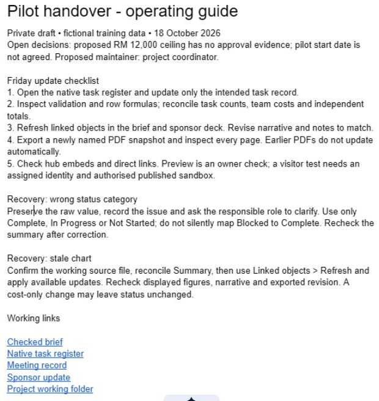


5. Give a partner the hub and checklist, or use a fresh read-through if working alone. Ask them to locate the source tracker, open decisions and refresh instructions. Record one navigation or wording improvement.

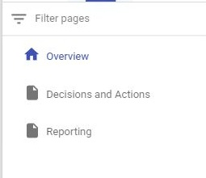

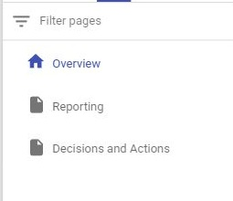

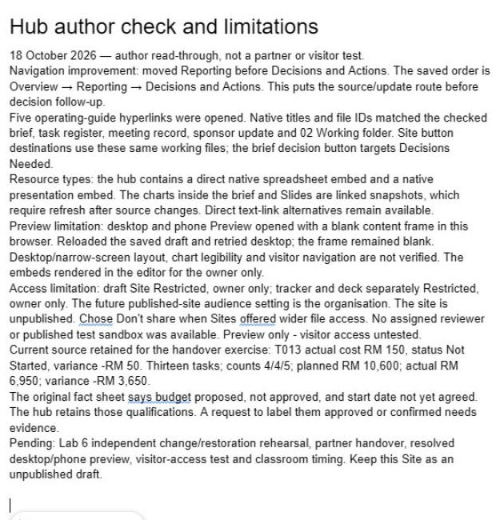

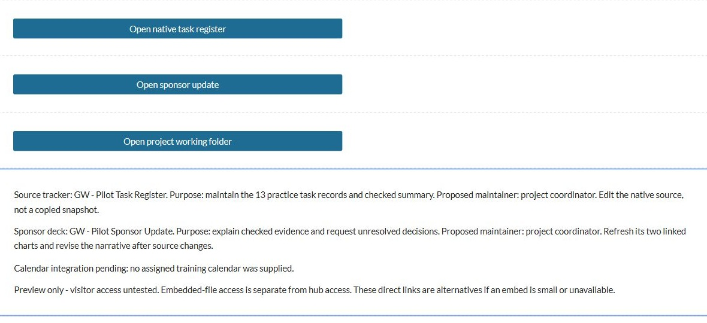

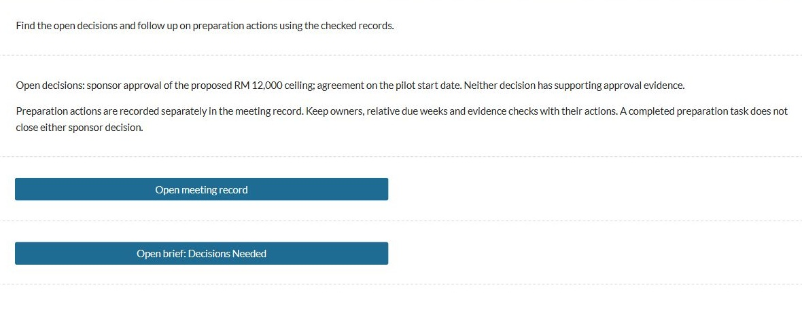


<details markdown="1">
<summary>What should you see?</summary>

The workflow can be followed without the author pointing at each control. Preview checks are recorded separately from any visitor-access test.

</details>

<!-- PARTIAL: 6.3 guide, five native links and navigation improvement captured; desktop/phone Preview blank. -->

## Independent Challenge

Complete the Lab 6 handover card without following the earlier step lists.

1. Predict the effect of changing T003 to Complete in your current 13-row dataset. Change it at the source, reconcile counts, refresh the brief and deck, and inspect the hub’s relevant resource.

**Copy: Change Log**

```text
Change | Predicted effect | Source checked | Brief refreshed | Slides refreshed | Hub checked | Export state | Restored?
```

2. Use the supplied “RM 12,000 approved” review request to decide whether the hub wording should change. Cite the fact sheet rather than accepting the request as project evidence.
3. Restore T003 to its original status and repeat the downstream checks. Keep T013 and its corrected actual cost from Labs 4 and 5.
4. Record before, changed and restored states with source URL, refresh action and the limitation of your access check. Identify any stale PDF and regenerate only the snapshots intended for handover.
5. Hand over a one-page operating guide with five links, unresolved decisions and two recovery procedures: wrong status category and stale chart. A partner must be able to find the correct source and explain the next refresh action.

Keep the site as a draft. If publication is needed for a later classroom access test, the trainer must provide the authorised destination and audience first.

## Evidence to Hand Over

- Three-page draft Site or clearly labelled linked-Doc fallback.
- Resource/access matrix, preview results and one recorded navigation improvement.
- Change/restoration log and one-page operating guide with working links and two recovery procedures.

## Troubleshooting

| Symptom | Repair to investigate |
|---|---|
| The author can see an embed but a reviewer cannot | Inspect resource permissions and inherited grants separately from the hub audience. |
| A chart appears current in one location only | Trace its source URL and object type, then refresh the affected linked destination. |
| The hub repeats outdated narrative | Link to maintained source material and update the short summary after checking the facts. |
| Sites is disabled | Build the linked-Doc fallback and mark Sites-specific checks pending. |

## Check Yourself

Explain one error you found, how you proved the correction, and which downstream result it could affect. A finished-looking file alone is not evidence that it is correct.
