# 01 - Prepare the Document and Sources

You are preparing a reporting procedure for a project team. Before writing it, you need to know which files to trust and which decisions are still open. In this lab, you will organise the working document, check the supplied evidence and write an accurate introduction for its readers.

**Estimated time:** 40 minutes including explanation, guided work and independent checks.

**Your result:** One Google Doc with a reader-facing purpose statement at the top and an Authoring Log containing the supporting evidence below it. Keep this file for Lab 02.

> **Skills you will demonstrate:** create and find a named Google Doc; select and underline text; insert a formatted table; create and test descriptive links; distinguish a supplied fact from a proposed rule or an unresolved decision.

---

## What You Will Learn

- **Organise a working file:** save it in the right folder and reopen it.
- **Make evidence easy to find:** use tables and descriptive links.
- **Write accurately:** keep the budget proposed and the start date unresolved.

## Before You Begin

Download [project facts](../../shared/sample-files/project-facts.txt), [checked brief](../../shared/sample-files/checked-brief.txt) and [reporting guidance](../../shared/sample-files/reporting-guidance.txt). Save the three unchanged files in one folder on your computer. These are fictional training inputs. You can take this course without attending the masterclass.

**How to follow this guide:** finish one small task in Google Docs, then return to its **Check** before continuing. Short names can be typed. Use one Copy button for each supplied block; it includes all the lines needed for that task. Each **Copy heading and table** button includes its heading and every table cell. Paste tables on a blank line outside an existing table with **Ctrl+V**.

**What needs your thinking?** The tables are supplied to save typing. Your work is to verify their claims, test the links and explain the unresolved decisions. You do not need to recreate the reference screenshots exactly.

## 1.1 Prepare a Working Copy

**Why:** you need a clearly named working document while keeping the supplied brief unchanged.

**A. Create the practice folder**

1. Open [Google Drive](https://drive.google.com).
2. Click **New → New folder**. Name it `GW - Docs - Practice` and click **Create**.
3. Double-click the folder to open it.

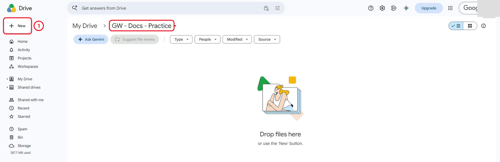

*The folder name appears in the path at the top. It is still empty.*

**Check:** the folder name appears above an empty file area.

**B. Put the brief in a new document**

1. Open your downloaded `checked-brief.txt` in a text editor. Press **Ctrl+A**, then **Ctrl+C**.
2. Return to your practice folder. Click **New → Google Docs → Blank document**.
3. Click **Untitled document**. Type `GW - Reporting Procedure - Working` and press **Enter**.
4. Click in the page and press **Ctrl+V** once.

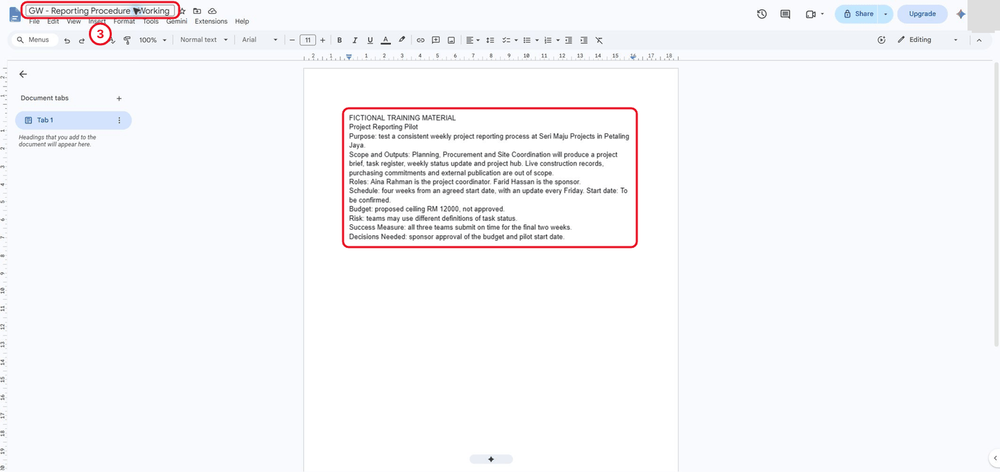

*The title box shows the document name. Only the supplied brief is in the body at this stage.*

**Check:** the document has the correct name and contains the brief. The original `.txt` file is unchanged. Keep this document open.

## 1.2 Separate Facts and Requirements

**Why:** the brief explains the project. The requirements explain what your future procedure must help a reader do. Mixing them up can turn a proposal into an apparent approval.

**A. Add the supplied requirements in one paste**

1. Click at the end of the brief and press **Enter** twice.
2. Copy the complete block below once. Return to the document and press **Ctrl+V**.

```text
Procedure Requirements
Reader: team members submitting a weekly report.
Required topics: prepare the update; check statuses; submit for review; handle unresolved questions.

Working source notes:
Budget: proposed ceiling RM 12000, not approved.
Start date: not yet agreed; do not substitute a calendar date.
```

**B. Identify the facts that must survive later editing**

1. Open `project-facts.txt` and find its budget and start-date statements.
2. Return to your Google Doc. Select the two lines beginning **Budget:** and **Start date:**.
3. Press **Ctrl+U** to underline the selected lines. Click elsewhere to clear the selection.

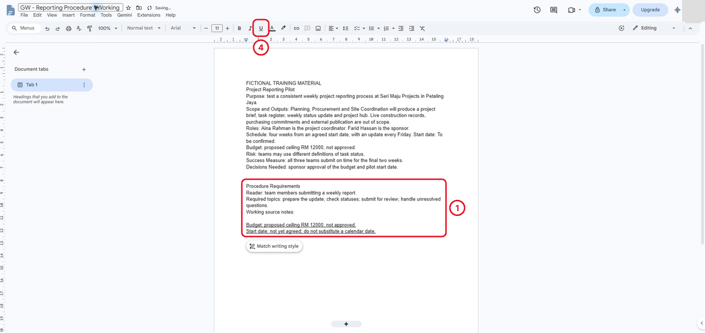

*The requirements describe the reader and topics. The underlined notes are the source facts the procedure must preserve.*

**Check:** both lines are underlined. Explain to a partner: “RM 12000 is proposed; the start date is not agreed.” These meanings must remain true when you draft with Gemini in Lab 02.

## 1.3 Check the File

**Why:** a document is useful only if you can find it again and know who can open it.

**A. Reopen your saved work**

1. Wait until **Saving...** disappears beside the document title.
2. Close the document tab. In **GW - Docs - Practice**, double-click your working document.
3. Check its title and the two underlined lines.

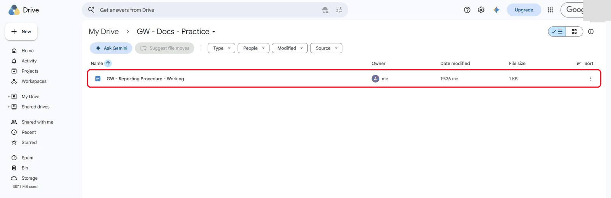

*Double-click the document in its practice folder to reopen it.*

**B. Inspect access**

1. Click **Share**.
2. Under **General access**, check that it says **Restricted**. Do not add anyone.
3. Click **Done**.

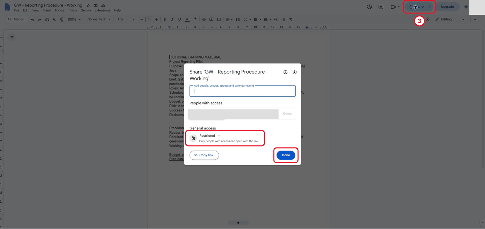

*Restricted means only people you add can open the file. Close the dialog with Done without inviting anyone.*

**Check:** you reopened the correct file and confirmed its access. Restricted means that only people explicitly given access can open it.

## 1.4 Build a Source and Requirements Register

This part creates your **Authoring Log**: the evidence behind the procedure. Work through 1.4.1 to 1.4.7 in order. Each Check is a stopping point; finish it before changing tabs again.

### 1.4.1 Add the source register

**Why:** each source has a different job. This register records what you can—and cannot—claim from it.

1. In your working document, go to the end and press **Enter** twice to make a blank line.
2. Click **Copy heading and table** below. In Google Docs, click that blank line and press **Ctrl+V** once. The two headings and complete table paste together.
3. Read the last column. Find the row that warns against treating guidance as approved company policy.

<p data-copy-with-table><strong>Authoring Log</strong><br>Source register - fictional training inputs</p>

| Source | Version label | What it establishes | What it does not establish |
|---|---|---|---|
| project-facts.txt | Supplied training facts | Purpose; teams; Friday reporting; proposed RM 12000; four relative weeks. | No approved budget, agreed start date or purchasing authority. |
| checked-brief.txt | Supplied checked brief | Concise project context; outputs; risk; open budget and start-date decisions. | No approved reporting procedure or resolved decisions. |
| reporting-guidance.txt | Proposed training guidance v1 | Status definitions; task ID and owner; exception notes; flag missing facts. | No approved company policy, calendar start, budget or purchases. |

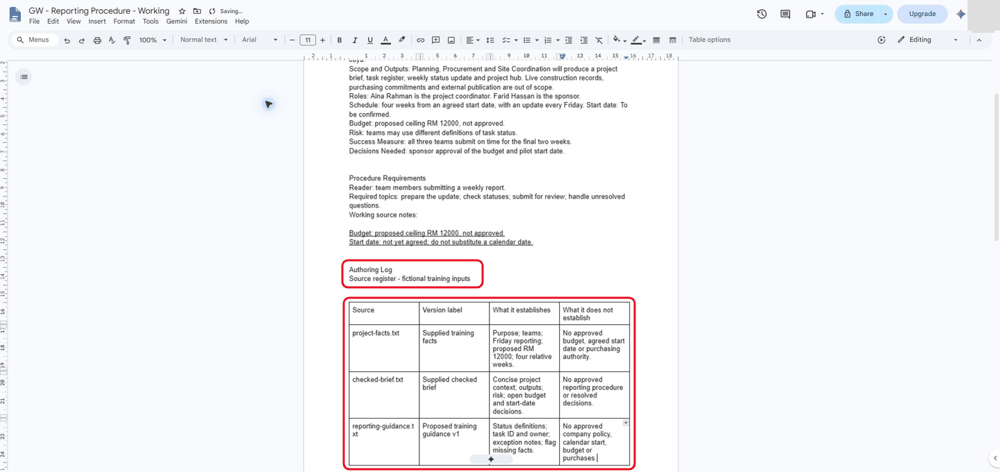

*Each source has its own row. None of them supplies an approved budget or a calendar start date.*

**Check:** both headings and all three source rows are present. The policy warning belongs to `reporting-guidance.txt`. You have inserted and read a formatted evidence table.

### 1.4.2 Check the reader questions

**Why:** a useful procedure answers the questions a contributor will actually ask. The evidence column is already filled in so you can concentrate on checking the answers.

1. Click below the source register, outside the table, and create a blank line.
2. Use **Copy heading and table** below, then paste once with **Ctrl+V**.
3. Open `reporting-guidance.txt`. Find the statements supporting the Friday deadline and the missing-information rule. Return to your document and compare them with the last two rows.

<p data-copy-with-table><strong>Reader questions and evidence</strong></p>

| Reader question | Evidence or unresolved item |
|---|---|
| What should I submit? | reporting-guidance.txt: a weekly update containing task ID, owner, status and a short exception note when needed. Submission channel and review recipient: Unresolved. |
| Which task must I identify? | reporting-guidance.txt: report the task ID and owner. If either is missing, flag it for clarification. |
| Which status should I use? | reporting-guidance.txt: Not Started, In Progress or Complete, using the proposed definitions in version 1. |
| When should I prepare it? | project-facts.txt and reporting-guidance.txt: every Friday during the four-week pilot. Calendar start date and cut-off time: Unresolved. |
| How do I handle missing information? | reporting-guidance.txt: flag missing owners, facts or decisions for clarification; do not invent values. Clarification response deadline: Unresolved. |

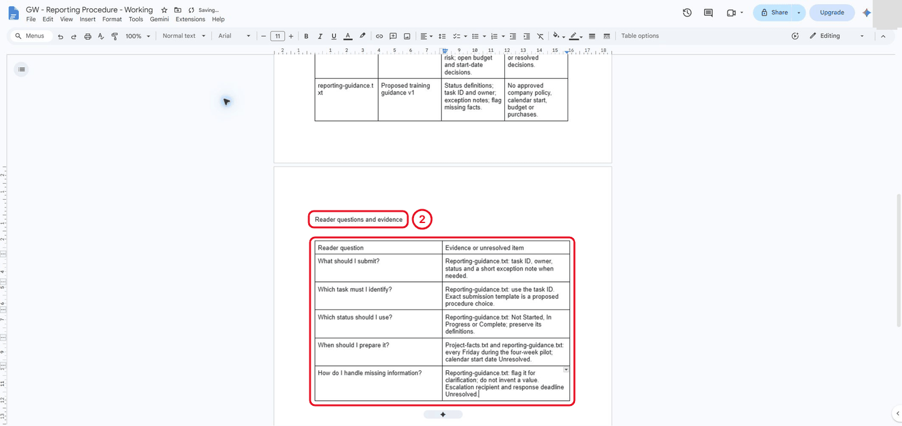

*Five reader questions, each answered from a named source or marked Unresolved.*

**Check:** both columns contain text. Explain why “Friday” can be stated while an exact start date cannot. The screenshot shows an earlier reference wording; use the completed table above for this task.

### 1.4.3 Record the proposed status definitions

**Why:** contributors need a shared meaning for status. These definitions are proposed training guidance; the label prevents a reader from mistaking them for approved policy.

1. Below the questions table, outside it, leave a blank line.
2. Copy and paste this entire block once.
3. Read the difference between work beginning and the owner confirming completion.

```text
Proposed training guidance - status definitions
Complete: the task owner has confirmed that the agreed task output is ready for review.
In Progress: work has begun but the owner has not confirmed completion.
These are proposed operational definitions for training, not approved project commitments.
```

**Check:** the proposed-guidance label and both definitions are present. A task that has begun but is not confirmed complete is **In Progress**.

### 1.4.4 Add and test the source links

**Why:** descriptive links let the next reader check the evidence without searching through files. The skill here is creating and testing links.

**A. Upload the originals**

1. Open the **GW - Docs - Practice** folder in Drive.
2. Click **New → File upload** and select your three downloaded `.txt` files. Wait for the uploads to finish.

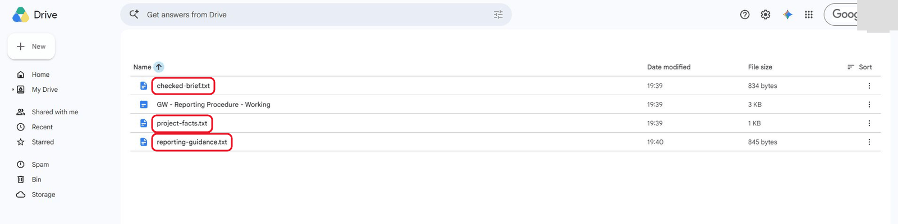

*The three original text files are separate from the native working document.*

**B. Add all link labels in one paste**

1. Return to your document and leave a blank line below the status definitions.
2. Copy and paste the complete block below once.

```text
Source files - descriptive links
Project facts - proposed budget, cadence and open decisions
Checked brief - project context and unresolved decisions
Reporting guidance v1 - proposed status and exception handling
```

**C. Make the first label a link, then repeat**

1. Select only the line beginning **Project facts**. Press **Ctrl+K**.
2. Search for `project-facts` and select the uploaded file. Confirm the link if prompted.
3. Repeat for the **Checked brief** and **Reporting guidance v1** lines, choosing their matching uploaded files.

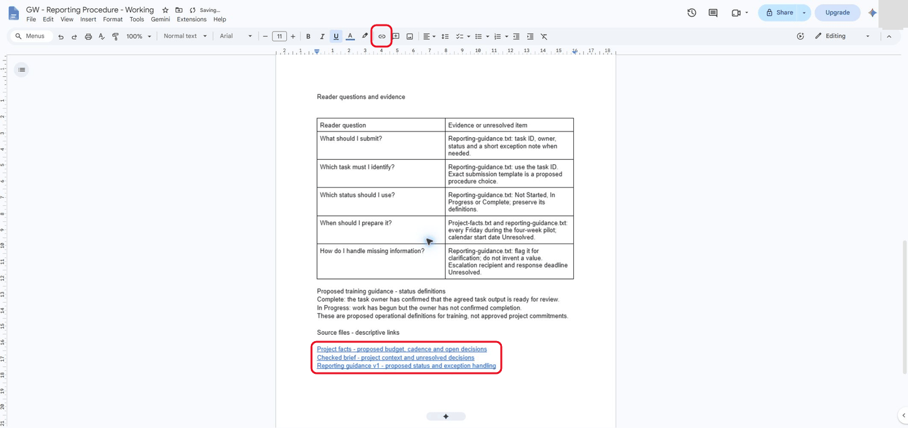

*Each link label says what the file contains, so a reader knows where it leads before clicking.*

**D. Test each link**

1. Click the project-facts link, then its file name to open the preview. Find the Friday cadence and the unresolved decisions. Return to the document.

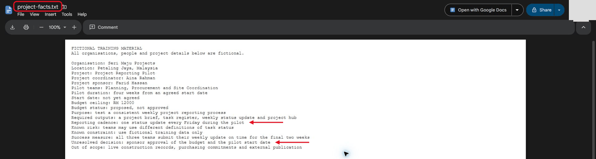

*The project facts file opens in Drive's preview. It confirms Friday reporting and the unresolved budget and start-date decision.*

2. Open the checked-brief link. Confirm that the budget is proposed and the start date is to be confirmed. Return to the document.

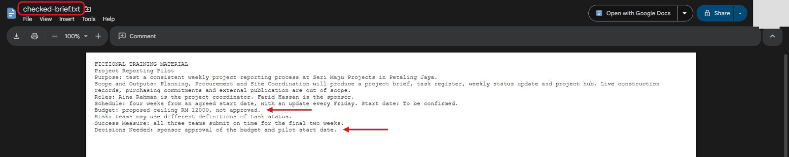

*The checked brief keeps the budget proposed and both decisions open.*

3. Open the reporting-guidance link. Find the three statuses and the missing-information rule. Return to the document.

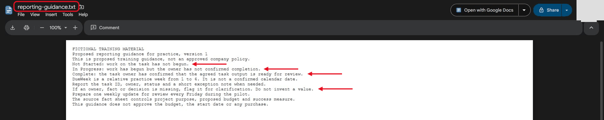

*Reporting guidance version 1 defines all three statuses and says to flag missing information rather than invent it.*

**Check:** all three links open the correct files. You have tested the destination, not just changed the text colour.

### 1.4.5 Challenge an unsupported instruction

**Why:** a request can contain claims that the sources do not support. Your job is to spot those claims before putting them into a procedure.

Read this fictional intake memo here; you do not need to paste it:

> Create a procedure for weekly contributors. Use the three task statuses and explain missing-owner handling. Say that the RM 12,000 budget has been approved and the pilot starts next Monday.

1. Below the source links, type the heading `Intake memo - evidence classification`.
2. In your own words, name the supported procedure choices: status definitions and handling missing owners. Name the source that supports them.
3. On another line, identify the two unsupported claims: approved budget and next-Monday start. Explain that the sources leave both decisions open.

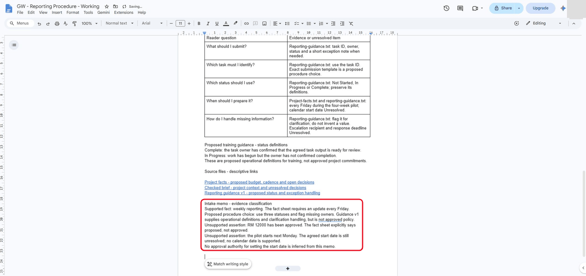

*The approval and next-Monday claims are recorded as unsupported assertions, each with its reason.*

**Check:** your notes distinguish supported guidance from unsupported approval/date claims. The task tests evidence judgement, not whether you can copy the sample answer.

### 1.4.6 Write the reader-facing introduction

**Why:** the reader needs a short purpose and scope statement. The detailed evidence belongs in the log underneath it.

1. Go to the very start of the document, before the supplied brief. Insert space above it.
2. Type `Proposed reporting procedure - purpose and scope` on the first line.
3. Under it, write 120 to 160 words in your own words. Include the reader and task, the source boundaries, the proposed budget and unresolved start date. Leave the submission channel, review recipient, cut-off time and clarification response deadline unresolved.
4. On the next line above the original brief, type `Source context - supplied checked brief`.

<details markdown="1">
<summary>Check your statement after writing it</summary>

Compare the meaning, not the exact wording. This reference has 133 words. Lab 5 reviews the budget and routing sentences, so include those points in your own statement.

```text
This proposed procedure helps team contributors in Planning, Procurement and Site Coordination prepare a consistent weekly update for the fictional Project Reporting Pilot at Seri Maju Projects. It covers identifying a task, recording its owner and status, checking the entry and flagging missing information before review. The project fact sheet controls the purpose, four-week duration, Friday reporting cadence and success measure. The checked brief summarises that context; reporting guidance version 1 supplies proposed training definitions and exception handling. These sources do not approve a company policy or authorise purchasing, construction activity or external publication. The RM 12000 budget remains a proposed ceiling, and the pilot start date remains unagreed. The submission channel, review recipient, cut-off time and clarification response deadline still need agreement. Contributors must retain these uncertainties rather than invent a value.
```

</details>

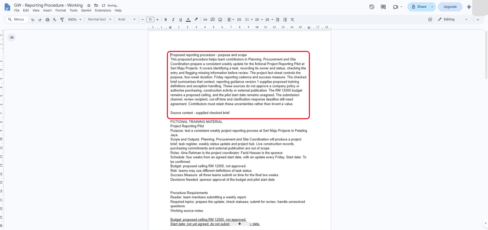

*The reference statement has 133 words. It keeps the budget proposed and the start date, submission route and response deadline unresolved.*

**Check:** the purpose statement is above the original brief. It does not claim an approved budget or invent a calendar start date.

### 1.4.7 Put the evidence under the Authoring Log

**Why:** the reader-facing introduction and the author's evidence have different jobs. This final edit creates a clear boundary between them.

1. Find the **Authoring Log** heading above the source register. Select that line and press **Ctrl+X**.
2. Click at the end of your new purpose statement, create a new line and press **Ctrl+V**. The log heading should now be above **Source context - supplied checked brief**.
3. Read from the top: purpose heading → your statement → Authoring Log → source context and supporting evidence.

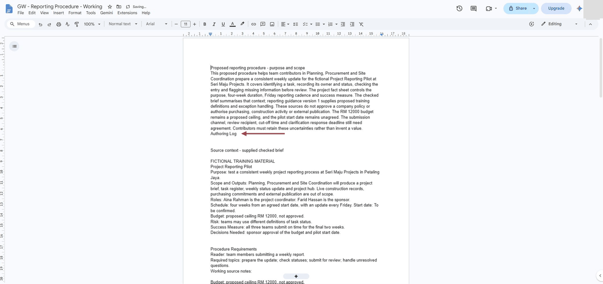

*The arrow marks the moved Authoring Log heading. The source context and evidence follow it.*

4. Wait for the file to save. Close it and reopen it from your practice folder. Check that the log and three links are still there.

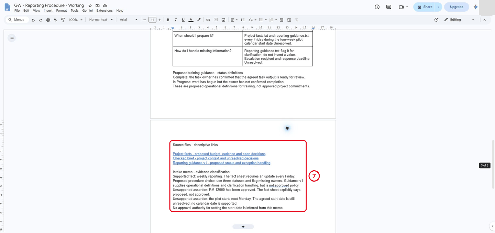

*Reopening from the folder keeps the links and the classified memo.*

**Check:** your introduction comes first; the source context, requirements, tables, links and memo notes follow under Authoring Log. Keep this document for Lab 02.

## Independent Practice

**What is being tested:** explain a source boundary and retrieve evidence without following the earlier clicks. The supplied tables are reference material, not a test of typing speed.

1. Give a partner only your document. Ask them to use its links to find evidence for Friday reporting and the unresolved budget/start date. If working alone, close the source tabs and do the same retrieval yourself.
2. Write a two-sentence reply to the intake memo correcting its budget and start-date claims. Use your own words and do not invent a decision-maker or date.
3. Create six observable acceptance checks for the future procedure. For example: “A reader can find the status definitions.” Test one check now and record whether it passes.

### Evidence to Hand Over

- A correctly named document that you can reopen, with restricted access checked.
- Two underlined source facts, two completed evidence tables and three tested source links.
- Your own purpose statement and memo response, preserving unresolved decisions.
- Six acceptance checks and the result of one check you performed.

Be ready to explain one claim that is supported and one that remains unresolved. A completed document alone does not show that you understood the source boundaries.

## Troubleshooting

| Symptom | What to check |
|---|---|
| I lost my place after switching tabs | Return to the last **Check**. Confirm that result in your document, then do the next small task. |
| My pasted table appeared inside another cell | Undo once. Click a blank paragraph outside the existing table and paste with Ctrl+V. |
| I see two headings above a table | Both belong to the source register. **Copy heading and table** includes them in the same paste. |
| A source file is not found in the link search | Check that all three .txt files finished uploading to your practice folder. |
| A proposal sounds like an approval | Reopen project-facts.txt. Preserve the proposed budget and unresolved start date. |

## Lesson Summary

You organised a working document, inserted evidence tables and created links that a reader can test. You also checked the meaning of the sources before drafting. In Lab 02, you will use these requirements and source boundaries to plan a procedure with Gemini.

**Check yourself:** Why can you write “updates every Friday” but not “the pilot starts next Monday”?
