# 01 - Prepare the Document and Sources

In this chapter you will create a working copy and distinguish source facts from instructions.

> **Prompts and values:** use the [copy-paste page](./prompts.md) for the exact values used below.

**Target allocation:** 40 minutes: 10 explanation/demonstration, 10 guided build and casework, 15 independent challenge, 5 verification and repair. The active portion is 30 minutes by design. These are unmeasured targets awaiting a learner pilot.

**Your result:** A named working document and a separate set of source facts.

> **Status:** real-app reference route captured with 16 stage images. Source register, five questions, three opened links, memo classification and 133-word scope checked. Browser upload and independent challenge remain unverified.

## What You Will Learn

- Create a named document from supplied text.
- Distinguish source facts from a draft.
- Keep the working document and source separate.

## Before You Begin

Read the [case input](./prompts.md) and use a separate named casework copy for destructive tests or altered datasets. Keep the baseline unchanged for later chapters. Record source facts, proposed practice and unresolved questions separately.

Download [project facts](../../shared/sample-files/project-facts.txt) and [checked brief](../../shared/sample-files/checked-brief.txt). You can take this course without attending the masterclass.

## 1.1 Prepare a Working Copy

1. In Drive, create a folder named `GW - Docs - Practice`.

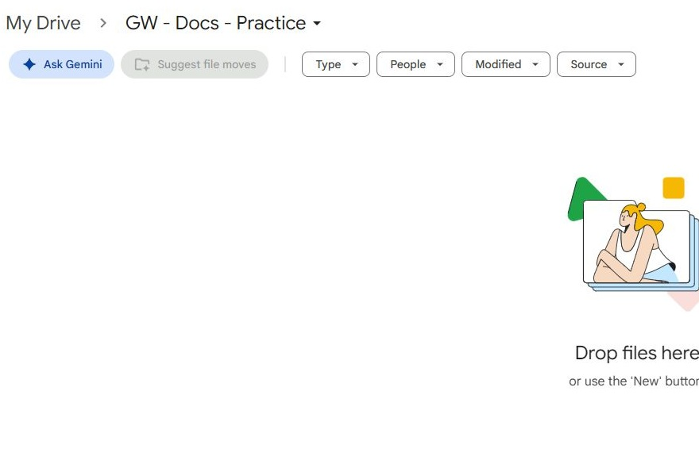

2. Open the supplied checked brief text. Create a blank Google Doc in your new folder.
3. Name it `GW - Reporting Procedure - Working`. Paste the supplied brief text into the body.

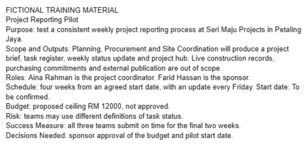

What should you see?

A native Google Doc contains the fictional brief. The original downloaded source remains unchanged.

<!-- Reference core captured 18 October 2026; independent learner challenge remains pending. -->

## 1.2 Separate Facts and Requirements

1. Read the fact sheet and underline the proposed budget and unresolved start date in your working notes.
2. Add a section named `Procedure Requirements`. Record the intended reader: team members submitting a weekly report.
3. List the required procedure topics: prepare the update, check statuses, submit for review and handle unresolved questions.

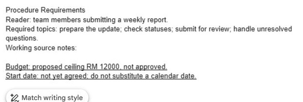

What should you see?

The project brief supplies context; the procedure requirements describe what the new document must help a reader do.

<!-- Reference core captured 18 October 2026; independent learner challenge remains pending. -->

## 1.3 Check the File

1. Wait for Saved to Drive. Close and reopen the new document from your practice folder.
2. Use the document title to check that you reopened your working copy.

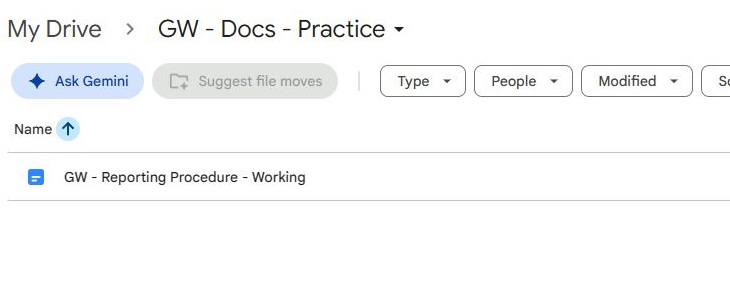

3. Inspect Share, confirm its current access and close the dialog without inviting anyone.

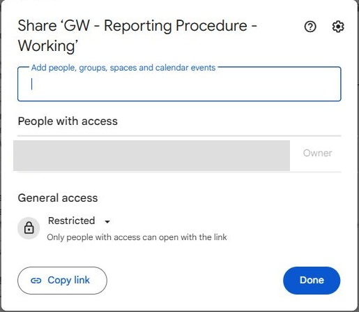

What should you see?

Your working copy can be reopened and has its intended current access.

<!-- Reference core captured 18 October 2026; independent learner challenge remains pending. -->

## 1.4 Build a Source and Requirements Register

1. Create an **Authoring Log** section after the copied brief. Add a table with Source, Version label, What it establishes and What it does not establish. Register project-facts.txt, checked-brief.txt and reporting-guidance.txt separately.

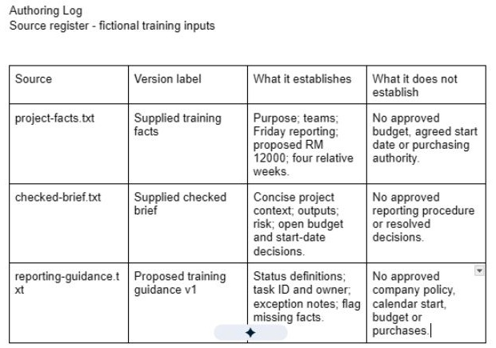

2. Read the reporting guidance in full. Add the definitions of Complete and In Progress to the log, labelled as proposed training guidance. Distinguish these operational definitions from the fact sheet’s project commitments.

3. Create a second table for five reader questions: what to submit, which task to identify, which status to use, when to prepare the update and how to handle missing information. For each, name its evidence source or write **Unresolved**.

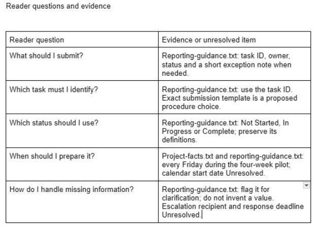

4. Upload your unchanged `project-facts.txt`, `checked-brief.txt` and `reporting-guidance.txt` to the practice folder. Use **Insert**, **Link** to connect three descriptive source labels to those uploaded files. Reopen each link and inspect the file title and content.

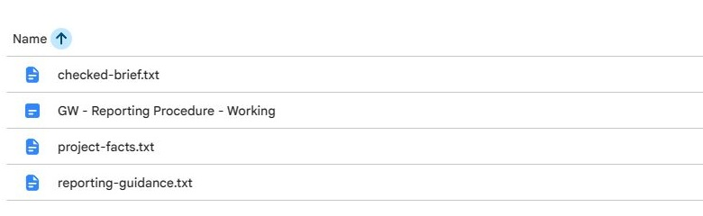

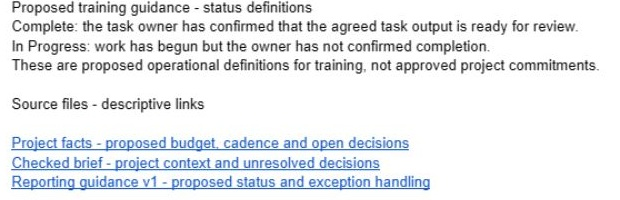

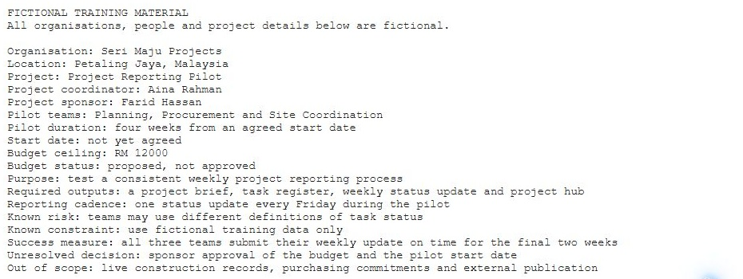

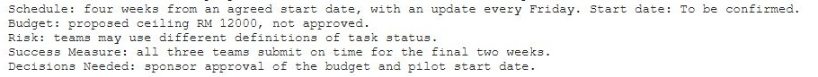

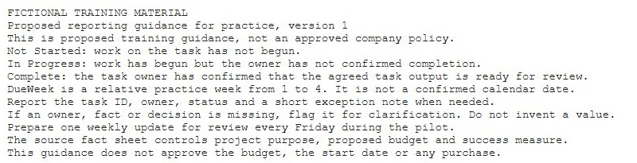

**Reference setup:** browser upload was blocked by the automation extension’s local-file setting. The connected Drive upload tool supplied these exact files; manual browser upload remains unverified. No extension or security settings were changed.

5. Read the intake memo on the copy-paste page. Sort its requests into supported facts, proposed procedure choices and unsupported assertions. Record a reason for each classification.

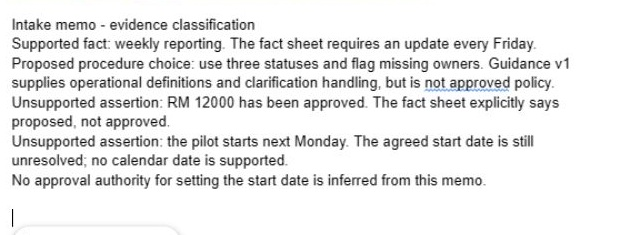

6. Draft a 120 to 160 word document purpose and scope statement for team contributors. It must say that the procedure is proposed practice, identify its source boundaries and list what is still unresolved.

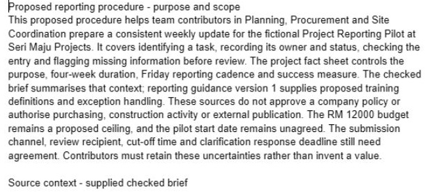

7. Move authoring-only notes below a clearly marked **Authoring Log** heading so a reader can distinguish working evidence from procedure instructions. Reopen the file from its folder and check that the log and links survived.

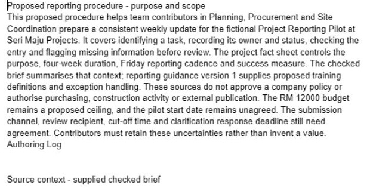

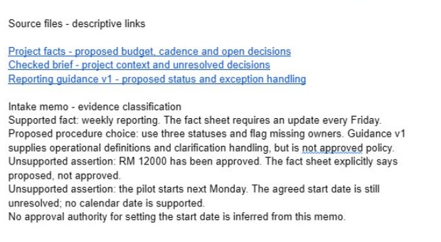

What should you see?

Three-source register and five reader questions with evidence or an unresolved label. The result must be supported by the recorded checks; an attractive output or an AI assurance is insufficient.

<!-- Reference core captured 18 October 2026; independent learner challenge remains pending. -->

## Independent Challenge

Close the earlier step lists for the first attempt. Use the case input and your own reasoning. If you need help, record the hint and repeat the affected check independently.

1. Independently design a six-row acceptance checklist for the finished procedure. Each item must be observable, such as “a reader can find the status definitions”, rather than “looks professional”.

2. Write a response to the intake memo correcting its budget and date assertions without inventing an approval authority for the start date.

3. Give a partner only the document and source links. Ask them to find the evidence for Friday reporting and the two unresolved decisions. Record any failed retrieval and repair the source label. If alone, close the source tabs and repeat from the document.

## Evidence to Hand Over

- Three-source register and five reader questions with evidence or an unresolved label.
- A substantive purpose/scope statement and six testable acceptance checks.
- Corrected intake memo and a recorded source-retrieval result.

Record the defect or uncertainty you investigated, the evidence used, the repair or reasoned no-change decision, and the final state. Restore temporary changes or keep them in a clearly named scenario copy.

## Troubleshooting

| Symptom | What to check |
|---|---|
| A procedure instruction is treated as policy | Check the source-register classification and retain its proposed-practice label. |
| An input or earlier result is missing | Reopen the input named in Before You Begin; do not substitute private company data |
| A menu or feature is unavailable | Confirm the account and the shared access notes; record the missing step and ask the trainer for its fallback |
| The result differs from the checkpoint | Compare the exact source range, wording and conditions before repeating the action |

## Lesson Summary

You prepared an independent working document and its source context. Next, turn the requirements into a procedure draft.

**Check yourself:** Which source fact must you preserve when describing the budget?
