# 02 - Plan and Draft with Gemini

In this chapter you will generate an outline, draft from supplied evidence and record unsupported claims.

**Estimated time:** 55 minutes, planned as 10 explanation and demonstration, 25 guided build and casework, 15 independent practice and 5 verification and repair. Not yet timed with learners.

**Your result:** A checked proposed procedure with outstanding sponsor questions.

> **Skills you will demonstrate:** write a source-grounded AI request; review its claims; insert a checked draft; test a procedure with normal and missing-information cases.

---

## What You Will Learn

- Specify a useful drafting task.
- Review an AI proposal before using it.
- Preserve unresolved facts in a procedure.

## Before You Begin

**Which file?** Work in **GW - Reporting Procedure - Working** throughout. Keep review notes and walkthroughs in its Authoring Log.

**Keep your place:** complete one small task, check its result, then move on. Type short names where shown. Supplied blocks include related lines in one paste; **Copy heading and table** buttons include the labels too. Use **Ctrl+V** on a blank paragraph outside existing tables. Screenshot wording and page counts are examples; check your own result.

Use your `GW - Reporting Procedure - Working` document from Lab 1, the supplied [project facts](../../shared/sample-files/project-facts.txt), [reporting guidance](../../shared/sample-files/reporting-guidance.txt) and [Tasks.csv](../../shared/sample-files/Tasks.csv). If Gemini is unavailable, skip 2.1 and 2.2.1. Start at **2.2.2**, reviewing the supplied draft in 2.3 instead of an AI reply, then continue all checks.

## 2.1 Define the Reader and Task

**Why:** A useful AI request names the reader, evidence and output. You are learning to constrain a proposal before using it.

### 2.1.1 Open the drafting panel

1. In your working document, click **Ask Gemini** (the star button at the top right).
2. The Gemini panel opens on the right.

**Check:** The panel is open beside your Working document.

### 2.1.2 Paste one grounded request

1. Copy the complete prompt below once into the **Ask Gemini** box.
2. It already includes the supplied fictional fact sheet.
3. Read its output instructions before submitting; no placeholder replacement is needed.

**Session:** new Gemini panel chat | **Grounding:** pasted project-facts.txt

```text
Goal: Propose a weekly reporting procedure for team members.
Context: Fictional Seri Maju Projects training exercise.
Source: Only the facts pasted below.
Expectations: Reply in the panel only, without editing my document. Use headings Prepare, Check, Submit for Review and Resolve Questions, with numbered steps. Label operational steps as proposed training practice. Preserve the proposed budget and unresolved start date. Do not invent approval authorities, deadlines or systems.

FACTS:
FICTIONAL TRAINING MATERIAL
All organisations, people and project details below are fictional.

Organisation: Seri Maju Projects
Location: Petaling Jaya, Malaysia
Project: Project Reporting Pilot
Project coordinator: Aina Rahman
Project sponsor: Farid Hassan
Pilot teams: Planning, Procurement and Site Coordination
Pilot duration: four weeks from an agreed start date
Start date: not yet agreed
Budget ceiling: RM 12000
Budget status: proposed, not approved
Purpose: test a consistent weekly project reporting process
Required outputs: a project brief, task register, weekly status update and project hub
Reporting cadence: one status update every Friday during the pilot
Known risk: teams may use different definitions of task status
Known constraint: use fictional training data only
Success measure: all three teams submit their weekly update on time for the final two weeks
Unresolved decision: sponsor approval of the budget and the pilot start date
Out of scope: live construction records, purchasing commitments and external publication
```

The fact sheet is included to ground the task. Review the reply yourself before using any wording in the document.

**Check:** The prompt includes real fact-sheet text; no placeholder remains.

### 2.1.3 Read before submitting

1. Read the prompt again before submitting.
2. It asks for an answer in the panel and a proposed procedure, not a change to your document or to company policy.

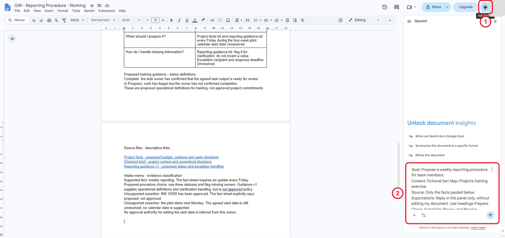

*The prompt includes the actual fact sheet. It is still in the box, waiting to be submitted.*

<details markdown="1">
<summary>What should you see?</summary>

The request names the reader, source and output format. No source placeholder remains.

</details>

<!-- Reference core captured 18 October 2026; independent learner challenge remains pending. -->

**Check:** The request asks for a panel reply and preserves unresolved decisions.

## 2.2 Review the Draft

**Why:** AI output is a draft to inspect. A fluent answer can still omit a status or invent a usable-looking workflow.

### 2.2.1 Read the response

1. Click **Submit** (the arrow at the bottom right of the panel) and read the whole response, scrolling down the panel.
2. If Gemini offers to edit your document instead, click **Reject all**: this lab only uses the panel.

**Example response: two views of the same answer**

The two screenshots below show one example Gemini reply. The panel was scrolled to show different parts of that reply. They illustrate what to look for during a review; they are not two separate tasks or answers to copy. Your own reply may use different wording and may not contain these problems.

#### View 1 of 2 — check the status definitions

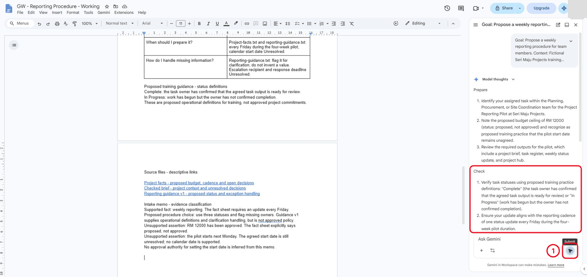

*In this example, Check leaves out Not Started. In your own reply, check whether all three statuses are covered; record an omission only if you find one.*

#### View 2 of 2 — the same reply, scrolled down to submission instructions

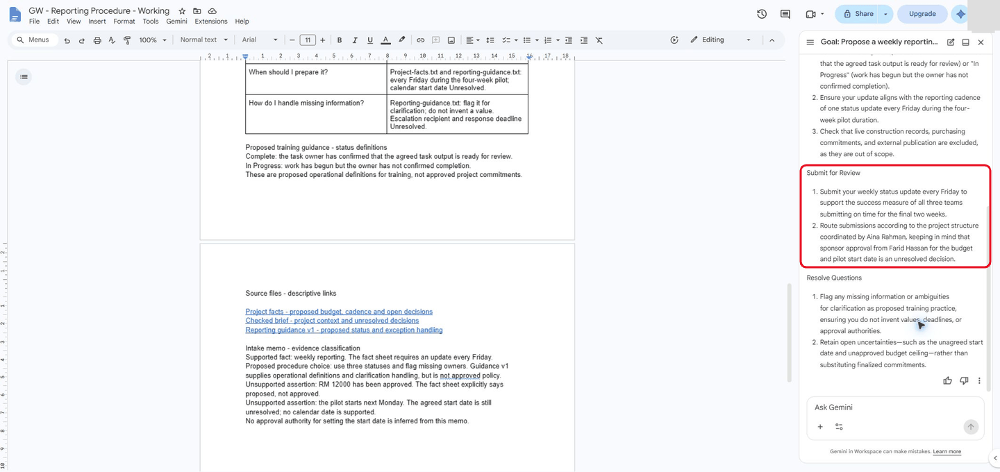

*In this example, “Route submissions according to the project structure” gives no usable destination. In your reply, check that missing channel, recipient and cut-off details remain unresolved rather than being invented.*

**Your next action:** return to your own Gemini reply and review it in 2.2.2. You do not need to reproduce the example's wording or errors.

**Check:** The response is still a proposal; your document has not been automatically replaced.

### 2.2.2 Record your source checks

1. Compare every instruction in the response with `project-facts.txt` and `reporting-guidance.txt`.
2. At the end of the document, type `AI draft review` and today's date, then record what the response got right and each repair it needs.
3. Check three things: are all three statuses covered, are missing routing details kept unresolved, and are claims supported by the supplied sources? Record what you actually find. If a point is already correct, note the source and **no repair needed**.

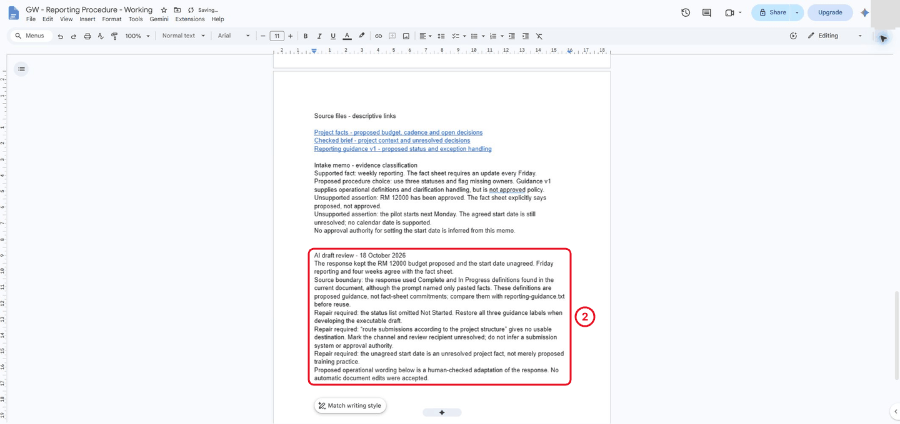

*This example review records the issues found in the illustrated reply. Your review should record your own findings, including source-supported points that need no repair.*

**No Gemini?** Review the reference draft in 2.3 against the sources. Record the same three checks and label your notes a reference-draft review. You still practise evidence judgement.

<details markdown="1">
<summary>What should you see?</summary>

The draft distinguishes known project facts from a proposed training procedure. The budget and start date remain unresolved.

</details>

<!-- Reference core captured 18 October 2026; independent learner challenge remains pending. -->

**Check:** Your review names a correct point and any missing, vague or unsupported instruction.

## 2.3 Insert the Checked Text

**Why:** The reader needs a usable procedure without reading an AI conversation. The checked text belongs above the evidence log.

### 2.3.1 Insert the supplied draft once

1. Above **Authoring Log**, click at the end of the purpose statement and create a blank paragraph.
2. Paste the complete reference draft below once; its title and four section labels are included.
3. Compare it with your reviewed AI response. Explain a repair if one is needed, or identify a source-supported point that is already correct.
4. Keep step 4 as supplied for now; you will add the missing status definitions in 2.4.

Paste this complete reference once, then compare its meaning with your reviewed response. Without Gemini, review this reference against the sources. Step 4 is deliberately incomplete until the repair in 2.4.2.

```text
Weekly reporting procedure - proposed training practice
Prepare
1. Identify your task in Planning, Procurement or Site Coordination. Preserve the source task ID and owner; flag missing information for clarification rather than inventing it.
2. Gather the current task update and a short exception note. Use fictional training data only; exclude live construction records and purchasing commitments.
Check
3. Compare project context with the fact sheet: the pilot runs four weeks from an agreed start date and requires a Friday update. RM 12000 remains proposed, not approved.
4. Confirm that operational instructions are labelled proposed training practice. If a fact or instruction has no evidence, retain an unresolved question.
Submit for Review
5. Prepare the weekly status update for Friday review. The submission channel, review recipient and cut-off time are unresolved; request agreement before treating a draft route as operational.
6. Check that the brief, task register, weekly update and project hub remain the four intended outputs. This training draft does not authorise sending or publication.
Resolve Questions
7. Record ambiguous statuses, missing owners and unsupported commitments as questions requiring clarification. Do not turn uncertainty into a completed task or an approved decision.
8. Recheck the entry against its sources after clarification. Until evidence is supplied, preserve the unresolved value and keep the draft distinguishable from an approved record.
```

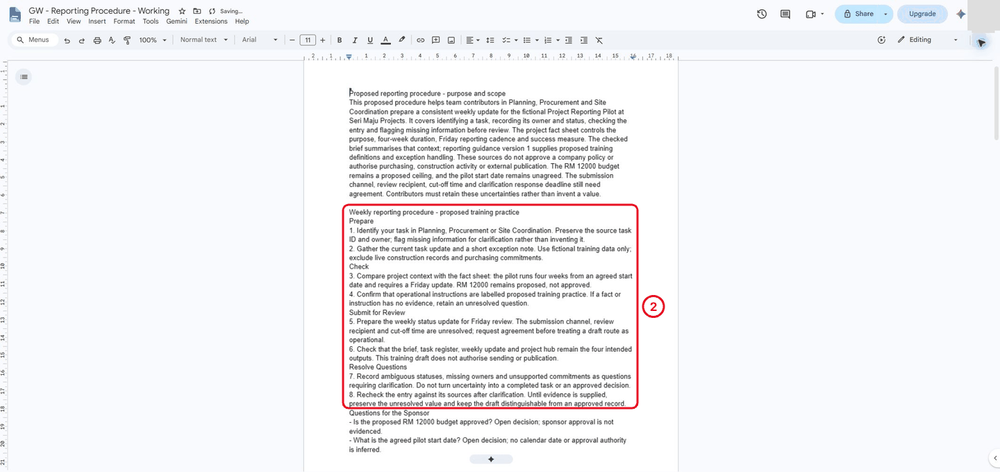

*The checked procedure sits in the reader-facing part of the document. The Gemini response and your review stay in the Authoring Log.*

**Check:** The procedure has four section labels and eight steps above Authoring Log.

### 2.3.2 Keep the fact sheet available

1. Keep `project-facts.txt` open in another tab so a reviewer can compare commitments.

**Check:** You can open the fact sheet for comparison.

### 2.3.3 Add the open decisions

1. Under procedure step 8, paste the Questions for the Sponsor block below once; the heading and both decisions are included.

```text
Questions for the Sponsor
- Is the proposed RM 12000 budget approved? Open decision; sponsor approval is not evidenced.
- What is the agreed pilot start date? Open decision; no calendar date or approval authority is inferred.
```

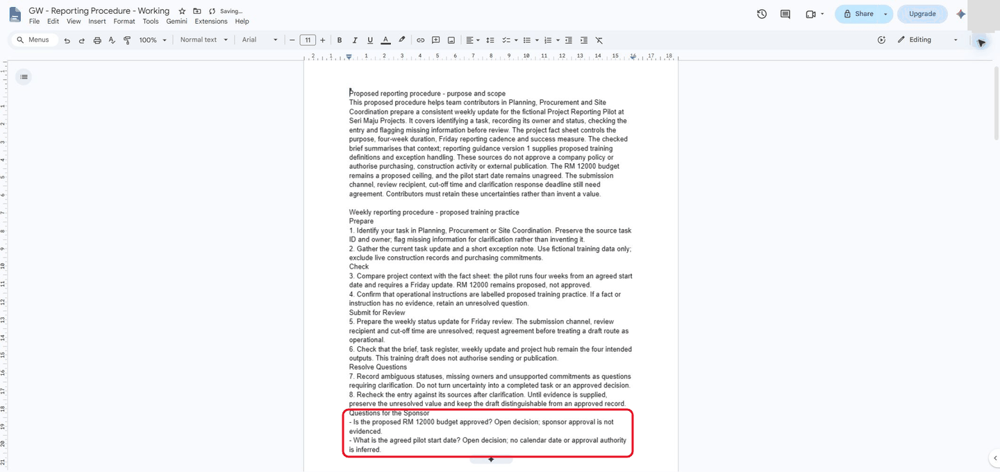

*The draft ends with two open sponsor questions. It doesn't invent an approval or a calendar date.*

<details markdown="1">
<summary>What should you see?</summary>

The procedure and its outstanding questions are readable without the Gemini conversation.

</details>

<!-- Reference core captured 18 October 2026; independent learner challenge remains pending. -->

**Check:** Both budget approval and start date remain open questions.

## 2.4 Develop an Executable Procedure and Test Its Logic

**Why:** A procedure must tell a person what to do and how to check the result. Test it with a normal record and an incomplete one.

### 2.4.1 Read the supplied plan

1. At the end of the Authoring Log, leave a blank paragraph outside any table.
2. Click **Copy heading and table** below and paste once with **Ctrl+V**.
3. Read across row 1: what comes in, what the contributor does, what they produce, and how they check it.
4. Verify the other rows against your procedure and sources.

The plan is supplied to save transcription. Verify the source labels and action/check pairs; change a row if your checked procedure differs.

<p data-copy-with-table><strong>Procedure plan - eight steps across four sections</strong><br>Sources: project-facts.txt (facts); reporting-guidance.txt v1 (proposed guidance). Workflow details are proposed practice.</p>

| Step | Input | Action | Output | Check |
|---|---|---|---|---|
| 1 Prepare | Supplied task record | Identify task; retain ID and owner (guidance) | Task or clarification query | No invented ID or owner |
| 2 Prepare | Current task information | Gather status and exception note (guidance) | Draft update | Fictional data only; gaps retained |
| 3 Check | Fact sheet | Check duration, cadence and budget (facts) | Context checked | Four relative weeks; Friday; RM 12000 proposed; start unagreed |
| 4 Check | Guidance v1 | Check all three status meanings (guidance) | Supported status or meaning query | No guessed mapping of unfamiliar labels |
| 5 Submit | Draft and unresolved routing | Prepare Friday review; request routing agreement (facts / proposed) | Review-ready draft retained | Channel, recipient and cut-off agreed before sending |
| 6 Submit | Intended project outputs | Check brief, register, update and hub (facts) | Scope check | No sending or publication authority |
| 7 Resolve | Missing or unsupported information | Record gap and ask for clarification (guidance / proposed) | Query and exception note | No invented decision |
| 8 Resolve | Evidence after clarification | Recheck entry against its source (proposed) | Checked entry or open query | Unresolved values stay visible |

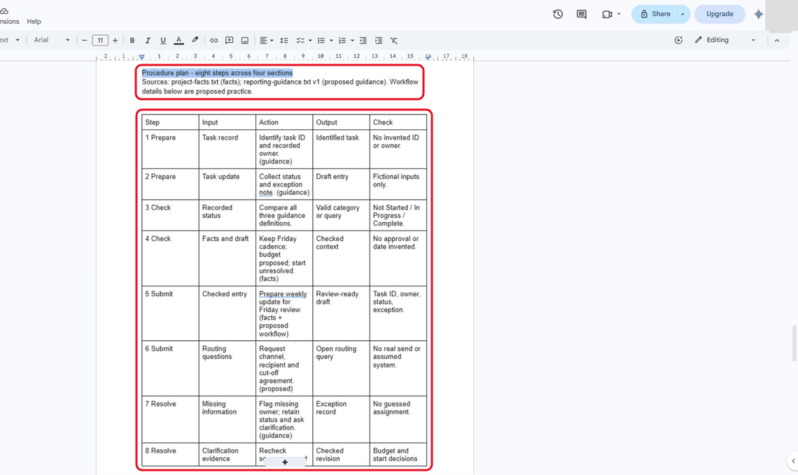

*Each step has an input, an action, an output and a check. Source labels in brackets show where each action comes from.*

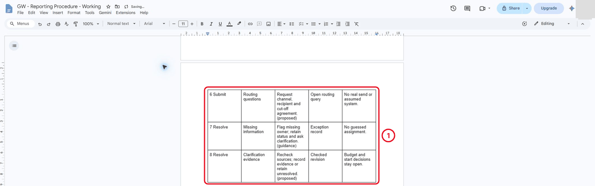

*Steps 6 to 8 cover routing questions, missing information and rechecking after clarification.*

**Check:** The eight rows each have an input, action, output and check.

### 2.4.2 Repair the status check

1. Check the plan against `reporting-guidance.txt` and the fact sheet.
2. Mark each factual instruction with its source in brackets, such as `(facts)` or `(guidance)`, and mark workflow details you designed as `(proposed)`.
3. The supplied reference draft deliberately leaves the status definitions out of procedure step 4. Replace that step with the checked wording below. This repairs the supplied reference; your own Gemini reply may already have included all three statuses.

```text
4. Check the three proposed guidance categories: Not Started means work has not begun; In Progress means work has begun without owner-confirmed completion; Complete means the owner has confirmed the agreed output is ready for review. Preserve an unfamiliar label as a clarification query rather than inventing a mapping.
```

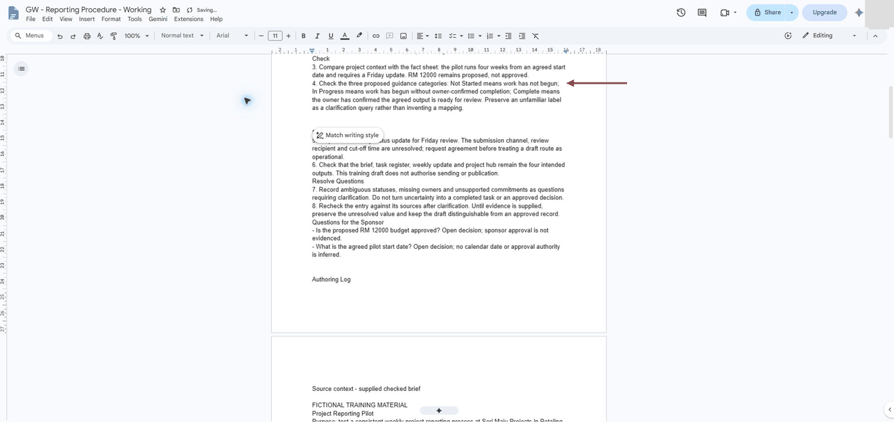

*The arrow marks the repaired step 4. An unfamiliar label becomes a clarification query rather than a guessed status.*

**Check:** Step 4 contains all three meanings and keeps unfamiliar labels unresolved.

### 2.4.3 Write a normal submission

1. Below the plan, type `Example weekly submission - fictional supplied record` and write a submission for task T001 from `Tasks.csv`: its TaskID, owner, status and exception note.

**Check:** T001 matches Tasks.csv; no new task data was invented.

### 2.4.4 Trace a missing owner

1. Below the example, type `Missing-owner route - proposed practice` and describe what happens for test card T-TEST-A provided below .
2. The route must stop anyone from guessing an owner and say what needs clarifying.

**Case input to analyse**

Read this fictional case here; you do not need to paste the case itself. Record your own check or decision where instructed.

> Walkthrough A: TaskID T-TEST-A, owner missing, status In Progress, exception “awaiting owner confirmation”. Walkthrough B: TaskID T-TEST-B, owner Siti Aminah, status Blocked. These are separate fictional procedure test cases; do not add them to the task workbook.

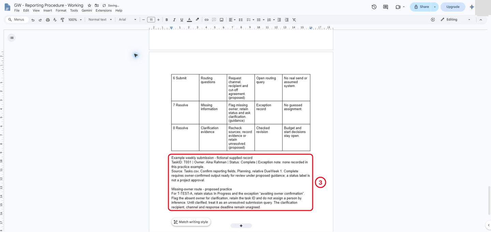

*The supplied T001 record and the missing-owner test card are kept separate. No owner is invented.*

**Check:** The missing-owner route asks for clarification rather than assigning someone.

### 2.4.5 Clarify the submission action

1. Rewrite procedure step 5 (Submit for Review) to make it clearer, using Gemini or by hand.
2. In the Authoring Log, type `Before:` and `After:` lines with the old and new wording, and a `Preserved checks:` line listing what the rewrite kept.

```text
5. Prepare a review-ready draft containing task ID, recorded owner, one supported status and an exception note when needed. The fact sheet requires Friday reporting. Before sending, obtain agreement on the submission channel, review recipient and cut-off time; if any is missing, retain the draft and record a routing query. This exercise sends nothing.
```

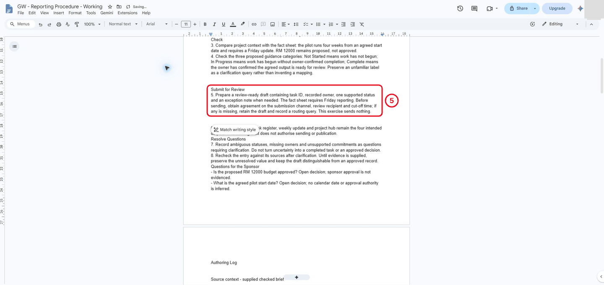

*The new step 5 keeps the draft and records a routing query while the channel, recipient and cut-off are unresolved.*

**Check:** The rewrite keeps the draft while routing is unresolved.

### 2.4.6 Walk through both routes

1. Do two paper walkthroughs.
2. Under `Paper walkthrough A - normal supplied T001`, follow the procedure with T001 and note where it gives a clear next action.
3. Under `Paper walkthrough B - incomplete card T-TEST-A`, do the same with the missing-owner card.
4. Record any ambiguity and the repair you made.

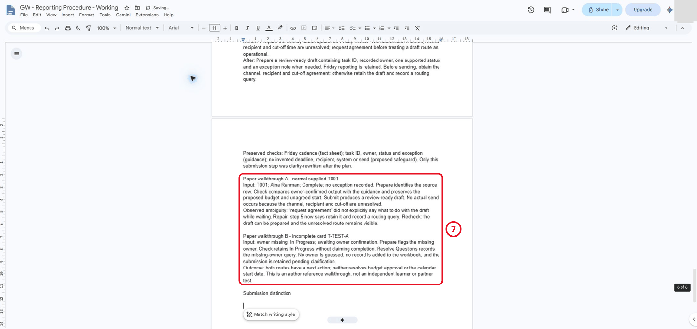

*Walkthrough A found that "request agreement" didn't say what to do with the draft while waiting. Step 5 was repaired.*

**Check:** Both walkthroughs record what happened and any repair.

### 2.4.7 Compare submission and question

1. Paste the distinction table and its heading below the walkthroughs once.
2. Verify both descriptions against your walkthroughs.
3. Explain why a review-ready draft is not necessarily ready to send.
4. Keep both project decisions unresolved.

<p data-copy-with-table><strong>Submission distinction</strong></p>

| Record type | Observable distinction |
|---|---|
| Complete submission | ID, recorded owner, supported status and any exception note are checked. Keep the draft unsent until channel, recipient and cut-off are agreed. |
| Unresolved question | Record the gap, source and clarification needed. Retain the draft; do not guess a missing value. |

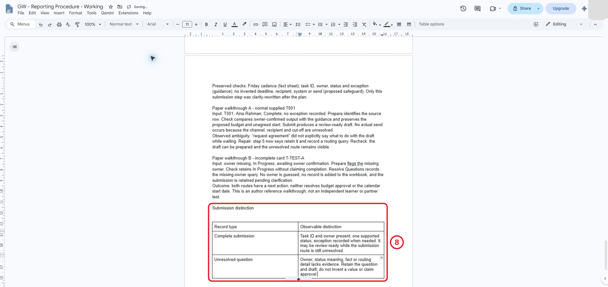

*A complete submission can be review-ready while its route is unresolved. An unresolved question keeps the draft and asks for evidence.*

<details markdown="1">
<summary>What should you see?</summary>

An eight-step plan with inputs, outputs and checks, a repaired step 4, a T001 example, a missing-owner route, two walkthroughs with a recorded repair, and the submission distinction table. The result must be supported by the recorded checks; an attractive output or an AI assurance is insufficient.

</details>

<!-- Reference core captured 18 October 2026; independent learner challenge remains pending. -->

**Check:** You can explain the difference without turning an open question into a completed submission.

## Independent Practice

**What is being tested:** perform the chapter skills without following the earlier clicks. Use the supplied material to reduce typing; explain your decisions and show the actual result. If you need a hint, record it and repeat that check independently.

1. Write a new **Late or Incomplete Submission** subsection without using the earlier drafting prompt. Give a reader a clear action, an exception record and a review check.

2. Test it with both card examples, one containing a missing owner and one an unfamiliar status. Do not silently convert “Blocked” into Complete or invent a new reporting deadline.

3. Ask a reviewer to execute the written steps verbally. Revise one ambiguity and save the source comparison in the Authoring Log.

### Evidence to Hand Over

- Eight-step procedure with inputs, outputs and checks.
- Normal and exception walkthroughs with a recorded repair.
- Independent late/incomplete subsection that preserves uncertainty.

Record the defect or uncertainty you investigated, the evidence used, the repair or reasoned no-change decision, and the final state. Restore temporary changes or keep them in a clearly named scenario copy.

<details markdown="1">
<summary>Reference-run scope (trainer information)</summary>

real-app reference route captured with 13 stage images. Gemini response reviewed, eight-step table verified and normal/missing-owner paper routes checked. Independent late/incomplete challenge and reviewer pilot remain pending.

The classroom-clarity revision changes the guide; the revised learner route and timings still need classroom checks.

</details>

## Troubleshooting

| Symptom | What to check |
|---|---|
| A shorter rewrite loses a required check | Compare the before-and-after input/action/output table and restore the missing check. |
| An input or earlier result is missing | Reopen the input named in Before You Begin; do not substitute private company data |
| A menu or feature is unavailable | Confirm the account and the shared access notes; record the missing step and ask the trainer for its fallback |
| The result differs from the checkpoint | Compare the exact source range, wording and conditions before repeating the action |

## Lesson Summary

You created a source-constrained draft. Structure and navigation will make it usable as a longer document.

**Check yourself:** Can you identify one instruction that is a proposed procedure step rather than a source fact?
