# 02 - Plan and Draft with Gemini

In this chapter you will generate an outline, draft from supplied evidence and record unsupported claims.

> **Prompts:** the [prompts page](./prompts.md) has every value and prompt for this chapter, each with a Copy button.

**Estimated time:** 55 minutes, planned as 10 explanation and demonstration, 25 guided build and casework, 15 independent practice and 5 verification and repair. Not yet timed with learners.

**Your result:** A checked proposed procedure with outstanding sponsor questions.

> **Status:** real-app reference route captured with 13 stage images. Gemini response reviewed, eight-step table verified and normal/missing-owner paper routes checked. Independent late/incomplete challenge and reviewer pilot remain pending.

---

## What You Will Learn

- Specify a useful drafting task.
- Review an AI proposal before using it.
- Preserve unresolved facts in a procedure.

## Before You Begin

Read the [case input](./prompts.md) and use a separate named casework copy for destructive tests or altered datasets. Keep the baseline unchanged for later chapters. Record source facts, proposed practice and unresolved questions separately.

Use your working document and the supplied [project facts](../../shared/sample-files/project-facts.txt). If AI access is unavailable, use the manual route below.

## 2.1 Define the Reader and Task

1. Open Ask Gemini in your working document.
2. Copy the Part 2 prompt from the prompts page and replace the source placeholder with the complete fact sheet.
3. Read the prompt before submitting. It asks for a panel response and a proposed procedure, not a change to company policy.

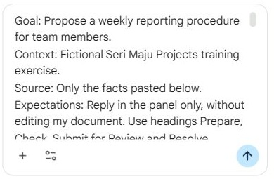

*The Gemini prompt is prepared with the actual fact sheet; the request remains unsubmitted at this stage.*

What should you see?

The request names the reader, source and output format. No source placeholder remains.

<!-- Reference core captured 18 October 2026; independent learner challenge remains pending. -->

## 2.2 Review the Draft

1. Submit and read the whole response. If Gemini instead proposes document edits, inspect them before choosing Accept all; use Reject all if the result is wrong.

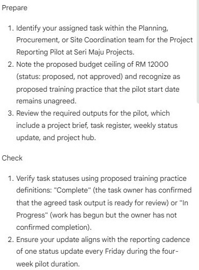

*The panel response is still an unreviewed proposal; its Check section omits Not Started.*

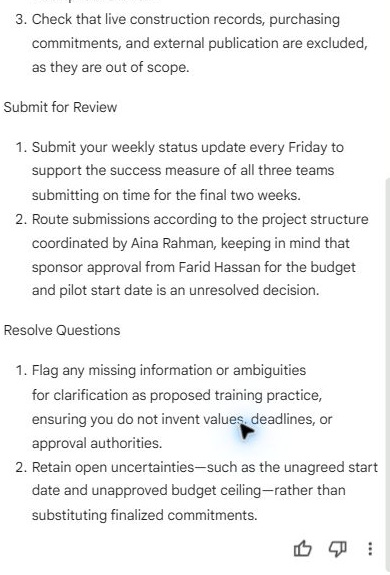

*The remaining response preserves open decisions but gives an insufficiently specific submission route.*

2. Compare each operational instruction with the fact sheet. Mark unsupported steps as proposed practice rather than an approved process.

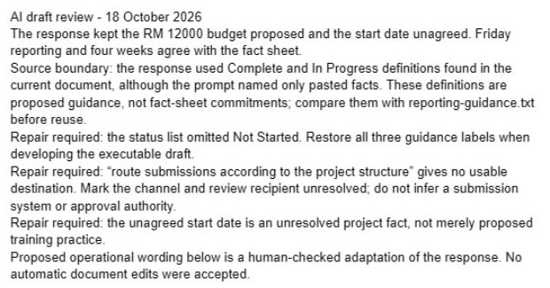

*The human review records source-boundary issues, the missing status and the vague routing instruction.*

3. If Gemini is unavailable, draft four sections manually: Prepare, Check, Submit for Review and Resolve Questions.

What should you see?

The draft distinguishes known project facts from a proposed training procedure. The budget and start date remain unresolved.

<!-- Reference core captured 18 October 2026; independent learner challenge remains pending. -->

## 2.3 Insert the Checked Text

1. Copy the checked draft into a new section of your working document. Remove duplicated titles.

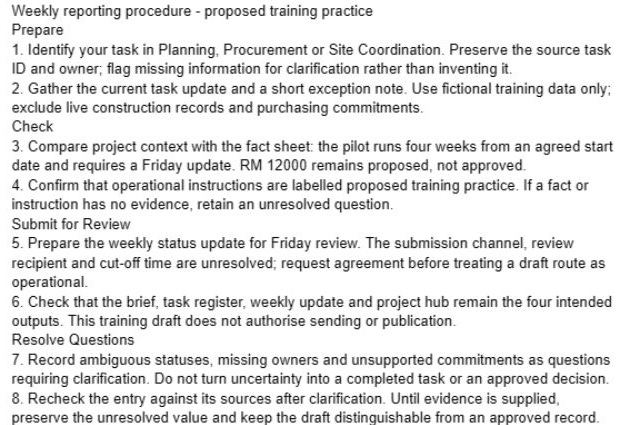

*The checked four-section draft is inserted separately from its retained evidence.*

2. Keep the source facts available so a reviewer can compare commitments.
3. Add a final section named `Questions for the Sponsor` with the two unresolved decisions.

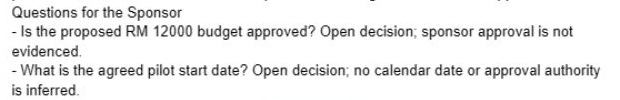

*The draft ends with two open sponsor questions and no invented approval or calendar date.*

What should you see?

The procedure and its outstanding questions are readable without the Gemini conversation.

<!-- Reference core captured 18 October 2026; independent learner challenge remains pending. -->

## 2.4 Develop an Executable Procedure and Test Its Logic

1. Before requesting a rewrite, make a table with Step, Input, Action, Output and Check. Plan at least eight meaningful procedure steps across the four main sections.

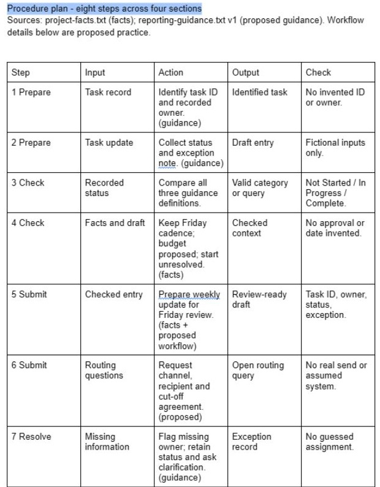

*The native plan maps the first seven steps to inputs, actions, outputs and checks.*

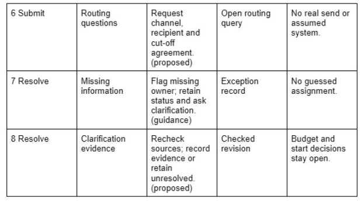

*The remaining plan rows complete eight meaningful steps across the four sections.*

2. Use reporting-guidance.txt alongside the fact sheet. Map every factual instruction to the relevant source, and label workflow details you design as proposed practice.

3. Draft an example weekly submission containing TaskID, owner, status and exception note. Use fictional values from the practice pack, not live work.

4. Add an alternate route for a task with a missing owner. The route must stop an invented assignment and identify what needs clarification.

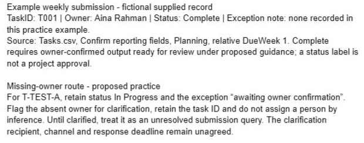

*A supplied T001 example is distinguished from the missing-owner test card.*

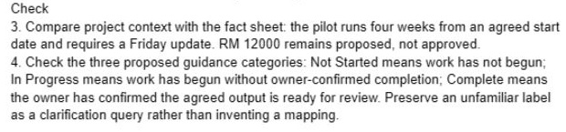

*The reader-facing check now includes all three proposed guidance definitions.*

5. Ask Gemini for a clarity rewrite of only one section, or rewrite it manually. Keep a before-and-after extract in the Authoring Log and compare the preserved checks.

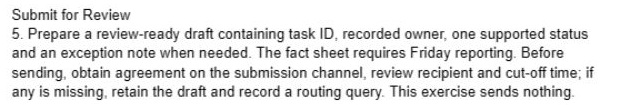

*The revised submission instruction explicitly retains a draft while routing details are unresolved.*

6. Perform a paper walkthrough using T001 as a complete record and the card’s incomplete record as the exception. Record where the procedure gives a usable next action and where it is ambiguous.

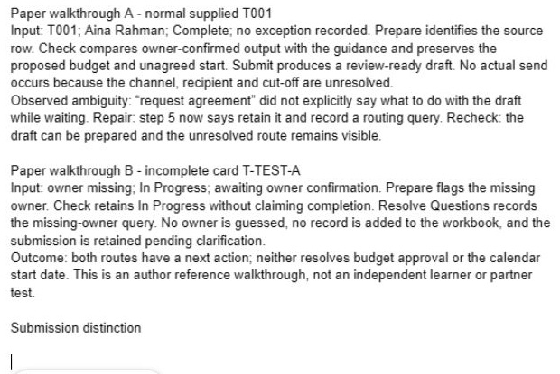

*The author walkthrough records normal and incomplete routes, the ambiguity and the repair.*

7. Repair the ambiguous instruction and add a two-row distinction between a complete submission and an unresolved question. Keep both project decisions unresolved.

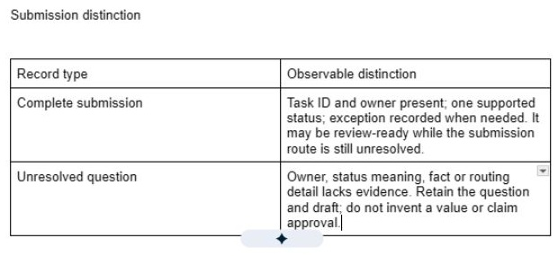

*A two-row distinction separates a review-ready submission from an unresolved question.*

What should you see?

Eight-step procedure with inputs, outputs and checks. The result must be supported by the recorded checks; an attractive output or an AI assurance is insufficient.

<!-- Reference core captured 18 October 2026; independent learner challenge remains pending. -->

## Independent Practice

Close the earlier step lists for the first attempt. Use the case input and your own reasoning. If you need help, record the hint and repeat the affected check independently.

1. Write a new **Late or Incomplete Submission** subsection without using the earlier drafting prompt. Give a reader a clear action, an exception record and a review check.

2. Test it with both card examples, one containing a missing owner and one an unfamiliar status. Do not silently convert “Blocked” into Complete or invent a new reporting deadline.

3. Ask a reviewer to execute the written steps verbally. Revise one ambiguity and save the source comparison in the Authoring Log.

### Evidence to Hand Over

- Eight-step procedure with inputs, outputs and checks.
- Normal and exception walkthroughs with a recorded repair.
- Independent late/incomplete subsection that preserves uncertainty.

Record the defect or uncertainty you investigated, the evidence used, the repair or reasoned no-change decision, and the final state. Restore temporary changes or keep them in a clearly named scenario copy.

## Troubleshooting

| Symptom | What to check |
|---|---|
| A shorter rewrite loses a required check | Compare the before-and-after input/action/output table and restore the missing check. |
| An input or earlier result is missing | Reopen the input named in Before You Begin; do not substitute private company data |
| A menu or feature is unavailable | Confirm the account and the shared access notes; record the missing step and ask the trainer for its fallback |
| The result differs from the checkpoint | Compare the exact source range, wording and conditions before repeating the action |

## Lesson Summary

You created a source-constrained draft. Structure and navigation will make it usable as a longer document.

**Check yourself:** Can you identify one instruction that is a proposed procedure step rather than a source fact?
