# 03 - Apply Styles and Navigation

In this chapter you will use heading styles, a contents list and bookmarks to make a long document navigable.

**Estimated time:** 55 minutes, planned as 10 explanation and demonstration, 25 guided build and casework, 15 independent practice and 5 verification and repair. Not yet timed with learners.

**Your result:** A styled procedure with a contents list and working internal links.

> **Skills you will demonstrate:** apply Title and heading styles; generate and refresh contents; create bookmark/heading/tab links; repair navigation after moving text.

---

## What You Will Learn

- Apply heading styles consistently.
- Insert and refresh a contents list.
- Link to a section with a bookmark.

## Before You Begin

**Which file?** Start in **Working**. From 3.4.3 onward, use **Navigation Practice**. Return to Working when starting Lab 04.

**Keep your place:** complete one small task, check its result, then move on. Type short names where shown. Supplied blocks include related lines in one paste; **Copy heading and table** buttons include the labels too. Use **Ctrl+V** on a blank paragraph outside existing tables. Screenshot wording and page counts are examples; check your own result.

Use your `GW - Reporting Procedure - Working` document from Lab 2. If you did not do Lab 2, place the following reference draft under your purpose statement before starting.

<details markdown="1">
<summary>Copy the prerequisite procedure draft if you skipped Lab 2</summary>

This is the supplied draft from Lab 2. If you skipped that lab, review it against the source files before using it.

```text
Weekly reporting procedure - proposed training practice
Prepare
1. Identify your task in Planning, Procurement or Site Coordination. Preserve the source task ID and owner; flag missing information for clarification rather than inventing it.
2. Gather the current task update and a short exception note. Use fictional training data only; exclude live construction records and purchasing commitments.
Check
3. Compare project context with the fact sheet: the pilot runs four weeks from an agreed start date and requires a Friday update. RM 12000 remains proposed, not approved.
4. Check the three proposed guidance categories: Not Started means work has not begun; In Progress means work has begun without owner-confirmed completion; Complete means the owner has confirmed the agreed output is ready for review. Preserve an unfamiliar label as a clarification query rather than inventing a mapping.
Submit for Review
5. Prepare a review-ready draft containing task ID, recorded owner, one supported status and an exception note when needed. The fact sheet requires Friday reporting. Before sending, obtain agreement on the submission channel, review recipient and cut-off time; if any is missing, retain the draft and record a routing query. This exercise sends nothing.
6. Check that the brief, task register, weekly update and project hub remain the four intended outputs. This training draft does not authorise sending or publication.
Resolve Questions
7. Record ambiguous statuses, missing owners and unsupported commitments as questions requiring clarification. Do not turn uncertainty into a completed task or an approved decision.
8. Recheck the entry against its sources after clarification. Until evidence is supplied, preserve the unresolved value and keep the draft distinguishable from an approved record.
Questions for the Sponsor
- Is the proposed RM 12000 budget approved? Open decision; sponsor approval is not evidenced.
- What is the agreed pilot start date? Open decision; no calendar date or approval authority is inferred.
```

</details>

## 3.1 Apply the Heading Hierarchy

**Why:** Heading styles give a document structure that the outline and contents can use. Larger or bold text alone does not do that.

### 3.1.1 Style the title

1. Click anywhere in the first line, `Proposed reporting procedure - purpose and scope`.
2. Open the style list in the toolbar (it shows **Normal text**) and choose **Title**.

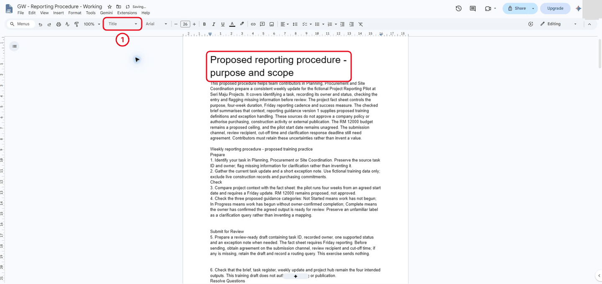

*The style list now shows Title. The line is the document's title, not just larger text.*

**Check:** The style menu says Title for the first line.

### 3.1.2 Style the main sections

1. Click in the word **Prepare** and choose **Heading 1** from the style list.
2. Do the same for Check, Submit for Review, Resolve Questions and Questions for the Sponsor.
3. Click **Show tabs and outlines** (the list icon at the top left) to see the outline.

**Check:** The main sections appear at one level in the outline.

### 3.1.3 Add a nested subsection

1. Click at the end of **Check** and press **Enter**.
2. Paste the two-line block below once.
3. Set only **Status Definitions** to **Heading 2**.
4. Set the explanation paragraph to **Normal text**, so it does not become a navigation entry.

```text
Status Definitions
Use reporting-guidance.txt version 1 for these proposed training definitions. The status check below preserves all three categories.
```

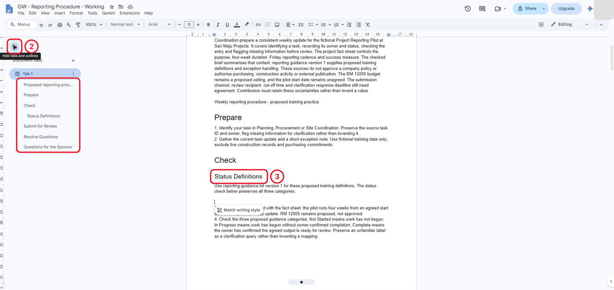

*The outline is built from heading styles. Status Definitions is indented because it is Heading 2.*

<details markdown="1">
<summary>What should you see?</summary>

The outline lists the main sections and nests Status Definitions beneath Check.

</details>

<!-- Reference core captured 18 October 2026; independent learner challenge remains pending. -->

**Check:** Status Definitions is nested under Check; its explanation is normal text.

## 3.2 Insert and Refresh the Contents

**Why:** A generated contents list follows heading structure, but it needs refreshing after a change.

### 3.2.1 Generate the contents

1. Click at the end of the purpose paragraph and press **Enter**.
2. Click **Insert**, **Table of contents** and choose the style with blue links.

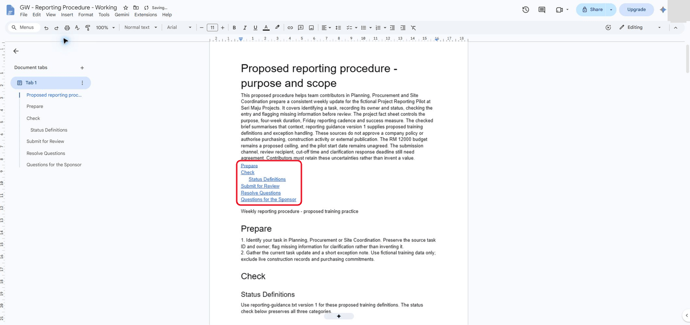

*Each entry is a link generated from a heading style. Nothing in this list is typed by hand.*

**Check:** The contents is generated, not a manually typed list.

### 3.2.2 Test an entry

1. Click the **Status Definitions** entry and check that the document jumps to that heading.

**Check:** The entry reaches Status Definitions.

### 3.2.3 Rename and refresh

1. Click in the **Check** heading and change it to `Check the Update`.
2. Scroll back up: the contents still says Check.
3. Click inside the contents list, then click the **Update table of contents** button (the circular arrow at its top left).

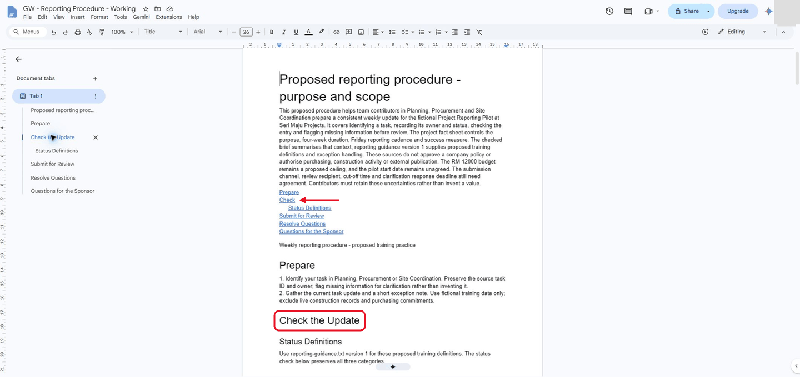

*The arrow marks the out-of-date entry. The contents doesn't change until you update it.*

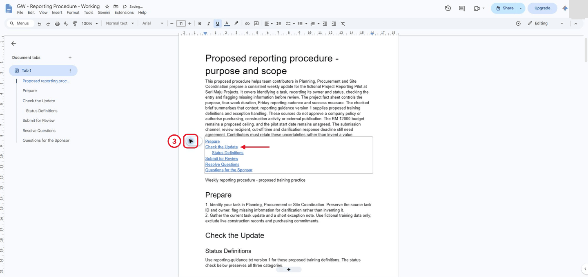

*After clicking the update button, the entry matches the renamed heading.*

<details markdown="1">
<summary>What should you see?</summary>

The contents shows the revised heading. It is generated from styles rather than a manually typed list.

</details>

<!-- Reference core captured 18 October 2026; independent learner challenge remains pending. -->

**Check:** The refreshed entry says Check the Update.

## 3.3 Create a Bookmark Link

**Why:** A bookmark marks a precise place. A descriptive link gives the reader a shortcut to that place.

### 3.3.1 Place a bookmark

1. Click at the start of the **Status Definitions** heading.
2. Click **Insert**, **Bookmark**.
3. A small Bookmark box appears under the heading.

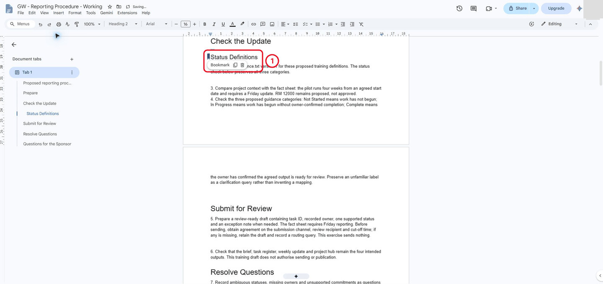

*The blue marker shows where the bookmark is. The box has a copy-link button and a remove button.*

**Check:** A bookmark marker is at Status Definitions.

### 3.3.2 Create the shortcut

1. Click at the end of the purpose paragraph (above the contents) and press **Enter**.
2. Type `Review the status definitions` and select it.
3. Click **Insert link** (or press **Ctrl+K**), click **Headings and bookmarks** and choose the **Status Definitions** bookmark.

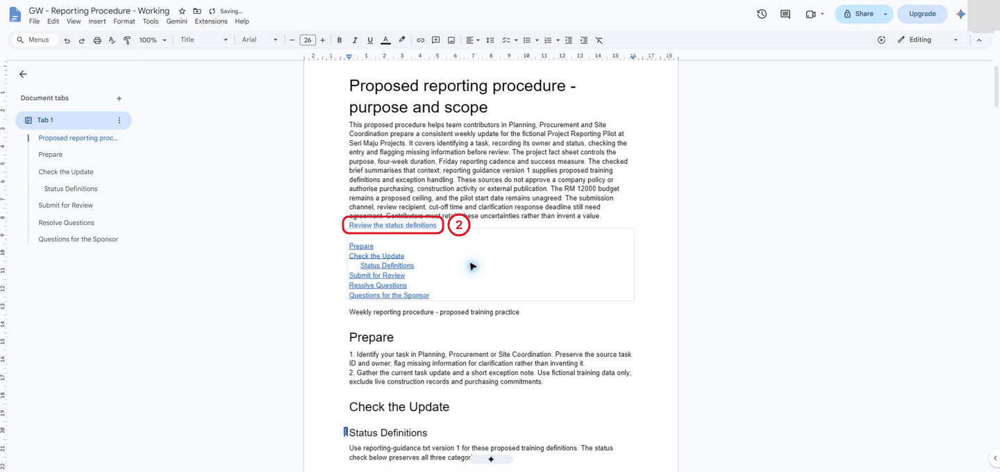

*The shortcut sits outside the contents list, so refreshing the contents doesn't remove it.*

**Check:** The link label describes its destination.

### 3.3.3 Follow the shortcut

1. Click the link and choose its address in the pop-up.
2. Check that the document jumps to Status Definitions.

<details markdown="1">
<summary>What should you see?</summary>

The internal link reaches the definitions without exposing or changing file permissions.

</details>

<!-- Reference core captured 18 October 2026; independent learner challenge remains pending. -->

**Check:** The shortcut lands at the definitions.

## 3.4 Organise a Longer Document and Repair Its Navigation

**Why:** Long documents need clear subsections and tested routes between tabs. Practise moving content on a separate copy.

### 3.4.1 Add three subsections

1. Under **Prepare**, paste the Required Fields block once.
2. Set its first line to **Heading 2** and its paragraph to **Normal text**.
3. Under **Submit for Review**, type **Submission Example** as Heading 2 and move your T001 example underneath it.
4. Under **Resolve Questions**, paste the Missing Information block once and style it the same way.
5. Update the contents after all three subsections are in place.

Each block includes its heading and explanation. Apply styles after pasting; formatting and navigation are the skills being practised.

```text
Required Fields
Prepare the task ID, recorded owner, one supported status and a short exception note when needed. Preserve the task source and relative DueWeek; do not convert it to an unagreed calendar date.
```

```text
Missing Information
If the owner is missing, retain the task ID and recorded status, flag the absent owner for clarification and keep an exception note. Do not guess an assignment. Until the submission channel, recipient and cut-off are agreed, keep the record as a draft.
```

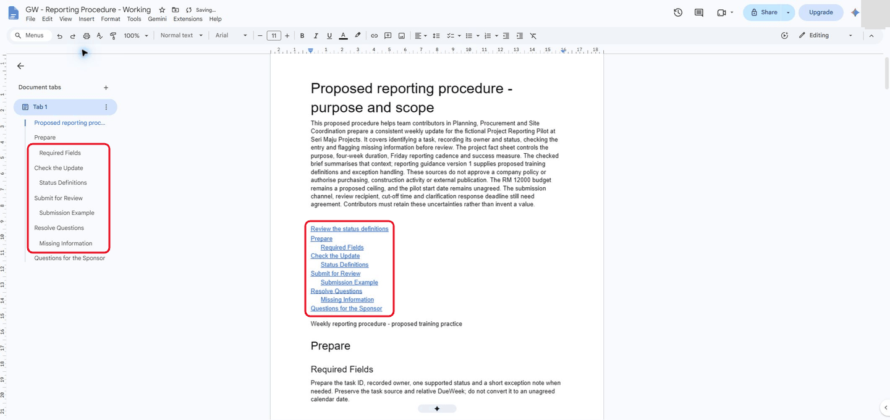

*Each new subsection appears in the outline and the contents at the second level.*

**Check:** The three Heading 2 subsections appear in outline and contents.

### 3.4.2 Finish Quick Start

1. Above the bookmark link, type `Quick Start`.
2. Under the bookmark link, add two more lines provided below: `Find the missing-owner route` and `Review the open sponsor decisions`.
3. Link them with **Insert link**, **Headings and bookmarks** to the **Missing Information** and **Questions for the Sponsor** headings.
4. Click each link to test it.

Keep the existing status shortcut. Paste only these two new labels together, then create their links.

```text
Find the missing-owner route
Review the open sponsor decisions
```

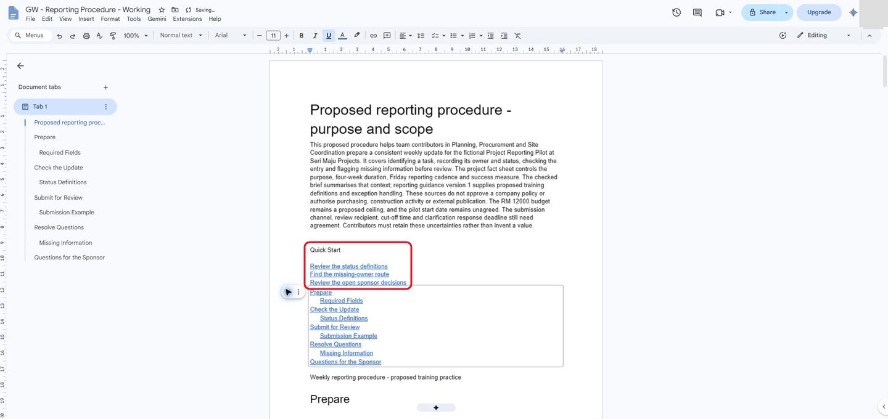

*Three shortcuts answer the three retrieval questions provided below.*

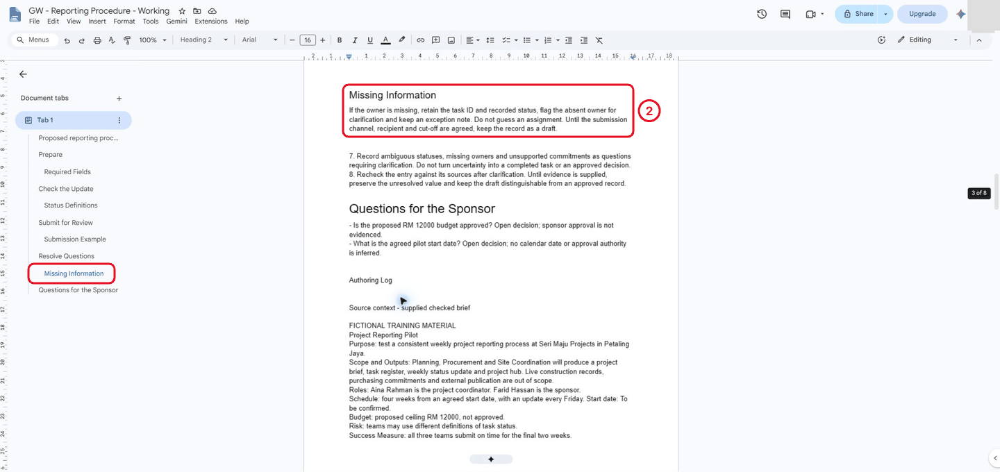

*The outline highlights Missing Information when the link lands there.*

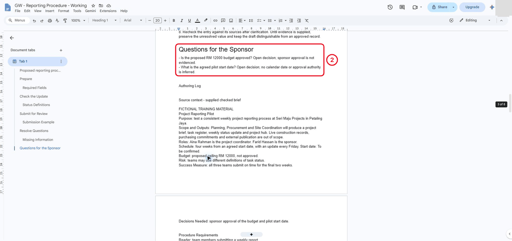

*Both open decisions are visible as soon as the link lands.*

**Check:** All three Quick Start links reach the intended headings.

### 3.4.3 Create the navigation copy

1. Click **File**, **Make a copy**.
2. Name it `GW - Reporting Procedure - Navigation Practice`, keep it in your practice folder and click **Make a copy**.
3. Do the rest of this section in the copy, so your Working document stays as it is.
4. In the copy, open **Show tabs and outlines**, click **+** next to **Document tabs**, then click the new tab's three dots, choose **Rename** and type `Examples`.
5. In the Examples tab, type the worked submission provided below.

```text
Worked submission - fictional example
T001 | Planning | Confirm reporting fields
Owner: Aina Rahman
Relative DueWeek: 1
Status: Complete
Exception note: none recorded for this practice example.
Check: under guidance v1, Complete requires the owner to confirm that the agreed output is ready for review. Budget approval and calendar start remain unresolved.
```

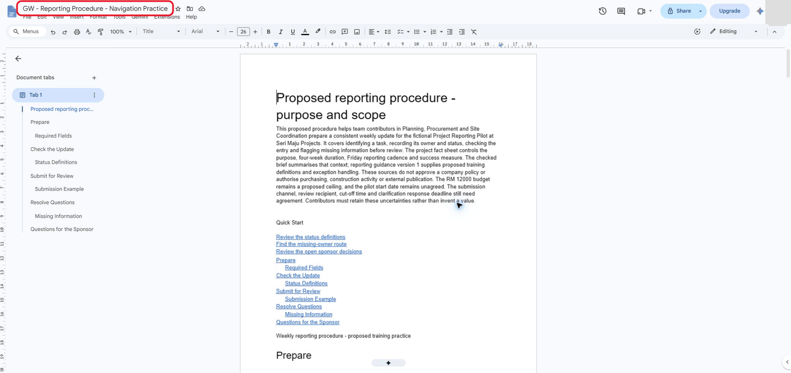

*The title bar shows the copy's name. The Working document is unchanged.*

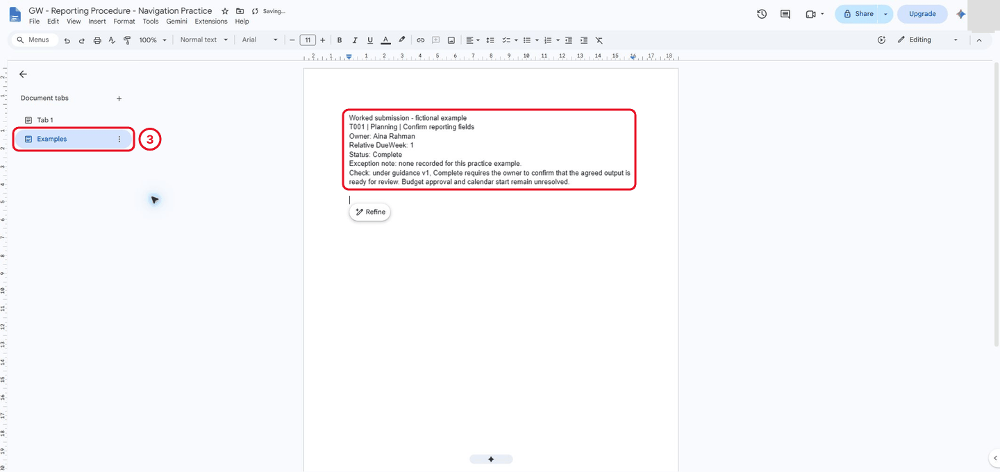

*The Examples tab holds one worked submission, kept apart from the main procedure.*

**Check:** The title says Navigation Practice and its Examples tab has the supplied example.

### 3.4.4 Link between tabs

1. Under the worked submission, type `Return to the main procedure` and link it with **Insert link**, **Tabs**, **Tab 1**.
2. Then switch to Tab 1, go to the end of the procedure (above the Authoring Log), type `Examples navigation` and `Open the Examples tab`, and link the second line to the **Examples** tab.
3. Test both links.

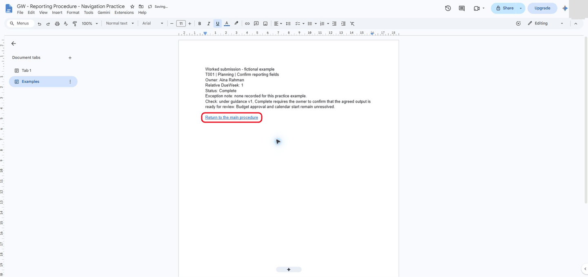

*This link takes the reader back to Tab 1.*

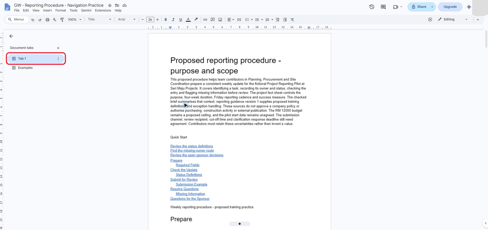

*Tab 1 is highlighted in the tab list after the link is clicked.*

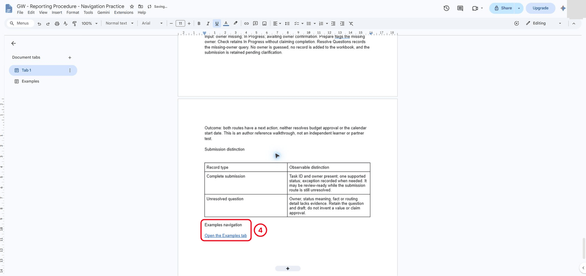

*The main tab has its own link to Examples.*

**Check:** Both directions work between Tab 1 and Examples.

### 3.4.5 Check contents scope

1. In the Examples tab, set the `Worked submission - fictional example` line to **Heading 1**.
2. Under the return link, type `Examples contents` and click **Insert**, **Table of contents**.
3. Then go to Tab 1 and update its contents.

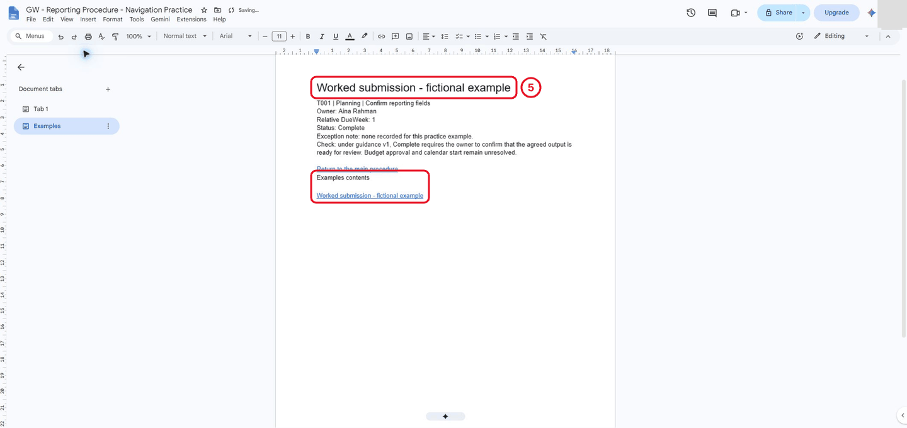

*The Examples contents lists only the heading in this tab.*

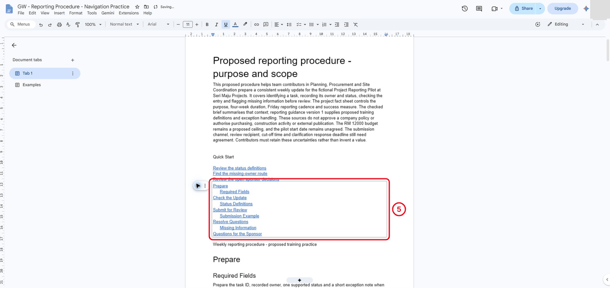

*Each tab's contents only lists headings in that tab, so cross-tab links are needed.*

**Check:** Each contents list includes its own tab; cross-tab links provide the other route.

### 3.4.6 Move and rename a subsection

1. Still in the copy, select the **Missing Information** heading and its paragraph, press **Ctrl+X**, click at the start of the **Required Fields** heading under Prepare and press **Ctrl+V**.
2. Rename the heading `Clarify Missing Information`.
3. Update the contents, then click **Find the missing-owner route** in Quick Start to check that it still arrives.

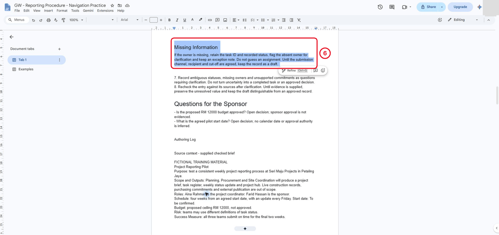

*Select the heading and its paragraph together so they move as one block.*

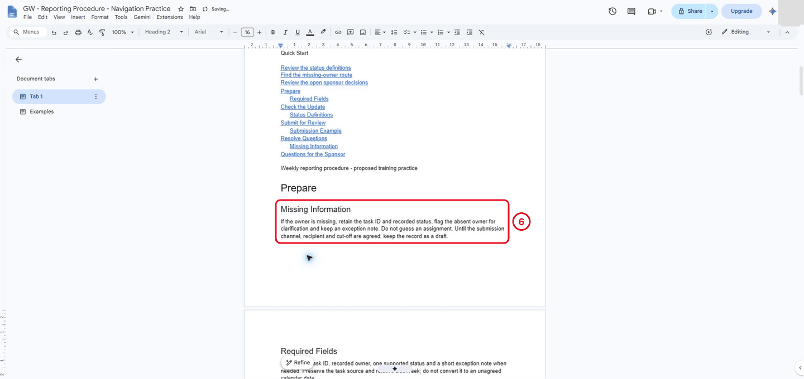

*Contributors now meet the missing-owner route while preparing their update.*

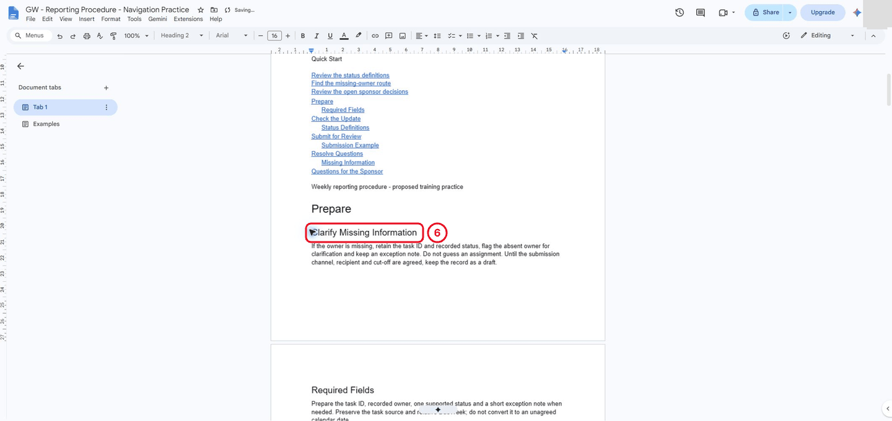

*The heading is still Heading 2 after renaming.*

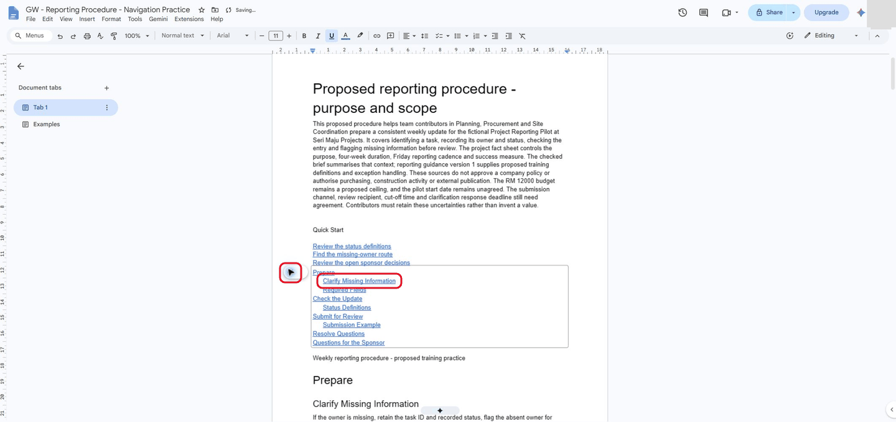

*Update the contents with its button to pick up the new name and position.*

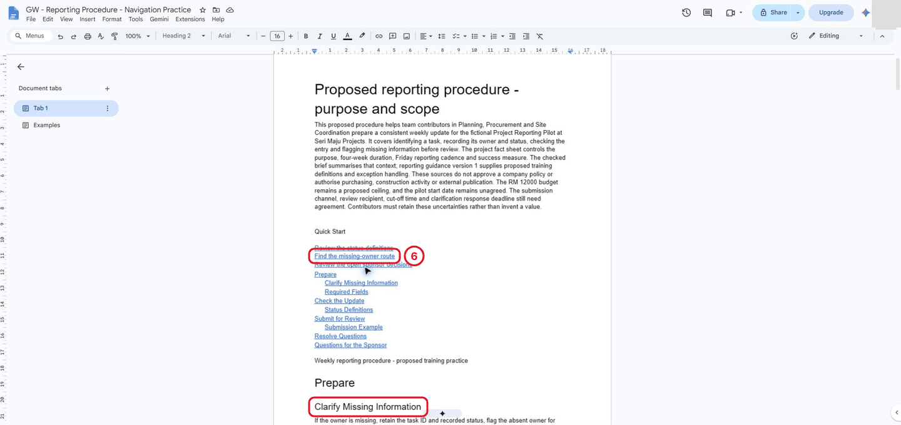

*A heading link follows the heading when it moves or is renamed.*

**Check:** The moved heading is still Heading 2 and its incoming shortcut still works.

### 3.4.7 Test retrieval

1. Give the copy to a reviewer with the three retrieval questions provided below.
2. Record which route they used and fix any misleading link or heading.
3. If you're working alone, do the retrieval yourself and label it an author check.
4. At the end of the copy, type `Navigation author check` and today's date, then record what you tested.

**Case input to analyse**

Read this fictional case here; you do not need to paste the case itself. Record your own check or decision where instructed.

> Retrieval questions: Where is Complete defined? What should I do when an owner is missing? Which decisions still need confirmation? Find each from the opening without scrolling through the whole document.

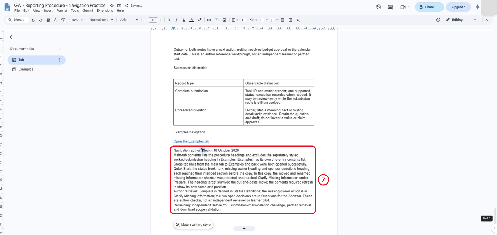

*The record lists the contents scope, the cross-tab tests, the retrieval routes and what is still pending.*

<details markdown="1">
<summary>What should you see?</summary>

A two-level heading hierarchy, three tested Quick Start links, working links between the tabs and a moved subsection whose shortcut still works. The result must be supported by the recorded checks; an attractive output or an AI assurance is insufficient.

</details>

<!-- Reference core captured 18 October 2026; independent learner challenge remains pending. -->

**Check:** Your record distinguishes a reviewer test from your own author check.

## Independent Practice

**What is being tested:** perform the chapter skills without following the earlier clicks. Use the supplied material to reduce typing; explain your decisions and show the actual result. If you need a hint, record it and repeat that check independently.

1. Add a separate **Before You Submit** checklist and link to it from the opening. Do not manually type a fake contents entry.

2. Change one heading and deliberately remove one bookmark only on the practice copy. Diagnose which incoming link fails and repair it with the appropriate destination.

3. Check main-tab and Examples navigation independently, then write a short note explaining the contents list’s observed scope and the remaining download-scope check.

### Evidence to Hand Over

- A two-level heading hierarchy and three tested Quick Start links.
- Examples tab or appendix with a working return link.
- Navigation fault, diagnosis and repair with a retrieval record.

Record the defect or uncertainty you investigated, the evidence used, the repair or reasoned no-change decision, and the final state. Restore temporary changes or keep them in a clearly named scenario copy.

<details markdown="1">
<summary>Reference-run scope (trainer information)</summary>

real-app reference route captured with 24 stage images. Heading hierarchy, refreshed contents, bookmark, three shortcuts, separate Examples tab, cross-tab links and moved/renamed subsection checked. Retrieval was an author check; independent challenge, partner test and export scope remain pending.

The classroom-clarity revision changes the guide; the revised learner route and timings still need classroom checks.

</details>

## Troubleshooting

| Symptom | What to check |
|---|---|
| The contents list misses another tab | Inspect the current tab’s outline and provide explicit cross-tab navigation rather than assuming global contents. |
| An input or earlier result is missing | Reopen the input named in Before You Begin; do not substitute private company data |
| A menu or feature is unavailable | Confirm the account and the shared access notes; record the missing step and ask the trainer for its fallback |
| The result differs from the checkpoint | Compare the exact source range, wording and conditions before repeating the action |

## Lesson Summary

Named styles support the outline, contents and navigation. Next, prepare the page layout.

**Check yourself:** What happens to the contents if a heading is only bold rather than styled?
