# 03 - Apply Styles and Navigation

In this chapter you will use heading styles, a contents list and bookmarks to make a long document navigable.

> **Prompts:** the [prompts page](./prompts.md) has every value and prompt for this chapter, each with a Copy button.

**Estimated time:** 55 minutes, planned as 10 explanation and demonstration, 25 guided build and casework, 15 independent practice and 5 verification and repair. Not yet timed with learners.

**Your result:** A styled procedure with a contents list and working internal links.

> **Status:** real-app reference route captured with 24 stage images. Heading hierarchy, refreshed contents, bookmark, three shortcuts, separate Examples tab, cross-tab links and moved/renamed subsection checked. Retrieval was an author check; independent challenge, partner test and export scope remain pending.

---

## What You Will Learn

- Apply heading styles consistently.
- Insert and refresh a contents list.
- Link to a section with a bookmark.

## Before You Begin

Read the [case input](./prompts.md) and use a separate named casework copy for destructive tests or altered datasets. Keep the baseline unchanged for later chapters. Record source facts, proposed practice and unresolved questions separately.

Use your procedure document. To practise without an AI draft, create four sections from the preceding chapter manually.

## 3.1 Apply the Heading Hierarchy

1. Select the document title paragraph and choose Title in the paragraph styles list.

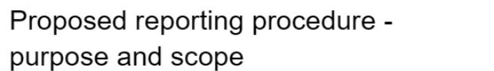

*The opening paragraph title uses the native Title style before navigation is added.*

2. Apply Heading 1 to Prepare, Check, Submit for Review, Resolve Questions and Questions for the Sponsor.
3. Under Check, add `Status Definitions` and apply Heading 2. Use normal text for its explanation.

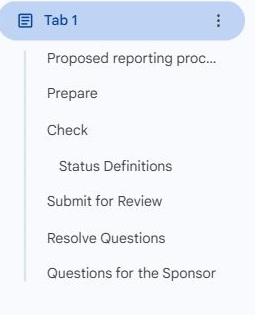

*The outline shows five main sections with Status Definitions nested under Check.*

What should you see?

The outline lists the main sections and nests Status Definitions beneath Check.

<!-- Reference core captured 18 October 2026; independent learner challenge remains pending. -->

## 3.2 Insert and Refresh the Contents

1. Place the cursor below the opening paragraph. Use Insert and the available Table of contents option.

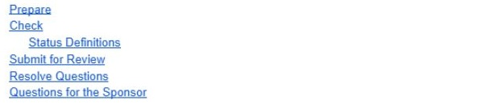

*A generated linked contents list appears before any heading rename.*

2. Choose a linked contents style. Click one entry and check that it navigates to the intended section.
3. Rename Check to `Check the Update`. Refresh the contents using its refresh control and check the new label.

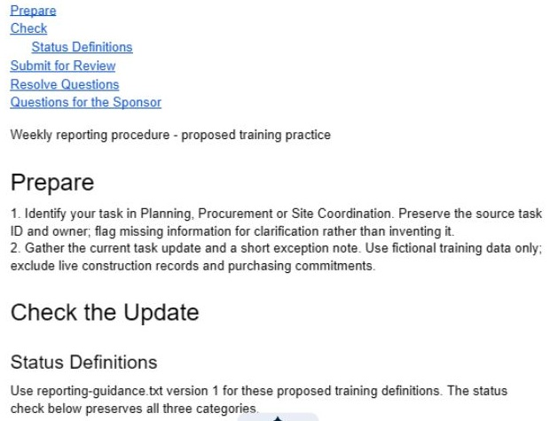

*The actual heading says Check the Update while the contents still says Check.*

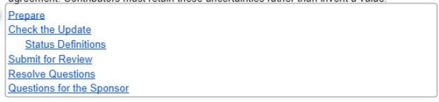

*Refreshing the generated contents picks up Check the Update.*

What should you see?

The contents shows the revised heading. It is generated from styles rather than a manually typed list.

<!-- Reference core captured 18 October 2026; independent learner challenge remains pending. -->

## 3.3 Create a Bookmark Link

1. Place the cursor beside the status definitions and choose Insert, then Bookmark.

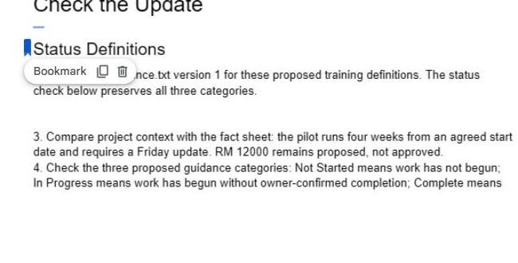

*A native bookmark is placed beside the status definitions.*

2. Copy the bookmark link from its control. Add text `Review the status definitions` near the opening and link it to the bookmark.

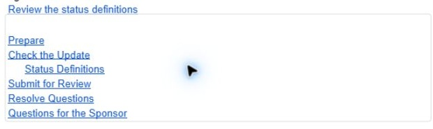

*The descriptive bookmark shortcut sits outside the generated contents list.*

3. Test the link. If document tabs are in use, check that the link reaches the intended tab as well as the section.

What should you see?

The internal link reaches the definitions without exposing or changing file permissions.

<!-- Reference core captured 18 October 2026; independent learner challenge remains pending. -->

## 3.4 Organise a Longer Document and Repair Its Navigation

1. Add at least three genuine subsections: **Required Fields**, **Missing Information** and **Submission Example**. Place them under the relevant Heading 1 sections and use Heading 2 consistently.

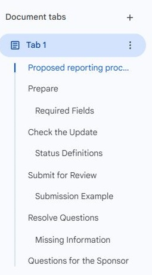

*Three substantive subsections join the two-level hierarchy.*

2. Create a **Quick Start** paragraph with descriptive links to the status definitions, missing-information route and sponsor questions. Use heading links or bookmarks and test each destination.

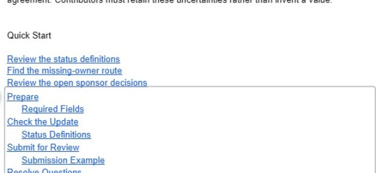

*Quick Start has separate shortcuts for definitions, missing-owner handling and open decisions.*

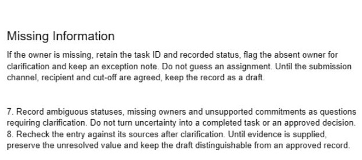

*The missing-owner shortcut reaches the actual exception-handling text.*

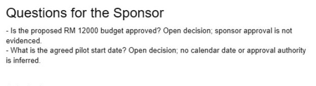

*The sponsor shortcut reaches the two unresolved project decisions.*

3. Open **Show tabs & outlines** if available. In a practice copy, create a second document tab named **Examples** and put one worked submission there. Keep the main procedure in its original tab.

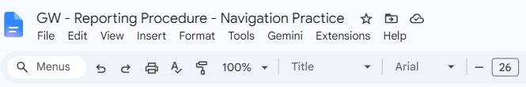

*Navigation tests continue in a separately named copy; the working baseline is retained.*

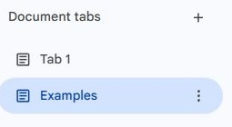

*Examples is selected in the separate practice document before its navigation links are added.*

4. Link from the main procedure to Examples and back. If document tabs are unavailable, use an Examples appendix in the same tab and record that fallback.

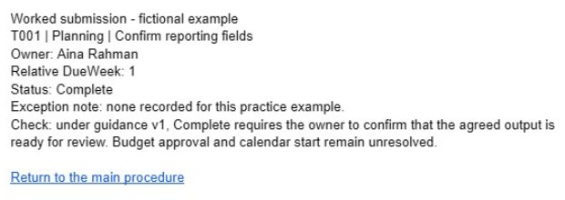

*Examples has an actual link back to the main procedure tab.*

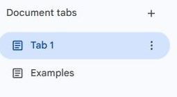

*Opening the return link selects the main tab in the same practice document.*

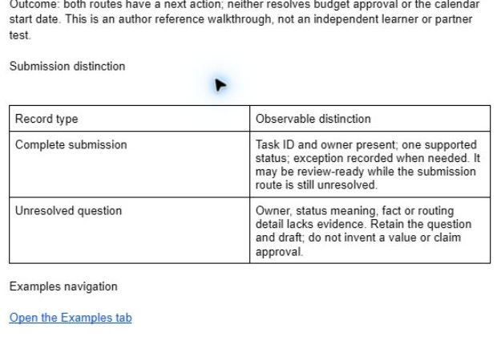

*The main tab has its own actual shortcut to Examples.*

5. Inspect the contents list’s scope. Do not assume it combines all document tabs; create or check navigation for each tab separately.

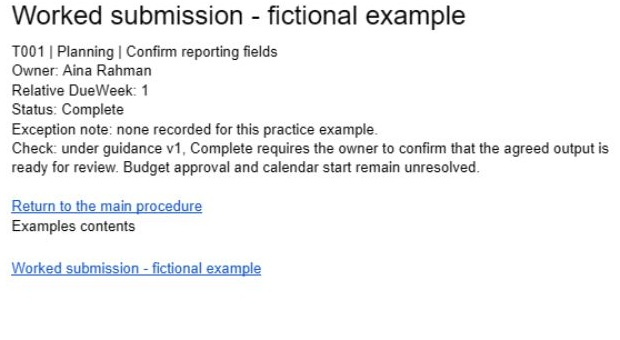

*Examples has a generated contents list for its own styled heading.*

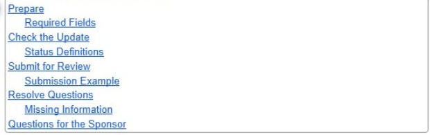

*Refreshing the main contents does not add the heading from the separate Examples tab.*

6. On the practice copy, rename **Missing Information** to **Clarify Missing Information** and move that subsection to a more appropriate point. Refresh the contents and retest its incoming links.

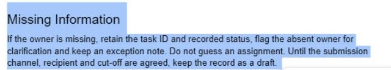

*The missing-information heading and its explanation are selected together in the practice copy.*

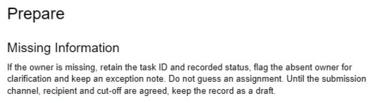

*The missing-owner route is moved beneath Prepare, before Required Fields.*

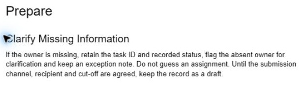

*The moved subsection is renamed Clarify Missing Information.*

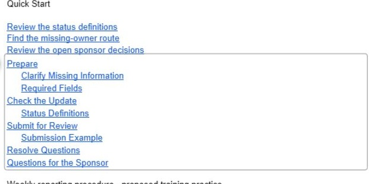

*A refresh updates the contents name and nesting after the move.*

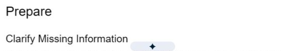

*The incoming shortcut still reaches the moved and renamed subsection.*

7. Give the document to a reviewer with the three retrieval questions on the card. Record which route they used and fix a misleading link or heading. If reviewing alone, perform an author retrieval check and label it separately; a partner or learner test remains pending.

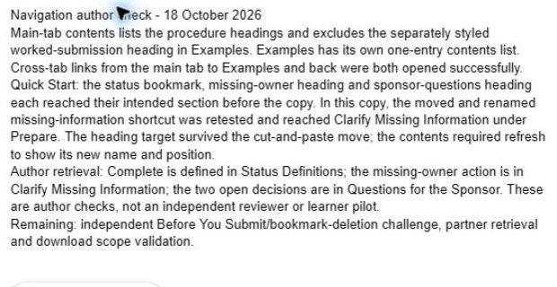

*The author check records contents scope, cross-tab tests, retrieval routes and pending learner checks.*

What should you see?

A two-level heading hierarchy and three tested Quick Start links. The result must be supported by the recorded checks; an attractive output or an AI assurance is insufficient.

<!-- Reference core captured 18 October 2026; independent learner challenge remains pending. -->

## Independent Practice

Close the earlier step lists for the first attempt. Use the case input and your own reasoning. If you need help, record the hint and repeat the affected check independently.

1. Add a separate **Before You Submit** checklist and link to it from the opening. Do not manually type a fake contents entry.

2. Change one heading and deliberately remove one bookmark only on the practice copy. Diagnose which incoming link fails and repair it with the appropriate destination.

3. Check main-tab and Examples navigation independently, then write a short note explaining the contents list’s observed scope and the remaining download-scope check.

### Evidence to Hand Over

- A two-level heading hierarchy and three tested Quick Start links.
- Examples tab or appendix with a working return link.
- Navigation fault, diagnosis and repair with a retrieval record.

Record the defect or uncertainty you investigated, the evidence used, the repair or reasoned no-change decision, and the final state. Restore temporary changes or keep them in a clearly named scenario copy.

## Troubleshooting

| Symptom | What to check |
|---|---|
| The contents list misses another tab | Inspect the current tab’s outline and provide explicit cross-tab navigation rather than assuming global contents. |
| An input or earlier result is missing | Reopen the input named in Before You Begin; do not substitute private company data |
| A menu or feature is unavailable | Confirm the account and the shared access notes; record the missing step and ask the trainer for its fallback |
| The result differs from the checkpoint | Compare the exact source range, wording and conditions before repeating the action |

## Lesson Summary

Named styles support the outline, contents and navigation. Next, prepare the page layout.

**Check yourself:** What happens to the contents if a heading is only bold rather than styled?
