# 04 - Prepare a Professional Page Layout

In this chapter you will set up pages, headers, footers and page numbering; compare pages and pageless use.

> **Prompts:** the [prompts page](./prompts.md) has every value and prompt for this chapter, each with a Copy button.

**Estimated time:** 50 minutes, planned as 10 explanation and demonstration, 20 guided build and casework, 15 independent practice and 5 verification and repair. Not yet timed with learners.

**Your result:** An A4 document with checked headers, footers and page numbers.

> **Status:** core sections 4.1-4.4 executed as an author reference run. Thirty-five staged images cover page setup, real headers/footers and page numbers, table/checklist casework, a separate Pageless comparison and checked PDF repairs. Full captured frames are retained for editing. The escalation-table independent challenge and learner timings remain pending.

---

## What You Will Learn

- Choose pages or pageless for the intended output.
- Add consistent page elements.
- Check a multi-page document visually.

## Before You Begin

Read the [case input](./prompts.md) and use a separate named casework copy for destructive tests or altered datasets. Keep the baseline unchanged for later chapters. Record source facts, proposed practice and unresolved questions separately.

Continue with your maintained `GW - Reporting Procedure - Working` document from Labs 1-3. Keep the Navigation Practice copy separate. The existing procedure and authoring evidence already make this a multi-page document; do not add filler or blank paragraphs to force more pages.

## 4.1 Choose the Document Format

1. Click **File**, **Page setup**. Inspect **Pages** and **Pageless**. You can inspect the Pageless tab, then return to Pages before applying anything.

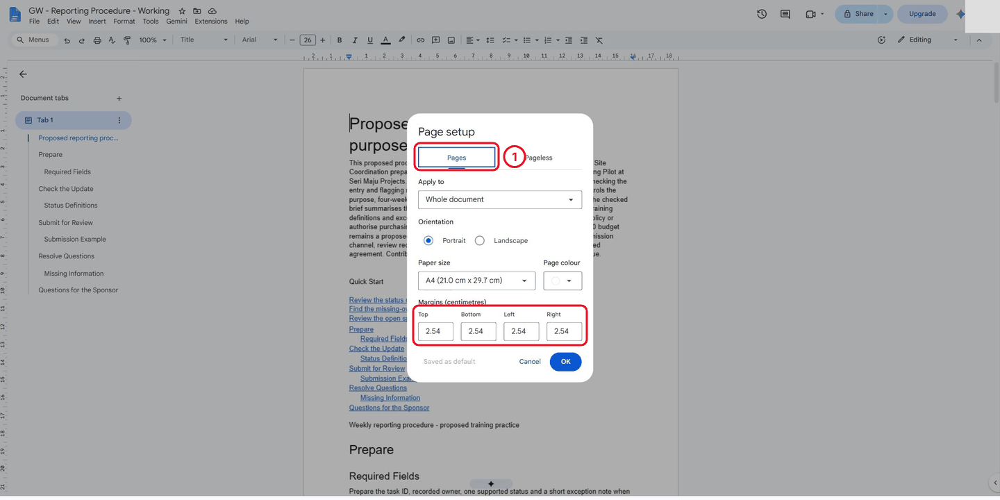

*The original Pages settings use A4 portrait and 2.54 cm margins.*

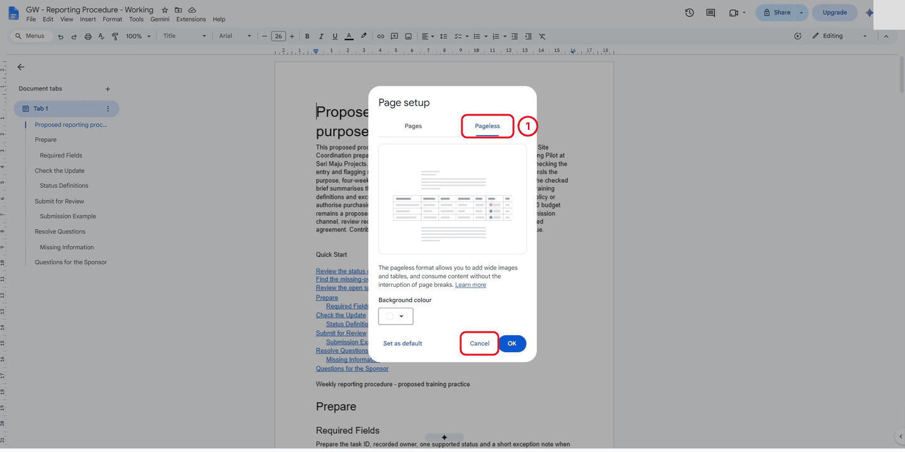

*Inspect Pageless without applying it to the maintained print document.*

2. On the **Pages** tab, set **Apply to** to **Whole document**, **Orientation** to **Portrait** and **Paper size** to **A4**. Type **2** in each of Top, Bottom, Left and Right, then click **OK**. Don't click **Set as default**.

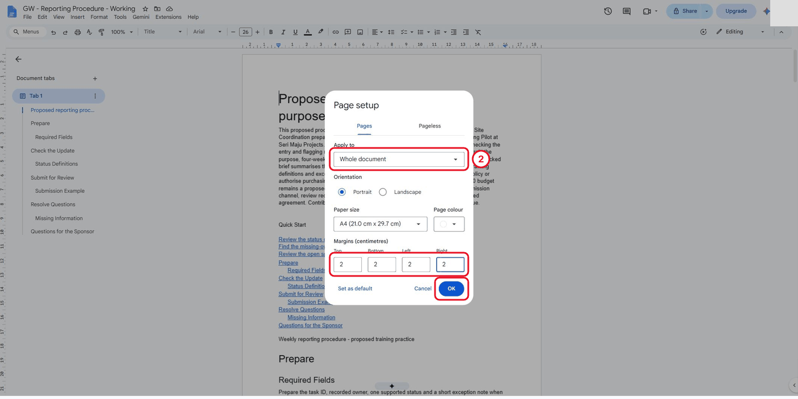

*Whole document, Pages, A4 portrait and four matching 2 cm margins before applying.*

3. Inspect the first page and its visible page boundary. Discuss when a wide collaborative working document might use Pageless instead.

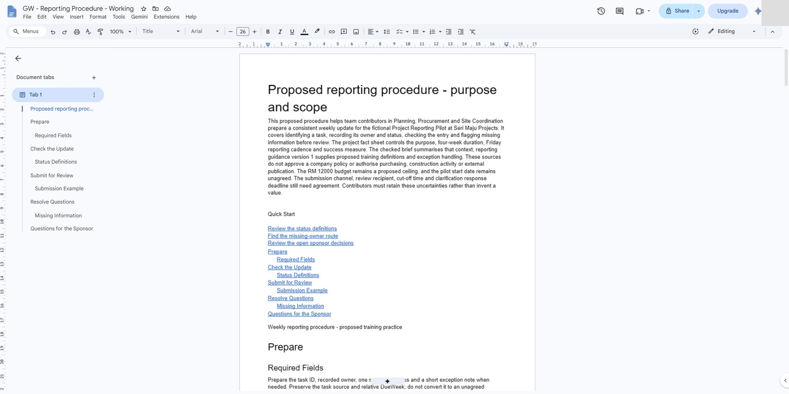

*The maintained document has page boundaries before headers and footers are added.*

What should you see?

The document has visible page boundaries. Page headers and page numbers are being tested in Pages mode.

<!-- CAPTURED: core reference route; independent escalation challenge and learner pilot remain pending. -->

## 4.2 Add Page Elements

1. Click **Insert**, **Page elements**, **Header** and type `Project Reporting Procedure`. Leave **Different first page** unchecked for this exercise. Press **Esc** to return to the body.

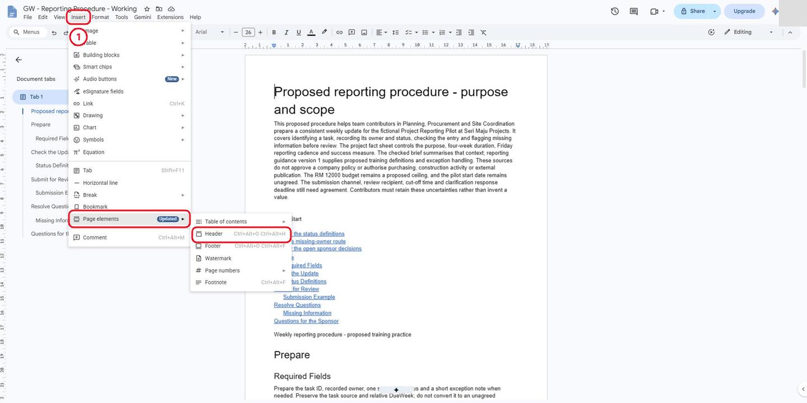

*Insert > Page elements contains Header, Footer and Page numbers.*

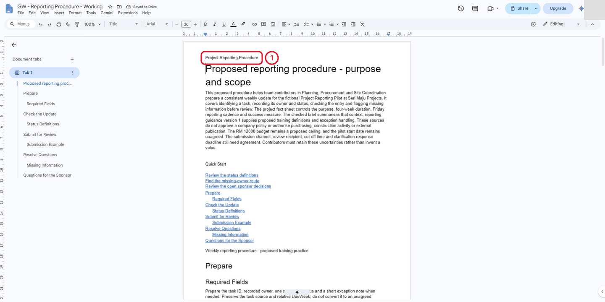

*The repeating header is present before adding the footer or page number.*

2. Click **Insert**, **Page elements**, **Footer**. Type `Fictional training material`, then press **Esc**.

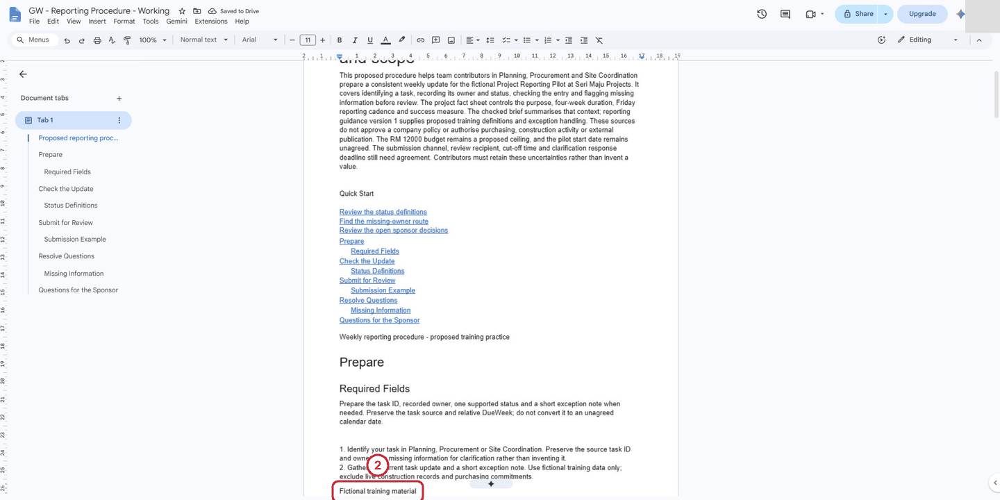

*The fictional-material footer is present before automatic numbering.*

3. Click **Insert**, **Page elements**, **Page numbers**, then the footer option starting on page one. A separate right-aligned page-number paragraph can appear below the footer label. Inspect a later page to confirm the number changes automatically.

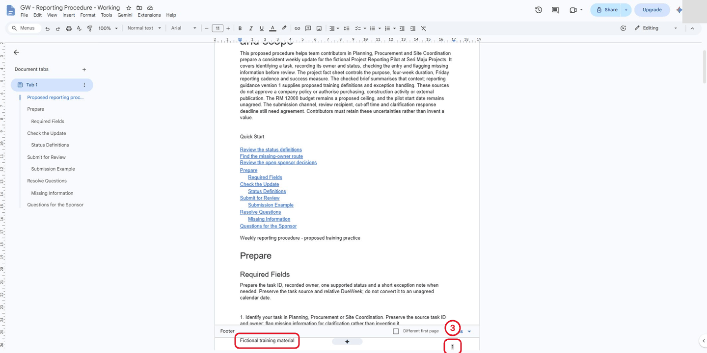

*The footer contains a live page-number field rather than a typed number.*

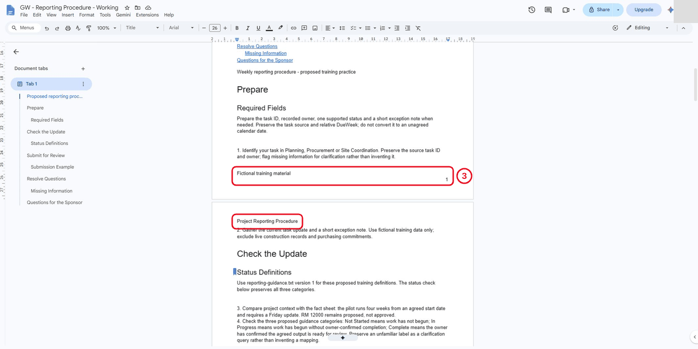

*The boundary shows page one’s footer and the repeated header on page two.*

What should you see?

The repeated elements are consistent and page numbering changes automatically across pages.

<!-- CAPTURED: core reference route; independent escalation challenge and learner pilot remain pending. -->

## 4.3 Check Page Breaks

1. Inspect every page for an isolated heading, split row or avoidable blank gap. Remove accidental heading formatting from empty paragraphs without deleting real headings or their navigation targets.
2. Click in a real heading and click **Format**, **Line & paragraph spacing**. Inspect **Keep with next** and **Keep lines together**; leave an already checked option on. Use **Add page break before** only for a genuine new section, such as the Authoring Log.

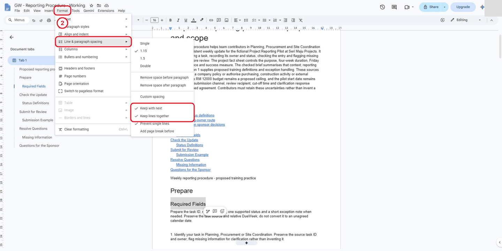

*The selected real heading already has Keep with next and Keep lines together enabled.*

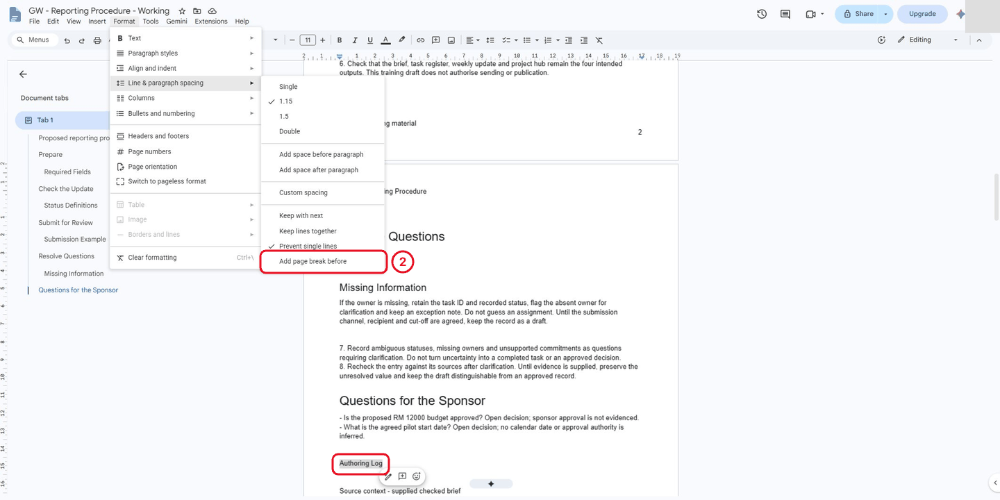

*A deliberate page break starts the evidence log separately from the reader-facing procedure.*

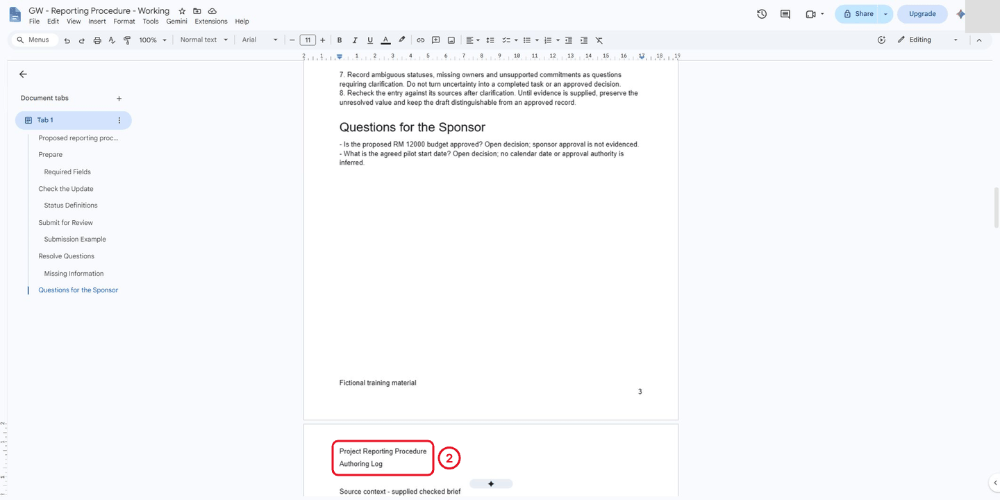

*The Authoring Log starts on a new page; source wording is retained.*

3. Click **File**, **Download**, **PDF document (.pdf)**. Open the downloaded file and inspect every page.

<!-- Reference run: the native PDF was retrieved through the connected Drive export after requesting the browser download; browser download completion is unverified. -->

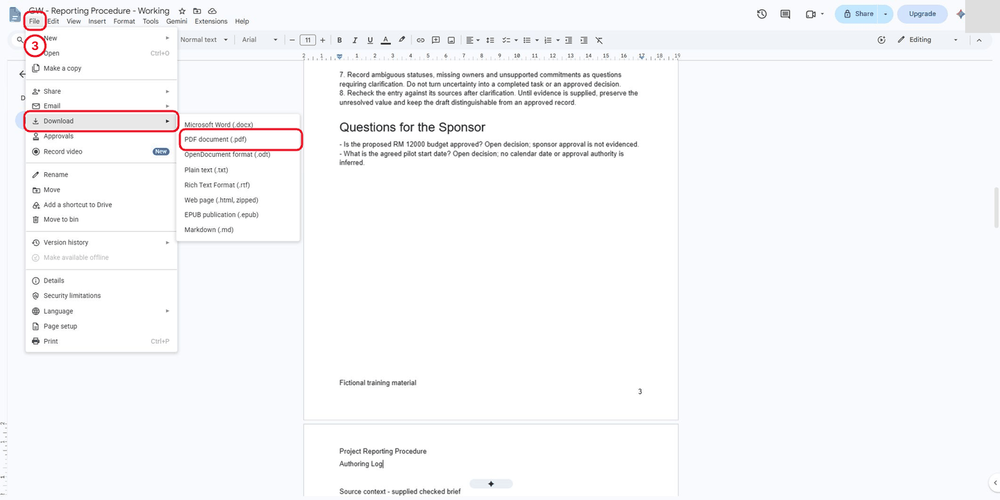

*File > Download offers PDF document for a print-layout snapshot.*

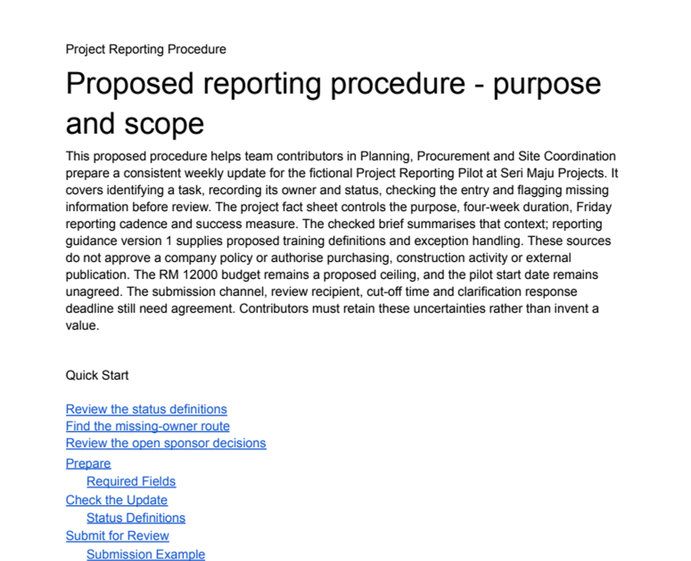

*The first native export is checked before adding the field table and submission checklist.*

If a table continues on another page without its headings, select a cell, open **Table options**, expand **Row**, then enable **Pin header row(s)** with a count of **1**. Inspect the actual continuation page.

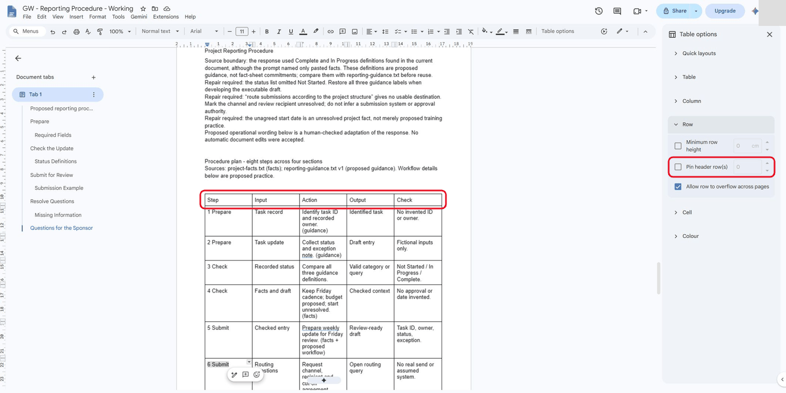

*The split procedure-plan table initially has no pinned header row.*

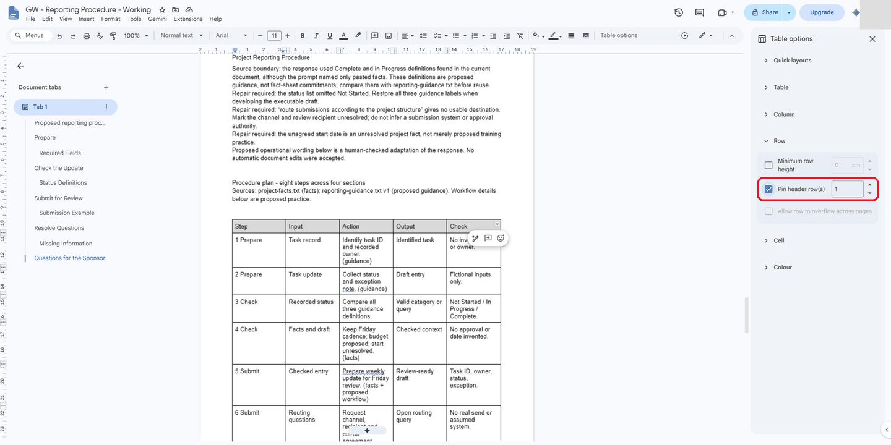

*Pin header row(s) is enabled with a count of one.*

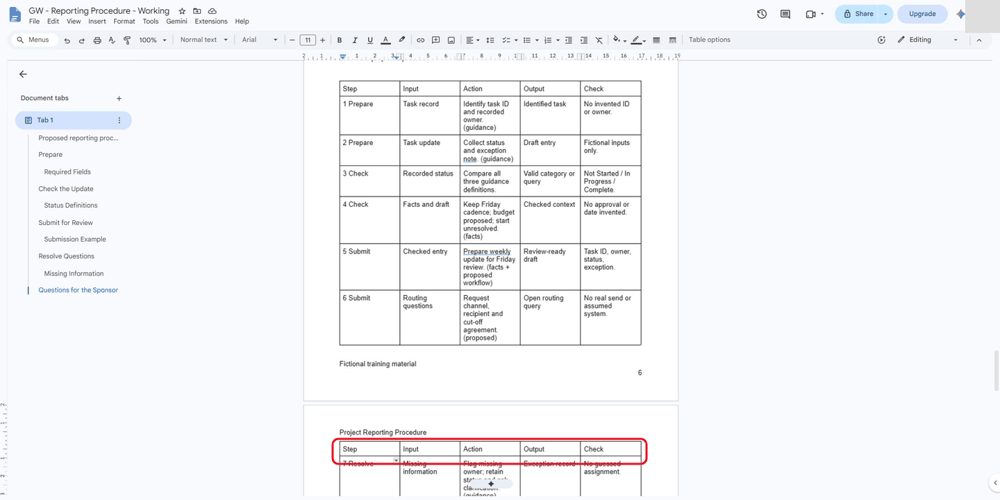

*The continuation page now repeats Step, Input, Action, Output and Check.*

What should you see?

Every page has usable content, legible page elements and no avoidable blank page.

<!-- CAPTURED: core reference route; independent escalation challenge and learner pilot remain pending. -->

## 4.4 Lay Out a Usable Multi-Page Procedure

1. Under **Required Fields**, add `Field reference - proposed training template`. Click **Insert**, **Table** and start with four columns. Enter the four headings and the six field rows from the prompts page. If the picker offers only five rows, pressing **Tab** in the final cell adds another row. Finish with **7 rows by 4 columns**, including the header.

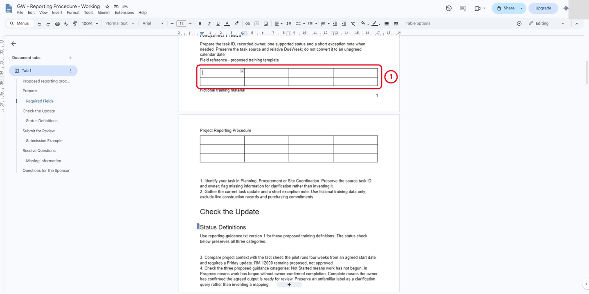

*The native table starts with four columns; Tab in the last cell adds the remaining rows.*

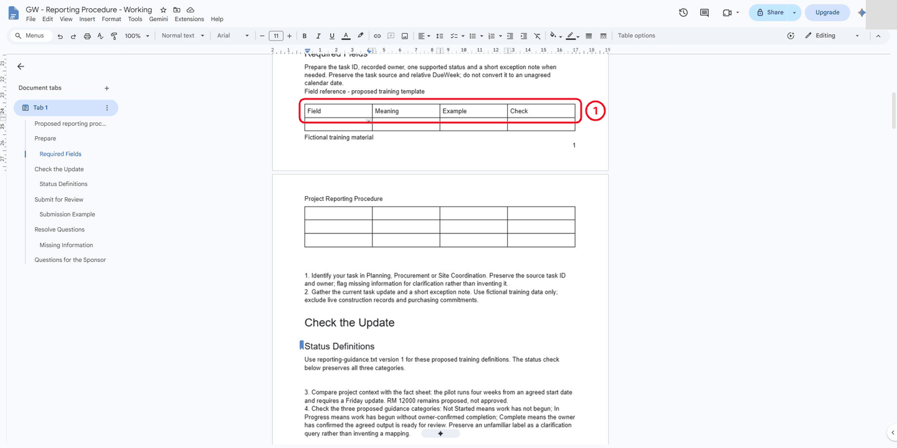

*Field, Meaning, Example and Check are entered before populating the six field rows.*

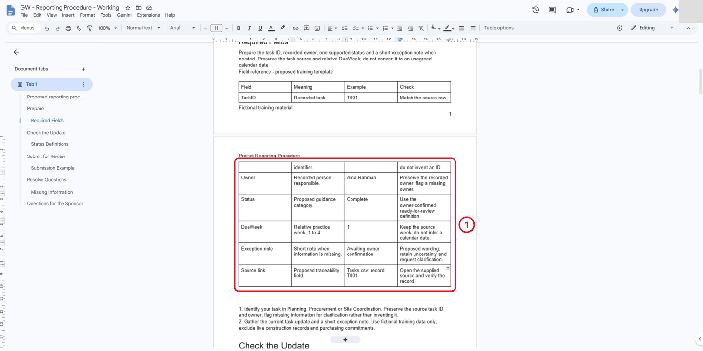

*All six fields are populated before adjusting widths and reviewing pagination.*

2. Place the cursor in each column and open **Table options**, **Column**. Enable **Column width** and use **3 cm**, **4.5 cm**, **4.5 cm** and **5 cm** respectively. Inspect **Cell padding** for the selected cell. Keep the table editable. Add a descriptive link to the supplied Tasks.csv example and verify T001 against the original input.

> **Reference run:** The reference run tests **0.15 cm** there.

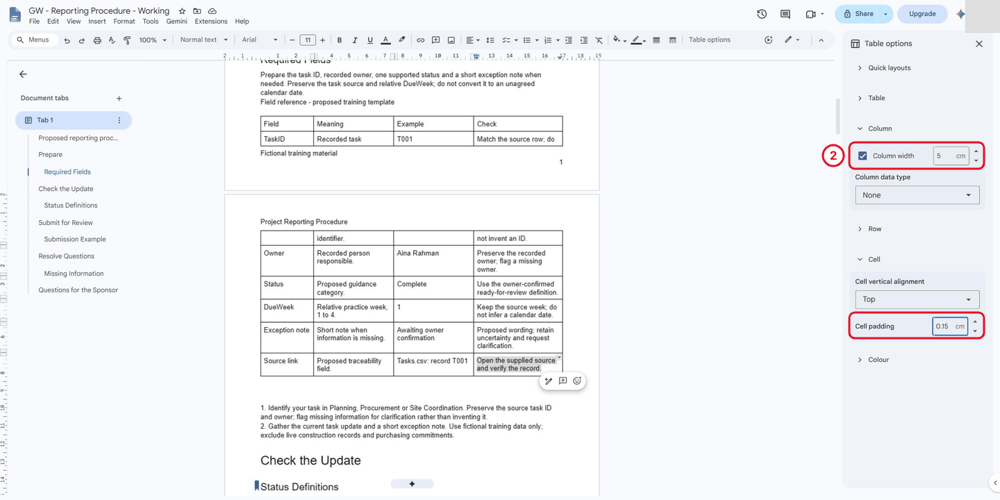

*The Check column is 5 cm wide; 0.15 cm padding is tested on the selected cell.*

3. Under **Submission Example**, type the label `Submission checklist - proposed training practice`, press **Enter** and add the six submission-check paragraphs from the prompts page. Select those six paragraphs and click **Numbered list**. Confirm you see **1** through **6**; pasted paragraphs may remain plain until you apply the list formatting. Keep the checklist label outside the list. Do not renumber the earlier eight-step procedure. Avoid filler.

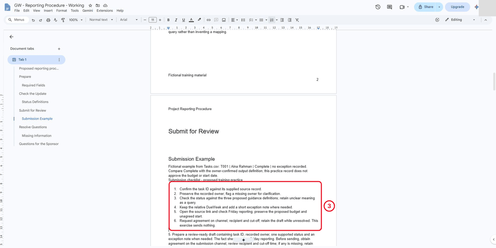

*Formatting verification confirms six real numbered-list items, preserving unresolved routing details.*

4. Inspect the table and headings across page boundaries. Pin one header row for the reference table too, and keep real headings with the following explanation.

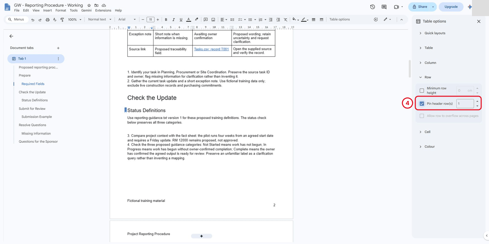

*The new reference table also has one pinned header row.*

5. Click **File**, **Make a copy**, name it `GW - Reporting Procedure - Layout Practice` and keep it in your Docs practice folder. Leave **Share it with the same people** unchecked. On that copy click **File**, **Page setup**, **Pageless**, **OK**. Compare the continuous table with the printed layout and record your decision. Headers, footers and page numbers are hidden in Pageless mode.

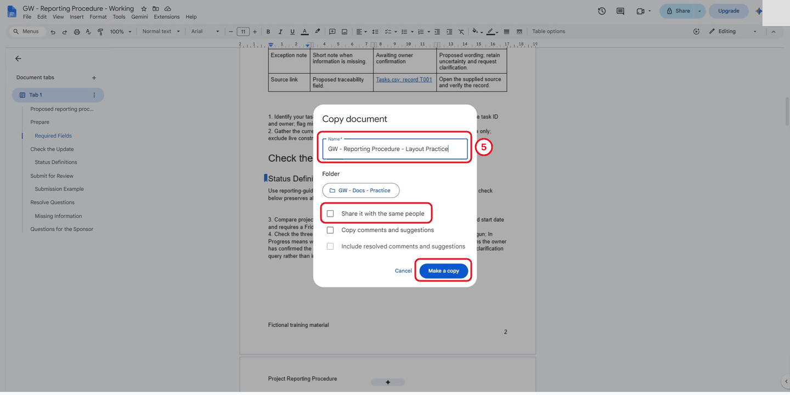

*Create the named layout-practice copy without copying sharing permissions.*

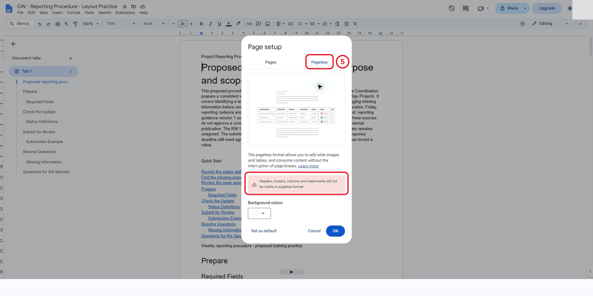

*Pageless warns that headers, footers, columns and watermarks will not be visible.*

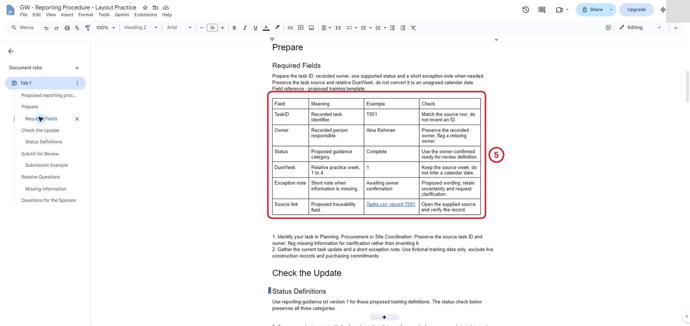

*The separate Pageless copy shows the complete four-column field table in a continuous view.*

6. Return to the maintained **Working** document. Confirm **Pages**, **A4 portrait** and the equal margins for the **Whole document**. Keep the comparison copy separate. Check the header, footer and automatic numbering again.

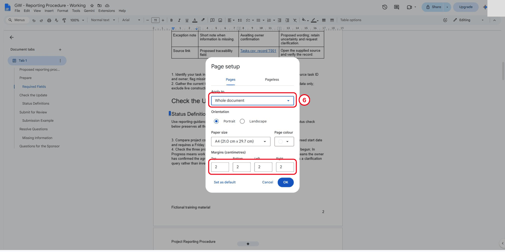

*The maintained version remains Pages, A4 portrait, with matching 2 cm margins.*

7. Export a fresh PDF and inspect every page. Record page numbers for defects, repair them in the native document, then export again.

A deliberate break before **Prepare** moved the complete reference table onto page **2**. This leaves the introduction and navigation as the first page.

> **Reference run:** In the reference draft, the first field row split between pages **1 and 2**.

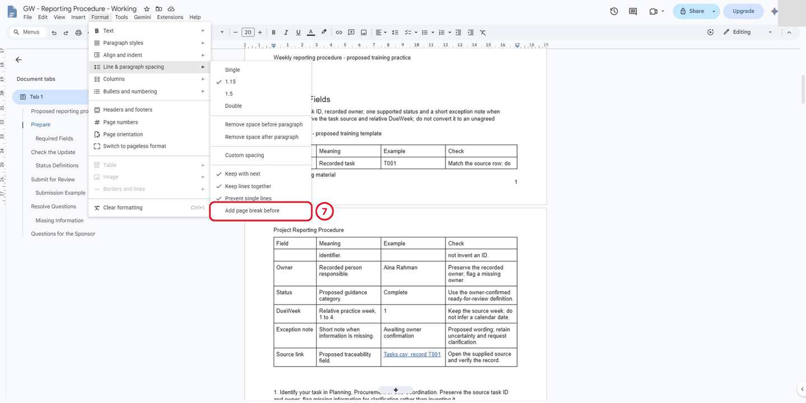

*A deliberate break before Prepare moves the field-reference section to a clean page.*

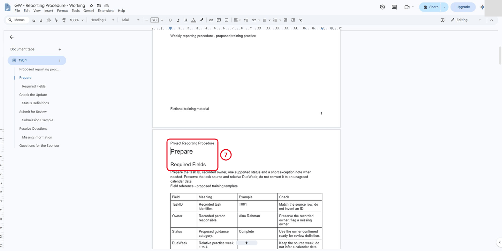

*Prepare and Required Fields start together after the intentional introduction-and-navigation page.*

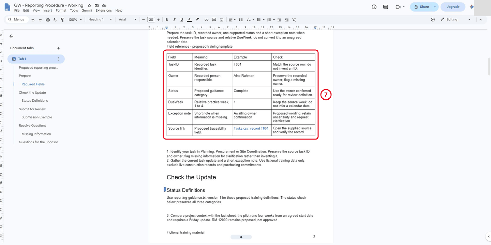

*The print table retains all six field rows and a descriptive source link after the page-break repair.*

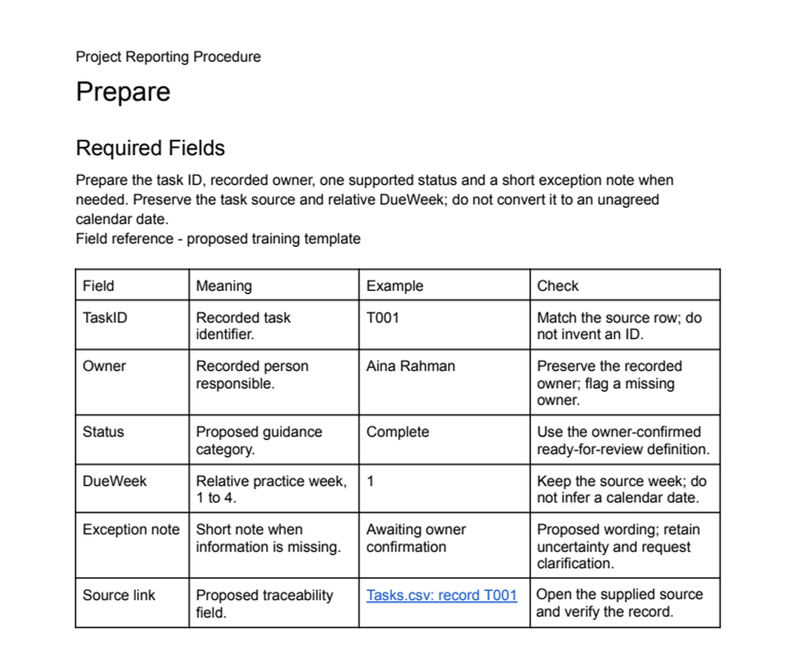

*Final native PDF page two keeps the complete field table readable on one page.*

Remove accidental heading styles from empty paragraphs where they create oversized gaps. Preserve the real headings and internal links.

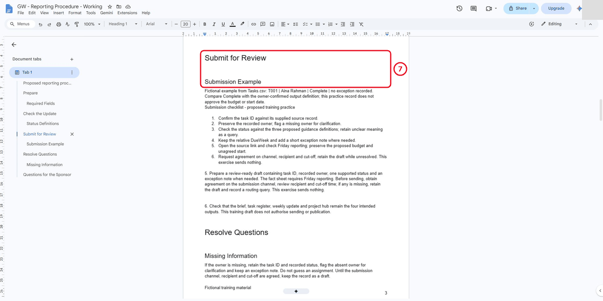

*Accidental heading styles on empty paragraphs are removed without changing real heading targets.*

A later draft also left the **Paper walkthrough B** label alone on page **8**. **Keep with next** moved it with its explanation onto page **9**. The final nine-page export was inspected page by page; the original text and all ten nonempty heading targets were retained. Purposeful section breaks are distinct from unwanted empty pages.

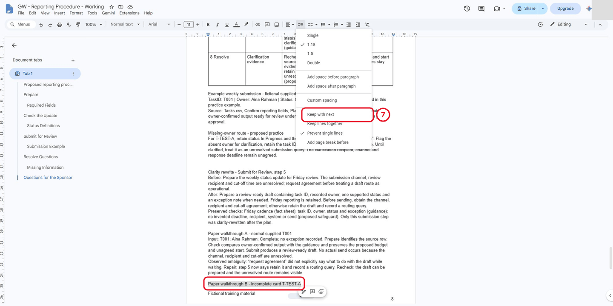

*Keep with next is applied to the isolated walkthrough label found on draft PDF page eight.*

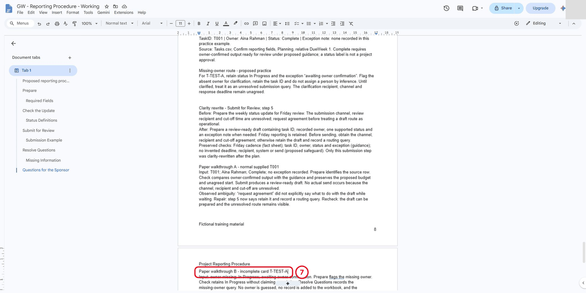

*The label moves to the next page with its following explanation.*

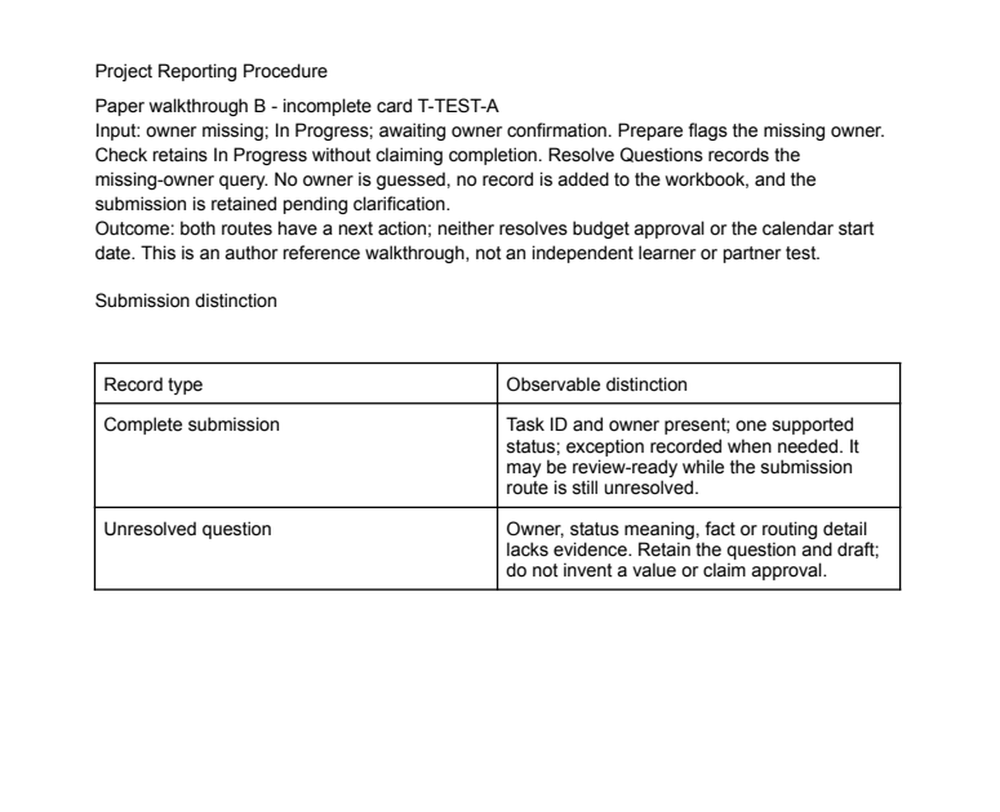

*Final native PDF page nine keeps the walkthrough label with its explanation.*

What should you see?

Populated six-field reference table and real submission checklist. The result must be supported by the recorded checks; an attractive output or an AI assurance is insufficient.

<!-- CAPTURED: core reference route; independent escalation challenge and learner pilot remain pending. -->

## Independent Practice

Close the earlier step lists for the first attempt. Use the case input and your own reasoning. If you need help, record the hint and repeat the affected check independently.

1. The reader now needs an escalation table containing Issue, Evidence, Proposed next action and Confirmation needed. Create at least three meaningful rows from missing owner, unclear status and unapproved budget cases.

2. Fit the new material without reducing the entire document to tiny text. Choose sensible breaks and inspect both the native pages and a fresh PDF.

3. Write a brief layout decision explaining the chosen mode, table widths and one pagination repair.

### Evidence to Hand Over

- Populated six-field reference table and real submission checklist.
- Three-case escalation table placed in a readable multi-page document.
- Page-by-page layout record and inspected PDF after the change.

Record the defect or uncertainty you investigated, the evidence used, the repair or reasoned no-change decision, and the final state. Restore temporary changes or keep them in a clearly named scenario copy.

## Troubleshooting

| Symptom | What to check |
|---|---|
| A wide table is clipped in the PDF | Adjust widths and source page layout, then re-export; inspect the final column on every affected page. |
| An input or earlier result is missing | Reopen the input named in Before You Begin; do not substitute private company data |
| A menu or feature is unavailable | Confirm the account and the shared access notes; record the missing step and ask the trainer for its fallback |
| The result differs from the checkpoint | Compare the exact source range, wording and conditions before repeating the action |

## Lesson Summary

The document now has a considered print layout. Collaboration will add a review trail.

**Check yourself:** Why should page numbers be inserted fields rather than typed text?
