# 05 - Review and Collaborate

In this chapter you will practise suggestions, comments and version history with a trainer-approved partner.

> **Prompts and values:** use the [copy-paste page](./prompts.md) for the exact values used below.

**Target allocation:** 55 minutes: 10 explanation/demonstration, 25 guided build and casework, 15 independent challenge, 5 verification and repair. The active portion is 45 minutes by design. These are unmeasured targets awaiting a learner pilot.

**Your result:** A reviewed procedure with a comment trail and named version.

> **Status:** sections 5.1-5.3 captured as an author reference run with 13 real stage images. The four-request Review Log has been started. Remaining section 5.4 actions, comparison, partner review, independent challenge and learner timing pilot are pending. Browser control was interrupted before the controlled review could finish.

## What You Will Learn

- Use suggestions and comments for different purposes.
- Resolve a review point after checking the change.
- Inspect and name a version.

## Before You Begin

Read the [case input](./prompts.md) and use a separate named casework copy for destructive tests or altered datasets. Keep the baseline unchanged for later chapters. Record source facts, proposed practice and unresolved questions separately.

Use your own procedure. A partner exercise requires a trainer-approved test account and explicit classroom sharing instructions.

## 5.1 Practise Suggestions

1. Open the editing-mode menu at the upper right and choose **Suggesting**. Edits now become proposals.

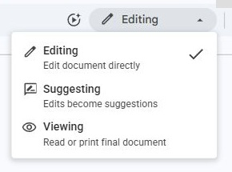
2. Under **Required Fields**, replace the first long instruction with the two clearer sentences on the copy-paste page. Inspect the pending replacement and its accept/reject controls.

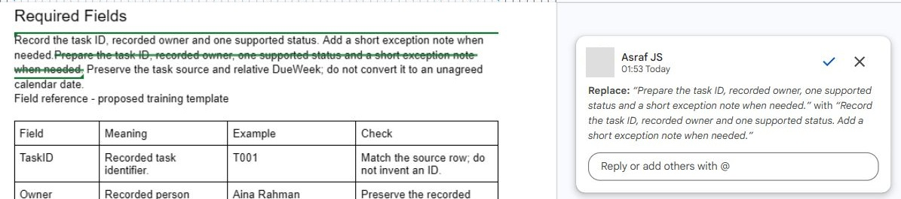
3. Compare meaning with the source facts, then click the suggestion’s **Accept** tick. The task ID, recorded owner, supported status and exception note must remain.

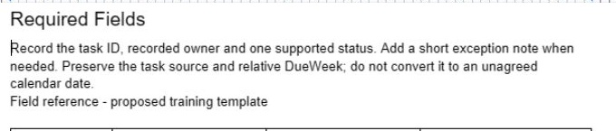

Next, suggest the deliberately unsupported budget approval sentence on the copy-paste page. Inspect it, then click **Reject**, the cross. The budget must remain a proposed ceiling; the start date remains unagreed.

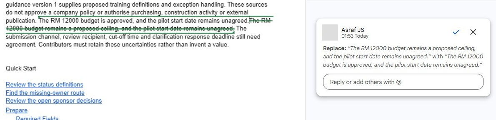

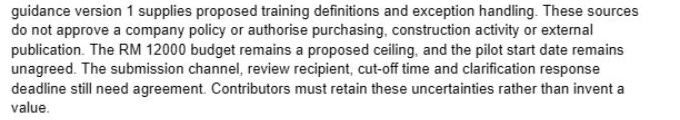

What should you see?

The correct revision is accepted and the incorrect budget change is rejected.

<!-- CAPTURED: author reference route; independent learner/partner validation pending. -->

## 5.2 Handle a Comment

1. Select the words **the pilot start date remains unagreed.** Choose **Add comment** or press **Ctrl+Alt+M**. Enter the question on the copy-paste page and choose **Post Comment**.

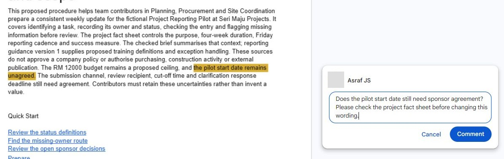
2. If a partner is assigned, follow the trainer's specific sharing instructions and ask them to review that sentence. Otherwise use your own comment for the exercise.
3. Open the posted comment and use **Reply**. Enter the source-based response, then click **Reply** to post it. Confirm that the reply appears in the thread; a filled draft is not a posted reply.

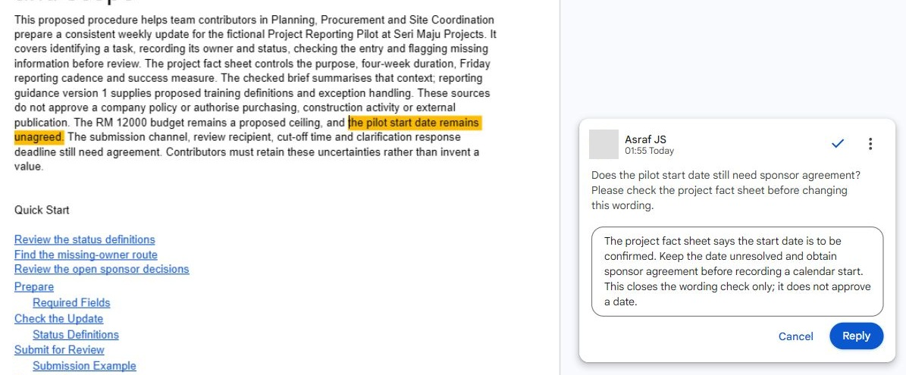

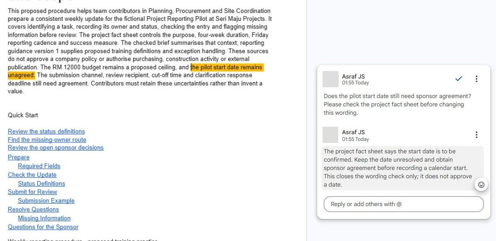

Only after checking the retained wording, choose **Mark as resolved and hide discussion**. This closes the editorial question and does not approve the start date.

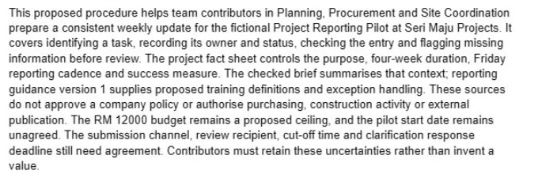

What should you see?

The comment discussion records a reason for the decision. Resolving it did not approve the start date.

<!-- CAPTURED: author reference route; independent learner/partner validation pending. -->

## 5.3 Keep a Review Milestone

1. Return to **Editing**. Choose **File**, **Version history**, **Name current version**.

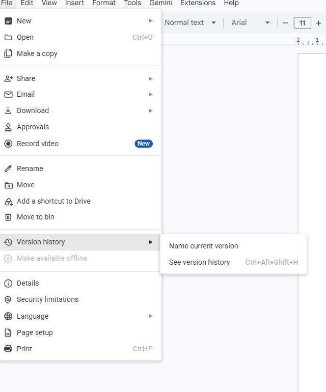
2. Enter `Procedure reviewed against project facts`, then choose **Save**. Use **See version history**, or the last-edit indicator, and verify that the saved name appears.

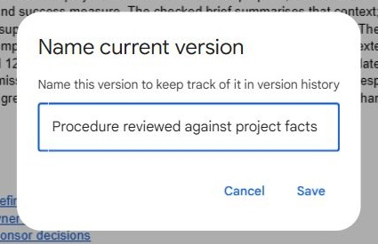

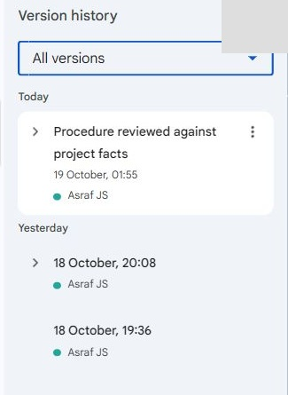
3. Select an older version to inspect it. Leave **Restore this version** unused. Choose **Back** at the top left to return to the current document.

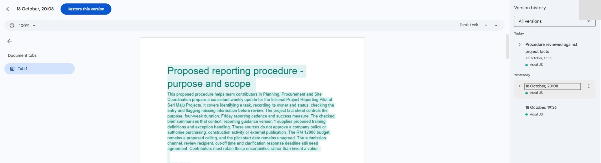

What should you see?

A named milestone is present and the current checked wording remains intact.

<!-- CAPTURED: author reference route; independent learner/partner validation pending. -->

## 5.4 Run a Controlled Editorial Review

**Reference-run checkpoint:** the four requests and source evidence are recorded with decisions still pending. Resume at step 2 below. The actions and comparison in steps 2-7 are written instructions, not completed capture evidence.

1. Create a **Review Log** with Change request, Evidence, Accept/reject/defer and Reason. Use all four requests from the card.

2. Name the current baseline version before applying any review edits. Record its name and the source fact sheet used.

3. Apply the clarity request in **Suggesting** mode and accept it after checking meaning. Make the approval request as a separate suggestion and reject it with a factual reason.

4. For the new contact request, add a comment explaining that the responsible role needs confirmation rather than inserting a fictional operational contact.

5. Use the source to answer the Friday-cadence comment. Resolve only the editorial question if the wording is corrected; the underlying budget/date questions remain open.

6. Make a separate comparison copy containing one accepted and one rejected proposed sentence. If **Tools**, **Compare documents** is available, compare it with the baseline and inspect the generated suggestions; otherwise compare side by side and log that fallback.

7. Name the checked working version and record which changes are editorial improvements and which require project evidence. Inspect version history without overwriting the current document.

What should you see?

Four reasoned review decisions and visible suggestion/comment handling. The result must be supported by the recorded checks; an attractive output or an AI assurance is insufficient.

<!-- VERIFY: execute expanded section 5.4 and independent challenge; capture images/c02-05-04.jpg only after real application success. -->

## Independent Challenge

Close the earlier step lists for the first attempt. Use the case input and your own reasoning. If you need help, record the hint and repeat the affected check independently.

1. Review a partner’s two proposed edits, or write two new requests yourself: one harmless clarity edit and one unsupported commitment. Decide independently, with a source reason for each.

2. Perform the accepted edit and leave an actionable comment on the deferred request. Do not resolve a missing-evidence issue merely to clear the comment count.

3. Hand over the Review Log and demonstrate the baseline, current version and outstanding question.

## Evidence to Hand Over

- Four reasoned review decisions and visible suggestion/comment handling.
- Document comparison result or a logged manual comparison.
- Named baseline/current milestones and unresolved evidence requirements.

Record the defect or uncertainty you investigated, the evidence used, the repair or reasoned no-change decision, and the final state. Restore temporary changes or keep them in a clearly named scenario copy.

## Troubleshooting

| Symptom | What to check |
|---|---|
| A clean comment list is mistaken for approval | Inspect each resolution reason and distinguish editorial closure from a project decision. |
| An input or earlier result is missing | Reopen the input named in Before You Begin; do not substitute private company data |
| A menu or feature is unavailable | Confirm the account and the shared access notes; record the missing step and ask the trainer for its fallback |
| The result differs from the checkpoint | Compare the exact source range, wording and conditions before repeating the action |

## Lesson Summary

Review actions preserve a discussion and revision trail. Next, adapt the document for different readers.

**Check yourself:** How does accepting a suggestion differ from resolving a comment?
