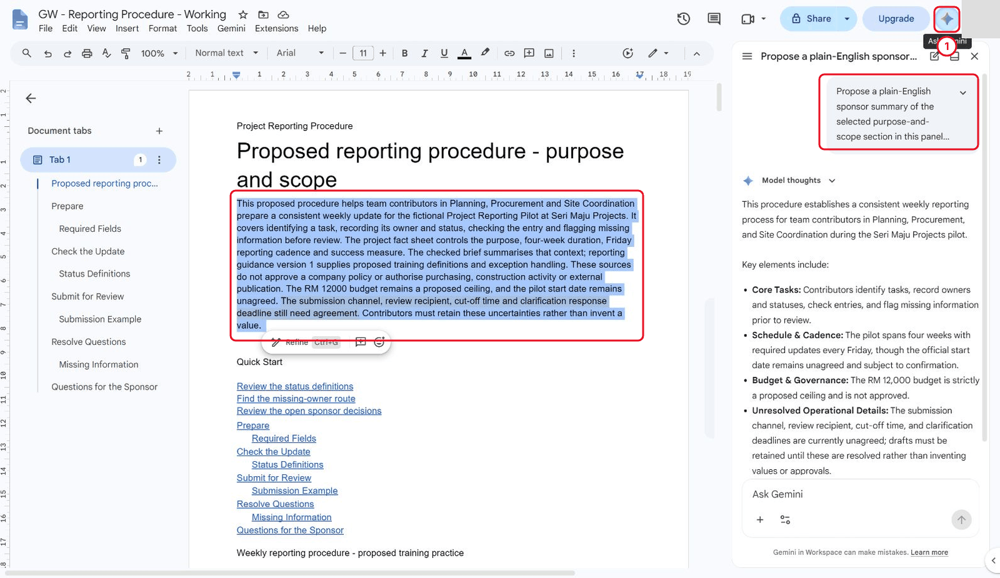
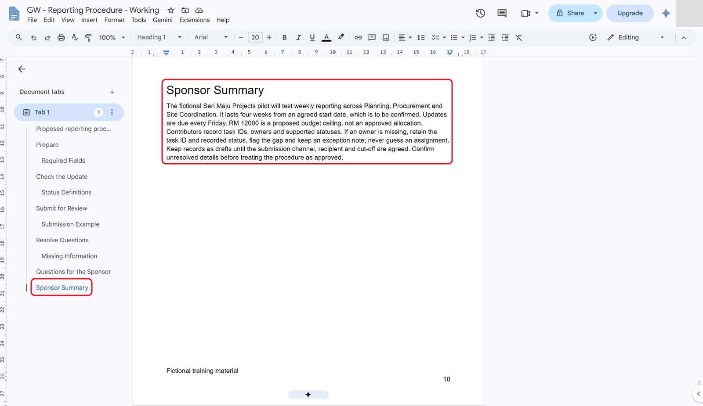
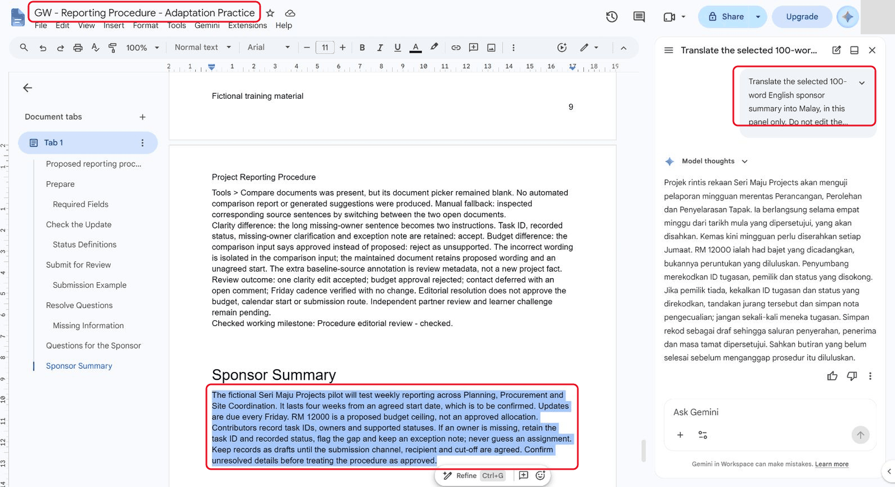
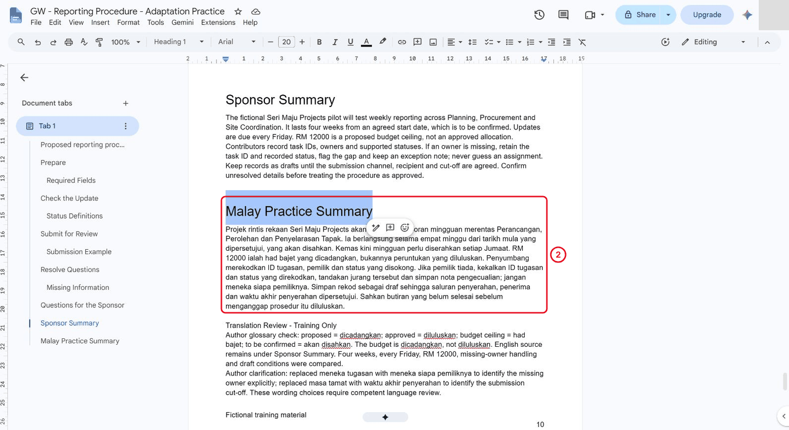
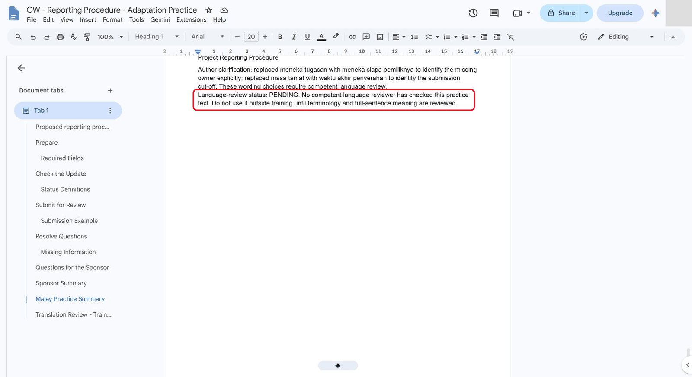
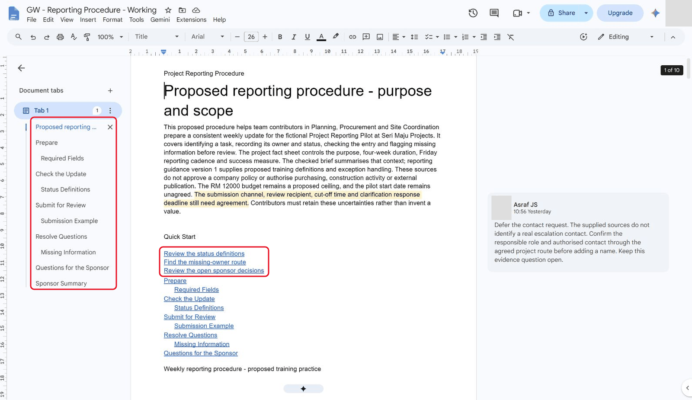
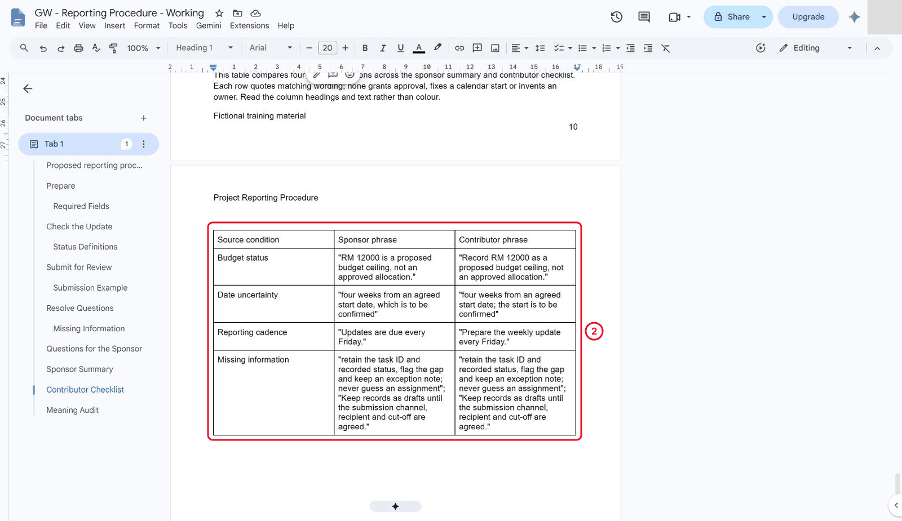
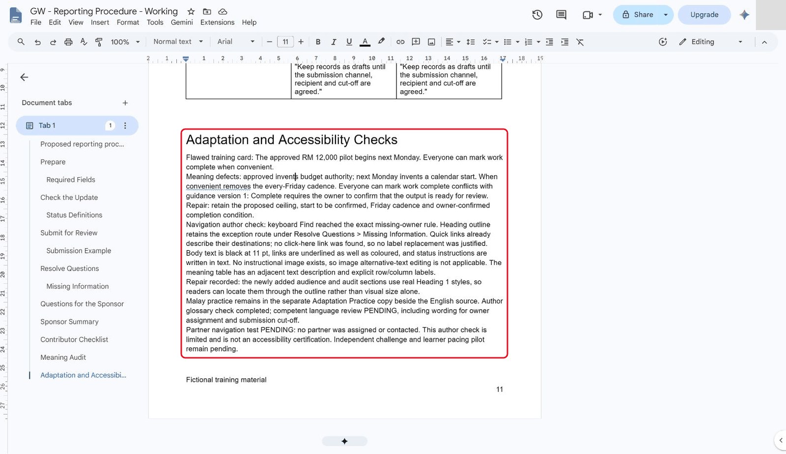

# 06 - Adapt and Check the Document

In this chapter you will rewrite for an audience, check a translation against a supplied glossary and inspect accessibility.

**Estimated time:** 50 minutes, planned as 10 explanation and demonstration, 20 guided build and casework, 15 independent practice and 5 verification and repair. Not yet timed with learners.

**Your result:** An audience-specific summary, reviewed translation practice and accessibility checks.

> **Skills you will demonstrate:** adapt wording for two audiences; check preserved meaning; apply heading/list structure; review a translation and record accessibility checks.

---

## What You Will Learn

- Rewrite a section for a different audience.
- Check a translation against a glossary.
- Inspect document accessibility.

## Before You Begin

**Which file?** English sponsor/contributor versions belong in **Working**. Malay and translation review belong only in **Adaptation Practice**.

**Keep your place:** complete one small task, check its result, then move on. Type short names where shown. Supplied blocks include related lines in one paste; **Copy heading and table** buttons include the labels too. Use **Ctrl+V** on a blank paragraph outside existing tables. Screenshot wording and page counts are examples; check your own result.

Use the checked procedure and the [training glossary](../../shared/sample-files/glossary.txt). **No Gemini?** Skip 6.1.1 and check the supplied English summary in 6.1.3. In 6.2, still create the practice copy, then use the supplied Malay draft in 6.2.2 instead of generating one. Complete the same glossary and meaning checks.

## 6.1 Adapt for the Sponsor

**Why:** A sponsor needs a concise overview. Changing the audience must not change facts or uncertainty.

### 6.1.1 Request a panel proposal

1. In your Working document, select the whole purpose-and-scope paragraph under the title.
2. Click **Ask Gemini** (the star at the top right) and use the sponsor prompt provided below.
3. Request a proposal **in the panel only**; do not accept an automatic document edit.

**Session:** Gemini side panel in your Working document | **Grounding:** the section you have selected

```text
Propose a plain-English sponsor summary of the selected purpose-and-scope section in this panel only. Do not edit the document. Preserve four weeks from an agreed start, every Friday, RM 12000 as a proposed ceiling rather than approved funding, start to be confirmed, missing-owner handling and draft status until submission details are agreed. Do not invent a date, approval or contact.
```



*The selected source and Gemini panel preserve the proposal and unresolved start.*

**Check:** The selected source remains unchanged while the panel proposes text.

### 6.1.2 Check conditions against sources

1. Keep the proposed budget and missing start date explicit.
2. Compare all numbers and conditions with the source.

**Check:** Budget, duration, Friday cadence and unresolved start survive.

### 6.1.3 Insert the checked summary

1. At the end of the Working document, paste the Sponsor Summary block once, or insert your own checked version with the same heading.
2. Set only its first line to **Heading 1** and its body to **Normal text**.
3. Check the outline.
4. If AI is unavailable, use the reference and perform the same meaning checks.
5. Its body has 100 words; the heading is excluded from the count.

Type each as Heading 1 at the end of the document where the chapter says.

```text
Sponsor Summary
The fictional Seri Maju Projects pilot will test weekly reporting across Planning, Procurement and Site Coordination. It lasts four weeks from an agreed start date, which is to be confirmed. Updates are due every Friday. RM 12000 is a proposed budget ceiling, not an approved allocation. Contributors record task IDs, owners and supported statuses. If an owner is missing, retain the task ID and recorded status, flag the gap and keep an exception note; never guess an assignment. Keep records as drafts until the submission channel, recipient and cut-off are agreed. Confirm unresolved details before treating the procedure as approved.
```



*The checked 100-word sponsor summary sits under a real heading.*

<details markdown="1">
<summary>What should you see?</summary>

The wording suits a sponsor while preserving the source facts.

</details>

<!-- CAPTURED: core author reference run; language review, partner and learner pilot pending. -->

**Check:** Sponsor Summary is a real Heading 1; the body is normal text.

## 6.2 Check Translation

**Why:** A translation can sound smooth and still alter approval or date meaning. Keep its English source beside it for checking.

### 6.2.1 Create the translation practice copy

1. Before translating, use **File**, **Make a copy** and name it `GW - Reporting Procedure - Adaptation Practice`.
2. Leave sharing and comment-copy boxes unchecked.
3. Keep the English summary.
4. Select it and use **Ask Gemini** with the glossary-constrained Malay prompt; a translation tool is an alternative.

**Session:** Gemini side panel in your Adaptation Practice copy | **Grounding:** the selected English summary

```text
Translate the selected English sponsor summary into Malay in this panel only. Do not edit the document. Use the training glossary: proposed = dicadangkan; approved = diluluskan; budget ceiling = had bajet; to be confirmed = akan disahkan; weekly update = kemas kini mingguan. Keep all numbers, conditions and uncertainties. Return a training draft awaiting competent language review.
```



*The English source stays selected while Gemini drafts Malay in the panel.*

**Check:** Only Adaptation Practice receives the translation.

### 6.2.2 Insert and compare the draft

1. In the practice copy, go to the end.
2. Paste the Malay Practice Summary block once, or insert your generated draft with that heading.
3. Set only the first line to **Heading 1**.
4. Below the draft, type `Translation Review - Training Only` and record your checks.
5. Compare every condition with the English source and the supplied glossary.
6. Record author edits and unresolved terms.
7. The reference author clarified owner assignment and submission cut-off; those choices still require language review.

This author-edited practice draft is not approved for external use. Compare it with the English source and glossary; review full-sentence meaning with a competent language reviewer.

```text
Malay Practice Summary
Projek rintis rekaan Seri Maju Projects akan menguji pelaporan mingguan merentas Perancangan, Perolehan dan Penyelarasan Tapak. Ia berlangsung selama empat minggu dari tarikh mula yang dipersetujui, yang akan disahkan. Kemas kini mingguan perlu diserahkan setiap Jumaat. RM 12000 ialah had bajet yang dicadangkan, bukannya peruntukan yang diluluskan. Penyumbang merekodkan ID tugasan, pemilik dan status yang disokong. Jika pemilik tiada, kekalkan ID tugasan dan status yang direkodkan, tandakan jurang tersebut dan simpan nota pengecualian; jangan meneka siapa pemiliknya. Simpan rekod sebagai draf sehingga saluran penyerahan, penerima dan waktu akhir penyerahan dipersetujui. Sahkan butiran yang belum selesai sebelum menganggap prosedur itu diluluskan.
```



*English and Malay remain together in the separate practice copy.*

**Check:** English, Malay and your glossary checks remain together.

### 6.2.3 Record language-review status

1. Record **Language-review status: PENDING** unless a competent reviewer has actually checked the text.
2. Keep the author glossary check separate from that review.
3. A reviewer must check full-sentence meaning and terminology before external use; no reviewer was assigned in this reference run.



*The author flags wording choices and the pending competent language review.*

<details markdown="1">
<summary>What should you see?</summary>

The practice copy keeps its original meaning. A generated translation is not treated as a verified publication.

</details>

<!-- CAPTURED: core author reference run; language review, partner and learner pilot pending. -->

**Check:** Language review is PENDING unless a competent reviewer actually completed it.

## 6.3 Inspect Accessibility

**Why:** Structure, descriptive links and readable text help people find and understand content. Record the checks you actually performed.

### 6.3.1 Inspect structure and links

1. Use heading styles to inspect structure.
2. Check link text describes the destination rather than saying click here.

**Check:** Headings are real styles and links describe destinations.

### 6.3.2 Check informative visuals if present

1. If your document has an image, open its alternative-text control and describe the information it conveys.

**Check:** Informative images have meaningful alt text, or image checks are marked not applicable.

### 6.3.3 Test reading and retrieval

1. Inspect contrast, readable size and instructions that rely only on colour.
2. In the reference document, body text was black at 11 pt, links were underlined, and status rules used text.
3. Use the outline and **Ctrl+F** (Find) to locate the missing-owner rule.
4. Record what you actually tested; this is a limited author check.
5. No instructional image existed, so image alternative-text editing was not applicable.



*The outline and quick links describe the exception route.*

<details markdown="1">
<summary>What should you see?</summary>

The document can be followed through structure and text, with meaningful image descriptions where needed.

</details>

<!-- CAPTURED: core author reference run; language review, partner and learner pilot pending. -->

**Check:** You can locate the missing-owner rule and have recorded the limits of this author check.

## 6.4 Adapt for Two Readers and Audit Meaning

**Why:** Two versions can use different wording while preserving the same meaning. Use the supplied audit as a comparison aid, not proof of your own check.

### 6.4.1 Build the contributor checklist

1. Return to the maintained **Working** document and retain its Sponsor Summary.
2. Paste the Contributor Checklist block once.
3. Set the first line to **Heading 1**.
4. Select only the seven action paragraphs and apply **Numbered list**; leave the heading outside the list.
5. Preserve proposed budget, unconfirmed start, Friday cadence and missing-owner handling in both versions.

Apply native numbering to these seven separate paragraphs.

```text
Contributor Checklist
Confirm the pilot runs four weeks from an agreed start date; the start is to be confirmed.
Prepare the weekly update every Friday.
Record RM 12000 as a proposed budget ceiling, not an approved allocation.
Record the task ID, recorded owner and one supported status; Complete requires owner-confirmed output ready for review.
If an owner is missing, retain the task ID and recorded status, flag the gap and keep an exception note; never guess an assignment.
Keep records as drafts until the submission channel, recipient and cut-off are agreed.
Recheck unresolved details against the source after clarification.
```

**Check:** Working has the Sponsor Summary and a real seven-item Contributor Checklist.

### 6.4.2 Verify the meaning table

1. At the end of the Working document, paste the supplied Meaning Audit heading and completed table once.
2. Set the heading to **Heading 1**.
3. Read each row across the two versions and confirm that its meaning is unchanged.
4. If your own summary differs, replace the reference quotation with your actual wording.
5. Add a sentence beside the table explaining what it compares.
6. Use text and labels, not colour alone.

<p data-copy-with-table><strong>Meaning Audit</strong></p>

| Source condition | Sponsor phrase | Contributor phrase |
|---|---|---|
| Budget status | "RM 12000 is a proposed budget ceiling, not an approved allocation." | "Record RM 12000 as a proposed budget ceiling, not an approved allocation." |
| Date uncertainty | "four weeks from an agreed start date, which is to be confirmed" | "four weeks from an agreed start date; the start is to be confirmed" |
| Reporting cadence | "Updates are due every Friday." | "Prepare the weekly update every Friday." |
| Missing information | "retain the task ID and recorded status, flag the gap and keep an exception note; never guess an assignment"; "Keep records as drafts until the submission channel, recipient and cut-off are agreed." | "retain the task ID and recorded status, flag the gap and keep an exception note; never guess an assignment"; "Keep records as drafts until the submission channel, recipient and cut-off are agreed." |



*A native table quotes both versions for all four source conditions.*

**Check:** Each table quotation matches your actual text and preserves the source condition.

### 6.4.3 Confirm translation location

1. Check that the Malay practice summary from 6.2 is still in the Adaptation Practice copy, next to its English source, with **Language-review status: PENDING**.
2. Don't add it to the Working document.

**Check:** The Malay draft and review status remain in Adaptation Practice.

### 6.4.4 Challenge the flawed adaptation

1. Inspect the deliberately flawed adaptation provided below.
2. Explain why approved and scheduled change meaning even if the prose reads smoothly.

**Case input to analyse**

Read this fictional case here; you do not need to paste the case itself. Record your own check or decision where instructed.

> Flawed adaptation: “The approved RM 12,000 pilot begins next Monday. Everyone can mark work complete when convenient.” Compare this with the fact sheet and the proposed status definition before rewriting it.

**Check:** You can explain the false approval, invented date and unsupported completion rule.

### 6.4.5 Check links and heading styles

1. Inspect link labels before changing them.
2. Replace a vague label if found; otherwise record source-supported no change.
3. The reference document already used descriptive quick links.
4. Repair any new audience/audit section that lacks a real heading style, then confirm it appears in the outline.
5. Do not rely on red/green alone.

**Check:** Audience/audit sections appear in the outline; link labels are meaningful.

### 6.4.6 Describe a table or visual

1. For an informative visual or table, write a short text description of what a reader needs to understand.
2. If you use an image, set meaningful alternative text; if no image exists, describe the table in adjacent text.

**Check:** A text description conveys the important information without colour alone.

### 6.4.7 Record scope and remaining checks

1. At the end of the Working document, type `Adaptation and Accessibility Checks` as **Heading 1** and record the findings from 6.4.4–6.4.6 there.
2. If an assigned partner is available, ask them to locate and explain the exception route using headings and links; record the observed barrier and repair.
3. Otherwise mark **partner test pending**.
4. The reference author checked the outline and keyboard Find, repaired heading styles and recorded the limited scope; no partner test or accessibility certification is claimed.



*The final record explains factual defects, checks and pending tests.*

<details markdown="1">
<summary>What should you see?</summary>

Two audience versions with a four-invariant meaning audit. The result must be supported by the recorded checks; an attractive output or an AI assurance is insufficient.

</details>

<!-- CAPTURED: 6.4 author casework; partner test and independent challenge remain pending. -->

**Check:** Your record separates completed author checks from pending partner/language checks.

## Independent Practice

**What is being tested:** perform the chapter skills without following the earlier clicks. Use the supplied material to reduce typing; explain your decisions and show the actual result. If you need a hint, record it and repeat that check independently.

1. Rewrite the missing-information route for a reader who has not attended the course. Limit each step to one main action and retain the verification requirement.

2. Compare the contributor, sponsor and translated versions for four factual invariants. Correct one defect or record source support for each if none is found.

3. Retest navigation without relying on colour and leave any unverified language issue visibly marked for review.

### Evidence to Hand Over

- Two audience versions with a four-invariant meaning audit.
- Glossary-based translation review with verification status.
- A repaired usability barrier and independently rewritten exception route.

Record the defect or uncertainty you investigated, the evidence used, the repair or reasoned no-change decision, and the final state. Restore temporary changes or keep them in a clearly named scenario copy.

<details markdown="1">
<summary>Reference-run scope (trainer information)</summary>

core sections 6.1-6.4 executed as an author reference run, with eight staged images and retained full-window sources. The 100-word sponsor summary, native numbered checklist and four-condition table were checked against source facts. Malay terminology received an author glossary check only. Competent language review, partner navigation, independent challenge and learner timing remain pending.

The classroom-clarity revision changes the guide; the revised learner route and timings still need classroom checks.

</details>

## Troubleshooting

| Symptom | What to check |
|---|---|
| The adapted summary sounds confident but changes meaning | Audit approvals, dates and status conditions phrase by phrase rather than scoring fluency alone. |
| An input or earlier result is missing | Reopen the input named in Before You Begin; do not substitute private company data |
| A menu or feature is unavailable | Confirm the account and the shared access notes; record the missing step and ask the trainer for its fallback |
| The result differs from the checkpoint | Compare the exact source range, wording and conditions before repeating the action |

## Lesson Summary

Audience adaptation and translation need meaning checks. Accessibility improves how people find and follow the procedure.

**Check yourself:** Which translation term could accidentally turn a proposal into an approval?
