# 07 - Export and Check Interoperability

In this chapter you will export a copy and inspect headings, page breaks and tables after conversion.

**Estimated time:** 40 minutes, planned as 10 explanation and demonstration, 10 guided build and casework, 15 independent practice and 5 verification and repair. Not yet timed with learners.

**Your result:** Checked Word and PDF export copies of the maintained procedure.

> **Skills you will demonstrate:** export Word and PDF; choose current-tab/all-tabs scope; inspect a conversion; track source revisions and checked snapshots.

---

## What You Will Learn

- Export a document to Word and PDF.
- Check conversion effects.
- Choose a distribution format deliberately.

## Before You Begin

**Which file?** Start with exports from **Working**. In 7.4 use **Release Practice**; import into a separate **Round Trip Practice** file and return to Release Practice for r2.

**Keep your place:** complete one small task, check its result, then move on. Type short names where shown. Supplied blocks include related lines in one paste; **Copy heading and table** buttons include the labels too. Use **Ctrl+V** on a blank paragraph outside existing tables. Screenshot wording and page counts are examples; check your own result.

Use your checked procedure. This chapter creates local export copies; it does not publish or email them.

## 7.1 Export Two Formats

**Why:** A download is a snapshot. Keep the Google Doc as the maintained source and export different formats for different readers.

### 7.1.1 Download Word

1. In the checked native **Working** document, click **File**, **Download**, **Microsoft Word (.docx)**.

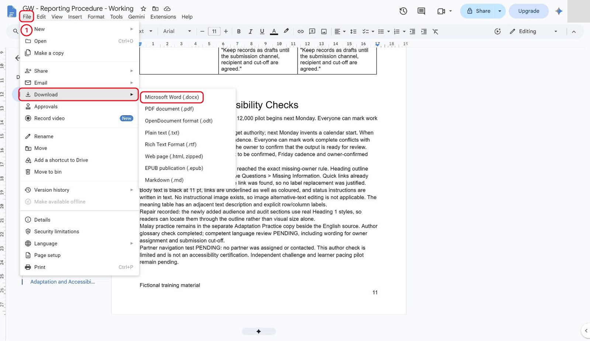

*File > Download offers separate Word and PDF formats.*

**Check:** A Word file was downloaded from the checked source.

### 7.1.2 Download PDF

1. Download **PDF document (.pdf)** separately.
2. Keep identifiable local names such as `Procedure-practice-r1.docx` and `Procedure-practice-r1.pdf`; retain these as prior working snapshots.

**Check:** Both identifiable r1 practice files exist locally.

### 7.1.3 Keep the maintained source

1. Keep the native Google Doc as the working source.
2. Downloads are snapshots and do not follow later source edits.

<details markdown="1">
<summary>What should you see?</summary>

Two local practice exports and the unchanged maintained native source.

</details>

**Check:** You can identify the native source separately from its snapshots.

## 7.2 Inspect the Copies

**Why:** A successful download does not prove a usable result. Open the actual file and inspect through its last page.

### 7.2.1 Open both files

1. Open both exports in approved available viewers.
2. Inspect all pages, including the last.
3. In this reference run, browser controls blocked local PDF URLs, so the PDF was rendered and inspected offline.
4. DOCX heading/table structure was inspected before the native Docs round trip in 7.4.
5. **Microsoft Word desktop rendering was not tested.**

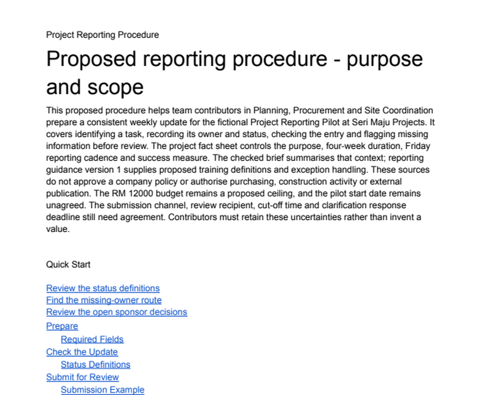

*The initial PDF reader copy is inspected offline from the first page to the last.*

**Check:** Record the actual viewers; do not claim a viewer you did not use.

### 7.2.2 Inspect important elements

1. Check title, contents links, heading hierarchy, page numbers, tables, images where present and final paragraph.
2. Record the viewer and exactly what was checked.
3. The initial PDF had 11 pages with no blank pages or text outside page bounds.
4. Its six tables and final training paragraph were present; no instructional image existed.

**Check:** Headings, tables, final content and numbering have been inspected.

### 7.2.3 Record differences and limits

1. Record actual differences.
2. Correct the native scenario source when appropriate and export again; keep prior snapshots.
3. Do not infer interactive link behaviour from a picture or document text alone.

<details markdown="1">
<summary>What should you see?</summary>

A check through the final page, with viewer limitations and real defects recorded separately from no-difference findings.

</details>

**Check:** Your record distinguishes a real defect from an untested feature.

## 7.3 Choose the Handover

**Why:** Choose a format for the recipient and inspect review content before treating a practice copy as releasable.

### 7.3.1 Match format to reader

1. Choose an editable Word file when the recipient needs to revise it, or PDF for a fixed reader handout.
2. Keep the native source for future controlled changes.

**Check:** Word suits editable handover and PDF a fixed reader copy.

### 7.3.2 Inspect comments and tracked content

1. Inspect comments and tracked content before distribution.
2. The first working DOCX retained an open review comment, even though the rendered PDF did not show it.
3. Retain the prior snapshot; make a separate release practice copy with comment copying unchecked.
4. Do not resolve the maintained source's evidence question merely to clean an export.

**Check:** Source evidence questions remain intact; any clean practice export comes from a separate copy.

### 7.3.3 Label the practice files

1. Confirm filenames, revision and fictional labels.
2. No sharing, publishing or email is performed in this exercise.

**Check:** Names identify revision and fictional practice status; nothing was distributed.

## 7.4 Test Conversion and Issue a Reproducible Release

**Why:** Scope and revision can change during conversion. Reproduce a complete handout, test a round trip, then make a genuinely revised export.

### 7.4.1 Create the release source

1. Click **File**, **Make a copy** to create `GW - Reporting Procedure - Release Practice`.
2. Leave sharing and comment-copy boxes unchecked.
3. This is the native **scenario release source**; the maintained Working document stays separate.
4. Add a Release Checklist with Native source, Revision, Export scope, Filename, Viewer and Result.
5. Use `Practice release r1`, distinct r1 filenames and a pending result until checked.

**Case input to analyse**

Read this fictional case here; you do not need to paste the case itself. Record your own check or decision where instructed.

> Release scenario: One reader needs an editable procedure; another needs a fixed complete handout including Examples. A previous PDF is already in the practice folder. Make the current revision and included scope unambiguous without deleting the maintained source.

```text
Release Checklist
Native source: this Release Practice document
Revision: Practice release r1
Export scope: record Current Tab or All Tabs for each file
Filename: record the actual downloaded filename
Viewer: record the viewer you used
Result: PENDING until the file is inspected
```

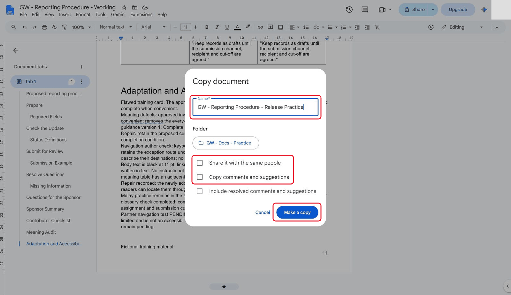

*The separate release practice copy excludes sharing and review comments.*

**Check:** Release Practice is separate from Working and has a pending checklist.

### 7.4.2 Set tabs and export r1

1. Rename the main tab **Procedure** (click the three dots on the tab, then **Rename**).
2. Add a separate **Examples** tab with the supplied fictional appendix and scope marker.
3. Name the baseline version `Practice release r1`.
4. Select **Procedure** before exporting the main-only file.
5. With multiple tabs, the Download dialog offers **Current Tab** and **All Tabs**.
6. Inspect the setting for **every** export; the reference dialog reset to Current Tab.

Apply Heading 1 to the first line only. Keep the scope marker unchanged so prior/current PDFs can be checked consistently.

```text
Examples for Release Practice
FICTIONAL TRAINING MATERIAL - APPENDIX
Example scope marker: COMPLETE-HANDOUT-EXAMPLES-R1
Task T001 - Planning - Aina Rahman - recorded status Complete. This recorded sample does not itself approve the budget or pilot date. Complete requires owner-confirmed output ready for review.
Missing-owner example: retain the task ID and recorded status, flag the owner gap and add an exception note. Never invent an assignment. Keep the entry as a draft until the submission channel, recipient and cut-off are agreed.
Final appendix checkpoint: proposed RM 12000 ceiling; start to be confirmed; every Friday; source uncertainty retained.
```

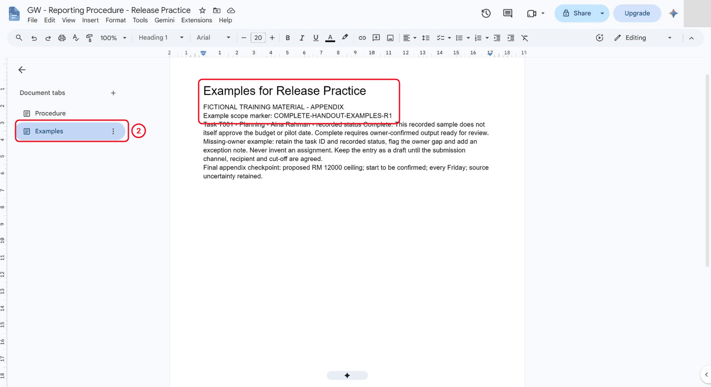

*A separate Examples tab has a recognisable complete-handout marker.*

Export `Procedure-r1-main.pdf` with **Current Tab**, then `Procedure-r1-complete.pdf` and `Procedure-r1-complete.docx` with **All Tabs**. If tabs are unavailable, state which appendix content is included instead of claiming an all-tabs test.

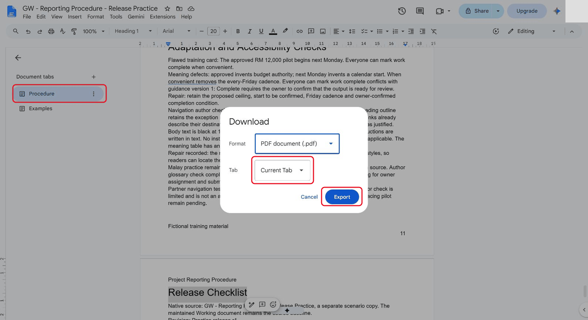

*Current Tab exports only the selected Procedure tab.*

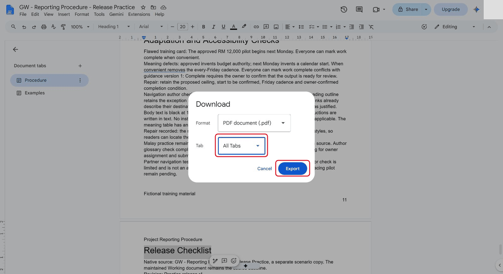

*All Tabs includes Procedure and Examples in the complete handout.*

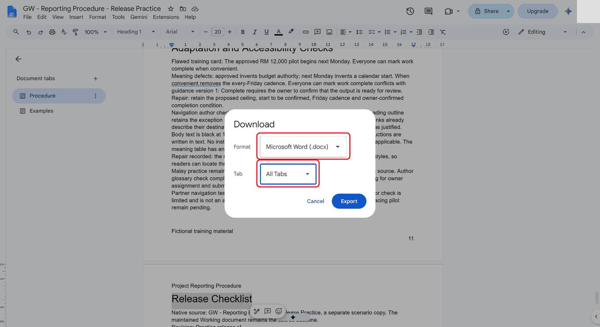

*The editable Word handover also deliberately includes all tabs.*

**Check:** Main-only uses Current Tab; complete PDF/Word deliberately use All Tabs.

### 7.4.3 Check what the files contain

1. Inspect the files through their final page.
2. The reference main-only PDF had **12 pages without the Examples marker**; the complete PDF had **13 pages with it**.
3. The clean Word export contained no comment metadata or tracked insertions/deletions.
4. Check three internal links, the contents list, a table and the final procedure/appendix paragraphs.
5. PDF structural checks resolved the three quick-link destinations to the expected pages; interactive PDF viewing remained pending.

**Check:** The complete files contain the Examples marker and you checked their final pages.

### 7.4.4 Record actual conversion findings

1. Paste the conversion-check table below with its heading.
2. Every result begins **Not yet checked**.
3. Inspect that element in the actual export, then replace the pending text with your observation and viewer.
4. Record a no-difference finding only after checking it.

<p data-copy-with-table><strong>Conversion Check Record</strong></p>

| Source location | Format | Observed difference | Severity / action |
|---|---|---|---|
| Heading hierarchy | DOCX / PDF | Not yet checked | Compare real heading structure, not just bold text. Record viewer and result. |
| Quick links and contents | DOCX / PDF | Not yet checked | Follow links; distinguish interactive tests from visual inspection. |
| Tables and final paragraph | DOCX / PDF | Not yet checked | Inspect dimensions, final column and last page. |
| Examples appendix | Complete exports | Not yet checked | Find COMPLETE-HANDOUT-EXAMPLES-R1 and check numbering. |
| Comments / tracked changes | DOCX | Not yet checked | Inspect separately; a clean-looking PDF does not establish absence in Word. | The reference record includes the initial Word comment, unnumbered Examples page, preserved heading hierarchy/table dimensions and tab flattening after import. A PDF parser also reported a duplicate title destination key: retain that warning rather than claiming every PDF link is validated.

Record actual findings and the viewer used. A native comparison report can contain expected source-record additions as well as conversion differences; do not count every suggestion as a defect.

**Check:** Only inspected results replace Not yet checked; limitations remain visible.

### 7.4.5 Import a separate round trip

1. Upload `Procedure-r1-complete.docx` as a distinct practice file and open/convert it in Docs, named `GW - Procedure r1 - Round Trip Practice`.
2. Do not replace the scenario or maintained source.
3. The browser upload required an unavailable extension permission in this run, so connected Drive imported only this authorised fictional DOCX.
4. **Browser upload was not verified.**

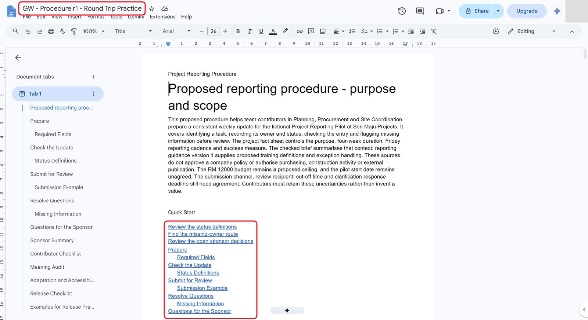

*The imported round-trip copy retains headings and quick links in one tab.*

**Check:** Round Trip Practice is a new file and neither source was overwritten.

### 7.4.6 Test structure and links

1. Compare heading hierarchy, table dimensions, links and final content.
2. The reference import retained **six table structures and 16 heading targets**, including Examples, but flattened two native tabs into one.
3. Follow the three quick links and a contents entry; the reference reached Status Definitions, Missing Information, Questions for the Sponsor and Submission Example.
4. Find/select the link label and use **Alt+Enter**, or use its link popup.

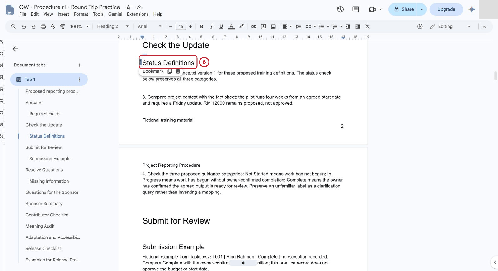

*The imported bookmark lands at Status Definitions.*

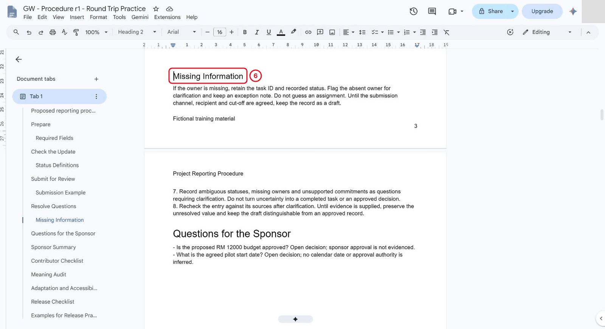

*The second imported quick link reaches Missing Information.*

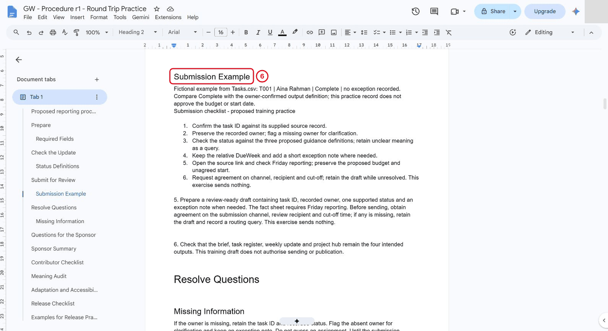

*A converted contents entry reaches Submission Example.*

Use **Tools**, **Compare documents** if available. Choose the observed source, exclude comments and inspect the generated report. Prefer the matching frozen r1 reference for an exact wording comparison. In this run the current source already contained later review-record additions, so those expected additions were distinguished from conversion effects. The generated report flagged margins, styles, sections and headers/footers. Do not accept all suggestions or interpret the report's comment count as a defect count.

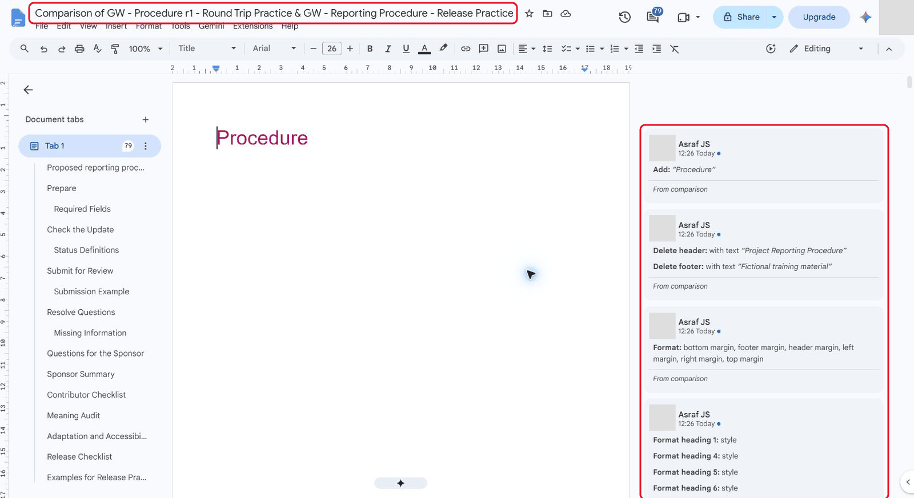

*Native comparison generates suggestions for structure and formatting; these are inspected rather than accepted together.*

**Check:** The imported links/structure were tested and comparison flags were assessed individually.

### 7.4.7 Repair and issue practice r2

1. Repair the actual source issue and change a real instruction in the **scenario** source.
2. In **Examples**, use **Insert**, **Page elements**, **Page numbers** to add a first-page footer field; prefix it `Examples - page `.
3. This makes the appendix's own sequence explicit.
4. In **Procedure**, append the supplied post-clarification source-recheck action to the exact missing-owner paragraph.
5. Confirm the selected tab and a unique search match before replacing text.

Find the exact existing missing-owner paragraph in the Procedure tab. Confirm one match and append this action without changing its existing conditions:

```text
After clarification, recheck the retained entry against the source before requesting review.
```

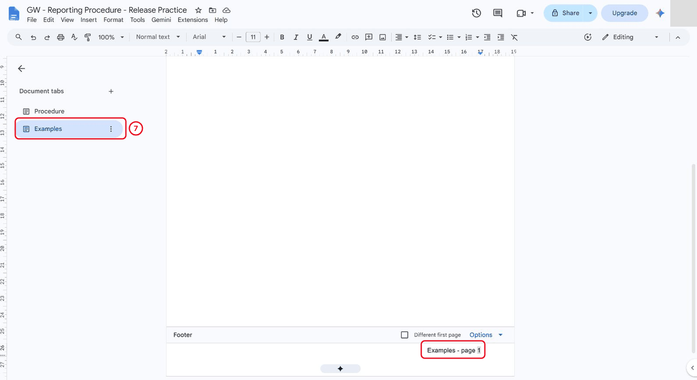

*A native page field adds an explicit Examples page sequence.*

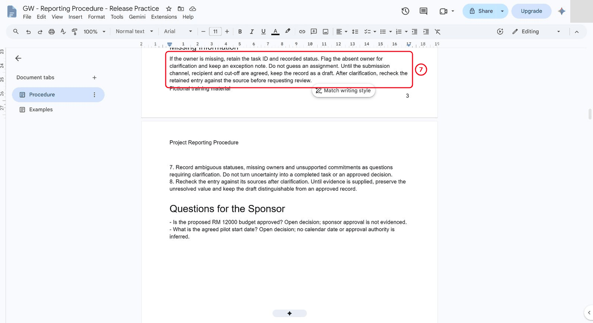

*The r2 source explicitly requires a source recheck after clarification.*

Update the source checklist to r2 filenames and record the inspected comparison, repair and viewer limitations. Name the revision `Practice release r2`. Export `Procedure-r2-main.pdf` with Current Tab, then the complete PDF and Word with All Tabs. Keep all r1 files and check that they are unchanged (same file size and modified time in your downloads folder).

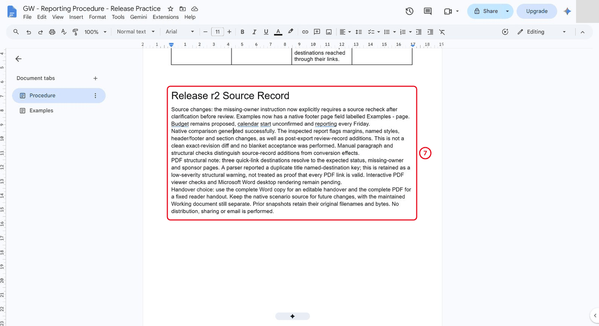

*The r2 source record distinguishes conversion evidence and pending viewer checks.*

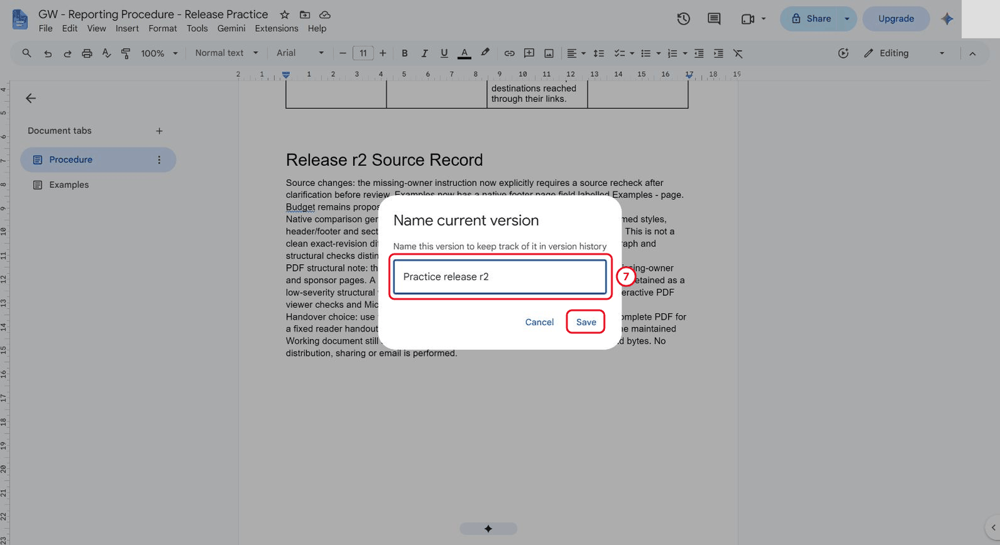

*The revised native source receives a distinct release milestone.*

Check the new files and record results in an external release manifest. Use this naming plan as a reference. Include only files you actually created and identify the current revision yourself.

| Filename | Revision | Scope | Purpose |
|---|---|---|---|
| Procedure-practice-r1.docx | Earlier maintained working snapshot | Original single tab and training appendices | Prior evidence; includes the open review comment |
| Procedure-practice-r1.pdf | Earlier maintained working snapshot | Original single tab and training appendices | Prior fixed snapshot |
| Procedure-r1-main.pdf | Practice release r1 | Procedure, Current Tab | Prior main-only copy |
| Procedure-r1-complete.pdf | Practice release r1 | Procedure plus Examples, All Tabs | Prior complete reader copy |
| Procedure-r1-complete.docx | Practice release r1 | Procedure plus Examples, All Tabs | Prior editable copy and round-trip input |
| Procedure-r2-main.pdf | Practice release r2 | Procedure, Current Tab | Current main-only practice copy |
| Procedure-r2-complete.pdf | Practice release r2 | Procedure plus Examples, All Tabs | Current complete reader handout |
| Procedure-r2-complete.docx | Practice release r2 | Procedure plus Examples, All Tabs | Current editable handover |

 The reference r2 main-only PDF had **13 pages** and excluded Examples; the complete PDF had **14 pages**, included Examples and displayed **Examples - page 1**. The revised instruction was present in both scopes, and the earlier working snapshots retained their original hashes. These are fictional training copies, not project approval or a distributed release.

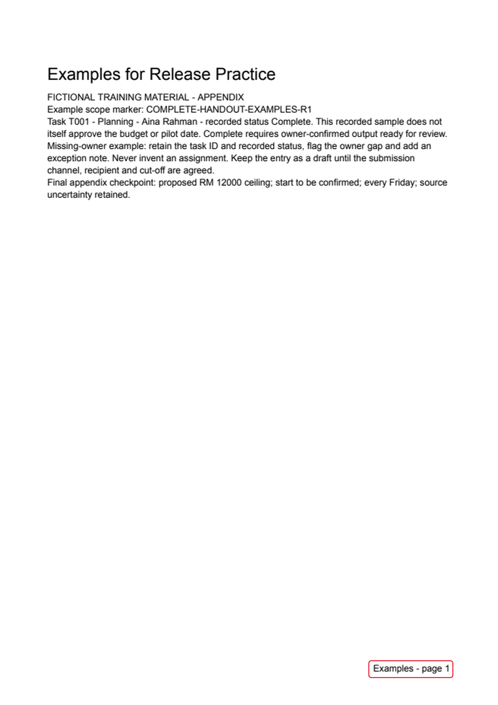

*The final complete PDF includes the fictional Examples appendix and its repaired page number.*

<details markdown="1">
<summary>What should you see?</summary>

Distinct prior/current filenames, checked export scopes, a separate round trip, recorded conversion differences and a revised source/export pair. Browser upload, interactive PDF viewing and Word desktop compatibility are not claimed from the fallback checks.

</details>

**Check:** r2 contains the real instruction change; r1 files remain unchanged and the manifest identifies scope.

## Independent Practice

**What is being tested:** perform the chapter skills without following the earlier clicks. Use the supplied material to reduce typing; explain your decisions and show the actual result. If you need a hint, record it and repeat that check independently.

1. Prepare a distribution manifest for an editable handover and a fixed reader copy. State exactly which source revision and tabs/appendices each contains.

2. Have a reviewer identify the current release using only your filenames and manifest. If they choose the wrong one, repair the naming or status label.

3. Demonstrate that the earlier downloaded copy does not change after a native edit, and explain which format would suit each reader.

### Evidence to Hand Over

- Scope-checked PDF/Word copies and a round-trip comparison.
- Element-by-element conversion record, including no-defect findings where observed.
- Release manifest and a checked revised export with an unambiguous current version.

Record the defect or uncertainty you investigated, the evidence used, the repair or reasoned no-change decision, and the final state. Restore temporary changes or keep them in a clearly named scenario copy.

<details markdown="1">
<summary>Reference-run scope (trainer information)</summary>

sections 7.1-7.4 have an author reference run with 17 staged images and retained sources. Word/PDF scope, a connected-Drive round trip, native comparison, an instruction revision and a checked r2 export are recorded. Browser upload, interactive PDF-viewer checks, Microsoft Word desktop rendering, independent challenge and learner timing remain unverified. PDF pages were rendered offline; that is not an interactive viewer test.

The classroom-clarity revision changes the guide; the revised learner route and timings still need classroom checks.

</details>

## Troubleshooting

| Symptom | What to check |
|---|---|
| Examples disappear from the complete handout | Check current-tab versus all-tabs export scope, then inspect the end of the new file. |
| An input or earlier result is missing | Reopen the input named in Before You Begin; do not substitute private company data |
| A menu or feature is unavailable | Confirm the account and the shared access notes; record the missing step and ask the trainer for its fallback |
| The result differs from the checkpoint | Compare the exact source range, wording and conditions before repeating the action |

## Lesson Summary

Conversion is complete only after checking the exported files. Next, demonstrate the complete procedure workflow.

**Check yourself:** Which file remains the maintained source after export?
