# 08 - Complete the Procedure Challenge

In this chapter you will independently revise a section and demonstrate that its facts and navigation remain correct.


**Estimated time:** 45 minutes, planned as 10 explanation and demonstration, 15 guided build and casework, 15 independent practice and 5 verification and repair. Not yet timed with learners.

**Your result:** A revised procedure with tested navigation and a checked handover.

> **Status:** sections 8.1-8.3 and the author work in 8.4 have a real reference run with 18 staged images and retained sources. The three-case route, native links, 100-word summary and complete PDF were checked. Section 8.4 step 7 (independent reader), the Independent Practice tasks, interactive PDF navigation and classroom timing remain pending. Author walkthroughs do not establish independent learner success.

---

## What You Will Learn

- Revise a procedure independently.
- Verify navigation and factual conditions.
- Explain a checked handover.

## Before You Begin

Read the case input beside the relevant steps. Use a separate named casework copy for destructive tests or altered datasets. Keep the baseline unchanged for later chapters. Record source facts, proposed practice and unresolved questions separately.

Use the procedure and source facts. Close the earlier step-by-step instructions for the first attempt.

## 8.1 Revise the Procedure

1. In the maintained **Working** document, add the supplied owner-clarification instruction under **Resolve Questions**, **Missing Information**. Preserve the task ID and recorded status, flag the missing owner, request clarification and keep an exception note. Never invent a person or contact.

**Copy: Owner Clarification Instruction**

Apply Heading 3 to the first line only.

```text
Request Owner Clarification
Draft a clarification request that records the task ID, recorded status and the missing-owner gap. Ask for the responsible owner to be confirmed; do not invent a name. Keep an exception note with the source reference.
Keep the request and task record as drafts until the submission channel, review recipient and cut-off are agreed. Recheck the entry against its source after clarification before requesting review. This training exercise sends nothing.
```

2. Apply **Heading 3** to `Request Owner Clarification`, beneath the existing Heading 2. Keep the request and task as drafts until routing is agreed; recheck the source after clarification.

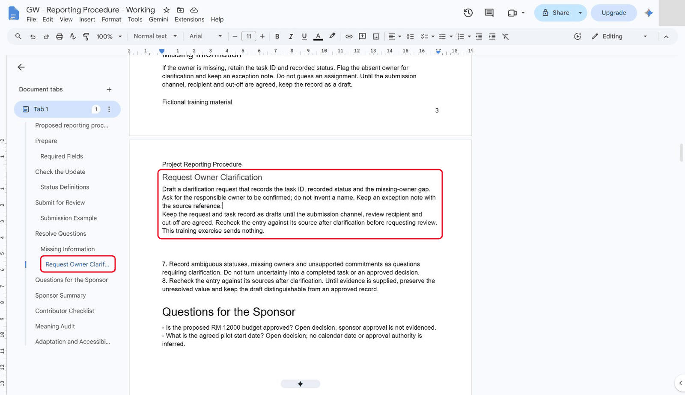

*Add the owner clarification instruction beneath its own Heading 3.*

3. Under **Quick Start**, below the existing shortcut links, add a link labelled `Draft an owner-clarification request`. Use **Insert link** and select the actual heading destination rather than typing a private document URL into the course notes.

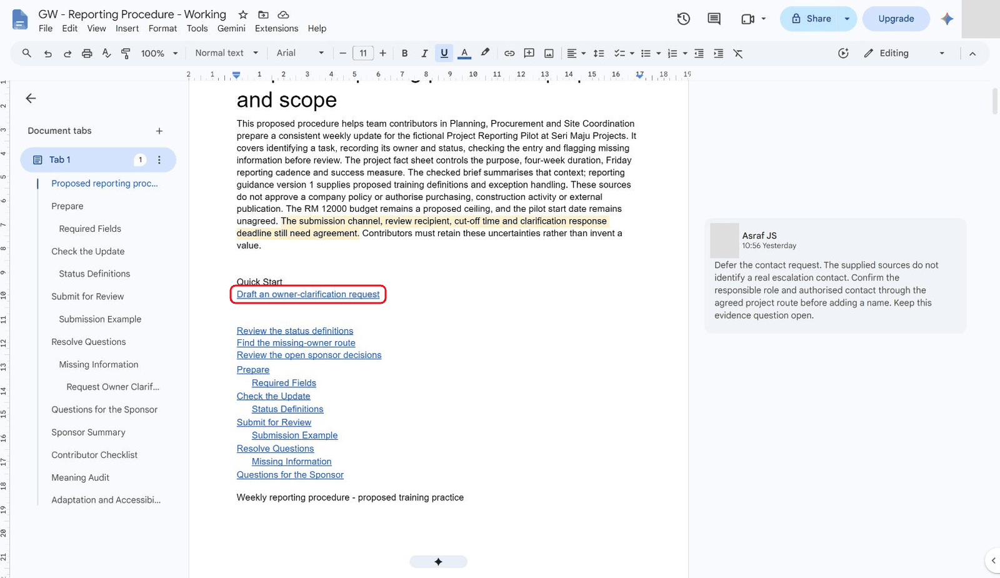

*Add an opening link to the new instruction.*

<details markdown="1">
<summary>What should you see?</summary>

A clear response to missing information, with no fabricated assignment or sent request.

</details>

## 8.2 Run the Review

1. Click inside the table of contents and click its **Update table of contents** button (the circular arrow at its left). The reference review found that the contents also omitted earlier audience/audit headings; refreshing repaired that real issue.

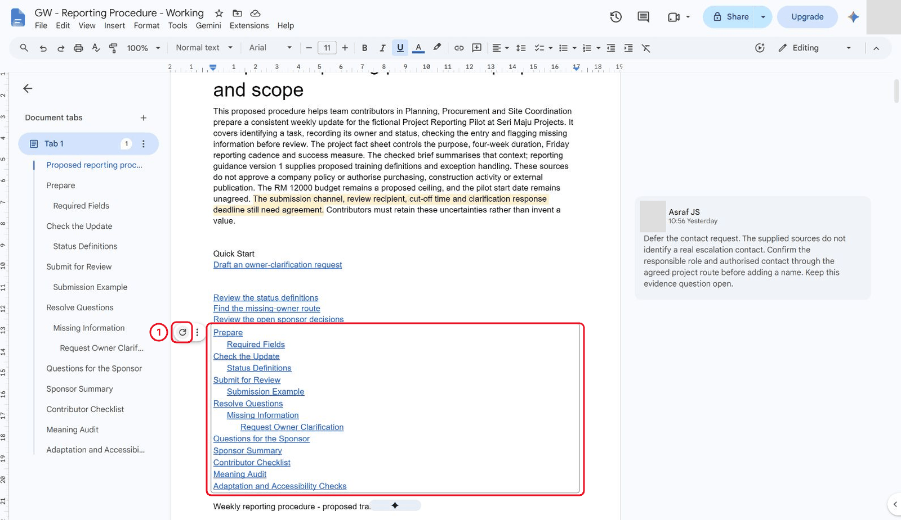

*Refresh the native contents to include current headings.*

2. Test the new opening link. It must reach **Request Owner Clarification**, not merely resemble a link. In the reference run, selecting the link and pressing **Alt+Enter** followed it.

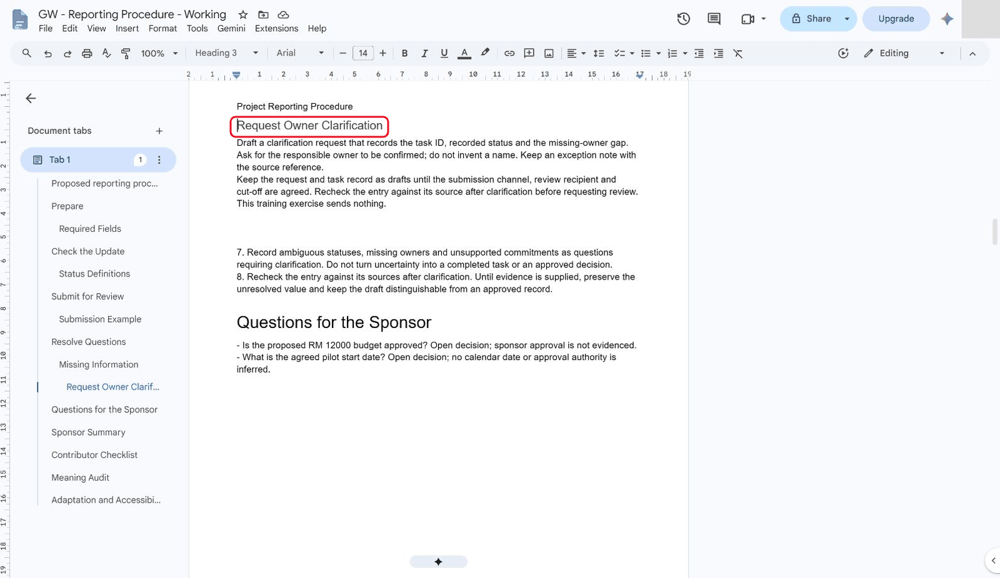

*Follow the opening link to Request Owner Clarification.*

3. Check all budget, approval and start-date references against `project-facts.txt` and `reporting-guidance.txt`. Retain **RM 12000 proposed ceiling**, **unagreed start**, **four weeks from the agreed start** and **every Friday**. Distinguish labelled flawed examples or rejected assertions from accepted facts; do not silently rewrite historical evidence.
4. Inspect the entire print layout and sponsor summary. The reference core PDF had **11 pages**: all pages were rendered and visually reviewed offline, with no blank pages or text outside page bounds. The existing sponsor summary remained 100 words. This does not establish interactive PDF-link behaviour.

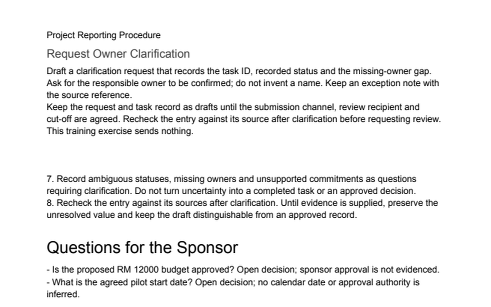

*Inspect the core native-export PDF offline through its final page.*

<details markdown="1">
<summary>What should you see?</summary>

A navigable procedure that retains the source conditions, with the actual repair recorded.

</details>

## 8.3 Demonstrate the Handover

1. At the end of the document, add a **Challenge Review Record** heading (Heading 1) showing the new instruction's source context, the contents repair and the decision to retain unresolved budget/date conditions. Keep the earlier contact-evidence question open; a tidy comment count is not evidence of resolution.

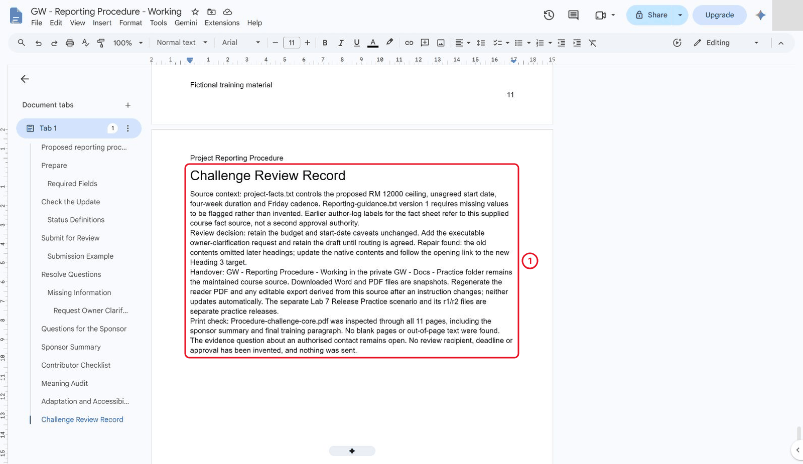

*Record source context, a review decision and the maintained source versus snapshot.*

2. Click **File**, **Version history**, **Name current version** and save `Procedure challenge checked`.

**Copy: Typed Values**

```text
Procedure challenge checked
```


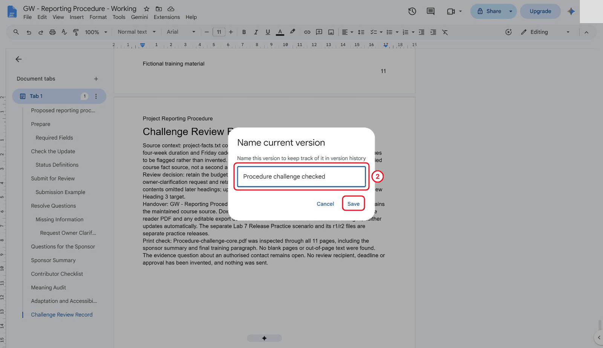

*Name the checked core revision.*

3. Explain that **Working** is the maintained native source. PDF/Word files are dated snapshots and must be regenerated after source changes. The separate Lab 7 release scenario remains distinct; it is not replaced by this exercise.

<details markdown="1">
<summary>What should you see?</summary>

A checked milestone and an honest handover that identifies the maintained source, snapshots and open decisions.

</details>

## 8.4 Complete an Unfamiliar Revision and Reader Test

1. Click **File**, **Make a copy** to create `GW - Reporting Procedure - Capstone Practice`. Leave sharing and comment copying unchecked. Write a **Capstone Change-Impact List** before editing: route, headings, contents, opening links, proposed checklist, audience wording, examples, export scope and reader evidence.

**Case input to analyse**

Fictional training material. This is exercise content to analyse, not authorisation to send, publish, grant access or change a real project decision.

```text
Final change brief: Contributors must be able to report an unknown owner, an unfamiliar status and a request that asserts approval without evidence. Keep these uncertainties visible and provide a review route. You may design proposed practice, but must not add a real contact, deadline, approval or pilot start date.
```


**Copy: Names and Opening Links**

```text
GW - Reporting Procedure - Capstone Practice
Procedure capstone checked
Procedure-capstone-complete-r1.pdf
Draft an owner-clarification request
Review unresolved owner, status and approval evidence
```


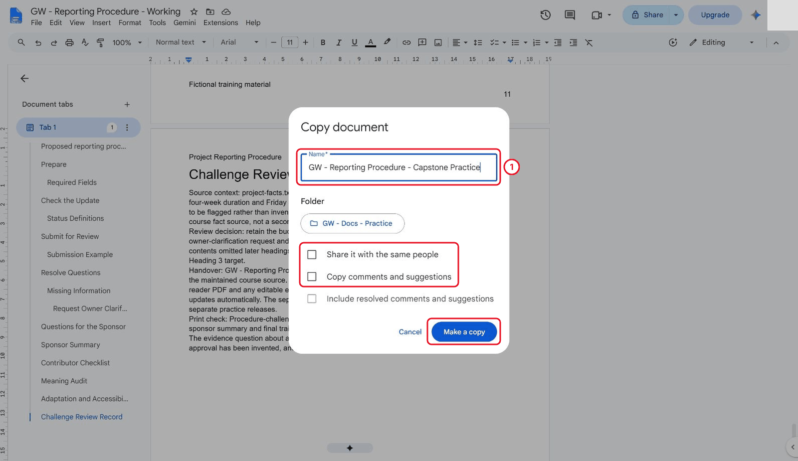

*Create the capstone practice copy without copying sharing or comments.*

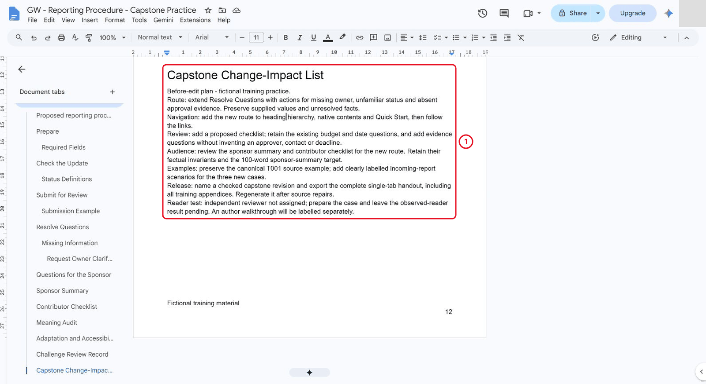

*Write the change-impact list before editing the route.*

2. Under **Resolve Questions**, add Heading 2 **Escalation and Evidence Gaps**, with Heading 3 branches **Missing Owner**, **Unfamiliar Status** and **Approval Evidence Missing**. Give each branch an action, a record to retain and a condition that remains unresolved. Preserve an unfamiliar raw label; do not map it to Complete without evidence. Treat asserted approval without a decision reference as unsupported.

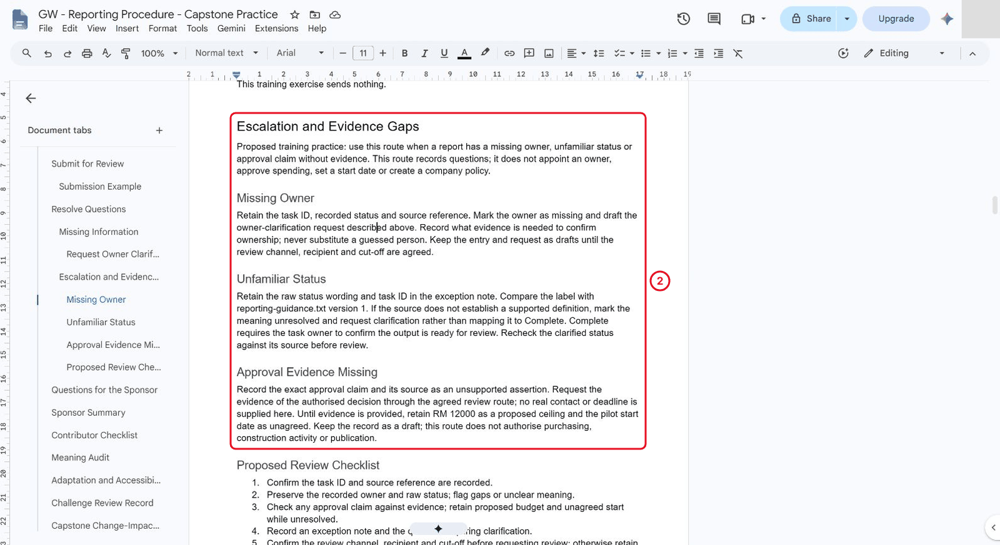

*Add distinct actions for missing owner, unfamiliar status and missing approval evidence.*

3. Add Heading 3 **Proposed Review Checklist** with the six actions provided below. Label this proposed training practice. Do not add a real recipient, deadline, approval policy or authority to spend.

**Copy: Proposed Review Checklist**

```text
1. Confirm the task ID and source reference are recorded.
2. Preserve the reported owner and raw status; flag gaps or unclear meaning.
3. Check any approval claim against evidence; retain proposed budget and unagreed start without approval.
4. Record an exception note and the pending clarification.
5. Confirm the review channel, recipient and cut-off before requesting review; otherwise retain the draft.
6. After clarification, recheck against the source and retain the review decision with its evidence.
```


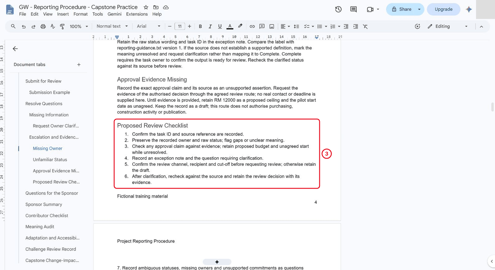

*Label the six-action checklist proposed practice.*

4. Under **Quick Start**, add the link `Review unresolved owner, status and approval evidence`, targeting the new Heading 2. Retain and retest the earlier owner-clarification link. Refresh the contents and follow its escalation entry. Both opening links and the contents destination were tested natively in the reference run.

5. Update the sponsor summary, contributor checklist and open decision questions to match the route. The checked sponsor version is **100 words**. Keep the original budget/date caveats and the canonical T001 source example. Add a separate **Capstone Incoming-Report Examples** table for the three supplied scenarios, with columns **Case**, **Incoming report**, **Author route and recorded action**, **Unresolved / stop condition**.

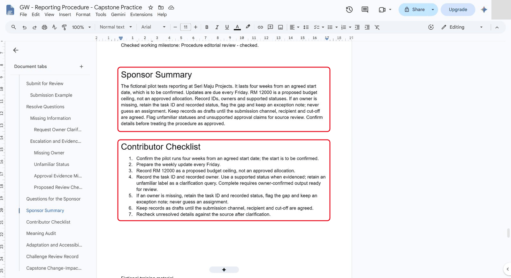

*Check the 100-word sponsor summary and contributor checklist against the new route.*

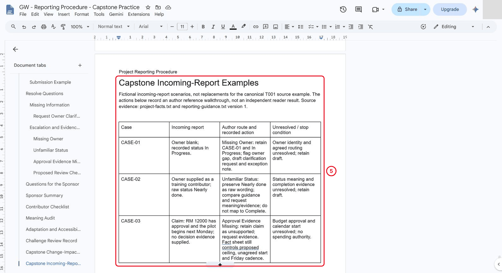

*Record the three fictional incoming-report cases as author checks.*

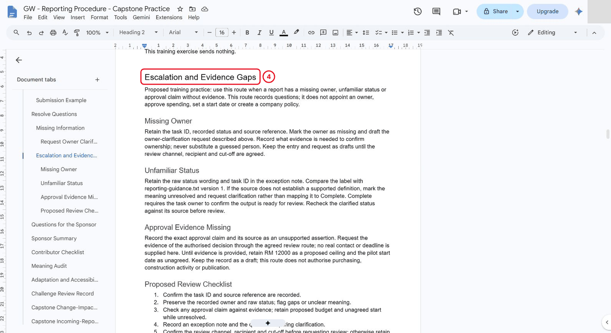

*The refreshed contents entry reaches the escalation heading.*

6. Add a **Reader-Test Status and Release Record**. Record the three author checks separately from an independent reader result. Name the checked revision `Procedure capstone checked`, export the complete single **Tab 1** including appendices to `Procedure-capstone-complete-r1.pdf`, and inspect every page. The reference PDF had **16 pages**. A page break kept the reader record together; an empty heading left by that break was changed to Normal text, the contents refreshed and the final PDF regenerated. Final readback confirmed **24 nonempty heading targets and seven native tables**. All final pages were rendered and visually inspected; no blank/out-of-page text was found. Native navigation was tested; interactive PDF navigation remains pending.

**Copy: Author Walkthrough Cases**

These are fictional incoming reports, not replacements for the canonical T001 source example. Record the route, next action and unresolved stop condition for each.

| Case | Incoming report | Reference route |
|---|---|---|
| CASE-01 | Owner blank; recorded status In Progress | Missing Owner: retain the case ID/status, flag the absent owner, draft a clarification request; owner/routing remain unresolved |
| CASE-02 | Owner supplied as training contributor; raw status Nearly done | Unfamiliar Status: retain the label, compare guidance, request meaning/evidence; do not infer Complete |
| CASE-03 | Claims RM 12000 approved and next Monday start; no decision evidence | Approval Evidence Missing: retain the unsupported assertion, request a decision reference through an agreed route, preserve proposed ceiling/unagreed start and Friday cadence |


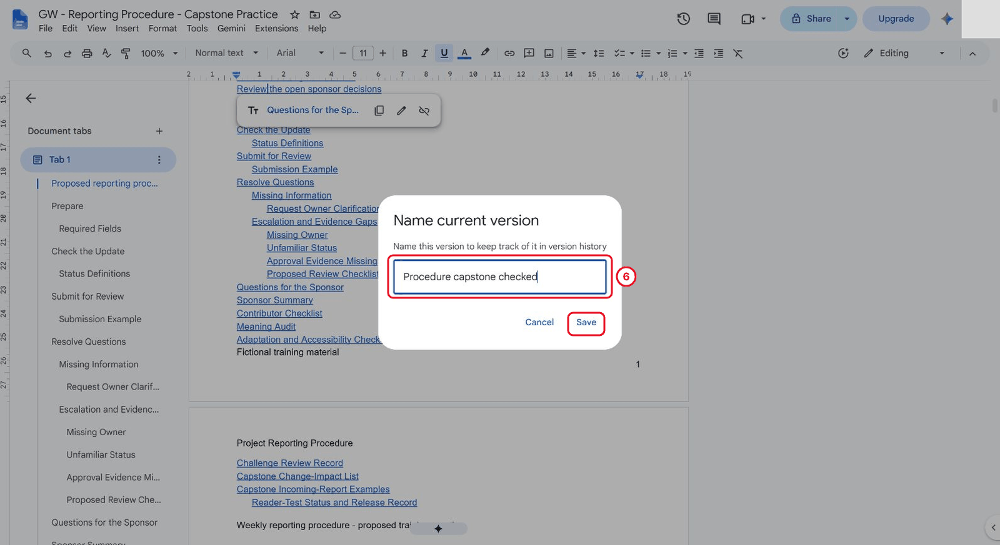

*Name the checked capstone revision before its complete export.*

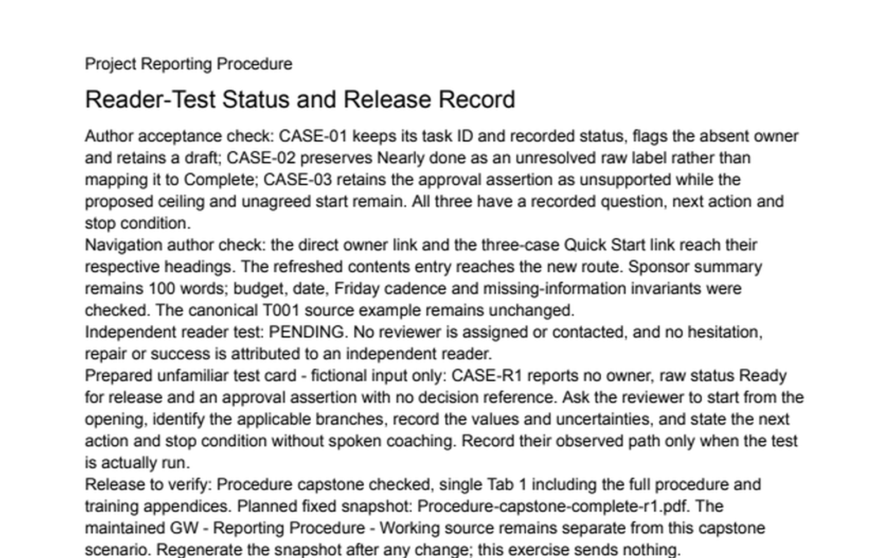

*The complete 16-page capstone PDF retains the pending reader-test record.*

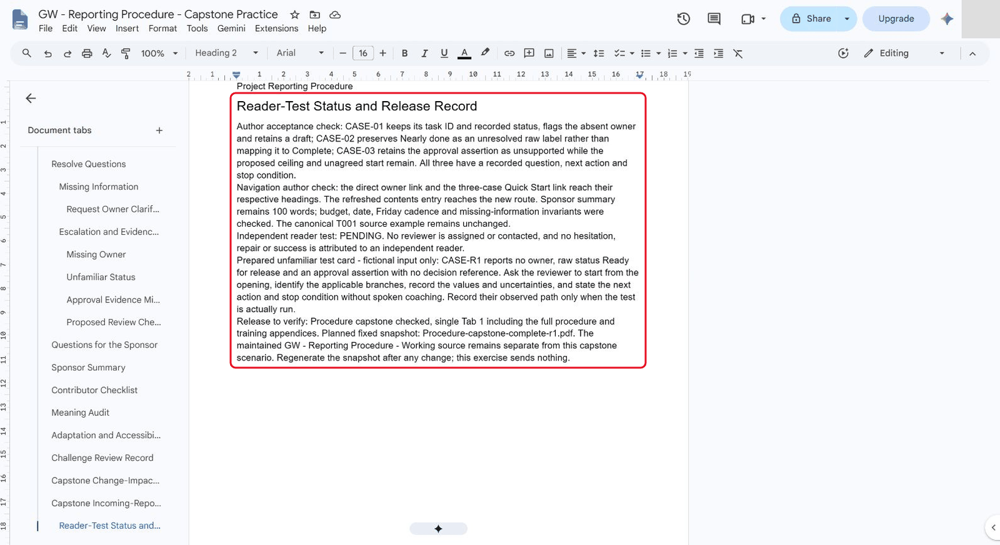

*Record author acceptance evidence and leave the independent reader test pending.*

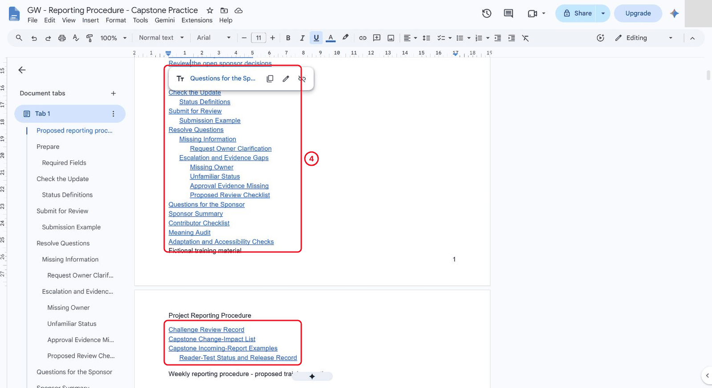

*The refreshed contents includes the new route and capstone records.*

7. **Pending until an independent reviewer is assigned:** give that person the document and unfamiliar CASE-R1 card. Ask them to follow it without coaching and record their actual decision path, hesitation and result. The reference run prepared the card but contacted nobody. Do not fill this result with the author's own walkthrough.

**Copy: Independent Reviewer Card (Result Pending)**

```text
CASE-R1: A report has no owner, uses status Ready for release and asserts approval without a decision reference.
Find the appropriate route without coaching. State what you record, the next action and what prevents release.
Reviewer:
Observed path:
Hesitation or error:
Evidence-based repair or second-case result:
Status: PENDING until an independent reviewer actually completes the test.
```


<details markdown="1">
<summary>What should you see?</summary>

An integrated three-case route with tested native navigation and a checked complete export. Independent reader evidence remains visibly pending until it actually exists.

</details>

## Independent Practice

Close the earlier step lists for the first attempt. Use the case input and your own reasoning. If you need help, record the hint and repeat the affected check independently.

1. Use the reviewer’s hesitation or error to revise one instruction. If no hesitation occurs, challenge them with a second case containing two missing fields.

2. Produce a one-page handover with source link, current release, outstanding review questions and three acceptance-test results.

3. Demonstrate a complete path from opening link to exception handling to review record. Your explanation must show why the procedure does not authorise spending.

### Evidence to Hand Over

- Integrated three-case escalation route with working navigation.
- A reader test, an evidence-based repair or a tested second case, and fresh complete export.
- One-page handover that distinguishes maintained source, snapshot and open decisions.

Record the defect or uncertainty you investigated, the evidence used, the repair or reasoned no-change decision, and the final state. Restore temporary changes or keep them in a clearly named scenario copy.

## Troubleshooting

| Symptom | What to check |
|---|---|
| The capstone only adds a new heading | Check for executable actions, worked examples, tested links and an independent reader result. |
| An input or earlier result is missing | Reopen the input named in Before You Begin; do not substitute private company data |
| A menu or feature is unavailable | Confirm the account and the shared access notes; record the missing step and ask the trainer for its fallback |
| The result differs from the checkpoint | Compare the exact source range, wording and conditions before repeating the action |

## Lesson Summary

You have drafted, structured, reviewed and checked a professional procedure.

**Check yourself:** Can a new reader find the missing-information instruction from the opening?
