# 01 - Read the Brief and Plan the Story

In this chapter you will choose the audience, decision and evidence; use Gemini to propose an outline.


**Estimated time:** 40 minutes, planned as 10 explanation and demonstration, 10 guided build and casework, 15 independent practice and 5 verification and repair. Not yet timed with learners.

**Your result:** A six-slide story plan with a decision request and source evidence.

> **Status:** an author reference run covers the written work in 1.1-1.4 with 15 staged images and retained sources. The real Gemini proposal, human revision, native storyboard and task snapshot were checked. Spoken rehearsal (1.3 step 3), partner walkthrough (1.4 step 7), independent challenge and learner timing remain pending. Lab 1 creates a planning Doc; deck creation starts in Lab 2.

---

## What You Will Learn

- Choose a presentation decision.
- Plan evidence before slide decoration.
- Use AI to propose a bounded outline.

## Before You Begin

Read the case input beside the relevant steps. Use a separate named casework copy for destructive tests or altered datasets. Keep the baseline unchanged for later chapters. Record source facts, proposed practice and unresolved questions separately.

Download [checked brief](../../shared/sample-files/checked-brief.txt), [project facts](../../shared/sample-files/project-facts.txt), [reporting guidance](../../shared/sample-files/reporting-guidance.txt) and [TaskRegister.xlsx](../../shared/sample-files/TaskRegister.xlsx). This specialist course supplies its own inputs.

In Google Drive, click **New**, **New folder**, type `GW - Slides - Practice` and click **Create**. Open the folder and drag `TaskRegister.xlsx` into it (or click **New**, **File upload**). Double-click it to inspect the **Tasks** sheet in section 1.4; Lab 5 converts this same upload to Google Sheets. Create every file in this course inside the practice folder.

## 1.1 Read the Decision

1. In Google Drive, click **New**, **Google Docs**, **Blank document**. Click **Untitled document**, type `GW - Sponsor Update - Story Plan` and press **Enter**. Create it inside your `GW - Slides - Practice` folder and keep it private. Use the supplied specialist inputs; the masterclass's later task changes are not this course's baseline.
2. Type `Sponsor Decision` and choose **Heading 1** from the style list. Underneath, identify **Farid Hassan, sponsor** as the audience. Write one decision sentence: decide whether to approve the **proposed RM 12000 ceiling** and agree the **pilot start date**. Aina Rahman coordinates the pilot.

**Copy: Planning Names and Decision Sentence**

Heading 1 sections in the planning Doc, in order:

```text
Sponsor Decision
Six-Slide Narrative - Human Draft
AI Proposal Review
Outline Acceptance Check
Audience and Evidence Storyboard
Decisions and Claim Inventory
Stakeholder Request Review
Opening and Closing Scripts
Appendix Plan and Review Status
```

Names and decision sentence:

```text
GW - Sponsor Update - Story Plan
Story plan checked
Story plan checked - layout repaired
Decide whether to approve the proposed RM 12000 budget ceiling and agree the pilot start date.
```

3. Separate purpose, future success criterion and unresolved approvals. The purpose is to test a consistent weekly reporting process. Success would mean all three teams submitting on time in the final two weeks; achievement is not yet evidenced.
4. Record the facts the sponsor needs: the three teams, four outputs, four weeks from an agreed start, Friday updates and the status-definition risk. Preserve the exclusions for live construction records, purchasing commitments and external publication.

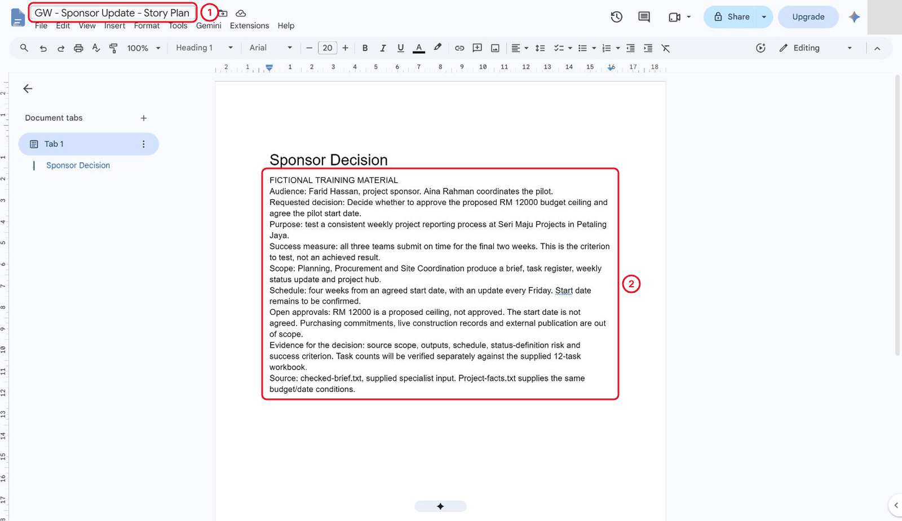

*Record the sponsor decision, purpose, success criterion and open approvals.*

<details markdown="1">
<summary>What should you see?</summary>

A clear budget/start-date decision request, supported project context and visible unresolved conditions.

</details>

## 1.2 Plan the Narrative

1. At the end of the Doc, add the Heading 1 `Six-Slide Narrative - Human Draft` and write your own six-slide outline under it first: **Purpose**, **Pilot Scope**, **Current Tasks**, **Risk**, **Decisions**, **Next Steps**. Give each one main message and a source. Leave task counts unverified until you inspect the supplied workbook; the brief does not contain them.

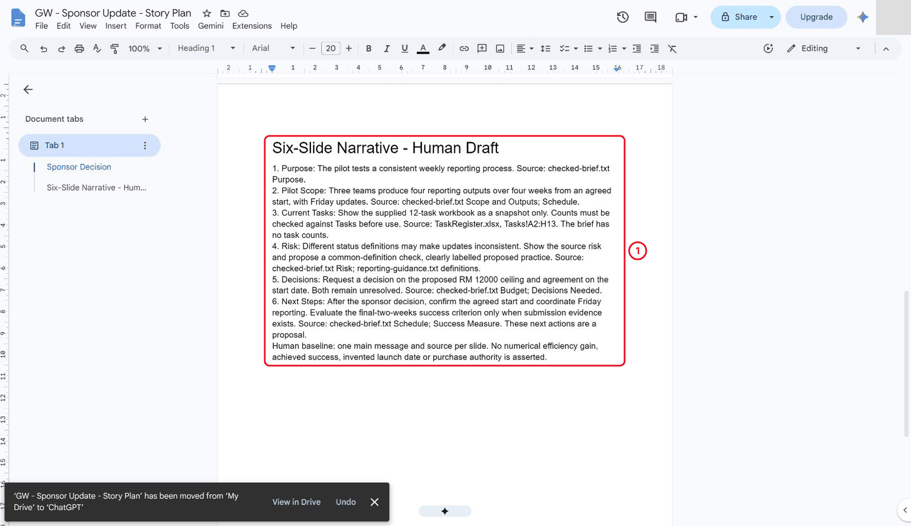

*Write the six-part human outline before asking Gemini.*

2. Click **Ask Gemini** (the star at the top right of the Doc). In a new conversation, paste the following prompt provided below with the complete `checked-brief.txt` replacing the placeholder. Request a panel-only answer. Do not submit an unresolved source placeholder or insert an unchecked generated deck.

**Copy: Propose an Outline**

**Session:** new chat | **Grounding:** pasted checked brief

```text
Goal: Suggest a six-slide sponsor update.
Context: Fictional reporting pilot.
Source: Only the checked brief below.
Expectations: Reply in the panel only. Give one main message and a source fact per slide. Preserve unresolved approvals and dates. Do not invent benefits or status counts.

BRIEF:
[paste checked-brief.txt]
```

Replace bracketed source placeholders before submitting. Keep a human check between an AI proposal and the final output.


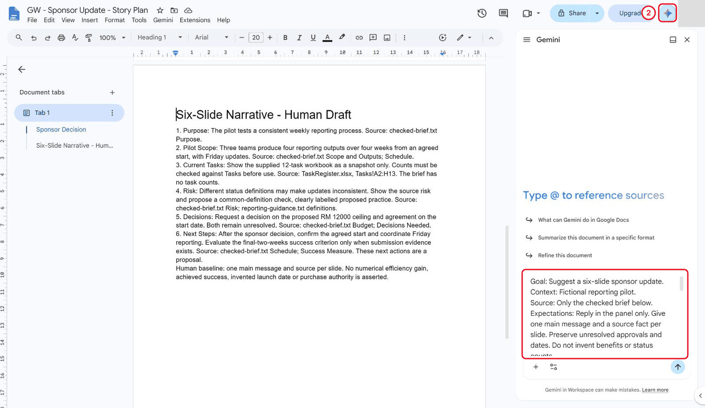

*Paste the bounded outline prompt and complete checked brief into Gemini.*

3. Read all six actual messages. The reference proposal used Purpose and Roles, Scope, Schedule and Success Measure, Reporting Risk, Proposed Budget and Decisions Needed. It retained the proposed budget and unconfirmed date and did not invent task counts or savings. Your response can differ; check its claims against the inputs.

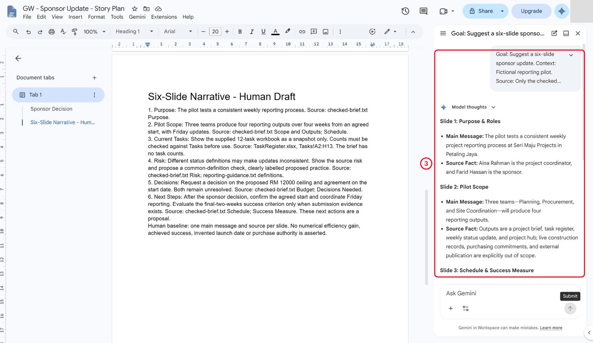

*Inspect the actual purpose and scope proposal in the Gemini panel.*

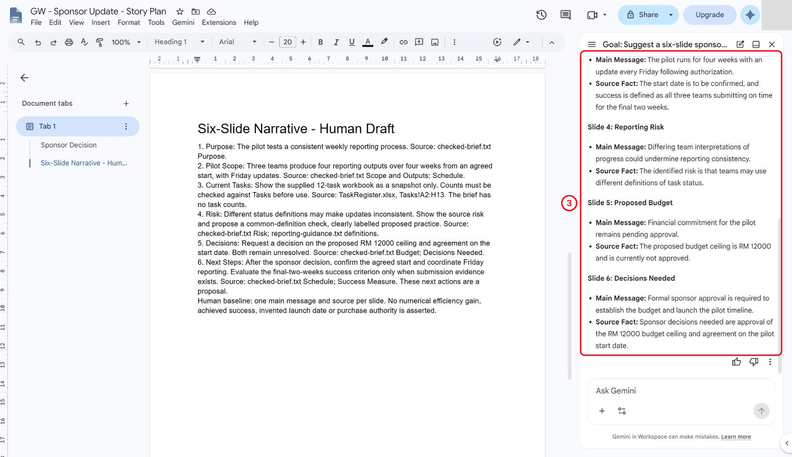

*The actual proposal retains the proposed budget and unresolved start decision.*

4. Add the Heading 1 `AI Proposal Review`. Compare the response with your human plan and record a real revision there. In this run, the first purpose message cited roles as its source fact: the review replaced that mapping with the actual Purpose phrase. It also replaced broad financial-commitment wording with proposed budget ceiling and kept the exact agreed-start condition.
5. Keep the required six-part story: merge budget with Decisions, include schedule and the success criterion in Scope/Next Steps, restore **Current Tasks** using a separately checked workbook, and end with conditional next actions. No unsupported claim was invented merely to demonstrate a correction.

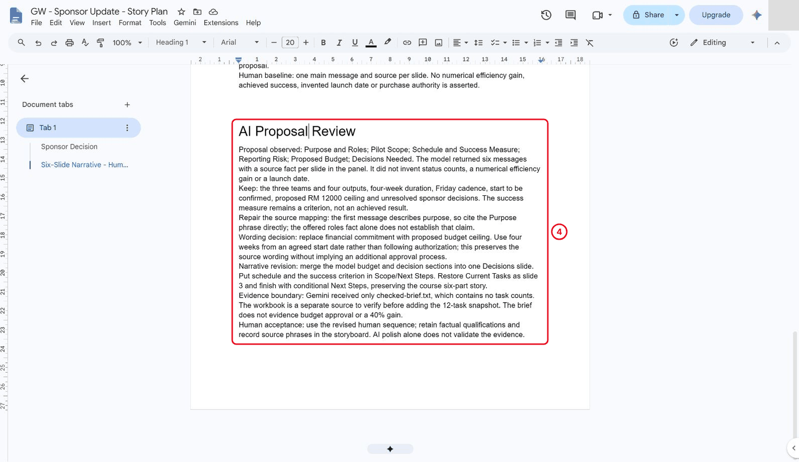

*Record the human source-mapping and narrative revision.*

<details markdown="1">
<summary>What should you see?</summary>

An outline with a useful job and identifiable source for every slide, plus a recorded human acceptance or repair decision.

</details>

## 1.3 Check the Outline

1. Add the Heading 1 `Outline Acceptance Check`. Check that no calendar launch date, achieved success or numerical efficiency saving has been invented.
2. Keep **RM 12000 proposed, not approved**, the unagreed start, four weeks from the agreed start and Friday reporting explicit. Confirm that the requested decision does not authorise purchasing.
3. Rehearse the plan aloud for one minute before creating the deck. **Pending in the author run:** a written script or word count does not establish that a person rehearsed aloud.

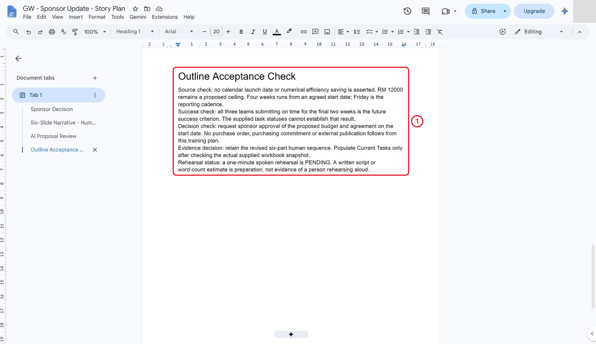

*Check factual conditions and leave spoken rehearsal pending.*

<details markdown="1">
<summary>What should you see?</summary>

A fact-checked outline. Record an actual spoken rehearsal separately when it happens.

</details>

## 1.4 Build an Audience and Evidence Storyboard

1. Add the Heading 1 `Audience and Evidence Storyboard` and a one-line description, then click **Insert**, **Table** and create a 5-column, 7-row table with **Slide**, **Audience question**, **Main message**, **Evidence**, **Visual approach**. Populate all six planned slides before opening the theme gallery. Landscape A4 was used in this reference run to keep the five-column table readable. Use **Format**, **Line & paragraph spacing**, **Add page break before** where needed to keep its heading and table together; inspect the resulting layout.

**Copy: Storyboard Columns and Required Sequence**

```text
Slide
Audience question
Main message
Evidence
Visual approach

Purpose
Pilot Scope
Current Tasks
Risk
Decisions
Next Steps
```

Use a native table with one header row and six story rows. Proposed visuals remain plans until later labs. Keep the checked brief and dataset as separate sources.


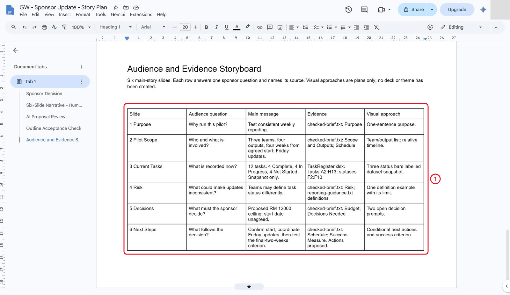

*Complete the native seven-row, five-column storyboard before deck decoration.*

2. Add the Heading 1 `Decisions and Claim Inventory`. Record both unresolved sponsor decisions and needed evidence. Budget approval needs an authorised decision identifying amount/conditions; a start date needs a recorded agreement. The supplied sources contain neither. A relative DueWeek value cannot supply a calendar date.
3. Build the claim inventory from `project-facts.txt`, `checked-brief.txt` and the supplied **12-task** workbook. Inspect `Tasks!A2:H13` and statuses `F2:F13`: **4 Complete, 4 In Progress, 4 Not Started**, four tasks per team. Label these as a dataset snapshot. In the reference run, the supplied local XLSX was inspected directly; this does not claim a live Google Sheets test or prove final-two-weeks on-time submissions.

**Copy: Source Controls**

| Input | Check |
|---|---|
| checked-brief.txt and project-facts.txt | RM 12000 proposed, start unagreed, four weeks from agreed start, Friday updates, three teams and four outputs |
| TaskRegister.xlsx Tasks!A2:H13 | Exactly 12 supplied task rows, T001-T012 |
| TaskRegister.xlsx Tasks!F2:F13 | Four Complete, four In Progress, four Not Started; dataset snapshot only |
| reporting-guidance.txt version 1 | Complete requires owner-confirmed output ready for review; DueWeek is relative |


Copy the table values (tab-separated); fill the native table as instructed:

```text
Input	Check
checked-brief.txt and project-facts.txt	RM 12000 proposed, start unagreed, four weeks from agreed start, Friday updates, three teams and four outputs
TaskRegister.xlsx Tasks!A2:H13	Exactly 12 supplied task rows, T001-T012
TaskRegister.xlsx Tasks!F2:F13	Four Complete, four In Progress, four Not Started; dataset snapshot only
reporting-guidance.txt version 1	Complete requires owner-confirmed output ready for review; DueWeek is relative
```

The specialist uses its own unchanged 12-task workbook. Do not substitute the masterclass's later 13-task scenario or treat status counts as evidence of successful weekly submissions.


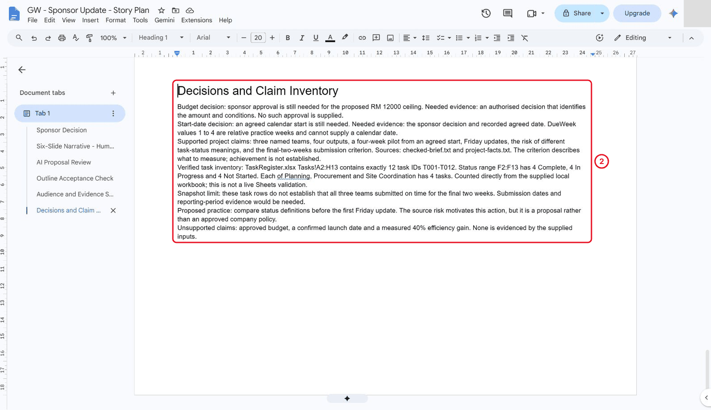

*Record the two decisions and verified twelve-task dataset snapshot.*

4. Add the Heading 1 `Stakeholder Request Review`. Classify the stakeholder requests as supported, proposed or unsupported. Preserve the source phrase for supported project claims and identify the range for derived counts. The three teams and task snapshot are supported. Saying the budget is approved contradicts the source. A 40% efficiency promise lacks a metric, measured baseline, comparison period and validated result. A shared-definition check can be proposed, with that status explicit.

**Case input to analyse**

Fictional training material. This is exercise content to analyse, not authorisation to send, publish, grant access or change a real project decision.

```text
Stakeholder requests: Explain the three teams; show current task counts; say the budget is approved; promise a 40% efficiency gain. The sources support the teams and task snapshot, but provide no approval or measured gain.
```


**Copy: Claim Review Fields**

```text
Stakeholder request:
Classification: Supported / Proposed / Unsupported
Source phrase or exact workbook range:
Limit or missing evidence:
Decision: Keep / Qualify / Omit / Request evidence
```


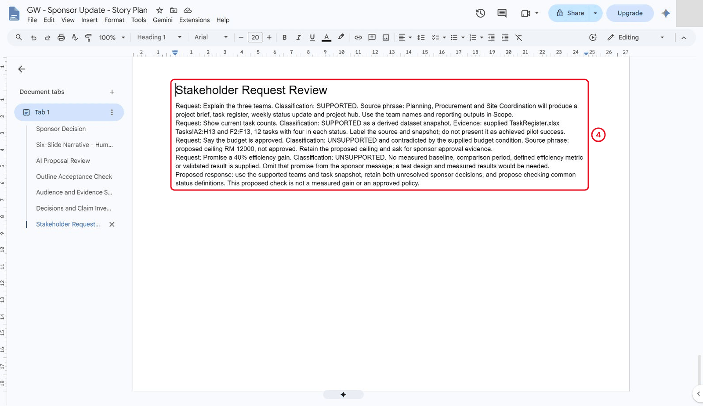

*Classify supported requests and reject unsupported approval and efficiency claims.*

5. Add the Heading 1 `Opening and Closing Scripts`. Draft a 60-second opening and 30-second closing request. Preserve the proposed budget and unresolved date. The reference drafts contain **125** and **63 words**; these are preparation, not measured speaking times. Keep actual rehearsal pending until performed.

**Copy: Speaking and Appendix Preparation**

Draft a 60-second opening and 30-second closing request. Keep both sponsor decisions visible. Word-count estimates support preparation; record the actual aloud duration separately.

Plan an appendix for source/status definitions and one for an unanswered audience question. Explain why neither belongs in the core six-slide sequence. Leave partner observations blank until a real partner completes the walkthrough.


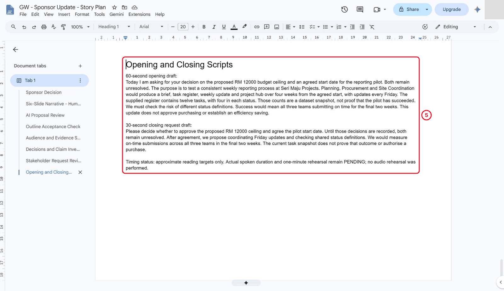

*Draft opening and closing scripts while leaving actual spoken duration pending.*

6. Add the Heading 1 `Appendix Plan and Review Status`. Plan one appendix on **source definitions** and a second on **an audience question the evidence cannot answer**. The reference second topic asks what measurable efficiency improvement the pilot will deliver; the inputs cannot answer. Explain why these support questions stay outside the six-slide decision story.

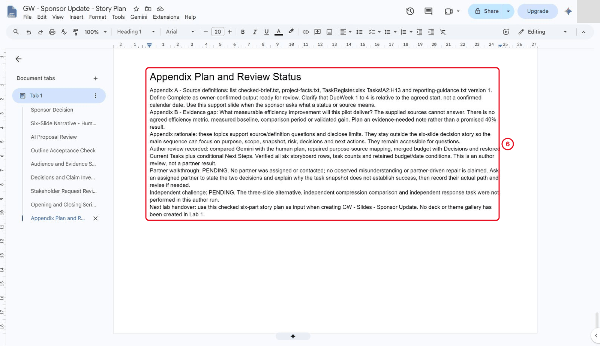

*Plan source definitions and an evidence-gap appendix, with partner review pending.*

7. **Pending until a partner is assigned:** walk them through the storyboard without decoration. Ask them to identify both decisions and explain why the task snapshot does not establish success. Record their actual confusion and any resulting revision. The reference author run contacted nobody and attributes no hesitation or repair to a partner.
8. Click **File**, **Version history**, **Name current version**, type `Story plan checked` and click **Save**. Inspect the complete planning document and record genuine issues. The initial author PDF had nine pages with one blank page after the storyboard. Removing an extra **Add page break before** setting on the following claim-inventory heading repaired it. The separate final milestone is `Story plan checked - layout repaired`. The final **eight-page** PDF was rendered and visually checked offline, with no blank pages or text outside page bounds. Native readback confirmed **nine nonempty headings and a 7 x 5 native table**. Interactive PDF navigation is not claimed.

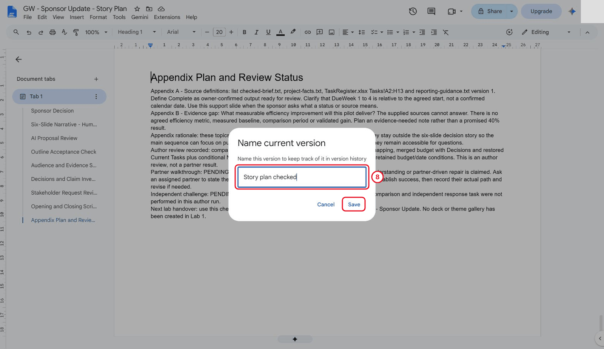

*Name the initial checked planning revision.*

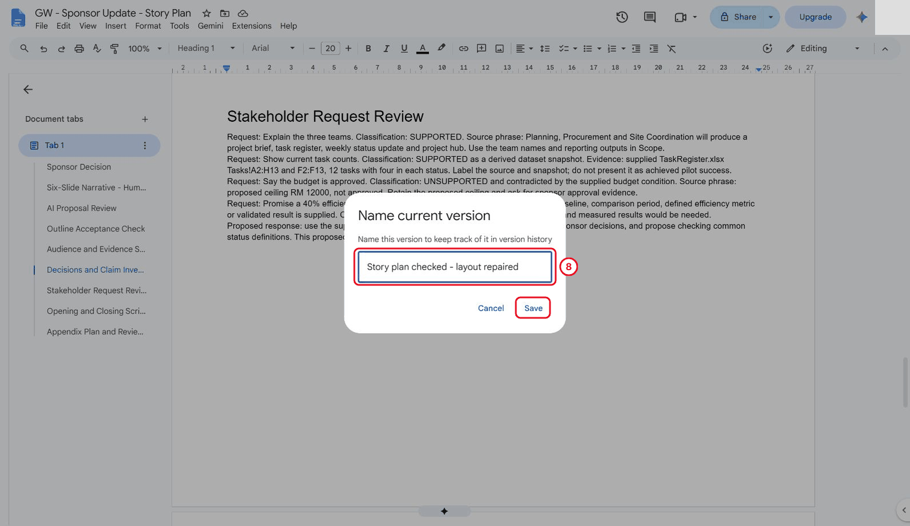

*Name a distinct checked revision after the blank-page repair.*

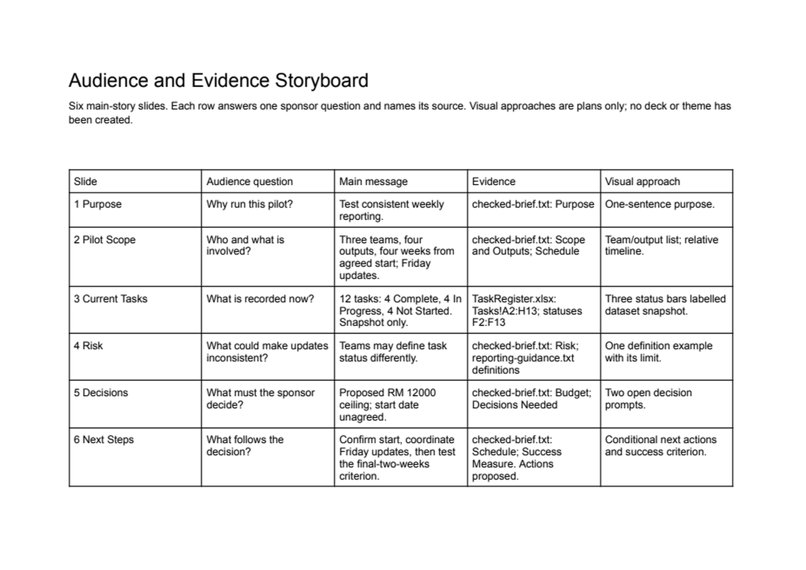

*The repaired native-export PDF retains the complete storyboard on one page.*

<details markdown="1">
<summary>What should you see?</summary>

A six-slide evidence storyboard, two appendix topics, source-backed claim decisions and draft scripts. Spoken rehearsal, partner results and the independent challenge remain visibly pending until completed.

</details>

## Independent Practice

Close the earlier step lists for the first attempt. Use the case input and your own reasoning. If you need help, record the hint and repeat the affected check independently.

1. Independently prepare a three-slide version for a sponsor with only two minutes available. Identify which evidence moves to notes or an appendix and why.

2. Compare the short and full outlines for all required facts. Restore any qualification lost through compression.

3. Write a response to an unsupported request in the case input , including what evidence would be needed to make that claim.

### Evidence to Hand Over

- Six-slide evidence storyboard with two planned appendix topics.
- Opening, decision request and a justified three-slide alternative.
- Stakeholder-claim classification and one recorded narrative revision.

Record the defect or uncertainty you investigated, the evidence used, the repair or reasoned no-change decision, and the final state. Restore temporary changes or keep them in a clearly named scenario copy.

## Troubleshooting

| Symptom | What to check |
|---|---|
| A polished outline lacks a decision | Return to the sponsor’s open questions and identify which slide supplies evidence for each. |
| An input or earlier result is missing | Reopen the input named in Before You Begin; do not substitute private company data |
| A menu or feature is unavailable | Confirm the account and the shared access notes; record the missing step and ask the trainer for its fallback |
| The result differs from the checkpoint | Compare the exact source range, wording and conditions before repeating the action |

## Lesson Summary

The story plan gives the deck a purpose and an evidence base.

**Check yourself:** What decision should the sponsor understand at the end?
