# 02 - Create and Organise the Deck

In this chapter you will apply a theme, manage slides and import a supplied slide while checking its formatting.

> **Prompts:** the [prompts page](./prompts.md) has every value and prompt for this chapter, each with a Copy button.

**Estimated time:** 45 minutes, planned as 10 explanation and demonstration, 15 guided build and casework, 15 independent practice and 5 verification and repair. Not yet timed with learners.

**Your result:** A named deck with a consistent theme and organised delivery sequence.

> **Status:** partial author reference run with 14 staged images and full original-size sources. Sections 2.1-2.2, appendix creation, theme/manual-colour comparison, working-deck navigation and reusable placeholders were checked in the real application. The Import slides picker remained blank after a saved-deck reload; 2.3 import comparisons and 2.4 steps 4-5 remain unverified. Independent challenge and learner timing remain pending.

---

## What You Will Learn

- Create a named deck and theme.
- Organise slides and layouts.
- Compare imported formatting with a destination theme.

## Before You Begin

Read the [case input](./prompts.md) and use a separate named casework copy for destructive tests or altered datasets. Keep the baseline unchanged for later chapters. Record source facts, proposed practice and unresolved questions separately.

Use the six-slide plan from Chapter 1. If no prior plan is available, use its six named topics.

## 2.1 Create the Deck

1. In Google Drive, click **New**, **Google Slides**, **Blank presentation**. Click **Untitled presentation** at the top left, type `GW - Slides - Sponsor Update` and press **Enter**.
2. In the **Themes** panel on the right, click **Simple Light**. If the panel isn't open, click **Theme** in the toolbar.

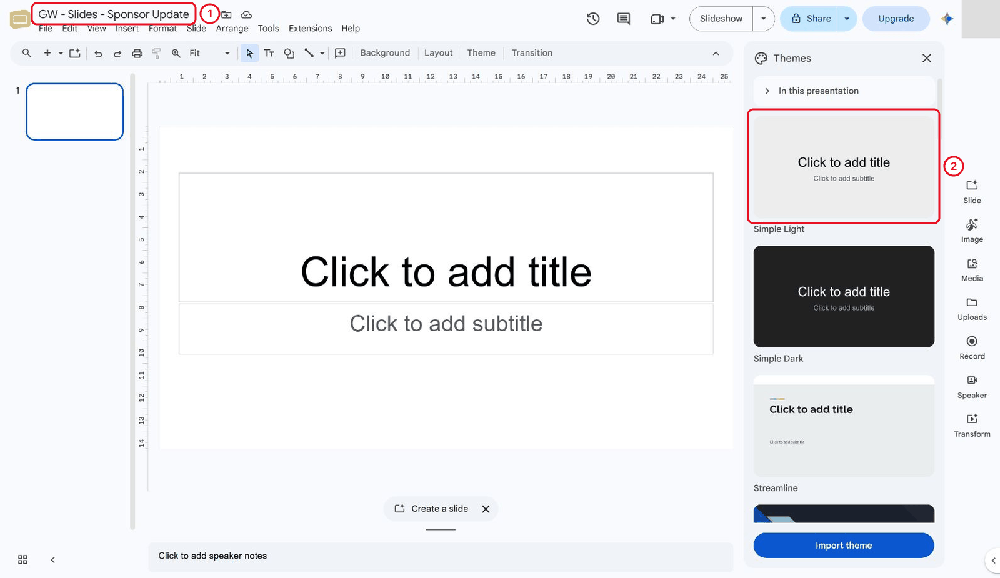

*Choose Simple Light before building the deck.*

3. Create the planned sequence: **Purpose**, **Pilot Scope**, **Current Tasks**, **Risk**, **Decisions**, **Next Steps**. Use a Title slide for Purpose and Title and body for the other five: click the arrow next to **+** (New slide) in the toolbar and choose the layout. Add the checked messages from your story plan.

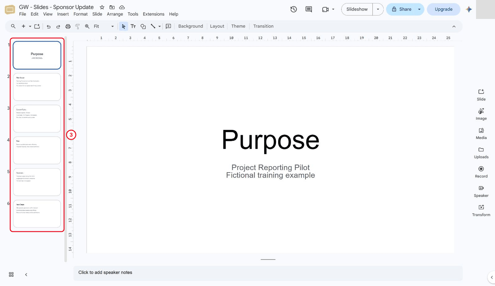

*Six planned slides in sequence.*

What should you see?

The deck has six identifiable slides in the planned sequence.

## 2.2 Manage the Sequence

1. In the filmstrip on the left, right-click the Risk slide and choose **Duplicate slide**. Change the copy's title to `Risk - alternative` and drag it to just after Decisions.
2. Right-click the duplicate and choose **Skip slide**.

> **Reference run:** The reference keeps **Risk - alternative** immediately after Decisions.

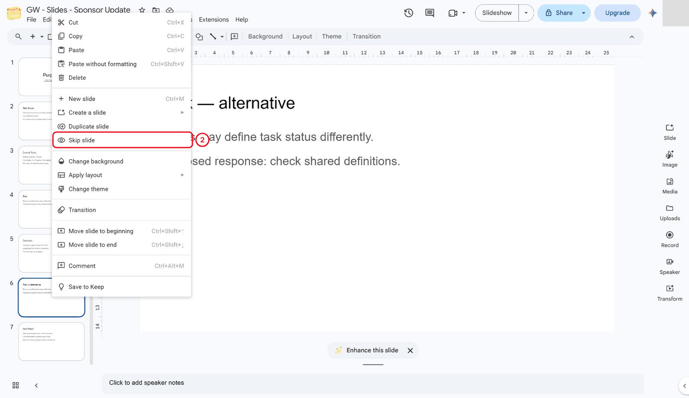

*Use the backup slide context menu.*

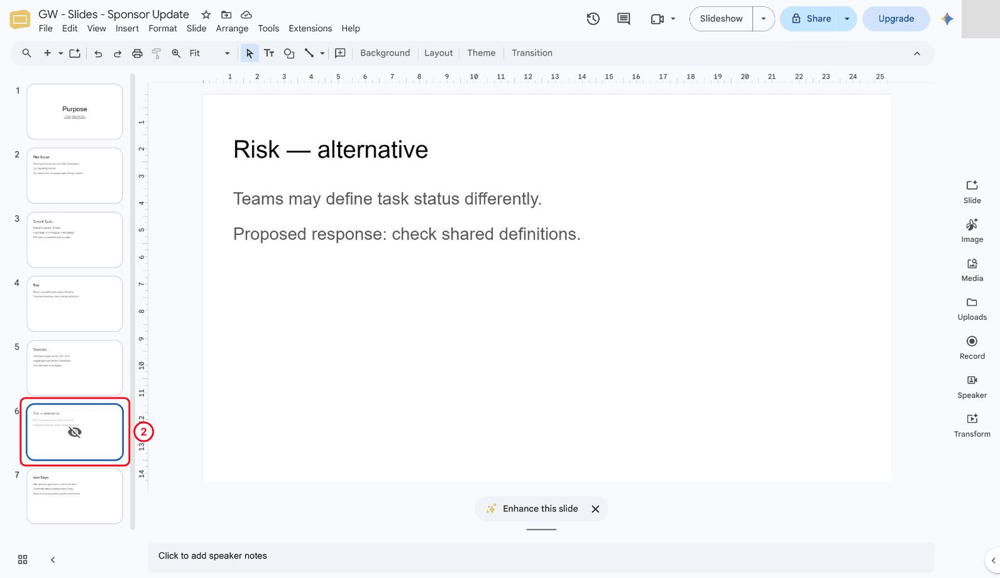

*Retain the alternative as skipped backup.*

3. Keep the duplicate skipped as backup: section 2.4 and Lab 7 count on it being slide 6. Start **Slideshow** from Decisions and advance: the reference reaches Next Steps, bypassing the backup.

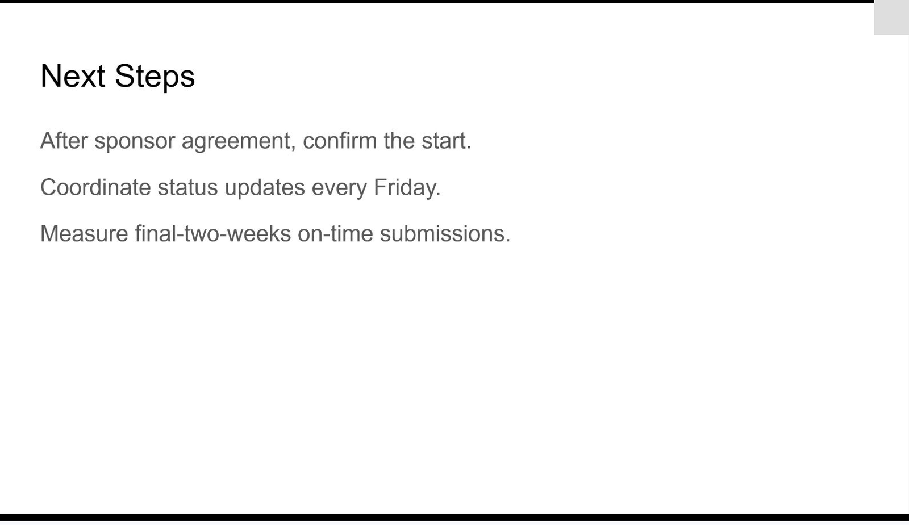

*Slideshow reaches Next Steps after Decisions.*

What should you see?

The main delivery sequence remains six slides; optional backup content is clearly handled.

## 2.3 Practise Importing

1. Create a second disposable deck named `GW - Slides - Import Practice Source`, with one title slide labelled `Fictional training example`.

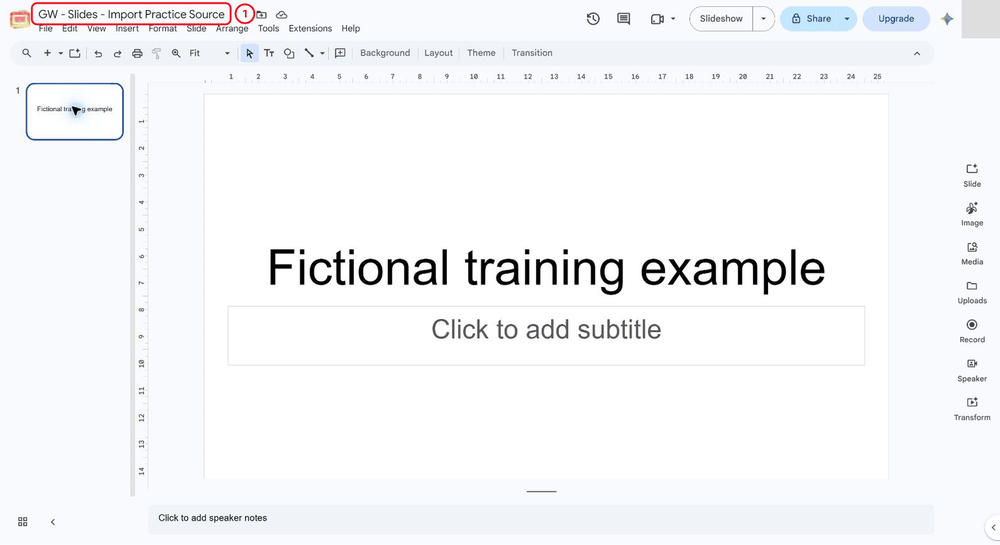

*Create the disposable import source.*

2. In the working deck click **File**, **Import slides** and choose that disposable source.
3. Compare keeping the source theme with adopting the destination theme. Remove the extra imported practice slide when finished.

> **Author-run limitation:** the Import slides dialog remained blank, including after saving and reloading the working deck. No slide was imported and neither formatting outcome is claimed. If this occurs in class, retain the source and record the incomplete comparison; continue the appendix and theme steps that do not rely on imports.

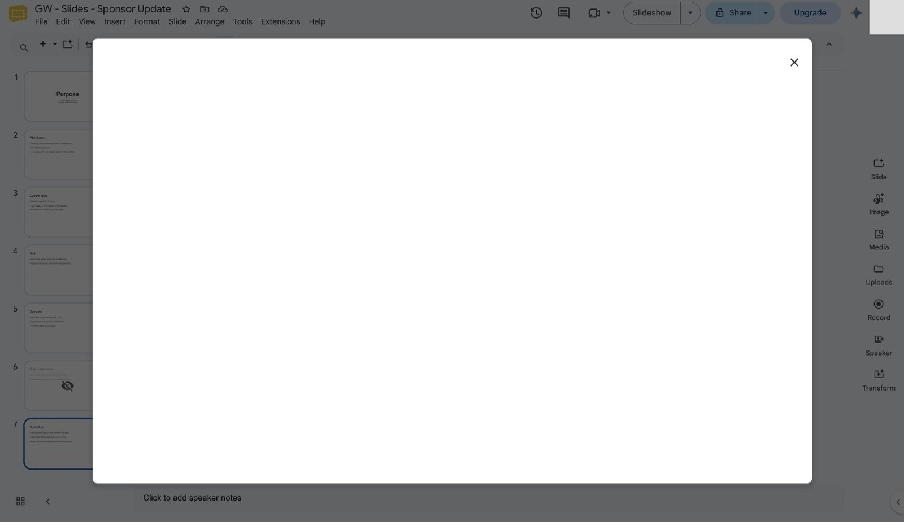

*Import picker remained blank in the author environment.*

What should you see?

You can explain the formatting choice without mixing an unrelated slide into the final story.

## 2.4 Create a Reusable Deck Structure and Import Test

1. Add **Appendix A - Source Definitions** and **Appendix B - Unanswered Question** after Next Steps. The retained Risk alternative makes nine total slides. Appendix A records the status definition, relative Due Week and source versions; Appendix B retains the missing efficiency baseline/comparison instead of promising an unsupported improvement.

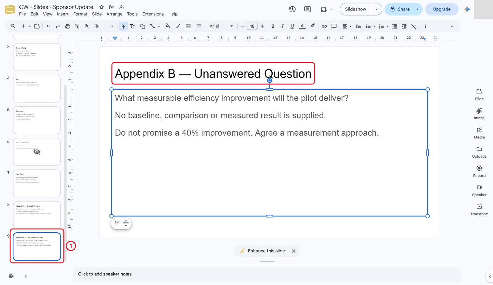

*Add the unanswered-question appendix.*

2. In the disposable deck click **Slide**, **Edit theme**, then **Colours** in the toolbar. Select **Accent 1** and set a practice hex value `#674ea7`. Close theme editing. Select the source title text and apply Accent 1 from the **theme** row of Text colour. Add subtitle `Manual colour stays fixed` and apply fixed dark red 2 from the standard palette. Return to theme editing and change Accent 1 to `#0b8043`.

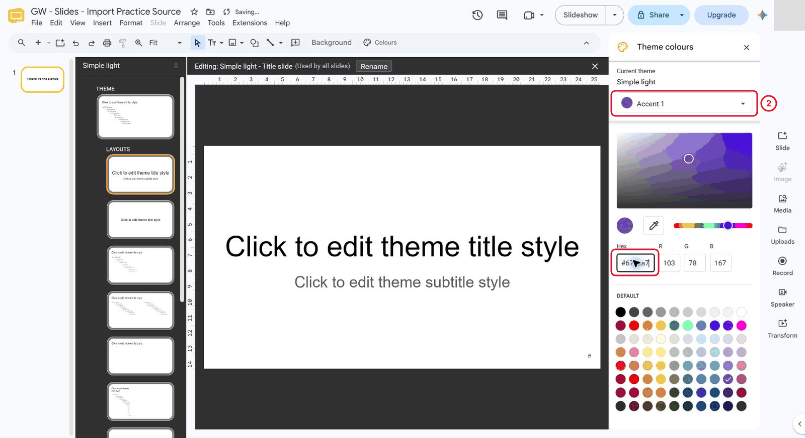

*Inspect and edit the disposable theme accent.*

The title follows the new green accent; the manually formatted subtitle remains red.

> **Reference run:** Native readback confirmed the title uses ACCENT1 and the subtitle a fixed RGB value.

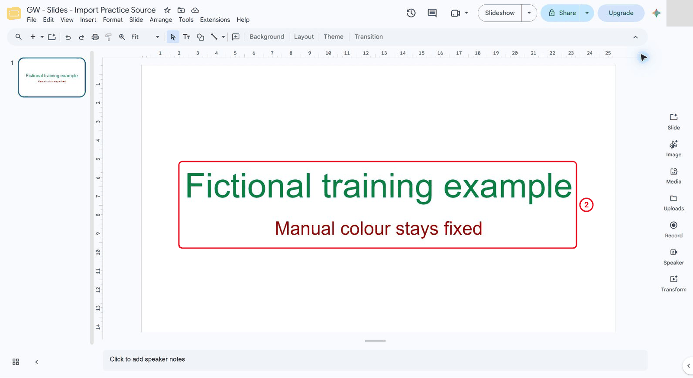

*Theme-linked title changes while manual text stays red.*

3. Keep Simple Light in the working deck and its consistent Title/Title and body layouts. Record that manual colours need separate inspection after theme changes. The practice accent changes above belong only to the disposable source.

4. Create a deliberately different source slide with a different theme and an informative title. Import it twice: once keeping its original theme and once adopting the destination theme.

5. Compare text, background and object formatting on the two imports. Choose the suitable version and keep only the useful practice result as a skipped slide at the end of the deck (**Slide**, **Move slide**, **Move slide to end**), so the slide numbers used in Labs 7 and 8 stay the same.

> **Reference run:** Steps 4-5 are pending because the import picker is blank. The working deck has no imported practice appendix.

6. On Decisions add **Review source definitions**, select that text and use **Ctrl+K > Slides in this presentation > Appendix A - Source Definitions**. Add **Return to Decisions** in Appendix A and link it to Decisions. Test both in **Slideshow**, by clicking the links.

> **Reference run:** The reference moved from slide 5 to slide 8 and back to slide 5.

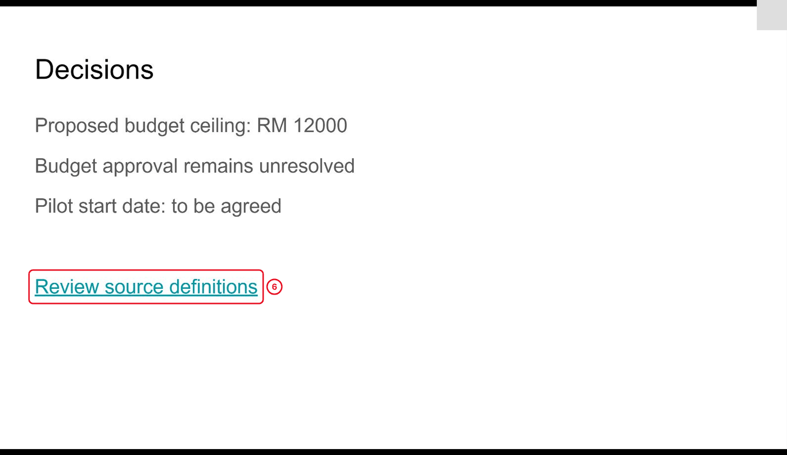

*Follow the decision slide link in presentation mode.*

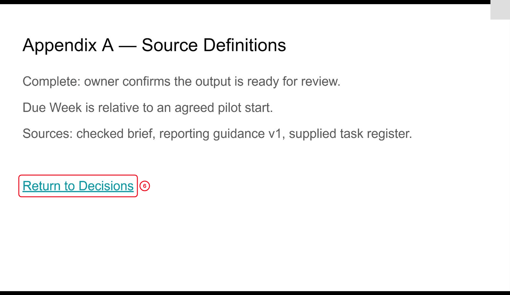

*Source definitions include a working return link.*

7. Click **File**, **Make a copy**, **Entire presentation** and name it `GW - Slides - Reusable Six-Part Structure`. Leave sharing unchecked and remove speaker notes from the copy. Replace every case-specific message, number and source in the copy with descriptive placeholders. Preserve the six main topics, skipped backup and two appendices; restore internal links if text replacement removes them. Do not treat the earlier project evidence as evidence for a new topic.

> **Reference run:** The reference copy uses the default linked slide-title labels.

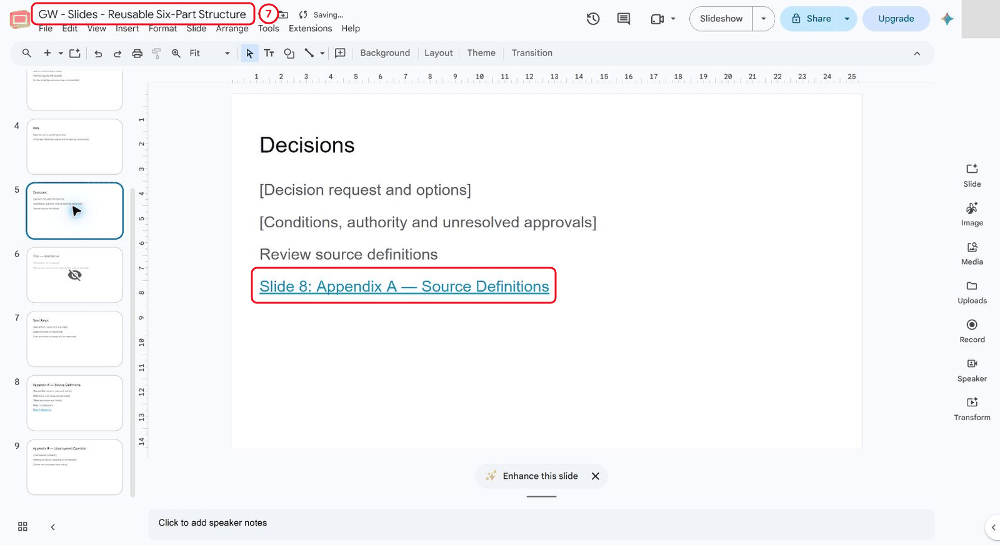

*Reusable decision placeholders replace case narrative.*

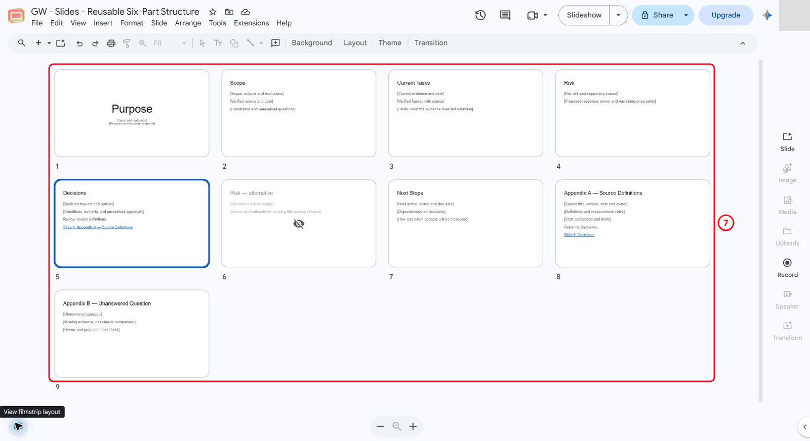

*Separate reusable structure with nine slides.*

What should you see?

Working deck plus clearly separated reusable structure copy. The result must be supported by the recorded checks; an attractive output or an AI assurance is insufficient.

## Independent Practice

Close the earlier step lists for the first attempt. Use the case input and your own reasoning. If you need help, record the hint and repeat the affected check independently.

1. A new training topic needs the same six-part structure but a different accent colour. Adapt the structure copy without changing the original evidence deck.

2. Import one additional practice slide and repair theme inconsistencies. Demonstrate the retained main sequence and skipped support material.

3. Write a short reuse note identifying what is controlled by the theme and what a future author must inspect manually.

### Evidence to Hand Over

- Working deck plus clearly separated reusable structure copy.
- Keep-theme/adopt-theme comparison and checked appendix navigation.
- Independent theme adaptation with the original deck preserved.

Record the defect or uncertainty you investigated, the evidence used, the repair or reasoned no-change decision, and the final state. Restore temporary changes or keep them in a clearly named scenario copy.

## Troubleshooting

| Symptom | What to check |
|---|---|
| Changing the theme leaves inconsistent objects | Inspect manually formatted elements separately from theme-linked placeholders. |
| An input or earlier result is missing | Reopen the input named in Before You Begin; do not substitute private company data |
| A menu or feature is unavailable | Confirm the account and the shared access notes; record the missing step and ask the trainer for its fallback |
| The result differs from the checkpoint | Compare the exact source range, wording and conditions before repeating the action |

## Lesson Summary

A consistent deck structure makes content editing and later review easier.

**Check yourself:** Why can an imported slide look different from the rest of a deck?
