# 03 - Build Clear Slide Layouts

In this chapter you will create a title, progress, risk and decision slide with a consistent visual hierarchy.

> **Prompts:** the [prompts page](./prompts.md) has every value and prompt for this chapter, each with a Copy button.

**Estimated time:** 55 minutes, planned as 10 explanation and demonstration, 25 guided build and casework, 15 independent practice and 5 verification and repair. Not yet timed with learners.

**Your result:** Readable core slides with supporting speaker notes.

> **Status:** author reference run with 21 staged real-application images and full original-size sources. The six main slides have checked titles and source notes. Dense/redesigned alternatives, aligned team cards and the output diagram were built and inspected in Slideshow. The 45-second explanation is a written draft; spoken duration, reviewer message-retrieval test (3.4 step 7), independent challenge and learner timing remain pending.

---

## What You Will Learn

- Use a layout hierarchy.
- Align objects and reduce crowded content.
- Write evidence-based slide titles.

## Before You Begin

Read the [case input](./prompts.md) and use a separate named casework copy for destructive tests or altered datasets. Keep the baseline unchanged for later chapters. Record source facts, proposed practice and unresolved questions separately.

Open the working deck and checked brief.

## 3.1 Build the Core Messages

1. Open `GW - Slides - Sponsor Update`. Change the Purpose title to **Test consistent weekly reporting**. Add **A proposed four-week Project Reporting Pilot** and the fictional-training label below it. This describes a purpose, not a measured benefit.

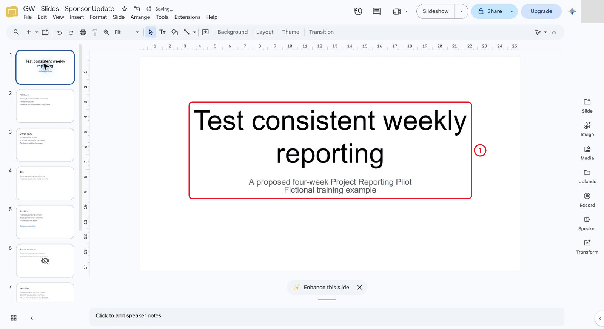

*State the reporting-pilot purpose descriptively.*

2. On Pilot Scope, name **Planning**, **Procurement** and **Site Coordination**. Name all four outputs: project brief, task register, weekly status update and project hub.

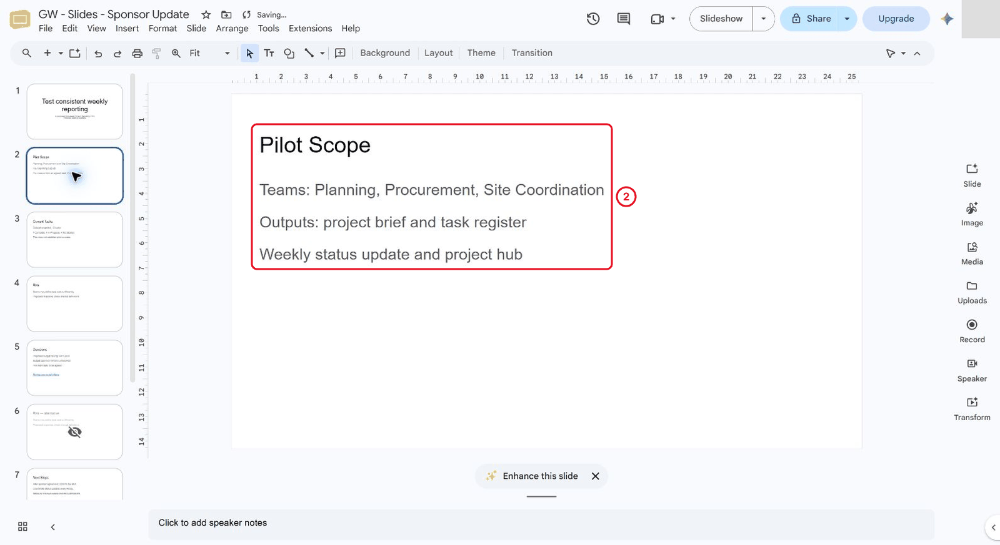

*Name the three teams and four outputs.*

3. On Decisions, retain **Proposed budget ceiling: RM 12000**, **Budget approval remains unresolved** and **Pilot start date: to be agreed**. Keep the existing appendix navigation link.

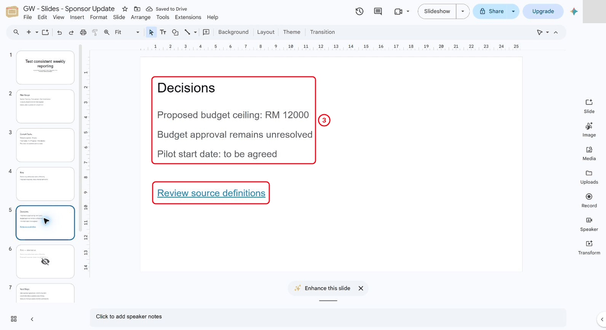

*Keep proposed budget and unagreed start visible.*

What should you see?

Source-backed purpose and scope, with both sponsor decisions still visibly unresolved.

## 3.2 Arrange the Content

1. Keep the related text in layout placeholders. The reference increases body text on the five main content slides to **22 pt**; check the actual line breaks at your viewing size.

2. Select the related title/body objects and use **Arrange > Align > Left** where needed. Distribution requires at least three objects; the three-card example in 3.4 uses it explicitly.

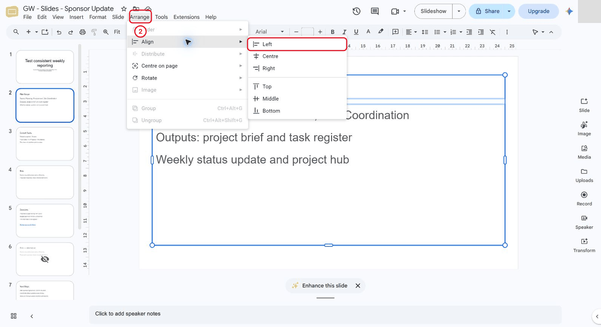

*Align related placeholders through Arrange.*

3. Keep concise phrases on the slide and retain full source qualifications in **speaker notes** (click **Click to add speaker notes** under the slide). On Scope, record all three teams and four outputs, exclusions, the four-week duration from an agreed start and Friday updates. The dense-paragraph reduction is demonstrated separately in 3.4, preserving its original for comparison.

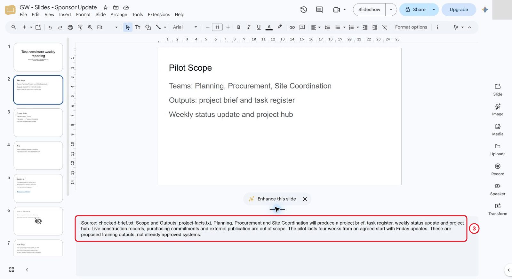

*Keep the full source qualifications in speaker notes.*

What should you see?

Consistent placeholders, readable body text and source details in notes. No text extends off the slide at the checked viewing size.

## 3.3 Review Titles and Notes

1. Replace topic-only titles with the checked main message. The reference titles are **Three teams will produce four outputs**, **The task snapshot is not a success result**, **Teams may define task status differently**, **Budget and start date need sponsor agreement**, and **Agree the start, then coordinate Friday updates**.

2. Add source notes to each of the six main slides. For the task snapshot, cite `TaskRegister.xlsx`, `Tasks!A2:H13` and status range `F2:F13`. Twelve tasks split four per status do not establish successful final-two-weeks submissions. For Decisions, cite the checked brief's Budget, Schedule and Decisions Needed; retain the proposed/unapproved ceiling and unagreed date.

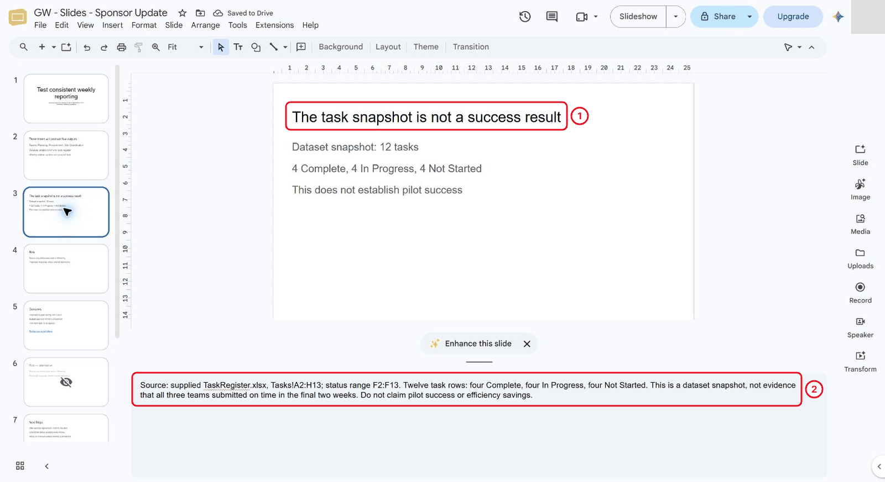

*Give the task snapshot a qualified evidence title.*

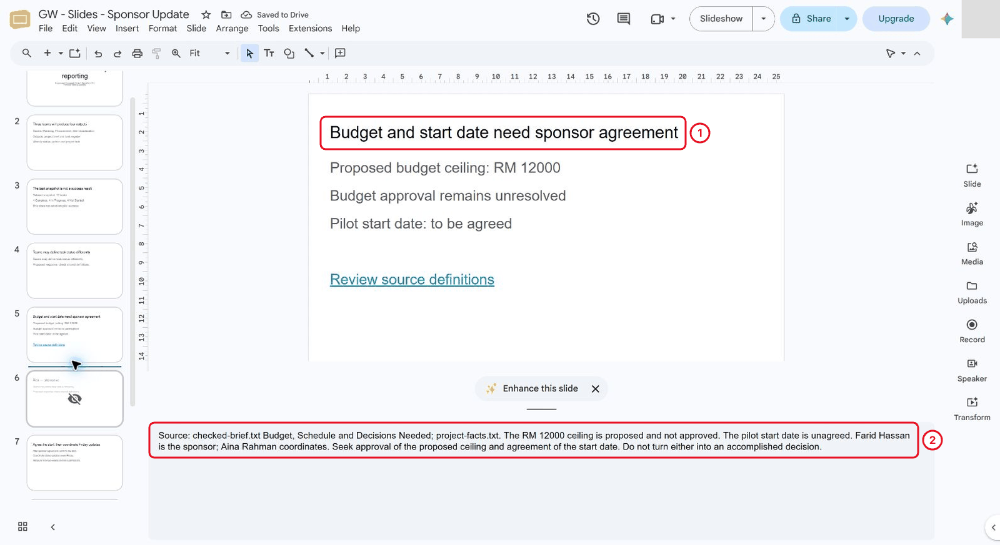

*Keep the sponsor-decision caveats in the notes.*

3. Click **Slideshow** at the top right and inspect line breaks, contrast and placement. Check the opening, scope, task snapshot, risk, decisions and conditional next steps. These captures show the author viewing size; they do not establish readability from the back of a classroom.

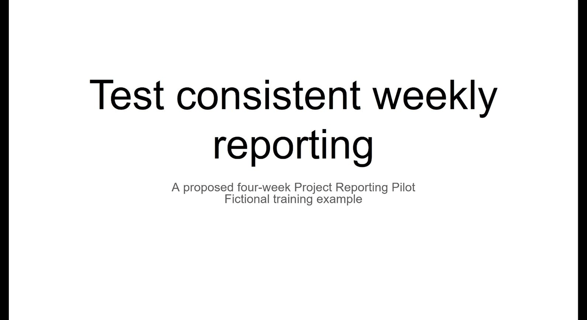

*Inspect the purpose slide in Slideshow.*

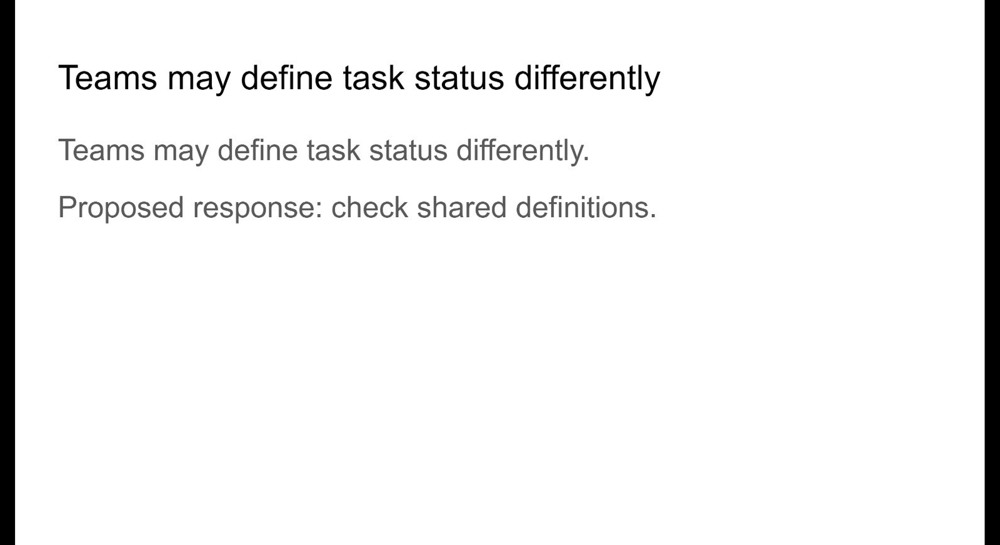

*Inspect the proposed risk response in Slideshow.*

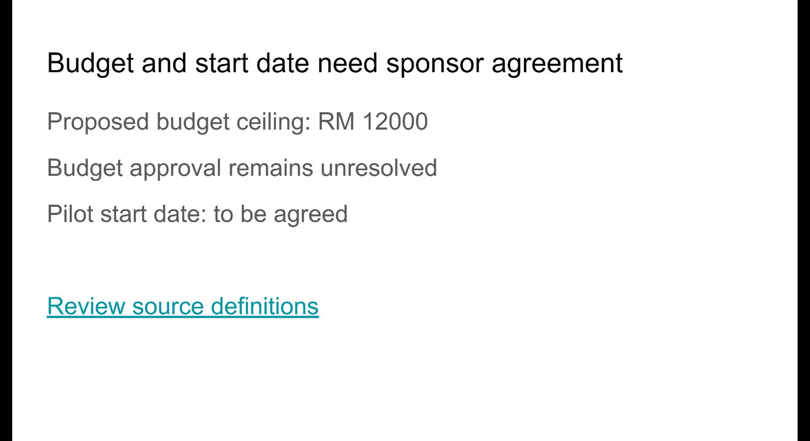

*Inspect both unresolved decisions in Slideshow.*

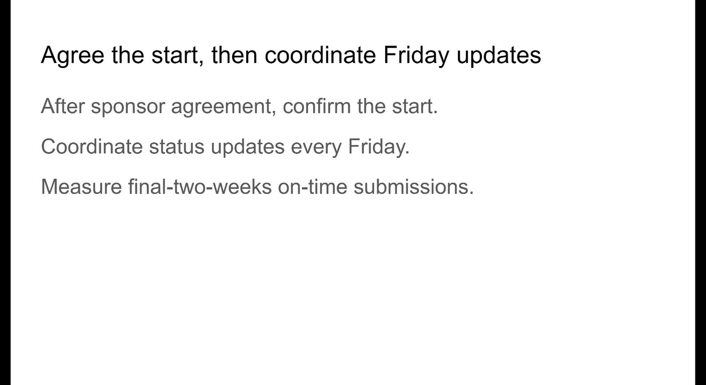

*Inspect the conditional next steps in Slideshow.*

What should you see?

Each main slide has a descriptive message and supporting source notes. The proposed definition check remains proposed; success is a future criterion rather than an achieved result.

## 3.4 Redesign Dense Content Without Losing Evidence

1. In Drive, click **New**, **Google Slides**, **Blank presentation** and name it `GW - Slides - Layout Practice`. Use **Title and body** for the first slide. Title it **Dense draft - full paragraph**, then paste the complete dense draft from the copy-paste card. Preserve it unchanged for comparison.

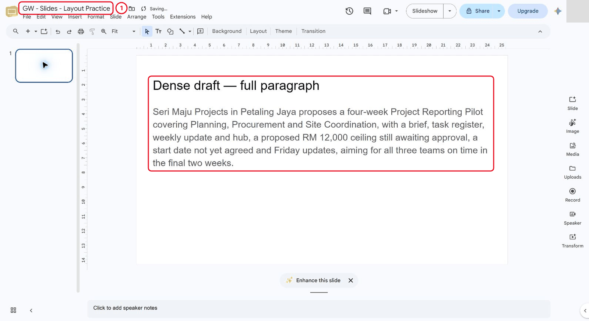

*Preserve the exact dense paragraph in a separate practice deck.*

2. Add a second Title and body slide titled **Sponsor decisions are needed before the pilot starts**. Use no more than three main points: three teams/four outputs; four weeks from an agreed start with Friday updates; future success target for the final two weeks. Add a rectangular **Sponsor decisions pending** callout with the proposed RM 12,000 ceiling approval and pilot start-date agreement. The reference uses 18 pt body and 20 pt callout text. Put the full paragraph and meaning audit in notes, retaining organisation/location, names, all numbers and approval qualifications.

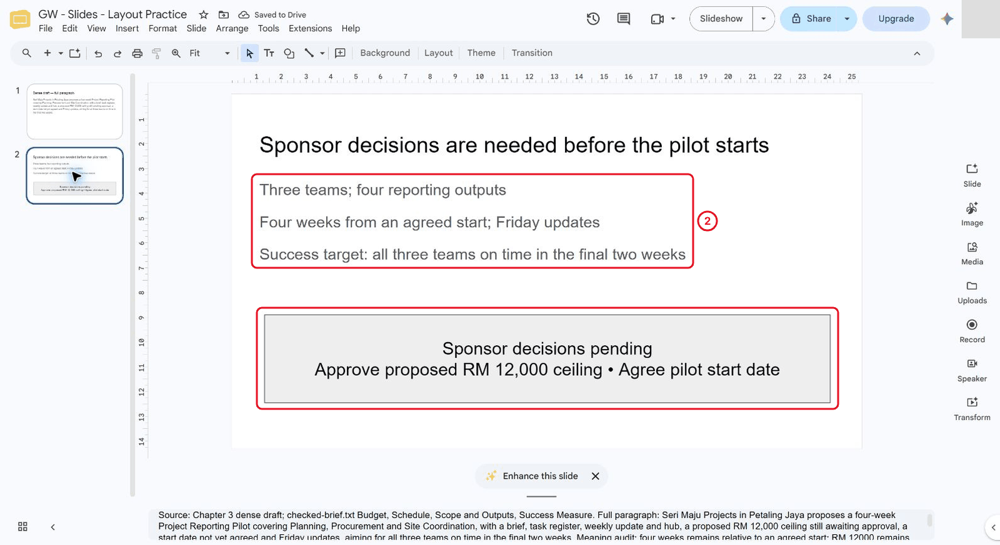

*Redesign as three points plus a pending-decision callout.*

3. Add a **Title only** slide titled **Three teams share one reporting process**. Draw one rectangle, add **Planning** at 20 pt, then duplicate its geometry for **Procurement** and **Site Coordination**. Leave text editing before duplicating a shape. Select all three cards, then use **Arrange > Align > Top** and **Arrange > Distribute > Horizontally**. Do not include the title in that selection.

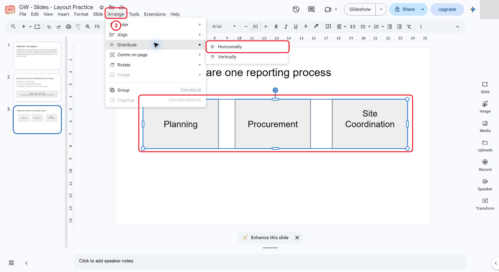

*Use Arrange to distribute matching team cards horizontally.*

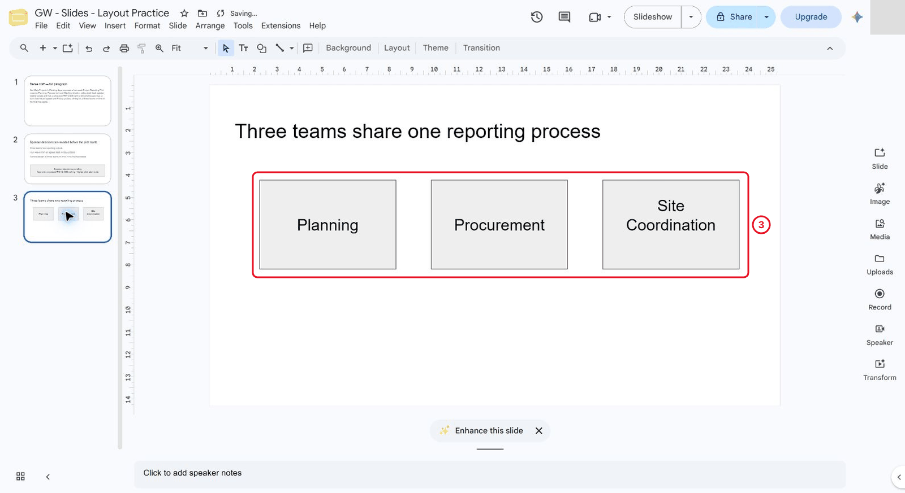

*Three team cards have equal size and deliberate spacing.*

4. Add another Title only slide titled **Proposed outputs support a weekly reporting cycle**. Create four equal blocks labelled **1. Project brief**, **2. Task register**, **3. Weekly update**, **4. Project hub**. Align tops and distribute horizontally. Click the arrow next to **Line** in the toolbar, choose **Arrow** and draw one between each pair of blocks. In notes, label it a proposed teaching sequence, not evidence of approved systems, live automation or a mandated workflow.

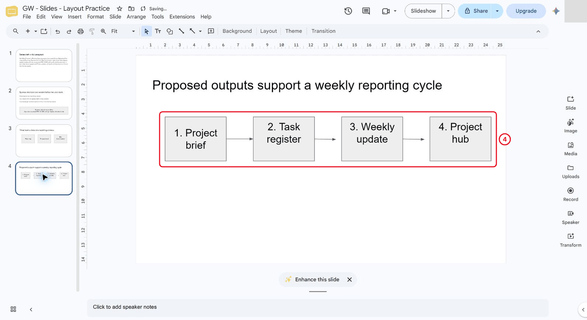

*Four proposed outputs are connected in a teaching sequence.*

5. Inspect the dense alternative, redesign, team layout and diagram in **Slideshow**. In the reference, the long paragraph contains both sponsor requests in one sentence; the redesign makes them visible in a separate callout. Check the smallest labels and dense regions at your actual viewing size. No clipping was observed in the author's 1591-pixel application window; classroom/projector testing remains pending.

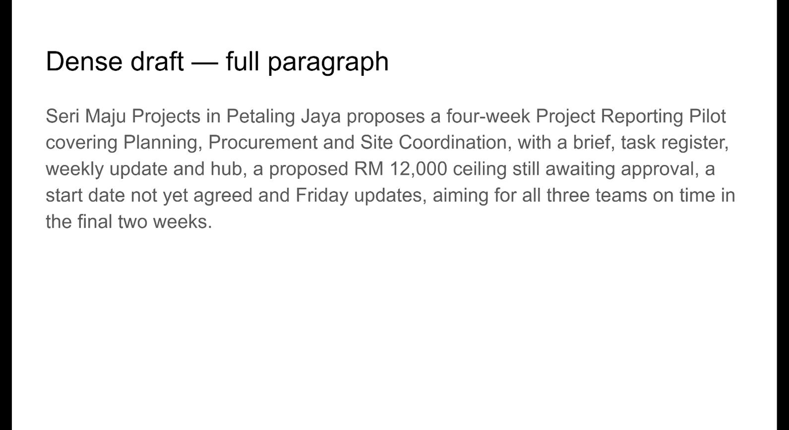

*Inspect the dense alternative at presentation size.*

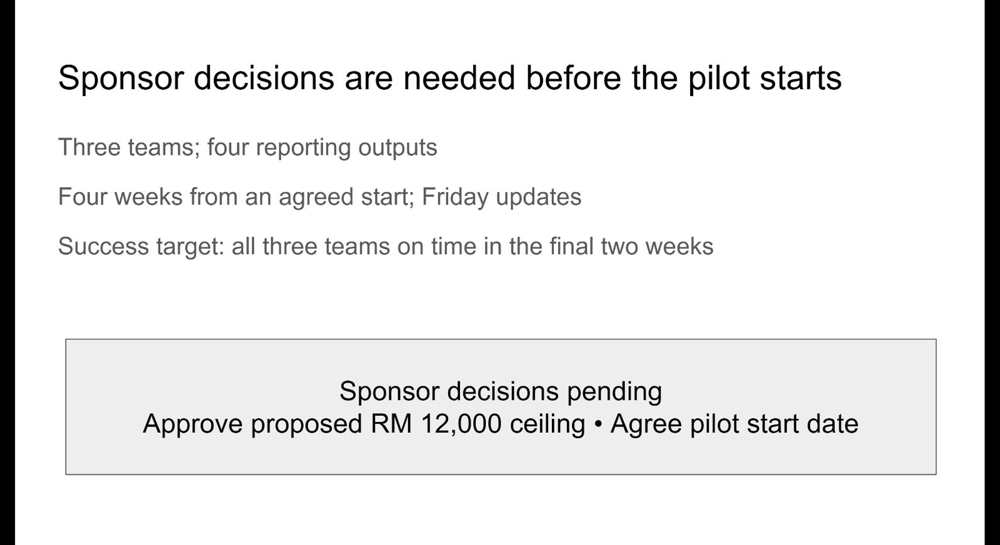

*Inspect the redesigned alternative at presentation size.*

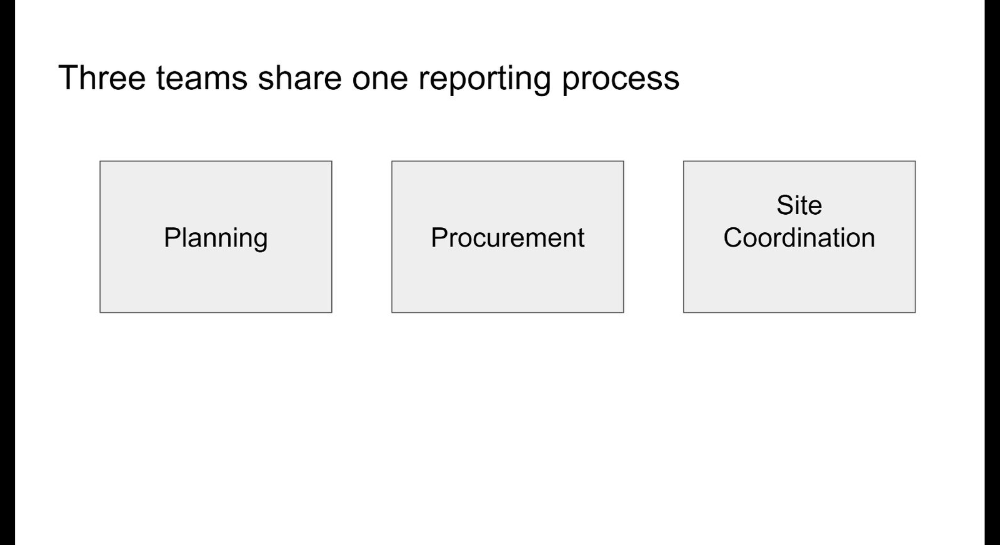

*Inspect all team labels at presentation size.*

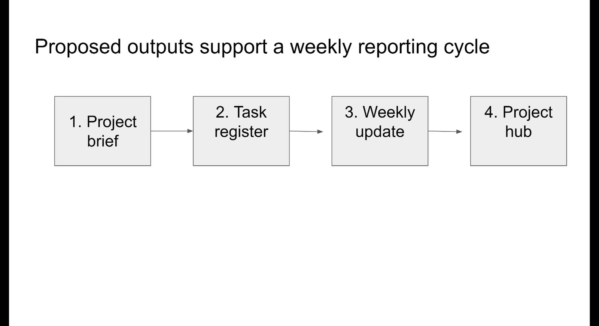

*Inspect all output labels at presentation size.*

6. Draft a **45-second explanation** in notes that adds context, citing the checked brief's budget caveat. Keep the written draft separate from actual spoken timing. Record the meaning audit: four weeks remains relative to an agreed start, RM 12000 remains proposed/unapproved, the date remains unagreed, Friday cadence remains and final-two-weeks submissions remain a target.

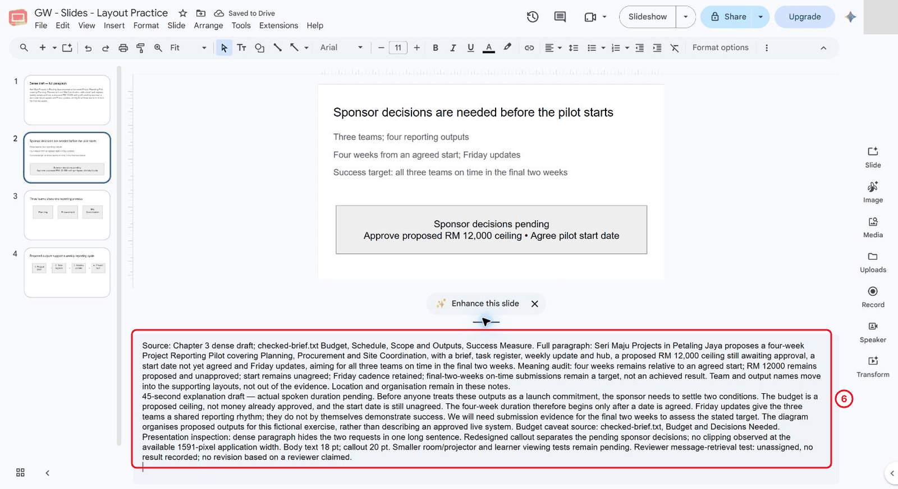

*Keep the explanation draft, meaning audit and pending reviewer status in notes.*

7. Ask a reviewer to state the main message after a brief look; compare the response with your intended message and revise where justified. **Reference status: reviewer unassigned, no response or reviewer-driven revision recorded.** Do not mark this test passed until a real reviewer completes it.

What should you see?

Dense and redesigned alternatives with a meaning audit, equally spaced team cards, a proposed output diagram and source-backed notes. Written explanation and author layout checks are complete; spoken timing and reviewer retrieval remain pending.

## Independent Practice

Close the earlier step lists for the first attempt. Use the case input and your own reasoning. If you need help, record the hint and repeat the affected check independently.

1. Redesign the Decisions slide independently so budget approval and date agreement are visible as two separate requests.

2. Keep a before-and-after copy and audit every numeric or approval phrase for meaning changes.

3. Test the revised slide with a reviewer or a fresh read-through and document one change made because of that test.

### Evidence to Hand Over

- Dense and redesigned alternatives with an explicit meaning audit.
- Aligned team layout, output diagram and useful speaker notes.
- Two-decision slide supported by a recorded message-retrieval test.

Record the defect or uncertainty you investigated, the evidence used, the repair or reasoned no-change decision, and the final state. Restore temporary changes or keep them in a clearly named scenario copy.

## Troubleshooting

| Symptom | What to check |
|---|---|
| The short version removes “proposed” | Move detail into notes while retaining approval conditions visibly on the decision slide. |
| An input or earlier result is missing | Reopen the input named in Before You Begin; do not substitute private company data |
| A menu or feature is unavailable | Confirm the account and the shared access notes; record the missing step and ask the trainer for its fallback |
| The result differs from the checkpoint | Compare the exact source range, wording and conditions before repeating the action |

## Lesson Summary

Clear hierarchy and checked titles make the deck easier to follow.

**Check yourself:** Which information belongs in speaker notes rather than on the slide?
