# 04 - Create and Check Visual Assets

In this chapter you will insert media, try an AI image where available and document image provenance.

> **Prompts:** the [prompts page](./prompts.md) has every value and prompt for this chapter, each with a Copy button.

**Estimated time:** 55 minutes, planned as 10 explanation and demonstration, 25 guided build and casework, 15 independent practice and 5 verification and repair. Not yet timed with learners.

**Your result:** A useful diagram or reviewed image with provenance and alternative text.

> **Status:** author reference run with 12 staged real-application captures and full original-size sources. Guided workflow, native image generation, alternative text, provenance, two compared designs, visual register and proportional image resizing checked. No permitted video was supplied: insertion/playback remain untested. Independent exception design, real reviewer comprehension and learner timing remain pending.

---

## What You Will Learn

- Insert images and media deliberately.
- Review a generated visual.
- Keep provenance and alternative text.

## Before You Begin

Read the [case input](./prompts.md) and use a separate named casework copy for destructive tests or altered datasets. Keep the baseline unchanged for later chapters. Record source facts, proposed practice and unresolved questions separately.

Use the working deck. Only use supplied, self-created or otherwise permitted media. AI generation is optional where unavailable.

## 4.1 Choose a Useful Visual

1. Open the working deck, `GW - Slides - Sponsor Update`. On the Scope slide (now titled **Three teams will produce four outputs**), keep the existing team/output text. A diagram explains the sequence; an office illustration provides context only.

2. Click **Shape** in the toolbar, then **Shapes**, **Rectangle**, and draw three boxes labelled **Source register**, **Checked update** and **Project hub**. Click the arrow next to **Line** in the toolbar, choose **Arrow** and connect their edges. Keep all three labels readable without colour.

> **Reference run:** The reference uses 20 pt labels.

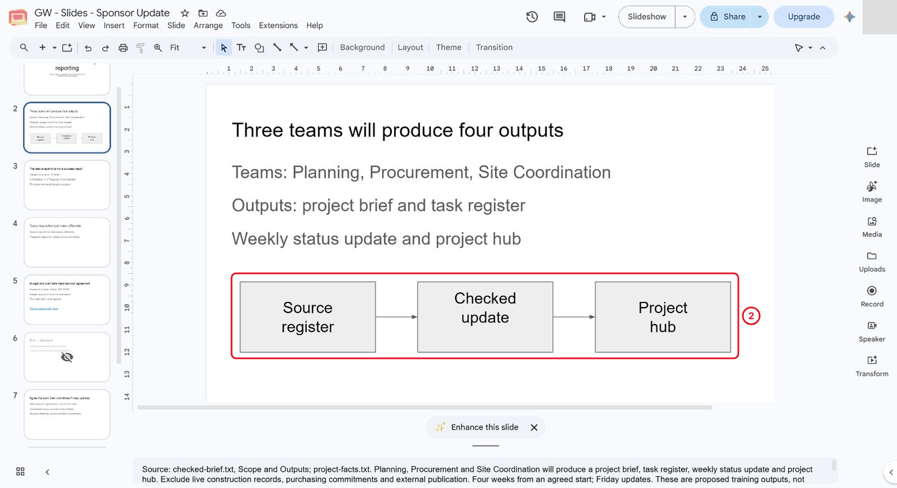

*Use labelled native shapes and arrows for the reporting workflow.*

3. Treat the arrows as proposed manual practice. They do not establish automatic integration or an approved company process.

## 4.2 Try a Generated Image

1. Where available, click **Image** in the right-hand rail to open **Help me visualise**. Enter the bounded prompt from the prompts page and select **Create**. Availability can differ by account.

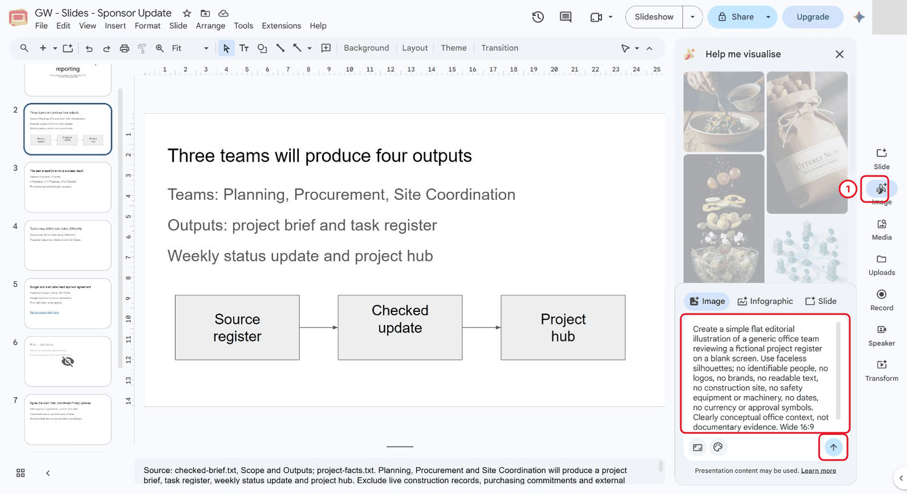

*Enter the bounded illustration prompt before generating.*

2. Inspect the actual result for readable text, logos, identifiable people, distorted details and misleading construction/safety or approval context. It is conceptual, not documentary evidence.

> **Reference run:** The reference result is a flat office illustration with five generic people and a blank grid.

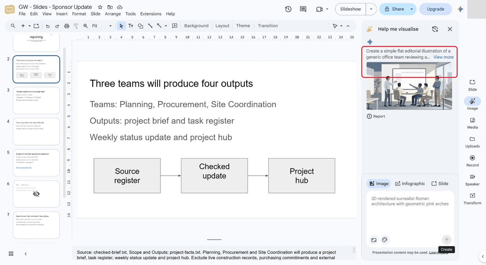

*Inspect the actual generated office illustration.*

3. Add a separate **Title only** slide titled **AI-generated context - optional illustration** and move it to the end of the deck (**Slide**, **Move slide**, **Move slide to end**). Keep the earlier slides in their positions; Labs 7 and 8 refer to them by number. Select the reviewed result, inspect **Image preview**, then select **Insert**. If the result is unsuitable or generation unavailable, keep the native workflow instead.

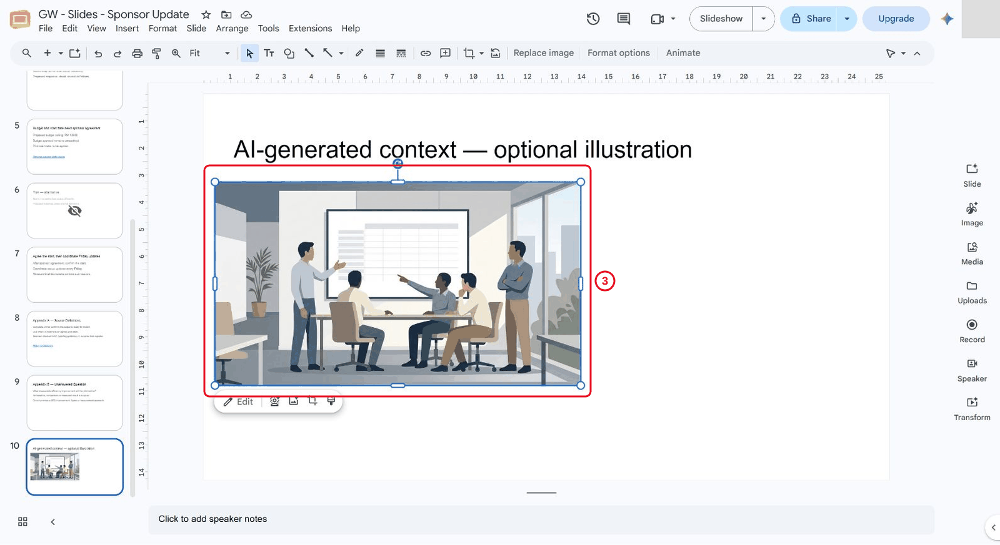

*Insert the reviewed illustration on a separate optional slide.*

4. Keep the illustration outside the main process explanation.

> **Reference run:** The reference marks this optional appendix slide **Skip slide** in its filmstrip context menu; the labelled workflow remains the main explanation.

## 4.3 Check Media and Provenance

1. Select the informative image. Open **Format options > Alt text** (the image options may expose the same control). Enter a useful description that includes its limited purpose, rather than repeating its filename or claiming it shows real activity.

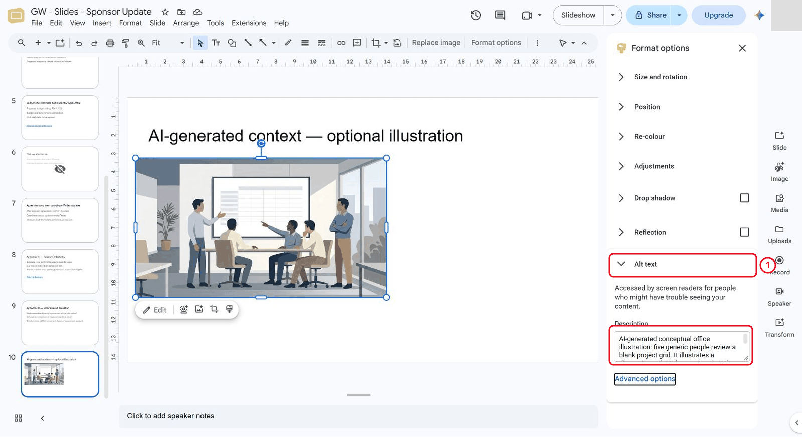

*Give the image a purpose-specific alternative text.*

2. In **speaker notes**, identify AI origin, generation date, exact prompt, inspected content and reuse uncertainty. Check the applicable permission and service terms before external reuse.

> **Reference run:** The reference makes no blanket copyright-free claim.

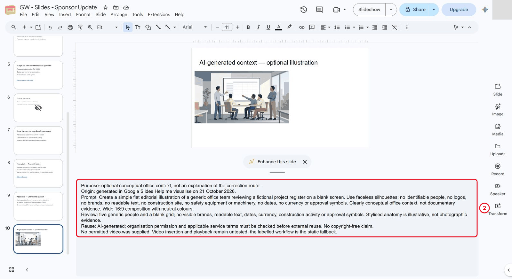

*Record the exact prompt, review and untested video dependency.*

3. On Scope, add the self-created diagram origin and information purpose to its existing speaker notes. Retain the original checked source qualifications. Confirm the note is in the notes pane, not a text box on the slide.

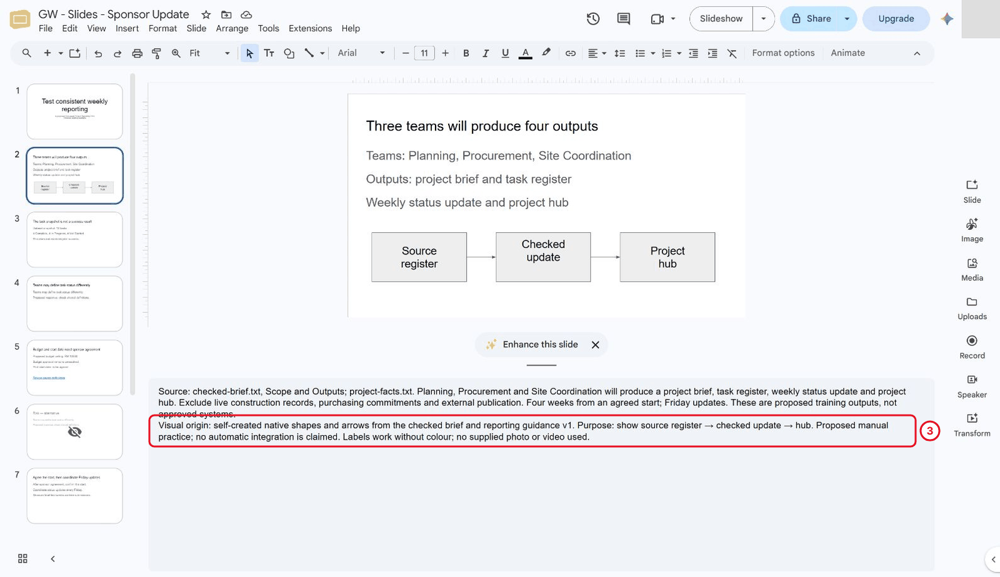

*Keep the native workflow origin and purpose in speaker notes.*

4. If a trainer supplies a permitted video link, practise insertion and playback in a casework copy. Use the labelled static workflow as the fallback. Do not choose an arbitrary external clip.

> **Reference run:** None supplied; insertion and playback untested.

## 4.4 Produce Visuals With a Clear Information Purpose

1. In Drive, click **New**, **Google Slides**, **Blank presentation** and name it **GW - Slides - Visual Casework**. Write one purpose sentence for every planned visual. The process designs explain a correction route; the office illustration supplies optional context and is rejected as evidence of that route. Keep the working deck's factual content unchanged.

2. On a Title only slide, build **Collect → Check → Report** using native rectangles and arrow connectors. Label the stages **Collect / Source register**, **Check / With task owner**, and **Report / Checked update → hub**. Below them, show the maintained task register as the source of truth and the complete exception route from the prompts page.

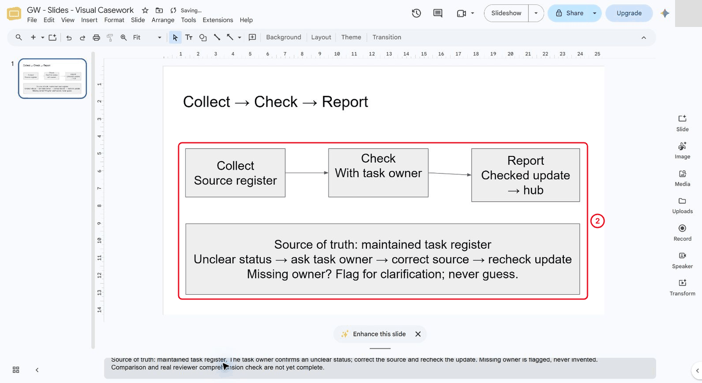

*Build the linear design with its source and correction route.*

3. On a second Title only slide, build a responsibility layout with three role/action lanes: **Contributor → Correct maintained register**, **Reviewer → Recheck update against source**, and **Coordinator → Report checked update → hub**. These are proposed training roles that need local agreement. Repeat the same source-of-truth and exception route; do not invent a missing owner.

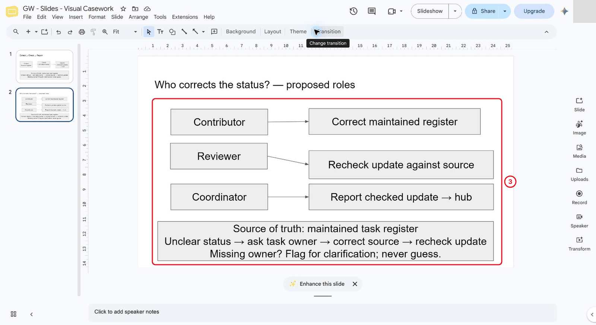

*Build a responsibility layout with the same exception route.*

4. Compare where a contributor would correct a bad status. Retain the linear alternative in the casework deck and record the reason in notes. **A real reviewer has not completed the comprehension test.**

> **Reference run:** The author selects the responsibility layout because **Contributor → Correct maintained register** names the correction point explicitly.

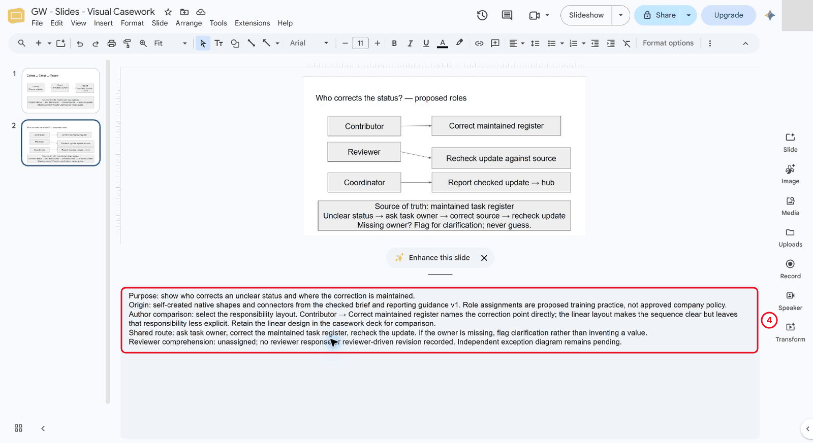

*Record the author comparison and pending reviewer test.*

5. Add a native table using **Insert > Table**. Use five columns: **Asset**, **Purpose**, **Origin**, **Rights / reuse**, **Text alternative**. Record the Scope workflow, linear design, selected responsibility design and optional AI illustration. Put full purpose sentences, source qualifications and the untested video dependency in notes.

> **Reference run:** The reference uses a five-row table with 10 pt text as a detailed register, not a classroom presentation slide; enlarge or split it when presenting to a group.

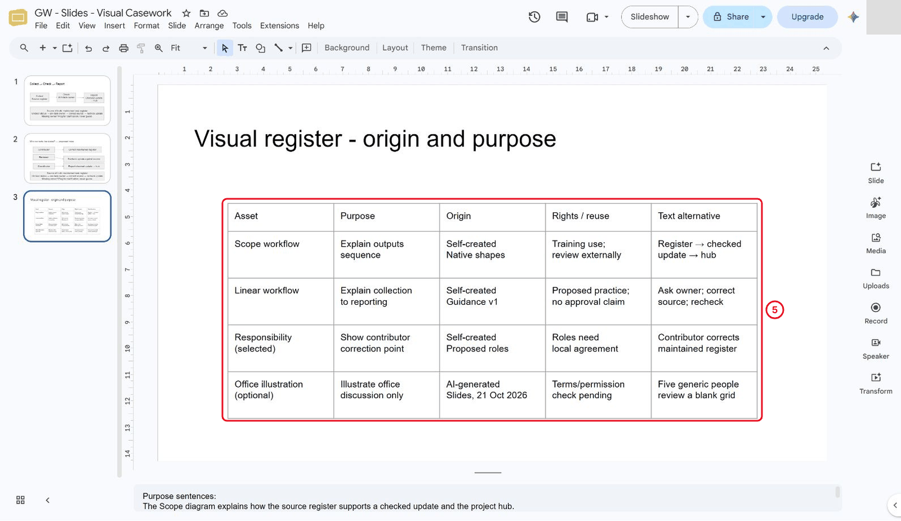

*Register all four assets with origin and reuse uncertainty.*

6. Reuse the actual bounded generation from 4.2; record its prompt and inspection rather than generating a second asset merely to fill the register. If unavailable, record the self-created diagram fallback.

7. Resize the retained illustration proportionally with a corner handle. Keep all five figures and the blank grid visible, preserve its alternative text and retain the optional illustration label. This does not crop the original-size screenshots retained in the screenshot library.

> **Reference run:** The reference enlarges the image without cropping content.

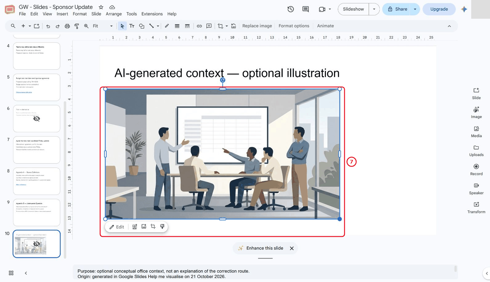

*Resize the illustration while retaining all figures and the blank grid.*

8. Record the media dependency: no permitted video supplied, playback untested, static diagrams available. If a permitted clip becomes available, test it in a copy and verify the static explanation when playback fails.

What should you see?

Two native process designs with the same source-of-truth and correction route, a reasoned author comparison, a four-asset visual register, and a reviewed optional illustration with provenance and alternative text. Independent exception design and real reviewer comprehension remain separate pending tasks. An attractive output or an AI assurance is insufficient.

## Independent Practice

Close the earlier step lists for the first attempt. Use the case input and your own reasoning. If you need help, record the hint and repeat the affected check independently.

1. Design an independent exception diagram for “unclear status → clarify → update source → recheck report”. Use labels that work without colour.

2. Have a reviewer identify the correction point using the diagram alone. Repair an ambiguous connector or label.

3. Record the selected diagram, rejected alternative, origin and fallback in the visual register.

### Evidence to Hand Over

- Two compared process designs and one independently built exception diagram.
- Visual register with origin, reuse uncertainty and text alternatives.
- Reader comprehension result plus a media fallback or explicit untested dependency.

Record the defect or uncertainty you investigated, the evidence used, the repair or reasoned no-change decision, and the final state. Restore temporary changes or keep them in a clearly named scenario copy.

## Troubleshooting

| Symptom | What to check |
|---|---|
| A decorative image is treated as evidence | Keep data and process evidence in labelled charts/diagrams and identify illustrative media explicitly. |
| An input or earlier result is missing | Reopen the input named in Before You Begin; do not substitute private company data |
| A menu or feature is unavailable | Confirm the account and the shared access notes; record the missing step and ask the trainer for its fallback |
| The result differs from the checkpoint | Compare the exact source range, wording and conditions before repeating the action |

## Lesson Summary

Visuals should support the message and carry a clear source record.

**Check yourself:** What must you check before treating an AI-generated image as suitable for a real presentation?
