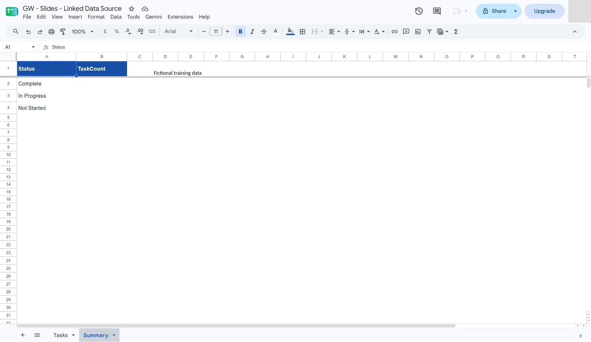
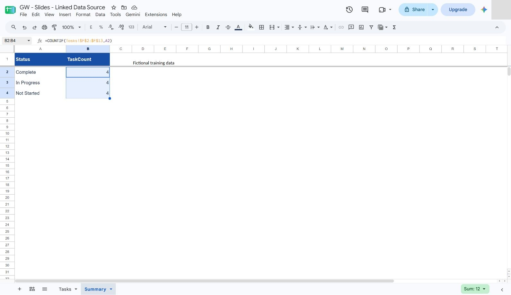
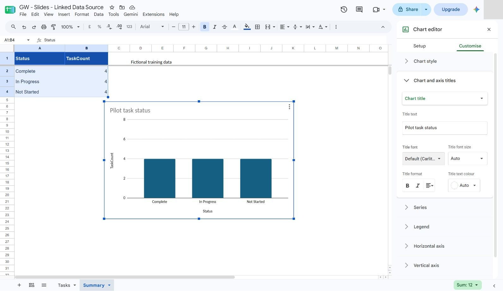
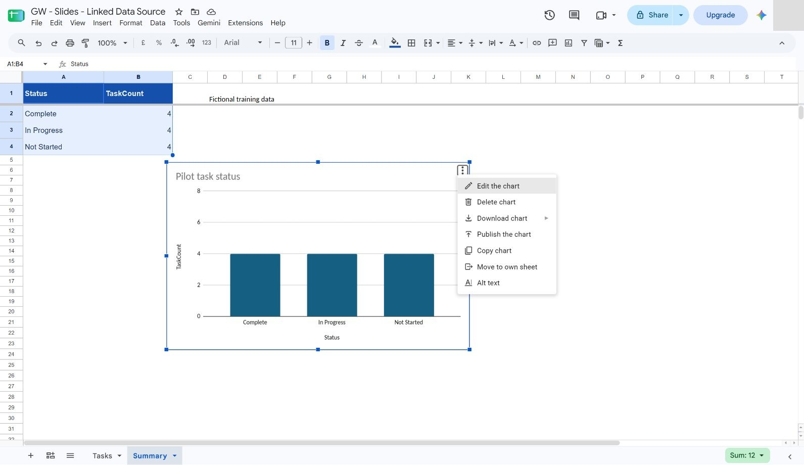
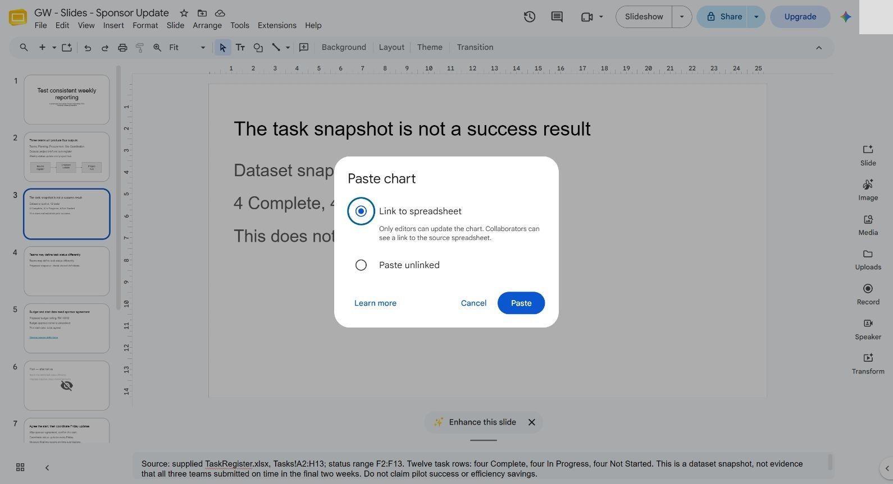
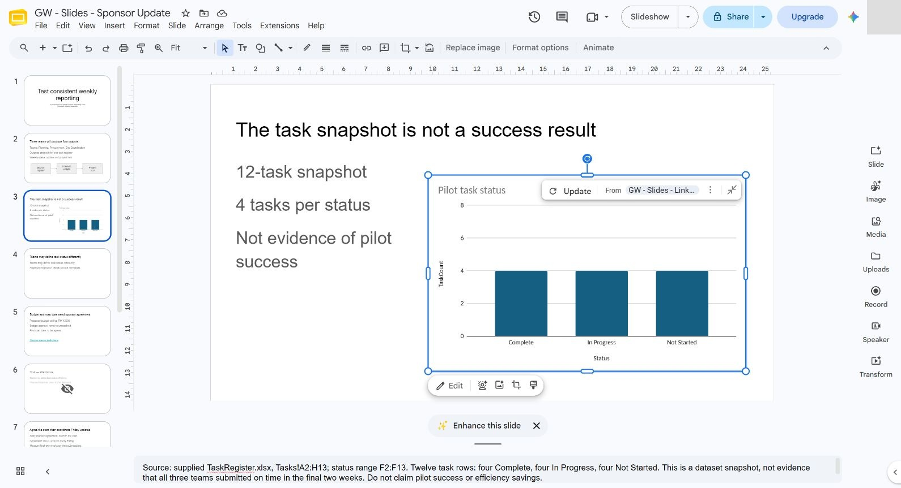
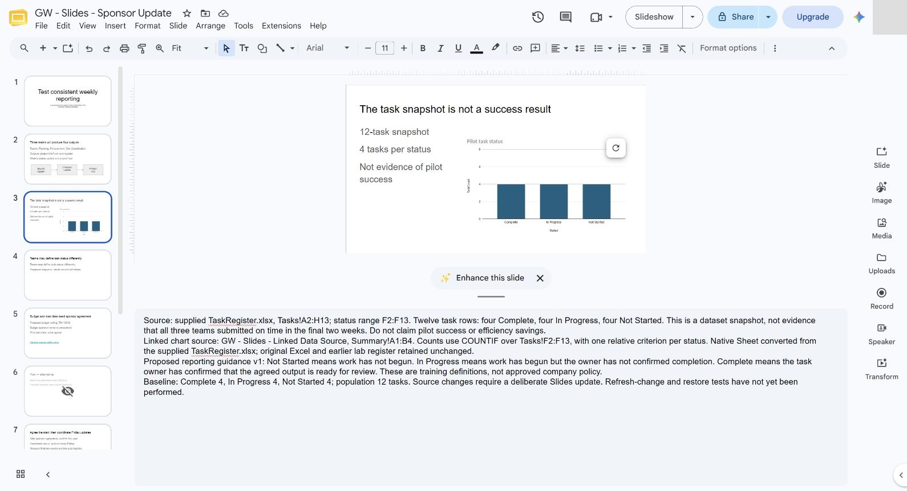

# 05 - Link and Explain Project Data

In this chapter you will insert a linked Sheets chart, change source data and explicitly refresh the chart.

> **Prompts and values:** use the [copy-paste page](./prompts.md) for the exact values used below.

**Target allocation:** 55 minutes: 10 explanation/demonstration, 25 guided build and casework, 15 independent challenge, 5 verification and repair. The active portion is 45 minutes by design. These are unmeasured targets awaiting a learner pilot.

**Your result:** A linked status chart whose refresh behaviour has been tested and restored.

> **Status:** partial author reference run: sections 5.1–5.2 have eight staged real-application captures and full original-size sources. Native COUNTIF formulas, 4/4/4 baseline and the Slides chart link/source identity checked. Refresh and restoration (5.3), extended cost/static comparison (5.4), independent challenge and learner timing remain pending.

## What You Will Learn

- Create a chart from a supplied register.
- Keep a chart linked across apps.
- Test refresh and restore the baseline.

## Before You Begin

Read the [case input](./prompts.md) and use a separate named casework copy for destructive tests or altered datasets. Keep the baseline unchanged for later chapters. Record source facts, proposed practice and unresolved questions separately.

Upload [TaskRegister.xlsx](../../shared/sample-files/TaskRegister.xlsx) and save a native Google Sheets copy. The starter Summary has three status labels with blank count cells.

## 5.1 Prepare the Source Chart

1. Use the supplied `TaskRegister.xlsx` starter. If it is already uploaded, open that original instead of uploading it again. Choose **File > Save as Google Sheets** and name the new native file **GW - Slides - Linked Data Source**. Keep earlier lab registers and the original Excel file unchanged. Confirm the new native copy has **Tasks** and **Summary**, with blank Summary count cells.

2. In **Summary!B2**, enter `=COUNTIF(Tasks!$F$2:$F$13,A2)`. Keep the task range absolute and the status criterion relative.

3. Select **B2:B4** and use **Ctrl+D** to fill down. Confirm **Complete = 4**, **In Progress = 4**, **Not Started = 4**, totalling twelve task records. The filled formulas must refer to A2, A3 and A4 respectively.

4. Select **Summary!A1:B4**, then **Insert chart**. In **Chart editor > Setup**, choose **Column chart** if Sheets initially suggests another type. In **Customise > Chart and axis titles**, set the chart title to **Pilot task status**. Check all three status labels and the count axis. The reference uses one series and the imported workbook styling.

What should you see?

Three formula-backed counts of four and a column chart accounting for twelve tasks. These counts describe a dataset snapshot; they do not establish pilot success.

## 5.2 Insert the Linked Chart

1. Open the chart's three-dot menu and choose **Copy chart**. Selecting the chart and pressing **Ctrl+C** is an equivalent learner action.

2. Open **Current Tasks** in `GW - Slides - Sponsor Update` (now titled **The task snapshot is not a success result**). Leave text editing before pasting the chart. Keep **Link to spreadsheet** selected in **Paste chart**, then select **Paste**.

3. Resize proportionally with a corner handle and move the chart beside the explanatory text. Keep the title and all category labels visible. The reference narrows the existing text placeholder to a left column and uses **12-task snapshot**, **4 tasks per status**, and **Not evidence of pilot success**; the chart supplies the three named categories. Retain the full source qualifications in notes.

4. In **speaker notes**, identify **GW - Slides - Linked Data Source**, **Summary!A1:B4** and **Tasks!F2:F13**. Explain the proposed training definitions from reporting guidance v1: Not Started = work has not begun; In Progress = work has begun but the owner has not confirmed completion; Complete = the owner confirms the agreed output is ready for review. Keep the distinction between dataset status and measured pilot success.

5. Verify the object is a linked chart and its source is the new native Sheet, rather than a pasted screenshot or an earlier register. **Reference status: source identity and baseline checked; no change/refresh/restoration test has yet been performed.** Complete 5.3 before describing refresh as tested.

What should you see?

A linked chart with readable labels and qualified commentary. The source has 4/4/4; the chart points to that same native spreadsheet and chart. Refresh behaviour remains a separate test.

## 5.3 Test the Refresh

1. Temporarily change T003 to Complete in Tasks and check the source counts become 5, 4 and 3.
2. Return to Slides, select the chart and use Update. Check the category labels as well as the numbers.
3. Restore T003 to Not Started and refresh again. Explain what happens if a viewer sees an old downloaded deck.

What should you see?

The final slide shows 4/4/4 after restoration. Refresh has been tested in both directions.

<!-- VERIFY: execute 5.3 in the target account and reconcile control names. Capture images/c03-05-03.jpg only from the real app. -->

## 5.4 Extend the Source and Audit Every Representation

1. Before changing data, write a baseline log containing the 12-task counts, chart source URL and the Slides destination. Confirm all three statuses have four tasks.

2. Create a second summary for planned cost by team using SUMIF over Tasks B2:B13 and G2:G13. Reconcile the three teams with RM 10,400 before charting.

3. Insert the team-cost chart into a skipped evidence appendix, linked to the working spreadsheet. Add a source note distinguishing cost records from the unapproved budget proposal.

4. Make a static pasted-image copy of the status chart on a separate skipped comparison slide. Label it **Static comparison only**.

5. Change T003 temporarily and compare the source, linked chart and static image. Record which destination offers an update and which remains frozen.

6. Restore T003 and update the linked object. Delete or clearly retain the static copy only as a labelled comparison.

7. Create an evidence checklist for category labels, population, units, source identity and refresh state. Use it on both charts.

What should you see?

Two checked linked charts and a documented static-versus-linked comparison. The result must be supported by the recorded checks; an attractive output or an AI assurance is insufficient.

<!-- VERIFY: execute expanded section 5.4 and independent challenge; capture images/c03-05-04.jpg only after real application success. -->

## Independent Challenge

Close the earlier step lists for the first attempt. Use the case input and your own reasoning. If you need help, record the hint and repeat the affected check independently.

1. On a separate source-and-deck challenge copy, append T013: Planning, Check the handover, Aina Rahman, week 4, Not Started, planned 200, actual 0.

2. Diagnose and repair every affected source formula range, then refresh both linked charts. Check whether the copied deck’s charts still point to the original spreadsheet; reinsert from the challenge source if needed.

3. Rewrite the task-count and planned-cost commentary to match the new population. Leave the original 12-row source and baseline deck unchanged.

## Evidence to Hand Over

- Two checked linked charts and a documented static-versus-linked comparison.
- Separate 13-record source/deck challenge with verified link identity.
- Consistent chart labels and narrative after the new-row change.

Record the defect or uncertainty you investigated, the evidence used, the repair or reasoned no-change decision, and the final state. Restore temporary changes or keep them in a clearly named scenario copy.

## Troubleshooting

| Symptom | What to check |
|---|---|
| The challenge chart still reads the baseline | Inspect the linked source URL and insert the chart from the intended challenge spreadsheet. |
| An input or earlier result is missing | Reopen the input named in Before You Begin; do not substitute private company data |
| A menu or feature is unavailable | Confirm the account and the shared access notes; record the missing step and ask the trainer for its fallback |
| The result differs from the checkpoint | Compare the exact source range, wording and conditions before repeating the action |

## Lesson Summary

The source chart controls the data; the presentation needs a deliberate refresh check.

**Check yourself:** How can you tell whether a chart is stale rather than wrong?
