# 05 - Link and Explain Project Data

In this chapter you will insert a linked Sheets chart, change source data and explicitly refresh the chart.

> **Prompts:** the [prompts page](./prompts.md) has every value and prompt for this chapter, each with a Copy button.

**Estimated time:** 55 minutes, planned as 10 explanation and demonstration, 25 guided build and casework, 15 independent practice and 5 verification and repair. Not yet timed with learners.

**Your result:** A linked status chart whose refresh behaviour has been tested and restored.

> **Status:** guided author reference run completed through 5.4 with 25 staged real-application captures and full original-size sources. COUNTIF/SUMIF formulas, both chart links, two temporary change/refresh/restore cycles and the static comparison checked. Independent challenge and learner timing remain pending.

---

## What You Will Learn

- Create a chart from a supplied register.
- Keep a chart linked across apps.
- Test refresh and restore the baseline.

## Before You Begin

Read the [case input](./prompts.md) and use a separate named casework copy for destructive tests or altered datasets. Keep the baseline unchanged for later chapters. Record source facts, proposed practice and unresolved questions separately.

Upload [TaskRegister.xlsx](../../shared/sample-files/TaskRegister.xlsx) and save a native Google Sheets copy. The starter Summary has three status labels with blank count cells.

## 5.1 Prepare the Source Chart

1. Use the supplied `TaskRegister.xlsx` starter. If it is already uploaded, open that original instead of uploading it again. Click **File**, **Save as Google Sheets** and name the new native file **GW - Slides - Linked Data Source**. Keep earlier lab registers and the original Excel file unchanged. Confirm the new native copy has **Tasks** and **Summary**, with blank Summary count cells.

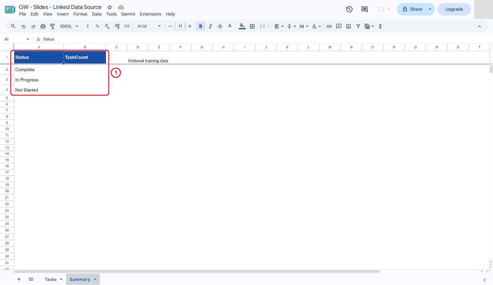

*Start from the native copy with blank summary counts.*

2. In **Summary!B2**, enter `=COUNTIF(Tasks!$F$2:$F$13,A2)`. Keep the task range absolute and the status criterion relative.

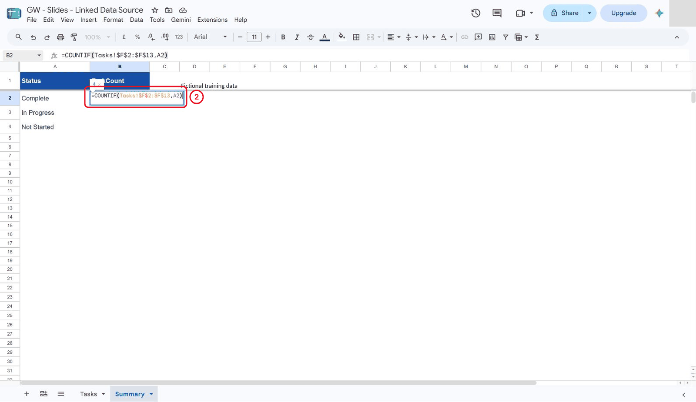

*Enter the COUNTIF formula against the twelve task rows.*

3. Select **B2:B4** and use **Ctrl+D** to fill down. Confirm **Complete = 4**, **In Progress = 4**, **Not Started = 4**, totalling twelve task records. The filled formulas must refer to A2, A3 and A4 respectively.

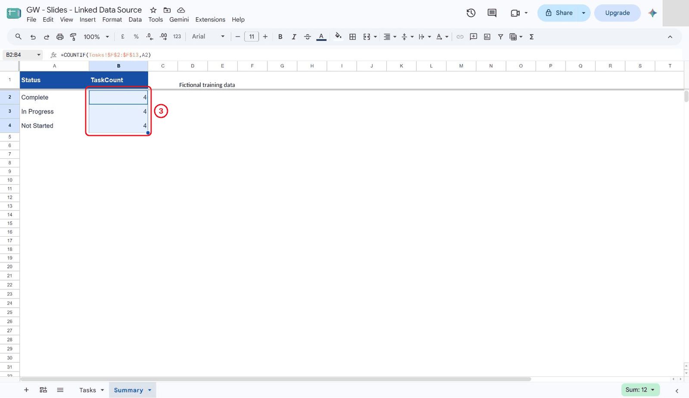

*Fill through B4 and confirm four tasks in each category.*

4. Select **Summary!A1:B4**, then click **Insert**, **Chart**. In **Chart editor > Setup**, choose **Column chart** if Sheets initially suggests another type. In **Customise > Chart and axis titles**, set the chart title to **Pilot task status**. Check all three status labels and the count axis. The reference uses one series and the imported workbook styling.

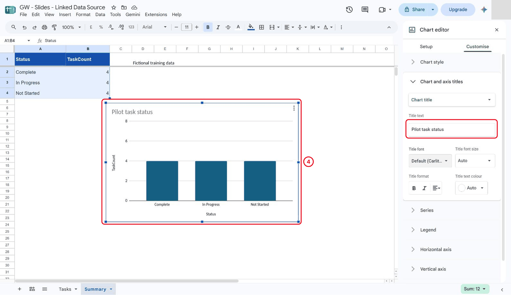

*Choose a column chart and set Pilot task status.*

What should you see?

Three formula-backed counts of four and a column chart accounting for twelve tasks. These counts describe a dataset snapshot; they do not establish pilot success.

## 5.2 Insert the Linked Chart

1. Open the chart's three-dot menu and choose **Copy chart**. Selecting the chart and pressing **Ctrl+C** is an equivalent learner action.

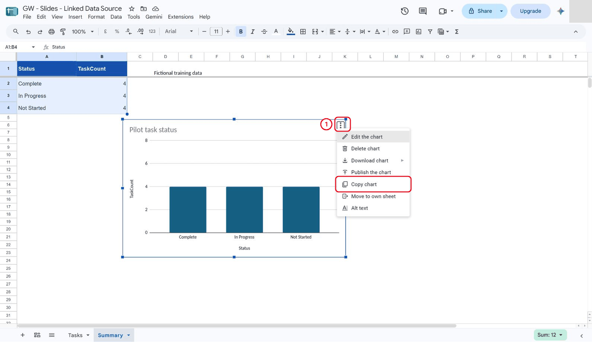

*Use the chart menu to copy the native object.*

2. Open **Current Tasks** in `GW - Slides - Sponsor Update` (now titled **The task snapshot is not a success result**). Leave text editing before pasting the chart. Keep **Link to spreadsheet** selected in **Paste chart**, then select **Paste**.

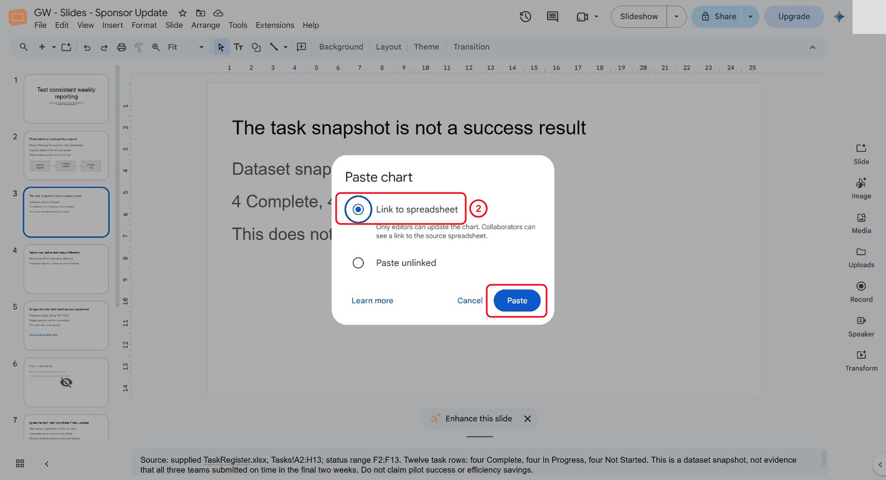

*Keep Link to spreadsheet selected when pasting.*

3. Resize proportionally with a corner handle and move the chart beside the explanatory text. Keep the title and all category labels visible. The reference narrows the existing text placeholder to a left column and uses **12-task snapshot**, **4 tasks per status**, and **Not evidence of pilot success**; the chart supplies the three named categories. Retain the full source qualifications in notes.

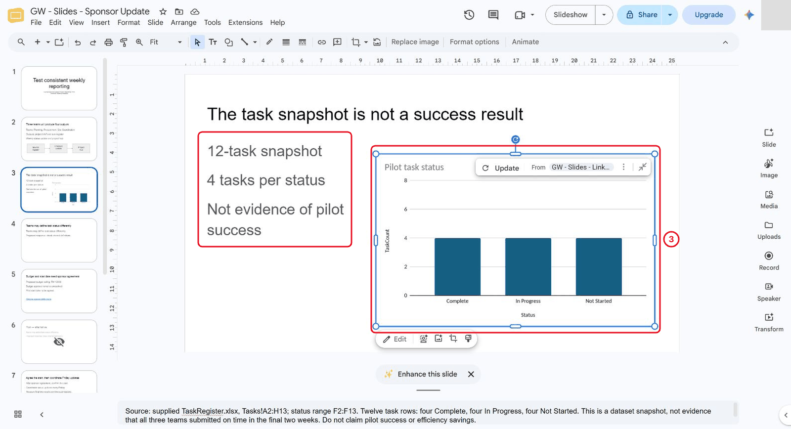

*Fit the linked chart beside the qualified twelve-task snapshot.*

4. In **speaker notes**, identify **GW - Slides - Linked Data Source**, **Summary!A1:B4** and **Tasks!F2:F13**. Explain the proposed training definitions from reporting guidance v1: Not Started = work has not begun; In Progress = work has begun but the owner has not confirmed completion; Complete = the owner confirms the agreed output is ready for review. Keep the distinction between dataset status and measured pilot success.

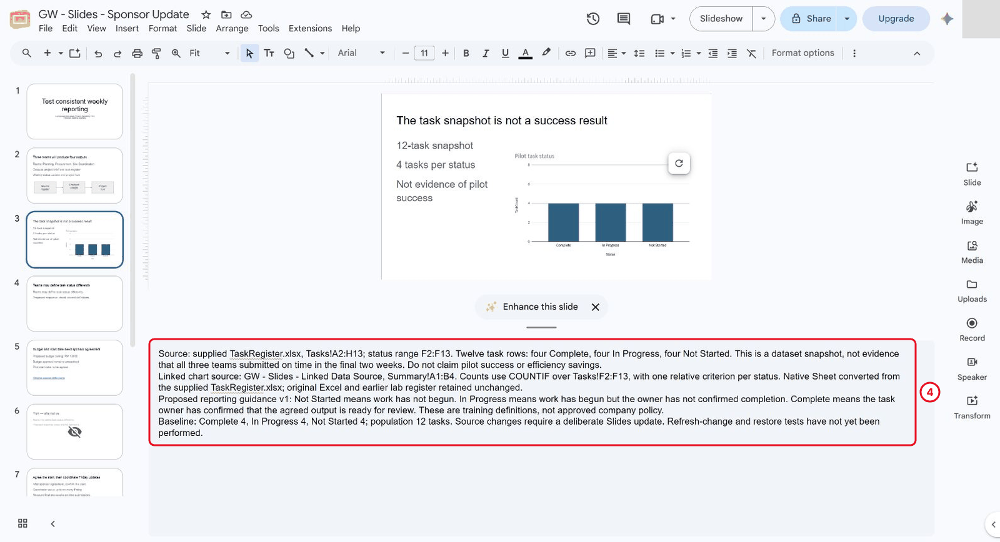

*Record source identity, definitions and the pending refresh test.*

5. Verify the object is a linked chart and its source is the new native Sheet, rather than a pasted screenshot or an earlier register. **At this stage, source identity and baseline are checked; refresh is tested in 5.3.** Complete 5.3 before describing refresh as tested.

What should you see?

A linked chart with readable labels and qualified commentary. The source has 4/4/4; the chart points to that same native spreadsheet and chart. Refresh behaviour remains a separate test.

## 5.3 Test the Refresh

1. Record T003's original status, **Not Started**, in **Tasks!F4**. Temporarily replace it with **Complete**. This is a controlled training test; no real owner confirmation is being claimed.

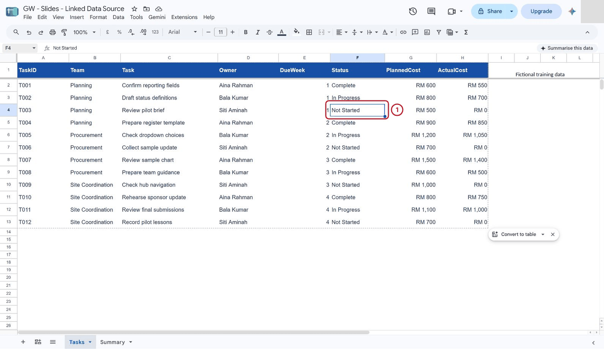

*Record T003 original status before testing.*

2. Open **Summary**. Check **Complete 5**, **In Progress 4**, **Not Started 3**. The population remains twelve.

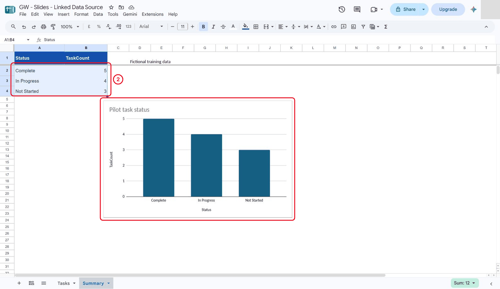

*Source counts change to five four three.*

3. Return to the Current Tasks slide. Before updating, compare the cached chart with the changed source. The reference still showed 4/4/4.

*Slides still shows the cached four four four chart.*

4. Select the linked chart and click **Update**. Check category labels as well as values. The chart should show 5/4/3. Also inspect the written summary: **4 tasks per status** does not change automatically. Treat this temporary mismatch as a repair check, not a presentation-ready result.

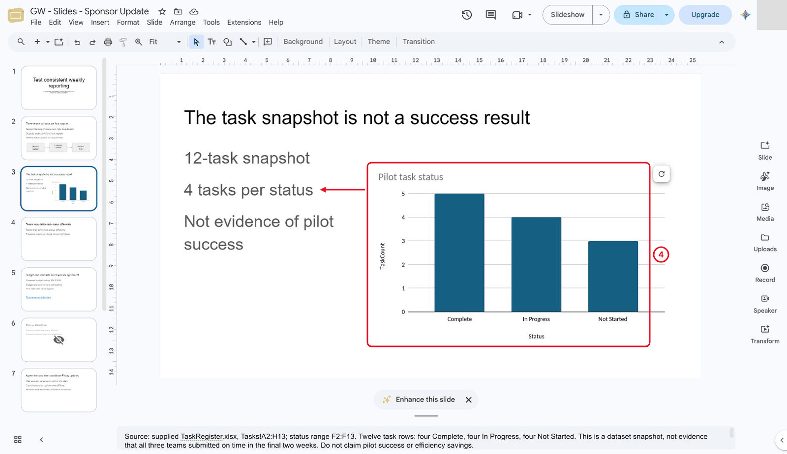

*Update changes the chart but not the written summary.*

5. Restore **Tasks!F4** to **Not Started**. Confirm Summary returns to 4/4/4.

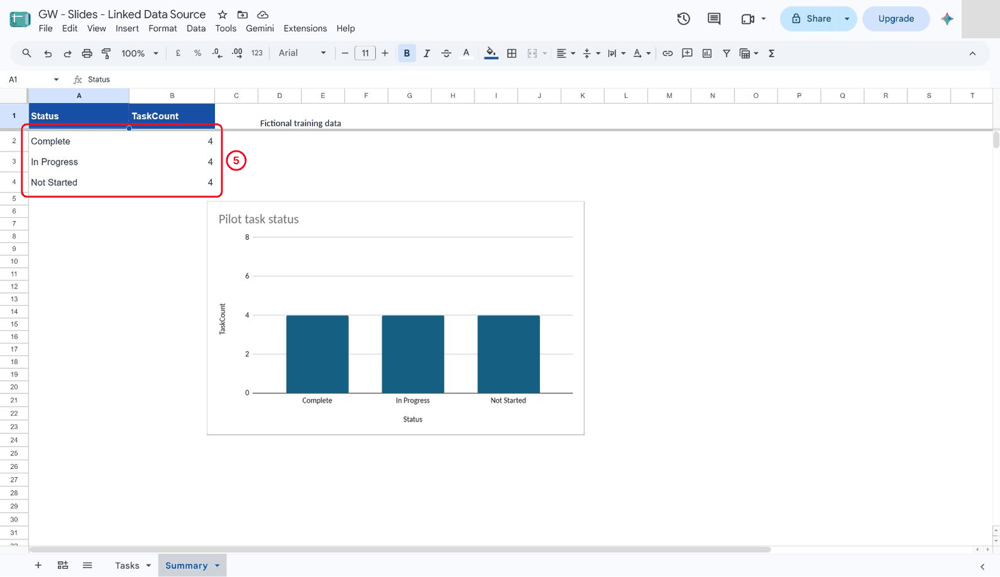

*Restore the source counts to four each.*

6. Update the Slides chart again. If the update action has not appeared, click **Tools**, **Linked objects** and click **Refresh** (the circular arrow at the top of the panel), then **Update chart**. Check that the chart and written summary agree at 4/4/4. Do not infer freshness merely from a link badge.

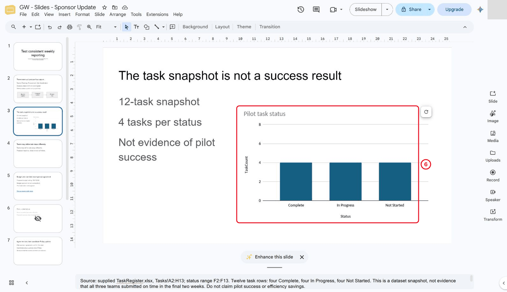

*Restore the Slides chart and original narrative.*

7. Record the change and restoration in speaker notes. Explain that a previously downloaded deck stays a snapshot: update the native chart, check surrounding commentary and export a new copy before distributing current figures.

What should you see?

Both source and linked slide finish at 4/4/4. The test demonstrated that chart data needs an explicit update and surrounding text needs a separate check.

## 5.4 Extend the Source and Audit Every Representation

1. Before the comparison test, write a private baseline log: twelve tasks, four per status, source chart URL and Slides destination. Use the intended working copies; do not paste private account URLs into a public guide.

2. Add a sheet named **Team Costs**. In A1:B5 enter the team labels, SUMIF formulas and total from the prompts page. The formulas group **Tasks!B2:B13** and sum **Tasks!G2:G13**. Check **Planning 2800**, **Procurement 4000**, **Site Coordination 3600**, **Total 10400**. Label the measure **Planned cost (RM)**; do not include the total as a fourth chart category.

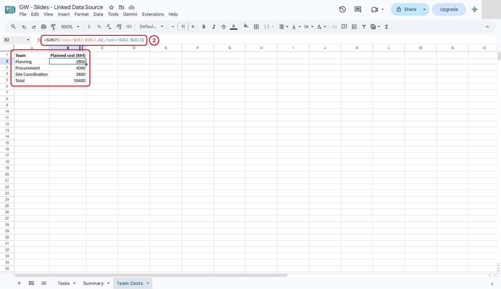

*SUMIF reconciles planned costs to RM 10400.*

3. Select **Team Costs!A1:B4** and insert a **Bar chart**. Set its title to **Planned cost by team (RM)**. Check all three full team labels and the RM measure. Widen source columns if labels are clipped.

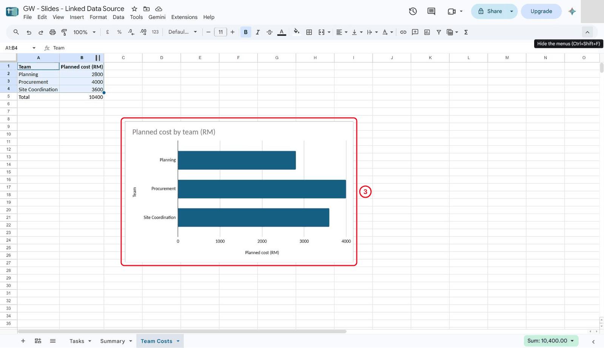

*Create the team-cost chart with RM units.*

4. Copy the cost chart. In Slides add an evidence appendix titled **Appendix - Planned cost evidence**, paste with **Link to spreadsheet**, resize proportionally below the title and remove unused placeholders. Move the appendix to the end: click **Slide**, **Move slide**, **Move slide to end**, and choose **Slide > Skip slide**. Add a source note: RM 10,400 is the total of supplied planned-cost records, separate from the unapproved RM 12,000 budget proposal.

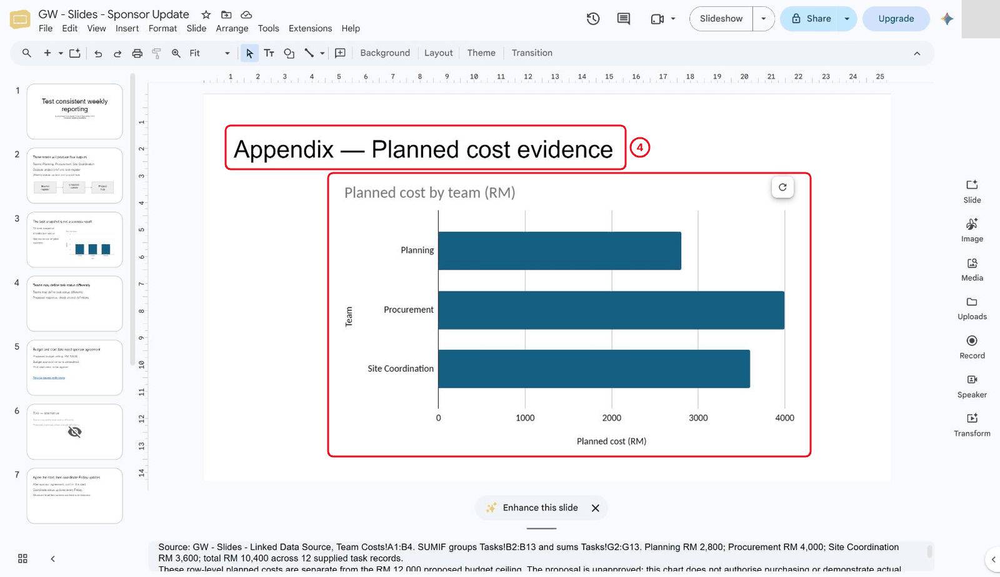

*Insert the linked cost chart in a skipped appendix.*

5. Add a separate slide titled **Static comparison only** and move it to the end of the deck too. Copy the status chart at the 4/4/4 baseline. In **Paste chart**, select **Paste unlinked**, then **Paste**. Keep all labels visible and skip this slide too.

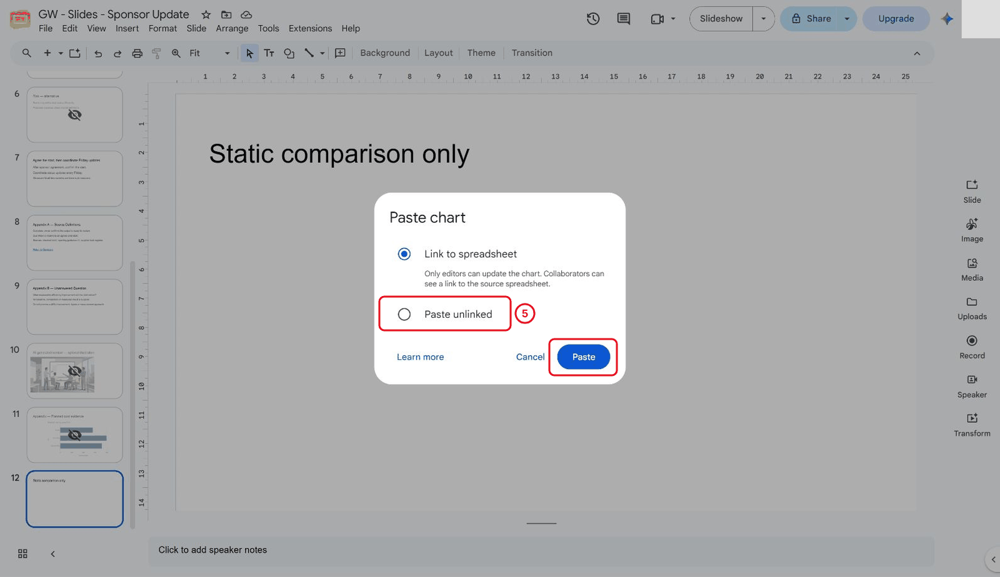

*Choose Paste unlinked for the static comparison.*

6. Temporarily change **Tasks!F4** to **Complete** again. Confirm the source becomes 5/4/3. Compare the static image before refreshing the linked chart: it remains 4/4/4 and has no chart Update action.

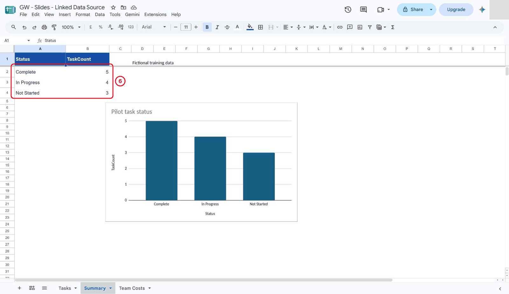

*Repeat the source status change for the comparison.*

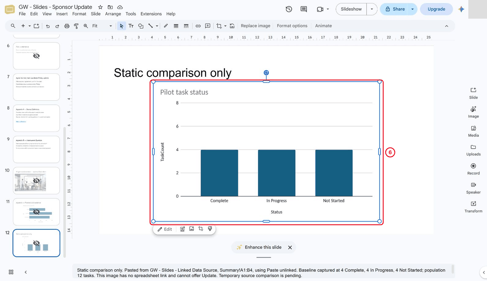

*Static image stays at four each without an Update control.*

7. Update the linked status chart. Confirm 5/4/3 while the static image stays at 4/4/4. Audit the unchanged written summary separately. Check Team Costs: changing only task status should leave planned costs at 2800/4000/3600, totalling RM 10,400.

*Linked chart updates to five four three.*

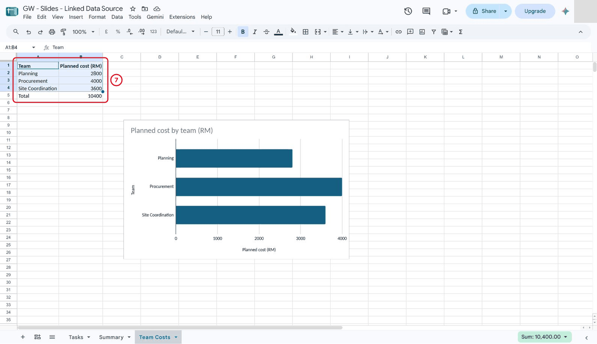

*Planned costs stay unchanged during the status test.*

8. Restore **Tasks!F4** to **Not Started**. Update the status chart, then use **Linked objects > Refresh** and update any remaining linked chart. Confirm source and status chart are back at 4/4/4 and the cost chart still matches RM 10,400. A refresh badge alone is not proof; compare actual values and labels. Retain the static image only as the clearly labelled, skipped comparison.

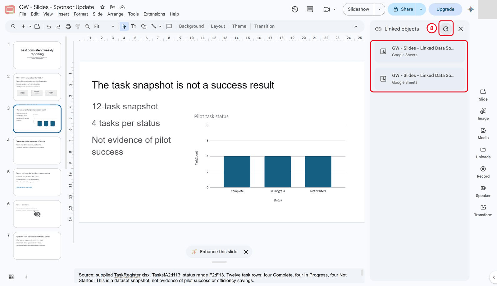

*Restore the status chart and refresh both linked objects.*

9. In speaker notes create and apply this evidence checklist to both charts. Record the observed refresh, frozen-image behaviour and restoration. Preserve the distinction between dataset counts, proposed practice, an unapproved budget and measured pilot success.

| Check | Status chart | Planned-cost chart |
|---|---|---|
| Category labels | Complete, In Progress, Not Started | Planning, Procurement, Site Coordination |
| Population | 12 task records | Same 12 task records grouped into 3 teams |
| Units | Task count | RM planned cost |
| Source identity | Working native Sheet, Summary!A1:B4 | Same Sheet, Team Costs!A1:B4 |
| Refresh and final state | 5/4/3 tested, restored to 4/4/4 | Refreshed; 2800/4000/3600, total 10400 |

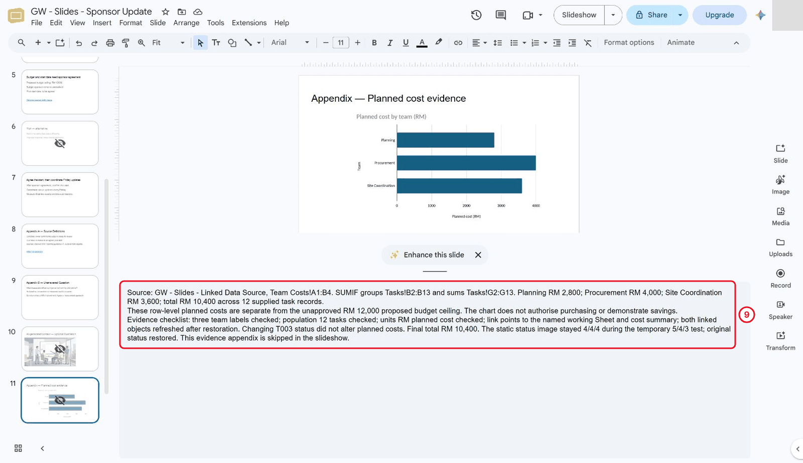

*Record cost source units and evidence checklist.*

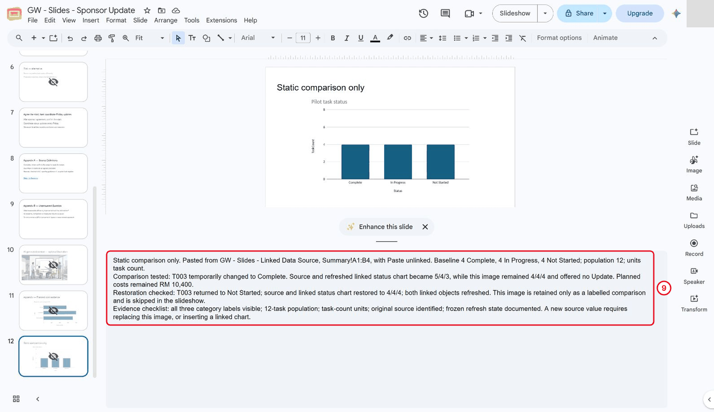

*Record the completed static comparison and restoration.*

What should you see?

Two checked linked charts and a documented static-versus-linked comparison. Temporary status changes are restored, both linked objects are refreshed, and the static image is labelled and skipped. Independent new-row repair remains a separate learner challenge.

## Independent Practice

Close the earlier step lists for the first attempt. Use the case input and your own reasoning. If you need help, record the hint and repeat the affected check independently.

1. On a separate source-and-deck challenge copy, append T013: Planning, Check the handover, Aina Rahman, week 4, Not Started, planned 200, actual 0.

2. Diagnose and repair every affected source formula range, then refresh both linked charts. Check whether the copied deck’s charts still point to the original spreadsheet; reinsert from the challenge source if needed.

3. Rewrite the task-count and planned-cost commentary to match the new population. Leave the original 12-row source and baseline deck unchanged.

### Evidence to Hand Over

- Two checked linked charts and a documented static-versus-linked comparison.
- Separate 13-record source/deck challenge with verified link identity.
- Consistent chart labels and narrative after the new-row change.

Record the defect or uncertainty you investigated, the evidence used, the repair or reasoned no-change decision, and the final state. Restore temporary changes or keep them in a clearly named scenario copy.

## Troubleshooting

| Symptom | What to check |
|---|---|
| The challenge chart still reads the baseline | Inspect the linked source URL and insert the chart from the intended challenge spreadsheet. |
| An input or earlier result is missing | Reopen the input named in Before You Begin; do not substitute private company data |
| A menu or feature is unavailable | Confirm the account and the shared access notes; record the missing step and ask the trainer for its fallback |
| The result differs from the checkpoint | Compare the exact source range, wording and conditions before repeating the action |

## Lesson Summary

The source chart controls the data; the presentation needs a deliberate refresh check.

**Check yourself:** How can you tell whether a chart is stale rather than wrong?
