# 07 - Rehearse and Distribute

In this chapter you will use presenter view, notes and audience tools; compare restricted sharing with public publishing.

> **Prompts and values:** use the [copy-paste page](./prompts.md) for the exact values used below.

**Target allocation:** 45 minutes: 10 explanation/demonstration, 15 guided build and casework, 15 independent challenge, 5 verification and repair. The active portion is 35 minutes by design. These are unmeasured targets awaiting a learner pilot.

**Your result:** A rehearsed delivery and a documented distribution choice.

> **Status:** author UI/export casework checked through 7.4, with 23 staged captures and full original-size sources. Run sheet/source answers, live appendix round trip, 14-page direct export and repaired 8-page handout scope, rendered PDF pages and internal destinations, and a source milestone verified. Two spoken rehearsals, interactive PDF clicks, independent challenge and learner timing remain pending.

## What You Will Learn

- Use presenter view and notes.
- Inspect audience tools.
- Distinguish file access from public publishing.

## Before You Begin

Read the [case input](./prompts.md) and use a separate named casework copy for destructive tests or altered datasets. Keep the baseline unchanged for later chapters. Record source facts, proposed practice and unresolved questions separately.

Use the checked deck. No real audience invitations or public publication are required.

## 7.1 Rehearse with Notes

1. Open the arrow beside **Slideshow** and choose **Presenter view**. The reference opens a separate presenter window and leaves an audience presentation in the original window. Inspect both before sharing a screen: the audience must receive the slide window rather than the speaker-notes window.

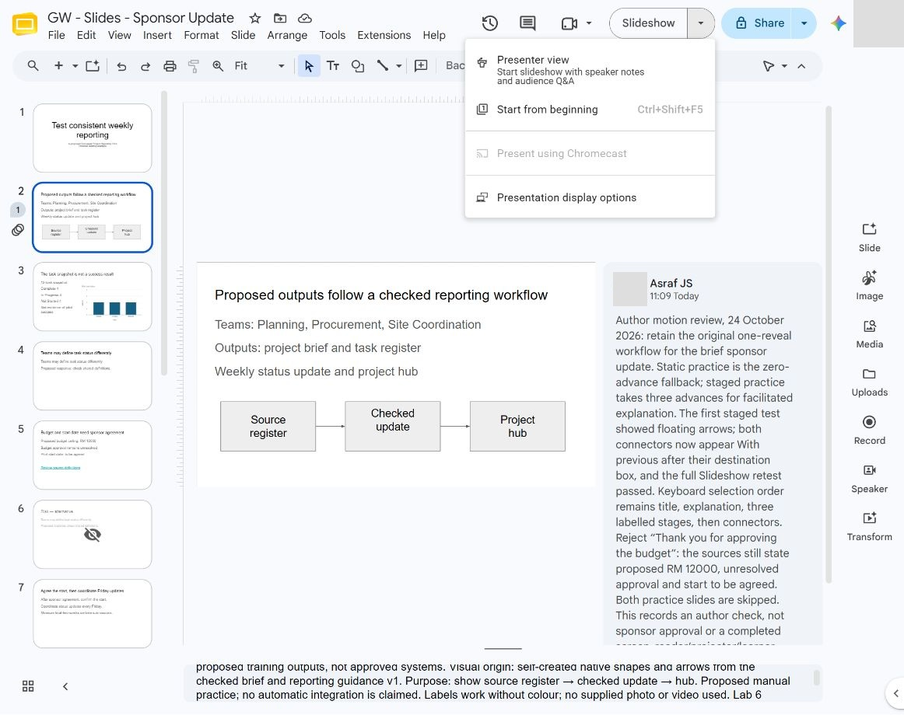

2. In the presenter window select **SPEAKER NOTES**. Use the slide selector to choose the opening. In the observed UI, focus the selector and press **Enter** to open its list, then choose the labelled slide. The presenter can see source qualifications while the audience window displays only the slide. Pause the timer while arranging windows; the reference's **00:00:24** is setup time, not a speaking result.

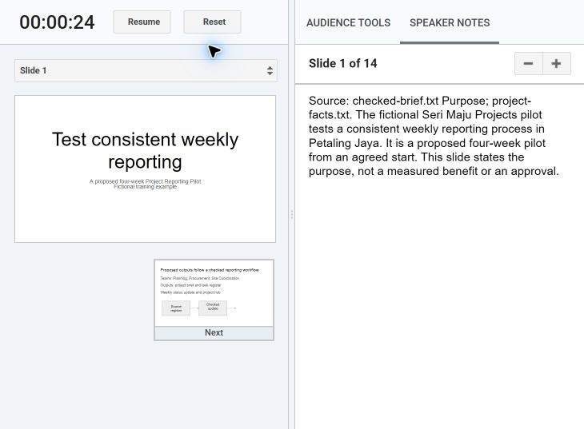

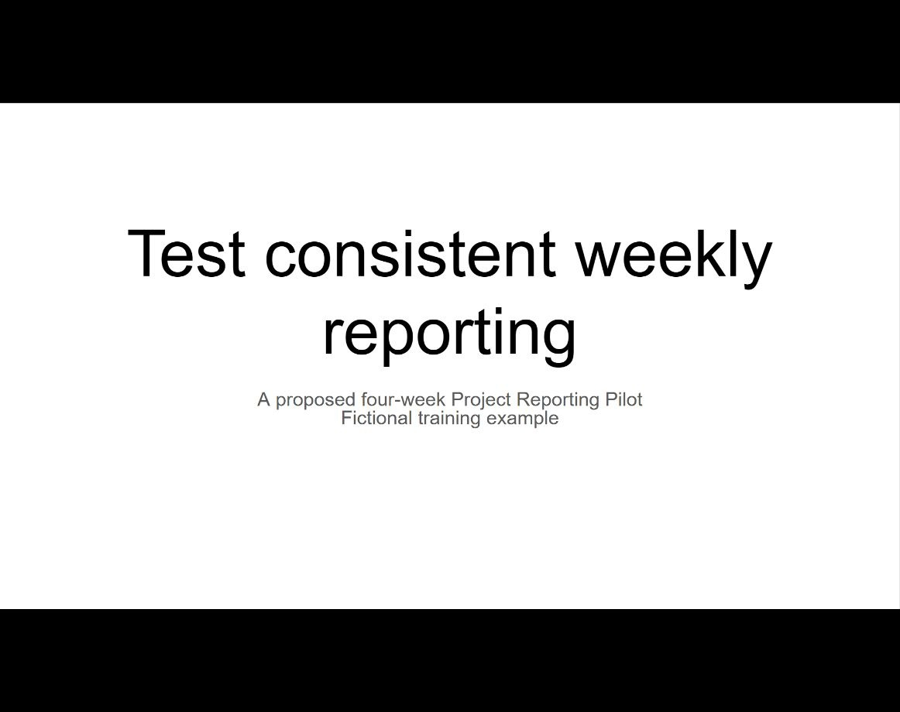

3. Choose the decision slide, **Budget and start date need sponsor agreement**. Read the notes and practise requesting approval of the proposed RM 12000 ceiling and agreement of the start date. Do not describe either as an accomplished decision. The reference checked the visible notes and navigation; a spoken, timed rehearsal is still required in 7.4.

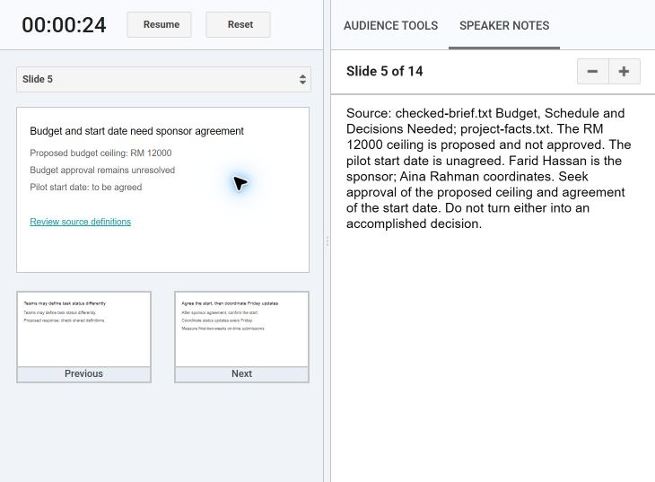

4. Click **Next** from slide 5. The reference moved directly to slide 7, **Agree the start, then coordinate Friday updates**, skipping the marked backup slide 6. Confirm the source qualifications remain in the notes. A successful skip check does not establish that all appendix slides are excluded from the delivery sequence; inspect your intended scope separately.

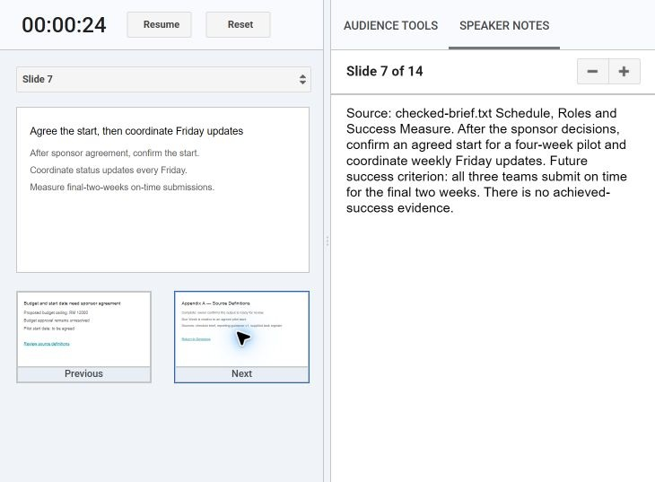

What should you see?

Separate presenter notes and audience slides, source-based opening/decision notes, and normal navigation that omits the skipped backup. Complete a real spoken rehearsal before claiming delivery timing or fluency.

## 7.2 Inspect Audience Tools

1. Select **AUDIENCE TOOLS** in the presenter window. The reference shows **Start new**. Leave it untouched: no live Q&A session or audience link is needed for this inspection. Google's [Q&A instructions](https://support.google.com/docs/answer/6386827?co=GENIE.Platform%3DDesktop&hl=en-GB) explain that starting a session enables questions through the link shown in the presentation. That behaviour is documentation-backed, not a live-session test in this reference.

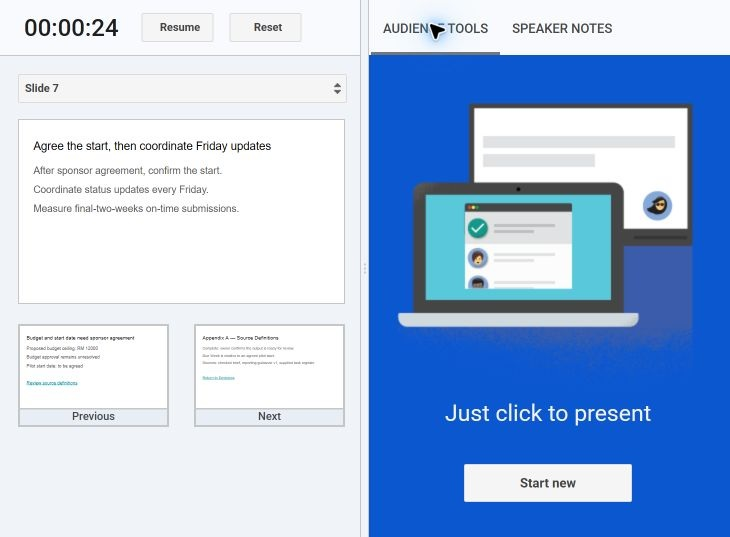

2. Close the presenter window and press **Esc** in the audience presentation to return to editing. Open **Share**. Inspect **People with access** and **General access** without entering a recipient, changing a role or copying a link. The reference showed the owner only and **Restricted**. A link does not grant access by itself. Select **Done** to close the dialog.

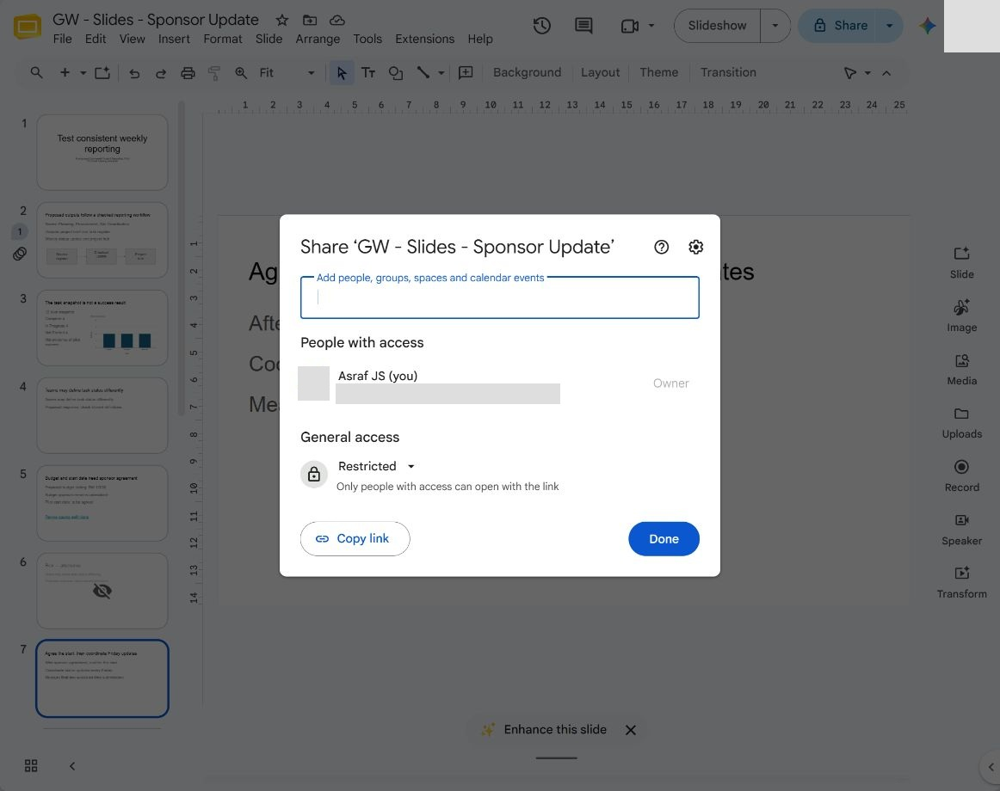

What should you see?

The Q&A session remains unstarted and file access remains at its existing restricted level. No invitation or access test with another person has occurred.

## 7.3 Compare Distribution Choices

1. Open **File > Share > Publish to web**. Inspect the dialog before selecting any publishing action. In the reference it explicitly says **This document is not published to the web**.

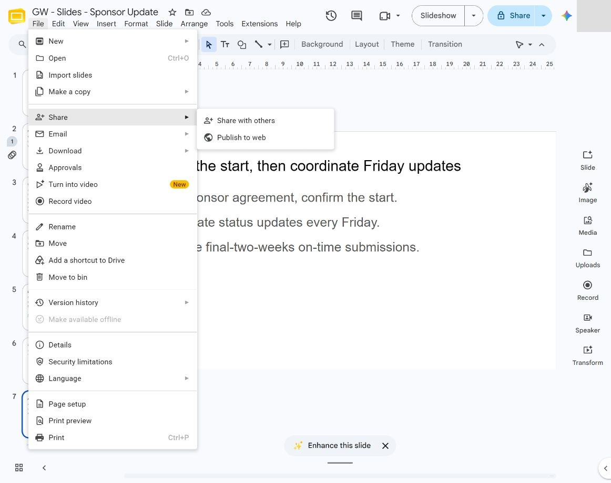

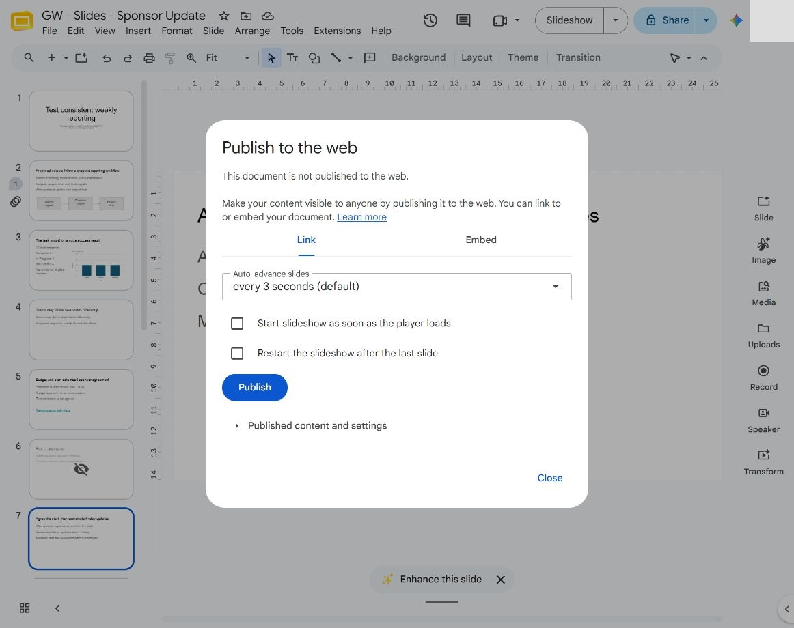

2. Compare **Link** and **Embed**. Link shows auto-advance controls; Embed also offers a slide-size choice. The observed defaults were every 3 seconds and Medium (960x569). Leave these settings unchanged, then select **Close**. Do not press **Publish**.

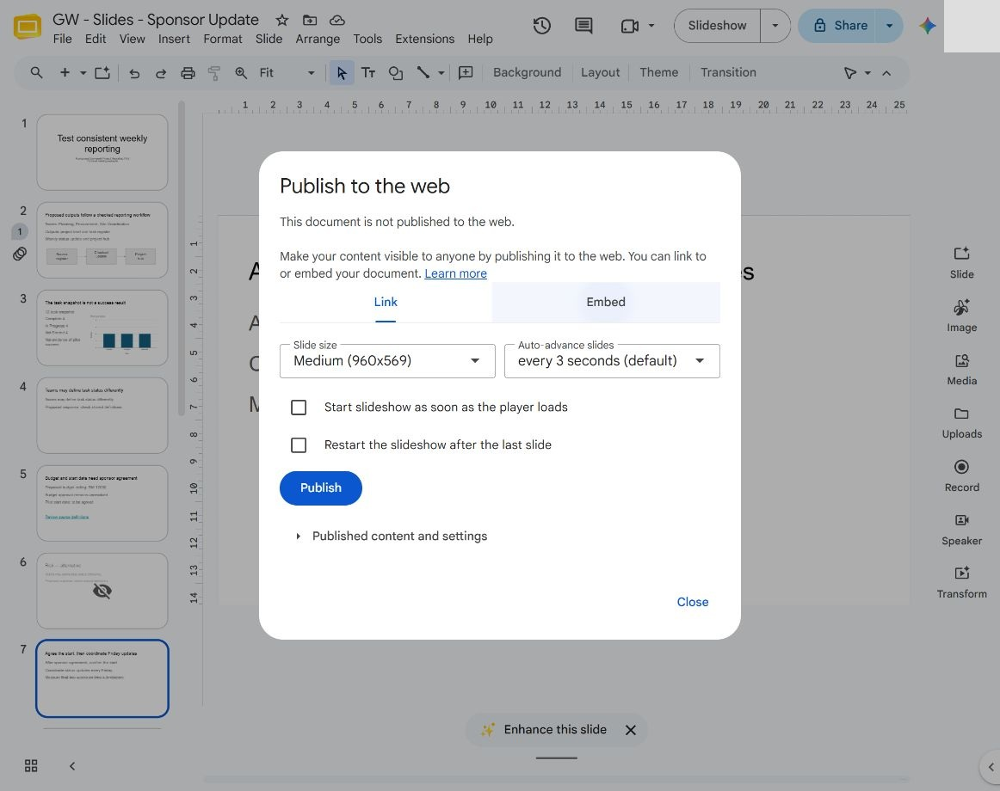

3. Record a distribution choice using the table below. For this fictional draft, retain the restricted editable source for author work. A future approved reviewer handout can be a checked, dated PDF; the 7.4 reference checks its8-page scope, rendered order and embedded destinations. Interactive PDF clicks and spoken rehearsal remain pending. The source pack does not authorise public publication.

| Choice | Intended use and update behaviour | Access and evidence to check |
|---|---|---|
| Restricted file link | Author or approved reviewers use the current source; source edits remain in that file. | Recipient identity, role, current access and correct revision. The reference remains owner-only; no recipient test was performed. |
| Downloaded PDF | A fixed handout or offline fallback at the recorded export revision; it does not refresh with later source edits. | Intended slide scope, skipped-slide inclusion, text and chart values, links, revision/date and permitted destination. The7.4 reference produced8-pages through Print preview; rendered pages and embedded destinations checked. Spoken fallback rehearsal and interactive PDF clicks remain pending. |
| Published presentation | A separate web-viewing or embed distribution route. Published content and update settings need their own review. | Whether web exposure is authorised, audience suitability and published settings. The dialog was inspected and closed; this deck is not published. |

What should you see?

A documented choice with its checks. The native file remains restricted and unpublished. No PDF delivery or live audience session is implied by inspecting these dialogs.

## 7.4 Rehearse an Accessible Delivery and Test Distribution

1. Write the [three-minute run sheet and sponsor answers](./prompts.md) in the opening speaker notes, preserving the original source notes. The checkpoints allocate opening, workflow, evidence, risk, decision request and next steps. These are planned times. In the reference the presenter timer was paused at **00:00:32** during setup; it is not a speaking result.

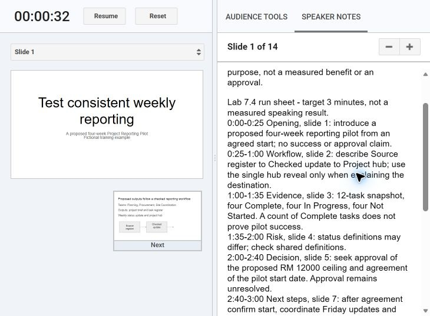

2. Perform a real first spoken rehearsal. Record total speaking time, one hesitation and unnecessary advances, excluding interruptions. This remains **unperformed in the author reference**. Do not substitute a timer left running during automation or window setup.

3. Prepare the three sponsor answers from the card. Four Complete tasks are a snapshot, not pilot-success evidence; RM 12000 remains a proposed ceiling; no confirmed start date is supplied. Cite the task register/Summary, checked brief and project facts. The success criterion is future on-time submission by all three teams in the final two weeks, not an achieved result.

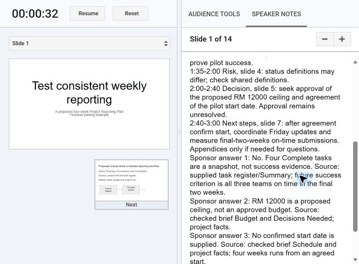

4. In actual **Slideshow**, open Decisions and click **Review source definitions**. The reference moved from source slide 5 to Appendix A on slide 8. Click **Return to Decisions** and confirm slide 5 returns without restarting. The earlier Next 5 to 7 check confirms backup 6 is skipped in normal progression. Use appendix links only when the audience needs the detail.

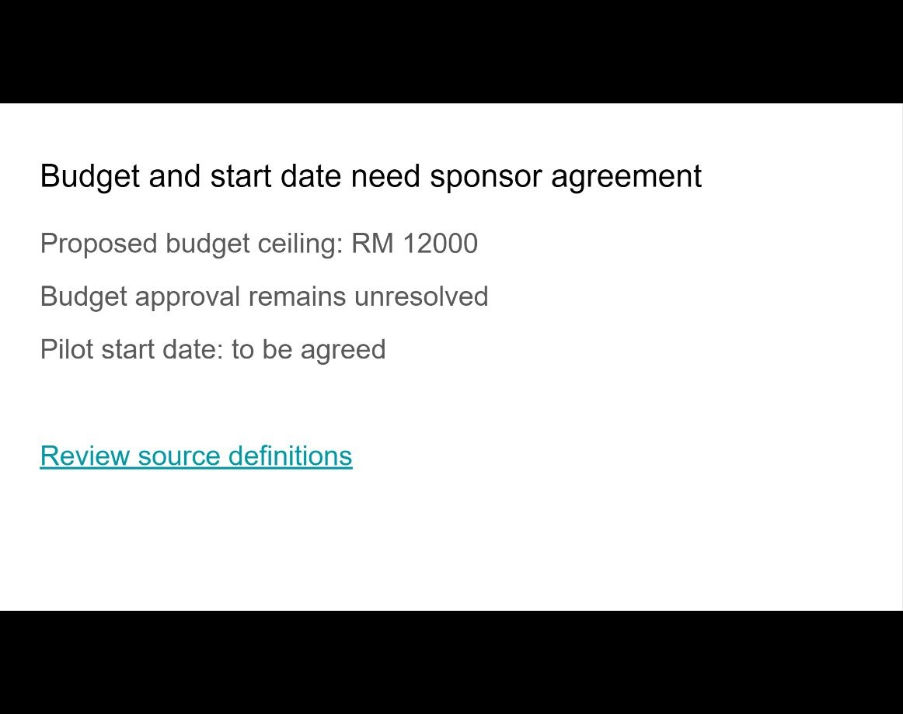

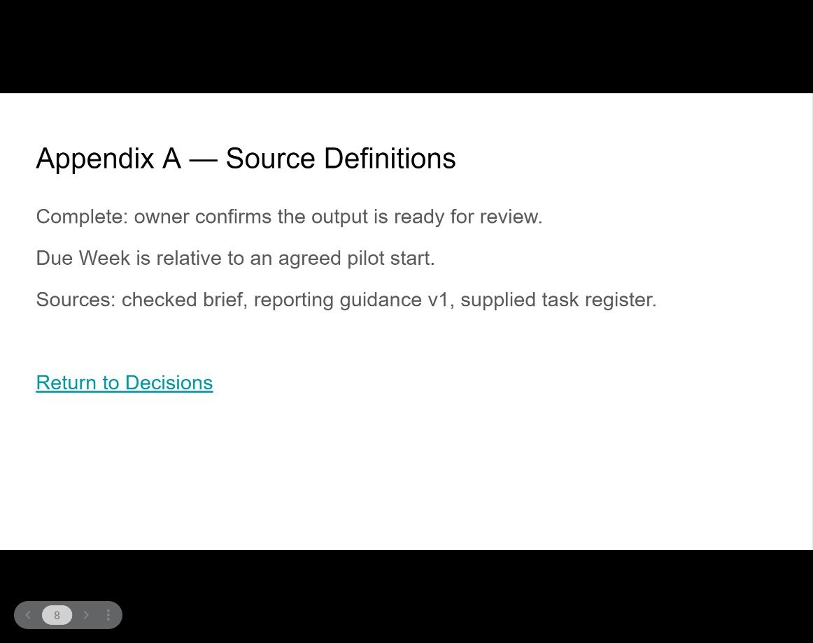

5. Exit Slideshow and use **File > Download > PDF document (.pdf)**. Inspect the downloaded file before treating it as a handout. The reference export contained **all 14 slides**, including the six skipped backup/practice slides. Skip status in Slideshow did not restrict this direct download.

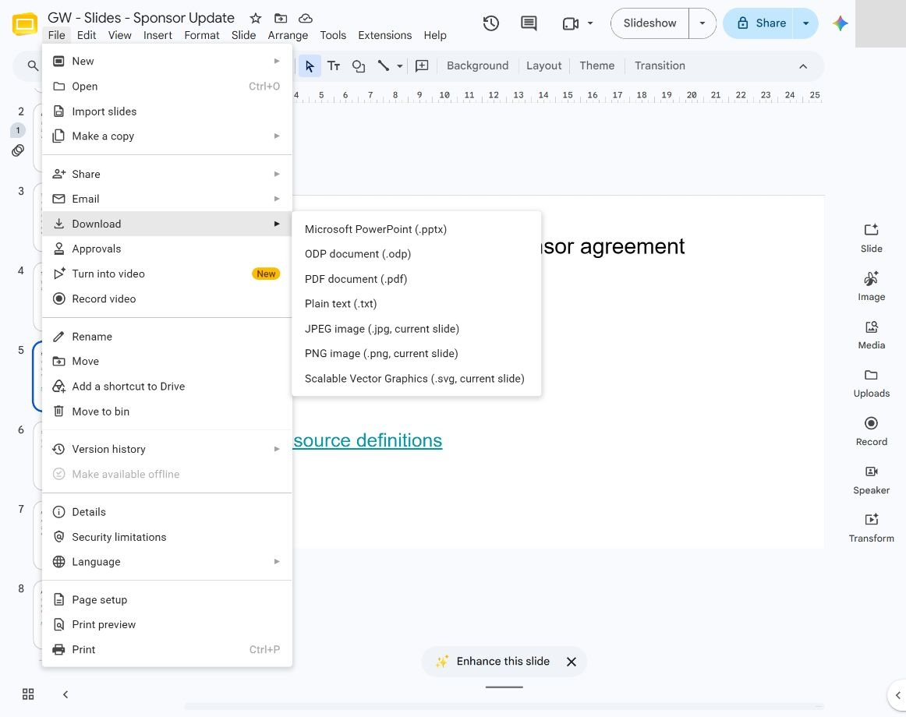

6. Repair the handout scope through **File > Print preview**. Keep **1 slide without notes**. The observed **Include skipped slides** control was enabled initially. Turn it **off**, then click **Download as PDF**. This produced **8 pages**, corresponding to source slides **1, 2, 3, 4, 5, 7, 8, 9**. Both source appendices remain as question references; skipped 6 and 10–14 are excluded. No source slide deletion or duplicate deck was needed. If this control is unavailable, prepare a separately named delivery copy and test its scope instead.

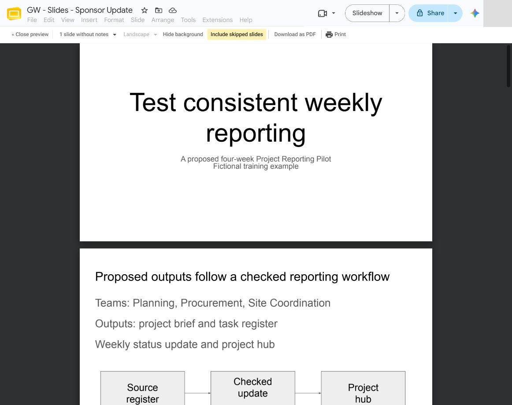

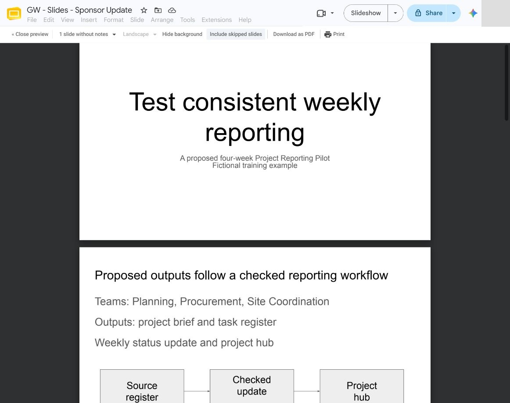

7. Inspect the [fixed R1 handout](./resources/sponsor-update-handout-r1.pdf), including every page and its navigation. In this export the embedded internal destinations resolve **Decisions PDF page 5 → Definitions page 7 → Decisions page 5**. The native source slide 8 is now PDF page 7 after exclusions. The figures below are full-page renders of the actual downloaded PDF. An interactive PDF viewer click test remains pending: controlled-browser policy blocked opening a local-file URL, so the reference used rendered-page review and structural destination checks without a browser workaround.

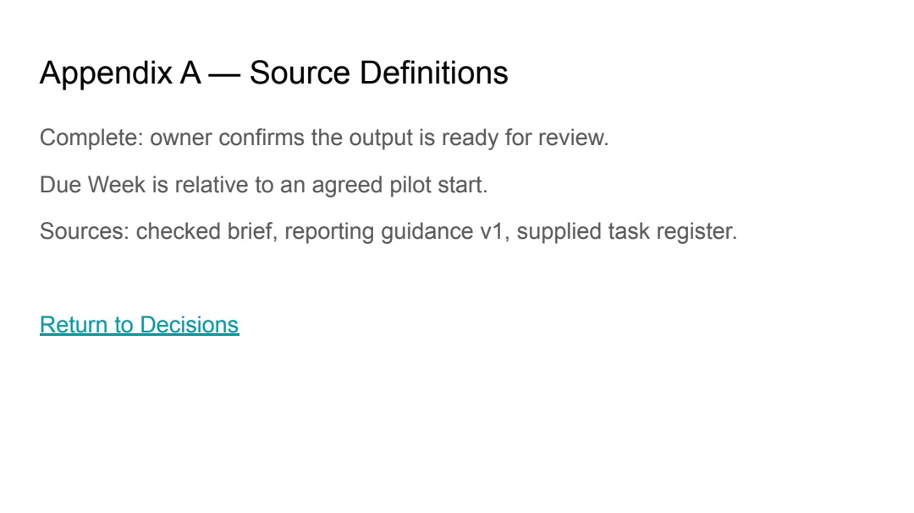

8. Inspect the fallback workflow page. All three boxes and both connectors appear together; PDF has no reveal sequence, presenter timer, Q&A or private speaker notes. Adapt the run sheet to explain Source register → Checked update → Project hub verbally. Keep the run sheet separately available, use page 5 for the decision request, page 7 for definitions and page 6 for next steps. The second **spoken** fallback rehearsal and its measured improvement remain unperformed.

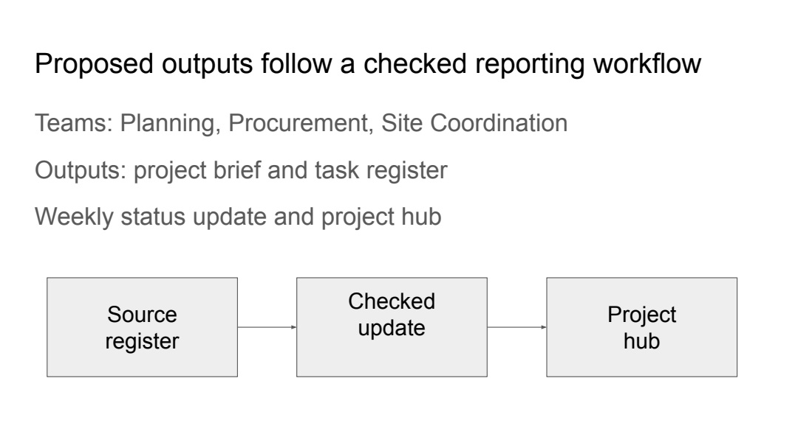

9. Record the fixed handout's scope, date and hash in the [release record](./release-manifest.md). It is an author reference for fictional training, not evidence of approval for external distribution. Retain the restricted editable source. After a later source change, compare the release record and re-export deliberately; downloaded PDF does not refresh. Name the source milestone **Sponsor update - delivery export checked**, verify it in history and return with **Back**. This records the author's UI/export checks, not a completed rehearsal or sponsor approval.

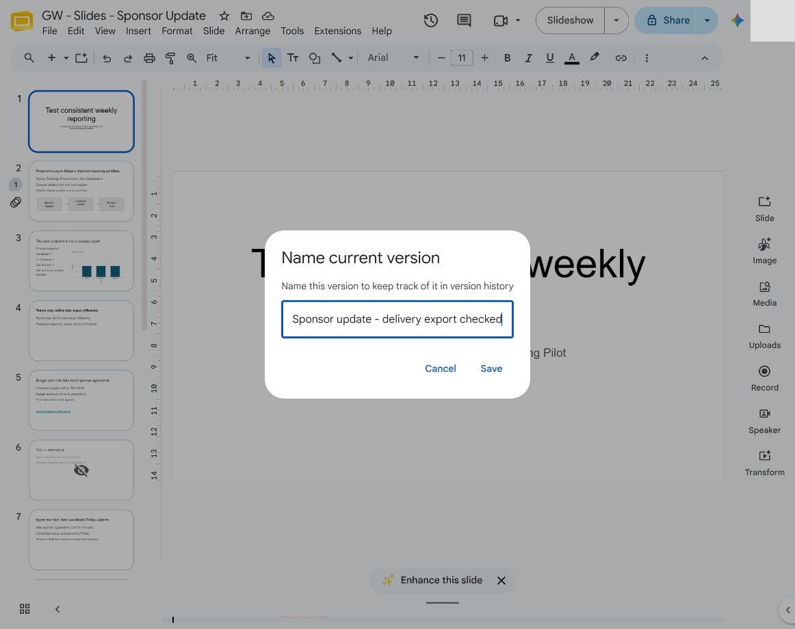

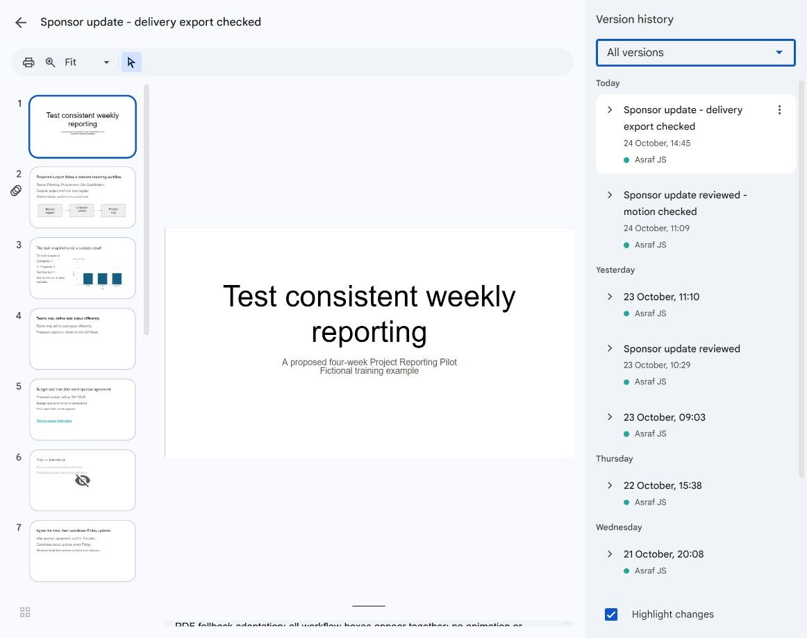

What should you see?

A planned run sheet, three grounded answers, live appendix navigation and an 8-page static handout with checked visual sequence and internal destinations. The14-page diagnostic explains the scope repair. Two real spoken rehearsals, interactive PDF clicks and independent validation remain open.

## Independent Challenge

Close the earlier step lists for the first attempt. Use the case input and your own reasoning. If you need help, record the hint and repeat the affected check independently.

1. A reviewer needs a current fixed handout and a presenter needs an editable source. Prepare a release manifest identifying each file, revision and intended use.

2. Deliver the opening and decision request once more using the fallback. Correct any claim whose qualification became unclear.

3. Demonstrate how you would recognise a stale downloaded copy after a source update.

## Evidence to Hand Over

- Two timed rehearsals with specific delivery improvements.
- Three source-based or explicitly unresolved sponsor answers.
- Inspected handout scope, fallback delivery and release manifest.

Record the defect or uncertainty you investigated, the evidence used, the repair or reasoned no-change decision, and the final state. Restore temporary changes or keep them in a clearly named scenario copy.

## Troubleshooting

| Symptom | What to check |
|---|---|
| The handout contains unwanted backup slides | In File > Print preview, turn off Include skipped slides and Download as PDF; inspect the actual output. Use a separate scoped delivery copy if that control is unavailable. |
| An input or earlier result is missing | Reopen the input named in Before You Begin; do not substitute private company data |
| A menu or feature is unavailable | Confirm the account and the shared access notes; record the missing step and ask the trainer for its fallback |
| The result differs from the checkpoint | Compare the exact source range, wording and conditions before repeating the action |

## Lesson Summary

A rehearsed deck and deliberate distribution choice complete the presentation workflow.

**Check yourself:** Why is publishing to the web a different decision from sharing with named reviewers?
