# 01 - Create and Navigate a Workbook

Seri Maju Projects keeps its pilot task list in an Excel file, `TaskRegister.xlsx`, and the coordinator, Aina Rahman, wants the team to work on it in Google Sheets from now on. Before anyone changes a number, she wants a working copy that everyone can find, a guide tab that says what each tab is for, and somewhere safe to practise. In this lab you set that up. You keep using the same workbook in every later lab.

**Estimated time:** 40 minutes, planned as 5 explanation, 25 guided build and 10 independent practice. Not yet timed with learners.

**Your result:** a Google Sheets file, `GW - Sheets - Task Register`, with the twelve supplied tasks untouched on **Tasks**, a **Workbook Guide** tab that explains the workbook, and two practice tabs.

> **You'll practise:** uploading an Excel file and saving it as Google Sheets, moving around with the name box, duplicating, adding, renaming and moving tabs, typing records, and selecting cells, rows, columns and ranges.

---

## What You Will Learn

- Create, name, find and reopen a Google Sheets workbook in Drive
- Move between tabs, cells and ranges with the name box
- Keep the supplied records safe and practise on copies

## Before You Begin

> **Download:** [TaskRegister.xlsx](../../shared/sample-files/TaskRegister.xlsx) and save it on your computer. It has two tabs: **Tasks**, with twelve fictional tasks in rows 2 to 13, and **Summary**, which you fill in later labs.

**How the workbook comes together:**

**Practice folder** > **TaskRegister.xlsx** (the Excel original) > **GW - Sheets - Task Register** (your Google Sheets copy): **Tasks** > **Workbook Guide** > **Navigation Practice** > **Entry Practice** > **Summary**

## Topics

**The Excel file and the Google Sheets file.** Uploading `TaskRegister.xlsx` puts the Excel file in Drive. You can open it in Sheets, but it stays an Excel file (you'll see a **.XLSX** badge next to its name). **Save as Google Sheets** makes a second, separate file in Google's own format. That second file is the one you work in. The Excel original stays in the folder, unchanged, so you can always start again.

**Addresses and TaskIDs.** **D5** is a cell address: column D, row 5. It tells you where a value is *now*. If someone sorts the list, a different task ends up in row 5. The TaskID in column A (such as **T004**) stays with its task wherever the row moves, so that's what you use to name a record.

---

## 1.1 Create the Folder and Upload the File

1. Open [Google Drive](https://drive.google.com).
2. Click **New**, then **New folder**. Type `GW - Sheets Foundation - Practice` and click **Create**.
3. Double-click the folder to open it.

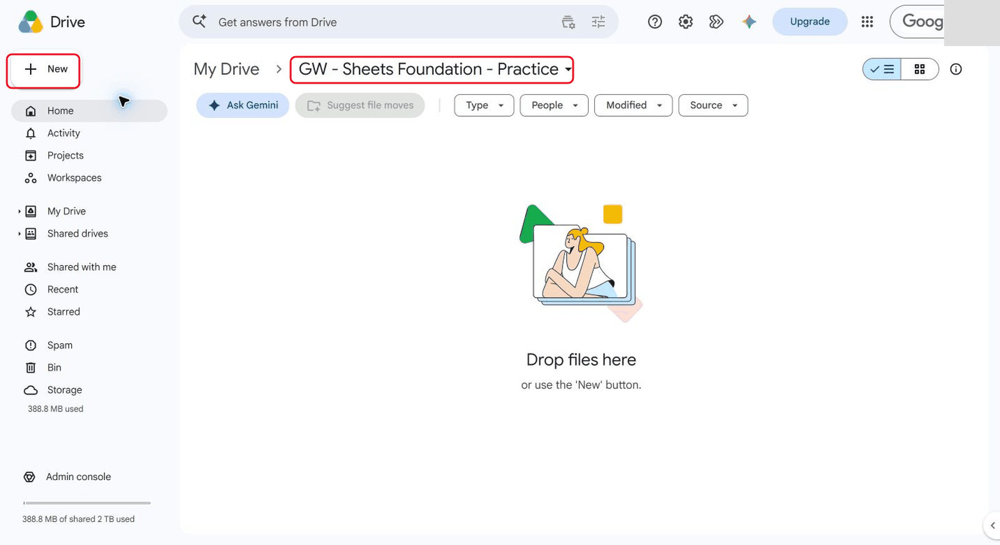

*The folder name shows in the path at the top, and the folder is empty.*

4. Click **New**, then **File upload**. Choose `TaskRegister.xlsx` from where you saved it and click **Open**.
5. Wait for **1 upload complete** at the bottom right.

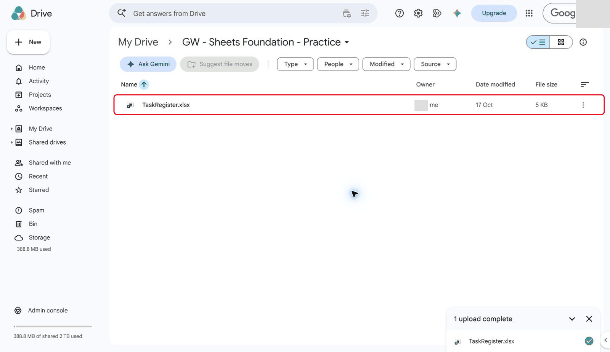

*The Excel file is in the folder, and the upload box at the bottom right shows a green tick.*

**Check:** you're inside **GW - Sheets Foundation - Practice**, and it holds one file, **TaskRegister.xlsx**.

---

## 1.2 Save It as Google Sheets

1. Double-click **TaskRegister.xlsx**. It opens in Sheets with a **.XLSX** badge next to its name.
2. Click **File**, then **Save as Google Sheets**.

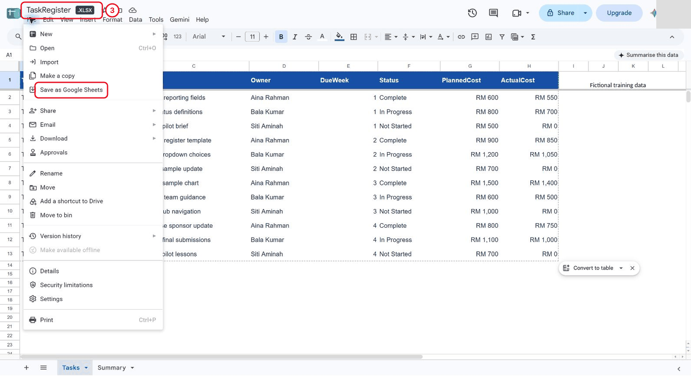

*The .XLSX badge beside the name tells you this is still the Excel file.*

3. A new Google Sheets file opens, with the same name and no **.XLSX** badge. Click its name at the top left, type `GW - Sheets - Task Register` and press **Enter**.

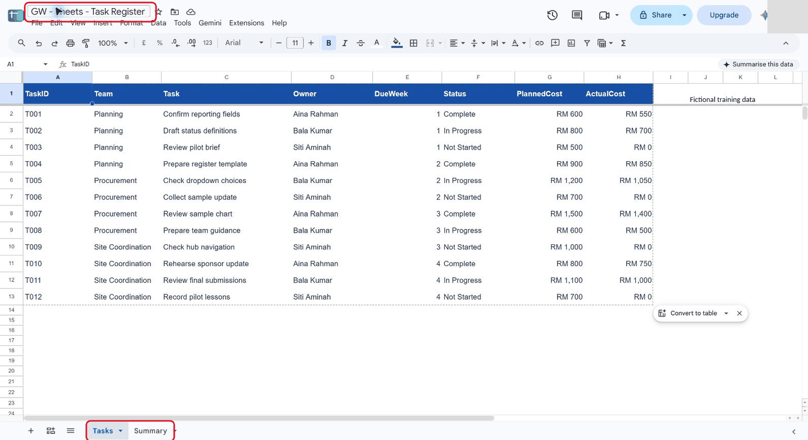

*No badge beside the new name, and two tabs at the bottom: Tasks and Summary.*

**Check:** the file is called **GW - Sheets - Task Register**, there's no **.XLSX** badge, and **Tasks** shows twelve tasks, **T001** to **T012**. Only rename this new file. Leave the Excel original as it is.

---

## 1.3 Find Your Way Around

The **name box** is the small box at the far left of the formula bar. It shows where you are, such as `A1`, and you can type an address into it to jump there.

1. On **Tasks**, click the name box, type `A1:H13` and press **Enter**. The headings and all twelve tasks are selected.

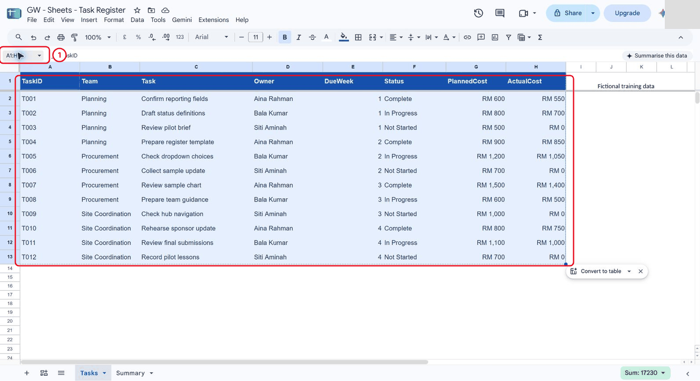

*A1:H13 is a range: everything from A1 at the top left to H13 at the bottom right.*

2. Click the name box, type `D5` and press **Enter**. The formula bar shows **Aina Rahman**. Look left to column A on the same row: it's task **T004**.

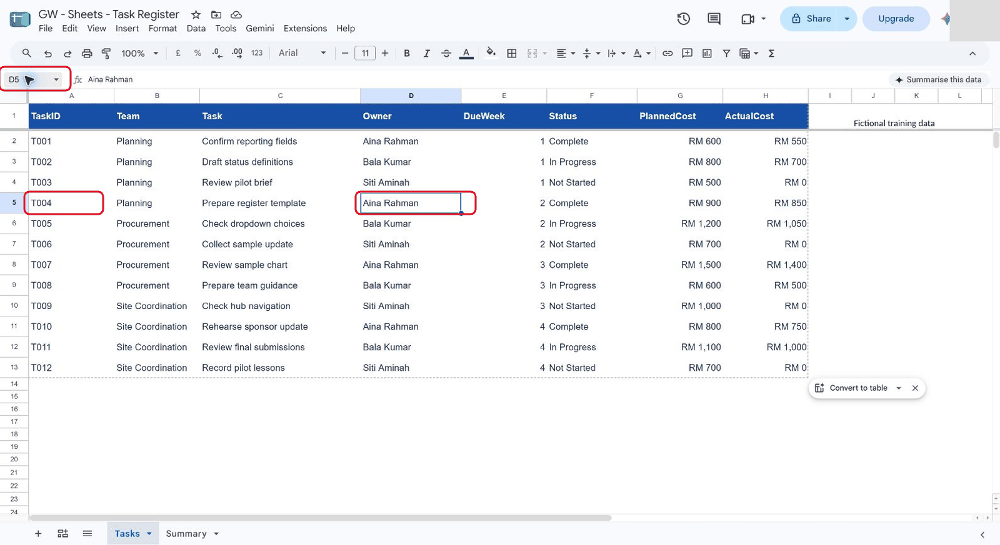

*D5 holds the owner of task T004.*

3. Click the **Summary** tab at the bottom. It has three status names and an empty **TaskCount** column, which you fill in a later lab. Click **Tasks** to go back.

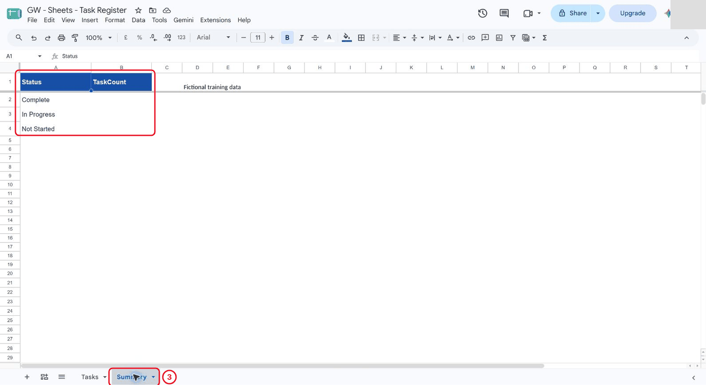

*Leave Summary as it is for now.*

**Check:** you can jump to any cell or range with the name box, and you're back on **Tasks**.

---

## 1.4 Make a Practice Tab

You'll try things out on a copy of **Tasks**, so the twelve supplied tasks stay exactly as they arrived.

1. Click the small arrow on the **Tasks** tab and choose **Duplicate**. A tab called **Copy of Tasks** appears.

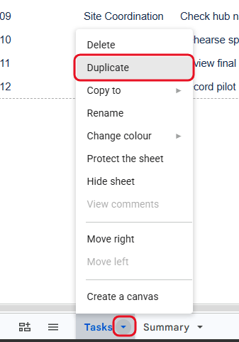

*The small arrow is on the Tasks tab itself, at the bottom of the screen.*

2. Click the arrow on **Copy of Tasks**, choose **Rename**, type `Navigation Practice` and press **Enter**.

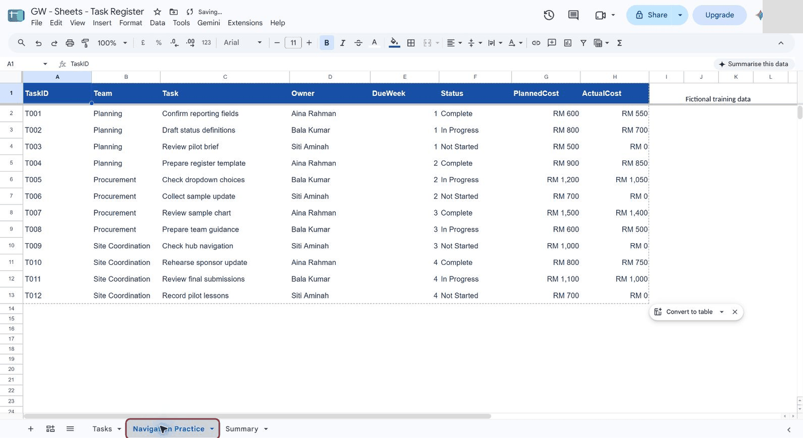

*The copy has every task and the same formatting as Tasks.*

3. On **Navigation Practice**, click **J1**, type `Practice only` and press **Enter**.
4. Point at the right edge of the column **J** heading, where it meets **K**. When the double bar appears, drag it to the right to make the column wider.

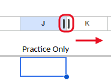

*Drag the double bar to the right. Yours says Practice only, with a small o.*


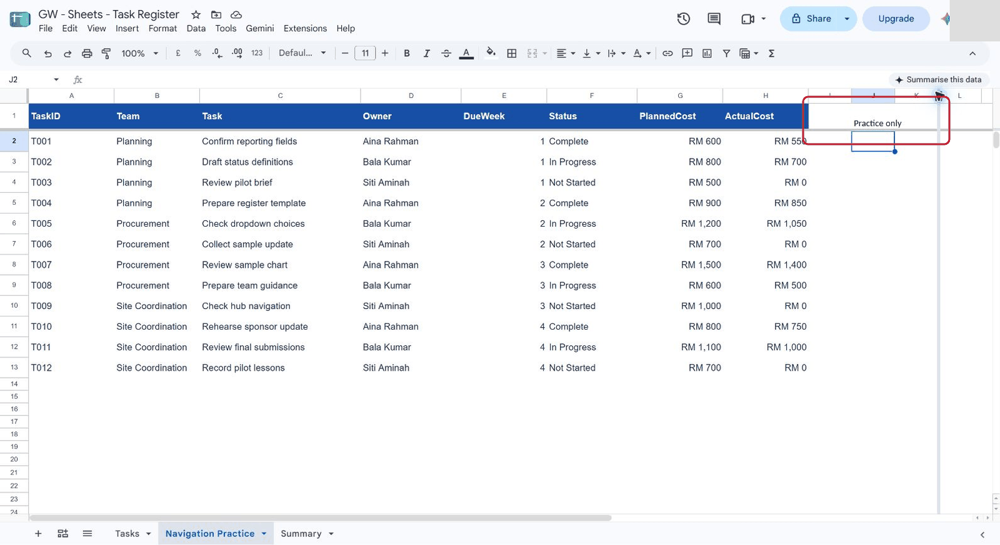

*The change is only on Navigation Practice.*

5. Click the **Tasks** tab.

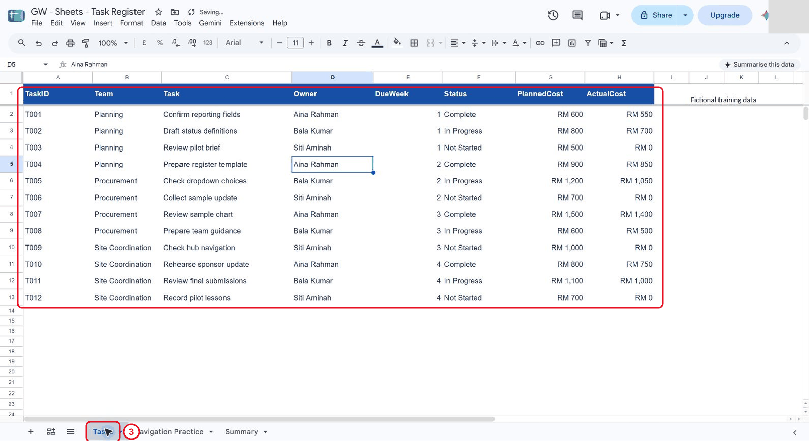

*Tasks still has its twelve tasks and no Practice only label.*

**Check:** **Practice only** is on **Navigation Practice**, and **Tasks** is unchanged.

---

## 1.5 Start the Workbook Guide

The Workbook Guide tells the next person what each tab is for, so they don't have to guess.

1. With **Tasks** open, click **+** (Add sheet) at the bottom left. A new tab appears next to **Tasks**.

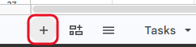

*The + is at the far left of the tab bar.*

2. Double-click the new tab's name, type `Workbook Guide` and press **Enter**.
3. Copy the block below, click **A1** on **Workbook Guide** and press **Ctrl+V**. The text fills two columns, **A** and **B**.

```text
Tab	Purpose and source status
Tasks	Maintained source: 12 records in A1:H13; use TaskID to identify each record.
Summary	Summary area supplied with the starter; calculations are built in later labs.
Navigation Practice	Duplicate for navigation experiments; J1 is Practice only.
```

4. Drag the right edge of the column **B** heading until each line fits.

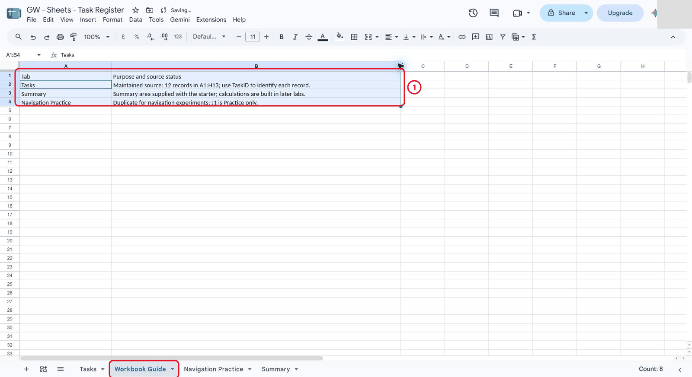

*Four rows, one for each tab so far. Workbook Guide sits next to Tasks.*

**Check:** **Workbook Guide** has the four rows in columns **A** and **B**, and every line is readable.

---

## 1.6 Check Four Addresses

Now you look up four cells and write down which task each one belongs to. This is the habit that stops mistakes later: you name a record by its TaskID, not by its row.

1. Click the **Tasks** tab. Click the name box (top left, above column **A**), type `A2` and press **Enter**. Cell A2 is selected. Read its value in the formula bar: **T001**. In column A it's also the TaskID.

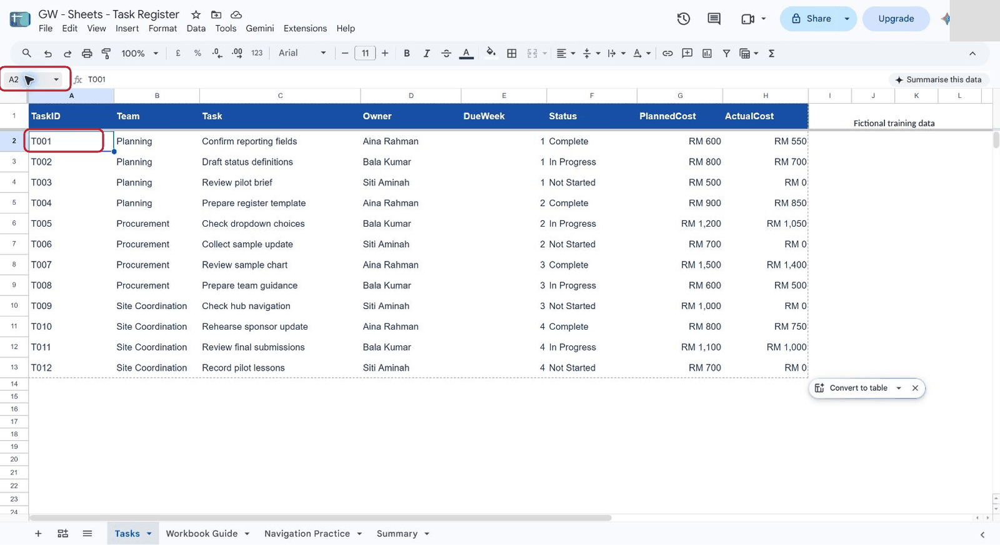

*The name box shows A2, and the formula bar shows T001.*

2. Click the name box again, type `D5` and press **Enter**. The formula bar shows **Aina Rahman**. Look left to column A on the same row for the TaskID: **T004**.

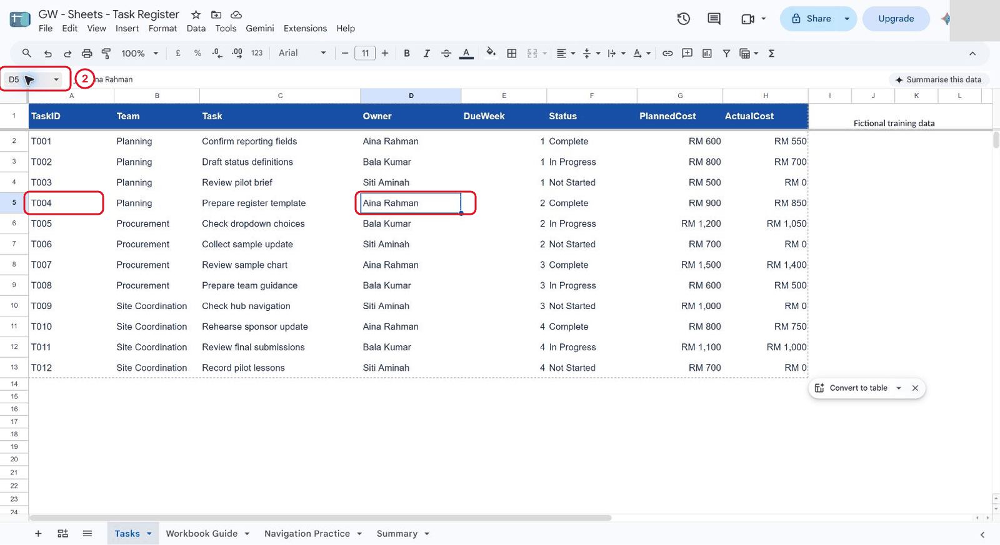

*D5 is the owner of T004.*

3. Do the same for `F8`. Note the value and the TaskID on that row.

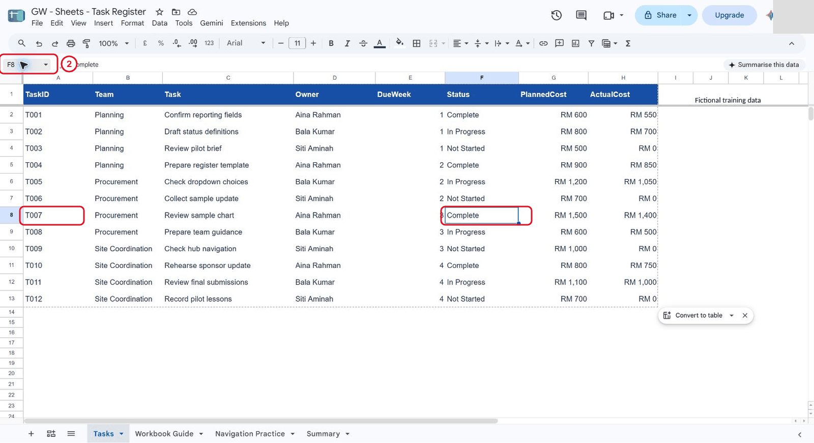

*F8 is the status of T007.*

4. Do the same for `H13`.

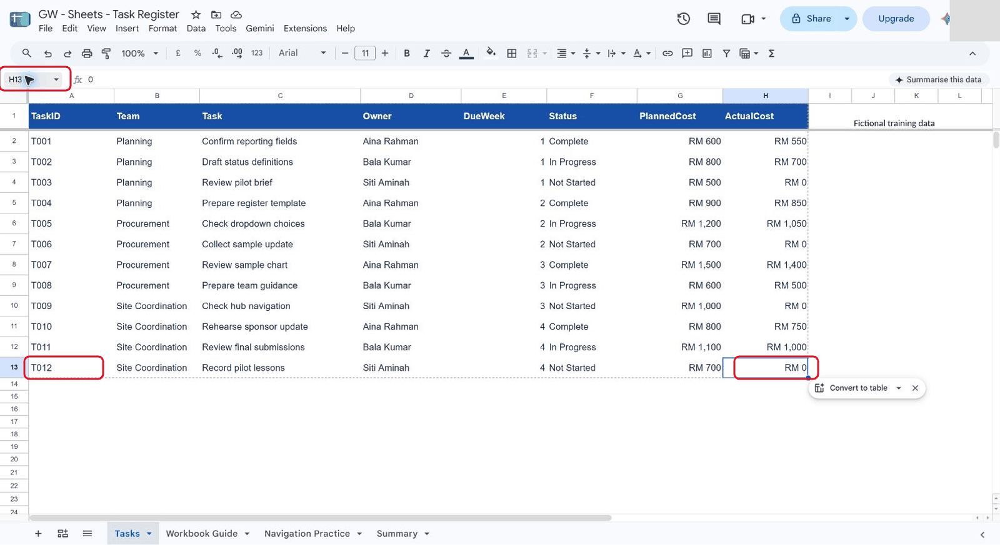

*H13 shows RM 0 for T012. A zero cost is still a value, not an empty cell.*

> **Tip:** press **Ctrl+Shift+Page Down** to move to the next tab and **Ctrl+Shift+Page Up** to go back (on a Mac, **Option+Down arrow** and **Option+Up arrow**).

5. Go to **Workbook Guide**. Copy the block below, click **A7** and press **Ctrl+V**. It adds the headings and the four addresses.

```text
Address	Column meaning	Visible value	TaskID
A2	TaskID
D5	Owner
F8	Status
H13	ActualCost
```

6. In **C8:D11**, type the value and the TaskID you found for each address.

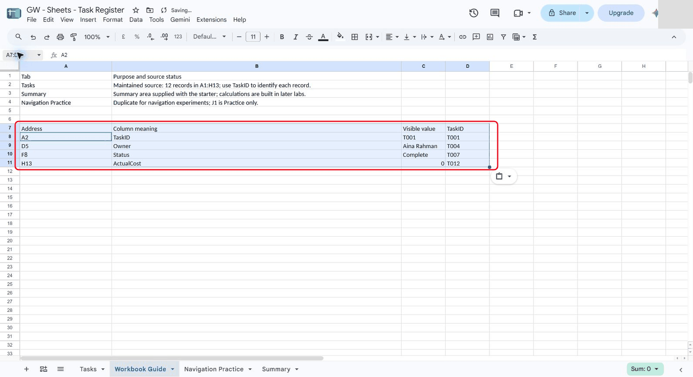

*Row 7 has the headings and rows 8 to 11 the four addresses.*

<details markdown="1">
<summary>What should you see?</summary>

| Address | Column meaning | Visible value | TaskID |
|---|---|---|---|
| A2 | TaskID | T001 | T001 |
| D5 | Owner | Aina Rahman | T004 |
| F8 | Status | Complete | T007 |
| H13 | ActualCost | 0 | T012 |

Tasks shows H13 as **RM 0** because of its currency format. Typed as `0` here, it shows as plain 0.

</details>

---

## 1.7 Type Three Records

Typing a few records yourself shows you how a row holds one task, with each field in its own column.

1. Click **+** (Add sheet). Double-click the new tab's name, type `Entry Practice` and press **Enter**.
2. Copy the heading row below, click **A1** on **Entry Practice** and press **Ctrl+V**.

```text
TaskID	Team	Task	Owner	DueWeek	Status	PlannedCost	ActualCost
```

3. Click **A2**. Type the first three tasks from **Tasks** (T001, T002 and T003), all eight fields of each. Press **Tab** to move right and **Enter** at the end of a row to start the next. Type costs as plain numbers, such as `600`.
4. Drag the right edge of the column **C** heading until each task name fits.

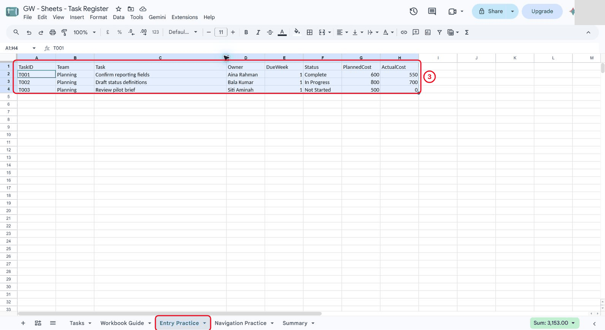

*Your three rows should match the first three rows of Tasks, field for field.*

5. Compare each row with **Tasks** by its TaskID, one field at a time. If anything is different, fix it on **Entry Practice**.

**Check:** **Entry Practice** has the headings and three tasks in **A1:H4**, and every field matches **Tasks**.

---

## 1.8 Practise Selecting

Before you format, sort or copy anything in later labs, you need to select the right thing. Use the name box on **Entry Practice** for each one.

1. Type `B2` and press **Enter**. One cell is selected.

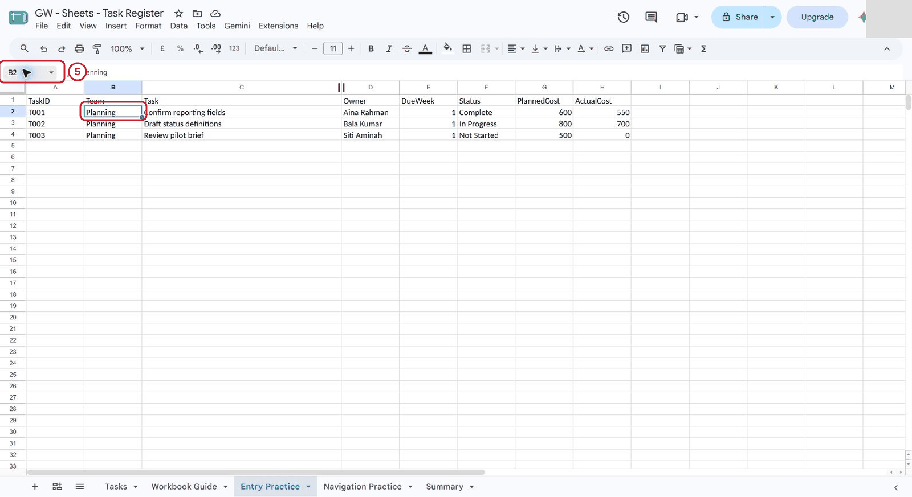

*One cell: the Team for T001.*

2. Type `2:2` and press **Enter**. The whole of row 2 is selected: every field of T001.

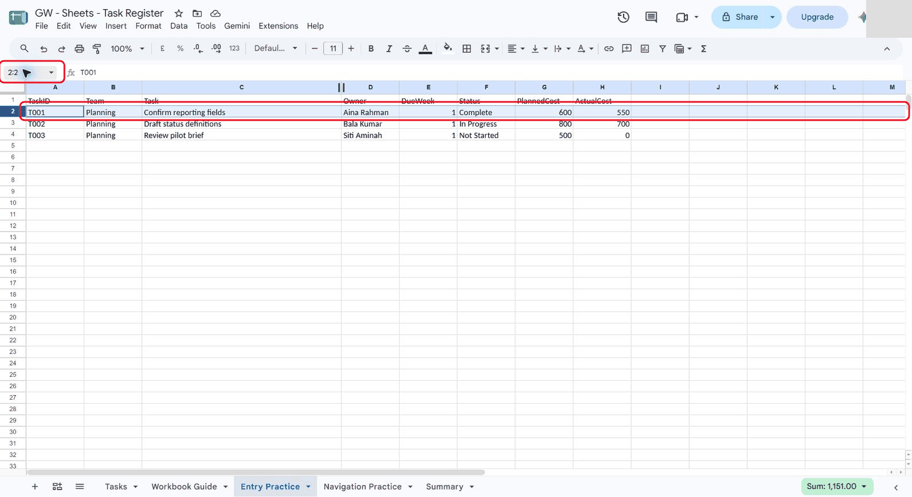

*A whole row keeps a record's fields together.*

3. Type `C:C` and press **Enter**. The whole Task column is selected.

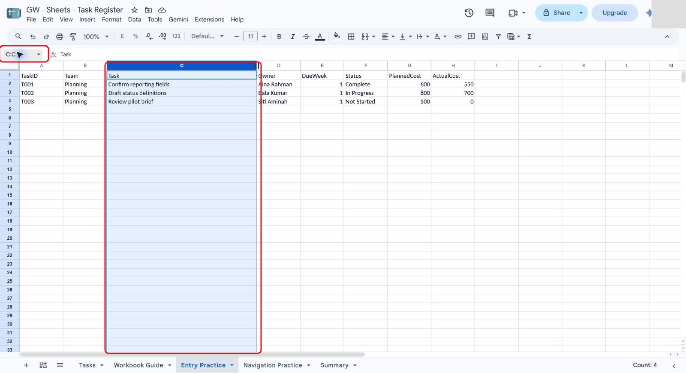

*A whole column is one field for every record.*

4. Type `A1:H4` and press **Enter**. The headings and your three records are selected.

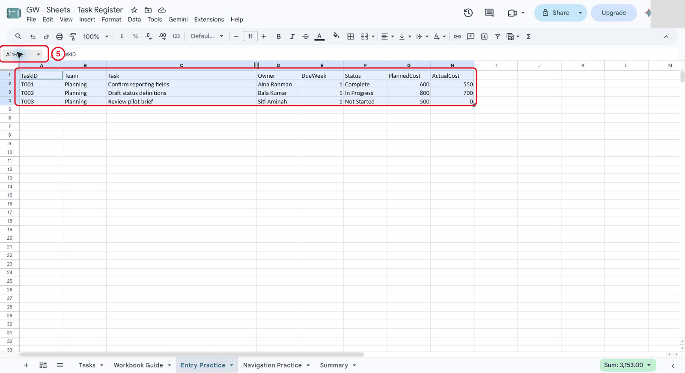

*A small table: the headings and three records.*

5. Go to **Workbook Guide**. Copy the block below, click **A13** and press **Ctrl+V**. If you fixed a typing mistake in 1.7, change the **Reconstruction** line to say what you fixed.

```text
Check	Result
Reconstruction	T001, T002 and T003 checked by TaskID: all eight fields match Tasks; no copying error found.
Readability repair	Widened Entry Practice task column so complete task text is visible; values unchanged.
Single cell	Use a cell address for one value, such as B2.
Whole row	Select 2:2 for the complete row; do not move isolated field cells within a record.
Whole column	Select C:C to operate on the Task field as a column.
Header selection	Use A1:H1 to format only the header, not the records below.
Small table selection	A1:H4 covers the eight headers and three recreated records.
```

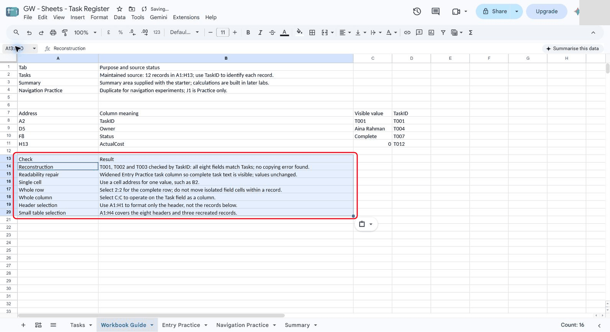

*Rows 13 to 20 record what you checked and what each selection is for.*

**Check:** you've made all four selections, and **Workbook Guide** has the check rows in **A13:B20**.

---

## 1.9 Tidy the Tabs and Reopen From Drive

1. Click the arrow on the **Entry Practice** tab and choose **Move right**. It moves one place, to after **Navigation Practice**.

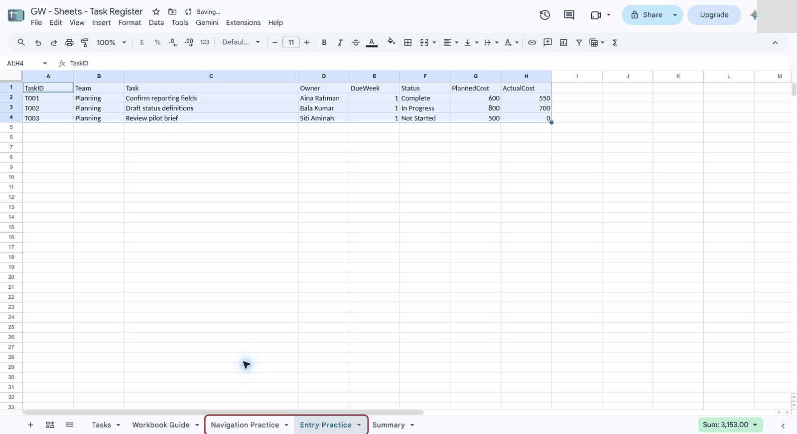

*The tab order now matches the map at the top of this lab.*

2. Close the browser tab with the workbook.
3. In Drive, open **GW - Sheets Foundation - Practice**. Don't use **Recent**: finding the file from its folder is what the next person will do.

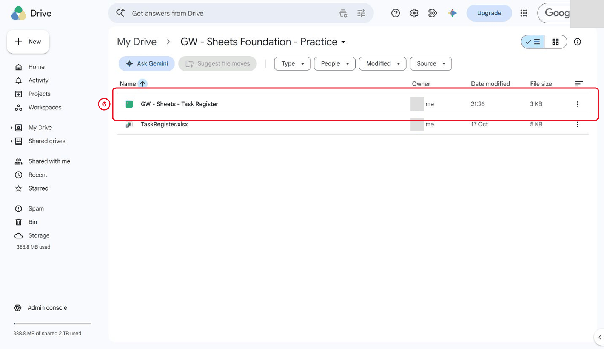

*Two files: the green Sheets icon is your working file, and TaskRegister.xlsx is the Excel original.*

4. Double-click **GW - Sheets - Task Register** and go to **Workbook Guide**.
5. Copy the block below, click **A23** and press **Ctrl+V**. Rows 21 and 22 stay empty as a gap.

```text
File identity	Which file to edit
Original	TaskRegister.xlsx - Microsoft Excel; keep as supplied source.
Native	GW - Sheets - Task Register - Google Sheets; edit this native file for the course.
Location	My Drive / GW - Sheets Foundation - Practice; both files are in this folder.
Reopen check	Closed the native workbook and reopened it from this folder, without Recent.
Source check	Tasks!A1:H13 matches the initial native source, including all 12 records; practice changes are separate.
Next learner	Open this Workbook Guide, then Tasks for the maintained source; use TaskID rather than guessing row position.
```

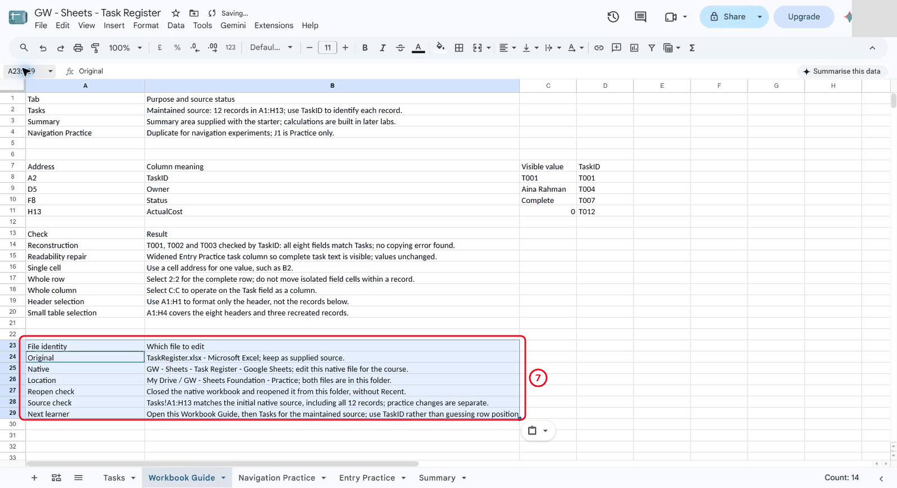

*The last block says which file to edit and where to find it.*

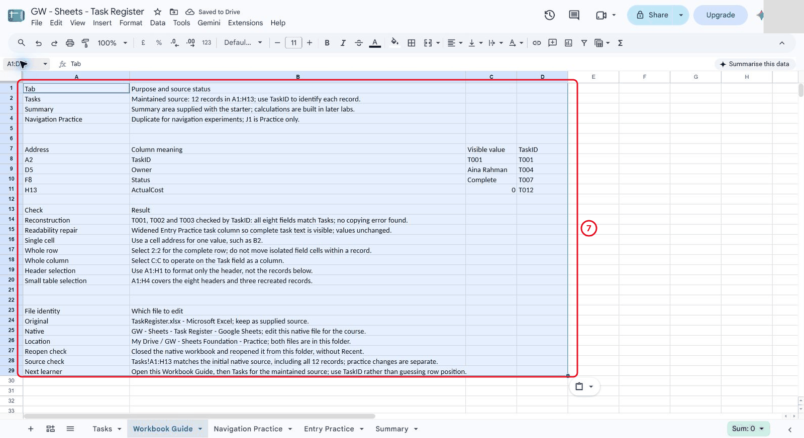

*The whole guide: tab purposes, address checks, selection checks and file identity.*

<details markdown="1">
<summary>What should you see?</summary>

**GW - Sheets - Task Register** opens from the practice folder with five tabs in this order: **Tasks**, **Workbook Guide**, **Navigation Practice**, **Entry Practice**, **Summary**. **Workbook Guide** has four blocks, starting at rows 1, 7, 13 and 23. **Tasks** still has the twelve supplied tasks in **A1:H13**.

</details>

---

## Independent Practice

Try these without looking back at the steps.

1. Close the workbook and reopen it from the practice folder, without using **Recent**. On **Tasks**, find the owner and the actual cost of **T008**. Name the record by its TaskID, not its row.
2. Add a tab called `New Entry Form`. In row 1, type the eight headings from **Tasks**. Leave rows 2 and 3 empty, ready for two new tasks. Don't add unfinished rows to **Tasks**.
3. With a partner, take turns to point at a cell address, a range, a tab and the file. Your partner names each one and says which file to edit for the course.

<details markdown="1">
<summary>What should you see?</summary>

T008 is owned by **Bala Kumar**, with an actual cost of **RM 500**. It's in row 9 today, but after a sort it could be anywhere: T008 is how you find it again.

</details>

### Evidence to Hand Over

- **Workbook Guide** with the tab purposes, the four address checks, the selection checks and the file identity rows
- **Entry Practice** with three typed records that match **Tasks**
- **New Entry Form** with eight headings and two empty rows
- The owner and actual cost of T008

## Troubleshooting

| Problem | What to try |
|---|---|
| **Save as Google Sheets** isn't in the **File** menu | You're already in the Google Sheets copy. Look for the **.XLSX** badge: if it isn't there, you're in the right file. |
| There are two files called **TaskRegister** | One is the Excel original and one is the new copy. Rename the one without the **.xlsx** ending (green Sheets icon). |
| A pasted block landed in one column | Click a single cell (don't double-click into it) before you press **Ctrl+V**. |
| The name box didn't move you | Click the name box, type the address with no spaces and press **Enter**. |
| You typed on **Tasks** by mistake | Press **Ctrl+Z** until the change is gone, then check **Tasks** against the supplied file. |
| The upload button or **Save as Google Sheets** is missing in your account | Tell your trainer. They'll give you a Google Sheets copy to use instead. |

## Lesson Summary

You uploaded an Excel file, saved a Google Sheets copy to work in, and kept the original safe. You moved around with the name box, practised on copies, typed three records and wrote a Workbook Guide so the next person knows which file and tab to use. In Lab 02 you make the register easier to read without changing what it says.

**Check yourself:** what's the difference between a spreadsheet file and a worksheet tab?
