# 02 - Enter and Format Reliable Data

The costs on **Tasks** came across from Excel showing **RM 600**, and the team wants them to stay right as the register grows. Aina has been caught out before: a "cost" that looked fine was really typed text, and the total came out short. In this lab you set proper ringgit and week formats on **Tasks**, make it easy to read, and then prove, on your practice tabs, which values a total really counts.

**Estimated time:** 45 minutes, planned as 5 explanation, 25 guided build and 15 independent practice. Not yet timed with learners.

**Your result:** `GW - Sheets - Task Register` with ringgit costs, whole-number weeks and readable rows on **Tasks**, and on **Entry Practice** a formatted practice table, a **Type Tests** block, a paste comparison and your notes.

> **You'll practise:** reading the formula bar, applying currency and number formats, wrapping text, fitting row heights, and using **Paste special** to copy only values or only formatting.

---

## What You Will Learn

- Tell a cell's value from the way it's displayed
- Format costs and weeks without changing the numbers
- Spot text that only looks like a number, and prove it with SUM and COUNT

## Before You Begin

Open `GW - Sheets - Task Register` from **GW - Sheets Foundation - Practice**. You need **Navigation Practice** and **Entry Practice** from Lab 01. If you skipped Lab 01, download [TaskRegister.xlsx](../../shared/sample-files/TaskRegister.xlsx) and follow Lab 01 sections 1.1, 1.2, 1.4 and 1.7 first.

**What you change in this lab:**

**Tasks**: cost and week formats > wrapped task names and fitted rows | **Navigation Practice**: a date and a text cost | **Entry Practice**: Type Tests > practice table > paste comparison > notes

On **Tasks** you only change how values look. The values themselves stay exactly as supplied.

## Topics

**What a cell holds and what it shows.** Click a cell and look at the formula bar: that's the value. The cell shows the value through a format. `600` with a ringgit format shows **RM600**, but it's still the number 600, so it adds up. If someone types the letters `RM 600`, the cell holds text. It can look almost the same, but SUM skips it.

**A quick clue.** Sheets lines numbers up on the right of a cell and text on the left. A cost sitting on the left is worth a second look.

**Weeks aren't dates.** **DueWeek** is a week number in the pilot (1 to 4), not a calendar date. The pilot start date isn't agreed, so a date you type in this lab is only a practice example.

---

## 2.1 Look Behind the Display

1. Click the **Tasks** tab. Click the name box, type `G2` and press **Enter**.
2. Look at the cell: it shows **RM 600**. Look at the formula bar: it shows `600`.

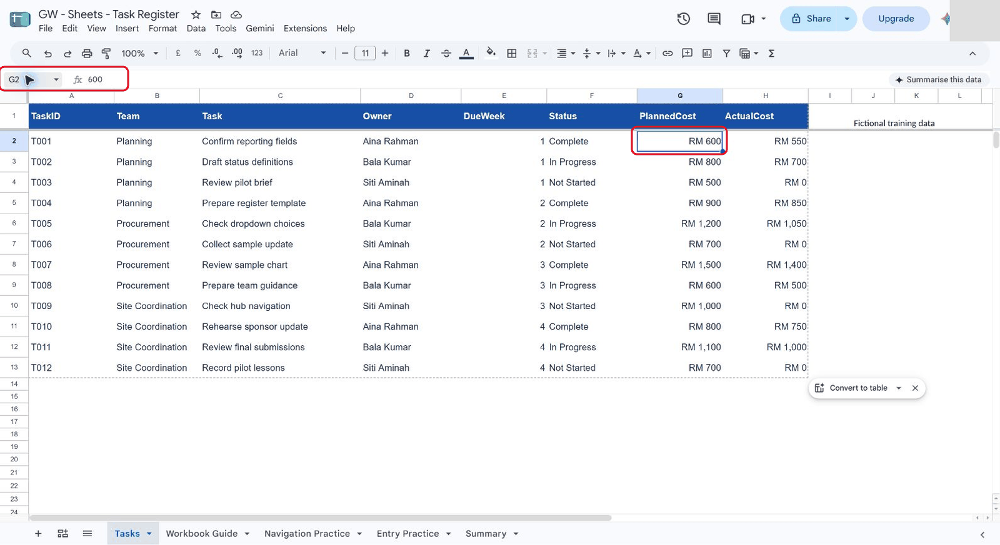

*The formula bar shows the value, 600. The cell shows it with a currency format.*

**Check:** you can say what **G2** holds (the number 600) and what it shows (**RM 600**).

---

## 2.2 Format the Costs and Weeks

The costs already show RM because of a format brought over from Excel. You replace it with Google's own ringgit format, so every cost you add later looks the same.

1. On **Tasks**, click the name box, type `G2:H13` and press **Enter**. Both cost columns are selected.
2. On the toolbar, click **123** (More formats), then **Custom currency**.
3. In the search box, type `RM`. Click **Malaysian Ringgit**.
4. Open the format list next to the search box and choose **RM1,000** (no decimal places). Click **Apply**.

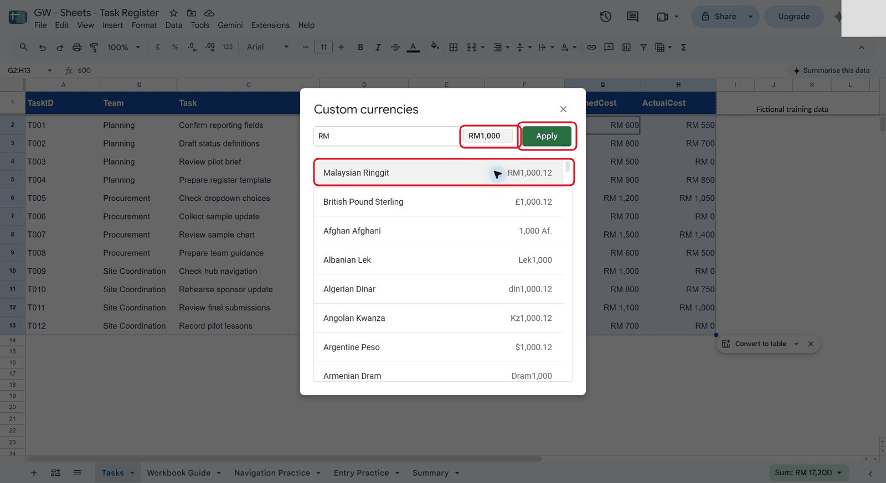

*The currency button on the toolbar may show £, because it follows the account's country. Choose RM here instead.*

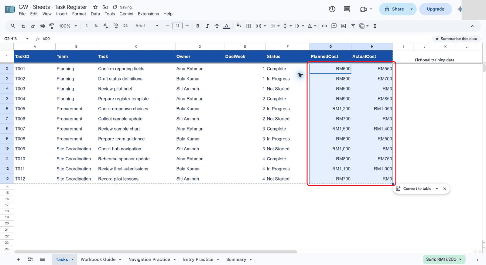

*The costs now show RM600, RM1,200 and RM0. The formula bar still shows plain numbers.*

5. Click the name box, type `E2:E13` and press **Enter**.
6. Click **123** (More formats), then **Custom number format**. Type `0` and click **Apply**. The weeks stay whole numbers, 1 to 4, and can't turn into dates.

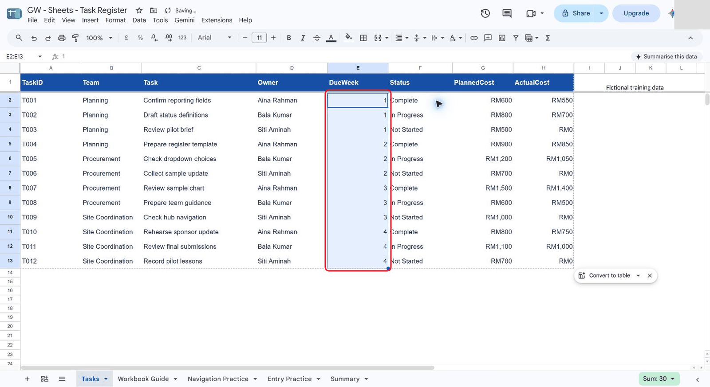

*The weeks look the same, but now they're set to stay whole numbers.*

**Check:** **G2:H13** show RM amounts with no decimals, **E2:E13** show 1 to 4, and **G2** still holds `600` in the formula bar.

---

## 2.3 Make Tasks Easy to Read

1. Look at the headings in row 1. They're already bold white text on dark blue, which is easy to read, so leave them as they are. You don't need to change something that already works.

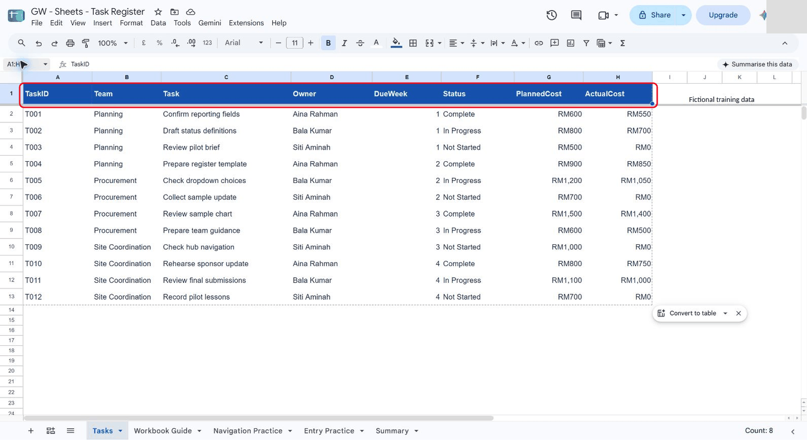

*These headings are already readable, so there's nothing to change.*

2. Click the name box, type `C2:C13` and press **Enter**. Click **Format**, then **Wrapping**, then **Wrap**. Long task names now break onto a second line instead of being cut off.

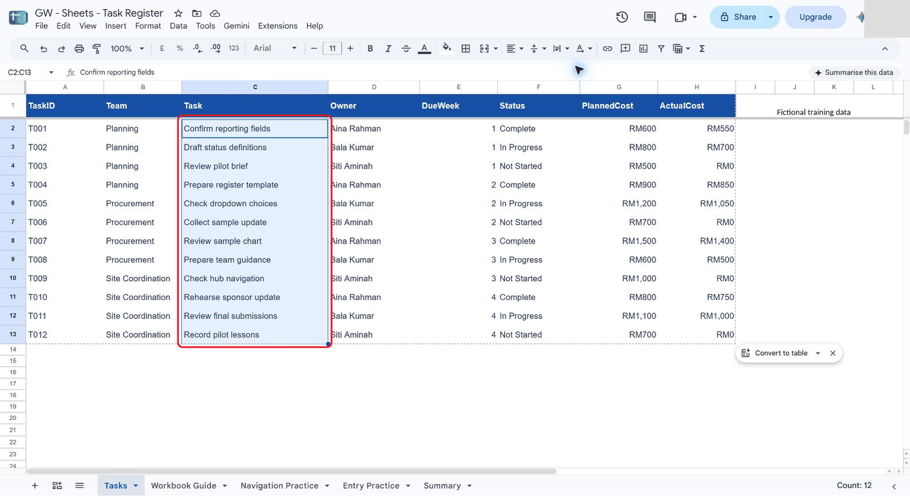

*Every task name is complete. The Owner column was already wide enough.*

3. Click row number **2**, hold **Shift** and click row number **13**. Rows 2 to 13 are selected.
4. Right-click a selected row number and choose **Resize rows 2 - 13**. Click **Fit to data**, then **OK**.

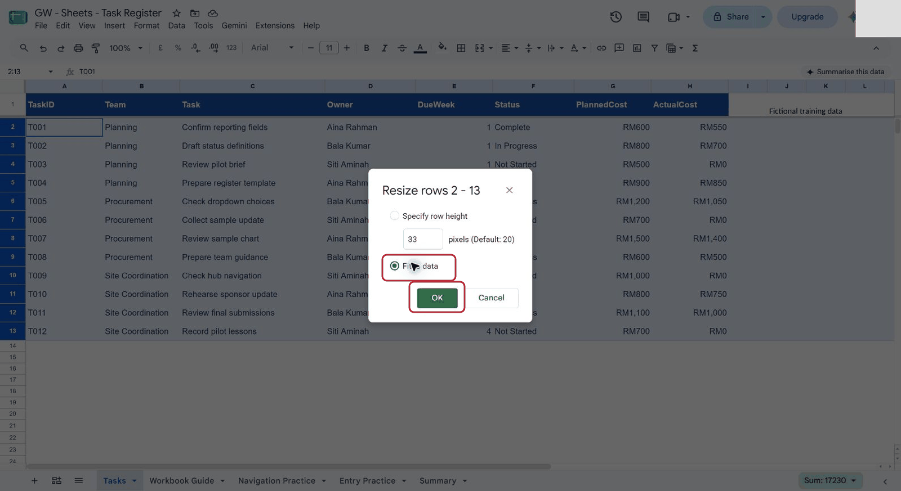

*Fit to data sets each row's height to its content.*

Don't merge cells to make headings look tidier. A merged cell spans two columns, so sorting and filtering can't treat each field separately, and later labs rely on that.

**Check:** every task name on **Tasks** is fully visible, the row heights fit, and no cells are merged.

---

## 2.4 Try a Date and a Text Cost

Now try two things on **Navigation Practice**, where it doesn't matter if something goes wrong.

1. Click the **Navigation Practice** tab. Click **J2**, type `2026-10-24` and press **Enter**. Sheets recognises a date. Click **123** (More formats) and choose **Date**.

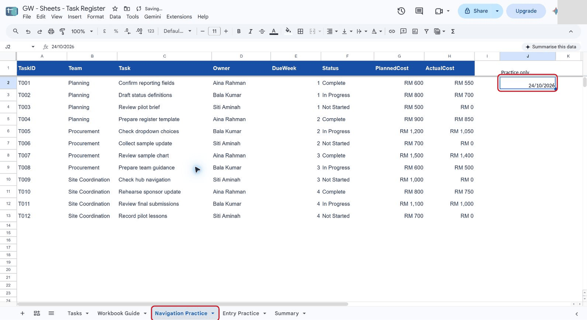

*In this account the date shows as 24/10/2026. Yours may show the day and month the other way round. It's a practice date, not the pilot start.*

2. Click **J4** and type `Numeric cost`. Press **Tab** and type `Text cost`. Press **Enter**.
3. In **J5**, type `600`. In **K5**, type `RM 600` (the letters R and M, a space, then 600).
4. Click **J5** and give it the ringgit format from 2.2 (**123**, **Custom currency**, **Malaysian Ringgit**, **RM1,000**, **Apply**).
5. Click **J5** and look at the formula bar, then click **K5** and look again.

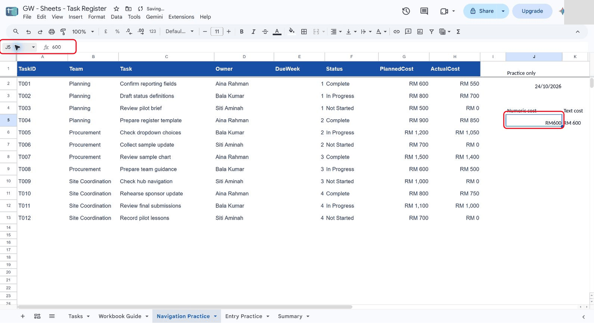

*J5 holds the number 600.*

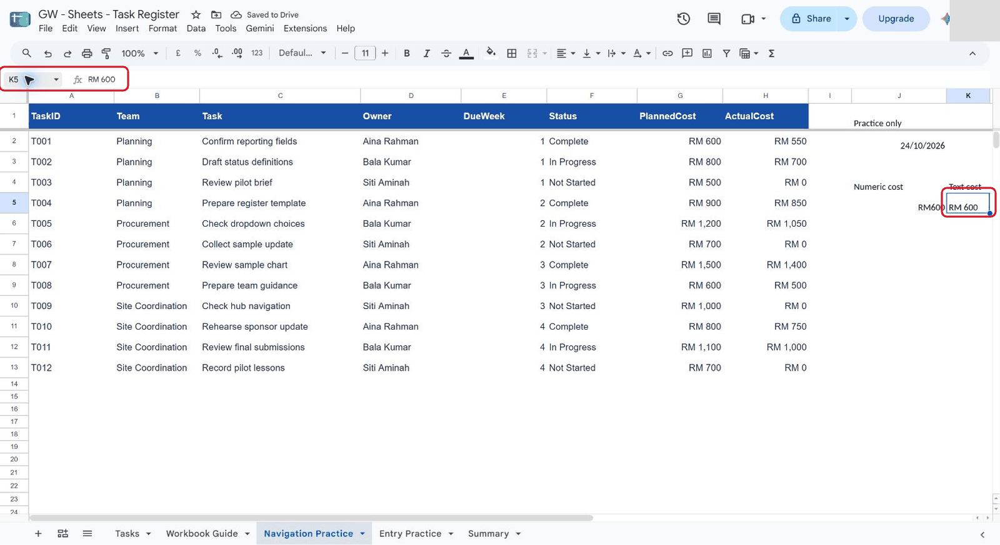

*K5 holds the text "RM 600". It sits on the left of its cell, and the formula bar shows the letters.*

**Check:** **J5** holds `600` and **K5** holds `RM 600` as text. They look alike, but only one is a number.

---

## 2.5 Prove Which One Counts

1. Click the **Entry Practice** tab. Copy the block below, click **A7** and press **Ctrl+V**. It fills **A7:B12**.

```text
Type Tests	Practice only
Field	Input
Numeric cost	600
Text cost	RM 600
Week index	2
Practice date	2026-10-24
```

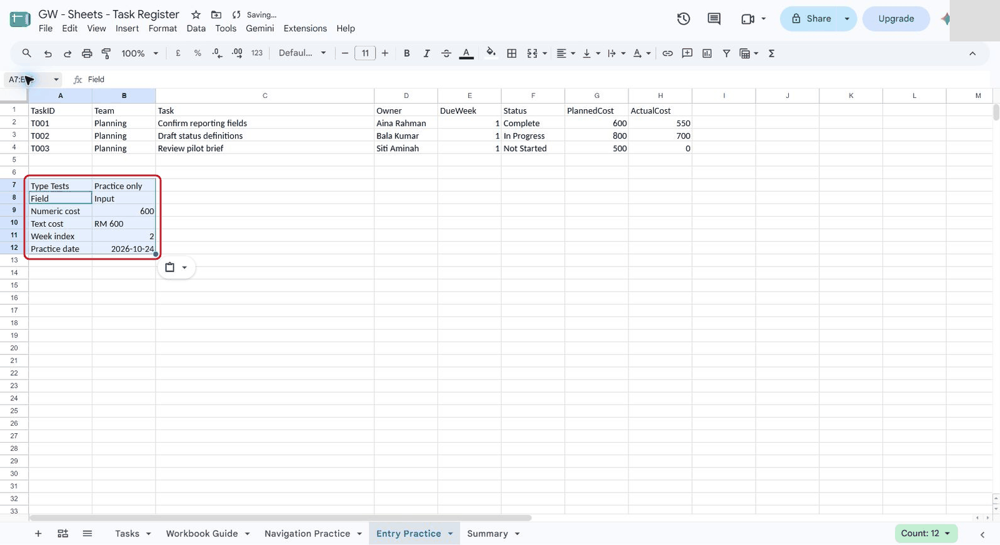

*Look at column B: 600 sits on the right, RM 600 on the left.*

2. Click the name box, type `B9:B10` and press **Enter**. Give both cells the ringgit format from 2.2. **B9** changes to **RM600**. **B10** doesn't change, because it's text.
3. Click **B12**, then click **123** (More formats) and choose **Date**.
4. Click **A14** and type `Temporary SUM check`. Press **Enter** and type `Numeric input count` in **A15**.
5. Click **B14**, type `=SUM(B9:B10)` and press **Enter**. In **B15**, type `=COUNT(B9:B10)` and press **Enter**.

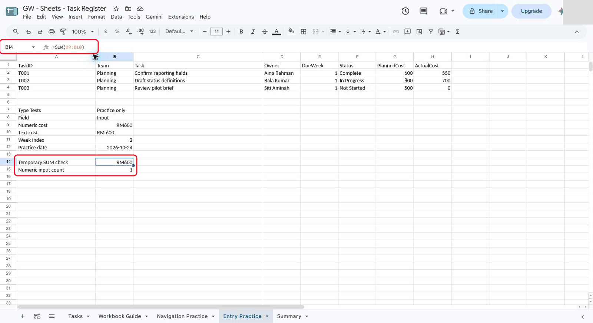

*SUM gives 600, not 1,200, and COUNT finds only one number.*

<details markdown="1">
<summary>What should you see?</summary>

**B14** shows **RM600**: only **B9** is added. **B15** shows **1**: only one of the two cells holds a number. Formatting can't turn typed text into a number. If you retyped **B10** as `600`, the SUM would become 1,200.

</details>

---

## 2.6 Format the Practice Table

Give the three records at the top of **Entry Practice** the same treatment as **Tasks**.

1. Click the name box, type `G2:H4` and press **Enter**. Give the costs the ringgit format from 2.2.
2. Click the name box, type `E2:E4` and press **Enter**. Give the weeks the custom number format `0`, as in 2.2.
3. Click the name box, type `A1:H1` and press **Enter**. Press **Ctrl+B** for bold, then click **Fill colour** (the paint bucket) on the toolbar and choose a light blue.
4. Click the name box, type `C2:C4` and press **Enter**. Click **Format**, **Wrapping**, **Wrap**.

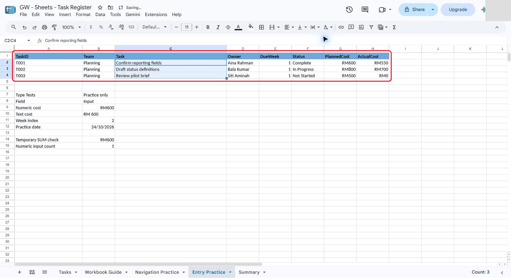

*Light blue with dark text is easy to read. No cells are merged.*

**Check:** **A1:H4** on **Entry Practice** have bold light-blue headings, RM costs, whole-number weeks and complete task names.

---

## 2.7 Compare Three Kinds of Paste

**Paste special** lets you choose what comes across when you paste. You try three kinds side by side, copying the same cell each time.

1. Copy the block below, click **D7** and press **Ctrl+V**. It adds a heading and three column labels.

```text
Paste comparison
Normal paste	Values only	Format only
```

2. Click **F9** and type `123`. Click **E9**, click **123** (More formats), choose **Custom number format**, type `0` and click **Apply**.

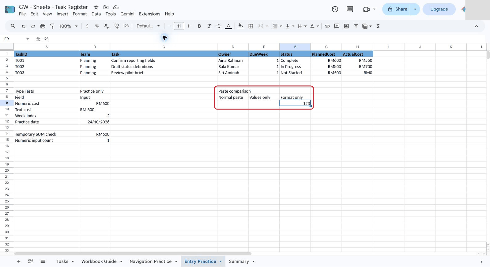

*Three empty targets in row 9, except F9, which already holds 123.*

3. Click **B9** (the RM600 number) and press **Ctrl+C**.
4. Click **D9** and press **Ctrl+V**.
5. Click **E9**. Click **Edit**, **Paste special**, **Values only**.
6. Click **F9**. Click **Edit**, **Paste special**, **Format only**.

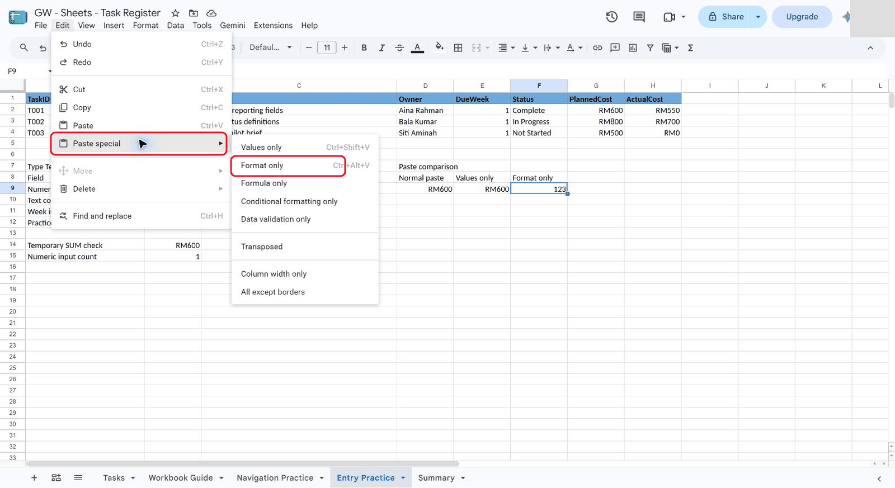

*Paste special lists each part you can paste on its own.*

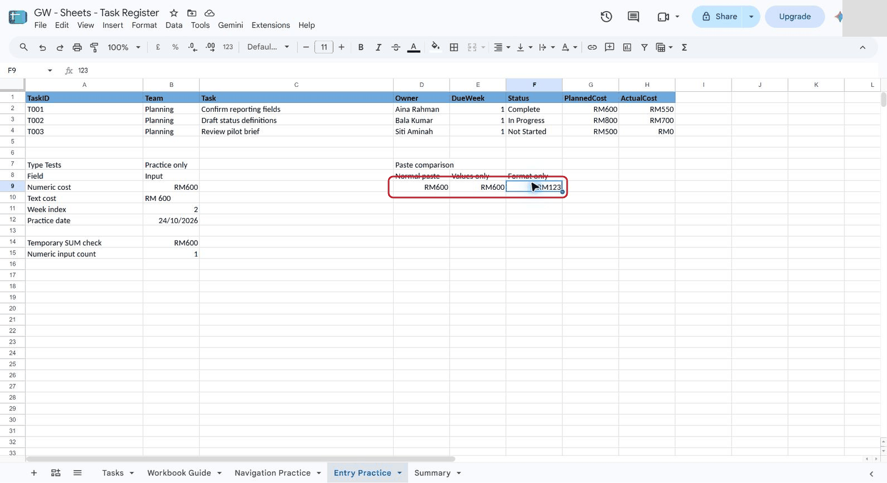

*Format only kept F9's own value, 123, and gave it the RM format.*

<details markdown="1">
<summary>What should you see?</summary>

**D9** (normal paste) shows **RM600**: the value and all its formatting came across. **E9** (values only) also shows **RM600**: in Sheets, **Values only** brings the number with its number format, but leaves colours, bold and borders behind. **F9** (format only) shows **RM123**: it kept its own value and took only the format.

</details>

---

## 2.8 Record What You Found

1. Copy the block below, click **A17** on **Entry Practice** and press **Ctrl+V**. It fills **A17:B24**, leaving **B22** and **B23** empty for you.

```text
Observed result	Explanation
SUM and COUNT	SUM(B9:B10)=600 and COUNT(B9:B10)=1: the number 600 counts; the text RM 600 is skipped.
Paste result	Normal paste and Values only both brought 600 with its RM format; Format only kept 123 and showed RM123.
Date boundary	Practice dates are examples only, outside Tasks DueWeek; they don't set a pilot start date.
Source checks	Observed numeric counts
Source cost cells
Source week cells
Source values	Formatting changed the display only; all twelve Tasks records keep their values.
```

2. Click **B22**, type `=COUNT(Tasks!G2:H13)` and press **Enter**. It counts the numbers in the **Tasks** cost columns: **24**.
3. In **B23**, type `=COUNT(Tasks!E2:E13)` and press **Enter**: **12**.
4. Select **B17:B24** and turn on **Format**, **Wrapping**, **Wrap**, so each note is readable.

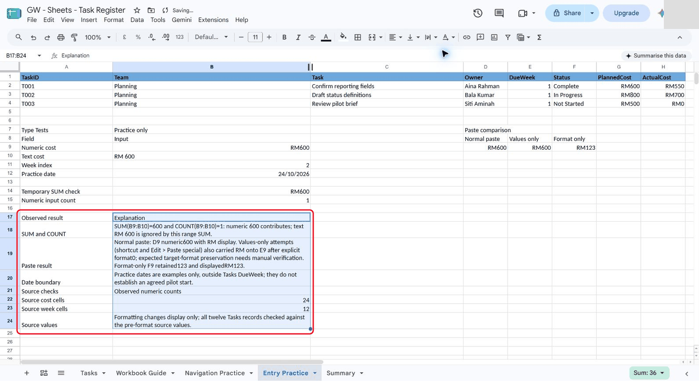

*The screenshot's Paste result note is worded differently from the block you pasted. The counts, 24 and 12, should match.*

5. Click the **Tasks** tab and click **G2**. The formula bar still shows `600`.

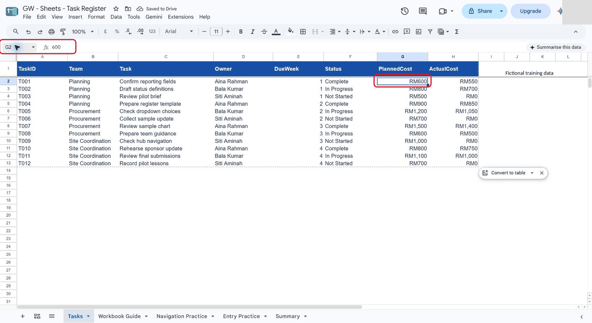

*Every cost and week on Tasks is still a number. Only the display changed.*

**Check:** **B22** shows **24** and **B23** shows **12**, so every cost and week on **Tasks** is a number, and **Tasks** **G2** still holds `600`.

---

## Independent Practice

A Site Coordination lead has sent a new task on a card, typed the way people often type. Try this without looking back at the steps.

1. On **Entry Practice**, copy the block below, click **A27** and press **Ctrl+V**. Row 27 is a label, and row 28 is the card exactly as supplied.

```text
Intake card - as supplied
T013	Site Coordination	Prepare the weekly sponsor summary and check every team's figures before Friday	Bala Kumar	next Monday	Not Started	RM 600	0
```

2. In **A30**, type `Clean entry`. In row 31, type a cleaned-up version of the same task, all eight fields:
   - **PlannedCost** as the number `600`, with the ringgit format
   - **DueWeek** left empty, because nobody has agreed which week "next Monday" means
   - the long task name wrapped so it's readable
3. In **J27**, type the question you'd send back to the lead about the due week.
4. Show a partner **G28** and **G31**. Ask them which one a total would count, and how they can tell without a formula. Then prove it with `=COUNT(G28,G31)`.

<details markdown="1">
<summary>What should you see?</summary>

**G28** holds the text `RM 600` and sits on the left of its cell. **G31** holds the number 600, shows **RM600** and sits on the right. `=COUNT(G28,G31)` gives **1**. **E31** is empty, and **J27** asks something like "Which pilot week is next Monday? The start date isn't agreed yet." Row 28 stays as supplied, so anyone can see what you started from.

</details>

### Evidence to Hand Over

- **Tasks** with ringgit costs, whole-number weeks, wrapped task names and fitted rows
- **Entry Practice** with the formatted practice table, the **Type Tests** block, the paste comparison and your notes, with **B22** showing 24 and **B23** showing 12
- The intake card as supplied (row 28), your clean entry (row 31) and your question in **J27**

## Troubleshooting

| Problem | What to try |
|---|---|
| A total is smaller than you expect | One of the cells is probably text. Click each one: a value on the left of its cell, or with letters in the formula bar, isn't a number. Retype it as a plain number. |
| The toolbar currency button shows £ | It follows the account's country. Use **123** (More formats) > **Custom currency** > **Malaysian Ringgit** instead. |
| The costs show decimals, such as RM600.00 | In **Custom currency**, open the format list and choose **RM1,000**, the one without decimals. |
| Your weeks turned into dates | Select them, then **123** > **Custom number format**, type `0` and **Apply**. |
| **Format only** also changed the value | You pressed **Ctrl+V** instead. Press **Ctrl+Z**, then use **Edit** > **Paste special** > **Format only**. |
| A formula shows as text in the cell | There's a space or an apostrophe before the `=`. Click the cell, delete it and type the formula again. |

## Lesson Summary

You set ringgit and week formats on **Tasks** without changing a single value, made the register easier to read without merging cells, and proved with SUM and COUNT that a typed `RM 600` doesn't count. You also saw what each kind of **Paste special** brings across. In Lab 03 you start calculating with these numbers.

**Check yourself:** why should you avoid merging cells inside a table of records?
