# 02 - Enter and Format Reliable Data

In this chapter you will use dates, numbers, currency, wrapping and sensible column widths.

> **Prompts and values:** use the [copy-paste page](./prompts.md) for the exact values used below.

**Target allocation:** 45 minutes: 10 explanation/demonstration, 15 guided build and casework, 15 independent challenge, 5 verification and repair. The active portion is 35 minutes by design. These are unmeasured targets awaiting a learner pilot.

**Your result:** A readable register with numeric currency values and sensible dimensions.

> **Status:** partial author reference with 18 staged application captures through 2.4. Currency/week formats, wrapping/row fit, numeric versus text tests, SUM/COUNT and format-only behaviour checked. Values-only target-format preservation did not pass in the controlled session and needs manual verification. Source values remain unchanged; independent challenge and learner timing are pending.

## What You Will Learn

- Apply formats to typed numbers.
- Use wrapping and fitted dimensions.
- Distinguish appearance from the stored value.

## Before You Begin

Read the [case input](./prompts.md) and use a separate named casework copy for destructive tests or altered datasets. Keep the baseline unchanged for later chapters. Record source facts, proposed practice and unresolved questions separately.

Use your original Tasks tab. If needed, reopen a fresh native copy of [TaskRegister.xlsx](../../shared/sample-files/TaskRegister.xlsx).

## 2.1 Inspect Values and Types

1. On **Tasks**, select **G2** through the name box. The formula bar shows numeric **600**, while the cell displays its currency. Do not type the RM label into the source number.

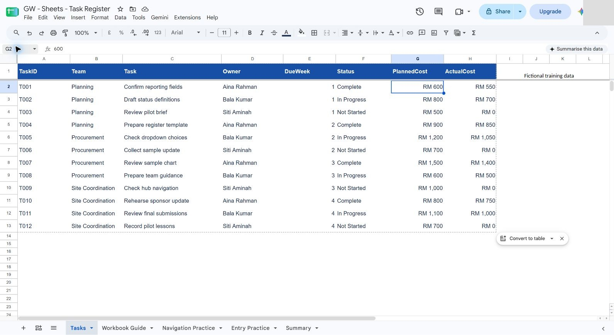

2. Select **G2:H13**. Open **More formats > Custom currency**, choose **Malaysian Ringgit**, select **RM1,000** without decimals, and **Apply**. The toolbar currency shortcut follows the workbook locale, so it may offer pounds; select RM explicitly.

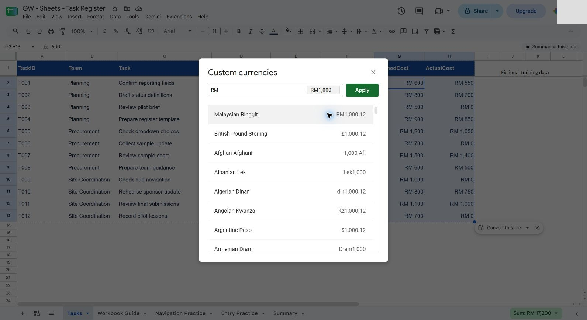

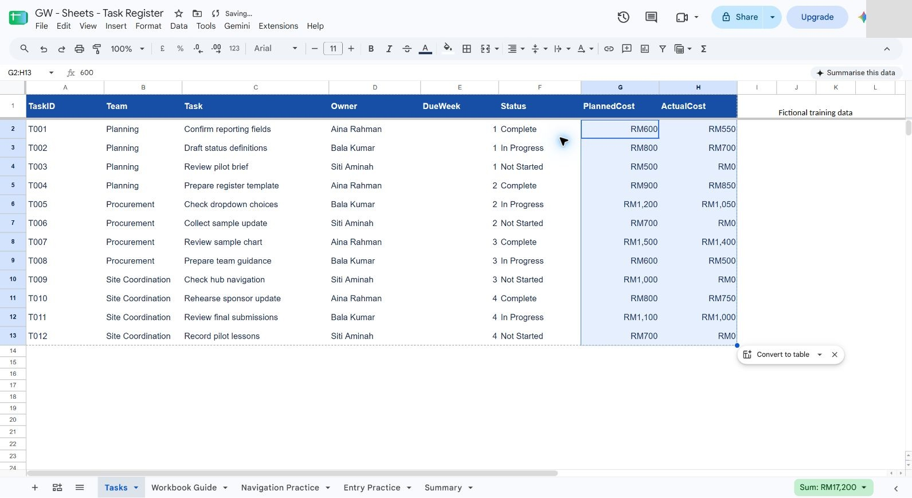

3. Select **E2:E13**, use **More formats > Custom number format**, enter **0** and **Apply**. DueWeek remains an index from 1 to 4, not a calendar date.

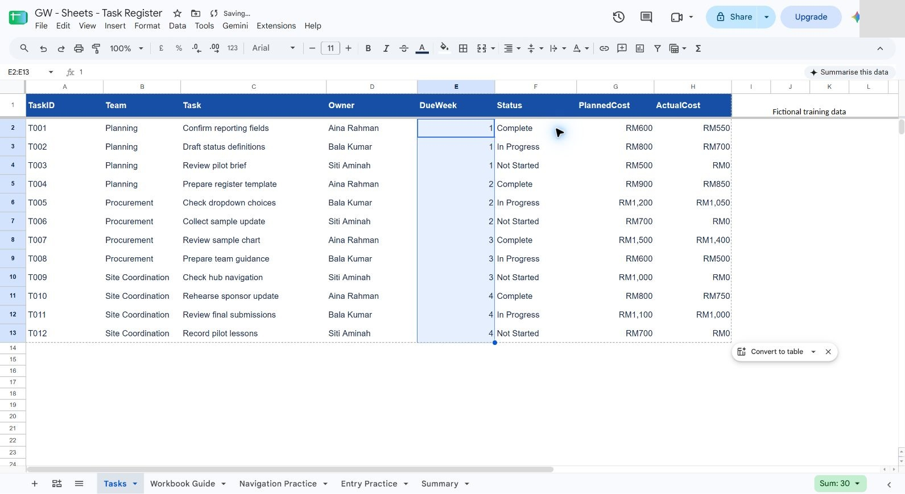

What should you see?

Costs show their currency while remaining numeric. Week values still range from 1 to 4.

<!-- VERIFIED: author UI/source-value checks; values-only format preservation, independent challenge and learner timing remain pending. -->

## 2.2 Improve Readability

1. Select **A1:H1** and inspect its contrast. The starter already has bold white labels on a dark blue fill, so the reference retains that suitable style. A reasoned no-change decision is preferable to changing a readable header just to demonstrate a button.

2. Inspect Task and Owner widths and widen only if text is cut off. The supplied source widths already show each task and owner. Select **C2:C13**, choose **Text wrapping > Wrap**, and inspect complete descriptions.

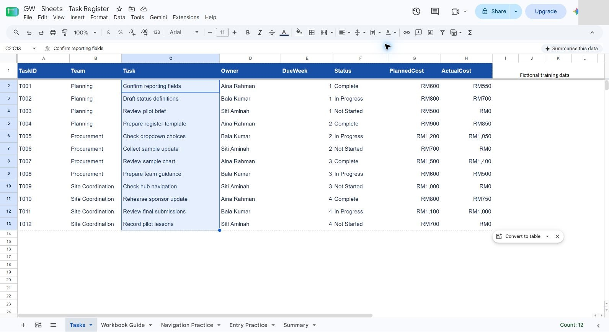

3. Select rows **2:13**, open the row-header menu, choose **Resize rows 2–13 > Fit to data > OK**. Keep each data column separate; do not merge cells in the register.

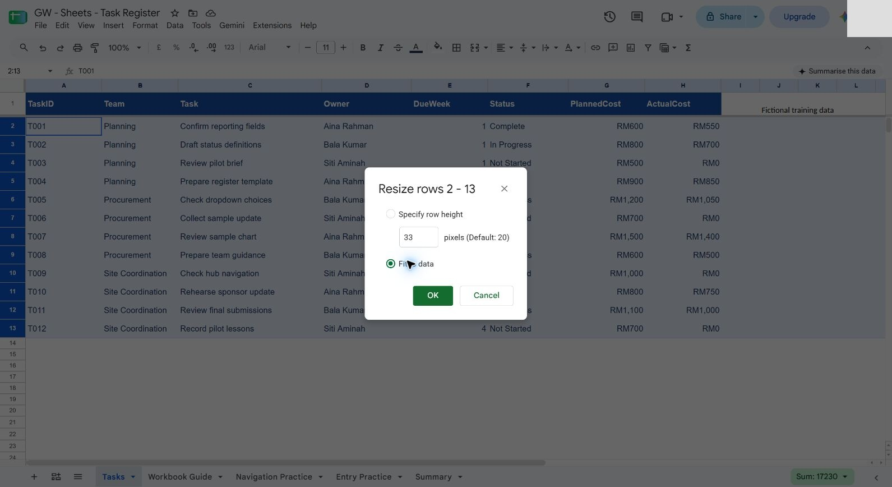

What should you see?

Headers, names and cost figures are readable without cutting off text.

<!-- VERIFIED: author UI/source-value checks; values-only format preservation, independent challenge and learner timing remain pending. -->

## 2.3 Inspect Formatting Effects

1. On **Navigation Practice**, enter **2026-10-24** in **J2**, commit it, then use **More formats > Date**. In the reference locale it displays **24/10/2026**. This is a practice example only, not an agreed pilot start.

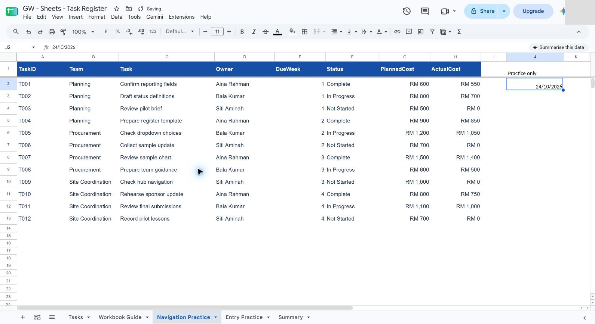

2. Enter **Numeric cost / Text cost** in **J4:K4**, then numeric **600** in **J5** and text **RM 600** in **K5**. Apply RM currency to J5. Select each cell and compare its formula-bar value.

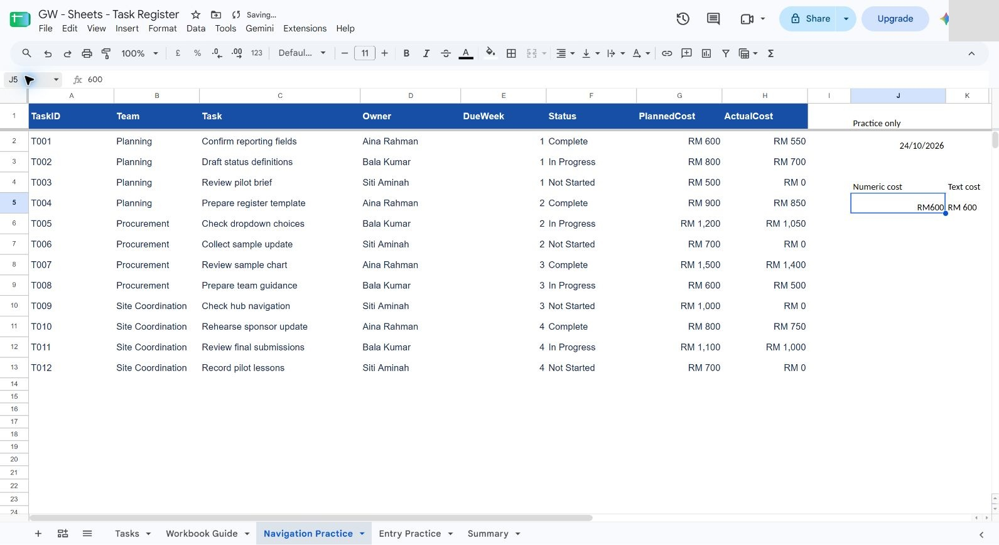

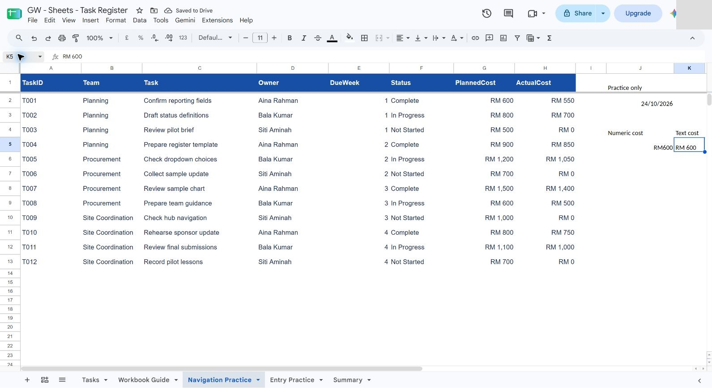

3. Keep these clearly labelled practice entries as evidence, or undo them when no longer useful. The reference retains them outside the baseline. Compare the original source values before and after formatting; display changes must not alter the twelve records.

What should you see?

You can explain why number formatting does not convert arbitrary text into a number.

<!-- VERIFIED: author UI/source-value checks; values-only format preservation, independent challenge and learner timing remain pending. -->

## 2.4 Diagnose Display, Type and Readability Problems

1. On **Entry Practice**, keep **A1:H4** as the copied three-record table. Create **Type Tests** in **A7:B12**: labels in A, numeric **600** in B9, text **RM 600** in B10, week index **2** in B11 and practice date **2026-10-24** in B12.

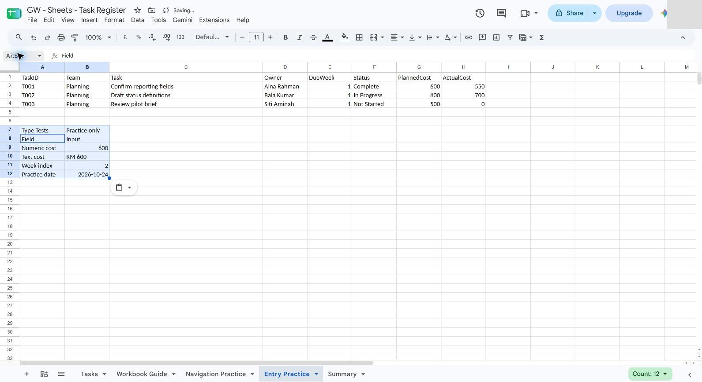

2. Apply RM currency to **B9:B10**, then inspect both values. B9 remains a number and B10 remains text. Give B12 a date display; keep the practice date outside the source week column.

3. Add **=SUM(B9:B10)** in B14 and **=COUNT(B9:B10)** in B15. The reference results are **600** and **1**: numeric 600 contributes, while text RM 600 is ignored by this range SUM. Widen the label column if needed. These checks remain on the practice tab.

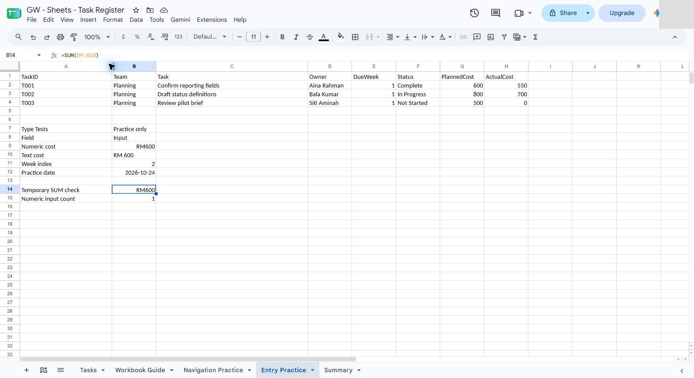

4. Give **G2:H4** the same custom RM currency display and **E2:E4** custom number format **0**. B11 remains a whole-number practice index. Dates stay in B12 and Navigation Practice J2; they do not supply missing source schedule evidence.

5. Apply a bold, light-blue header with readable dark text to **A1:H1**, wrap **C2:C4**, and retain the widened task column. Make each complete description readable. No source cells are merged.

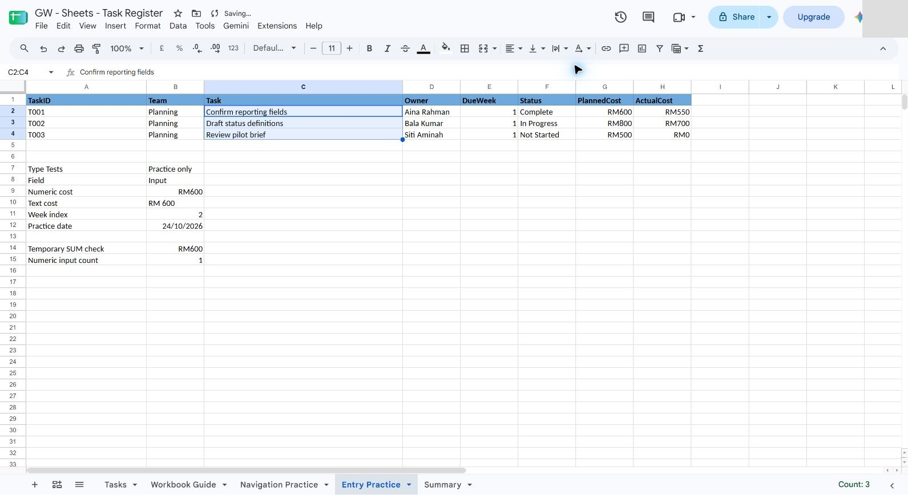

6. Prepare **D8:F9** as a separate paste comparison: headers **Normal paste / Values only / Format only**, with **123** already in F9. Use B9 (numeric 600 with RM display) as the source. Select destination cells without pasting a cell address over your copied clipboard content.

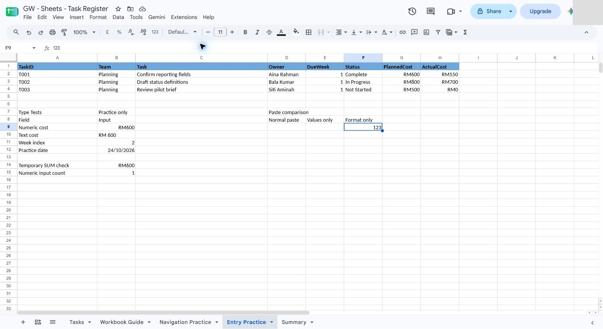

Use **Edit > Paste special** to test the two special transfers separately from normal paste. Normal paste D9 was verified as numeric 600 with RM display. Format-only F9 retained numeric **123** and displayed **RM123**.

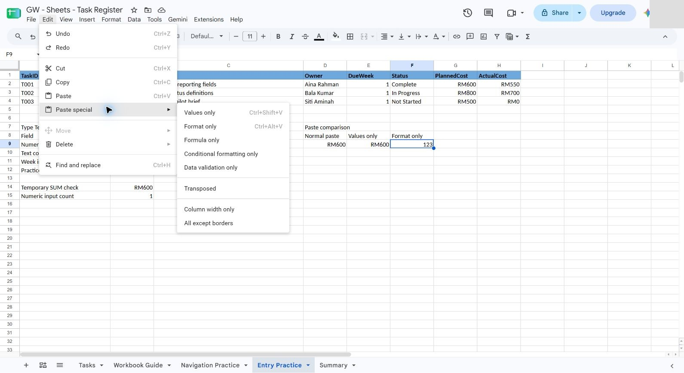

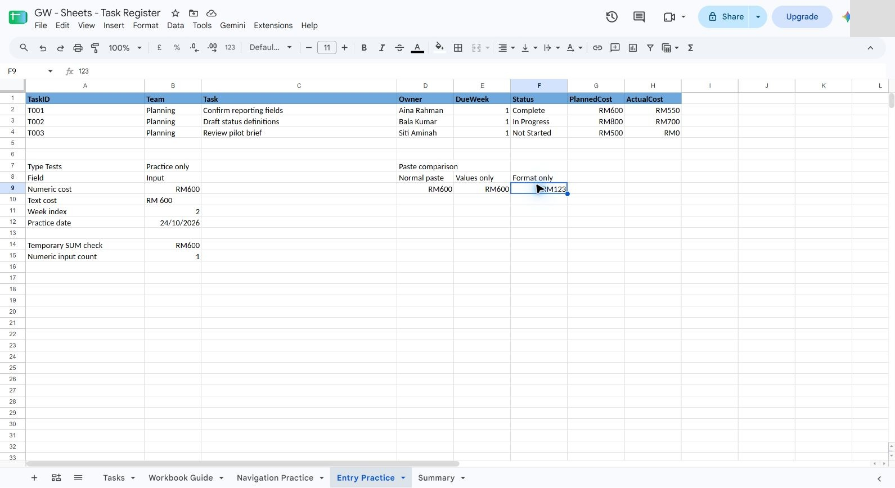

> **Verification limitation:** the controlled session's values-only shortcut and direct menu both carried the RM format onto E9 even after its target was explicitly set to number format 0. The number remained 600, but expected preservation of the target format was **not verified**. Repeat this step manually, compare E9's number format before and after, and record the outcome. Do not treat visually similar cells or an attempted command as proof that the property transfer passed.

7. Record the results and the unresolved paste check on the practice tab. **=COUNT(Tasks!G2:H13)** returns **24** numeric cost cells; **=COUNT(Tasks!E2:E13)** returns **12** numeric week cells. A bounded comparison confirmed that every original **Tasks!A1:H13** underlying value remained unchanged. Wrap the observation text so it is readable.

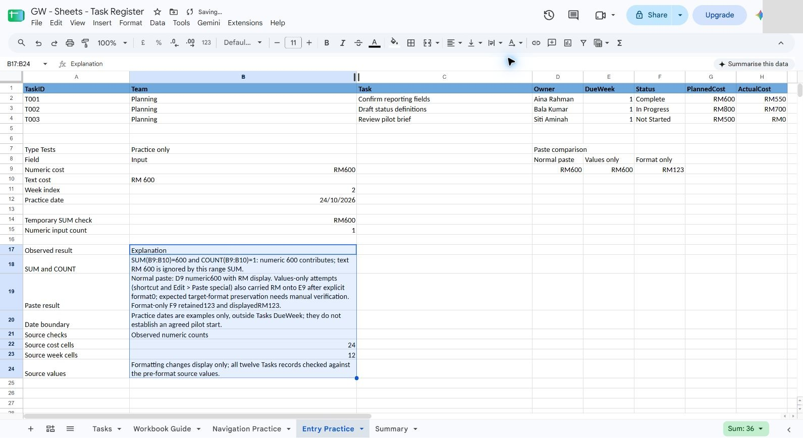

Return to **Tasks > G2** and inspect **600** again. Formatting did not create a confirmed calendar date or change the twelve records.

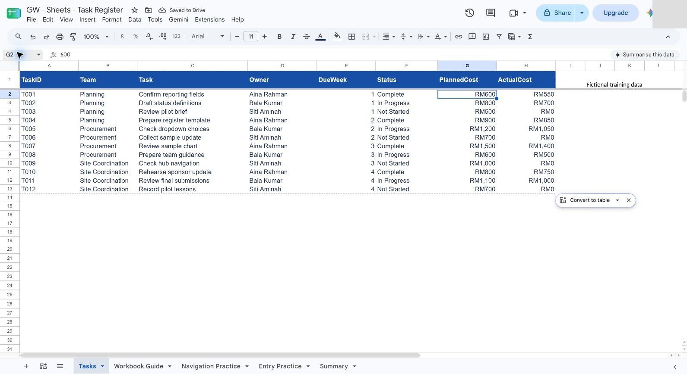

What should you see?

Type-test block with observed calculation behaviour. The result must be supported by the recorded checks; an attractive output or an AI assurance is insufficient.

<!-- VERIFIED: author UI/source-value checks; values-only format preservation, independent challenge and learner timing remain pending. -->

## Independent Challenge

Close the earlier step lists for the first attempt. Use the case input and your own reasoning. If you need help, record the hint and repeat the affected check independently.

1. Repair the card’s three proposed entries in a separate intake table. Preserve raw input and record the clean value or clarification needed.

2. Prepare a readable three-record handout view with consistent currency and whole-week display. Prove the underlying numeric values remain numeric.

3. Give a partner two visually similar cost cells and ask them which one can be calculated reliably. Use formula-bar and SUM evidence in your explanation.

## Evidence to Hand Over

- Type-test block with observed calculation behaviour.
- Raw-to-clean intake table and readable entry-practice layout.
- Independent numeric evidence and unchanged 12-row source.

Record the defect or uncertainty you investigated, the evidence used, the repair or reasoned no-change decision, and the final state. Restore temporary changes or keep them in a clearly named scenario copy.

## Troubleshooting

| Symptom | What to check |
|---|---|
| Currency looks correct but totals are wrong | Inspect numeric type and formula-bar value before changing more display formats. |
| An input or earlier result is missing | Reopen the input named in Before You Begin; do not substitute private company data |
| A menu or feature is unavailable | Confirm the account and the shared access notes; record the missing step and ask the trainer for its fallback |
| The result differs from the checkpoint | Compare the exact source range, wording and conditions before repeating the action |

## Lesson Summary

Typed values and readable formatting prepare the register for calculation.

**Check yourself:** Why should you avoid merging cells inside a dataset?
