# 03 - Calculate and Copy Formulas

Aina wants to know, task by task, whether the pilot is spending more or less than planned, and she wants the totals to stay right as rows are added. In this lab you write the variance for every task, add totals, averages and counts, and learn the two copying mistakes that most often break a spreadsheet: a formula pointing at the wrong row, and a shared figure that moves when you fill down.

**Estimated time:** 65 minutes, planned as 10 explanation, 35 guided build and 20 independent practice. Not yet timed with learners.

**Your result:** `GW - Sheets - Task Register` with a **Variance** column and a totals block on **Tasks**, a fixed-multiplier calculation on **Navigation Practice**, and a **Calculation Tests** tab that shows what zeros, blanks, text and copied references do.

> **You'll practise:** writing formulas, filling them down, using SUM, AVERAGE and COUNT, fixing a reference with `$`, and checking a total two different ways.

---

## What You Will Learn

- Write a formula and copy it to every row
- Total, average and count a column
- Keep a shared value fixed with an absolute reference such as `$L$9`

## Before You Begin

Open `GW - Sheets - Task Register` from **GW - Sheets Foundation - Practice**. You need **Tasks** with ringgit costs from Lab 02, and **Navigation Practice** from Lab 01.

**What you build in this lab:**

**Tasks**: Variance column > totals block | **Navigation Practice**: practice multiplier | **Calculation Tests**: zero, blank and text tests > wrong reference > relative and absolute > two-way total check

## Topics

**A formula starts with `=`.** `=H2-G2` takes the planned cost in G2 away from the actual cost in H2. Change either cell and the result updates.

**Copying moves the references.** Fill `=H2-G2` down one row and it becomes `=H3-G3`. That's what you want for row-by-row sums. It's not what you want for one shared value, such as a multiplier in **L9**. Writing it as `$L$9` fixes it, so every row uses the same cell.

**Zero and blank aren't the same.** A cost of `0` means nothing was spent. An empty cell means nobody has told you yet. Some formulas treat both as zero, so you have to check which one you've got.

---

## 3.1 Calculate the Variance

1. On **Tasks**, click **I1** and type `Variance`. Press **Enter**.
2. In **I2**, type `=H2-G2` and press **Enter**. T001 shows **-RM50**: it cost RM50 less than planned.

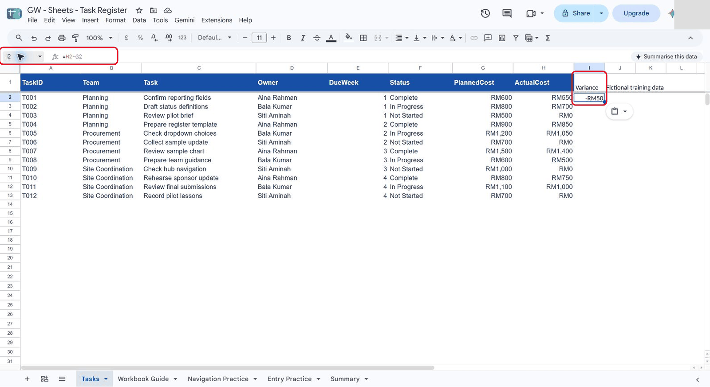

*The cell shows the result. The formula bar shows the formula.*

3. Click the name box, type `I2:I13` and press **Enter**. Press **Ctrl+D** to fill the formula down to every row.

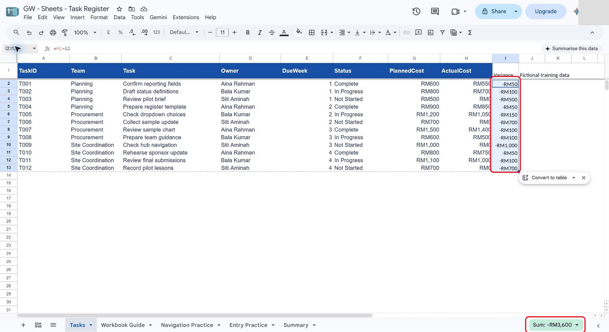

*The bottom right shows the sum of the selected cells: -RM3,600.*

4. Click **I7** and look at the formula bar: `=H7-G7`. Then click **I13**: `=H13-G13`. Each row uses its own costs.

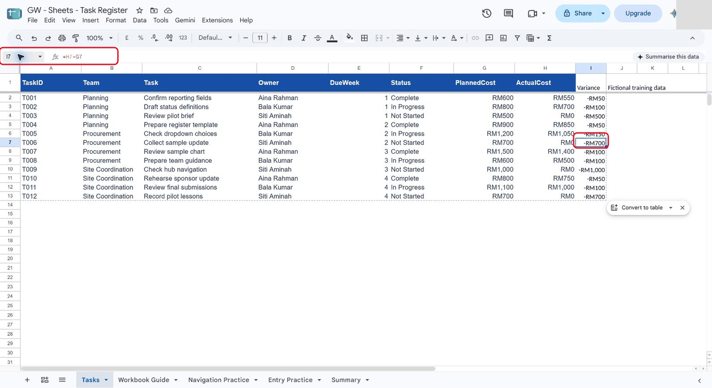

*Row 7 uses row 7's costs.*

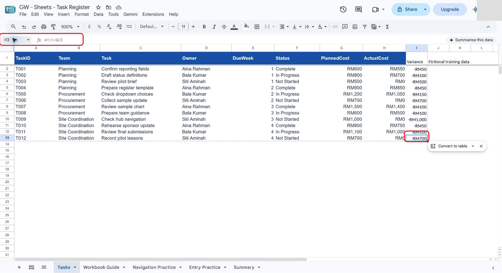

*So does row 13. A negative variance means the task cost less than planned so far. It doesn't mean the money is saved.*

**Check:** **I2:I13** show twelve variances, from **-RM50** at the top to **-RM700** at the bottom, and each formula uses its own row.

---

## 3.2 Add Totals, an Average and a Count

1. Still on **Tasks**, copy the block below, click **K1** and press **Ctrl+V**. It adds the labels in column **K**, with row 5 left empty.

```text
Measure	Result
Planned Total
Actual Total
Variance Total

Average Planned
Numeric Cost Count
```

2. Type these formulas, pressing **Enter** after each:
   - **L2**: `=SUM(G2:G13)`
   - **L3**: `=SUM(H2:H13)`
   - **L4**: `=SUM(I2:I13)`
3. Double-click the right edge of the column **K** heading so the labels fit. Scroll right if you can't see the block.

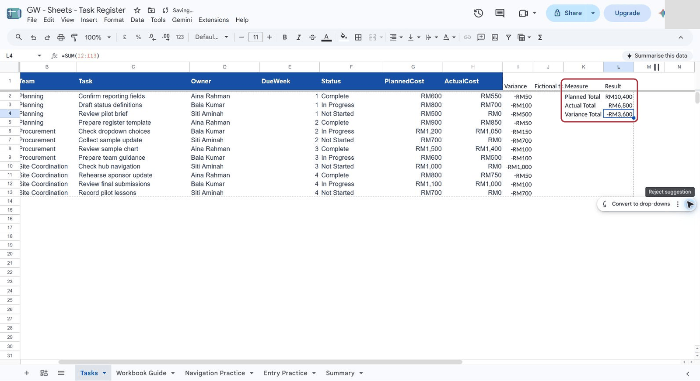

*Planned RM10,400, actual RM6,800, variance -RM3,600.*

4. In **L6**, type `=AVERAGE(G2:G13)`. In **L7**, type `=COUNT(G2:G13)`.
5. Click **L6**. On the toolbar, click **Increase decimal places** (the **.00** button with an arrow) twice, so it shows **RM866.67**.

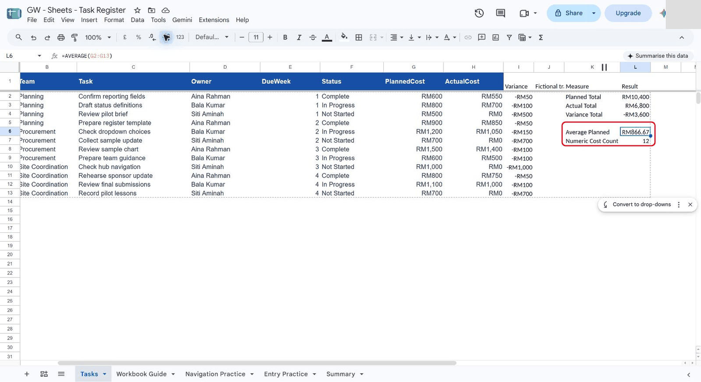

*The average is 10,400 divided by 12, shown to two decimal places.*

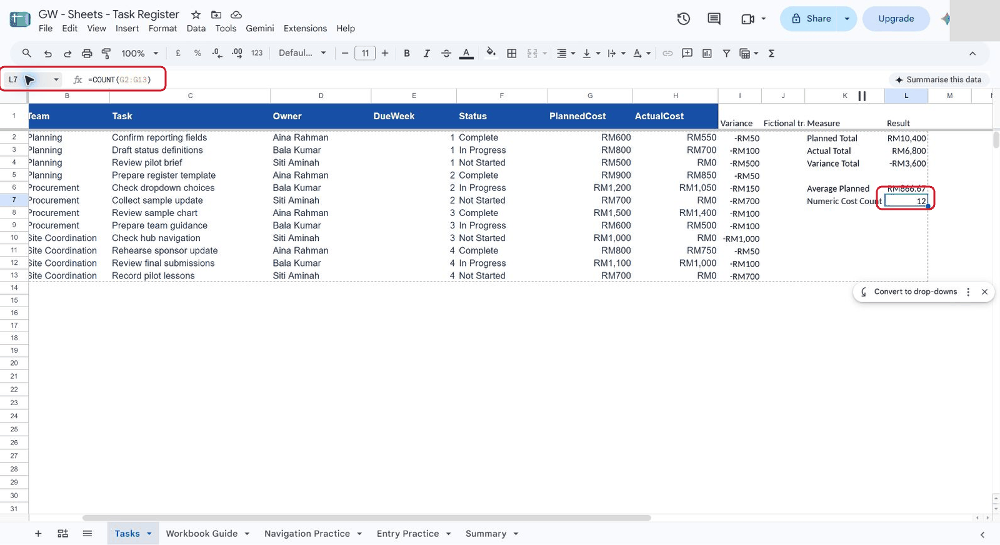

*COUNT finds 12 numbers in the planned costs, so none of them is text.*

**Check:** **L2:L4** show **RM10,400**, **RM6,800** and **-RM3,600**, **L6** shows **RM866.67** and **L7** shows **12**. They're formulas, not typed numbers.

---

## 3.3 Use a Fixed Multiplier

You try a "what if costs rise by 10%?" calculation on **Navigation Practice**. The multiplier is made up for practice; it isn't a real rate.

1. Click the **Navigation Practice** tab. Click the name box, type `J2:K6` and press **Enter**. Press **Delete** to clear the date and cost examples from Lab 02.
2. Click the name box, type `J2:J13` and press **Enter**. Click **123** (More formats) and choose **Number**, so the old date format can't disguise a result.
3. Click **K9** and type `Practice multiplier`. Click **L9** and type `1.1`. Double-click the right edge of the column **K** heading so the label fits.

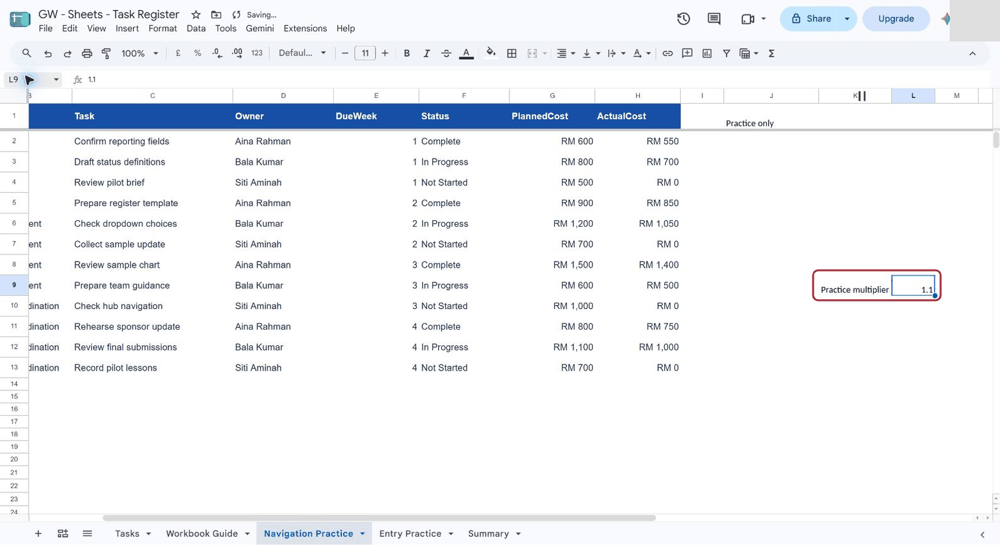

*One cell holds the multiplier, so you can change it in one place.*

4. Click **J2**, type `=G2*$L$9` and press **Enter**. It shows **660.00**: 600 times 1.1.

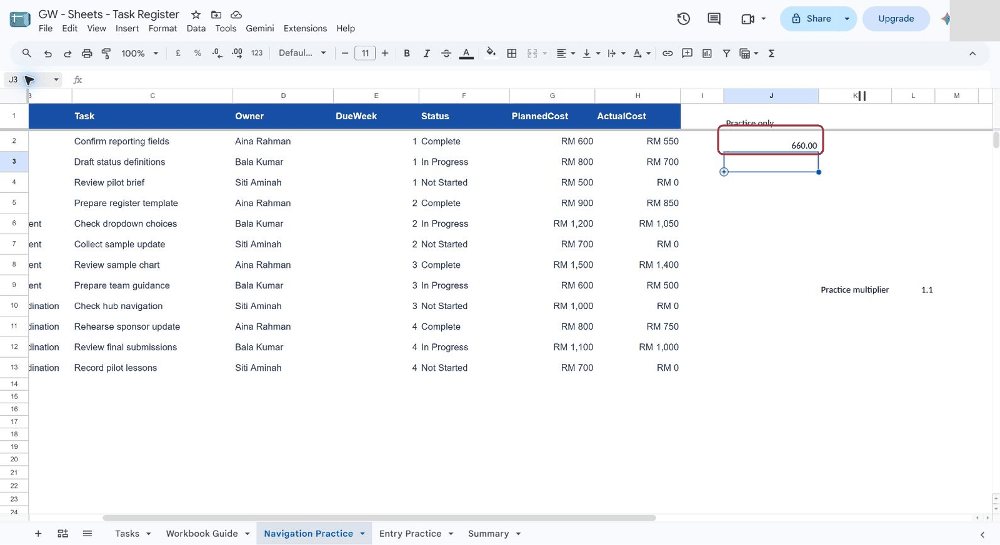

*The $ signs fix L9, so it won't move when you fill down.*

5. Click the name box, type `J2:J13`, press **Enter**, then press **Ctrl+D**. Click **J13**: the formula is `=G13*$L$9` and shows **770.00**. **G** moved with the row; **$L$9** stayed put.

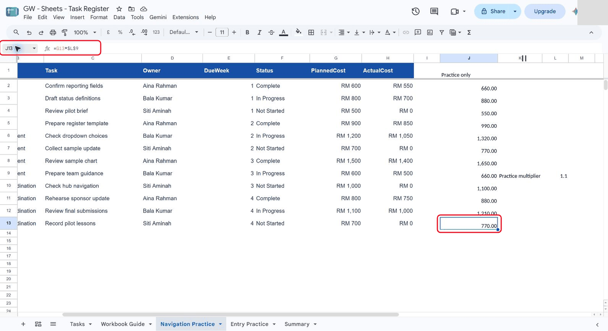

*Every row uses its own planned cost and the same multiplier.*

6. Change **L9** to `1.2`. **J2** becomes **720.00** and **J13** becomes **840.00**.

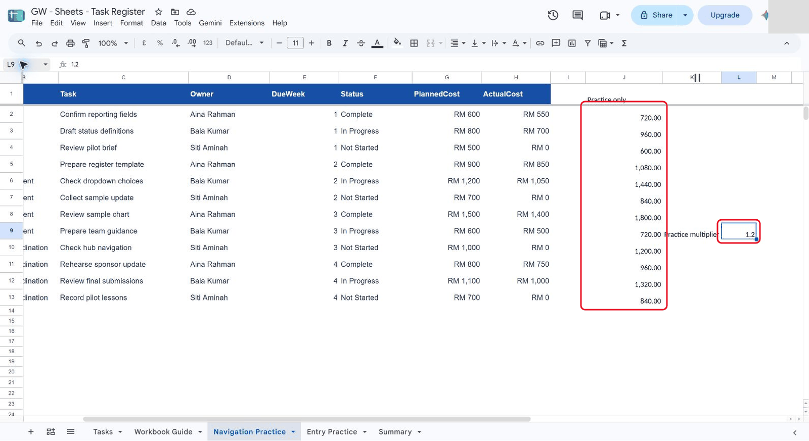

*One change updates all twelve results.*

7. Change **L9** back to `1.1`.


*Back to the original multiplier.*

**Check:** **L9** holds `1.1`, **J2** shows **660.00** and **J13** shows **770.00** with the formula `=G13*$L$9`.

---

## 3.4 Test Zeros and Blanks

Now you test what formulas do with awkward inputs, on a new tab where nothing can break.

1. With **Navigation Practice** open, click **+** (Add sheet). Double-click the new tab's name, type `Calculation Tests` and press **Enter**.
2. Copy the block below, click **A1** and press **Ctrl+V**. It adds four planned and actual pairs. **B5** stays empty on purpose: that actual hasn't been supplied.

```text
Planned	Actual	Variance
100	80
100	120
100	0
100
```

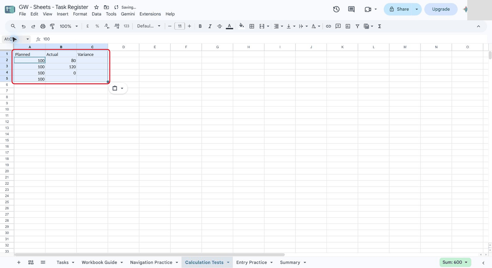

*Row 4 has a real zero. Row 5 has nothing.*

3. Click **C2**, type `=B2-A2` and press **Enter**. Click the name box, type `C2:C4`, press **Enter**, then press **Ctrl+D**. You get **-20**, **20** and **-100**. Leave **C5** empty, because there's no actual to subtract.
4. Copy the block below, click **D1** and press **Ctrl+V**.

```text
Interpretation
Actual below planned
Actual above planned
Confirmed numeric zero
Not supplied; variance pending
```

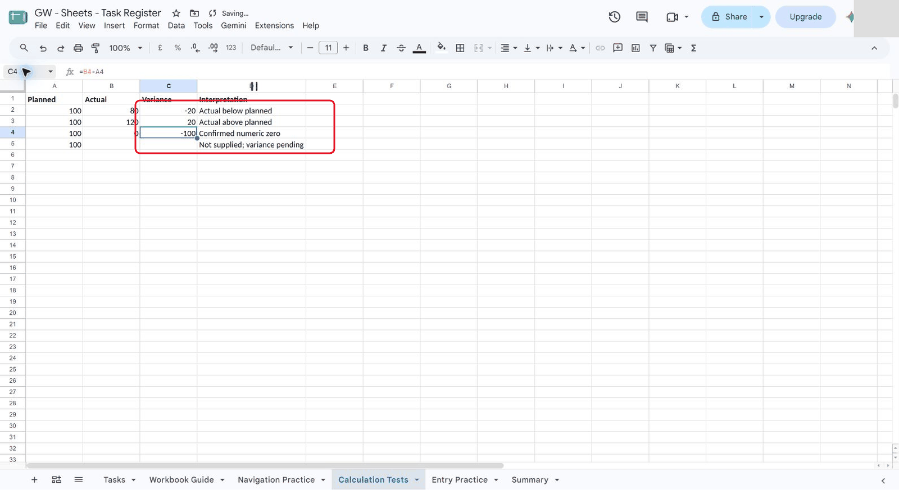

*If you filled C5 too, it would show -100, as if nothing had been spent. That's why it stays empty.*

5. Copy the block below, click **A8** and press **Ctrl+V**. It adds a zero, a blank and a text value in **B9:B11**.

```text
Input kind	Input	COUNT	SUM
Numeric zero	0
Blank
Text	RM 600
```

6. Click **C9** and type `=COUNT(B9)`. Click **D9** and type `=SUM(B9)`. Click the name box, type `C9:D11`, press **Enter**, then press **Ctrl+D**.

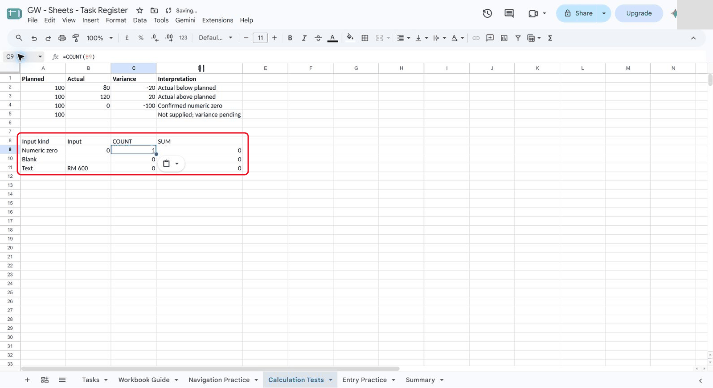

*SUM gives 0 for all three, so it can't tell them apart. COUNT can: only the real zero is a number.*

**Check:** **C2:C4** show **-20**, **20** and **-100**, **C5** is empty, and **C9:C11** show **1**, **0** and **0**.

---

## 3.5 Catch a Wrong Reference

A formula that points at the wrong row still gives a number, so it's easy to miss. You make the mistake on purpose and record it.

1. Copy the block below, click **A14** and press **Ctrl+V**.

```text
Reference check	Prediction	Observed	Reason
Wrong reference			Recorded before repair: B3-A2
Repaired			Same row: B2-A2
```

2. The wrong formula `=B3-A2` takes row 3's actual (120) and row 2's planned (100). Predict the result and type it in **B15**.
3. Click **C2**, type `=B3-A2` and press **Enter**. Type what you see in **C15**.

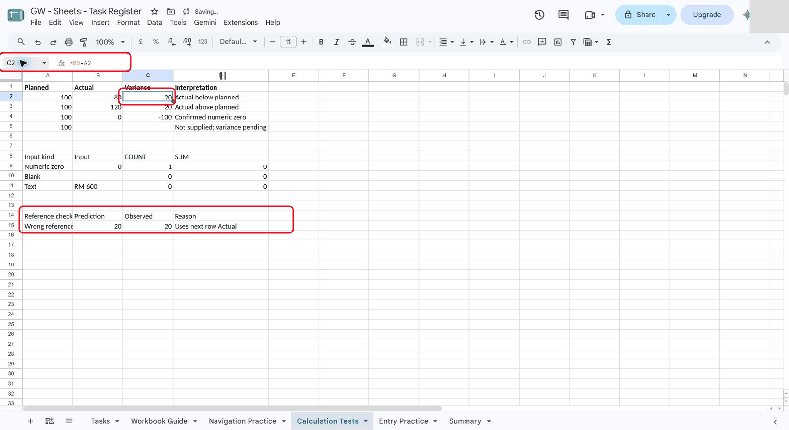

*The screenshot's reason in D15 reads "Uses next row Actual". Yours says "Recorded before repair: B3-A2". Either explains it.*

4. Repair **C2**: type `=B2-A2` and press **Enter**. It shows **-20** again. Type `-20` in **B16** and **C16**.

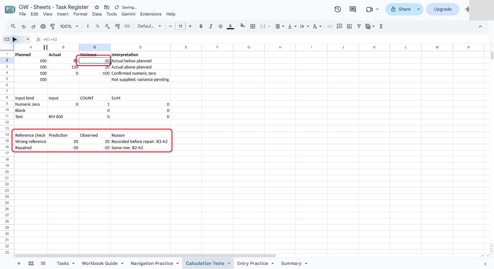

*Row 15 keeps a record of the mistake after it's fixed.*

**Check:** **C2** holds `=B2-A2` and shows **-20**, and rows 15 and 16 record **20** for the wrong reference and **-20** for the repair.

---

## 3.6 Compare Relative and Absolute References

1. Copy the block below, click **F1** and press **Ctrl+V**.

```text
Planned	Relative	Absolute
100
100
100
100
```

2. Click **K1** and type `Practice multiplier`. Click **K2** and type `1.1`.
3. Click **G2** and type `=F2*K2`. Click **H2** and type `=F2*$K$2`. Both show **110**.

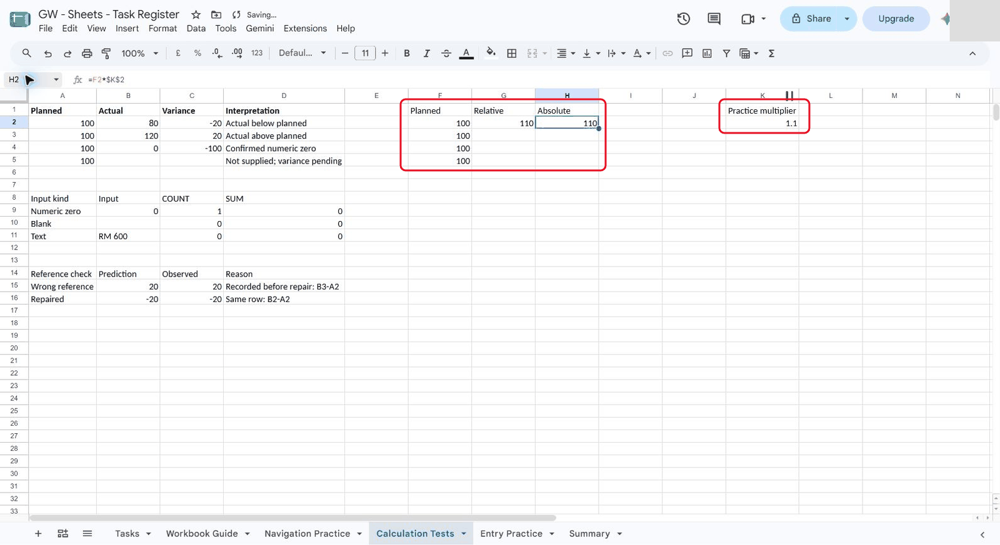

*Same calculation, written two ways.*

4. Click the name box, type `G2:H5`, press **Enter**, then press **Ctrl+D**.
5. Click **G3**. Its formula is `=F3*K3`: the multiplier reference moved down to **K3**, which is empty, so it shows **0**.

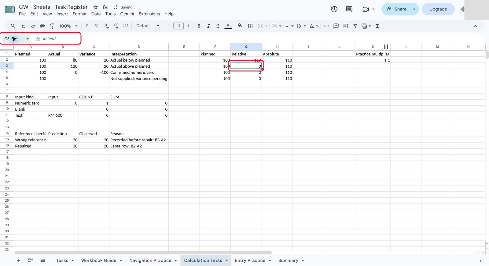

*The relative reference drifted to an empty cell.*

6. Click **H5**. Its formula is `=F5*$K$2`: still pointing at the multiplier, so it shows **110**.

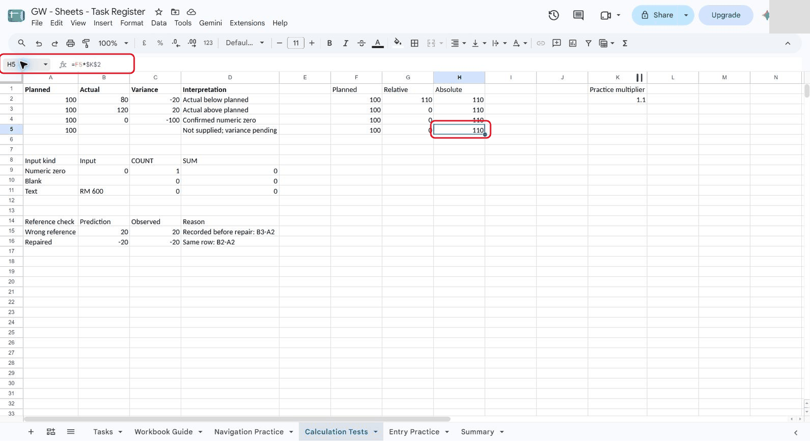

*The absolute reference stayed fixed.*

7. Change **K2** to `1.2`. **G2** and all of **H2:H5** become **120**; **G3:G5** stay **0**.

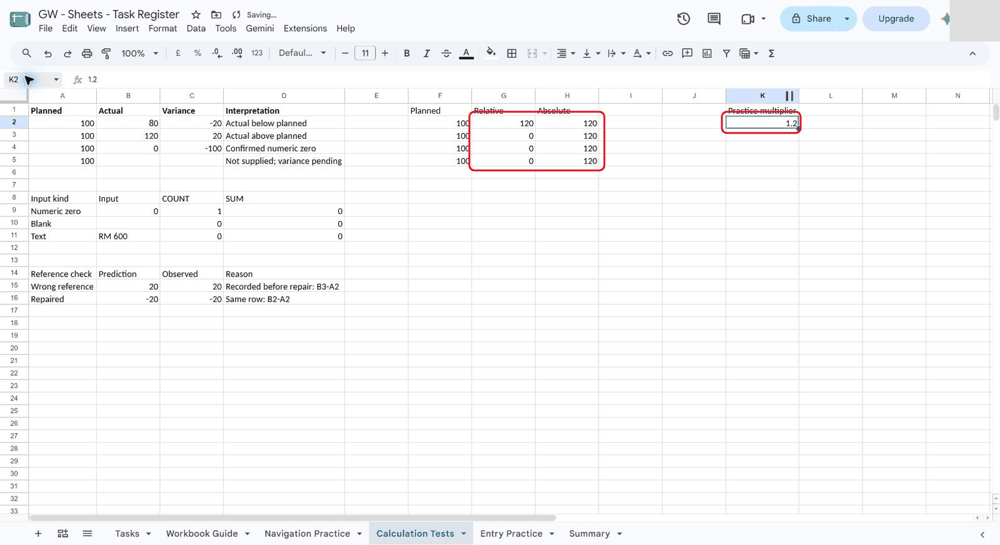

*Only the formulas that really point at K2 follow it.*

8. Change **K2** back to `1.1`. Then copy the block below, click **A19**, press **Ctrl+V**, and type `1.1`, `1.2` and `1.1` in **B20:D20**.

```text
Assumption test	Before	Changed	Restored
Hypothetical only
```

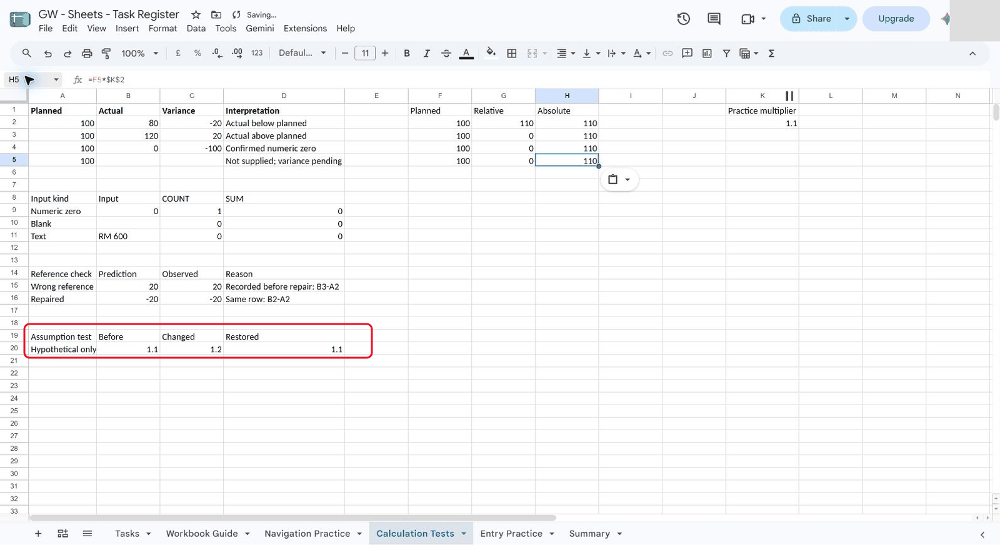

*Row 20 records the change and the restore.*

**Check:** **K2** holds `1.1`, **H2:H5** all show **110**, **G3:G5** show **0**, and row 20 shows **1.1**, **1.2**, **1.1**.

---

## 3.7 Check the Totals Two Ways

If two different routes to the same total agree, you can trust it. Here you check the **Tasks** variance total against planned and actual.

1. Copy the block below, click **A23** and press **Ctrl+V**.

```text
Reconciliation	Result
Sum of row variances
Actual minus planned
Difference
```

2. Type these formulas, pressing **Enter** after each:
   - **B24**: `=SUM(Tasks!I2:I13)`
   - **B25**: `=SUM(Tasks!H2:H13)-SUM(Tasks!G2:G13)`
   - **B26**: `=B24-B25`
3. Double-click the right edge of the column **A** heading so the labels fit.
4. In **A28:A30**, type `Blank Actual`, `Relative G3` and `Absolute H5`. In **B28:B30**, write one sentence each on what you found.

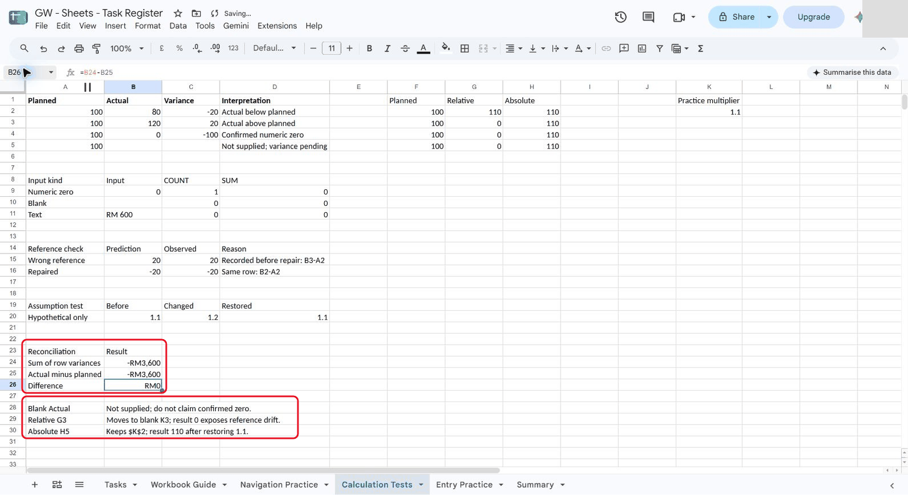

*Both routes give -RM3,600, so the difference is RM0. Your notes in B28:B30 can be worded differently.*

<details markdown="1">
<summary>What should you see?</summary>

**B24** and **B25** both show **-RM3,600**, and **B26** shows **RM0**. Notes along these lines:

- **Blank Actual:** not supplied; don't treat it as a confirmed zero.
- **Relative G3:** moved to the empty K3, so it shows 0; that's reference drift.
- **Absolute H5:** keeps `$K$2`, so it shows 110 after restoring 1.1.

</details>

---

## Independent Practice

Try these without looking back at the steps.

1. On **Calculation Tests**, from **F8**, build your own three-row estimate table with **Planned**, **Actual** and **Variance** columns. Make one actual a real `0` and one variance positive (actual above planned). Write the variance formula once and fill it down.
2. Break the check on purpose: change **B24** to `=SUM(Tasks!I2:I12)`, which leaves out the last task. Look at **B26**. Explain what the difference tells you, then repair **B24**.
3. Show a partner one cell that's a numeric zero, one that's blank and one relative reference that drifted. Ask them to explain each one from the formula bar.

<details markdown="1">
<summary>What should you see?</summary>

With **B24** shortened, it shows **-RM2,900** and **B26** shows **RM700**: exactly the T012 variance that went missing. After the repair, **B26** is back to **RM0**.

</details>

### Evidence to Hand Over

- **Tasks** with **Variance** in **I2:I13** and the totals block in **K1:L7**
- **Navigation Practice** with the fixed multiplier in **L9** and results in **J2:J13**
- **Calculation Tests** with the zero, blank and text tests, the wrong-reference record, the relative and absolute comparison and the reconciliation at **RM0**
- Your estimate table and your explanation of the shortened range

## Troubleshooting

| Problem | What to try |
|---|---|
| A formula shows as text | Check it starts with `=` and has no space or apostrophe in front. |
| **Ctrl+D** copied the wrong thing | Select the whole range first, starting with the cell that has the formula, then press **Ctrl+D**. |
| A multiplier result shows a date | Select the results, then **123** > **Number**. |
| A filled formula gives 0 on every row but the first | The shared cell isn't fixed. Add `$` signs, such as `$L$9`, and fill down again. |
| **B26** isn't zero | Compare **B24** and **B25** with **Tasks**: one of the ranges probably stops early or starts late. |

## Lesson Summary

You wrote a variance for every task, totalled, averaged and counted the costs, and used `$` to keep a shared multiplier fixed. You also saw that SUM can't tell a zero from a blank or text, that a wrong reference still gives a believable number, and that checking a total two ways catches both. In Lab 04 you clean and sort the records.

**Check yourself:** when you copy a formula, which part should move and which should stay fixed?
