# 03 - Calculate and Copy Formulas

In this chapter you will use arithmetic, SUM, AVERAGE and COUNT; explain relative and absolute references.

> **Prompts and values:** use the [copy-paste page](./prompts.md) for the exact values used below.

**Target allocation:** 65 minutes: 15 explanation/demonstration, 22 guided build and casework, 20 independent challenge, 8 verification and repair. The active portion is 50 minutes by design. These are unmeasured targets awaiting a learner pilot.

**Your result:** Copied variance formulas, reconciled totals and a tested fixed reference.

> **Status:** author reference with 23 staged application captures through guided sections 3.1–3.3 and casework 3.4. Row formulas, summaries, fixed-reference change/restoration, zero/blank/text checks, deliberate reference repair and reconciliation verified. Independent estimate/omitted-range challenge and learner timing remain pending.

## What You Will Learn

- Write arithmetic and aggregation formulas.
- Copy relative references correctly.
- Anchor a shared assumption.

## Before You Begin

Read the [case input](./prompts.md) and use a separate named casework copy for destructive tests or altered datasets. Keep the baseline unchanged for later chapters. Record source facts, proposed practice and unresolved questions separately.

Use Tasks A1:H13. The workbook has no prefilled answer formulas.

## 3.1 Calculate Variance

1. On **Tasks**, use the name box to select **I1** and enter **Variance**. In **I2** enter **=H2-G2** and commit it. T001 displays **-RM50**; the formula bar shows the underlying calculation.

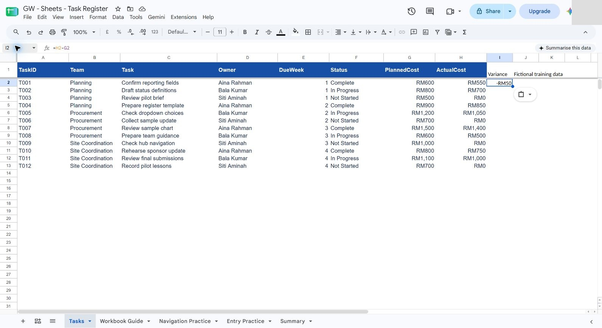

2. Select **I2:I13** with the name box and press **Ctrl+D** to fill down from the first cell. The fill handle or normal copy/paste is an alternative. The range sum is **-RM3,600**.

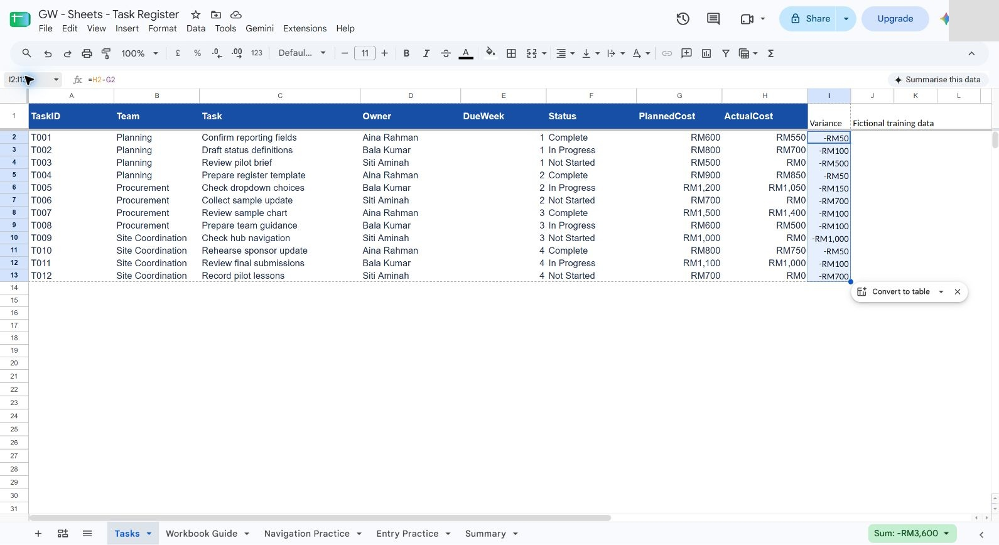

3. Inspect **I2**, **I7** and **I13** in the formula bar. Each refers to its own row: **=H2-G2**, **=H7-G7** and **=H13-G13**. The final two checks display **-RM700**. A negative variance means actual cost is below planned; it does not by itself establish a final saving or project completion.

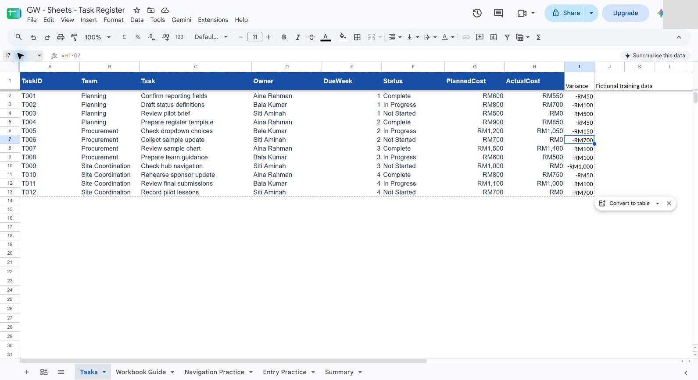

## 3.2 Summarise the Columns

1. In **K1:L1** enter **Measure / Result**. Label **K2:K4** **Planned Total / Actual Total / Variance Total**. In **L2:L4** enter **=SUM(G2:G13)**, **=SUM(H2:H13)** and **=SUM(I2:I13)**. Double-click the right edge of the K column header to fit its labels. Scroll horizontally when needed to show the complete summary.

2. Add **Average Planned** in K6 with **=AVERAGE(G2:G13)** in L6, and **Numeric Cost Count** in K7 with **=COUNT(G2:G13)** in L7. Fit K again after adding the longer labels. Select L6 and increase decimal places twice if it inherited the source's whole-ringgit display. The displayed average is **RM866.67**; its underlying calculation remains 10,400 divided by 12.

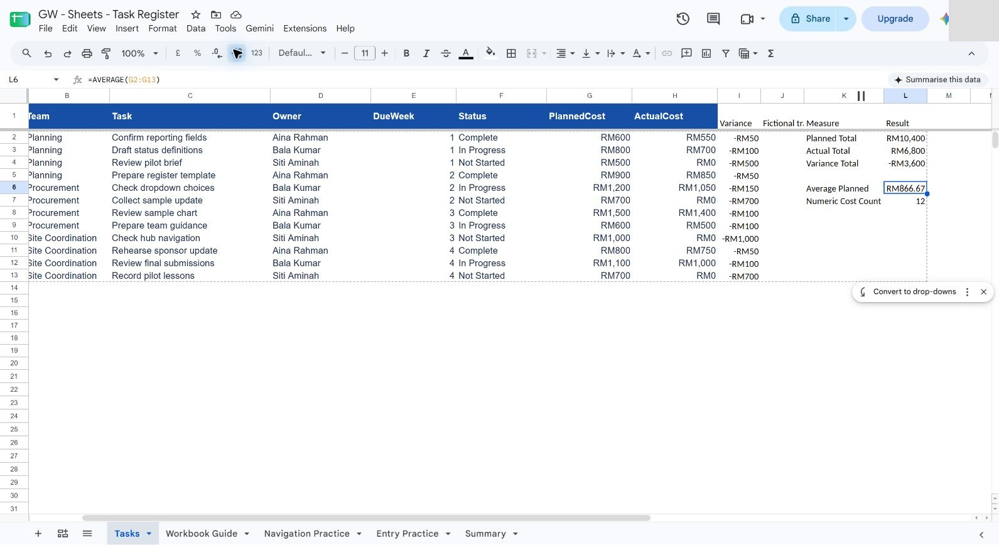

3. Inspect L7's formula and **12** result. The totals are **RM10,400 planned**, **RM6,800 actual** and **-RM3,600 variance**. Do not replace the formulas with those expected numbers.

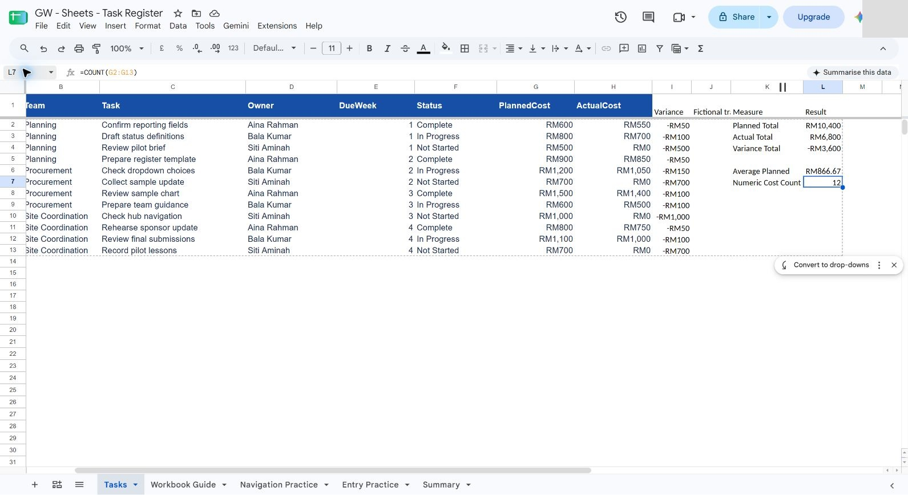

## 3.3 Anchor an Assumption

1. On **Navigation Practice**, reuse the clearly labelled practice area: clear the earlier Lab 2 date/cost examples in **J2:K6**. Their earlier screenshots remain in Lab 2. Set **J2:J13** to **More formats > Number**, so the old J2 date format cannot disguise a numeric calculation as a date. Keep the original Tasks source and the copied A:H records unchanged.

2. Enter **Practice multiplier** in **K9** and numeric **1.1** in **L9**. Fit K to show the complete label. This assumption is hypothetical; it is not an approved rate or a tax rule.

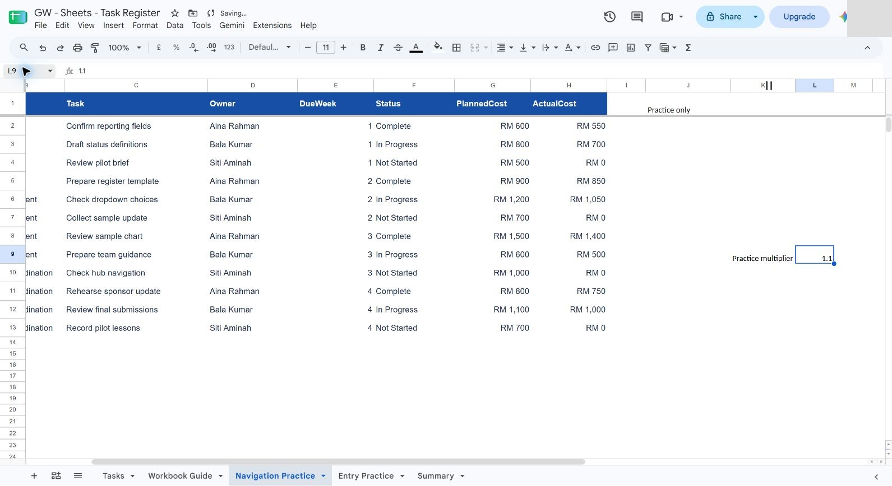

3. In **J2**, enter `=G2*$L$9` and commit it. The first result is **660.00** before filling the remaining rows.

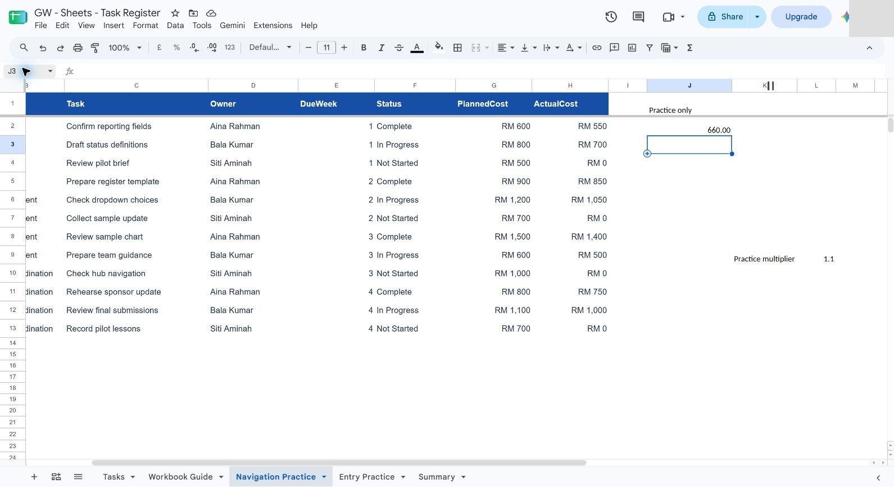

4. Select **J2:J13** and use **Ctrl+D**. Inspect **J13**: `=G13*$L$9` displays **770.00**. G changes with the row; $L$9 stays fixed.

5. Change **L9** to **1.2** and commit it. The first and final results become **720.00** and **840.00**.

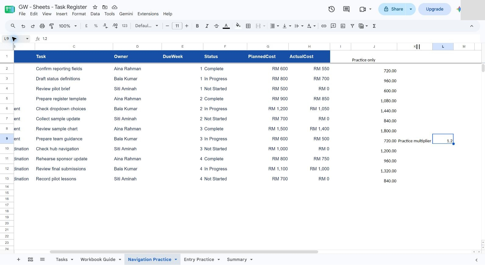

6. Restore **L9** to **1.1**. Reinspect J13's fixed reference and **770.00** result.

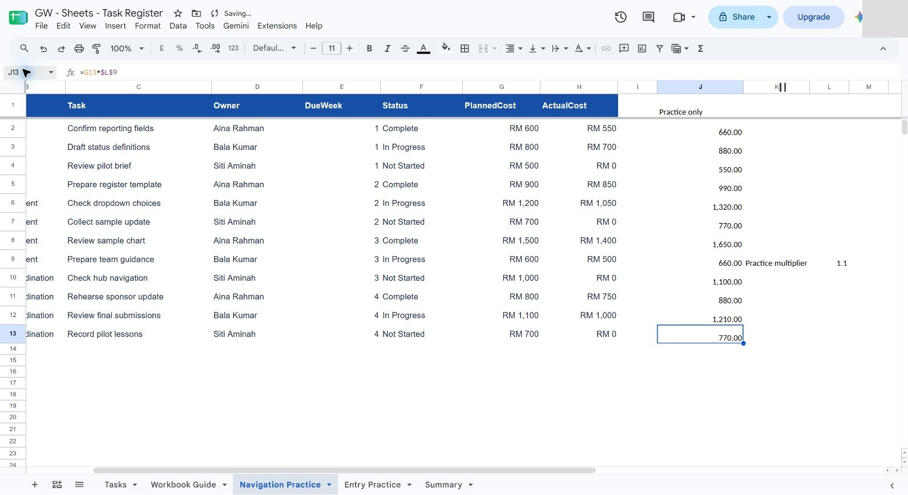

## 3.4 Test Calculations With Zeros, Blanks and Reference Errors

1. Use **Add Sheet**, then double-click the new tab and name it **Calculation Tests**. Enter **Planned / Actual / Variance** in **A1:C1**, and the four planned/actual pairs **100/80**, **100/120**, **100/0**, **100/blank** in rows 2–5. Leave **B5** genuinely empty.

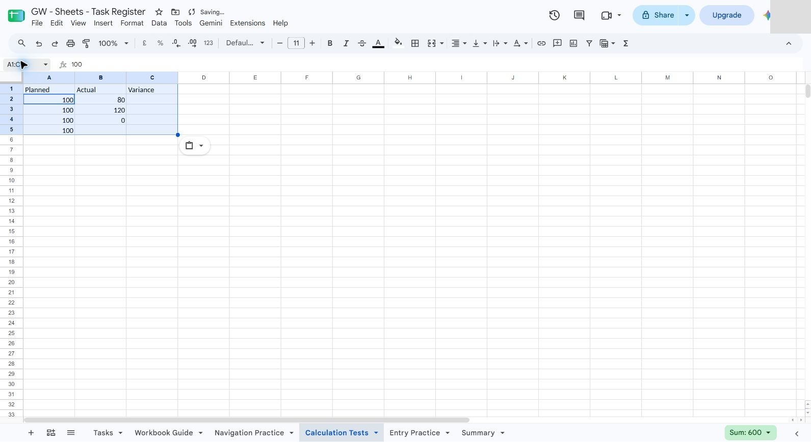

2. Enter **=B2-A2** in C2 and fill **C2:C4**. Results are **-20, 20, -100**. Leave C5 empty because its actual is not supplied. Add the interpretation in D and fit its column. A formula that treats an empty reference as zero would not establish confirmed zero expenditure.

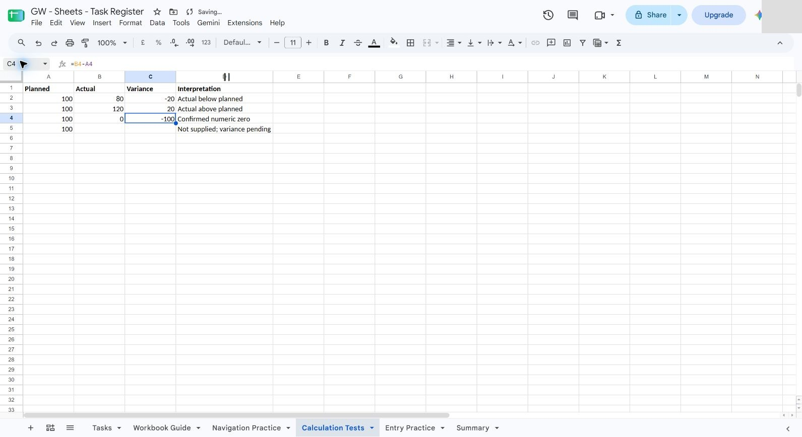

3. In **A8:D11**, create a separate test with headers **Input kind / Input / COUNT / SUM**. B9 is numeric **0**, B10 stays blank, B11 is text **RM 600**. In C9 and D9 enter **=COUNT(B9)** and **=SUM(B9)**, then fill through row 11. COUNT returns **1, 0, 0**; SUM returns **0, 0, 0**. SUM alone cannot distinguish these three inputs.

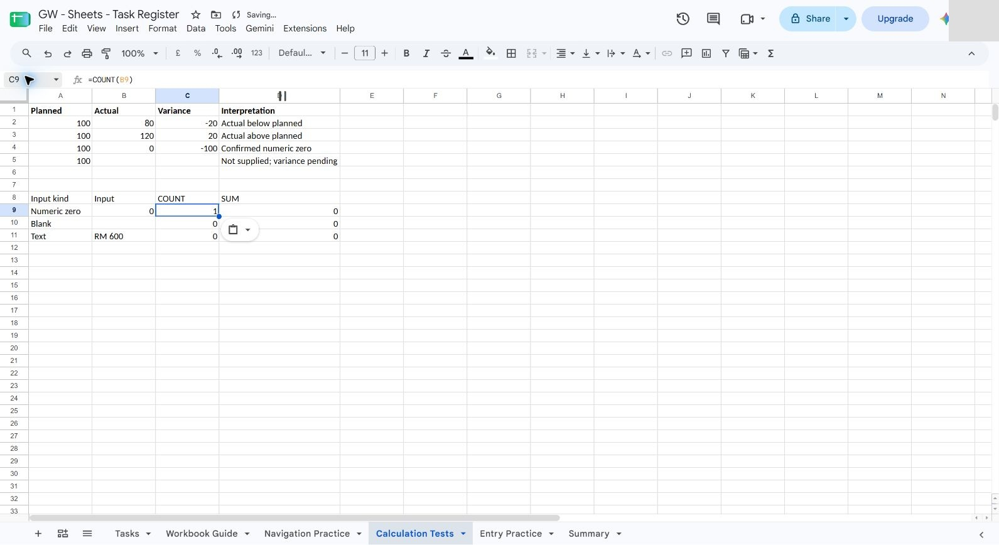

4. Predict that the intentionally wrong **=B3-A2** in C2 gives **20** by using the next row's actual. Enter it, inspect the formula bar and compare it with the first pair's intended **-20**. Record prediction and observation in **A14:D15**.

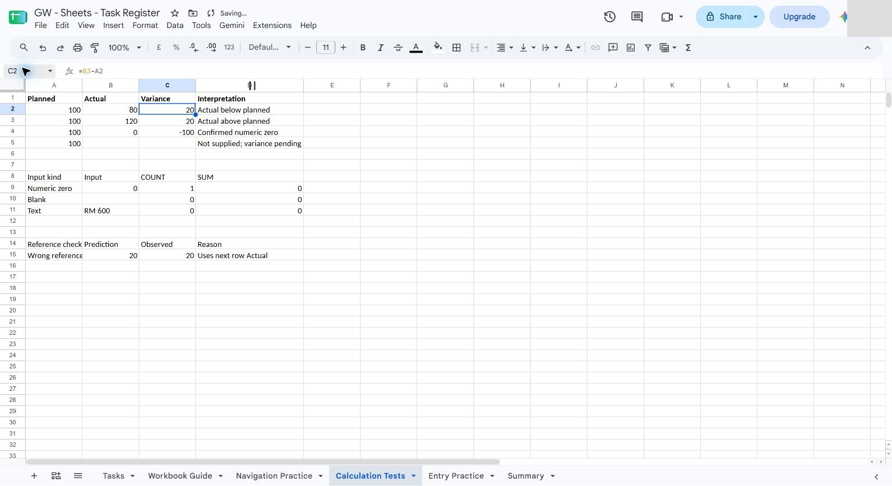

5. Repair C2 to **=B2-A2** and verify **-20**. Keep the wrong test's observed **20** as a labelled historical value, rather than a live link that changes after repair. Add the repaired observation in row 16.

> **Reference run:** The reference uses **=C2** for the current repaired result.

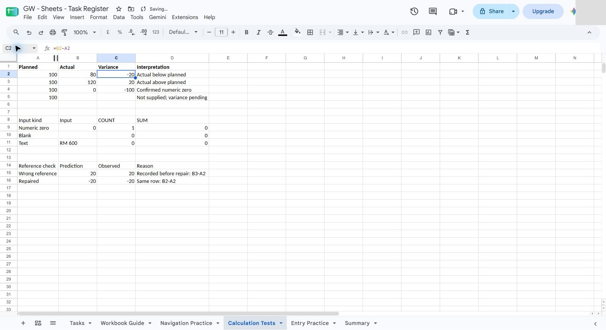

6. Build the reference comparison in **F1:H5**: headers **Planned / Relative / Absolute**, and four planned inputs of **100**. Put **Practice multiplier** in K1 and **1.1** in K2. Enter `=F2*K2` in G2 and `=F2*$K$2` in H2. Both initially return **110**.

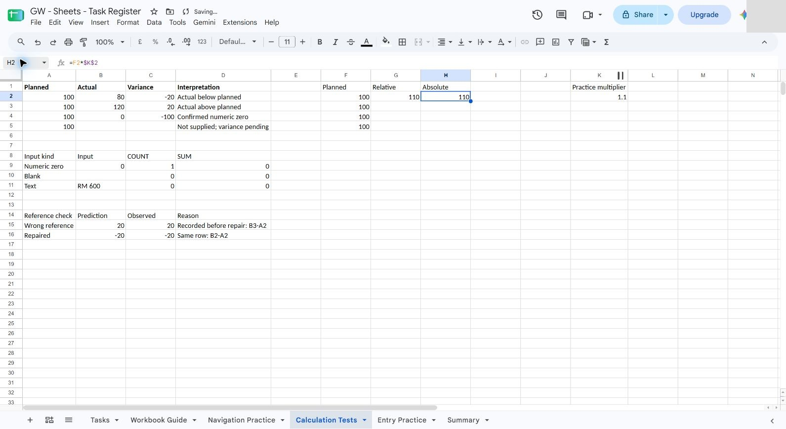

7. Fill **G2:H5** using Ctrl+D. Inspect **G3** `=F3*K3` and **G5** `=F5*K5`: both refer to blank multiplier cells and give **0**. Inspect **H3** `=F3*$K$2` and **H5** `=F5*$K$2`: both keep the intended assumption and give **110**. Retain the relative column as a labelled teaching counterexample.

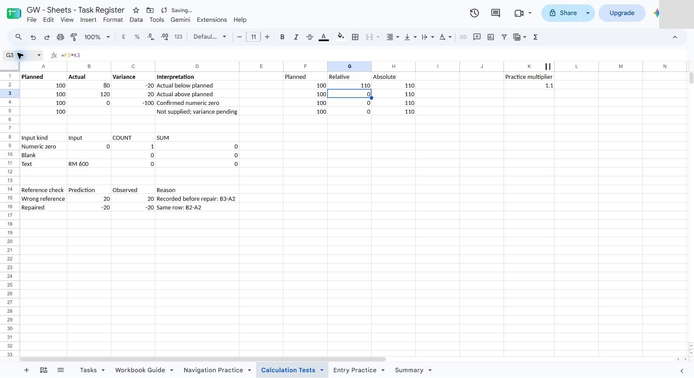

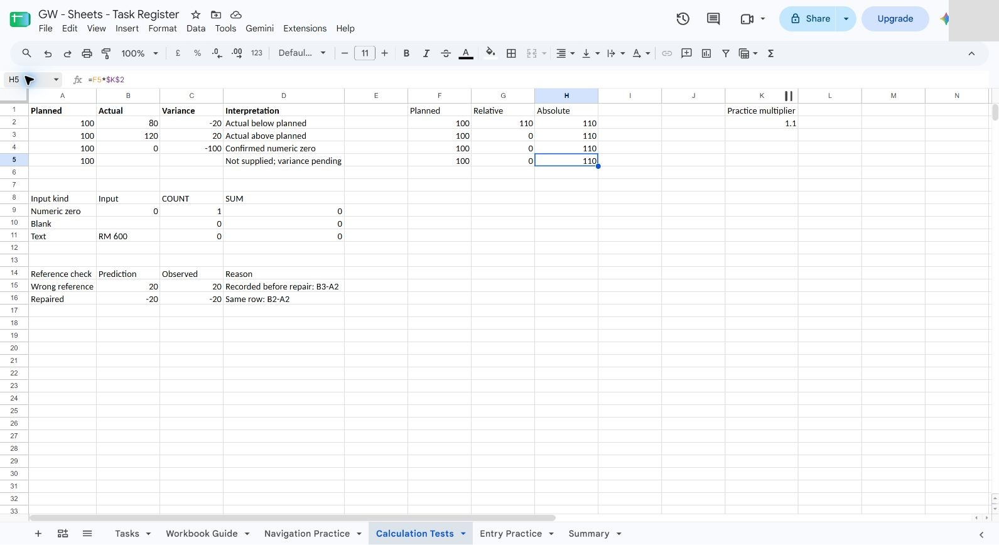

8. Change K2 to **1.2**. G2 and all four absolute results become **120**; the later relative results remain **0**. Record that observation, restore K2 to **1.1**, and keep the before/change/restored values in **A19:D20**. This is hypothetical practice only.

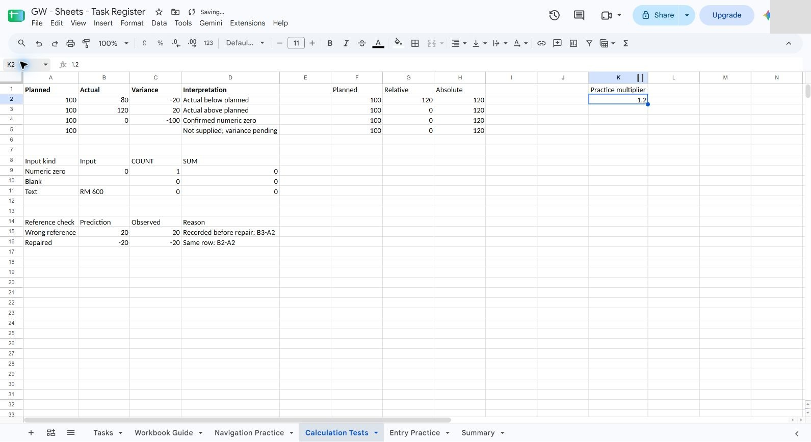

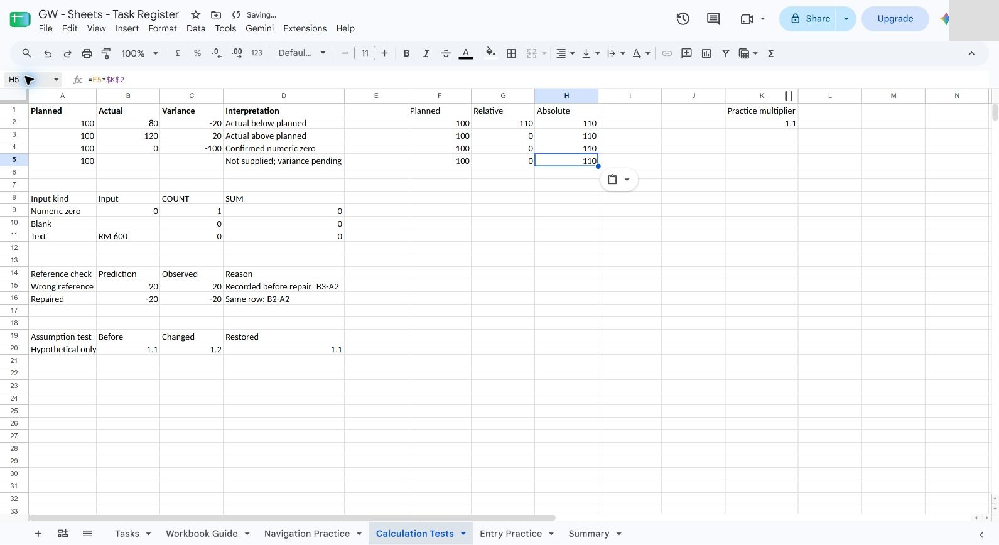

9. In **A23:B26**, reconcile the original source with **=SUM(Tasks!I2:I13)**, **=SUM(Tasks!H2:H13)-SUM(Tasks!G2:G13)** and the difference **=B24-B25**. Both methods give **-RM3,600** and their difference is **RM0**. Fit A to show its labels. Record the blank-information and reference-drift explanations separately below. All original **Tasks!A1:H13** values remain unchanged.

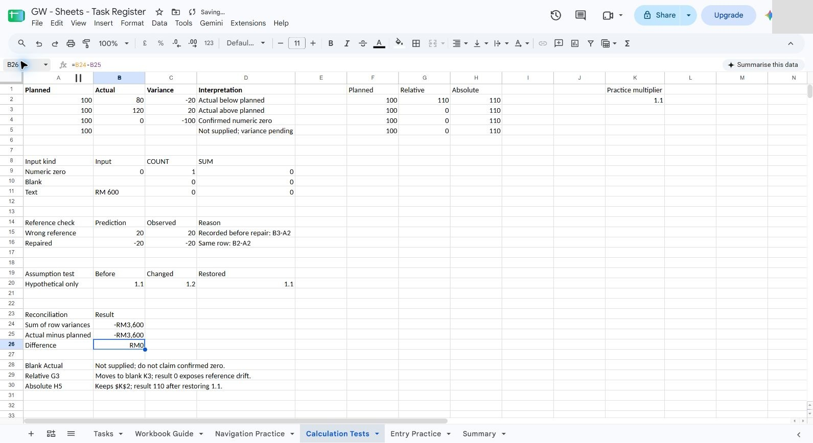

> **Validation boundary:** these are author UI reference checks. The independent estimate table, deliberately omitted total range, independent diagnosis and learner timing pilot have not been completed by this reference run.

## Independent Challenge

Close the earlier step lists for the first attempt. Use the case input and your own reasoning. If you need help, record the hint and repeat the affected check independently.

1. Create an independent three-row estimate table with at least one zero actual cost and one positive variance. Calculate and explain the results without copying a finished answer column.

2. Shorten one total range on the practice table, then use a second calculation to detect and repair the omission.

3. Write a short explanation of negative variance, numeric zero, blank information and a fixed reference, each supported by an actual test cell.

## Evidence to Hand Over

- Four-case calculation test with a documented blank-information limitation.
- Reference-error and omitted-range diagnosis with repaired formulas.
- Reconciled baseline totals and independent estimate table.

Record the defect or uncertainty you investigated, the evidence used, the repair or reasoned no-change decision, and the final state. Restore temporary changes or keep them in a clearly named scenario copy.

## Troubleshooting

| Symptom | What to check |
|---|---|
| A plausible total hides a copied-row error | Inspect row references and compare sum of variances against the difference of totals. |
| An input or earlier result is missing | Reopen the input named in Before You Begin; do not substitute private company data |
| A menu or feature is unavailable | Confirm the account and the shared access notes; record the missing step and ask the trainer for its fallback |
| The result differs from the checkpoint | Compare the exact source range, wording and conditions before repeating the action |

## Lesson Summary

You calculated and reconciled the register using visible source values and references.

**Check yourself:** Which part of a copied formula should move, and which should stay fixed?
