# 04 - Clean and Organise Records

In this chapter you will find and replace, trim text, sort whole records and freeze the header row.

> **Prompts:** the [prompts page](./prompts.md) has every value and prompt for this chapter, each with a Copy button.

**Estimated time:** 50 minutes, planned as 10 explanation and demonstration, 20 guided build and casework, 15 independent practice and 5 verification and repair, with 40 active minutes by design. Not yet timed with learners.

**Your result:** A cleaned text example, whole-record sort and named cost range.

> **Status:** partial author reference with 22 staged application captures through 4.4. Raw text preservation, TRIM, scoped case repair, whole-record sorts, frozen header, named-range reconciliation and immediate Undo of an unsafe sort verified. The reference used manual raw-value entry; CSV upload/import, independent boundary challenge and learner timing remain unverified.

---

## What You Will Learn

- Clean text without altering source evidence.
- Sort whole records.
- Keep headers visible while scrolling.

## Before You Begin

Read the [case input](./prompts.md) and use a separate named casework copy for destructive tests or altered datasets. Keep the baseline unchanged for later chapters. Record source facts, proposed practice and unresolved questions separately.

Use Tasks and download [DirtyText.csv](../../shared/sample-files/DirtyText.csv). Keep cleaning practice separate from the original register.

## 4.1 Clean a Small Import

1. Click **File > Import**, choose **Upload** and select your downloaded **DirtyText.csv**. Set **Import location** to **Insert new sheet(s)**, leave the separator on **Detect automatically**, untick **Convert text to numbers, dates, and formulas**, then click **Import data**. Rename the new tab **Dirty Text Practice**. It should have the headings **TaskID / Team / Status** in A1:C1. Click B2 and check in the formula bar that the spaces around Planning survived the import. If the upload isn't available, or the spaces were removed, use the manual fallback below.

> **Reference run:** The captured reference uses a **Dirty Text Practice** tab and manual entry of the supplied values because browser file upload remained unavailable.

**Manual fallback:** add a tab named **Dirty Text Practice** and enter the three records from Part 3 of the [prompts page](./prompts.md) into A1:C4. Check the raw spaces: B2 must contain one leading and one trailing space around Planning, and B4 one trailing space after Site Coordination. The controlled paste stripped those spaces, so they were explicitly restored through the cell editor with a leading apostrophe before the literal text. The apostrophe is an input prefix, not part of the stored team. Do not clean the raw cells themselves.

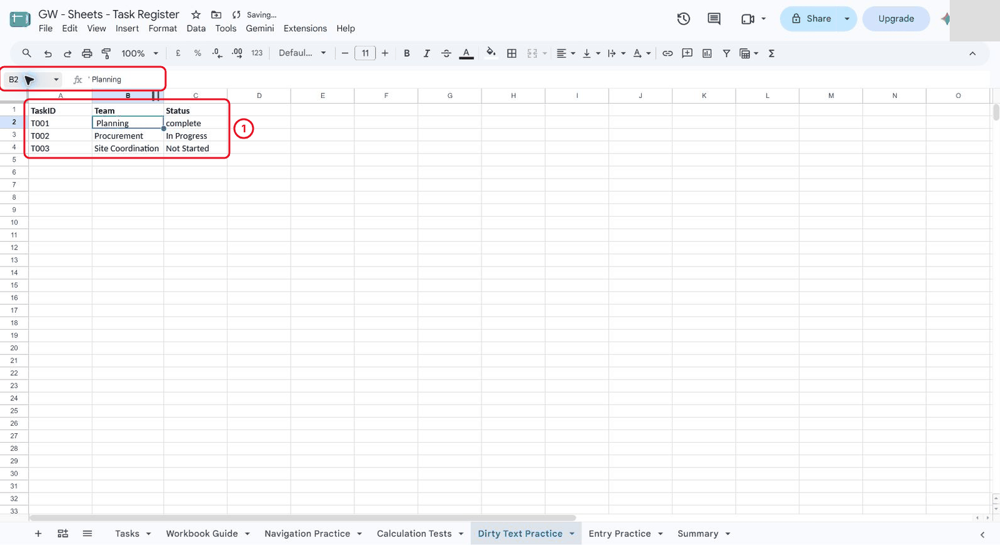

*Preserve raw CSV text and its surrounding spaces.*

2. Enter **CleanTeam** in D1 and **=TRIM(B2)** in D2. Inspect its formula before filling **D2:D4** with Ctrl+D.

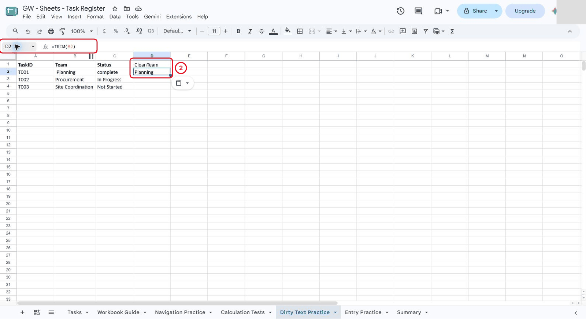

*Inspect the first TRIM formula.*

3. Put **CleanStatus** in E1 and the canonical values **Complete / In Progress / Not Started** in E2:E4, retaining the original C column. Fit B and D so complete team names are visible. Add optional **Raw length / Clean length** checks in F:G using **=LEN(B2)** and **=LEN(D2)**, filled through row 4. Planning changes from length **10 to 8** and Site Coordination from **18 to 17**; Procurement remains **11**. These checks make otherwise invisible spaces testable.

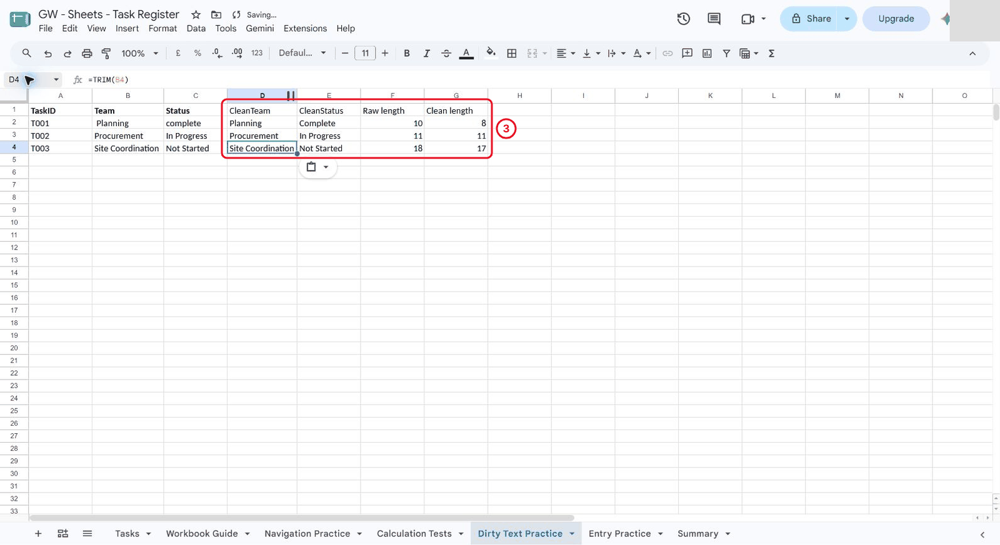

*Compare cleaned text and raw versus clean lengths.*

## 4.2 Sort Whole Records

1. Right-click **Tasks > Duplicate**, then rename the copy **Sorting Practice**. Work on the copy to preserve the original register for later chapters. Select **A1:I13**, including the variance column.

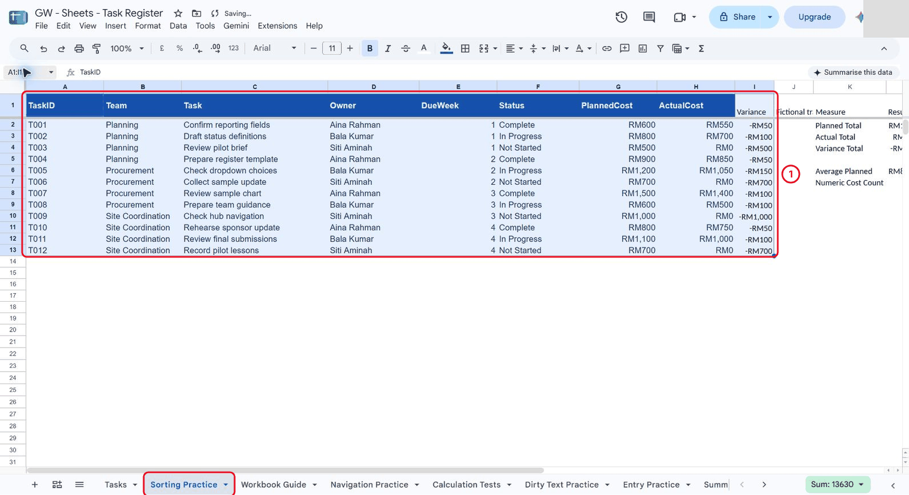

*Select all record columns in an isolated sorting copy.*

2. Open **Data > Sort range > Advanced range sorting options**. Select **Data has header row**. Choose **Team, A to Z**, add another sort column, and explicitly choose **TaskID, A to Z**; the automatic second choice may be a different column. Inspect the full range and both keys before clicking **Sort**.

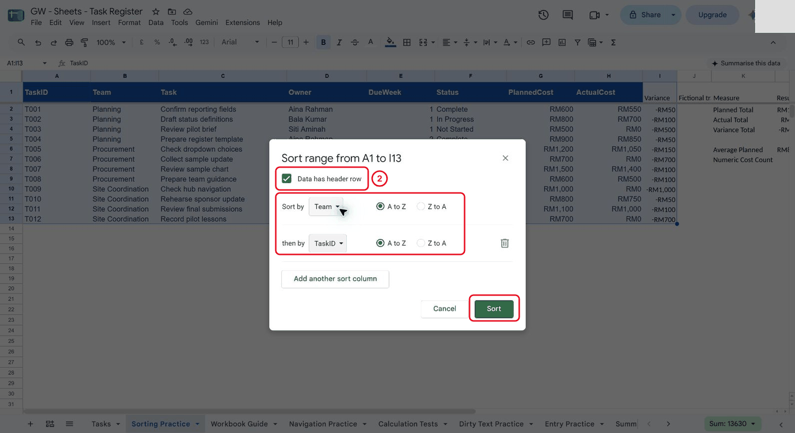

*Configure Team then TaskID with a header row.*

3. Locate **T001** and compare **Aina Rahman**, planned **600**, actual **550**, and **-50 variance** with the source. All twelve record relationships remain intact. This supplied register already follows Team/TaskID order, so this ascending sort legitimately leaves its order unchanged. The intake in 4.4 supplies a visible reorder test.

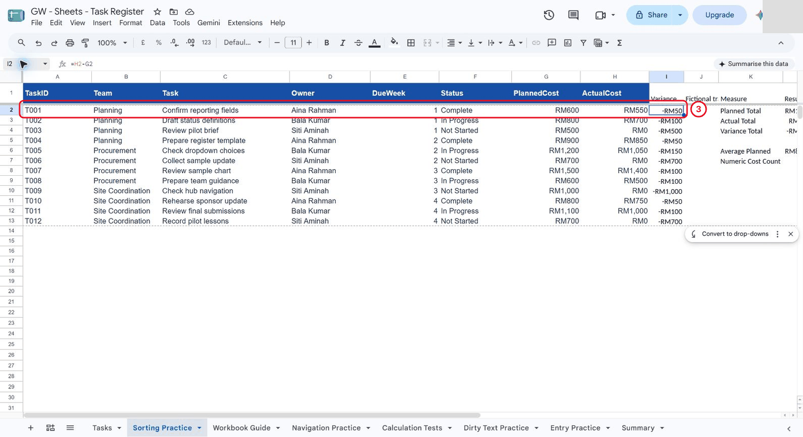

*Inspect the intact T001 costs, owner and variance.*

## 4.3 Freeze and Name a Range

1. On **Sorting Practice**, use **View > Freeze > 1 row**. The copy already inherited a frozen header; retaining or reselecting one row is appropriate. Do not freeze additional rows merely to produce a visible change.

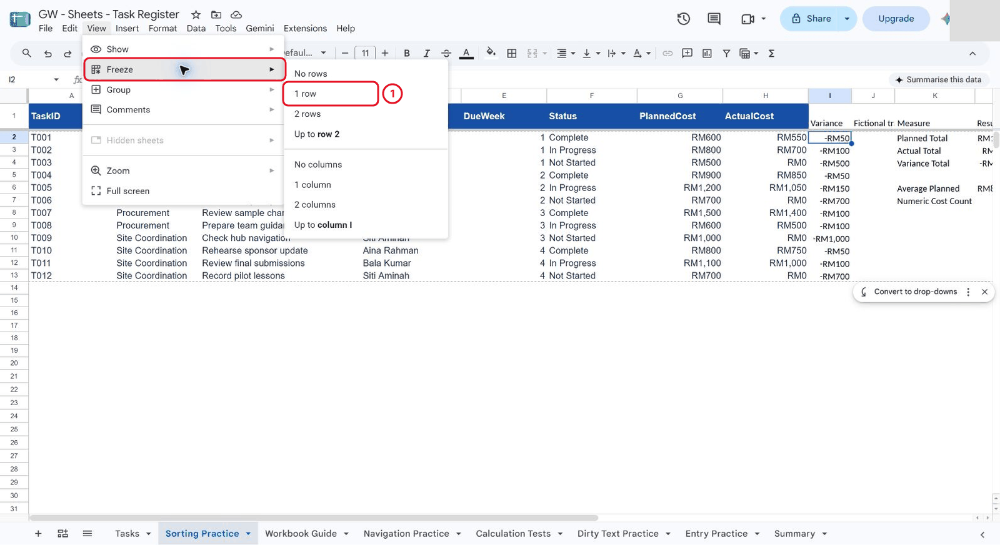

*Choose a one-row freeze.*

2. Scroll down, or navigate to **A35**, and verify row 1 remains visible above the scrolled rows. Return to the record range afterwards.

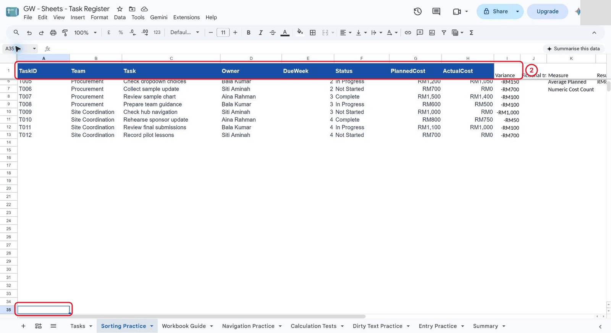

*Verify the frozen header after scrolling.*

3. Select **G2:G13** on **Sorting Practice**, use **Data > Named ranges**, enter **PlannedCosts** and save with **Done**. Inspect the bounds: **'Sorting Practice'!G2:G13**, twelve numeric cost cells. This name deliberately refers to the practice copy, not a changed baseline source.

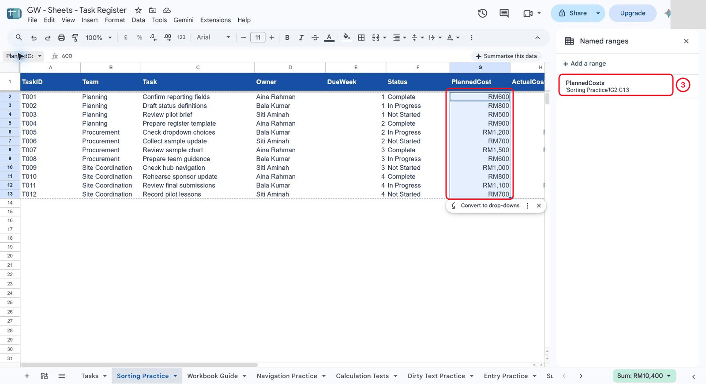

*Inspect the exact PlannedCosts bounds.*

4. In K9:L11 add labels **Named planned total / Explicit planned total / Difference**, with **=SUM(PlannedCosts)**, **=SUM(G2:G13)** and **=L9-L10**. Fit K to show the complete labels and scroll horizontally when needed. Both totals are **RM10,400**; the difference is **RM0**.

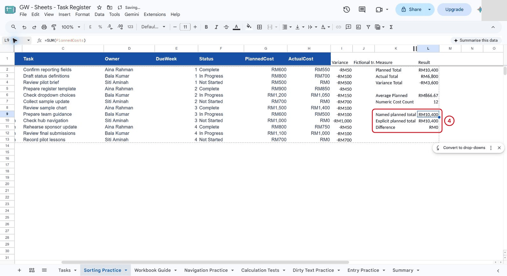

*Compare named and explicit totals.*

## 4.4 Clean an Intake and Prove That Records Stay Together

1. Create **Cleaning Intake Raw**, type the headers **TaskID / Team / Status** in A1:C1 and enter the five records from the case input (Part 2 of the prompts page) in A2:C6, and preserve the surrounding spaces in C001's team. Inspect the raw cell value, not only its appearance. Duplicate this raw tab and rename the working copy **Cleaning Intake**. Keep the raw tab unchanged.

> **Reference run:** The reference uses two leading and two trailing spaces around Planning.

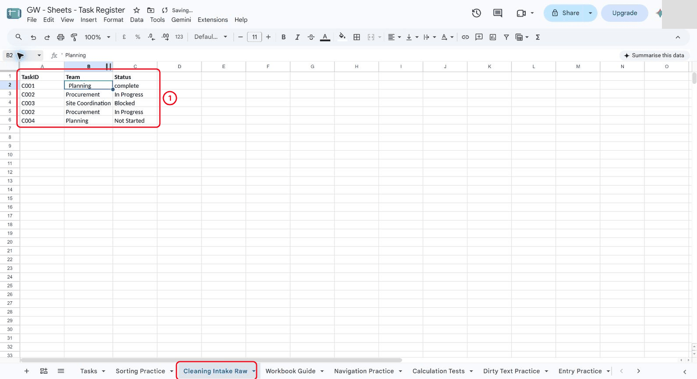

*Preserve the five-row raw intake.*

2. Add **CleanTeam / CleanStatus / Disposition** in D:F. Use **=TRIM(B2)** through D6. Initially copy the status values into E, so C001's cleaned status is still lowercase **complete** before the controlled repair. Compare both C002 records across all three supplied fields: they are identical. Keep both and label their disposition **Identical duplicate; retain both**. Retain **Blocked** on C003 and flag it for clarification; no canonical mapping is supplied. No owner or cost fields are invented for this intake.

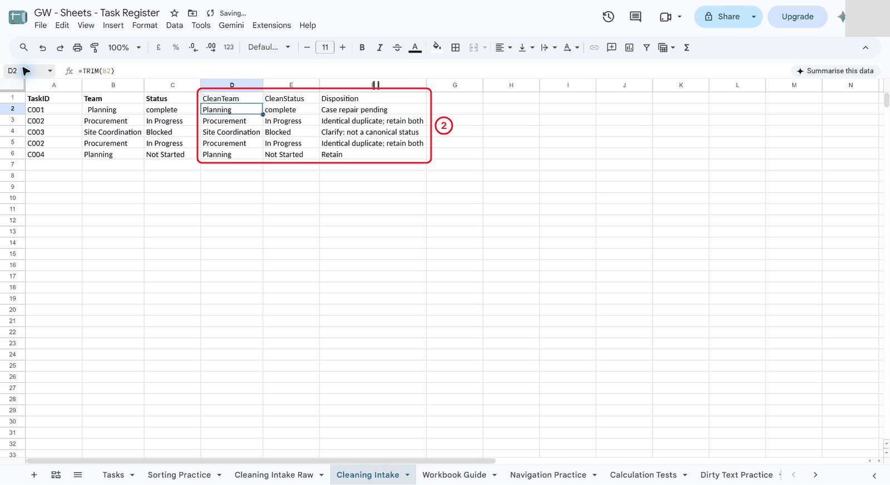

*Retain duplicates and flag the ambiguous status.*

3. Select **E2:E6** and open **Find and replace** with Ctrl+H. Find **complete**, replace with **Complete**, and confirm **Specific range 'Cleaning Intake'!E2:E6**. Enable **Match case** and **Match entire cell contents**; leave regular expressions and formula search off. This is the known case repair supplied by the exercise, rather than an invented spelling error.

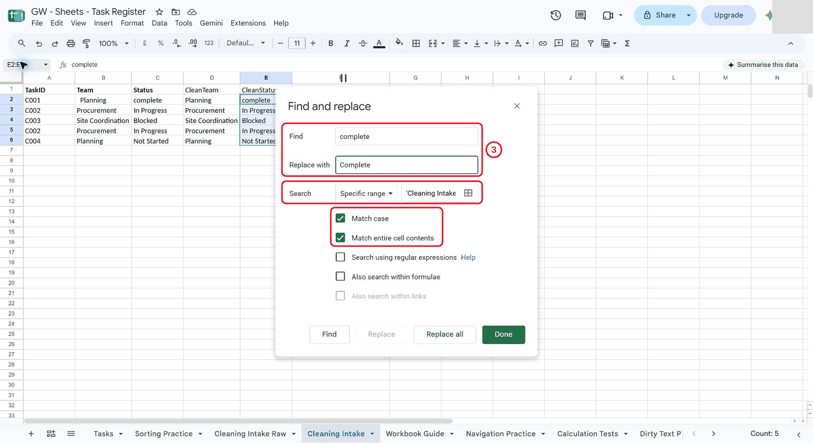

*Restrict case repair to cleaned statuses.*

4. Preview with **Find**, then use **Replace all**. Verify **Replaced one instance of complete with Complete**, then **Done**. The raw C2 and raw tab still contain lowercase complete. Update C001's disposition to **Case standardised; raw retained**.

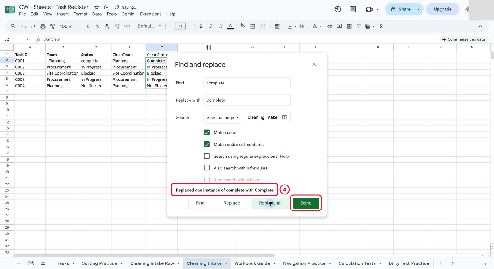

*Verify exactly one replacement.*

5. Record three TaskID-to-status checks before sorting in A9:D12, using the labels in Part 5 of the prompts page: C001 complete→Complete, both C002 In Progress→In Progress, and C003 Blocked→Blocked with clarification pending. The supplied intake has no owners, so status relationships provide the identity check.

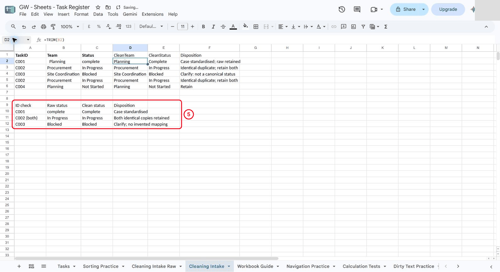

*Record identity checks before sorting.*

6. Select **A1:F6**, including raw fields, cleaned fields and dispositions. Open advanced sorting, mark the header row, and sort **CleanTeam A to Z**, then **TaskID A to Z**. Using the cleaned team avoids making whitespace part of the sort key. Keep the check table below row 6 outside the sort.

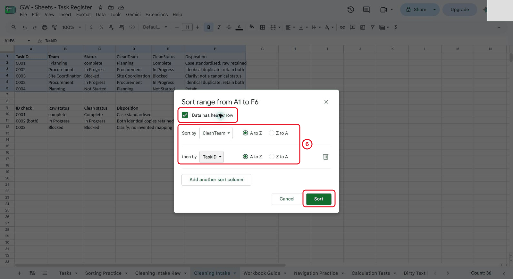

*Sort the complete intake by CleanTeam and TaskID.*

7. Verify the sorted ID order **C001, C004, C002, C002, C003**. Inspect the copied TRIM formulas: each still points to its own row's raw team. Compare the three identity checks again and record them in A14:D17 (labels in Part 5 of the prompts page). Both identical C002 rows remain; C003's unresolved status remains attached to C003.

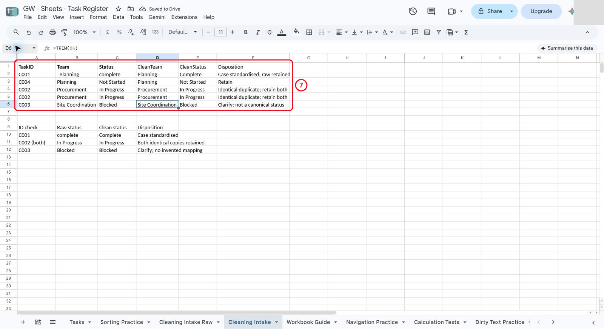

*Inspect identities after the whole-record sort.*

8. Reuse **PlannedCosts**, since this intake has no numeric cost column. In A19:B21 (labels in Part 5 of the prompts page) compare **=SUM(PlannedCosts)** with **=SUM('Sorting Practice'!G2:G13)**, then subtract the two results. Both give **RM10,400** and the difference is **RM0**. The exact twelve-cell bounds were inspected in 4.3. This does not test automatic expansion when new rows are added.

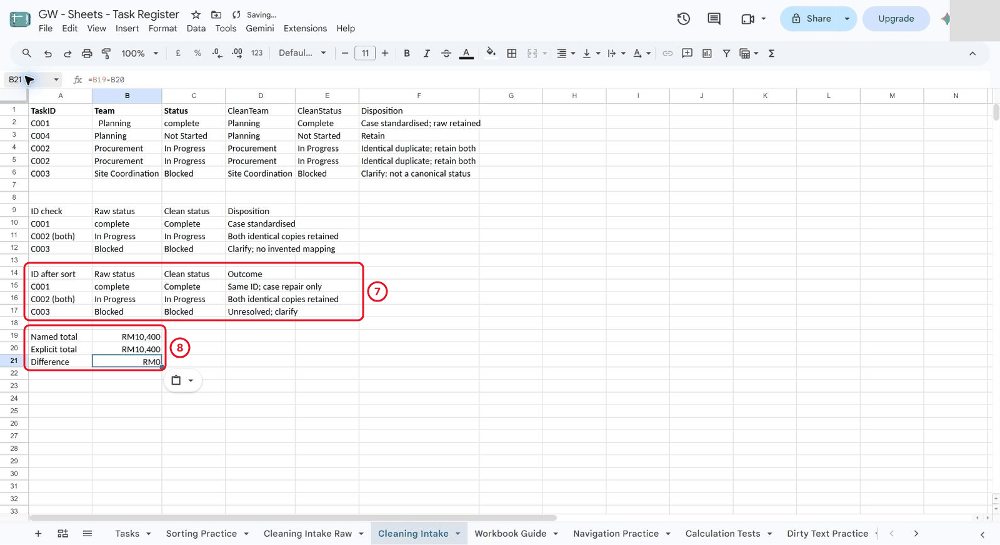

*Compare identity checks and named-range reconciliation.*

9. Duplicate the cleaned tab as **Sort Safety Test**. Select **only E2:E6** on this disposable copy. Keep the raw and clean intake tabs out of the test.

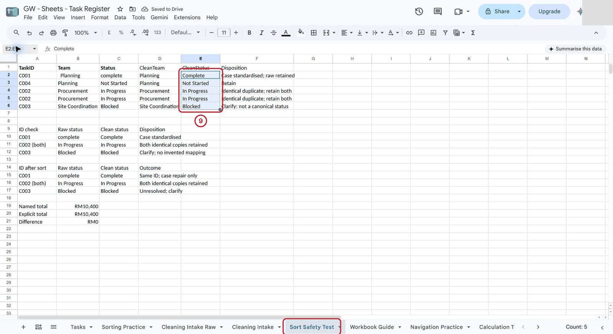

*Select only one column in a disposable copy.*

10. Use **Data > Sort range > Sort range by column E (A to Z)** on that isolated selection. Inspect the broken relationship: C001 now incorrectly has **Blocked**, C004 has **Complete**, and C003 has **Not Started**. The two C002 statuses happen to remain In Progress; checking only those would miss the defect.

*Observe broken relationships from the isolated-column sort.*

11. **Undo immediately** with Ctrl+Z, before making any other edit. Compare all six columns and the three ID checks with Cleaning Intake.

> **Reference run:** The reference verified an exact A1:F6 match after Undo.

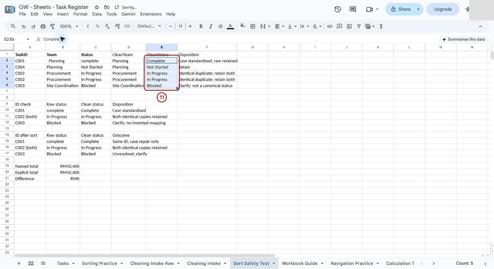

*Undo the unsafe sort immediately.*

12. Record the observed correct / bad-sort / after-Undo statuses in A24:D27, and a one-line final state in A29 (labels in Part 5 of the prompts page). C001 is restored to Complete, both C002 to In Progress, and C003 to Blocked. Keep the restored disposable tab as labelled evidence. The original Tasks values/formulas and raw intake remain unchanged.

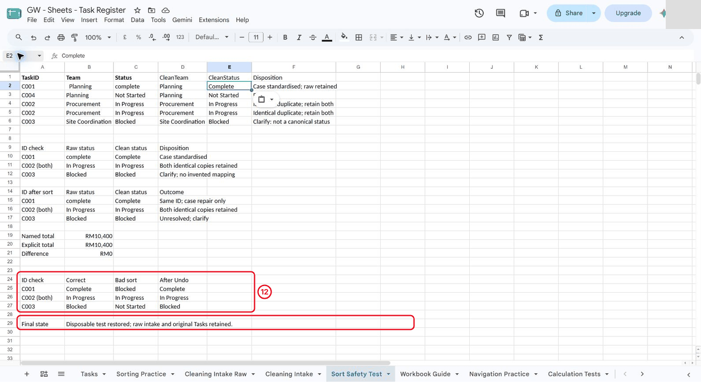

*Record restored identities and final state.*

> **Validation boundary:** the reference verifies the guided and casework operations above. CSV file upload/import, the independent named-range expansion test, an independent cleaner's result and classroom timing remain pending.

## Independent Practice

Close the earlier step lists for the first attempt. Use the case input and your own reasoning. If you need help, record the hint and repeat the affected check independently.

1. Produce a clean intake and an exception list independently. Keep unresolved category and conflicting-duplicate decisions visible.

2. Add one new numeric row only to a named-range practice copy and inspect whether the named range includes it. Repair its bounds and compare the two total methods.

3. Hand over the raw copy, clean result and three row-identity checks so another person can verify the cleaning without trusting your description.

### Evidence to Hand Over

- Preserved raw intake, justified clean values and explicit exceptions.
- Whole-record sorting evidence and a restored isolated-column demonstration.
- Named-range boundary test and independently reconciled total.

Record the defect or uncertainty you investigated, the evidence used, the repair or reasoned no-change decision, and the final state. Restore temporary changes or keep them in a clearly named scenario copy.

## Troubleshooting

| Symptom | What to check |
|---|---|
| A clean-looking row is associated with the wrong task | Compare complete TaskID relationships before and after the sort, not only totals. |
| An input or earlier result is missing | Reopen the input named in Before You Begin; do not substitute private company data |
| A menu or feature is unavailable | Confirm the account and the shared access notes; record the missing step and ask the trainer for its fallback |
| The result differs from the checkpoint | Compare the exact source range, wording and conditions before repeating the action |

## Lesson Summary

Cleaning, whole-record sorts and visible headers make the data safer to analyse.

**Check yourself:** What must stay together when sorting a register?
