# 05 - Validate and Filter the Register

Lab 04 cleaned up untidy entries after they arrived. Aina would rather they never arrived: a status of "Done" or a due week of 5 shouldn't be possible to type. She also wants each team lead to see only their unfinished tasks without hiding them from everyone else. In this lab you add entry rules, test that they really reject bad values, and save filter views that show a focused slice of the register.

**Estimated time:** 50 minutes, planned as 5 explanation, 30 guided build and 15 independent practice. Not yet timed with learners.

**Your result:** in `GW - Sheets - Task Register`, a status dropdown on **Tasks** that rejects anything else, a whole-week rule on **Entry Rule Practice**, a **Rule Tests** tab with what you expected and what happened, and two saved filter views: **Incomplete tasks** and **Planning incomplete tasks**.

> **You'll practise:** data validation (dropdowns and a custom formula), Paste special for validation only, testing a rule with good and bad values, filter views, and checking what a filter does to a SUM.

---

## What You Will Learn

- Add a dropdown that rejects anything not on the list
- Write a custom rule and prove it with tests
- Save filter views and check what they hide

## Before You Begin

Open `GW - Sheets - Task Register` from **GW - Sheets Foundation - Practice**. You need **Tasks** with all twelve records, and **Entry Practice** from Labs 01 and 02.

**What you build in this lab:**

**Tasks**: status dropdown > **Incomplete tasks** view | **Rule Tests**: status tests > week tests > entry guide | **Entry Rule Practice**: whole-week rule | **Tasks**: SUM check > **Planning incomplete tasks** view > view check

## Topics

**A rule is only as good as its test.** It's easy to set a rule and assume it works. You write down what should happen first (accept or reject), then try it, then record what actually happened.

**Rules cover a range.** A rule on **F2:F13** says nothing about **F14**. New rows can slip outside it, so you check where a rule applies as well as what it allows.

**A filter view hides rows; it doesn't remove them.** Filter views let each person see a slice of the data without changing what everyone else sees. A normal `=SUM()` still adds the hidden rows, so a total next to a filtered list can mislead.

---

## 5.1 Add a Status Dropdown

1. On **Tasks**, click the name box, type `F2:F13` and press **Enter**.
2. Click **Data**, then **Data validation**, then **Add rule**. Check **Apply to range** says **Tasks!F2:F13**.
3. **Criteria** shows **Drop-down**, with items Sheets has picked up from the cells. Check there are exactly three: `Complete`, `In Progress` and `Not Started`. Fix or delete any others.

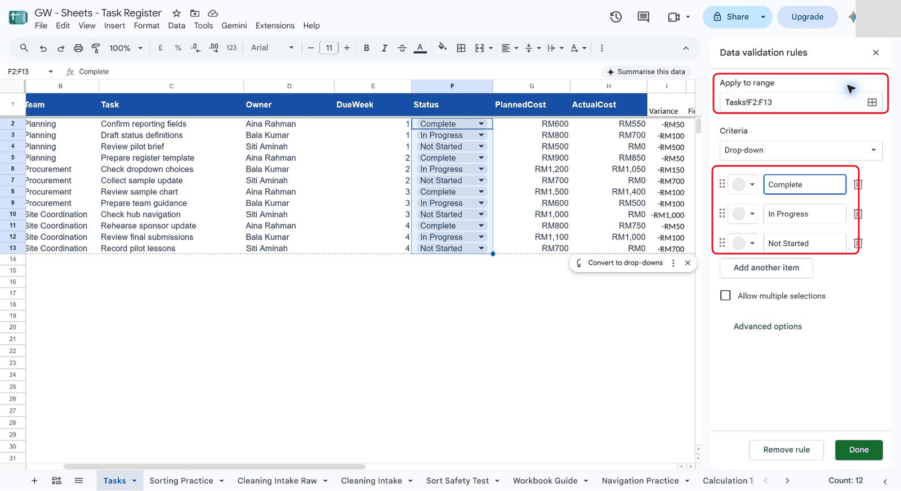

*Three items, spelled exactly as the register uses them.*

4. Leave **Allow multiple selections** unticked. Click **Advanced options** and choose **Reject the input**. Click **Done**, then close the panel.

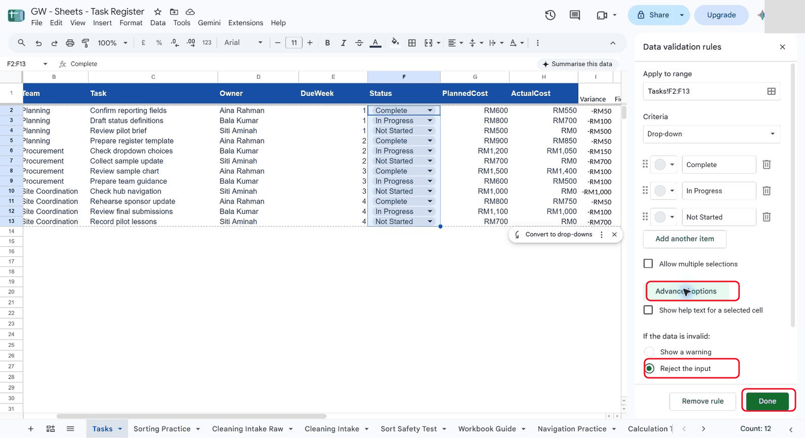

*Reject the input stops a bad value being saved. Show a warning would only flag it.*

5. Click the arrow in **F3**. It still says **In Progress**, and the list offers the three statuses.

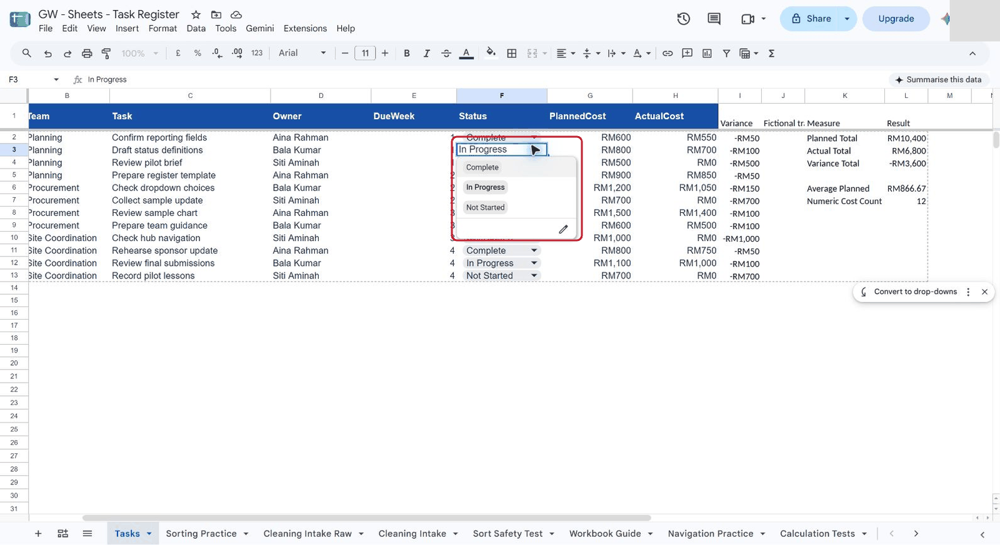

*Adding the rule didn't change any existing status.*

**Check:** every status on **Tasks** has a dropdown arrow, and none of them changed.

---

## 5.2 Save a Filter View

1. Click the name box, type `A1:I13` and press **Enter**.
2. Click **Data**, then **Create filter view**. A green bar appears with **Temporary filter 1** and **Range: A1:I13**.

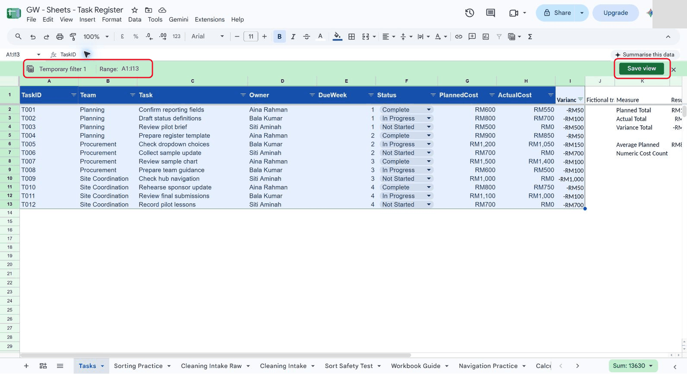

*The range covers the headings, every record and the Variance column.*

3. Click **Save view**. Type `Incomplete tasks` and click **Save**.

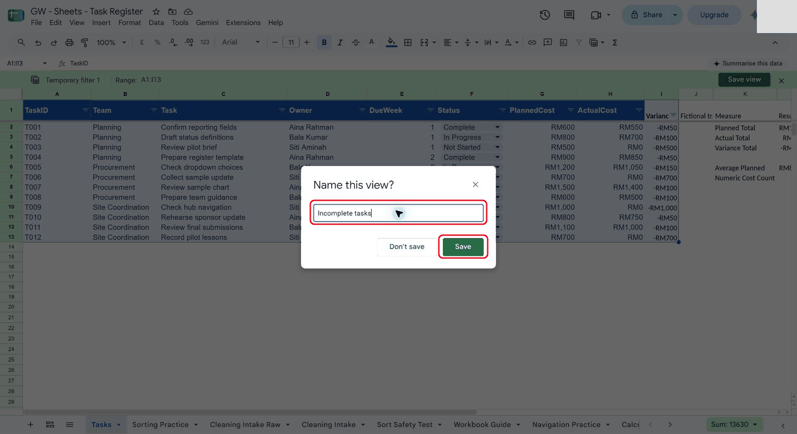

*Naming it means you can open it again later.*

4. Click the filter icon in the **Status** heading. Untick **Complete** and click **OK**.

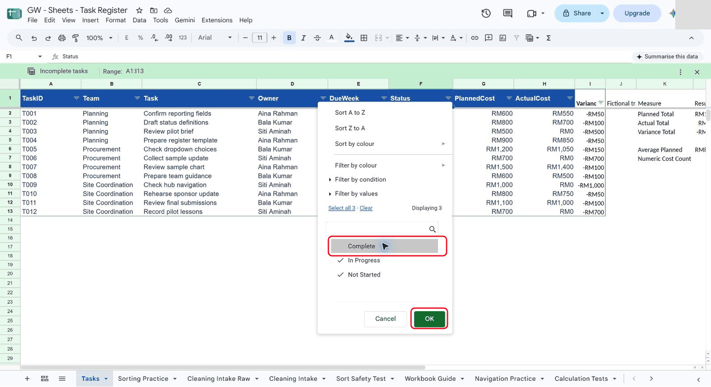

*In Progress and Not Started stay ticked.*

5. Eight tasks are shown, and the bottom right says **8 of 12 rows displayed**.

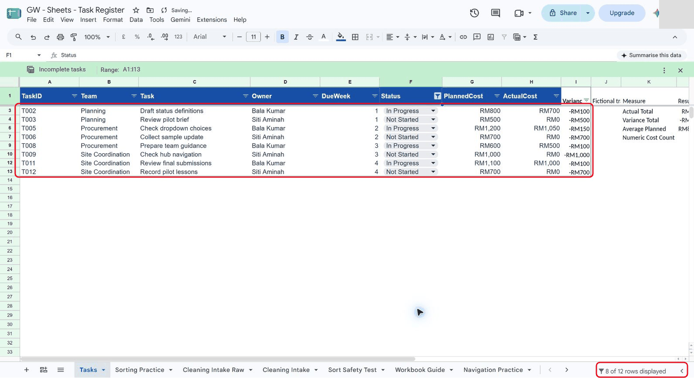

*T002, T003, T005, T006, T008, T009, T011 and T012.*

6. Click the **X** at the right of the green bar to close the view. All twelve rows come back.

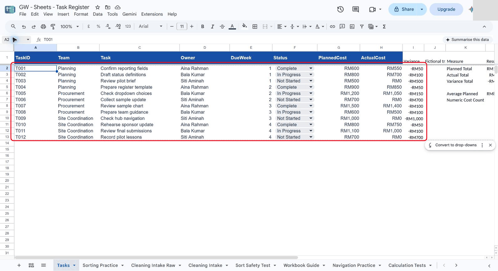

*Closing the view doesn't delete it, and nothing was removed from the register.*

**Check:** **Incomplete tasks** showed eight tasks, and now all twelve are visible again.

---

## 5.3 Test the Rule on a Spare Cell

You test the status rule somewhere it can't damage a real record.

1. Click **F2** and press **Ctrl+C**. Click **N2**, an empty cell to the right of the register.
2. Click **Edit**, **Paste special**, **Data validation only**. N2 gets the rule, but not F2's value.

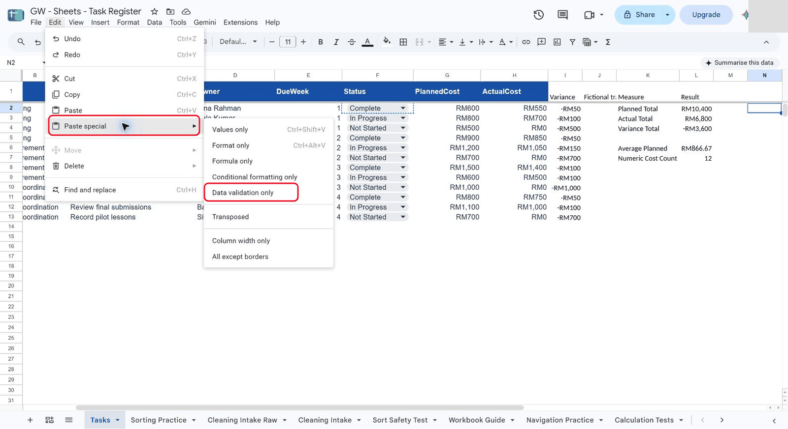

*Only the rule is pasted; N2 stays empty.*

3. In **N2**, type `Done` and press **Enter**. A **There was a problem** message lists the allowed values.

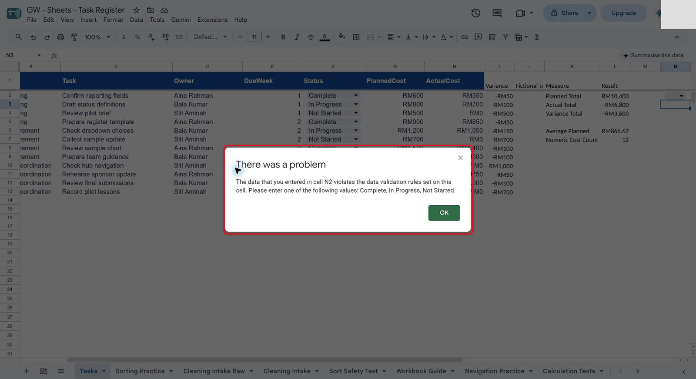

*The rule refused Done, so nothing was saved.*

4. Click **OK**. If N2 still shows what you typed, press **Esc**, then **Delete**.

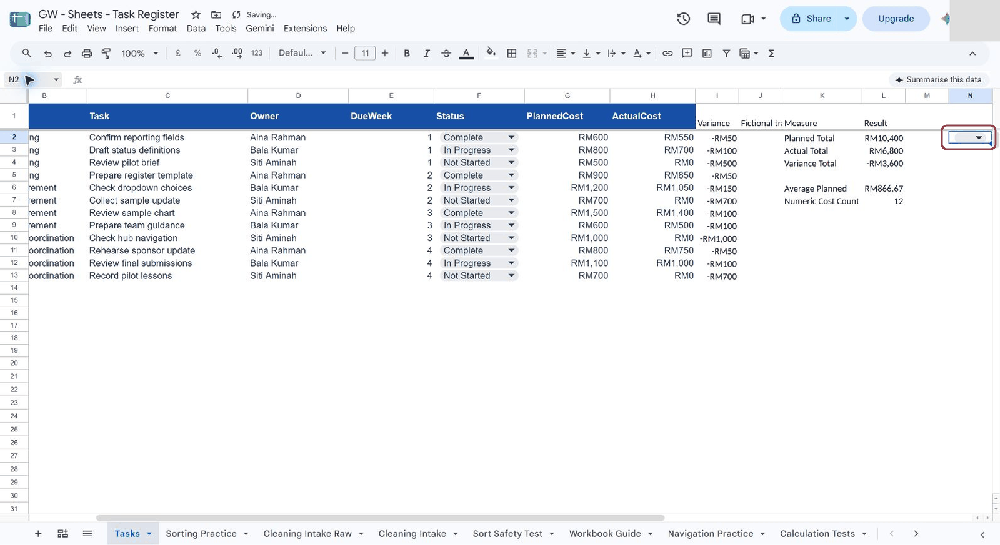

*N2 keeps the rule for later tests, but holds no value.*

5. Click **Filter views** on the toolbar (the funnel icon with a list) and choose **Incomplete tasks**. The same eight tasks appear. Click the **X** to close it.

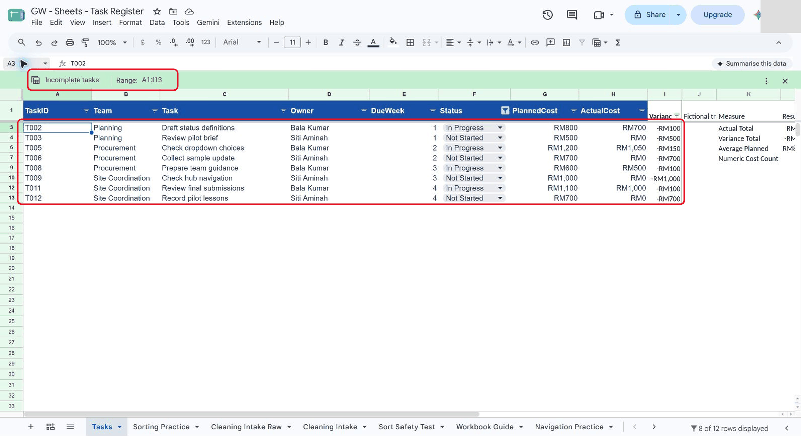

*The saved view kept its filter.*

**Check:** **N2** is empty with a dropdown arrow, and **Incomplete tasks** reopens with eight tasks.

---

## 5.4 Plan and Run the Status Tests

1. On **Tasks**, click **+** (Add sheet). Rename the new tab `Rule Tests`.
2. Copy the block below, click **A1** and press **Ctrl+V**. Column **B** stays empty for now; **Observed** says **Pending** until you test.

```text
Status test	Validated input	Expected	Observed	Repair / next action
Complete		Accept	Pending	None if accepted
In Progress		Accept	Pending	None if accepted
Not Started		Accept	Pending	None if accepted
Done		Reject	Pending	Use a canonical status
Blank		Test clearing	Pending	Check required fields separately
```

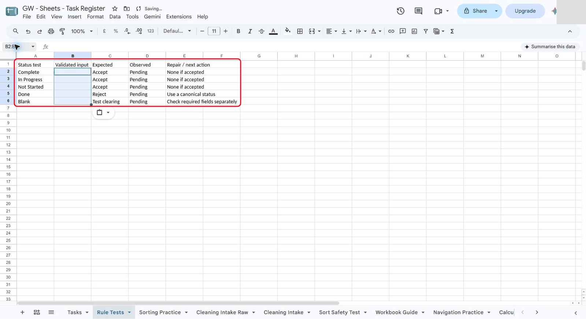

*Write down what should happen before you try it.*

3. Click the **Tasks** tab, click **F2** and press **Ctrl+C**. Back on **Rule Tests**, select **B2:B6**, then **Edit**, **Paste special**, **Data validation only**.
4. Use the dropdowns to choose **Complete** in **B2**, **In Progress** in **B3** and **Not Started** in **B4**. Change **D2:D4** to `Accepted`.

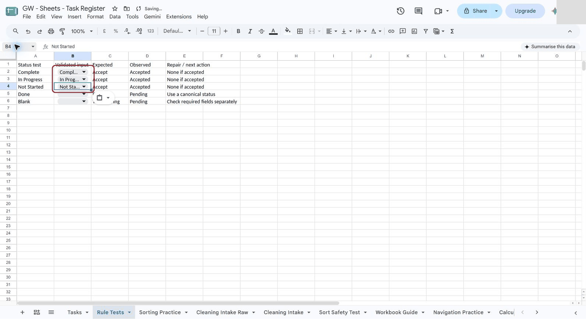

*All three allowed values are accepted.*

5. In **B5**, type `Done` and press **Enter**. The same message appears. Click **OK**; B5 stays empty. Change **D5** to `Rejected`.

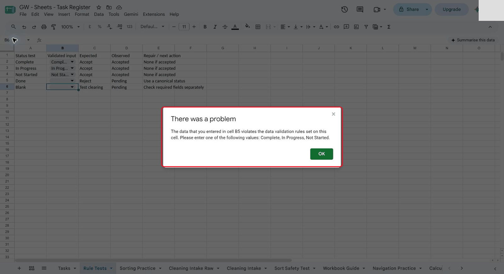

*Done is refused here too.*

6. In **B6**, choose any status, then press **Delete**. The cell clears without complaint. Change **D6** to `Clearing allowed`.

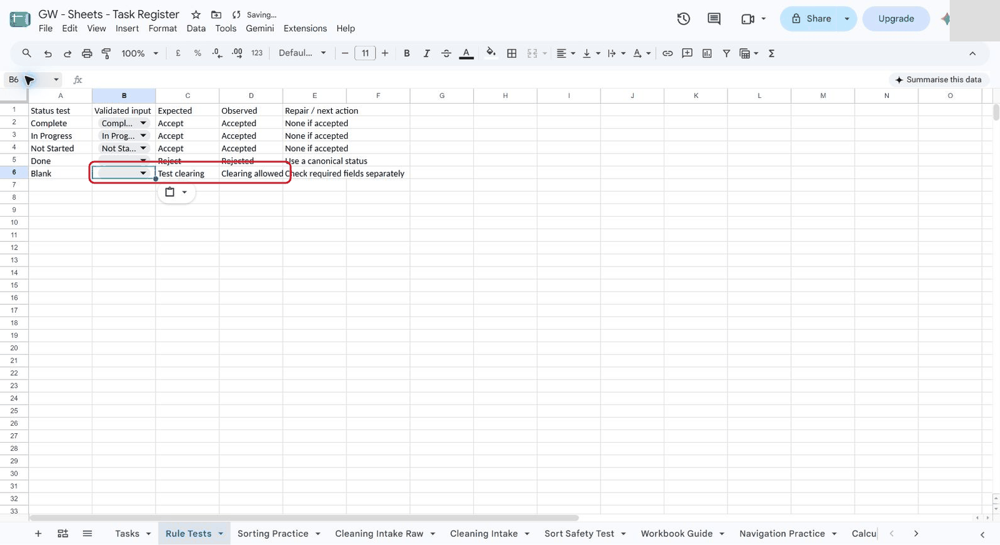

*The rule stops wrong values, but it can't make anyone fill a cell in.*

**Check:** **D2:D6** say **Accepted**, **Accepted**, **Accepted**, **Rejected**, **Clearing allowed**.

---

## 5.5 Add a Whole-Week Rule

DueWeek must be a whole number from 1 to 4. A dropdown can't say that, so you write a custom rule.

1. On **Rule Tests**, copy the block below, click **A9** and press **Ctrl+V**.

```text
Week test	Copy cell	Expected	Observed	Repair / next action
0	E4	Reject	Pending	Use integer 1 through 4
1	E4	Accept	Pending	None if accepted
4	E4	Accept	Pending	None if accepted
5	E4	Reject	Pending	Use integer 1 through 4
1.5	E4	Reject	Pending	Use a whole week
Blank	E4	Test clearing	Pending	Check required fields separately
```

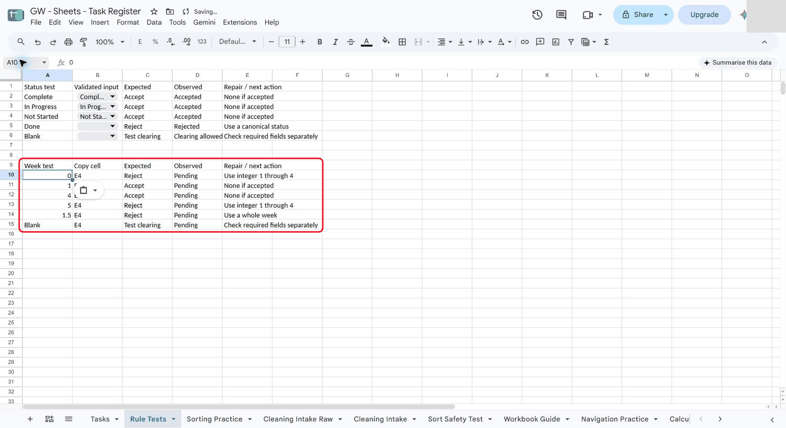

*Two values on each edge of the range, plus a fraction.*

2. Click the arrow on the **Entry Practice** tab and choose **Duplicate**. Rename the copy `Entry Rule Practice`.
3. On **Entry Rule Practice**, click the name box, type `E2:E4` and press **Enter**. Click **Data**, **Data validation**, **Add rule**.
4. Under **Criteria**, choose **Custom formula is**. Copy the formula below and paste it into the box.

```text
=AND(ISNUMBER(E2),E2=INT(E2),E2>=1,E2<=4)
```

5. Click **Advanced options**. Tick **Show help text for a selected cell** and paste this help text:

```text
Enter a whole practice week from 1 to 4. This is not a calendar date.
```

6. Choose **Reject the input**: a custom formula starts on **Show a warning**. Click **Done** and close the panel.

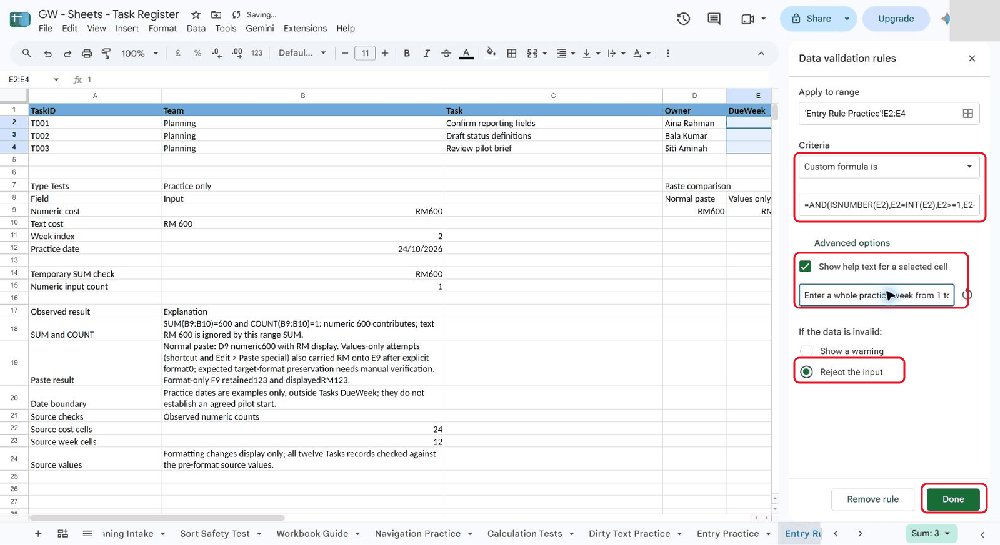

*The formula checks four things: it's a number, it's whole, it's at least 1 and at most 4.*

**Check:** the rule applies to **E2:E4** on **Entry Rule Practice**, uses the custom formula and rejects bad input.

---

## 5.6 Test the Week Rule

Use **E4** for every test. It starts at **1**.

1. In **E4**, type `0` and press **Enter**. Your help text appears in a **There was a problem** message. Click **OK**.


*Your own help text tells people what to type instead.*

2. Type `1` and press **Enter**: accepted. Type `4` and press **Enter**: accepted.

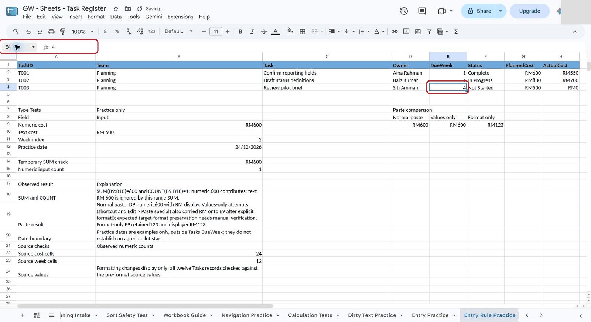

*4 is the top of the range, so it's allowed.*

3. Type `5` and press **Enter**: rejected. Click **OK**. Type `1.5` and press **Enter**: rejected. Click **OK**.

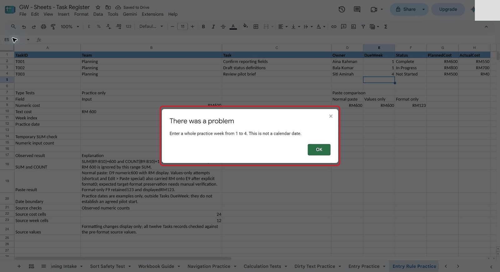

*5 is outside the range.*

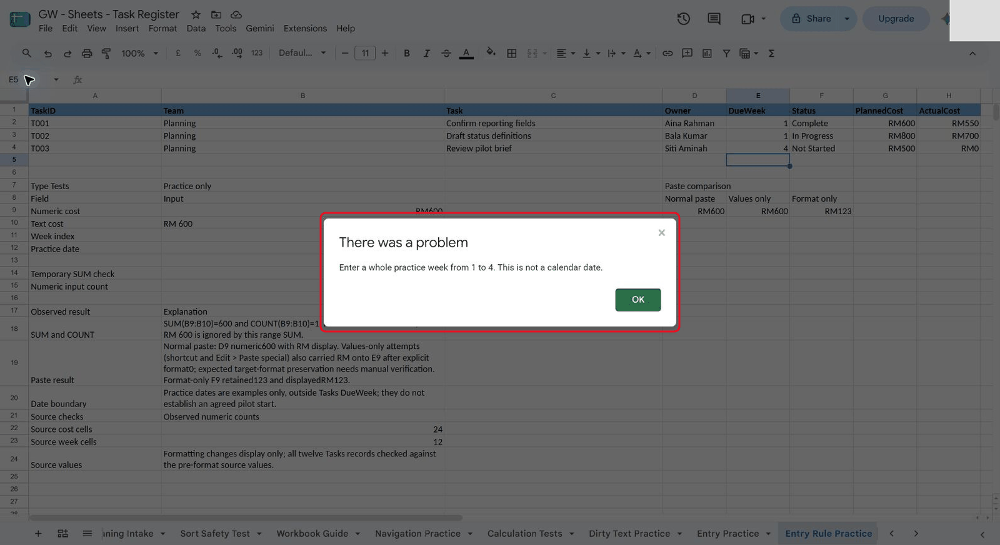

*1.5 is inside the range but not a whole week, so it's refused too.*

4. Click **E4** and press **Delete**. The cell clears.

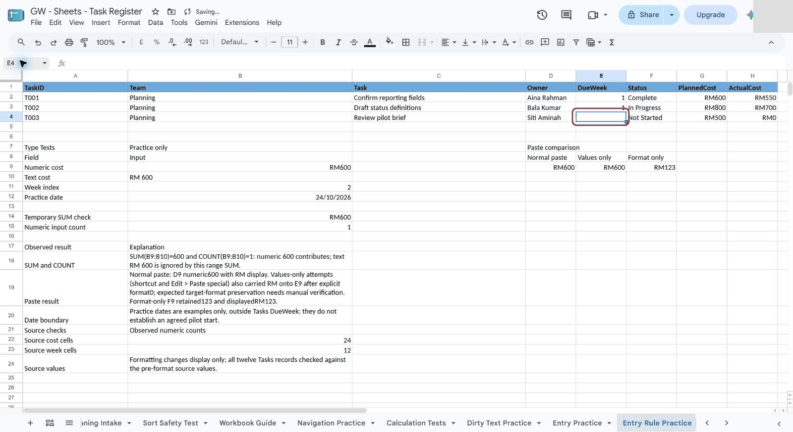

*As with the status rule, clearing is allowed.*

5. Type `1` in **E4** to put the original week back.


*The practice record is as it was.*

6. On **Rule Tests**, change **D10:D15** to what happened: `Rejected`, `Accepted`, `Accepted`, `Rejected`, `Rejected`, `Clearing allowed`.

**Check:** **E4** on **Entry Rule Practice** holds **1**, and **D10:D15** match what you saw.

---

## 5.7 Write an Entry Guide

1. On **Rule Tests**, copy the block below, click **A18** and press **Ctrl+V**.

```text
Entry guide	Instruction
Status	Complete, In Progress, Not Started
DueWeek	Whole practice week 1 to 4; a relative index, not a calendar date.
Invalid input	Read the rejection message and repair the value; do not bypass the rule.
Blank fields	Clearing is allowed. Check required fields before handing over a record.
Unclear category	Retain the uncertainty and ask for clarification; do not invent a mapping.
Rule coverage	Tasks F2:F13; status tests B2:B6; Entry Rule Practice E2:E4.
```

2. Widen columns **A** and **B** until every line is readable.

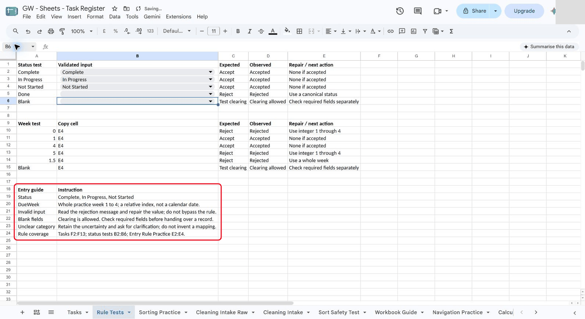

*Everything someone needs to enter data correctly, with the tests that back it up.*

**Check:** **Rule Tests** has the status tests, the week tests and the entry guide, and every line is readable.

---

## 5.8 See What a Filter Hides From SUM

1. On **Tasks**, click **I15** and type `SUM costs`. Click **J15**, type `=SUM(G2:G13)` and press **Enter**. It shows **RM10,400**.

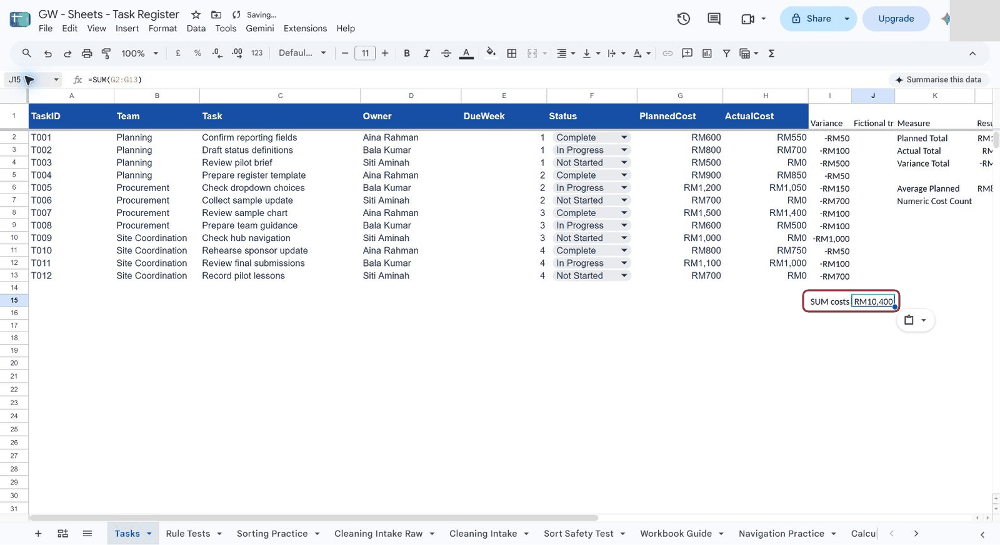

*Row 15 is outside the filter range, so it stays visible when rows are hidden.*

2. Click the name box, type `A1:I13` and press **Enter**. Click **Data**, **Create filter view**, then **Save view**. Type `Planning incomplete tasks` and click **Save**.

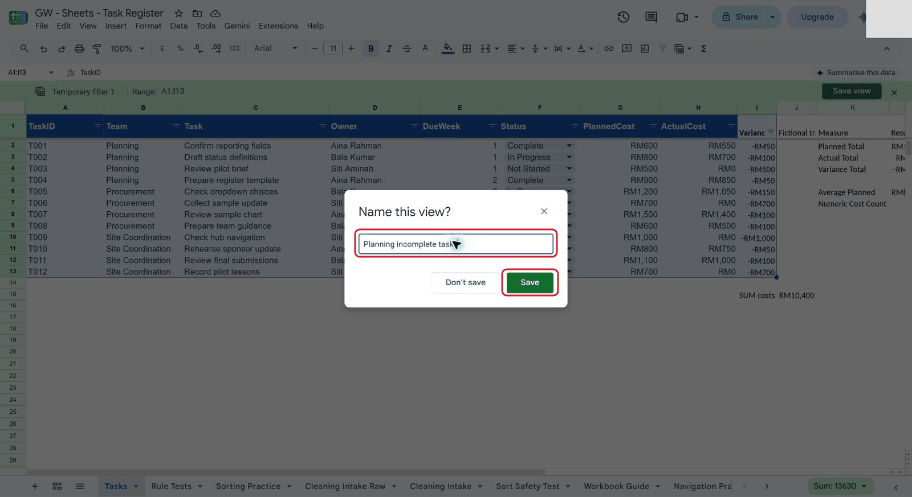

*A second view over the same range.*

3. In the **Status** heading filter, untick **Complete** and click **OK**.
4. In the **Team** heading filter, click **Clear**, tick only **Planning** and click **OK**.

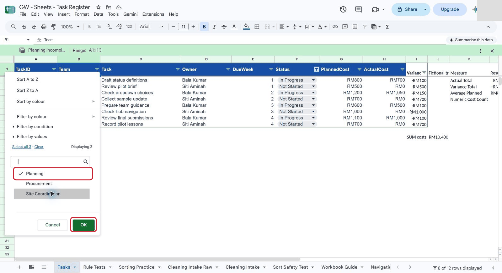

*Both filters apply at once: Planning, and not Complete.*

5. Two tasks are shown, **T002** and **T003**, and the bottom right says **2 of 12 rows displayed**. **J15** still shows **RM10,400**.

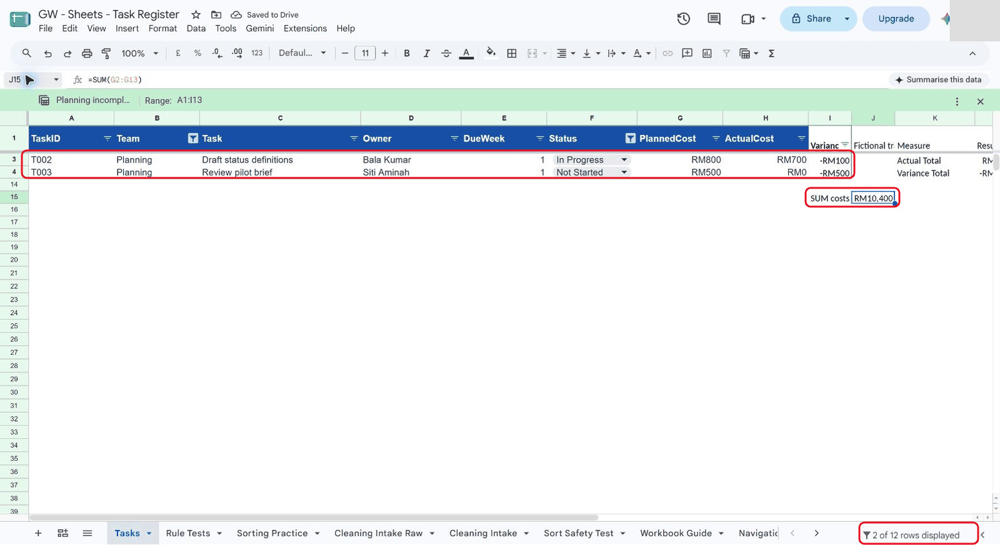

*The total still includes all twelve tasks, even though you can see only two.*

<details markdown="1">
<summary>What should you see?</summary>

Only **T002** and **T003**: the two Planning tasks that aren't Complete. **J15** stays at **RM10,400**, because `=SUM()` adds hidden rows too. The two visible tasks' planned costs add up to only RM1,300.

</details>

---

## 5.9 Reopen Both Views and Record Them

1. Close the view with the **X**. Click **Filter views** on the toolbar. Both **Incomplete tasks** and **Planning incomplete tasks** are listed.

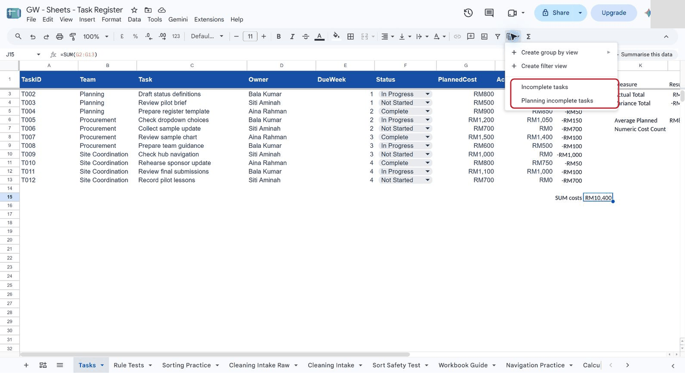

*A name in the list doesn't prove the filter inside it still works, so open each one.*

2. Choose **Incomplete tasks**: eight tasks, and **J15** still **RM10,400**. Close it.
3. Open **Planning incomplete tasks**: **T002** and **T003** again. Close it.

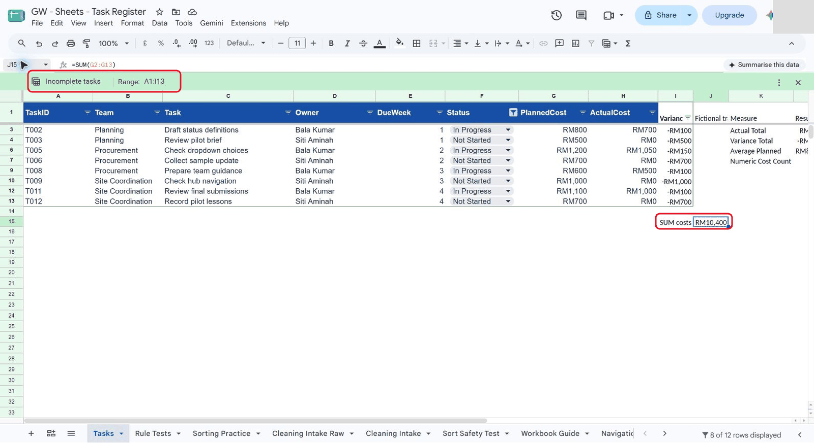

*Eight tasks.*

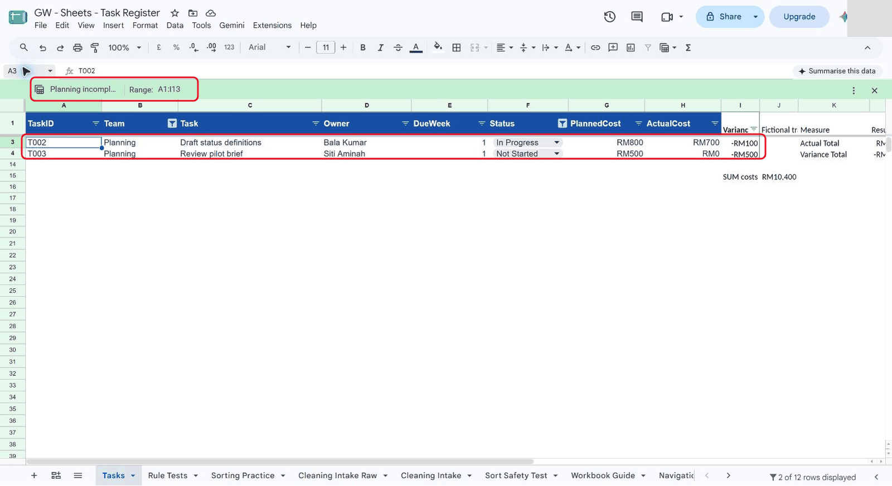

*Two tasks.*

4. With both views closed, check all twelve tasks are visible on **Tasks**.

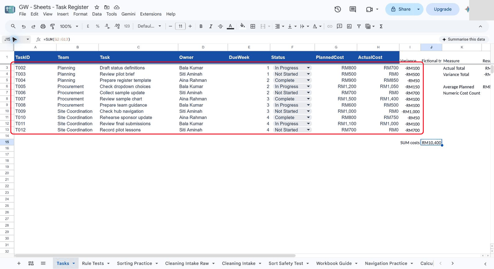

*Back to the full register.*

5. On **Rule Tests**, copy the block below, click **A27** and press **Ctrl+V**. Then fill in **C28:E30** from what you saw: how many tasks were visible, what **J15** showed, and which TaskIDs.

```text
View check	Range	Visible IDs	Ordinary SUM	Observed IDs / restore
Incomplete tasks	Tasks!A1:I13
Planning incomplete tasks	Tasks!A1:I13
Closed views	Original register
Scope	SUM includes hidden rows. Required fields need a separate completeness check.
```

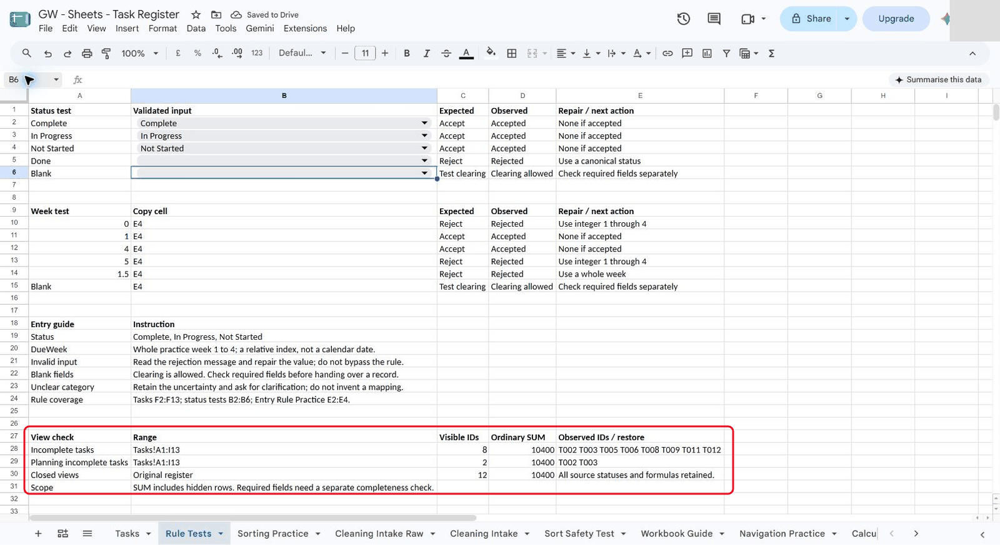

*The final record: what each view shows, and that the total ignores the filter.*

<details markdown="1">
<summary>What should you see?</summary>

| View check | Visible IDs | Ordinary SUM | Observed IDs / restore |
|---|---|---|---|
| Incomplete tasks | 8 | 10400 | T002 T003 T005 T006 T008 T009 T011 T012 |
| Planning incomplete tasks | 2 | 10400 | T002 T003 |
| Closed views | 12 | 10400 | All source statuses and formulas retained. |

</details>

---

## Independent Practice

Try these without looking back at the steps.

1. **A view for Procurement.** Create and save a filter view called `Procurement incomplete tasks` over **Tasks!A1:I13** that answers "Which Procurement tasks aren't complete?". Write its TaskIDs on **Rule Tests**.
2. **A gap in coverage.** On **Entry Rule Practice**, type `7` in **E5**, just below the three records. Does the week rule stop it? Explain why, then extend the rule to **E2:E5** (**Data** > **Data validation**, click the rule, change the range) and try `7` again. Clear **E5** when you're done.
3. **Test each other.** Swap laptops with a partner. Try to enter a wrong status on their **Rule Tests** and a wrong week on their **Entry Rule Practice**, and tell them what happened.

<details markdown="1">
<summary>What should you see?</summary>

**Procurement incomplete tasks** shows **T005**, **T006** and **T008**: 3 of 12 rows. On **Entry Rule Practice**, `7` in **E5** is accepted at first, because the rule only covers **E2:E4**. After you extend it to **E2:E5**, `7` is rejected.

</details>

### Evidence to Hand Over

- **Tasks** with the status dropdown, **N2** holding the rule but no value, and **J15** showing **RM10,400**
- **Rule Tests** with the status and week tests (expected and observed), the entry guide and the view check
- **Entry Rule Practice** with the whole-week rule and **E4** back at 1
- Three saved filter views, and your coverage-gap explanation

## Troubleshooting

| Problem | What to try |
|---|---|
| A bad value was saved with a red triangle | The rule is set to **Show a warning**. Open it, choose **Reject the input**, then retype the value. |
| The dropdown has extra items | Open the rule and delete them. Keep exactly **Complete**, **In Progress** and **Not Started**. |
| The custom formula rejects everything | Check it starts with `=` and refers to **E2**, the first cell of the range. |
| The filter view shows nothing | Open each heading filter and click **Select all**, then apply the filters again. |
| Everyone else can see your filter | You used **Data** > **Add a filter** instead of a filter view. Remove it and create a filter view. |
| A new row accepts any value | It's outside the rule's range. Extend the range in **Data** > **Data validation**. |

## Lesson Summary

You added a status dropdown that rejects anything else and a custom rule for whole weeks, and proved both with tests you planned first. You saw that clearing a cell is always allowed, that a rule only covers its range, and that a normal SUM still counts hidden rows. Your two filter views give a focused slice without changing what anyone else sees. In Lab 06 you summarise the register and chart it.

**Check yourself:** does hiding a row remove it from an ordinary SUM?
