# 05 - Validate and Filter the Register

In this chapter you will add a status dropdown, identify invalid entries and create a filter view.

> **Prompts:** the [prompts page](./prompts.md) has every value and prompt for this chapter, each with a Copy button.

**Estimated time:** 50 minutes, planned as 10 explanation and demonstration, 20 guided build and casework, 15 independent practice and 5 verification and repair, with 40 active minutes by design. Not yet timed with learners.

**Your result:** A status dropdown and two named filter views.

> **Status:** author reference with 34 staged application captures through 5.4. Strict status validation, actual rejection tests, whole-week boundaries/fractions, clearing limitations, two saved views, visible TaskID checks, ordinary SUM under filtering and restoration verified. Independent coverage/range repair and learner timing remain pending.

---

## What You Will Learn

- Restrict status values.
- Create and name a filter view.
- Check hidden rows before interpreting totals.

## Before You Begin

Read the [case input](./prompts.md) and use a separate named casework copy for destructive tests or altered datasets. Keep the baseline unchanged for later chapters. Record source facts, proposed practice and unresolved questions separately.

Use the original Tasks table, with all 12 baseline records still present.

## 5.1 Add a Status Dropdown

1. On **Tasks**, select **F2:F13** and open **Data > Data validation > Add rule**. Confirm **Apply to range Tasks!F2:F13**. In the current interface the default Drop-down criterion populated its choices from the selected cells; inspect rather than assuming those inferred choices are correct. Use exactly **Complete / In Progress / Not Started**.

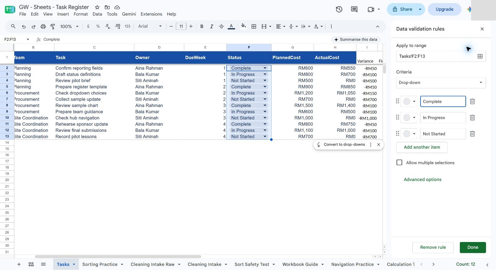

*Inspect status rule coverage and canonical options.*

2. Open **Advanced options**, confirm **Reject the input**, and keep **Allow multiple selections** off. Click **Done**, then close the sidebar.

> **Reference run:** The reference uses the Chip display.

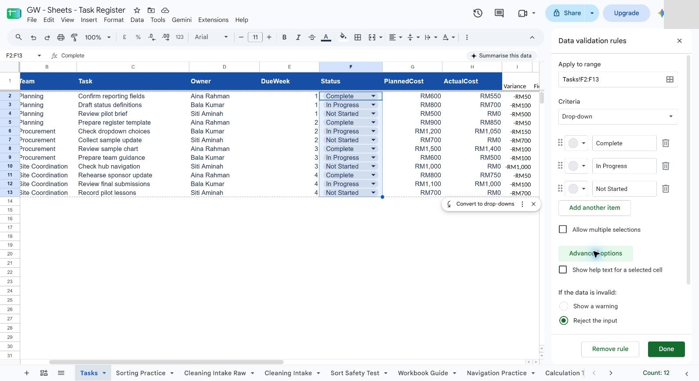

*Verify Reject the input and single selection.*

3. Inspect **F3** and open its dropdown. Its existing **In Progress** value remains unchanged, and the three canonical choices are available. Adding a rule must not rewrite the twelve source statuses.

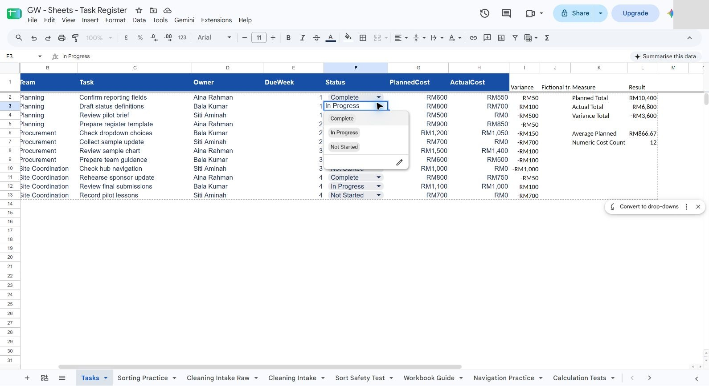

*Inspect an unchanged existing status dropdown.*

## 5.2 Create a Filter View

1. Select **A1:I13**, including the header and variance. Use **Data > Create filter view**, or the toolbar's **Filter views > Create filter view**. This interface initially creates **Temporary filter 1**; inspect its range before saving.

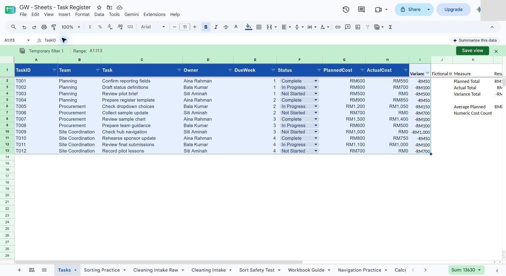

*Inspect the temporary filter range.*

2. Click **Save view**, enter **Incomplete tasks** in **Name this view?**, then **Save**. This save-and-name step replaces the older guide's assumption that a new view is named immediately.


*Name the saved incomplete view.*

3. Open the Status header filter, uncheck **Complete**, and click **OK**. Leave **In Progress** and **Not Started** selected.

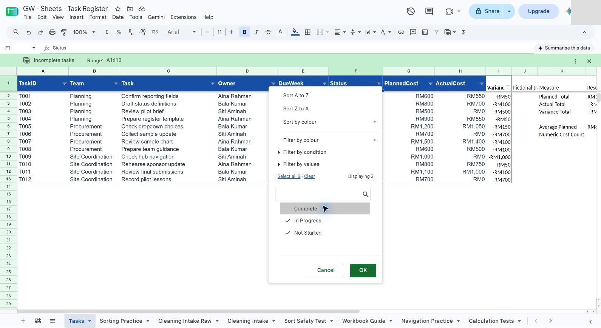

*Exclude Complete from the Status filter.*

4. Count the visible IDs: **T002, T003, T005, T006, T008, T009, T011, T012**. The lower-right indicator reports **8 of 12 rows displayed**. Compare these with the original source statuses.

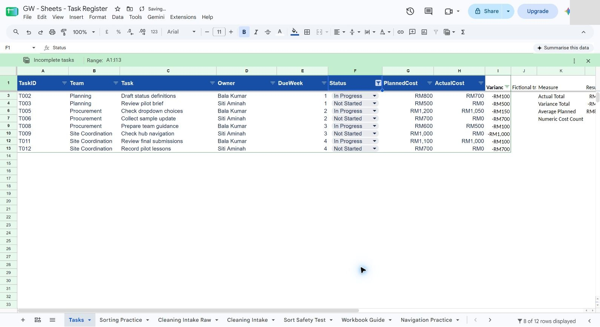

*Verify eight incomplete task IDs.*

5. Use **Exit** at the right of the green filter-view bar. All twelve records return. Closing the view does not delete its saved definition or any hidden records.

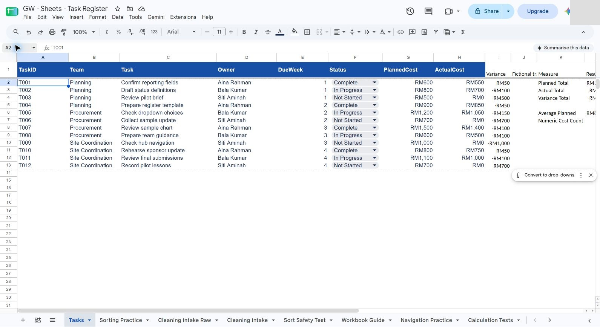

*Restore all twelve rows after closing the view.*

## 5.3 Test a Rule Safely

1. Select **F2**, copy it, and select the unused **N2** outside the source register. Use **Edit > Paste special > Data validation only**. This transfers the rule without copying a source status value. Keep the copied clipboard intact while selecting the destination; pasting a cell address would replace it.

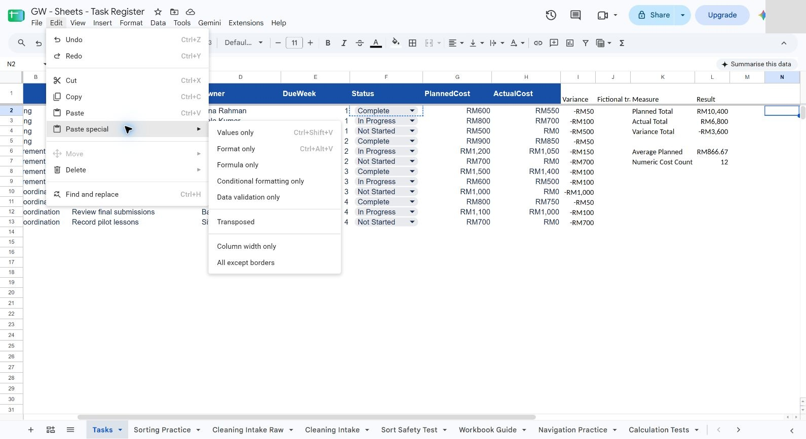

*Copy only data validation to the spare cell.*

2. Edit N2 with **F2** (the edit-cell key), enter **Done**, and commit. This is rejection, not a warning that leaves an invalid value stored.

> **Reference run:** The reference shows **There was a problem** and identifies the allowed values **Complete, In Progress, Not Started**.

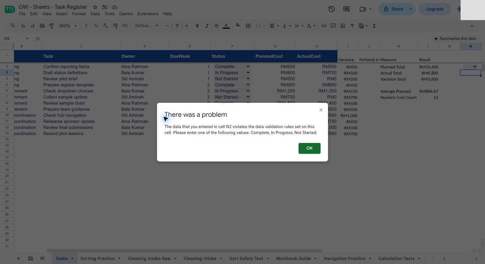

*Observe Done rejected in N2.*

3. Dismiss the message, exit editing if necessary, and clear N2. Its value is empty; its copied validation remains available for safe demonstrations. No baseline status was changed.

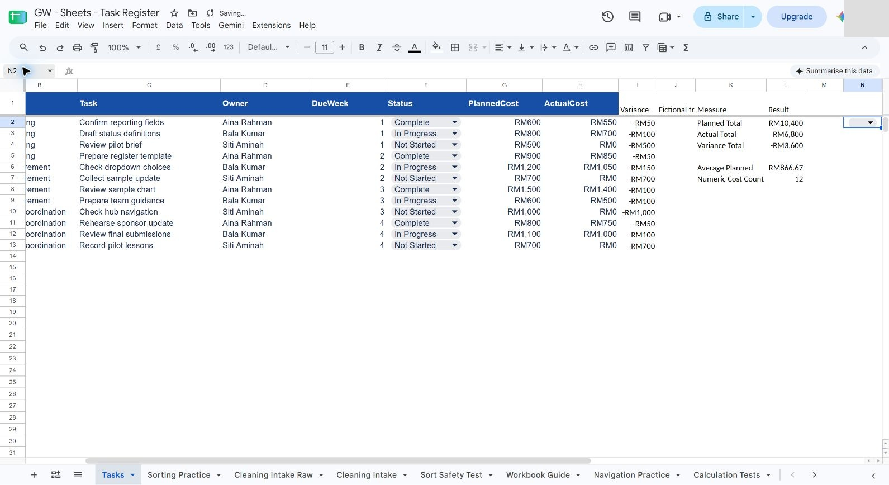

*Clear the spare test cell.*

4. Open the toolbar's **Filter views** menu and choose **Incomplete tasks**. It still shows the same eight task IDs. Exit the view before continuing.

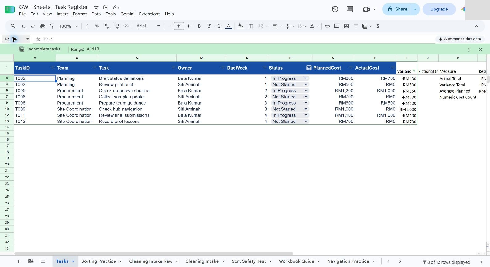

*Reopen the saved incomplete view.*

## 5.4 Design and Verify Entry Rules and Focused Views

1. Create **Rule Tests** with headers **Status test / Validated input / Expected / Observed / Repair or next action** in A1:E1. Plan **Complete, In Progress, Not Started, Done and Blank** in rows 2–6. Predict acceptance for the canonical statuses and rejection for Done; leave observed results pending. Treat clearing as an actual test, not an assumed required-field guarantee.

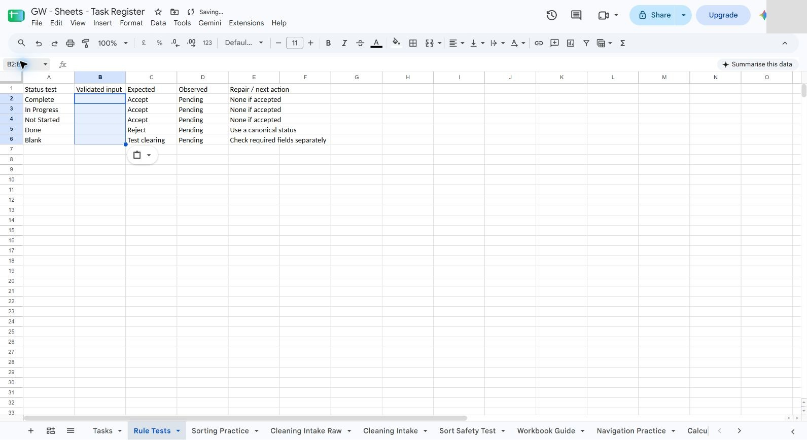

*Plan status tests before running them.*

2. Copy validation from Tasks F2 to **Rule Tests B2:B6** using **Paste special > Data validation only**. Enter test values through cell-edit mode, preserving the rule. The three canonical statuses are accepted in B2:B4.

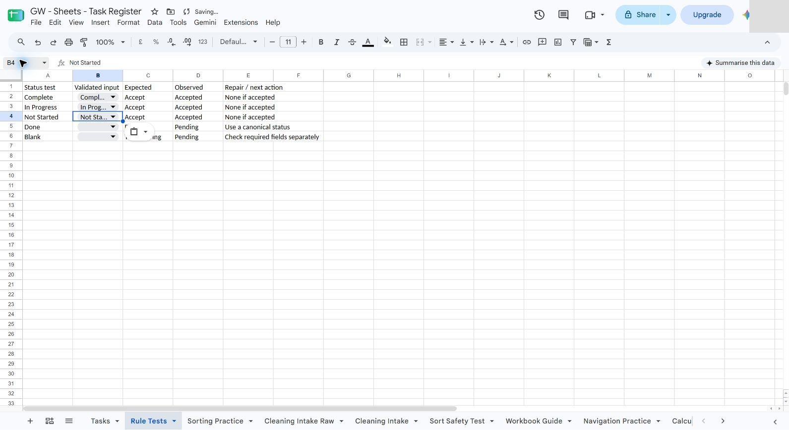

*Verify all three canonical statuses accepted.*

3. Attempt **Done** in B5. It is rejected with the same allowed-value message. Dismiss the message; B5 stays empty. Record **Rejected** separately from the attempted value.

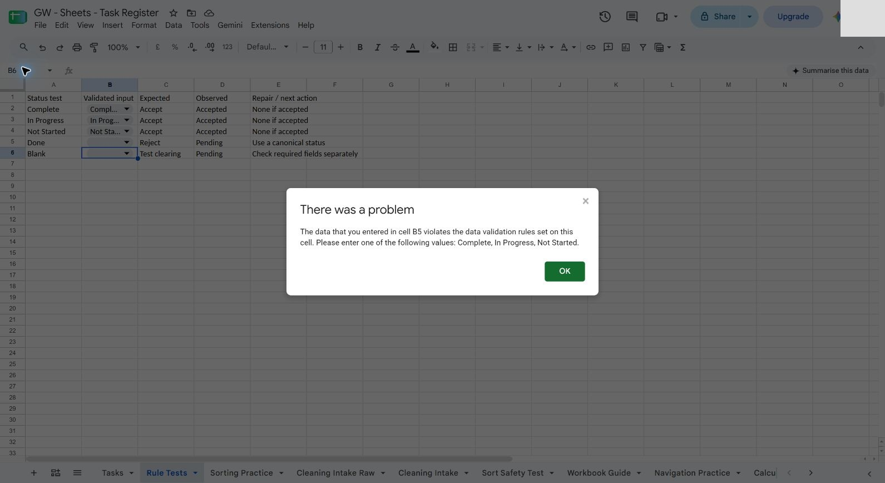

*Reject Done in the planned matrix.*

4. Enter a valid status in B6, then clear it with Backspace. Clearing is allowed. Record that observation and keep B6 empty. The tested rule limits nonempty status entries but does not prove that every required field is complete.

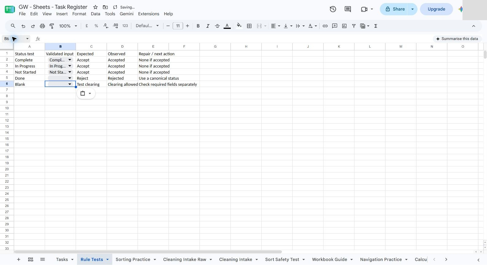

*Record that status clearing is allowed.*

5. Plan the week tests in **A9:E15**: **0 reject / 1 accept / 4 accept / 5 reject / 1.5 reject / blank clearing to test**. Use a copy named **Entry Rule Practice**, created by duplicating **Entry Practice**. The test target is **E4** on that copy; the original three copied records remain unchanged.

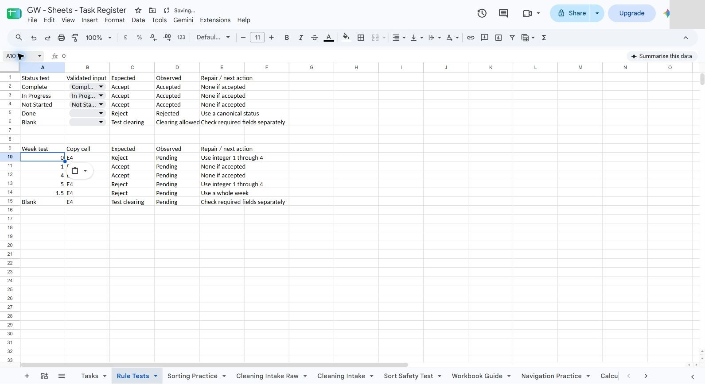

*Plan week boundaries and fraction tests.*

6. On **Entry Rule Practice**, select **E2:E4** only, open **Data validation > Add rule**, choose **Custom formula is**, and enter:

```text
=AND(ISNUMBER(E2),E2=INT(E2),E2>=1,E2<=4)
```

Use the top-left cell E2 as the relative reference. This checks numeric type, a whole number and both bounds; a simple between rule alone would not express the whole-week requirement. Explicitly choose **Reject the input**: the custom criterion initially offered **Show a warning** in this session. Enable help text **Enter a whole practice week from 1 to 4. This is not a calendar date.**, then save and close the sidebar. E2:E4 covers the three-record practice table, not the notes and type tests farther down that tab.

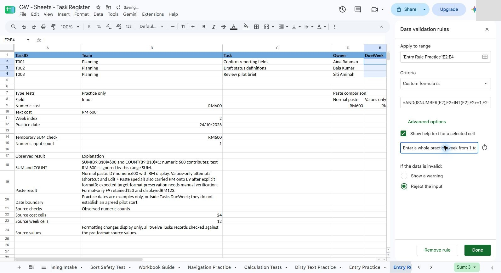

*Configure the strict whole-week custom formula.*

7. Reuse E4 for each planned test. Enter edit mode, select its previous content, type the candidate and commit. **0** is rejected with the configured help text. Dismiss the message before the next test.


*Reject week zero.*

8. Test **1**, then **4**; both are accepted. Inspect the formula bar after committing each input. The captured upper-bound stage shows E4 holding numeric **4**.


*Accept the upper boundary of four.*

9. Test **5** and **1.5** separately. Both are rejected. A fractional value must not be accepted merely because it lies between the bounds.


*Reject week five.*

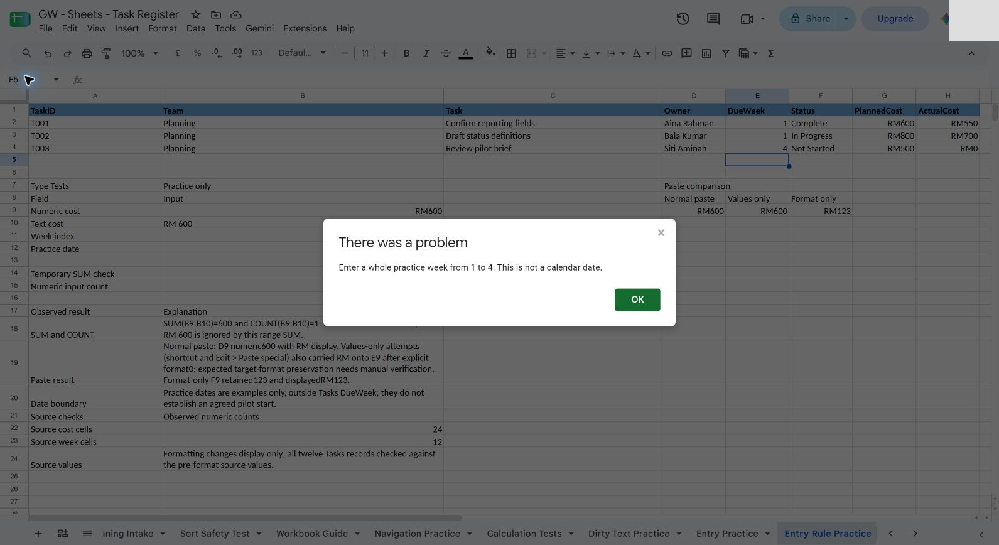

*Reject a fractional week.*

10. Clear the previously valid week and observe that deletion is allowed. This clearing test does not establish acceptance of every possible blank-input mechanism. Required-field completeness still needs an explicit review.

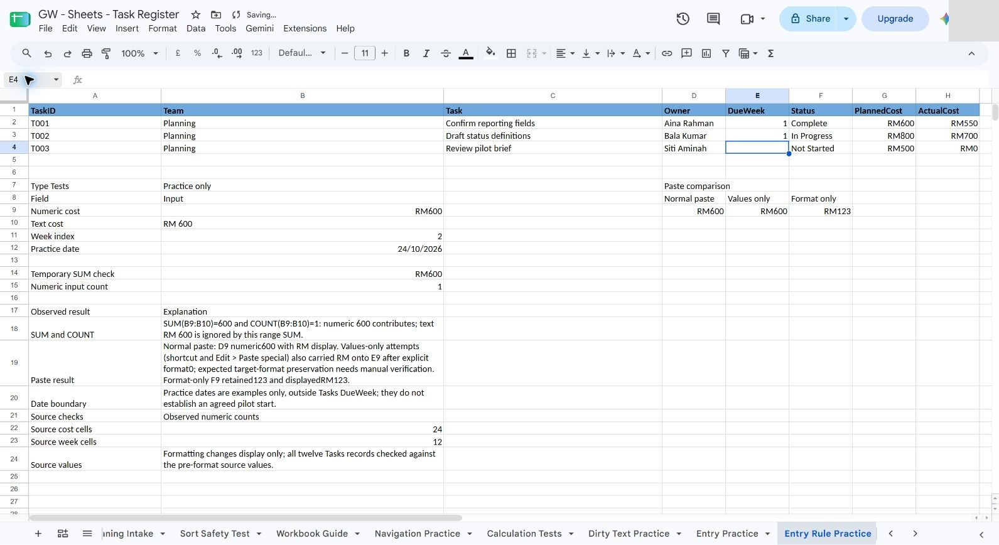

*Observe that clearing a week is allowed.*

11. Restore E4 to its original numeric **1**. Keep the other practice-record values unchanged.


*Restore the original practice week.*

12. Record all observed results in Rule Tests. Add an entry guide in A18:B24 covering the canonical statuses, whole relative weeks, actual rejection messages, clearing limitation, unclear-category escalation and precise rule ranges. Fit the columns so labels and instructions are readable. Do not invent a mapping for an unclear category.

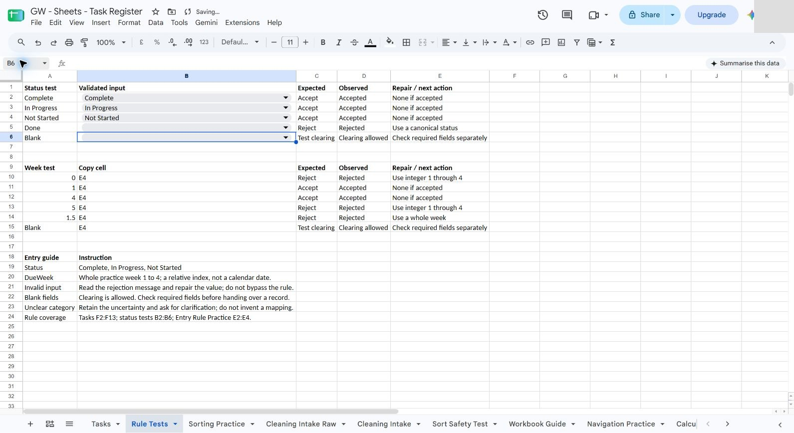

*Review the completed rule matrix and entry guide.*

13. On **Tasks**, enter **SUM costs** in I15 and **=SUM(G2:G13)** in J15. This labelled check sits outside the bounded A1:I13 filter range and stays visible while rows are hidden. Before filtering its result is **RM10,400**.

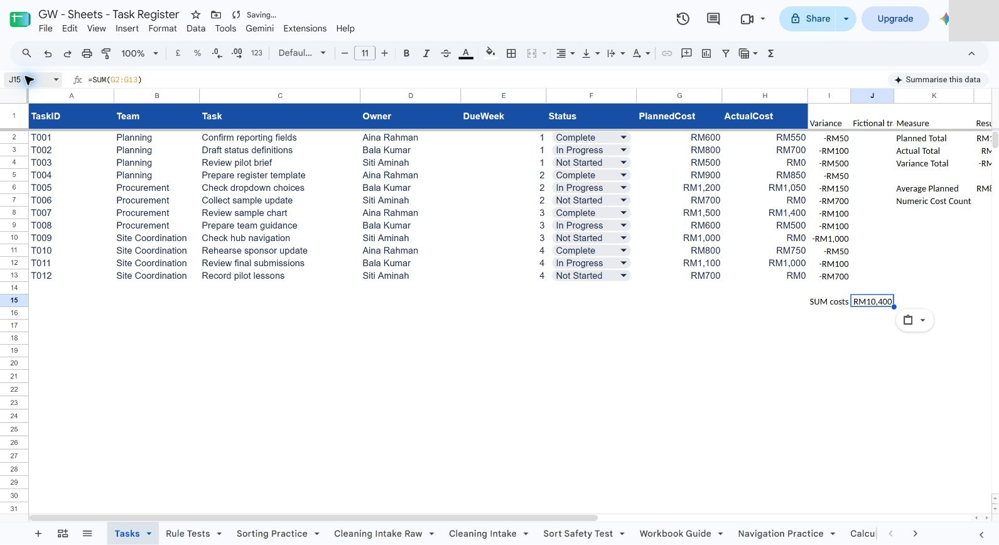

*Record the ordinary SUM before filtering.*

14. Create a second filter view over **A1:I13**, save it as **Planning incomplete tasks**, and exclude Complete in Status as before.

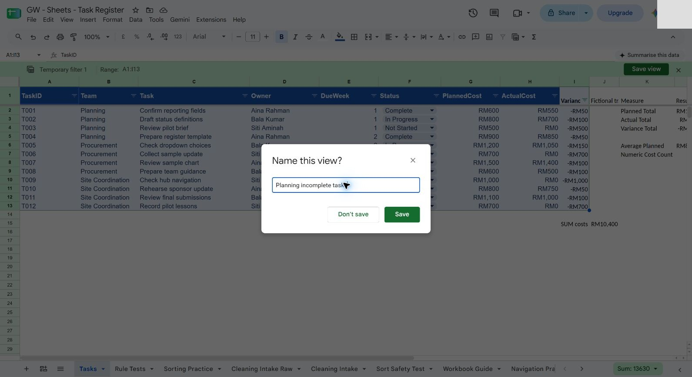

*Name the Planning-focused view.*

15. In the Team header filter leave only **Planning** selected. Both Team and Status criteria must apply to the same view.

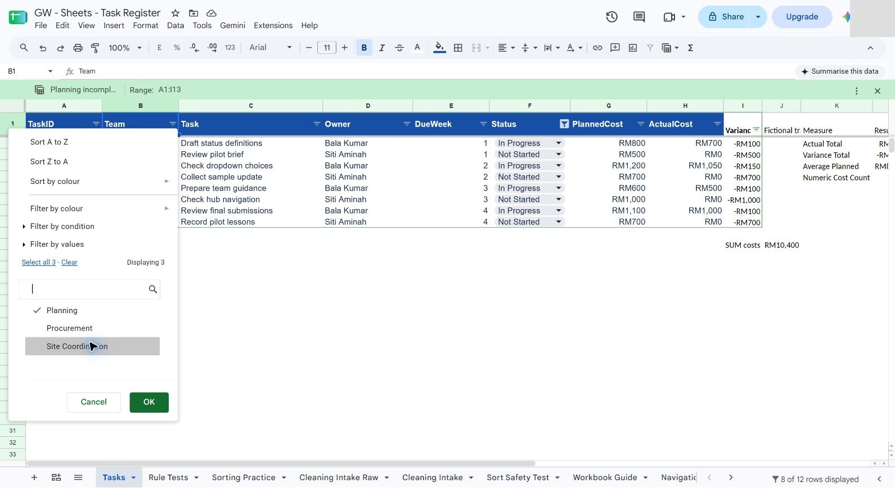

*Keep only Planning in the Team filter.*

16. Verify **T002 and T003**, and the lower-right **2 of 12 rows displayed** indicator. A manual source scan confirms these are the two Planning records not Complete. J15 still shows **RM10,400** because an ordinary SUM includes values in hidden rows; it is not the total of only the two visible records.

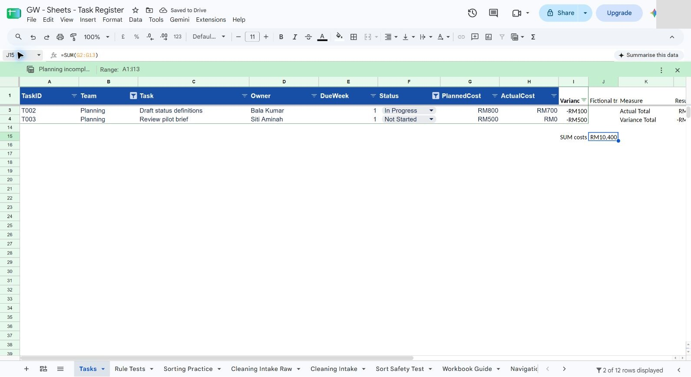

*Verify two Planning tasks with an unchanged SUM.*

17. Exit the view and inspect the **Filter views** menu. Both saved names remain available.

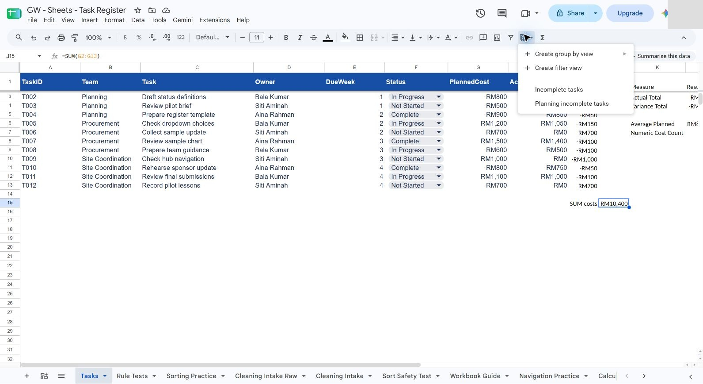

*Inspect both saved view names.*

18. Reopen **Incomplete tasks** and verify eight IDs with J15 still **RM10,400**. Exit it, reopen **Planning incomplete tasks**, and verify the same two IDs. Do not use the mere presence of a view name as proof that its criteria persisted.

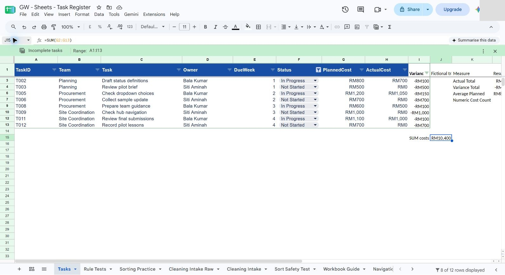

*Reopen eight incomplete tasks with unchanged SUM.*

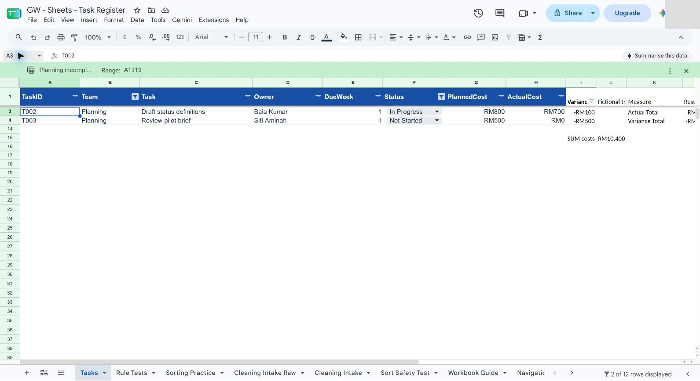

*Reopen the Planning view and confirm two tasks.*

19. Exit the view and leave all twelve source records visible. The source A1:L13 values and formulas remain unchanged; the validation rules and separate J15 control are additions.

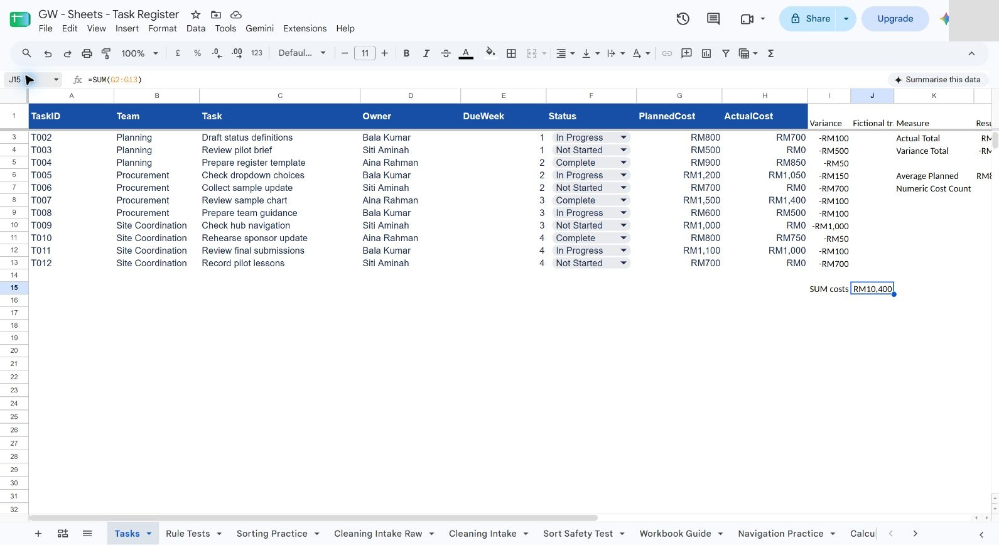

*Restore all source rows after closing both views.*

20. Record the two views' ranges, visible counts, observed IDs and ordinary SUM in **Rule Tests A27:E31**. All source rows return after closing the views. Inspect rule coverage separately from view coverage: an input outside a bounded rule may escape validation, and hiding a row does not remove it from an ordinary SUM.

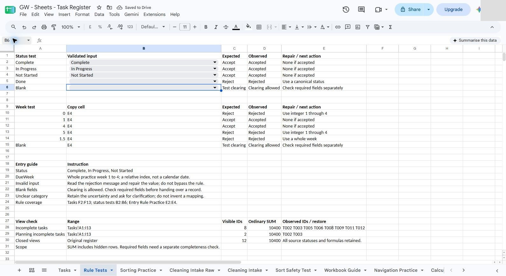

*Review the final rule and view evidence.*

> **Validation boundary:** these are author UI reference checks. The independent Procurement view, new-row coverage/range repair challenge, independent entry test and learner timing pilot remain pending. Earlier CSV-import and values-only-format limitations remain separate.

## Independent Practice

Close the earlier step lists for the first attempt. Use the case input and your own reasoning. If you need help, record the hint and repeat the affected check independently.

1. Independently build a small entry test with one valid row, one invalid status and one out-of-range week. Demonstrate the rules rather than merely listing them.

2. Create a named view answering “Which Procurement tasks are not complete?” and list its TaskIDs as evidence.

3. Check whether each new practice row lies inside the rule and view ranges. Repair a missing bound on the practice copy and retest.

### Evidence to Hand Over

- Expected-versus-observed rule matrix including week boundaries and blanks.
- Two useful named views with independently checked visible records.
- Entry guide and a repaired coverage/range test.

Record the defect or uncertainty you investigated, the evidence used, the repair or reasoned no-change decision, and the final state. Restore temporary changes or keep them in a clearly named scenario copy.

## Troubleshooting

| Symptom | What to check |
|---|---|
| A new row accepts invalid values | Inspect rule coverage as well as the dropdown definition; retest the actual new row. |
| An input or earlier result is missing | Reopen the input named in Before You Begin; do not substitute private company data |
| A menu or feature is unavailable | Confirm the account and the shared access notes; record the missing step and ask the trainer for its fallback |
| The result differs from the checkpoint | Compare the exact source range, wording and conditions before repeating the action |

## Lesson Summary

Validation prevents inconsistent entries and filter views support focused inspection.

**Check yourself:** Does hiding a row delete it or remove it from an ordinary SUM?
