# 06 - Summarise and Visualise

In this chapter you will build a simple conditional total and chart; ask Gemini to explain a checked formula if available.

> **Prompts:** the [prompts page](./prompts.md) has every value and prompt for this chapter, each with a Copy button.

**Estimated time:** 55 minutes, planned as 10 explanation and demonstration, 25 guided build and casework, 15 independent practice and 5 verification and repair, with 45 active minutes by design. Not yet timed with learners.

**Your result:** A conditional summary and a source-linked status chart.

> **Status:** author reference with 29 staged application captures through 6.4. Conditional summaries, two labelled charts, Gemini explanation, actual source-change propagation, reconciliations and repaired chart/category faults checked. Source status and cost restored. Independent dashboard/reviewer and learner timing remain pending.

---

## What You Will Learn

- Calculate a conditional count and total.
- Choose and label a simple chart.
- Use AI to explain a formula without surrendering the check.

## Before You Begin

Read the [case input](./prompts.md) and use a separate named casework copy for destructive tests or altered datasets. Keep the baseline unchanged for later chapters. Record source facts, proposed practice and unresolved questions separately.

Use Tasks and the starter Summary tab. Existing baseline status counts are four per category.

## 6.1 Count Statuses

1. Open the supplied **Summary** tab. A1:B4 already contains Status / TaskCount and the three canonical status labels; the counts are blank. Enter **=COUNTIF(Tasks!$F$2:$F$13,A2)** in B2. The fixed range covers the twelve task statuses; A2 supplies the criterion.

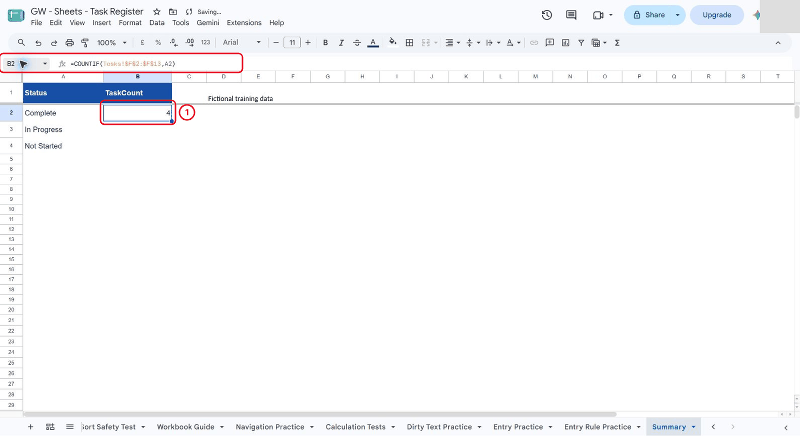

*Enter the first anchored COUNTIF.*

2. Select B2:B4 and use **Fill down** (Ctrl+D). Inspect B3: the range remains fixed and the criterion becomes A3. Enter **Total** in A5 and **=SUM(B2:B4)** in B5. Verify **4 / 4 / 4**, total **12**.

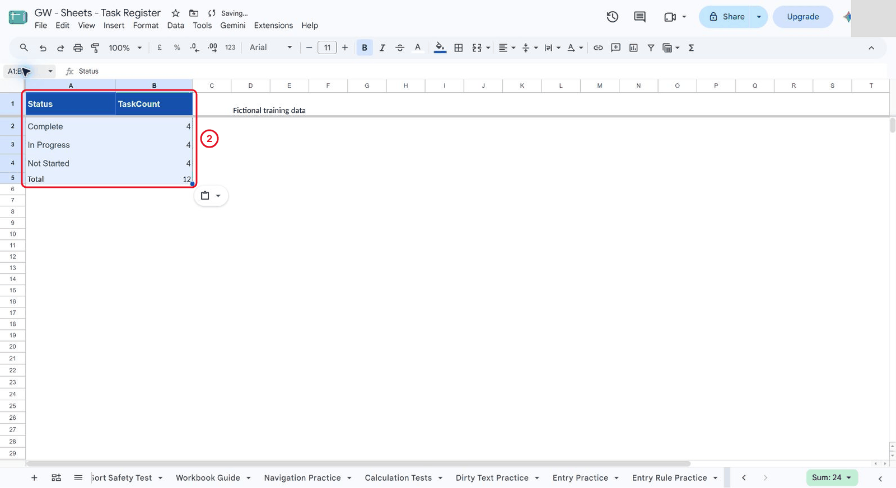

*Fill three status counts and total twelve.*

3. Move the fictional-data marker from D1 to G1 before using D:E. Enter **Team / Planned cost (RM)** in D1:E1 and **Planning / Procurement / Site Coordination** in D2:D4. In E2 enter **=SUMIF(Tasks!$B$2:$B$13,D2,Tasks!$G$2:$G$13)**.

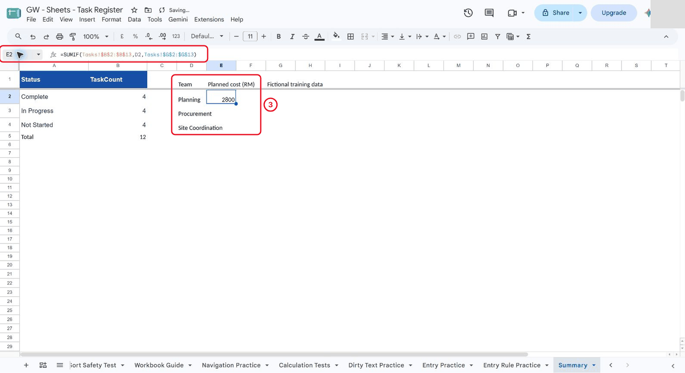

*Enter the first anchored SUMIF.*

4. Fill E2 through E4. Verify **2800 / 4000 / 3600**, which sum to **10400**. Fit D:E to the labels so Site Coordination and the RM heading remain readable. These are planned amounts, not actual expenditure or savings.

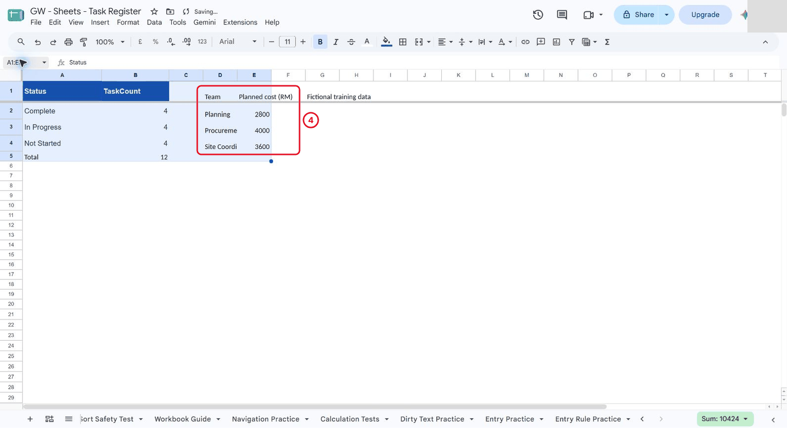

*Inspect both conditional summaries.*

## 6.2 Build a Useful Chart

1. Select **A1:B4**, excluding Total, then **Insert > Chart**. This session initially suggested a pie chart; explicitly choose **Column chart** in **Chart editor > Setup**. Confirm **A1:B4**, row 1 headers and column A labels.

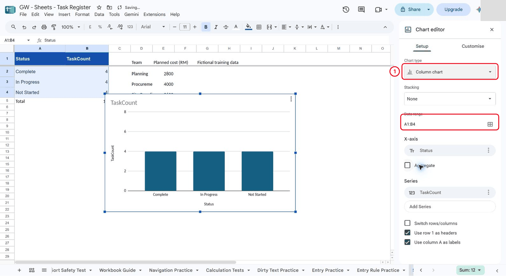

*Set column chart and bounded status range.*

2. In **Customise > Chart and axis titles**, set the chart title to **Task count by status**. Close the editor. Select the chart once, then drag its blank upper area to place it below the summaries without covering cells.

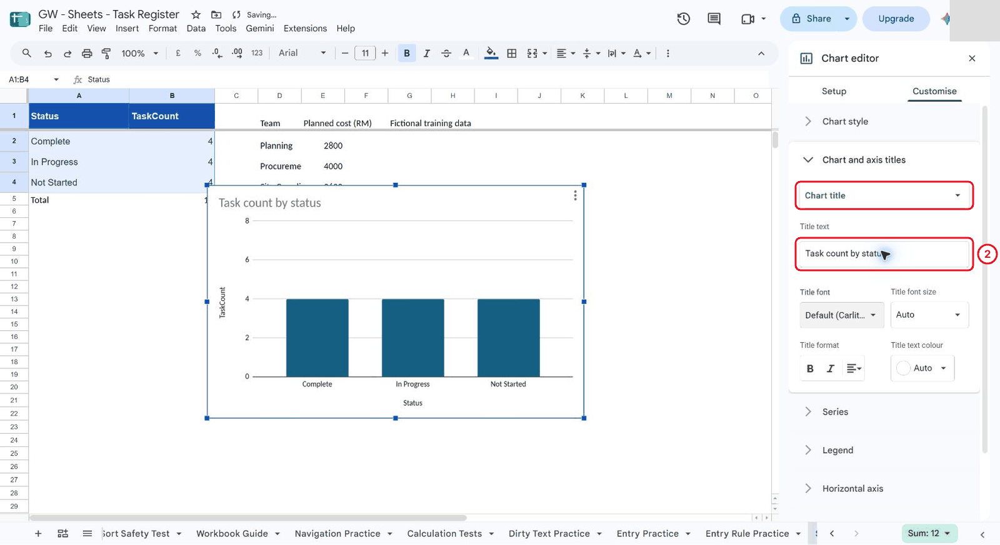

*Set a descriptive status chart title.*

3. Verify exactly three categories, each at **4**. No blank category or Total should be plotted. Inspect B3 in the formula bar alongside the chart; its criterion is A3.

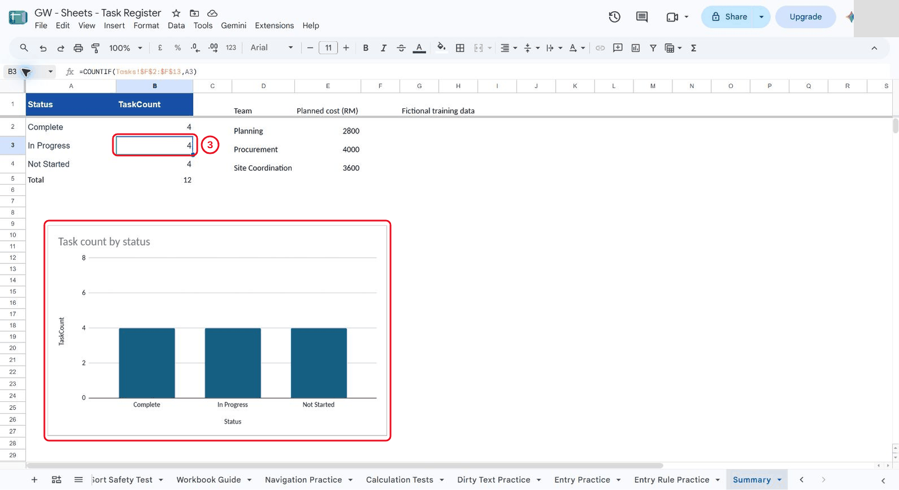

*Verify three equal categories and the B3 relative criterion.*

## 6.3 Explain and Check

1. If available, open **Ask Gemini** and request an explanation of the COUNTIF formula **in the panel only**. Ask about the anchored range, relative criterion and filling to B3. Do not apply Insert or other workbook changes. The exact prompt is in Part 3 of the [prompts page](./prompts.md). If Gemini is unavailable, explain the same references manually and record the fallback.

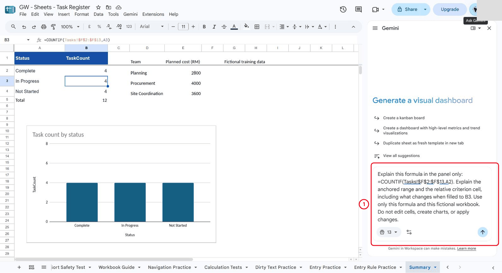

*Ask for a panel-only formula explanation.*

2. Compare the explanation with actual B3: **=COUNTIF(Tasks!$F$2:$F$13,A3)**. The twelve-row range stays fixed; the criterion shifts from A2 to A3. In this session Gemini showed the same B3 formula and result 4. Its prose explanation is supporting material, not proof that the workbook is correct. Close the panel.

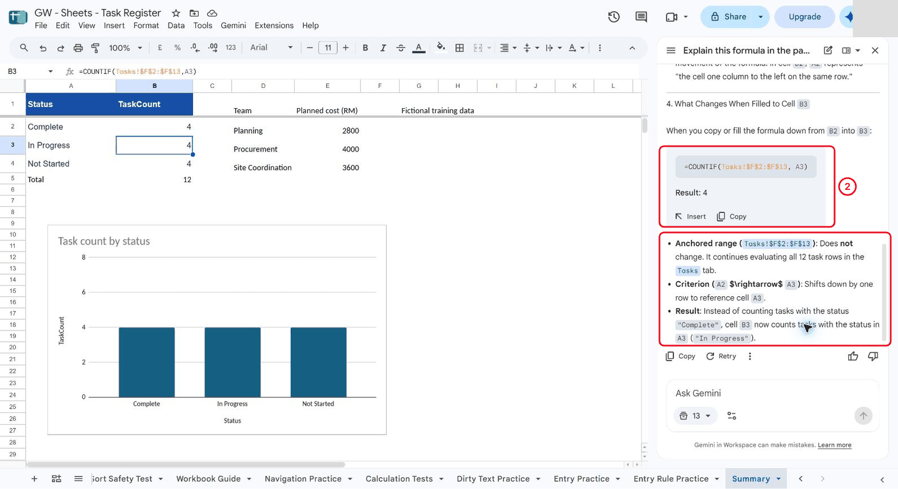

*Compare Gemini explanation with the actual B3 formula.*

3. On Tasks, identify **T003** in row 4 and record **F4 = Not Started** before editing. Do not change a different task or an entire status column.

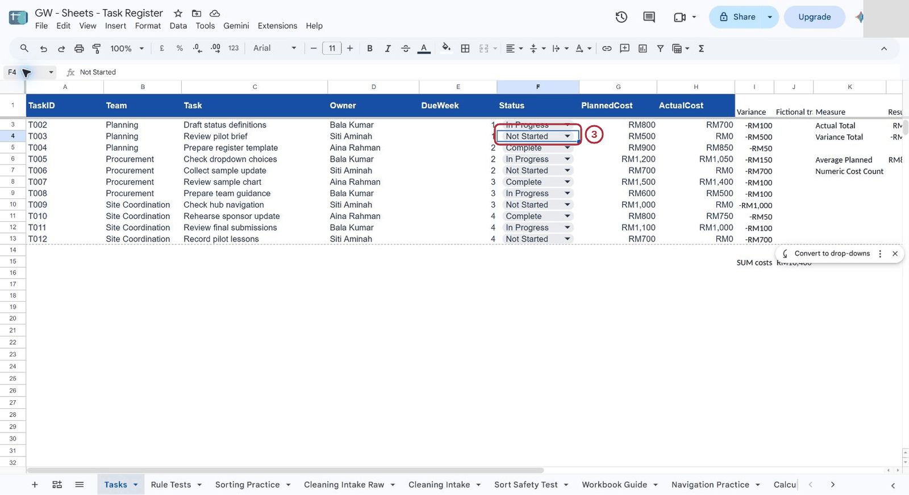

*Record T003 original Not Started status.*

4. Temporarily edit F4 to **Complete**, preserving its existing dropdown rule. Commit the cell edit.

*Temporarily set T003 Complete.*

5. Return to Summary. Verify **Complete 5 / In Progress 4 / Not Started 3**, still total **12**, and the status chart changes with the source.

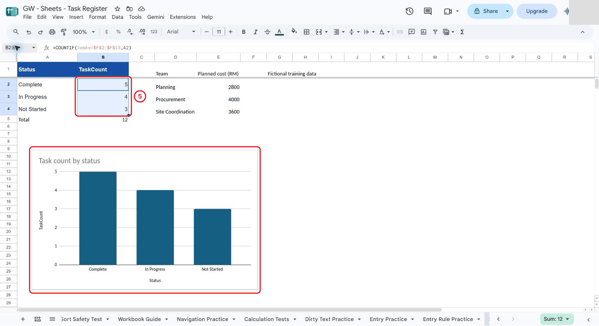

*Verify counts and chart change to five four three.*

6. Restore Tasks F4 to **Not Started** immediately.

*Restore T003 Not Started.*

7. Return to Summary and verify **4 / 4 / 4** and the chart's three equal bars again. Both source and visual restoration matter.

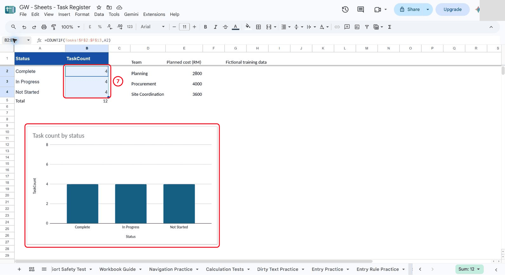

*Verify four four four baseline returns.*

## 6.4 Build a Second Summary and Diagnose a Misleading Chart

1. Select **D1:E4** and insert another column chart. Confirm its range and category labels.

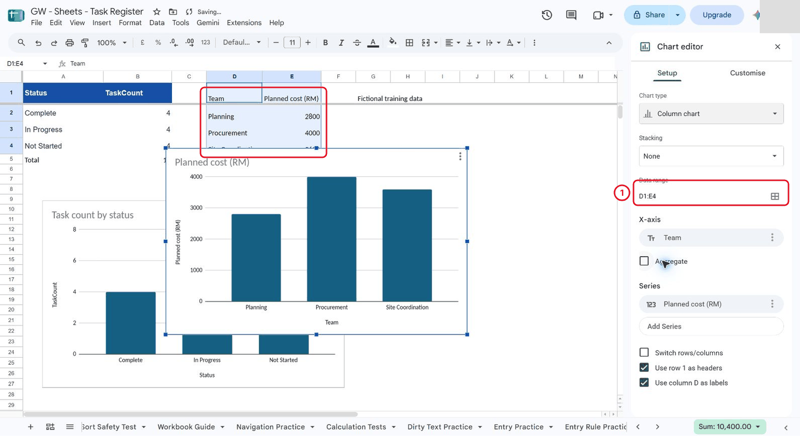

*Build the team cost chart from D1:E4.*

2. Title it **Planned cost by team (RM)**. The series/vertical axis reads **Planned cost (RM)**. Place it beside the status chart; keep currency amounts separate from task counts.

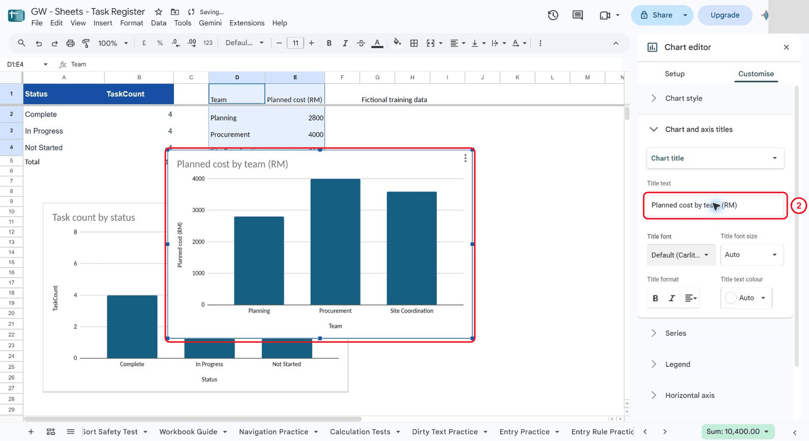

*Label planned cost units as RM.*

3. In G2:J4 create **Summary Checks / Summary / Source / Difference** (the block is in Part 4 of the prompts page). Row 3 is **Task count**, with H3 **=B5**, I3 **=COUNTA(Tasks!A2:A13)**, J3 **=H3-I3**. Row 4 is **Planned cost (RM)**, with H4 **=SUM(E2:E4)**, I4 **=SUM(Tasks!G2:G13)**, J4 **=H4-I4**. Expect **12 versus 12** and **10400 versus 10400**, both differences zero. Fit G so its labels are readable.

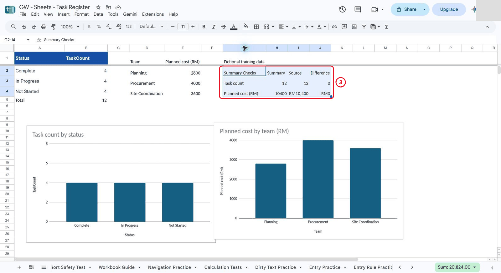

*Reconcile summary and source totals.*

4. Duplicate Summary and name the copy **Chart Range Tests**. Keep baseline Summary intact for the fault tests. Its copied formulas still refer to Tasks.

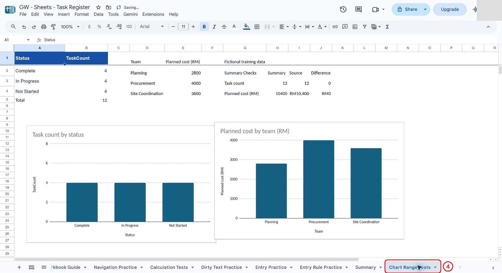

*Create a named chart fault-test copy.*

5. Edit the copied status chart in **Setup**. Use **Select data range**, set the single range **A1:B5**, and confirm **OK**. Verify the chart actually displays a fourth **Total = 12** category. If multiple ranges are listed, retain only the intended single range. The categories now represent 4+4+4+12=24 plotted counts even though only twelve tasks exist; Total duplicates the population already split into statuses.

> **Reference run:** The reference needed the range dialog: typing in the compact range field alone did not update the underlying category/series ranges.

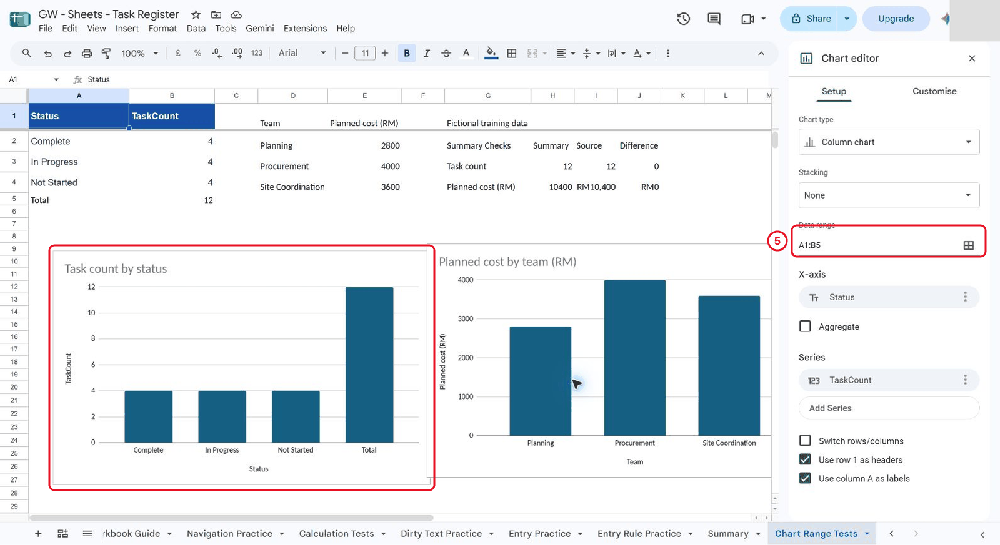

*Observe Total incorrectly plotted as a fourth category.*

6. Use the same range dialog to restore **A1:B4**. Verify three bars at four; changing the title or hiding a label would not repair the source selection.

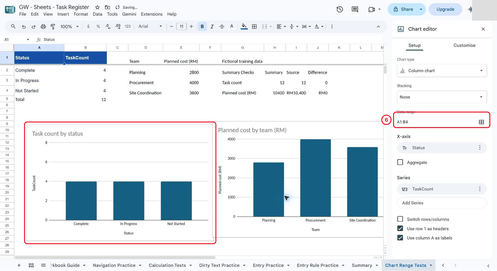

*Repair chart range to exclude Total.*

7. On **Chart Range Tests** only, temporarily misspell A4 as **Not Startd**. B4's COUNTIF becomes **0**, the category's bar has zero height, B5 falls to **8**, and J3 reports **-4** against twelve source TaskIDs. The source tasks are still present; the criterion is wrong.

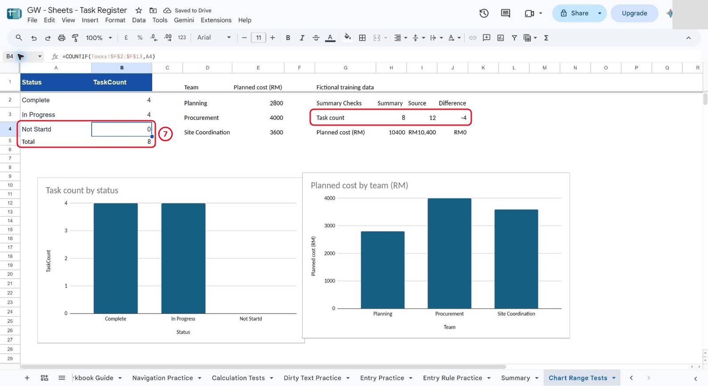

*Observe misspelt status produce zero and a reconciliation difference.*

8. Repair A4 to **Not Started**. B4 returns to **4**, total **12**, difference zero, and the chart returns to baseline. Retain the formula; never type a replacement count over it.

*Repair criterion spelling and retain COUNTIF.*

9. On baseline Summary, type two supported findings in A7 and A8: **4 tasks in each status; 12 in total**, and **Procurement has the largest planned total: RM4,000 of RM10,400**. Neither finding establishes on-time delivery or realised savings.

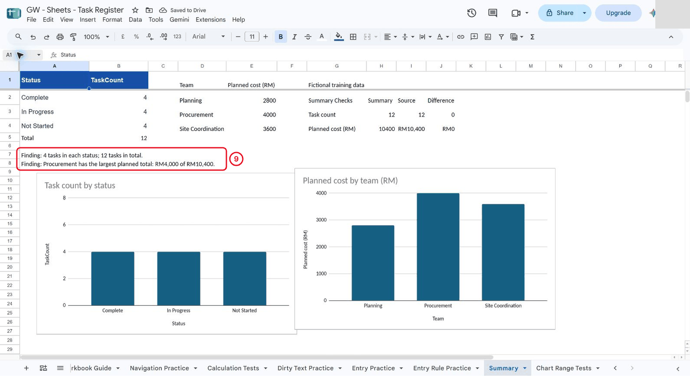

*Write two evidence-supported findings.*

10. For the cost propagation test, record original **Tasks G4 = 500** for T003. H4 is zero; I4's variance formula gives **-500**.

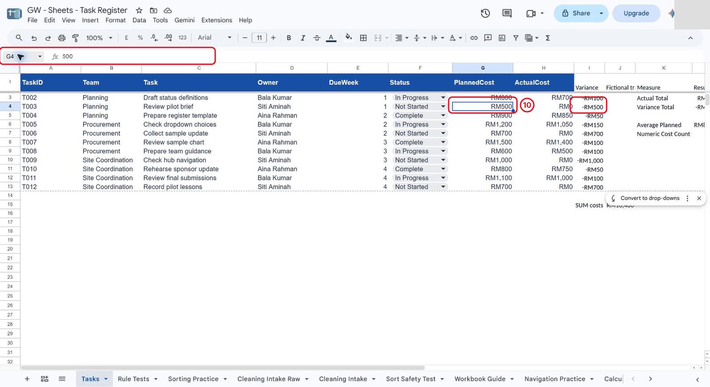

*Record T003 original planned cost five hundred.*

11. Temporarily edit G4 to **600**. Verify the row's I4 becomes **-600**; do not overwrite the variance formula.

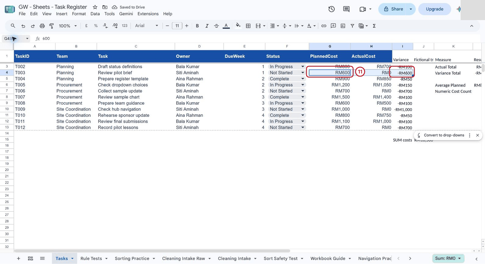

*Temporarily increase planned cost by one hundred.*

12. On Summary, Planning becomes **2900**, Procurement remains **4000**, Site Coordination remains **3600**, and both planned grand totals become **10500** with difference zero. Inspect the Planning chart bar. The baseline findings describe the restored baseline; do not treat them as automatically refreshed narrative.

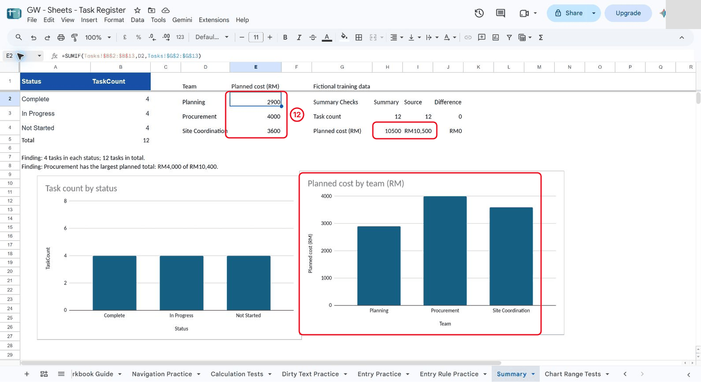

*Verify Planning and grand totals and chart update.*

13. Restore Tasks **G4 to 500**. Verify I4 returns to **-500** and the source planned total to **10400**.

*Restore original planned cost.*

14. Verify Summary team totals **2800 / 4000 / 3600**, planned totals **10400**, status counts **4 / 4 / 4**, and zero reconciliation differences. Both charts and the baseline findings agree again.

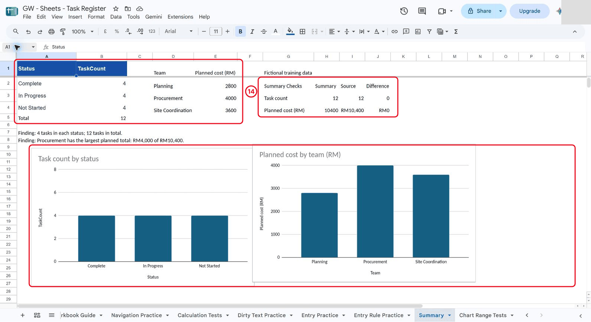

*Verify both baseline charts and zero differences.*

15. Add a sheet named **Summary Test Log** with the headers **Check / Target / change / Expected and observed / Restored final state** and the row labels in Part 4 of the prompts page. Record the actual status, range, spelling, cost, formula and reconciliation checks. Wrap the log text and use readable column widths. Record the independent challenge and learner timing as pending rather than claiming them from these guided author checks.

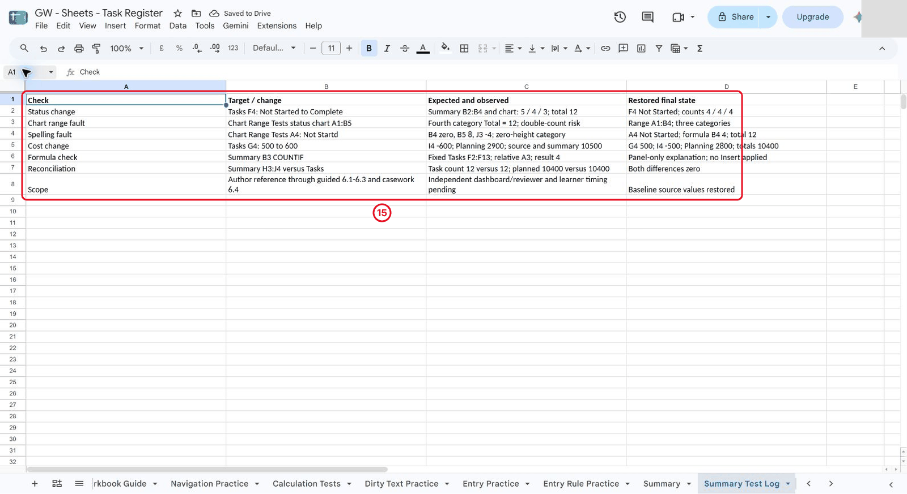

*Record actual tests and restorations.*

> **Validation boundary:** author UI reference through guided 6.1–6.3 and casework 6.4. All original Tasks A1:N15 values/formulas are restored; new summaries, charts, named copy and test log are retained. Independent dashboard, reviewer/fresh attempt and learner timing remain pending. Earlier CSV-import and values-only-format limitations remain separate.

## Independent Practice

Close the earlier step lists for the first attempt. Use the case input and your own reasoning. If you need help, record the hint and repeat the affected check independently.

1. Prepare an independent one-page dashboard on a new tab with two labelled charts, source links and two concise supported findings.

2. Diagnose the case input's (Part 2 of the prompts page) suspicious chart and summary symptoms using the source cells. Repair the cause, not just the visual appearance.

3. Use a reviewer or fresh read-through to check units, population and total reconciliation, then record one correction or evidence for a no-change decision.

### Evidence to Hand Over

- Two reconciled summaries/charts with distinct units.
- Documented total-row and misspelt-category fault repairs.
- Independent dashboard, supported findings and restored source-change test.

Record the defect or uncertainty you investigated, the evidence used, the repair or reasoned no-change decision, and the final state. Restore temporary changes or keep them in a clearly named scenario copy.

## Troubleshooting

| Symptom | What to check |
|---|---|
| A missing count is hidden by typing a result | Repair the criterion or formula so later source changes still recalculate. |
| An input or earlier result is missing | Reopen the input named in Before You Begin; do not substitute private company data |
| A menu or feature is unavailable | Confirm the account and the shared access notes; record the missing step and ask the trainer for its fallback |
| The result differs from the checkpoint | Compare the exact source range, wording and conditions before repeating the action |

## Lesson Summary

A checked summary and chart communicate the register accurately.

**Check yourself:** Why should the total row normally be excluded from this chart's categories?
