# 07 - Share and Prepare Output

In this chapter you will inspect access, print a selected range and check scaling and page breaks.

> **Prompts and values:** use the [copy-paste page](./prompts.md) for the exact values used below.

**Target allocation:** 40 minutes: 10 explanation/demonstration, 10 guided build and casework, 15 independent challenge, 5 verification and repair. The active portion is 30 minutes by design. These are unmeasured targets awaiting a learner pilot.

**Your result:** Checked access and readable register and summary print previews.

> **Status:** author reference with 29 staged captures through 7.4 (25 application views and four actual PDF pages). Restricted access/unpublished state inspected without changes; selected-range clipping repaired; three native PDF revisions checked, including a two-page register with repeated header; source heading restored and revision manifest recorded. Independent outputs/reviewer and learner timing remain pending.

## What You Will Learn

- Inspect sharing without accidental exposure.
- Prepare a readable print range.
- Distinguish printing from public publishing.

## Before You Begin

Read the [case input](./prompts.md) and use a separate named casework copy for destructive tests or altered datasets. Keep the baseline unchanged for later chapters. Record source facts, proposed practice and unresolved questions separately.

Use the checked register. No public publishing or email distribution is required.

## 7.1 Inspect Access

1. Open **Share** on the maintained workbook. Inspect **People with access** and **General access**. Record what is shown rather than assuming the same permissions in another account.

> **Reference run:** This reference shows **Restricted** and one listed owner; no additional people/groups or inherited group access is displayed in this dialog.

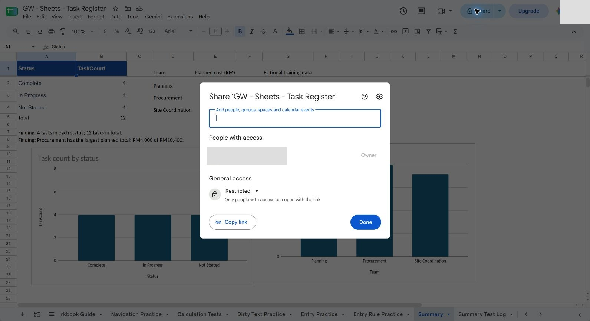

2. Explain the proposed roles: **Viewer** reads, **Commenter** reads and comments, **Editor** can edit. Keep these role explanations separate from actual recipient testing. Close with **Done**.

> **Reference run:** No named recipient was assigned in this reference, so no invitation or permission change was made.

## 7.2 Prepare the Print Range

1. On Tasks, select **A1:I13**, including all twelve records and the variance column. This excludes K:L controls, the row 15 SUM, spare cells and unrelated tabs.

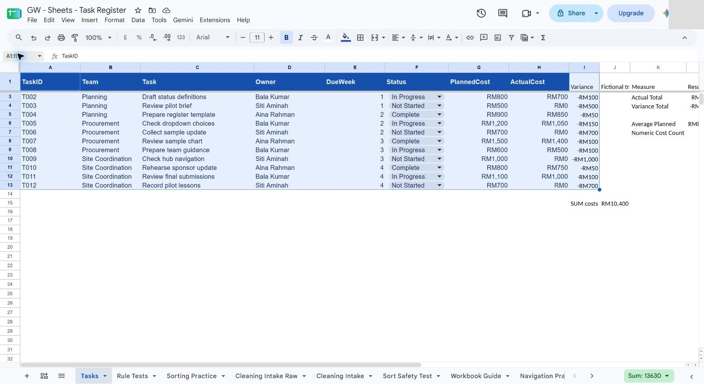

2. Open **File > Print**. Inspect the scope menu: it offers **Current sheet**, **Workbook**, and **Selected cells (A1:I13)**. A selection in the grid does not mean Selected cells is already chosen; this session initially used Current sheet.

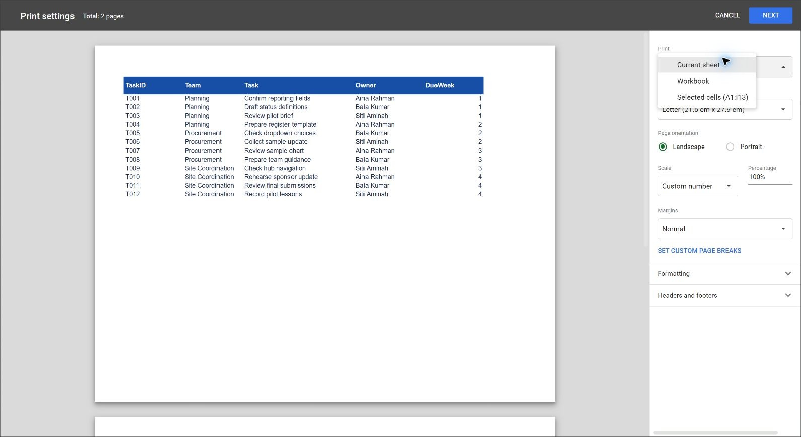

3. Explicitly choose **Selected cells (A1:I13)**, **Landscape**, and **Fit to width**. Inspect every preview page and all nine headers. The initial Letter preview fits one page but makes this wide register small; fitting alone does not establish readable physical output. The later casework uses A3 at approximately 10.7 pt and a separate layout copy.

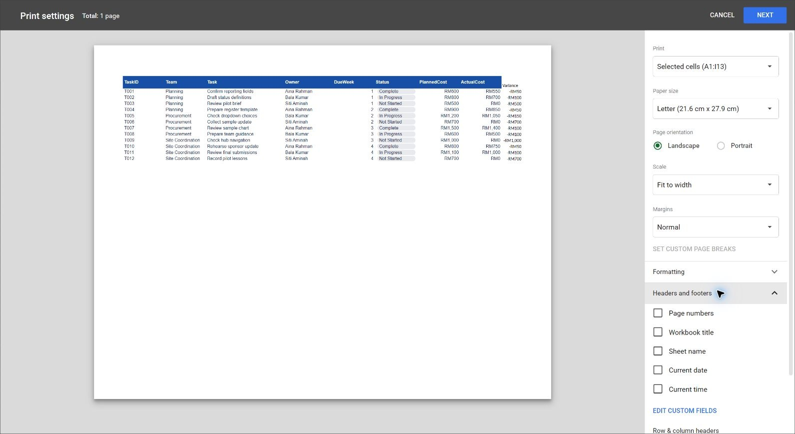

4. Expand **Headers and footers**. **Repeat frozen rows** is available because Tasks already has row 1 frozen; repeat frozen columns is disabled because none are frozen. This option must be tested on actual multi-page output. Cancel this print preview before continuing. If the browser's system print dialog opens after **Next**, cancel it; the PDF workflow below uses **Download as PDF** and **Export**.

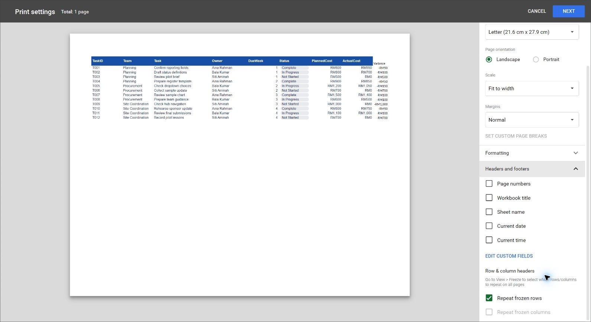

## 7.3 Compare Output Options

1. Inspect **File > Share > Publish to web**, or find **Publish to web** with menu search. The dialog explicitly says **This document is not published to the web**. Do not click Publish.

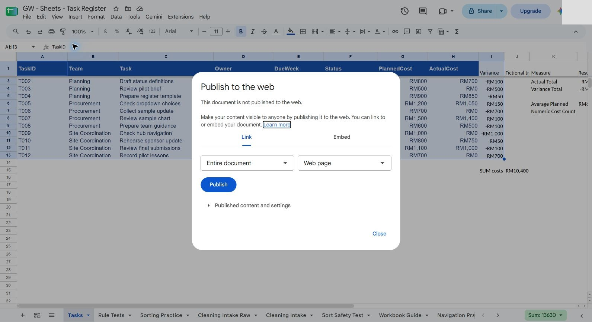

2. Inspect the sheet/chart scope selector. **Entire document** and individual sheets/charts are offered. Publication creates a web-facing view and can broaden the audience; it is separate from file access and from a fixed PDF snapshot. Close the menu and dialog without publishing. A fixed PDF is suitable when the recipient needs a checked revision rather than an editable live tracker; distribution still needs its own authorised recipient and scope.

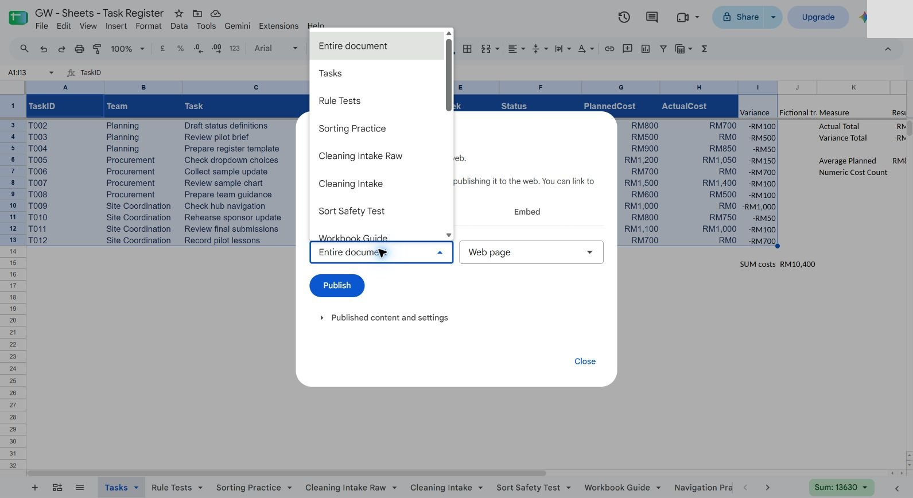

## 7.4 Prepare a Readable, Scoped and Reproducible Output

1. Create **Output Plan**. Write the output brief and role proposal separately from the actual access record. A contributor needs all twelve Tasks rows and working input cells; a sponsor needs a fixed summary of **12 tasks**, counts **4/4/4**, team planned **RM2800/4000/3600**, total **RM10400**, and two labelled charts. Record Editor only as a proposal for a separately approved contributor; no recipient permission has been tested. Record the inspected Restricted/owner-only display and unpublished state.

> **Reference run:** In the reference, A:B are 650 pixels wide with wrapped text.

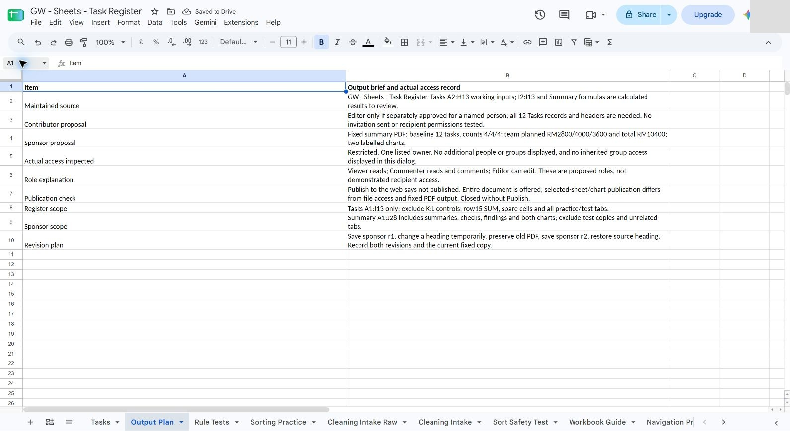

2. On Summary, inspect the extent of the charts as well as the populated cells. The first attempted scope **A1:J28** covered the summary cells but did not extend far enough for the right-hand chart.

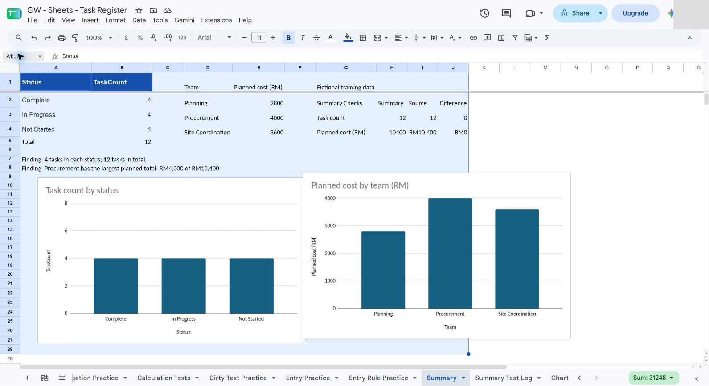

3. Open Print and compare **Current sheet / Workbook / Selected cells**. Current sheet uses the used sheet area, Workbook risks including practice/test tabs, and Selected cells limits the exported region. Explicitly choose the intended scope each time.

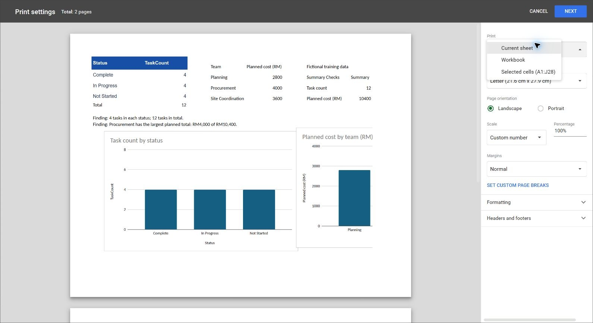

4. The **A1:J28** selected-cells preview clips the cost chart: Site Coordination is missing from the printed right-hand side. This is a scope defect even though the source chart is complete. Cancel and repair the selection rather than accepting a partly visible chart.

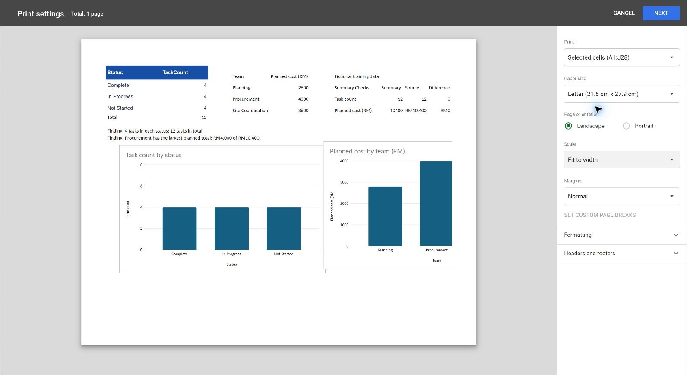

5. Select **A1:N28** and reopen the preview with **Selected cells** and **Fit to width**. Both complete charts now fit inside the region. Inspect all three team labels, all three statuses, the totals and zero reconciliation differences. No test tabs belong in this sponsor handout.

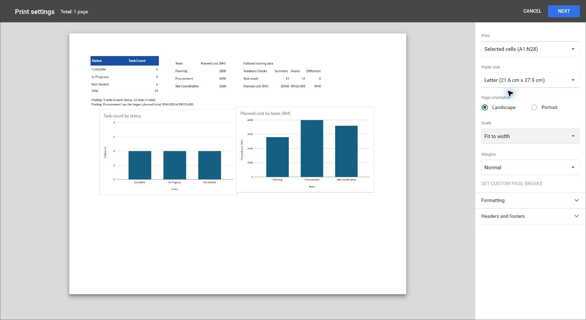

6. Choose **A3**, **Landscape**, and fit-to-width for this author reference. The saved text is approximately **10.7 pt** on A3; confirm the actual customer's output medium before adopting this layout. Do not claim that the same content remains readable when printed smaller. Page numbers can be selected under Headers and footers, but this session's saved PDFs did not contain visible footer numbers, so that option is not treated as verified output.

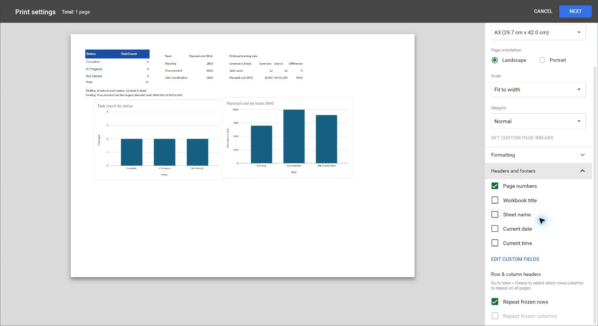

7. Cancel the Print workflow and use **File > Download > PDF (.pdf)**, or menu search **Download as PDF**. This opens the same layout controls with **Export**, avoiding the browser system print dialog reached by Print's Next. Recheck **Selected cells (A1:N28)**, A3, Landscape, Fit to width, and the one-page preview; the export scope initially defaults to Current sheet again. Click **Export** and retain the downloaded file as **GW-Sponsor-Summary-r1.pdf**.

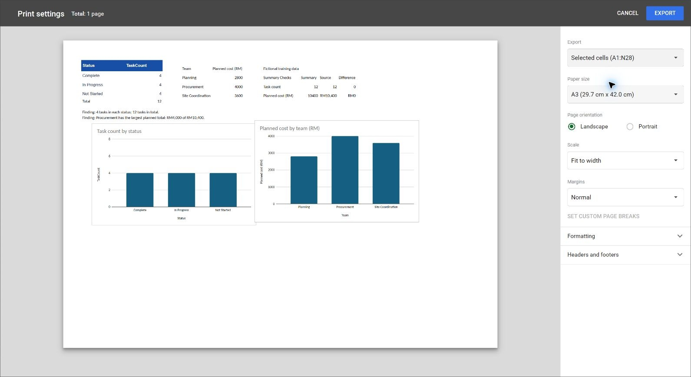

8. Open or render the actual saved PDF, not just its preview. Verify the counts, planned totals, findings and both complete charts. This full-page render is from the native downloaded PDF. Record its revision, page count, source range and file hash before changing the source.

9. To test page breaks without changing the maintained register, duplicate Tasks as **Register Output**. On that copy only, remove columns **J:Z** and rows **14:1000**, leaving exactly **A1:I13** with the original twelve records and row 1 frozen. Preserve all nine fields and the variance formulas. This is a layout snapshot; contributors should continue editing the maintained Tasks sheet.

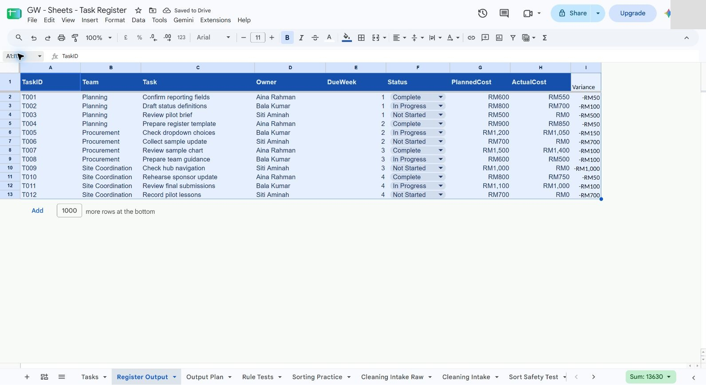

10. Use **Download as PDF** on Register Output. Choose **Current sheet**, A3, Landscape and **Normal (100%)**, then **Set custom page breaks**. Selected-cells mode disables custom page breaks in the summary workflow; the bounded layout copy allows Current sheet without helper content.

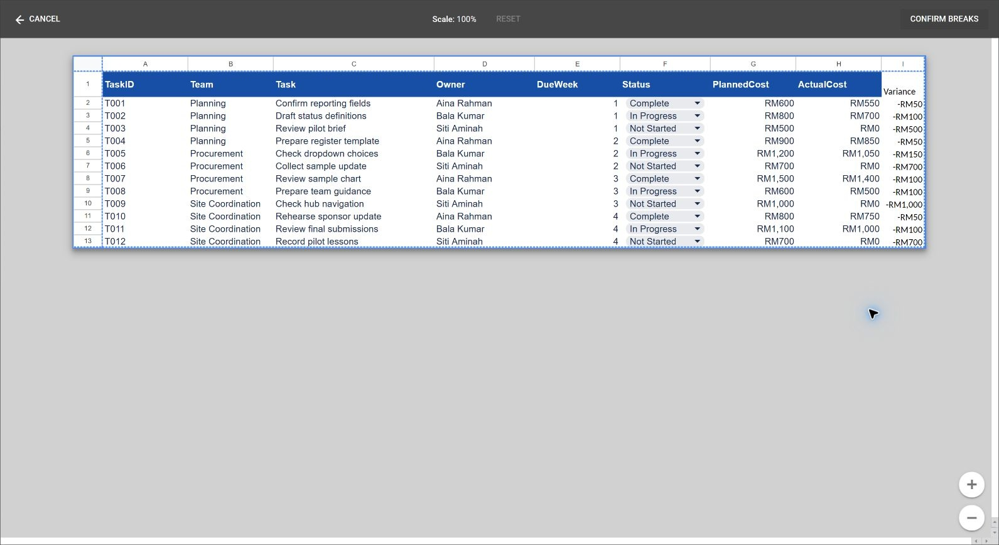

11. Drag the bottom row-page boundary to the line **after row 7**, between T006 and T007, then **Confirm breaks**. This deliberate split tests pagination and header repetition; it is not a requirement to waste a second page for every small register.

> **Reference run:** The reference now has two row-page regions.

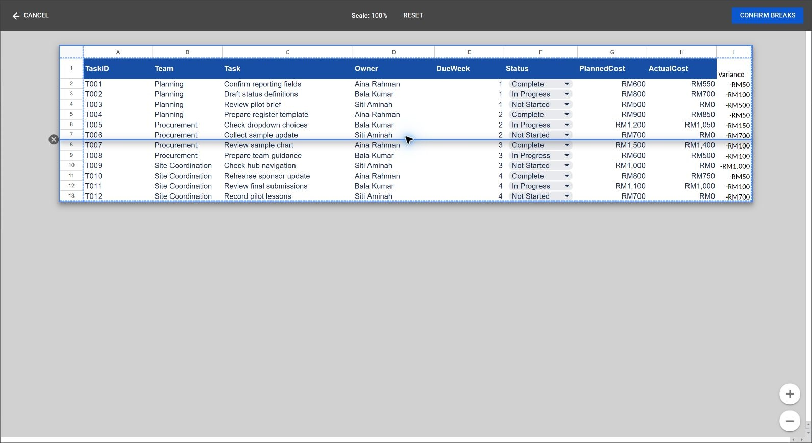

12. Under Headers and footers confirm **Repeat frozen rows**. The scale reads **Fit to page breaks (100%)**, and the preview reports **2 pages**. Inspect page 1 for T001–T006 and all column labels.

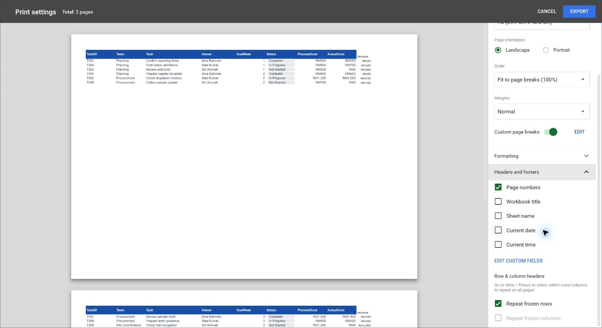

13. Scroll to the final preview page. It must repeat the header and show **T007–T012**, including the last task **Record pilot lessons** and its row values. No K:L controls, row 15 SUM or practice sheets should appear. Click **Export** and retain the file as **GW-Task-Listing-r1.pdf**.

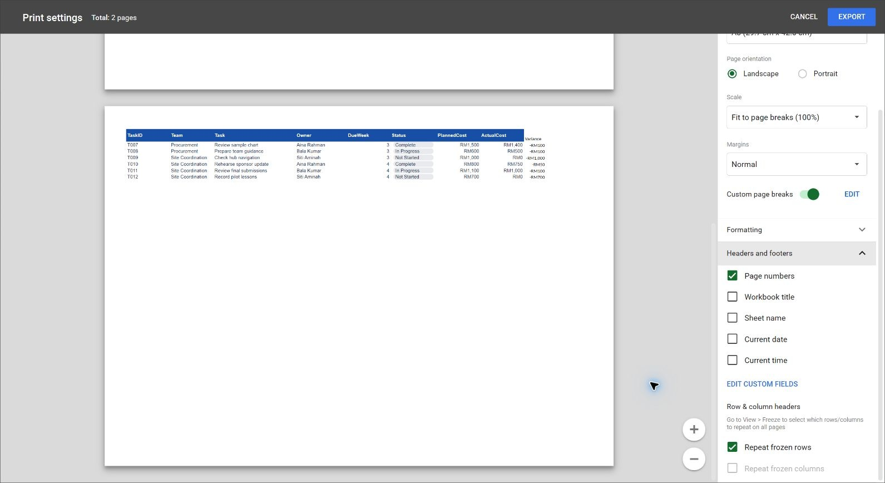

14. Open or render **both actual PDF pages**. Page 1 contains six tasks and readable headers.

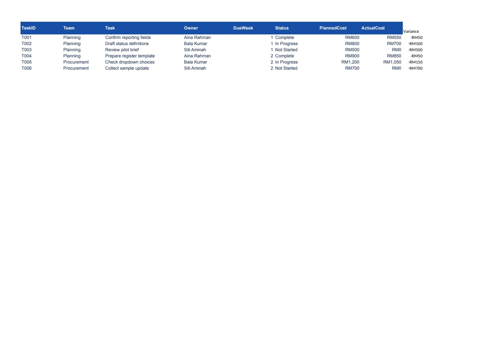

15. Page 2 contains the other six tasks, repeats the header and includes T012. Compare row labels and cost values with Tasks; all twelve records appear exactly once across the two pages. The PDF uses A3 landscape and approximately 10.7 pt text.

> **Reference run:** Footer numbers were not visible despite selecting the option; identify pages by the inspected content and PDF page count in this reference.

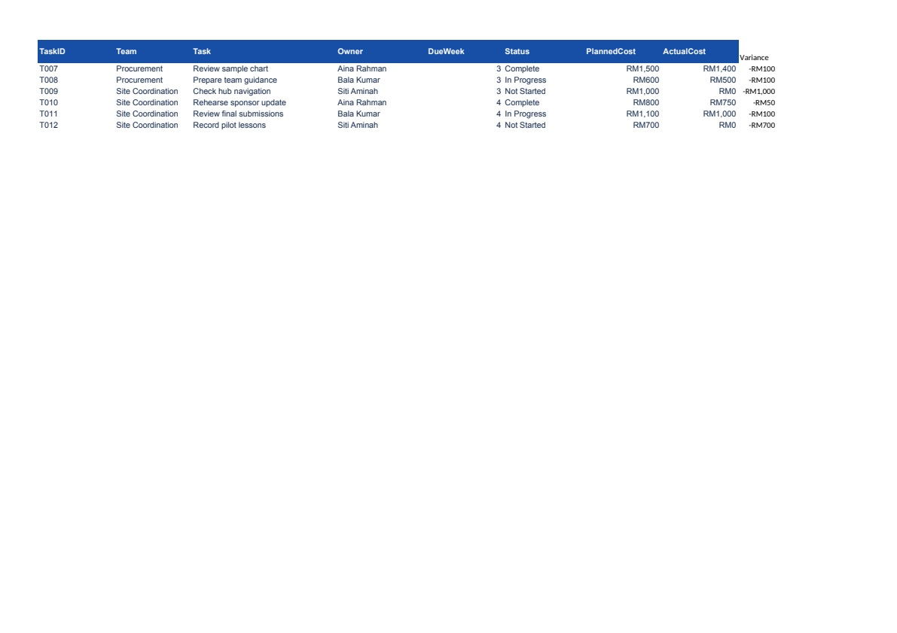

16. On maintained Summary, record **A1 = Status**. Keep the saved revision 1 PDF untouched.

17. Temporarily change that one heading to **Task status**. Counts, formulas, costs and chart data must remain unchanged. A saved PDF does not update when the working source changes.

18. Export the same **A1:N28** range with the same A3/Landscape/Fit-to-width settings as **GW-Sponsor-Summary-r2.pdf**. Keep revision 1 as a separate file; do not overwrite it.

19. Inspect revision 2: its heading is **Task status**, with the same 4/4/4, total 12, planned 10400 and complete charts. Reopen or compare revision 1: it still says **Status**, and its SHA256 remains unchanged. A newly generated revision and an old fixed copy can legitimately differ from one another.

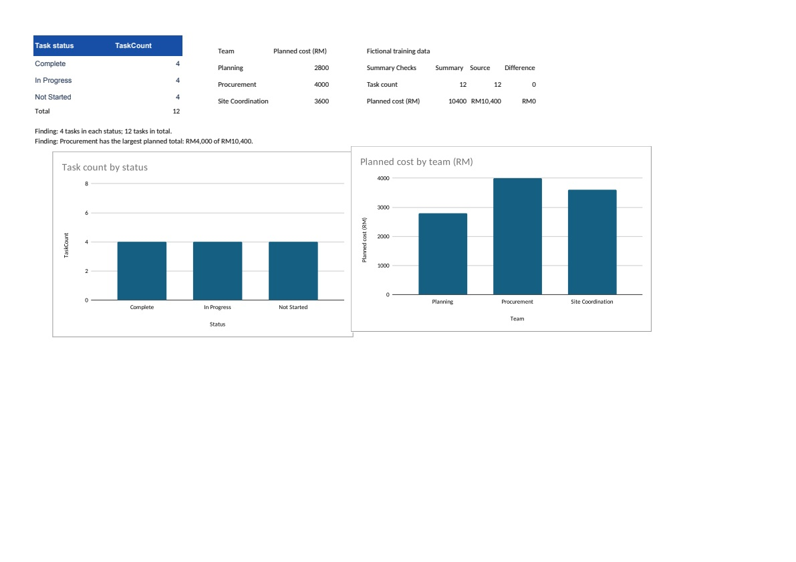

20. Restore Summary A1 to **Status**. Verify the maintained source values/formulas match the pre-test baseline. Revision 2 remains the latest fixed demonstration with its changed heading; document that deliberate difference from the restored source rather than claiming the two are identical.

21. Update Output Plan with the repaired **A1:N28** scope and completed revision sequence. The maintained workbook is the live source; Register Output is the bounded layout snapshot; the PDFs are fixed outputs.

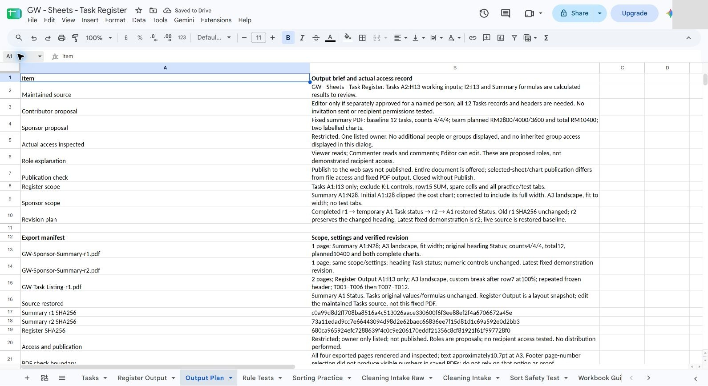

22. Add an **Export manifest** identifying each filename, source range, paper/orientation/scale, page count, inspected final-page content, hash, and revision status. Record source restoration, actual access versus proposed roles, the footer-number limitation and pending independent reviewer/timing checks.

> **Reference run:** The downloadable examples below are the native author reference exports.

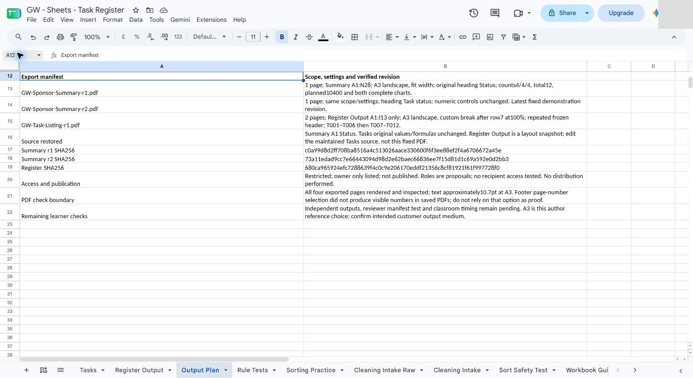

- [Sponsor summary r1 — original heading, one A3 page](./reference-output/GW-Sponsor-Summary-r1.pdf)
- [Sponsor summary r2 — changed heading, one A3 page](./reference-output/GW-Sponsor-Summary-r2.pdf)
- [Task listing r1 — repeated header, two A3 pages](./reference-output/GW-Task-Listing-r1.pdf)
- [Export manifest with hashes and scope](./reference-output/export-manifest.json)

> **Validation boundary:** guided 7.1–7.3 and casework 7.4 are author reference checks. The three PDFs contain four inspected pages. No sharing, publication, email distribution or recipient-role testing was performed. The original Tasks values/formulas and Summary heading are restored. Independent outputs, reviewer manifest test, customer output medium and classroom timing remain pending; earlier import/paste limitations remain separate.

## Independent Challenge

Close the earlier step lists for the first attempt. Use the case input and your own reasoning. If you need help, record the hint and repeat the affected check independently.

1. Prepare two independent outputs: a concise sponsor summary and a complete task listing with readable headings. Do not force both into the same one-page layout.

2. Have a reviewer use the manifest to identify the current source and current fixed copy. Repair ambiguous filenames or scope labels.

3. Explain which ranges should be edited, which calculated cells should be reviewed and why a fixed PDF is not a live tracker.

## Evidence to Hand Over

- Inspected access settings and proposed-role plan.
- Two scope-checked readable PDFs with the correct final-page content.
- Source-to-export comparison and a revision manifest that identifies the current copy.

Record the defect or uncertainty you investigated, the evidence used, the repair or reasoned no-change decision, and the final state. Restore temporary changes or keep them in a clearly named scenario copy.

## Troubleshooting

| Symptom | What to check |
|---|---|
| The PDF contains practice/helper content | Inspect selected-cells versus current-sheet/workbook scope and regenerate the intended output. |
| An input or earlier result is missing | Reopen the input named in Before You Begin; do not substitute private company data |
| A menu or feature is unavailable | Confirm the account and the shared access notes; record the missing step and ask the trainer for its fallback |
| The result differs from the checkpoint | Compare the exact source range, wording and conditions before repeating the action |

## Lesson Summary

Checked access and readable output complete the register handover.

**Check yourself:** Which output would automatically reflect later source changes, and which is a snapshot?
