# 07 - Share and Prepare Output

The register is ready to leave the team. Aina has two audiences: the sponsor wants a one-page summary they can read and keep, and contributors need the full task list. Before anything goes out, she wants you to check who can already open the workbook, confirm it isn't published on the web, and make PDFs that show exactly what you meant them to: no practice tabs, no cut-off charts.

**Estimated time:** 40 minutes, planned as 5 explanation, 25 guided build and 10 independent practice. Not yet timed with learners.

**Your result:** an **Output Plan** tab in `GW - Sheets - Task Register`, a one-page sponsor summary PDF in two revisions, and a two-page task listing PDF with the headings repeated on each page.

> **You'll practise:** reading the Share dialog without changing it, checking Publish to the web, choosing a print scope, paper size and scaling, setting a page break, repeating a frozen heading row, and downloading a PDF.

---

## What You Will Learn

- Check who has access without changing it
- Print or export exactly the range you mean
- Tell a live workbook from a fixed PDF

## Before You Begin

Open `GW - Sheets - Task Register` from **GW - Sheets Foundation - Practice**. You need **Tasks** and **Summary** from Lab 06, with both charts.

In this lab you don't share the workbook with anyone, publish it or email anything. You look at those settings, and you download PDFs to your own computer.

**What you build in this lab:**

**Share** and **Publish to the web** checks > **Output Plan** > sponsor summary PDF (r1) > **Register Output** > task listing PDF > sponsor summary PDF (r2) > export record

## Topics

**Access, publishing and PDFs are different things.** **Share** controls who can open the live workbook. **Publish to the web** makes a public web version anyone with the link can see. A PDF is a fixed copy: once downloaded, it never changes, even when the workbook does.

**Viewer, Commenter, Editor.** A Viewer can read. A Commenter can read and add comments. An Editor can change anything. You'll write down which role each audience would need, but you won't give anyone access.

**Print what you selected, not what you see.** Selecting cells doesn't tell Print to use them. You choose **Selected cells** in the print settings every time, and check the preview for anything cut off or anything extra.

---

## 7.1 Check Who Can Open the Workbook

1. Click **Share** at the top right.
2. Look at **People with access** and **General access**. Note what they say.

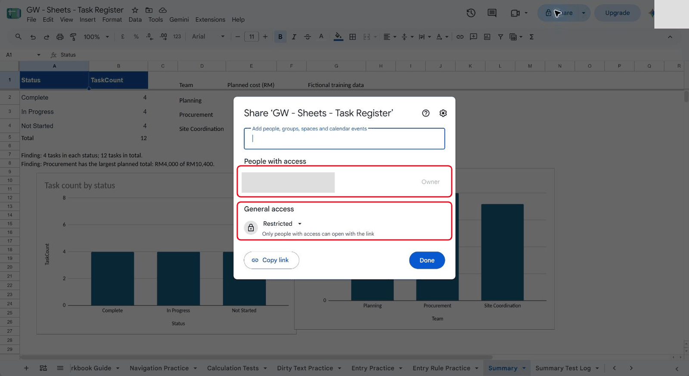

*Restricted means only the people listed can open it. Yours may list different people.*

3. Click **Done** without changing anything.

**Check:** you can say who has access to the workbook and what **General access** is set to, and you haven't changed either.

---

## 7.2 Preview the Register for Printing

1. Click the **Tasks** tab. Click the name box, type `A1:I13` and press **Enter**. That's the twelve tasks with their headings and variances, but not the totals block or the checks to the right.

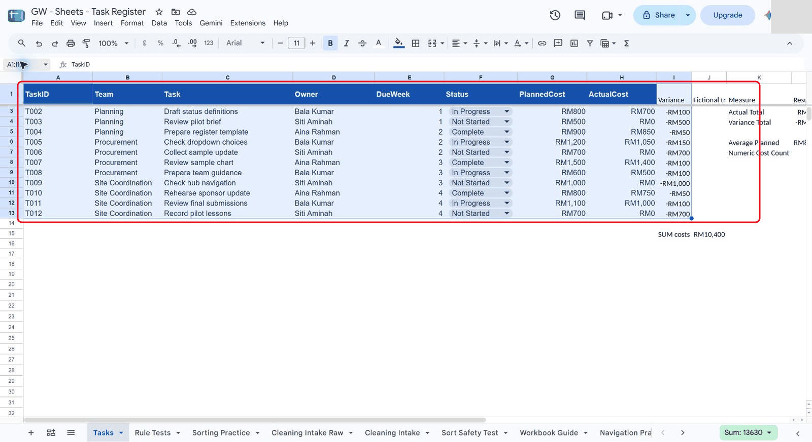

*Just the register.*

2. Click **File**, then **Print**. Open the list at the top right of **Print settings**. It offers **Current sheet**, **Workbook** and **Selected cells (A1:I13)**.

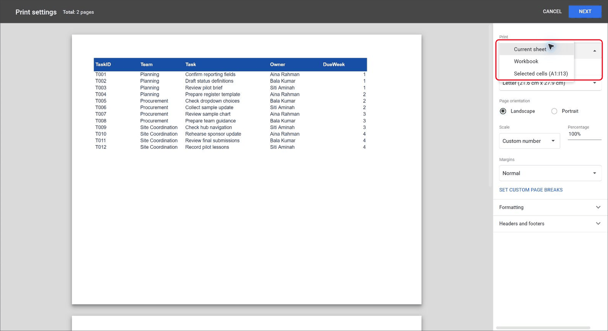

*It starts on Current sheet, even though you selected cells.*

3. Choose **Selected cells (A1:I13)**. Set **Page orientation** to **Landscape** and **Scale** to **Fit to width**.

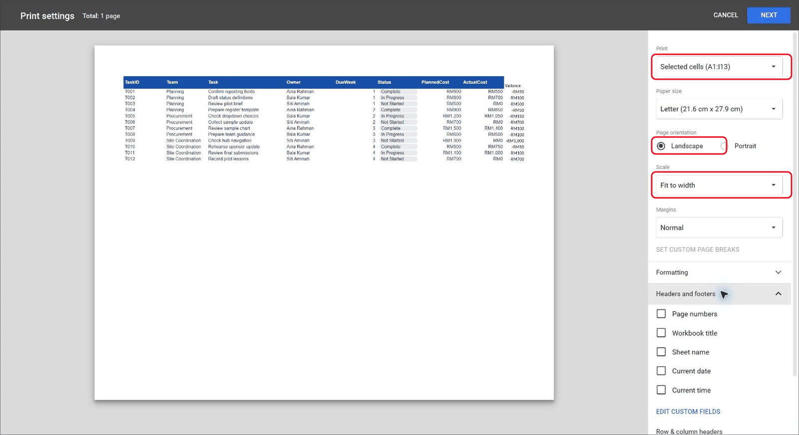

*Everything fits, but on Letter paper the text is very small.*

4. Click **Headers and footers** to open it. Near the bottom, **Repeat frozen rows** is available, because row 1 on **Tasks** is frozen.

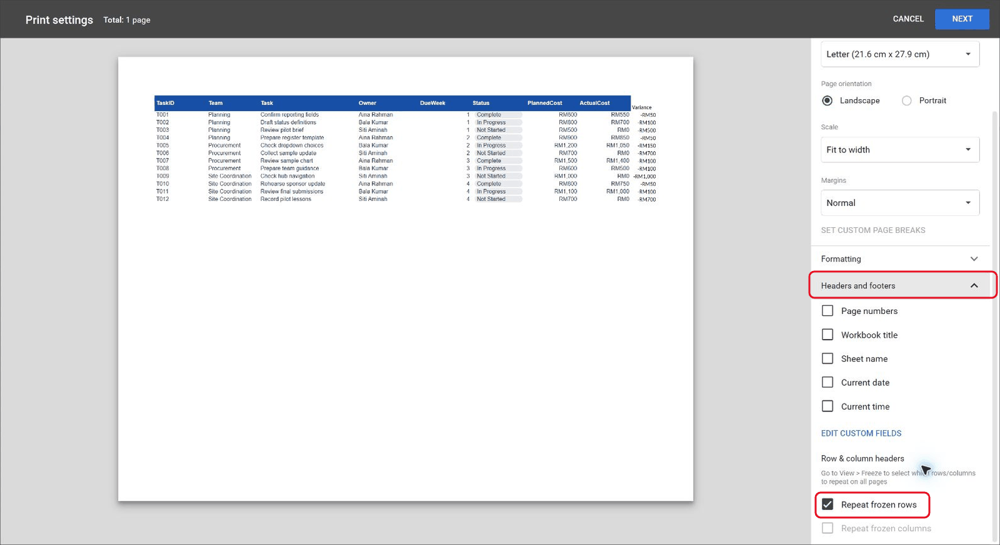

*You'll use this in 7.7 when the list runs onto a second page.*

5. Click **Cancel**.

**Check:** you've seen the three print scopes and the **Repeat frozen rows** option, and nothing has been printed.

---

## 7.3 Check It Isn't Published

1. Click **File**, **Share**, **Publish to the web**. The dialog says **This document is not published to the web**.

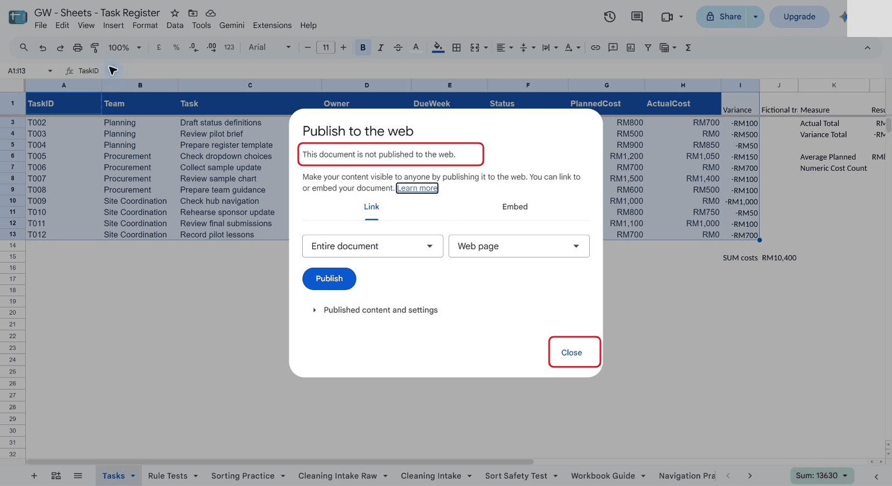

*Don't click Publish.*

2. Open the **Entire document** list. It lists every tab you could publish.


*Publishing would put these on the web for anyone with the link, practice tabs included.*

3. Close the list, then click **Close**.

**Check:** the workbook says it's not published, and you closed the dialog without publishing.

---

## 7.4 Write an Output Plan

1. Click **+** (Add sheet). Rename the new tab `Output Plan`.
2. Copy the block below, click **A1** and press **Ctrl+V**. It records what each audience needs and what you checked.

```text
Item	Output brief and actual access record
Maintained source	GW - Sheets - Task Register. Tasks A2:H13 are the working inputs; I2:I13 and Summary formulas are calculated results to review.
Contributor proposal	Editor, only if separately approved for a named person; all 12 Tasks records and headings are needed. No invitation sent.
Sponsor proposal	Fixed summary PDF: 12 tasks, counts 4/4/4, team planned RM2800/4000/3600, total RM10400, two labelled charts.
Actual access inspected	Restricted, as shown in the Share dialog. No changes made.
Role explanation	Viewer reads; Commenter reads and comments; Editor can edit. These are proposals, not access given.
Publication check	Publish to the web says not published. Closed without publishing.
Register scope	Tasks A1:I13 only; exclude K:L totals, row 15 SUM, spare cells and practice tabs.
Sponsor scope	Summary: counts, team totals, checks, findings and both charts; no test tabs.
Revision plan	Save sponsor r1, change a heading, save r2, restore the heading. Keep both PDFs.
```

3. Widen columns **A** and **B**, and turn on **Format**, **Wrapping**, **Wrap** for column **B**.

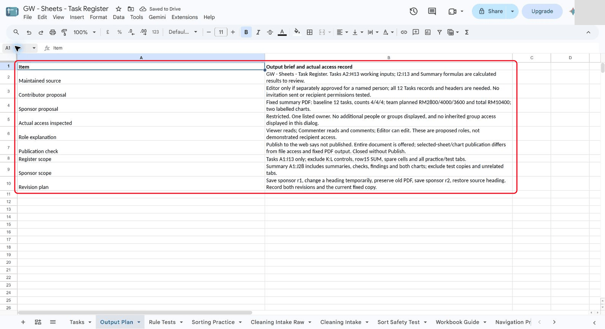

*The screenshot's wording is a little different from the block you pasted.*

**Check:** **Output Plan** has ten readable rows, and the access row matches what you saw in 7.1.

---

## 7.5 Fit the Summary on One Page

1. Click the **Summary** tab. Click the name box, type `A1:J28` and press **Enter**.


*Look at the right-hand chart: it runs past column J.*

2. Click **File**, **Print**. Open the scope list and look at the three options.

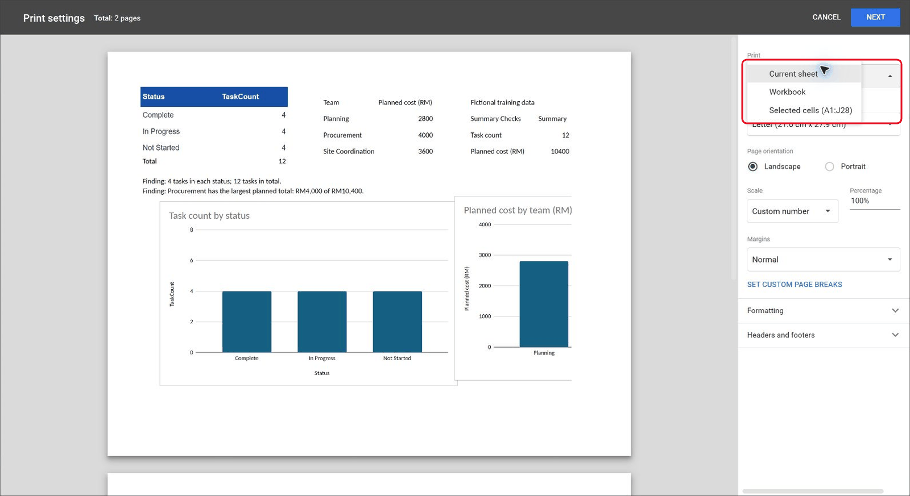

*Workbook would print every tab, practice ones included.*

3. Choose **Selected cells (A1:J28)**, **Landscape** and **Fit to width**. The cost chart is cut off: **Site Coordination** is missing.


*The chart is complete on the sheet, but the range is too narrow.*

4. Click **Cancel**. Select `A1:N28` with the name box and open **File**, **Print** again. Choose **Selected cells (A1:N28)**, **Landscape** and **Fit to width**. Both charts are complete.

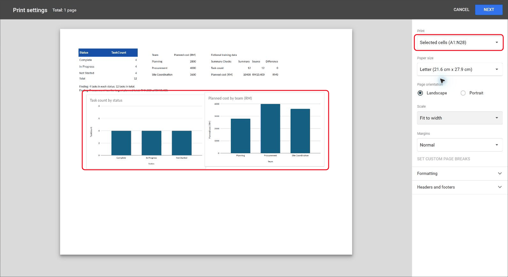

*Fix the range, not the chart.*

5. Set **Paper size** to **A3**. Open **Headers and footers** and tick **Page numbers**.

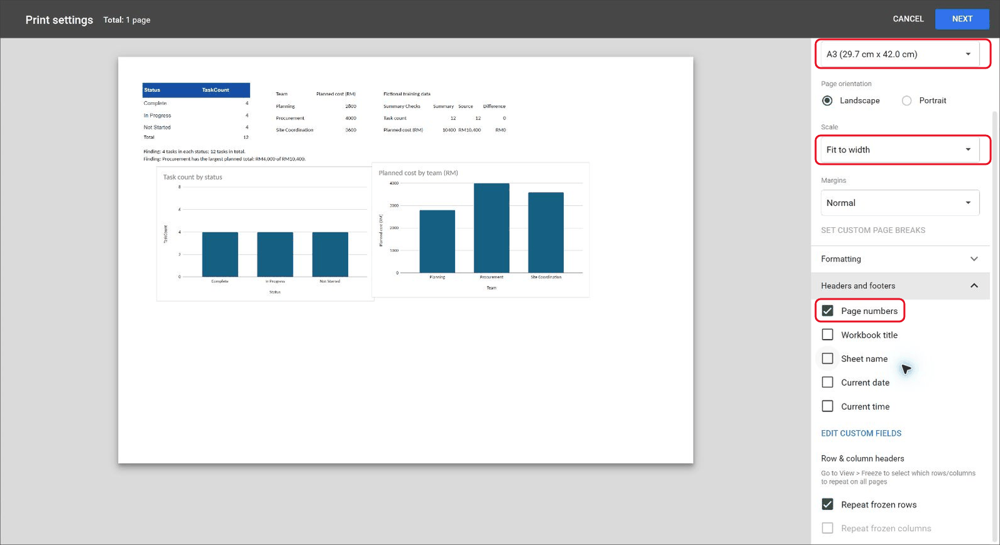

*A3 gives the text room to be readable when printed.*

6. Click **Cancel**. You'll download the PDF next instead of printing.

**Check:** with **A1:N28** on A3, the preview shows all three statuses, all three teams, both charts and the findings on one page.

---

## 7.6 Download the Summary as a PDF

1. With **A1:N28** still selected, click **File**, **Download**, **PDF (.pdf)**. The same settings appear, with an **Export** button.
2. Check them again: **Selected cells (A1:N28)**, **A3**, **Landscape**, **Fit to width**. The scope often goes back to **Current sheet**.

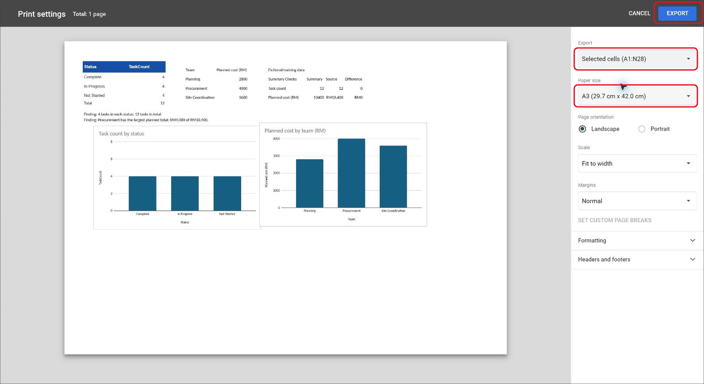

*Check the scope every time you open these settings.*

3. Click **Export**. When it downloads, rename the file `GW-Sponsor-Summary-r1.pdf`.
4. Open the PDF and check it: counts, team totals, both findings and both complete charts.

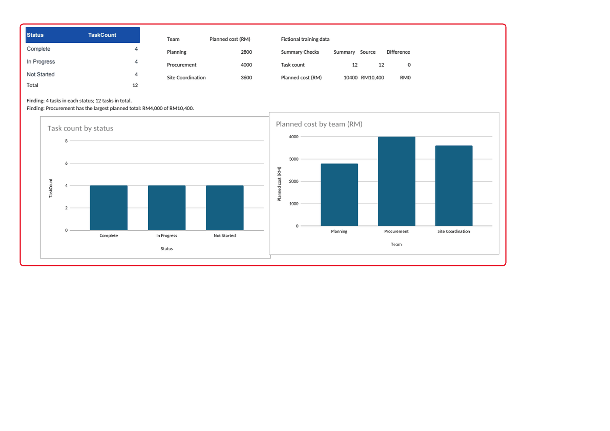

*Check the real PDF, not just the preview.*

**Check:** `GW-Sponsor-Summary-r1.pdf` is one page with both complete charts, and its heading says **Status**.

---

## 7.7 Make a Two-Page Task Listing

The task list is short, but you split it over two pages on purpose, to practise page breaks and repeating the heading row.

1. Click the arrow on the **Tasks** tab and choose **Duplicate**. Rename the copy `Register Output`.
2. On **Register Output**, click the name box, type `J:Z` and press **Enter**. Right-click a selected column heading and choose **Delete columns J - Z**.
3. Click the name box, type `14:1000` and press **Enter**. Right-click a selected row number and choose **Delete rows 14 - 1000**.

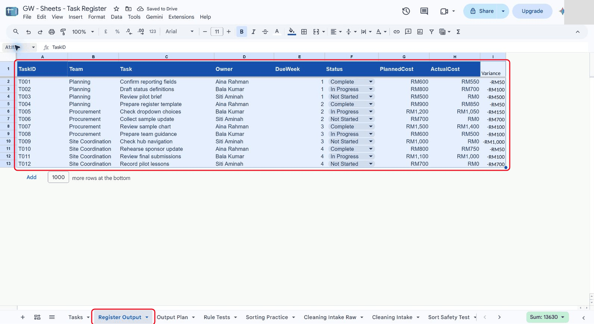

*This copy is only for printing. Keep editing the real Tasks tab.*

4. Click **File**, **Download**, **PDF (.pdf)**. Choose **Current sheet**, **A3**, **Landscape**, and set **Scale** to **Normal (100%)**. Click **Set custom page breaks**.

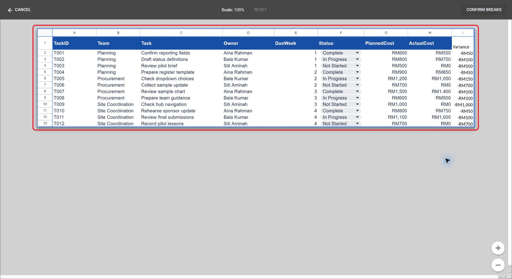

*The blue line at the bottom marks the end of the page.*

5. Drag the bottom blue line up to sit between row 7 (**T006**) and row 8 (**T007**). Click **Confirm breaks**.

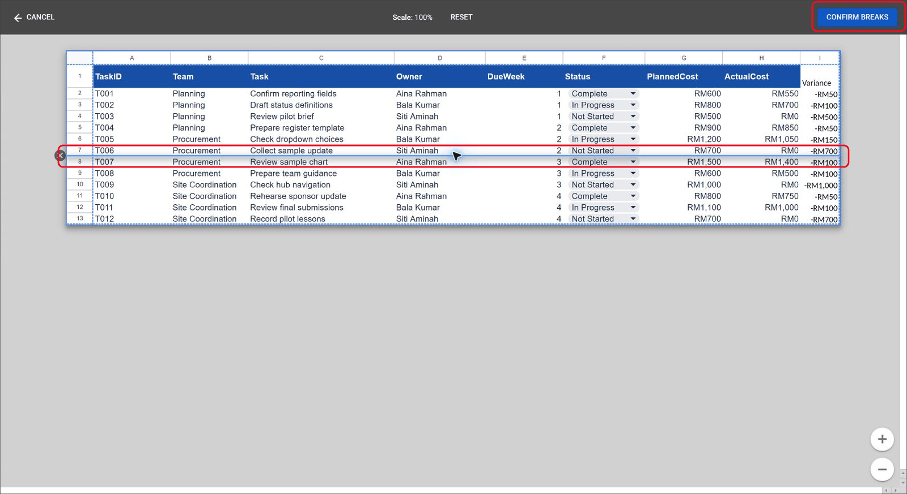

*Six tasks on each page.*

6. Open **Headers and footers** and tick **Repeat frozen rows**. The preview says **2 pages**.

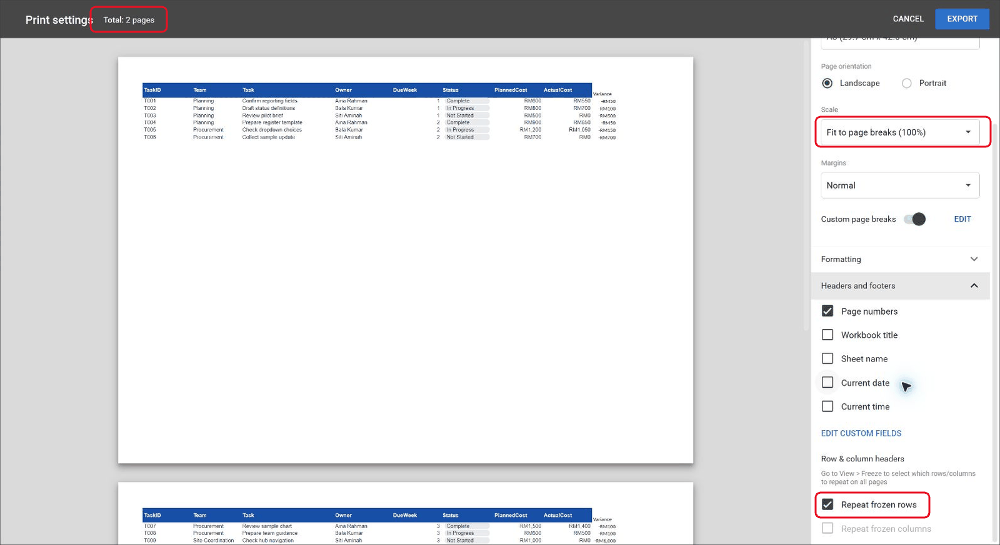

*Page 1 has T001 to T006.*

7. Scroll to the second page in the preview: it starts with the heading row and runs from **T007** to **T012**. Click **Export** and rename the file `GW-Task-Listing-r1.pdf`.

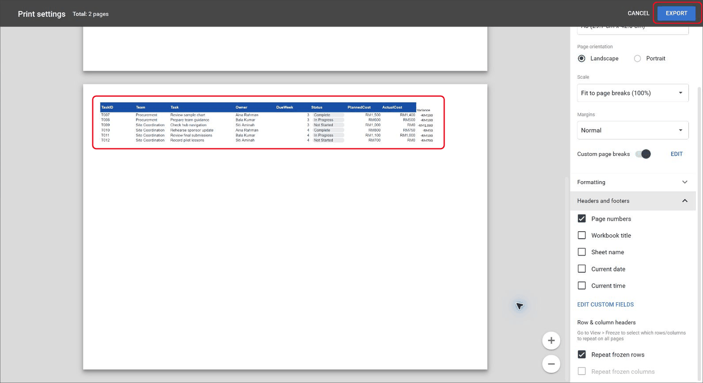

*No totals, no checks, no practice tabs.*

8. Open the PDF and check both pages.

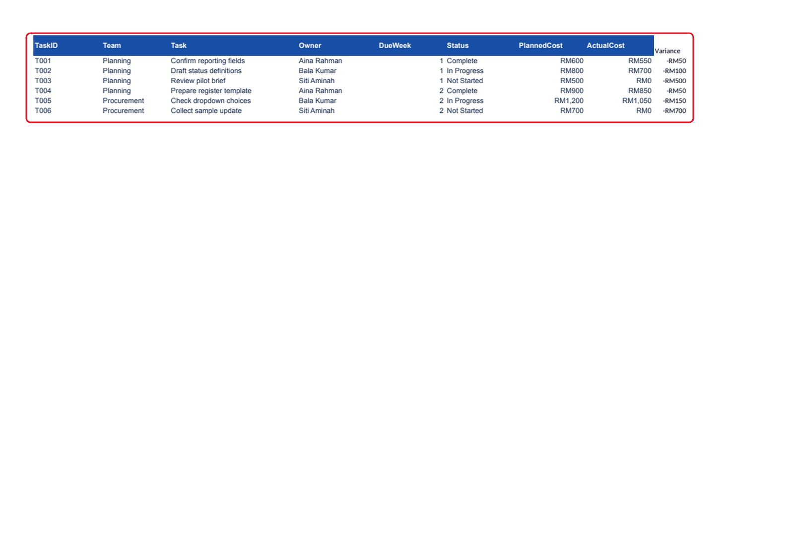

*Page 1.*

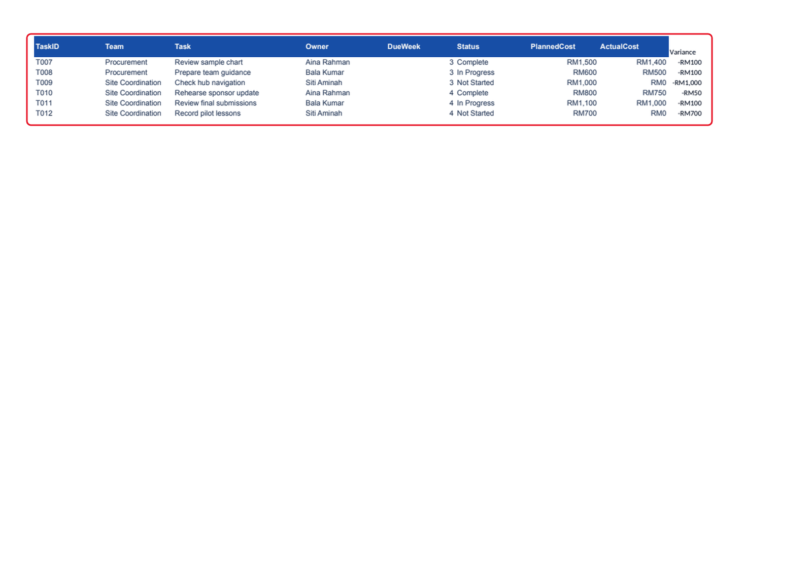

*Page 2 repeats the headings, and every task appears exactly once.*

**Check:** `GW-Task-Listing-r1.pdf` has two pages, both with the heading row, and twelve tasks in total.

---

## 7.8 See That a PDF Doesn't Update

1. Click the **Summary** tab. **A1** says **Status**.


*This is the heading in revision 1.*

2. Click **A1**, type `Task status` and press **Enter**.

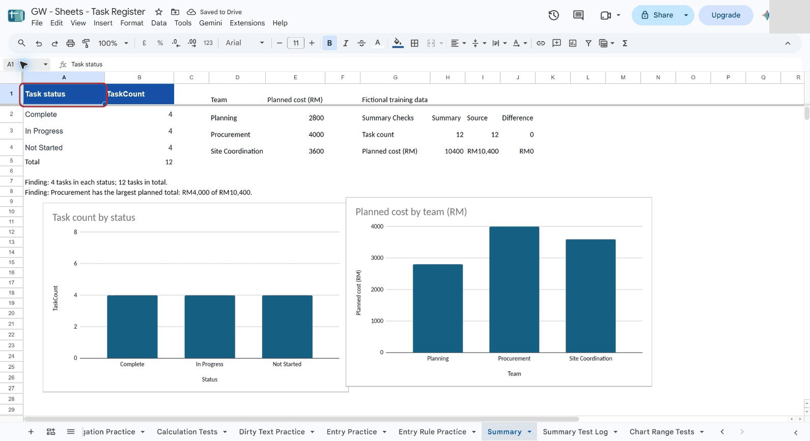

*Only the heading changes. The counts, formulas and charts don't.*

3. Select `A1:N28` and download it as in 7.6: **Selected cells (A1:N28)**, **A3**, **Landscape**, **Fit to width**. Click **Export** and rename the file `GW-Sponsor-Summary-r2.pdf`. Keep revision 1 as it is.


*Same range and settings as revision 1.*

4. Open revision 2: the heading says **Task status**. Open revision 1: it still says **Status**.

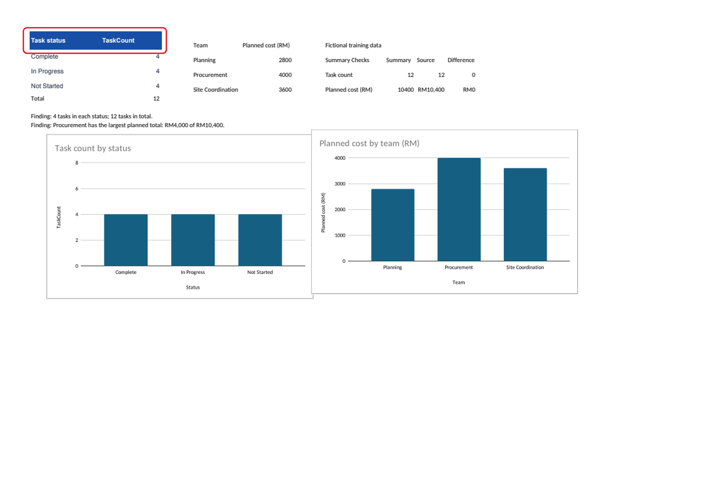

*Two fixed copies from two moments. Neither changes now.*

5. On **Summary**, change **A1** back to `Status`.


*The live workbook is back as it was. Revision 2 keeps the changed heading.*

**Check:** you have two sponsor PDFs, one saying **Status** and one saying **Task status**, and **Summary** **A1** says **Status** again.

---

## 7.9 Record the Exports

1. Click the **Output Plan** tab. Update the sponsor scope and the revision plan with what you actually did: copy the block below, click **B9** and press **Ctrl+V**. It replaces **B9** and **B10**.

```text
Summary A1:N28. A1:J28 clipped the cost chart, so the range was widened. A3 landscape, Fit to width; no test tabs.
Completed: r1 saved with Status; A1 changed to Task status; r2 saved; A1 restored to Status. r1 unchanged; r2 is the latest fixed copy.
```

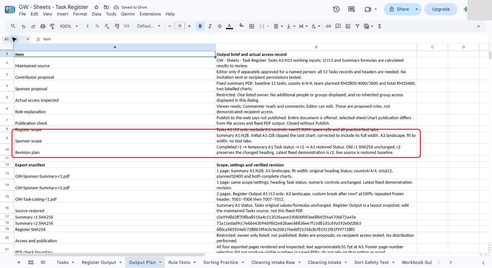

*The plan now records the range fix and both revisions.*

2. Copy the block below, click **A12** and press **Ctrl+V**.

```text
Export manifest	Scope, settings and checked content
GW-Sponsor-Summary-r1.pdf	1 page; Summary A1:N28; A3 landscape, Fit to width; heading Status; counts 4/4/4, total 12, planned 10400, both charts complete.
GW-Sponsor-Summary-r2.pdf	1 page; same range and settings; heading Task status; numbers unchanged. Latest fixed copy.
GW-Task-Listing-r1.pdf	2 pages; Register Output A1:I13; A3 landscape, break after row 7 at 100%; repeated header; T001-T006 then T007-T012.
Source restored	Summary A1 is Status again. Tasks values and formulas unchanged. Register Output is a print copy; edit Tasks, not this copy.
Access and publication	Restricted; no one added. Not published. Roles are proposals only. Nothing sent.
```

3. Turn on wrapping for column **B** so each line is readable.

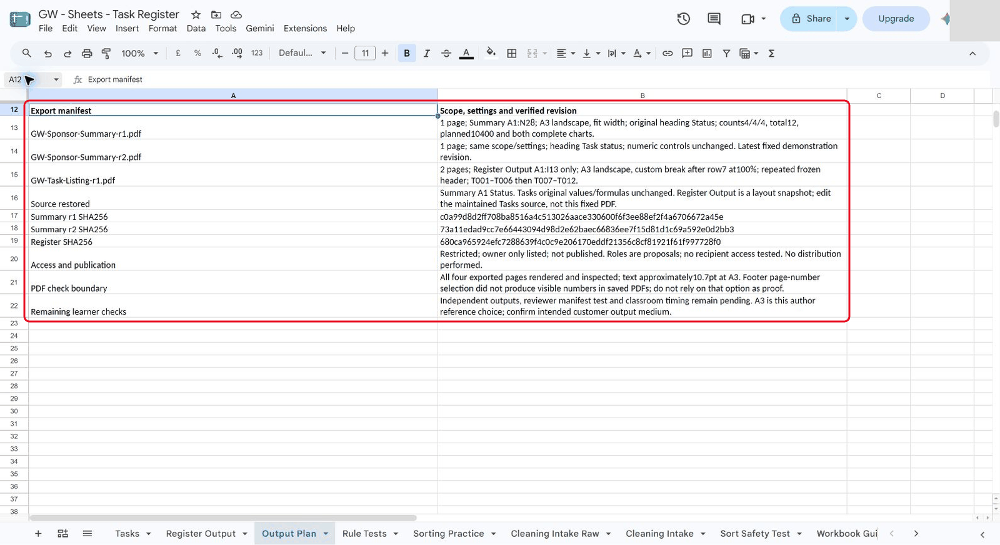

*The screenshot also has file fingerprint (SHA256) rows. You can leave those out.*

**Check:** **Output Plan** lists all three PDFs, with which one is the latest sponsor copy.

> **Download:** example exports to compare with yours:
>
> - [GW-Sponsor-Summary-r1.pdf](./reference-output/GW-Sponsor-Summary-r1.pdf)
> - [GW-Sponsor-Summary-r2.pdf](./reference-output/GW-Sponsor-Summary-r2.pdf)
> - [GW-Task-Listing-r1.pdf](./reference-output/GW-Task-Listing-r1.pdf)

---

## Independent Practice

Try these without looking back at the steps.

1. **Edit or review?** On **Output Plan**, under the manifest, write two lines for a new contributor: which cells they should type into, and which cells they should only check because formulas fill them.
2. **Which copy is current?** Give a partner your **Output Plan** and the three PDFs. Without your help, they should say which sponsor PDF is the latest and why its heading differs from the live **Summary**.
3. **Portrait or landscape?** Download **Register Output** again in **Portrait** on A4 with **Fit to width**. Compare it with your landscape listing and write one sentence on **Output Plan** about which you'd send, and why.

<details markdown="1">
<summary>What should you see?</summary>

Contributors type into **Tasks A2:H13**. They only check **I2:I13**, the totals in **K1:L7**, **J15** and everything on **Summary**, because formulas fill them. Revision 2 is the latest sponsor copy; it says **Task status** because it was saved during the test, and the live workbook was put back afterwards. A portrait A4 listing fits, but the text is much smaller.

</details>

### Evidence to Hand Over

- **Output Plan** with the plan, the export manifest and your contributor notes
- `GW-Sponsor-Summary-r1.pdf` and `GW-Sponsor-Summary-r2.pdf`, one page each
- `GW-Task-Listing-r1.pdf`, two pages with the heading on both
- Your portrait-or-landscape decision

## Troubleshooting

| Problem | What to try |
|---|---|
| The PDF includes practice tabs | The scope was **Workbook**. Choose **Selected cells** or **Current sheet** and export again. |
| A chart is cut off in the PDF | Widen the selected range until the whole chart is inside it, such as **A1:N28**. |
| The scope went back to **Current sheet** | It resets each time you open the settings. Choose **Selected cells** again before exporting. |
| **Set custom page breaks** is greyed out | It isn't available with **Selected cells**. Use **Current sheet** on the **Register Output** copy. |
| Page numbers don't show in the PDF | They may not appear in a downloaded PDF. Identify pages by their first and last TaskID instead. |
| **Next** opened your browser's print window | Cancel it. Use **File** > **Download** > **PDF (.pdf)** and **Export** instead. |

## Lesson Summary

You checked who can open the workbook and that it isn't published, without changing either. You exported a one-page sponsor summary after fixing a range that cut off a chart, and a two-page task listing with the headings repeated. Changing one heading showed that a PDF stays as it was saved while the workbook moves on. In Lab 08 you bring everything together on a new task.

**Check yourself:** which output reflects later changes automatically, and which is a fixed copy?
