# 08 - Complete the Register Challenge

In this chapter you will extend a separate register, repair a formula and reconcile its totals before an independent changed-row challenge.

> **Prompts and values:** use the [copy-paste page](./prompts.md) for the exact values used below.

**Target allocation:** 45 minutes: 10 explanation/demonstration, 15 guided build and casework, 15 independent challenge, 5 verification and repair. The active portion is 35 minutes by design. These are unmeasured targets awaiting a learner pilot.

**Your result:** A separate 13-record challenge copy with reconciled totals and chart.

> **Status:** author reference with 32 staged captures through 8.4 (31 application views and one native PDF page). Separate 13-record workbook, extended ranges, repaired reference, actual validation rejection, two-method controls, cost correction, focused views, current PDF and operating guide checked. Original baseline preserved. Partner explanation/handover, independent T014/range omission and learner timing remain pending.

## What You Will Learn

- Extend a register deliberately.
- Repair a formula and reconcile totals.
- Explain a checked chart.

## Before You Begin

Read the [case input](./prompts.md) and use a separate named casework copy for destructive tests or altered datasets. Keep the baseline unchanged for later chapters. Record source facts, proposed practice and unresolved questions separately.

Make a separate challenge copy of your workbook. The original 12-record baseline must stay intact.

## 8.1 Add a New Record

1. On the maintained workbook use **File > Make a copy**. Name the new file **GW - Sheets - Register Challenge - 13 Records**. Keep **Share it with the same people** and **Copy comments** unchecked. Verify the new title and distinct workbook identity before editing. This is a whole-workbook scenario copy, not a replacement for the original baseline.

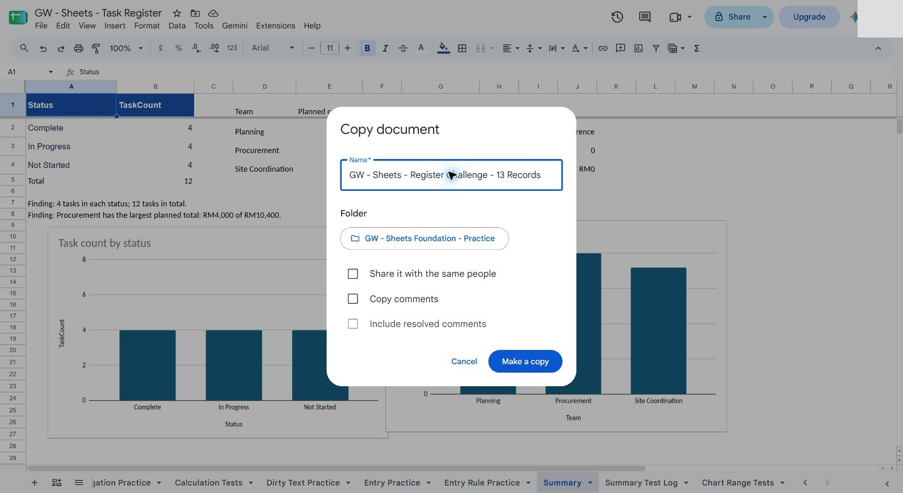

2. Inspect Tasks and its original twelve records. The copied workbook also contains earlier practice tabs and output plans; these are training history. The current challenge handover will use **Tasks / Summary / Change Log** only. Do not present an inherited twelve-record PDF or practice control as the corrected challenge output.

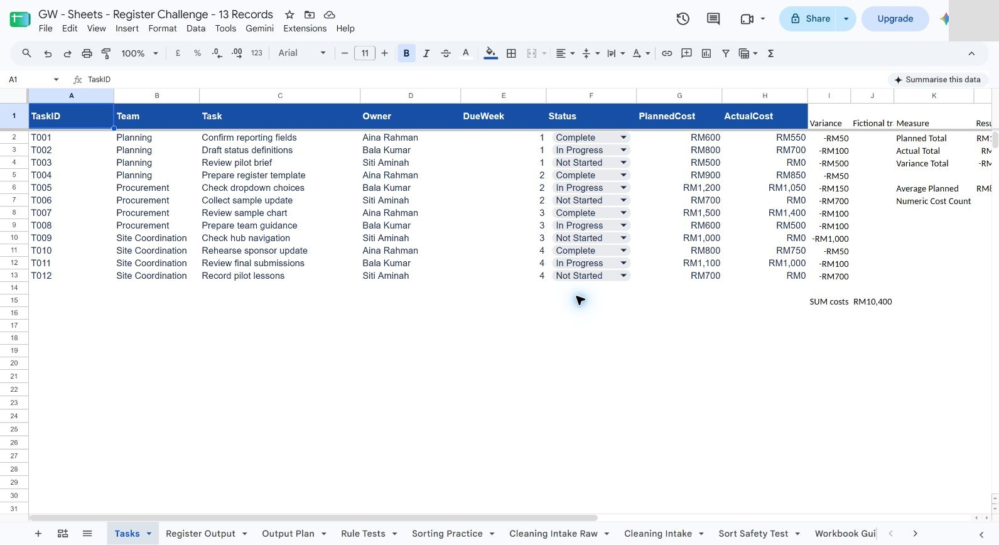

3. In Tasks A14:H14 enter **T013 / Planning / Check the handover / Aina Rahman / 4 / Not Started / 200 / 0**. The new costs are numeric; the existing bounded controls still omit row 14 until extended.

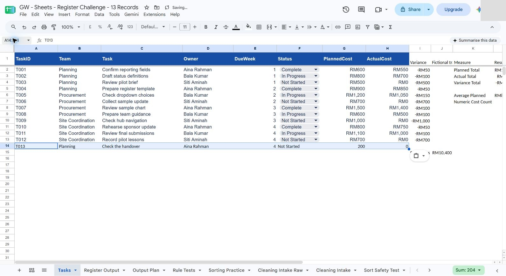

4. Select I13:I14 and **Fill down**. Inspect **I14 =H14-G14**, result **-200**. It must calculate from its own record rather than a prior task.

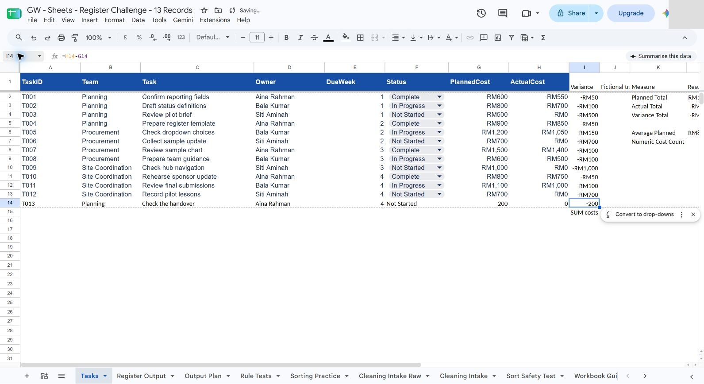

5. Inspect the status rule through **Data > Data validation**. Its intended range is **Tasks!F2:F14**, retaining the separate N2 spare rule. Use the **Select data range** picker, extend the F range and confirm **OK / Done**; preserve the exact canonical choices and Reject input. The actual new-row verification and committed repair are shown in 8.3. Do not accept a typed range field alone as proof of coverage.

> **Reference run:** The captured field edit below shows the intended extension, but this author's first text-field attempt did not persist.

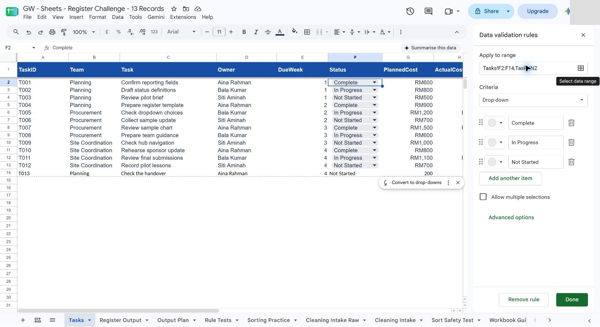

6. Extend the live Tasks controls: L2 **=SUM(G2:G14)**, L3 **=SUM(H2:H14)**, L4 **=SUM(I2:I14)**, L6 **=AVERAGE(G2:G14)**, L7 **=COUNT(G2:G14)**, and J15 **=SUM(G2:G14)**. Expected values before correction are **10600 / 6800 / -3800**, average planned **815.384615…**, numeric count **13**. The original twelve task values remain unchanged.

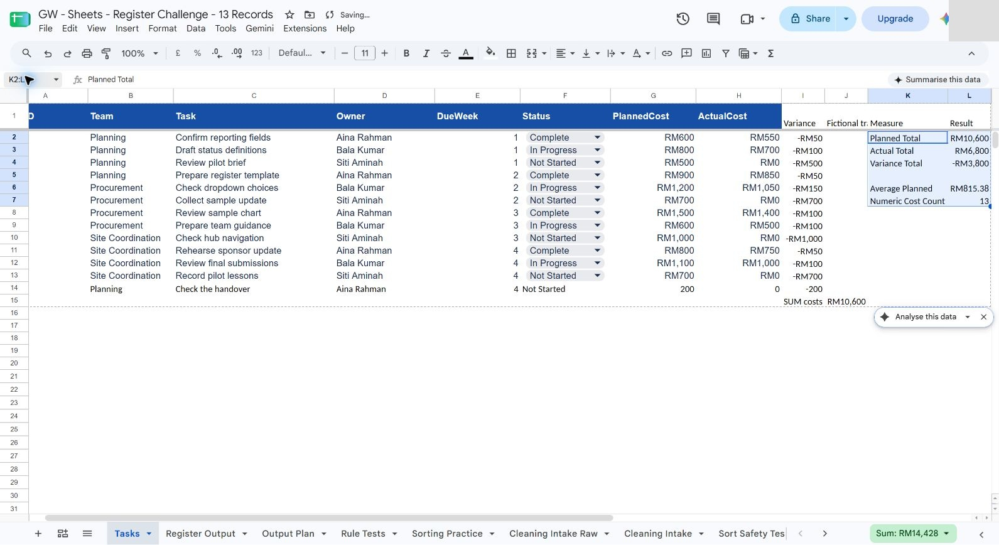

7. Inspect **Named ranges**. In the inherited training workbook, PlannedCosts referred to the earlier **Sorting Practice!G2:G13**. In this scenario copy, edit it to the authoritative **Tasks!G2:G14** and save. Navigating to PlannedCosts selects Tasks and reports **RM10600**. Record both the sheet change and new last row; simply extending a historical practice table would leave the named control tied to the wrong source.

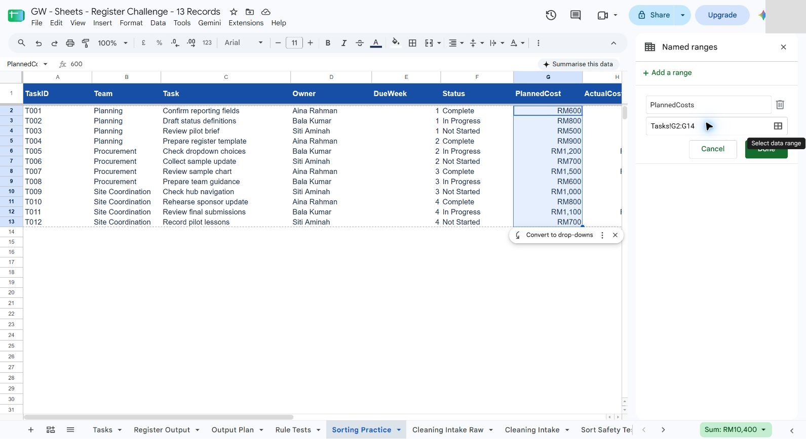

8. On Summary, enter **=COUNTIF(Tasks!$F$2:$F$14,A2)** in B2 and fill to B4. Enter **=SUMIF(Tasks!$B$2:$B$14,D2,Tasks!$G$2:$G$14)** in E2 and fill to E4. Extend I3 to **=COUNTA(Tasks!A2:A14)** and I4 to **=SUM(Tasks!G2:G14)**. The existing B5/H3/H4/difference formulas can remain because their summary-category population has not gained a row. Expect **4 / 4 / 5**, total **13**, team planned **3000 / 4000 / 3600**, total **10600**, zero differences. The inherited written findings are updated in the next section; text does not automatically refresh with a chart.

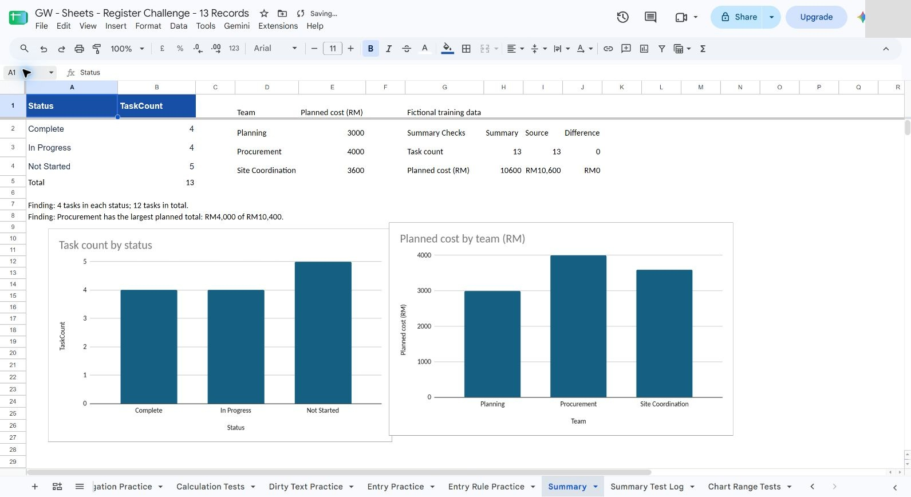

## 8.2 Repair and Reconcile

1. Predict a deliberate error before applying it. Change challenge I14 to **=H14-G13**. G13 is T012's planned **700**, so the predicted row result is **-700**, summed variance **-4300**, and discrepancy **-500** from the correct actual-minus-planned **-3800**. Inspect the actual row and total; the captured grid shows that predicted fault.

2. Repair I14 to **=H14-G14**. The row returns to **-200**; do not replace the formula with a typed result.

3. Reconcile planned **10600**, actual **6800**, and variance **-3800**. Compare the sum of row variances with actual total minus planned total. Numeric planned-cost count is thirteen.

4. Update the written findings to **4 Complete / 4 In Progress / 5 Not Started; 13 tasks** and explain that T013 adds planned **RM200**, increasing Planning to **RM3000** and planned grand total to **RM10600**. Inspect both charts. Their category source ranges stay **A1:B4 / D1:E4**; the conditional formulas underneath them now cover the thirteenth source record.

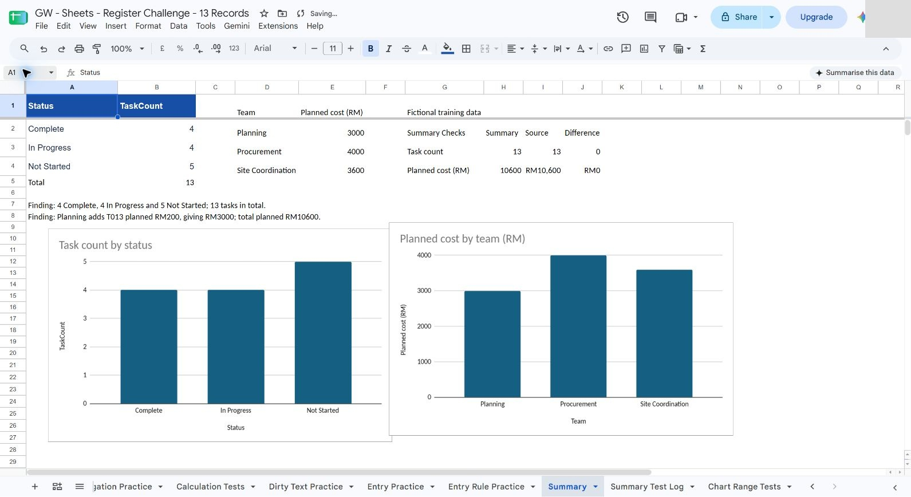

## 8.3 Explain the Result

1. Verify the new row's validation before handover. Entering **Done** in F14 through cell-edit mode is now actually rejected with the three allowed statuses.

> **Reference run:** In this run the first compact range-text edit had not saved F14. The author reopened the rule, used **Select data range**, changed the first range to **Tasks!F2:F14**, preserved **Tasks!N2**, then confirmed **OK / Done**.

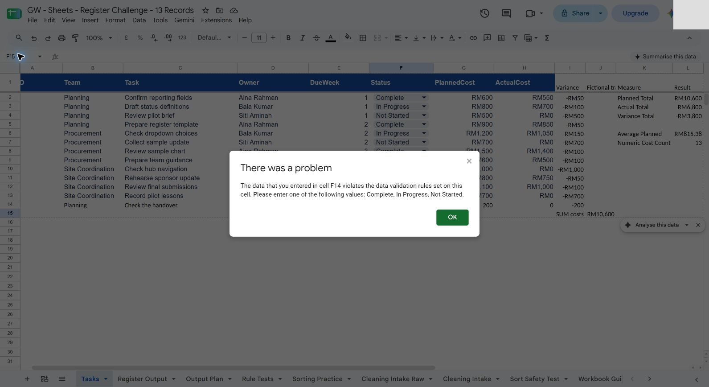

2. Dismiss the message and exit editing. F14 retains **Not Started**. This is evidence of the tested rule on the new row; a dropdown elsewhere in the workbook would not prove that coverage. The repaired range is also confirmed in native cell metadata.

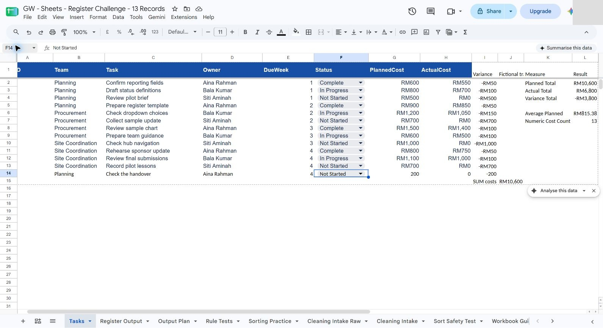

3. Explain using the cells: I14's H14/G14 references follow its own row; Summary B4 holds **=COUNTIF(Tasks!$F$2:$F$14,A4)**, with a fixed source range and relative criterion; F14 uses the canonical strict status rule. Identify the new record's RM200 planned contribution and its effect on population and variance.

> **Reference run:** This reference provides the cell-supported author explanation; the requested partner explanation remains a learner/human check and was not performed.

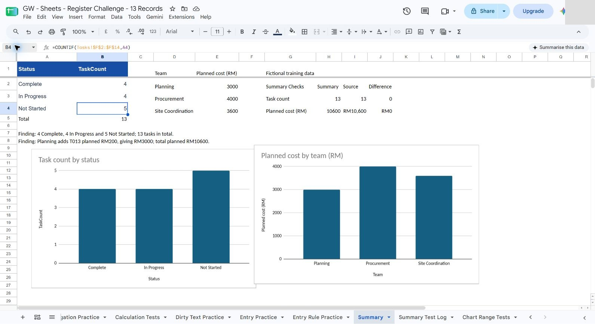

## 8.4 Stress-Test the Extended Register and Complete the Handover

1. Create **Change Log** and list every active range changed for T013: row variance, totals, average/count, status validation, PlannedCosts, conditional summaries, source checks, chart dependency and filter-view coverage. Distinguish inherited training tabs and baseline exports from the current scenario. Leave filter-view verification pending until reopened below.

> **Reference run:** The reference uses wrapped 450-pixel A:C columns so descriptions remain readable.

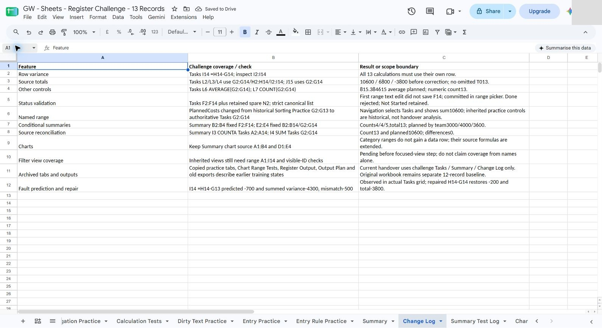

2. On Tasks use **View > Show > Formulae**, or menu search **Show all formulae**. Inspect every cell I2:I14: each is **=Hrow-Grow**, including repaired I14. Turn formula display off afterward. If a sort is required, sort whole records and repeat the row-reference check; this reference did not perform an additional sort in Lab 8.

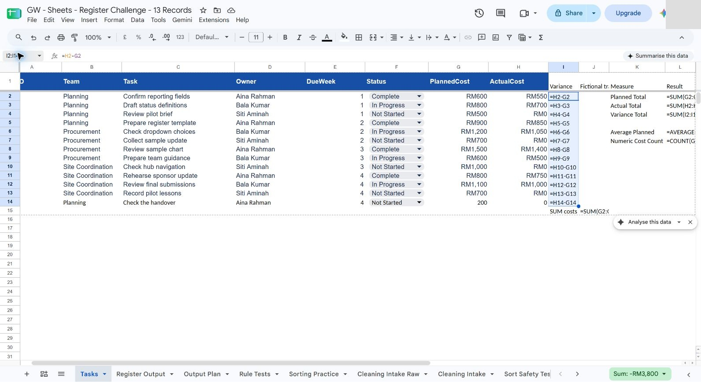

3. Extend Summary's control block with actual and variance checks in G5:J6. H5 is **=SUM(Tasks!H2:H14)**. I5 independently adds SUMIF actual totals for Planning, Procurement and Site Coordination over B2:B14/H2:H14; J5 is H5-I5. H6 is **=SUM(Tasks!I2:I14)**; I6 is H5-H4, and J6 is H6-I6. Before the correction these reconcile to **6800 / -3800** and zero differences.

4. In Change Log A15:D22 make a control table **Control / Method one / Method two / Difference**. Compare COUNTA task IDs with COUNT numeric planned costs; COUNTUNIQUE with COUNTA; SUM planned with the team SUMIF total; SUM actual with the three-team actual total; summed variance with actual-minus-planned; status-count sum with record count; and SUM(PlannedCosts) with the direct source sum. Each difference should be zero. Record the next prediction before changing the source: **T013 ActualCost 0→150** should give row variance **-50**, actual grand total **6950**, variance grand total **-3650**, with planned **10600** unchanged. Status and planned-cost charts should remain unchanged because neither uses ActualCost.

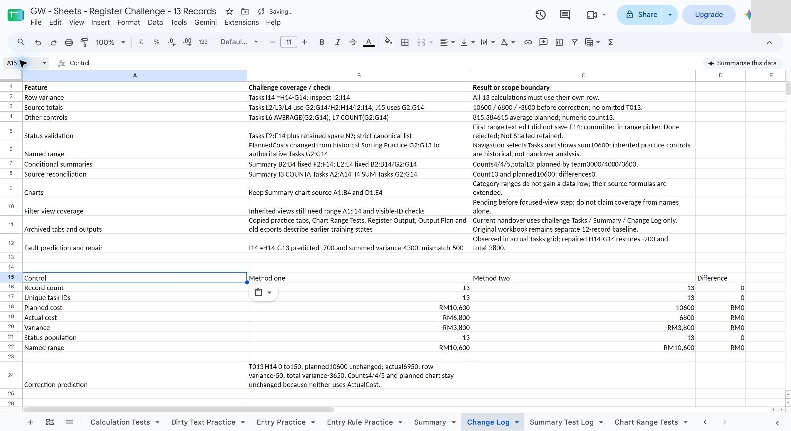

5. Apply **150** to challenge Tasks H14 only. Verify **I14 =H14-G14 = -50**. For consistent display, copy G13:H13 and paste **Format only** into G14:H14 without overwriting numeric 200/150. Preserve the clipboard while selecting the destination; pasting an address would replace the copied cells.

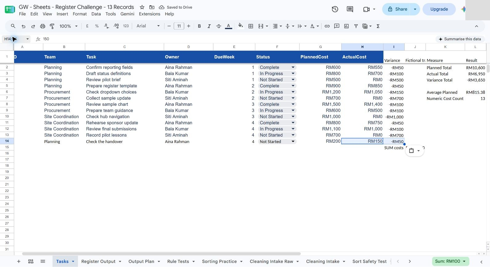

6. Inspect Summary: actual **6950**, variance **-3650**, planned **10600**, counts **4/4/5**, zero reconciliation differences. The unchanged charts are correct for their selected measures; the actual/variance controls communicate the correction.

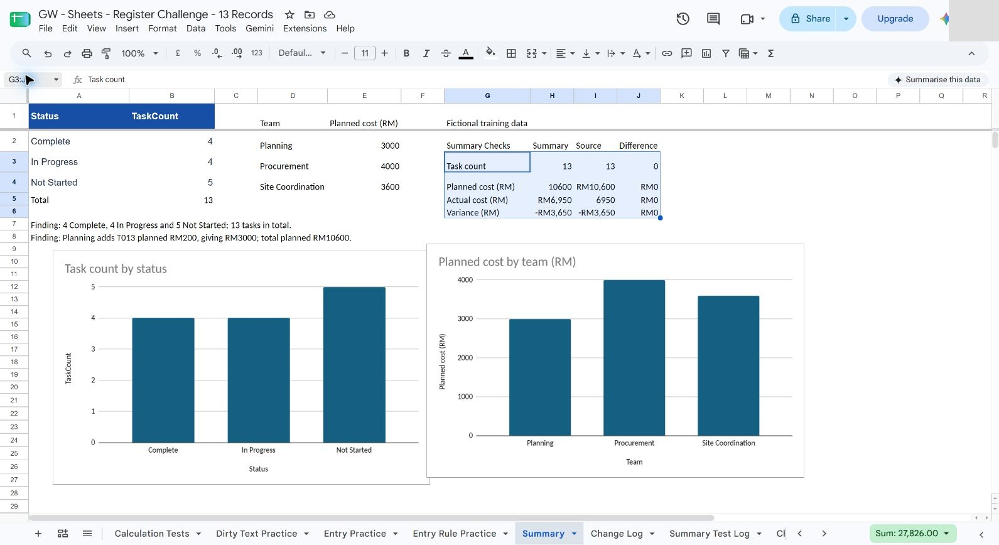

7. Recheck the two-method table and record observed versus predicted effects. The corrected state is retained in this scenario copy; the original baseline is not changed to 13 records.

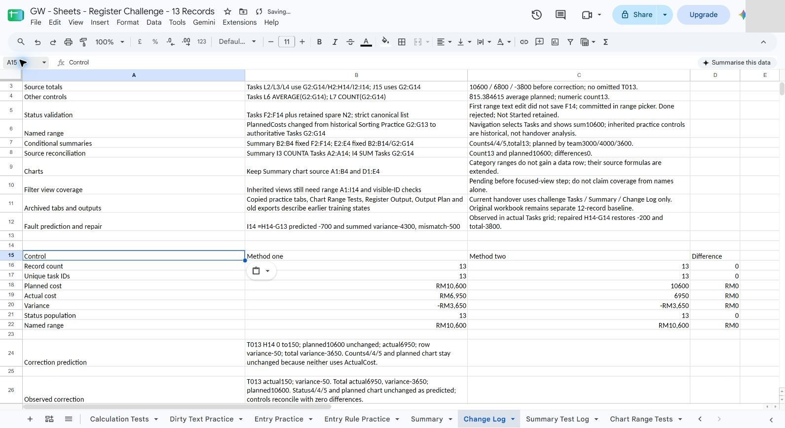

8. Reopen **Incomplete tasks** and inspect its range and record IDs. In this session the inherited view already reopened over **A1:I14**, so no manual range edit was needed. Verify nine visible IDs **T002, T003, T005, T006, T008, T009, T011, T012, T013**. Check bounds explicitly; do not assume the application will expand a bounded view in every future run.

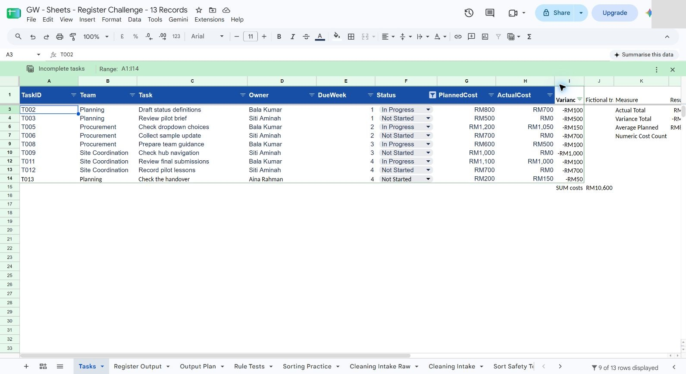

9. Close that view and reopen **Planning incomplete tasks**. It also shows **A1:I14**, with **3 of 13 rows displayed**: **T002, T003, T013**. The new task must be included. A saved view name alone is not a population check.

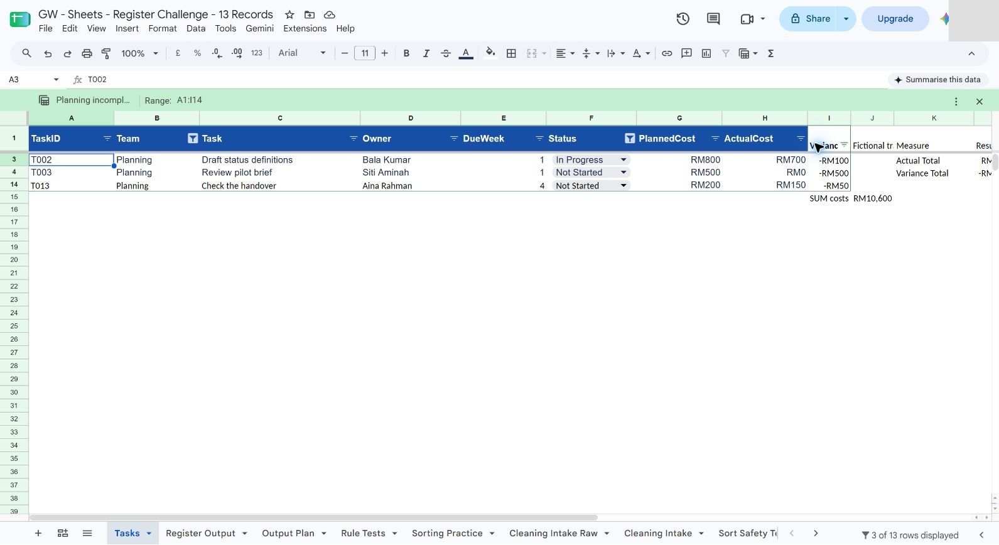

10. Exit the view and leave all thirteen records visible. Update Change Log with the observed ranges and IDs, noting that both views were closed. Ordinary SUM still includes the full source population while a view hides rows.

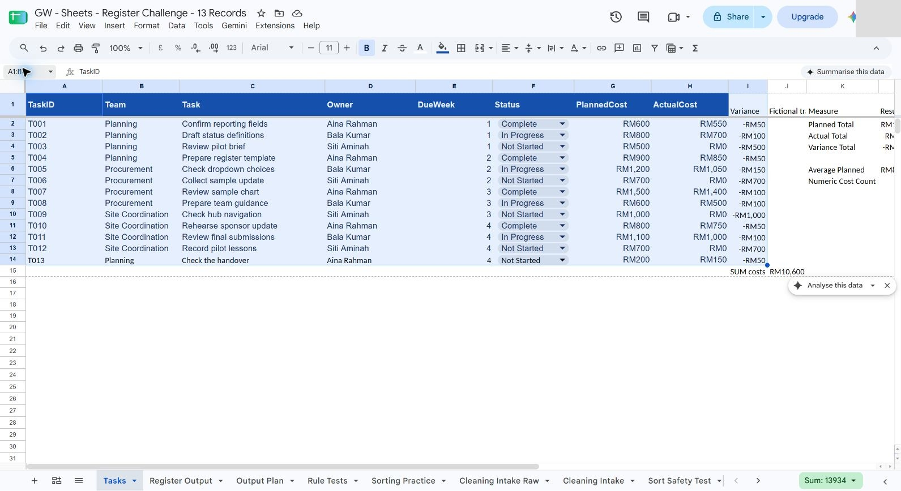

11. Label Summary **13-record challenge - corrected** and write a current finding with **planned RM10600 / actual RM6950 / variance -RM3650**. Keep the task-count finding at 4/4/5, thirteen total. Include the new actual/variance controls in the sponsor output so its corrected state can be distinguished from the old baseline PDF.

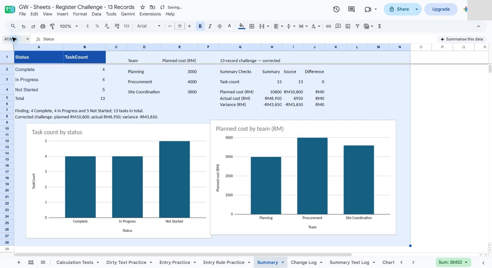

12. Select **Summary A1:N28**, use **Download as PDF**, and explicitly choose **Selected cells**, A3, Landscape, Fit to width. Inspect the complete labels, charts and current control values. Export as **GW-Register-Challenge-Corrected-r1.pdf**; do not overwrite a baseline file or export the whole workbook's historical practice tabs.

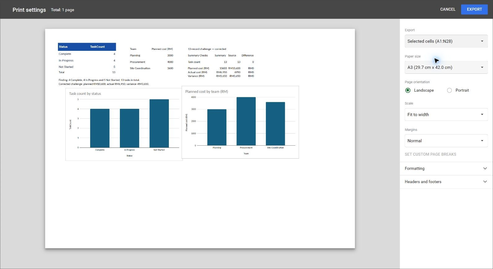

13. Inspect the actual saved page. It is a one-page A3 native PDF with approximately 10.7 pt text, thirteen tasks, status **4/4/5**, Planning **3000**, planned **10600**, actual **6950**, variance **-3650**, zero differences and both complete charts. It is distinct from the untouched baseline exports.

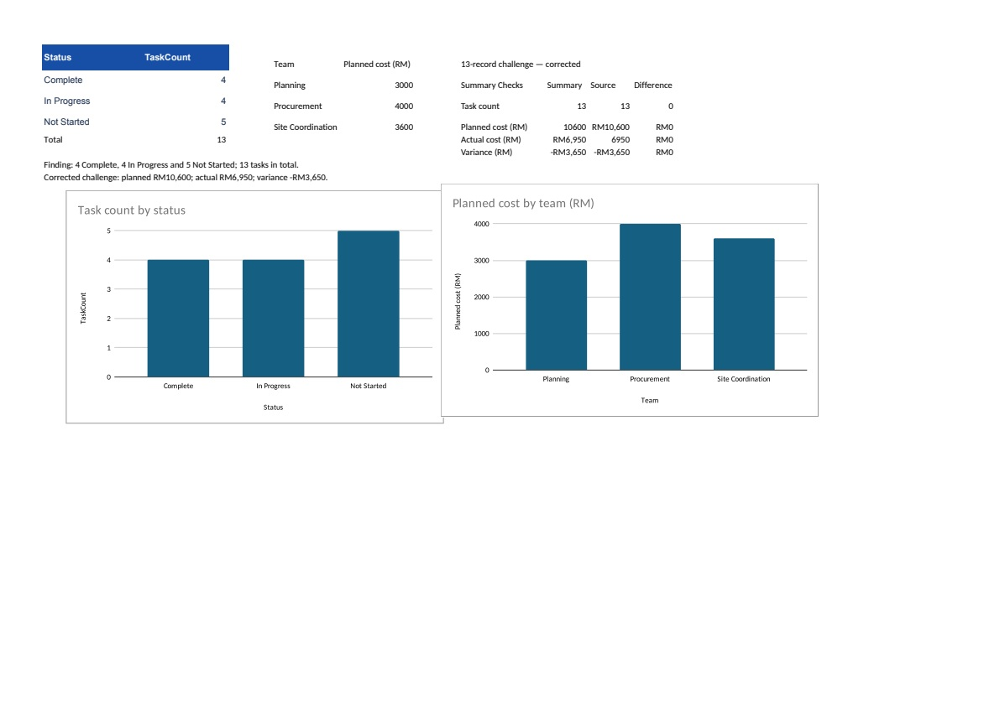

14. Write an operating guide in Change Log: identify the maintained challenge source; enter the next record on a further disposable copy; retain unique IDs/numeric costs/canonical statuses; copy a same-row formula; extend every active bounded range; commit and test rule coverage; inspect whole-record sorts and view IDs; reconcile by two methods; then export a newly named current summary. Record the PDF's scope, state, page count and hash. Partner handover and independent T014 remain pending rather than being inferred from this written guide.

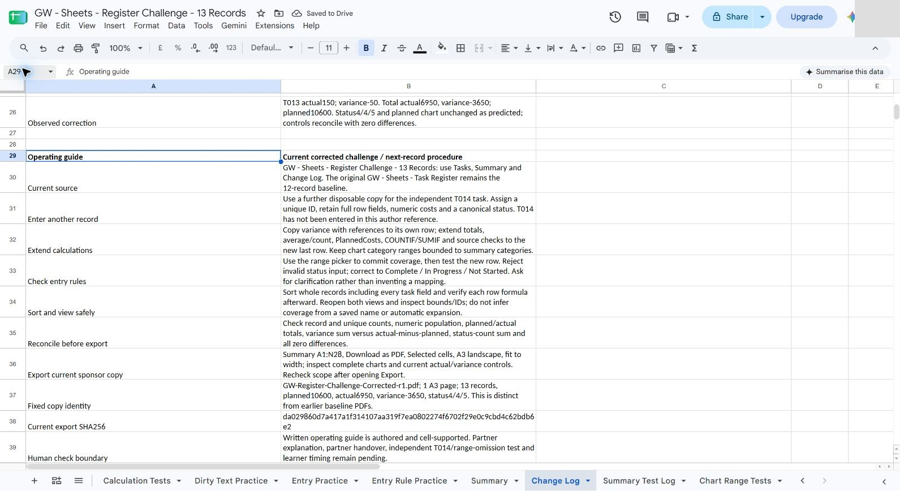

15. Inspect the completed coverage log and control table. Current handover sources are **Tasks / Summary / Change Log**; copied practice tabs, prior Register Output, Output Plan and old PDFs describe earlier training states. The PlannedCosts definition now belongs to the authoritative challenge Tasks source, so historical practice controls must not be presented as the current handover analysis.

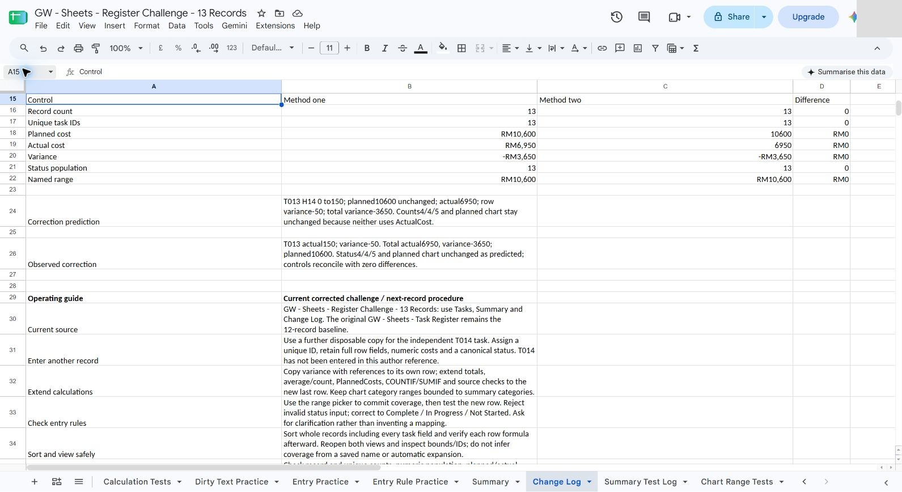

16. Reopen the original **GW - Sheets - Task Register** and compare its twelve-record state: **4/4/4**, planned **10400**, actual **6800**, variance **-3600**.

> **Reference run:** Native readback confirms its Tasks and Summary values/formulas remain unchanged from Lab 7.

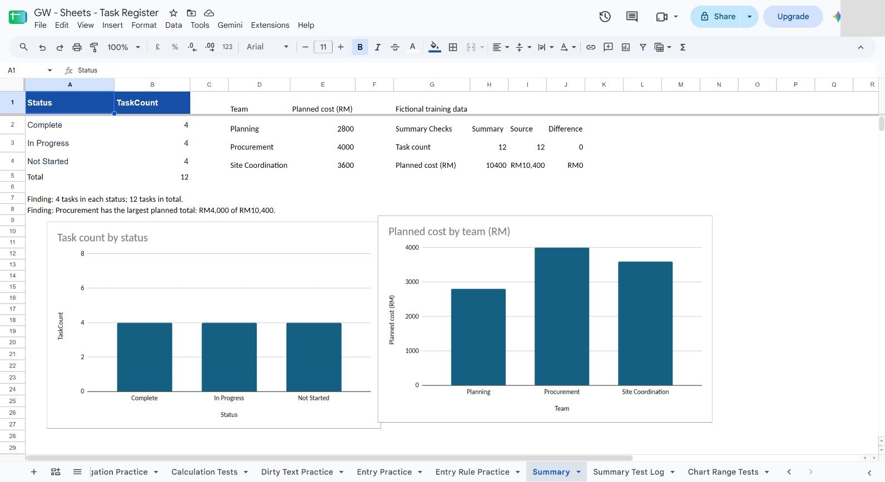

17. Leave **GW - Sheets - Register Challenge - 13 Records** clearly named and saved in the corrected state.

> **Reference run:** Its 13-record source, controls, export and written guide are retained; there is no T014 author-reference copy yet.

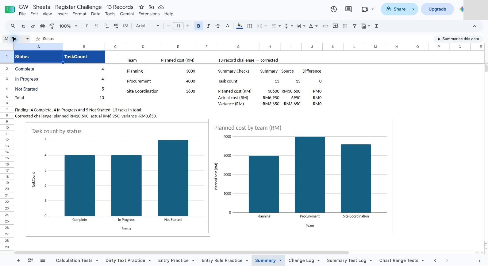

- [Corrected challenge sponsor PDF](./reference-output/GW-Register-Challenge-Corrected-r1.pdf)
- [Current export manifest](./reference-output/export-manifest.json)

> **Validation boundary:** guided 8.1–8.2, cell-supported author explanation and casework 8.4 are checked. Partner explanation/handover, independent T014 and shortened-range diagnosis, and learner timing remain pending. All eight Foundation labs now have author-reference captures; this does not establish a classroom-ready release or resolve earlier CSV/import and values-only-format limitations.

## Independent Challenge

Close the earlier step lists for the first attempt. Use the case input and your own reasoning. If you need help, record the hint and repeat the affected check independently.

1. Close the earlier click instructions. Add T014 on a further disposable copy using the supplied fields, then extend and verify all affected features independently.

2. Use your control table to catch at least one deliberately shortened range. Correct it and explain the cause with cell evidence.

3. Give a partner the operating guide and ask them to find the current source and identify the checks for the next row. Record a handover improvement and leave all scenario copies clearly named.

## Evidence to Hand Over

- 13-record cost-corrected challenge and a full coverage/change log.
- Separate 14-record independent test with reconciled totals and repaired range omission.
- Readable current export plus a tested operating guide and preserved baseline.

Record the defect or uncertainty you investigated, the evidence used, the repair or reasoned no-change decision, and the final state. Restore temporary changes or keep them in a clearly named scenario copy.

## Troubleshooting

| Symptom | What to check |
|---|---|
| The challenge contaminates the next baseline lesson | Keep named scenario copies and compare their population and totals before proceeding. |
| An input or earlier result is missing | Reopen the input named in Before You Begin; do not substitute private company data |
| A menu or feature is unavailable | Confirm the account and the shared access notes; record the missing step and ask the trainer for its fallback |
| The result differs from the checkpoint | Compare the exact source range, wording and conditions before repeating the action |

## Lesson Summary

You have built, checked and extended a usable register.

**Check yourself:** Which ranges needed extending after T013 was added?
