# 08 - Complete the Register Challenge

A thirteenth task has arrived: T013, *Check the handover*, for Planning. It sounds like one new row, but every total, rule, summary, named range and filter view you built stops at row 13. Aina wants the new task added on a separate copy, every feature extended to cover it and proved to work, a cost correction applied, and a current summary exported, while the original twelve-task register stays exactly as it is. This lab pulls together everything from Labs 01 to 07.

**Estimated time:** 45 minutes, planned as 5 explanation, 30 guided build and 10 independent practice. Not yet timed with learners.

**Your result:** a separate workbook, `GW - Sheets - Register Challenge - 13 Records`, with T013 added and corrected, every range extended, a **Change Log** with two-way checks and an operating guide, and a one-page corrected summary PDF. The original `GW - Sheets - Task Register` is unchanged.

> **You'll practise:** making a copy of a workbook, adding a record and extending every range that depends on it, editing validation rules and named ranges, catching a wrong reference, checking totals two ways, and exporting a current summary.

---

## What You Will Learn

- Add a record and find everything that must grow with it
- Prove each feature covers the new row
- Keep the original, the challenge and the fixed PDFs clearly apart

## Before You Begin

Open `GW - Sheets - Task Register` from **GW - Sheets Foundation - Practice**. You need everything from Labs 01 to 07, including both saved filter views and the **PlannedCosts** named range.

**What you build in this lab:**

**Challenge copy** > T013 > extended rules, totals and named range > extended summary > wrong-reference test > **Change Log** > two-way checks > cost correction > views > corrected PDF > operating guide

## Topics

**Ranges don't grow by themselves.** `=SUM(G2:G13)` stops at row 13, so a task in row 14 is quietly left out. The same is true of validation rules, named ranges, COUNTIF and SUMIF. When you add a row, you look for every range that should now end at 14.

**Prove coverage on the new row.** A rule that says **F2:F14** in its settings is a good sign. Typing `Done` into **F14** and seeing it rejected is proof.

**Three states, kept apart.** The original register (12 tasks), the challenge copy (13 tasks), and the PDFs (fixed at the moment you saved them). Each has a clear name so nobody mixes them up.

---

## 8.1 Make a Challenge Copy

1. In `GW - Sheets - Task Register`, click **File**, then **Make a copy**.
2. Name it `GW - Sheets - Register Challenge - 13 Records`. Leave **Share it with the same people** and **Copy comments** unticked. Click **Make a copy**.

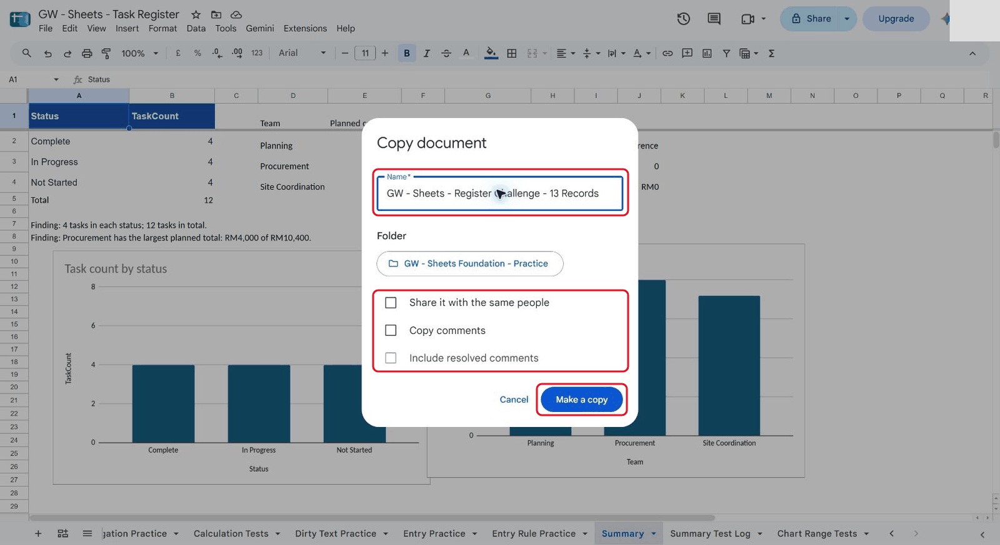

*The copy goes in the same practice folder.*

3. The copy opens in a new tab. Check its name at the top left before you change anything.

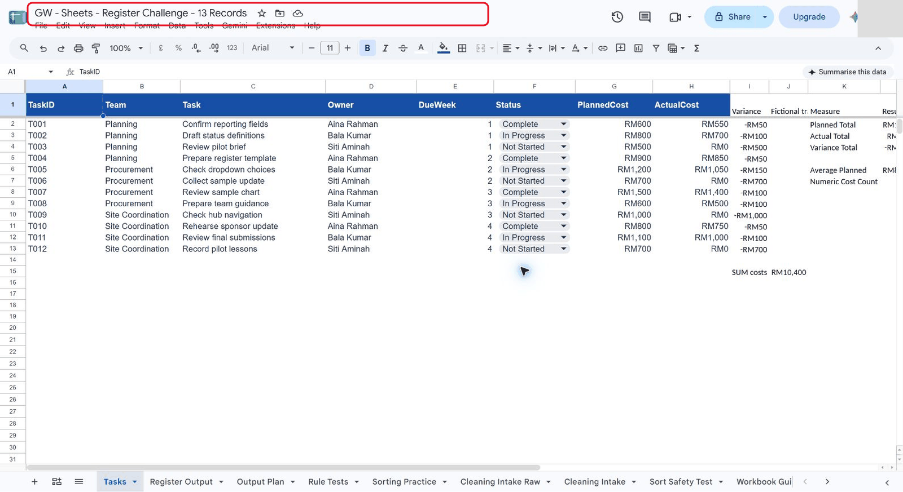

*From here on, work only in this copy. The practice tabs came with it; you won't use them.*

**Check:** the name at the top says **Register Challenge - 13 Records**, and **Tasks** still has twelve tasks.

---

## 8.2 Add T013

1. On **Tasks**, copy the line below, click **A14** and press **Ctrl+V**. It fills all eight fields.

```text
T013	Planning	Check the handover	Aina Rahman	4	Not Started	200	0
```

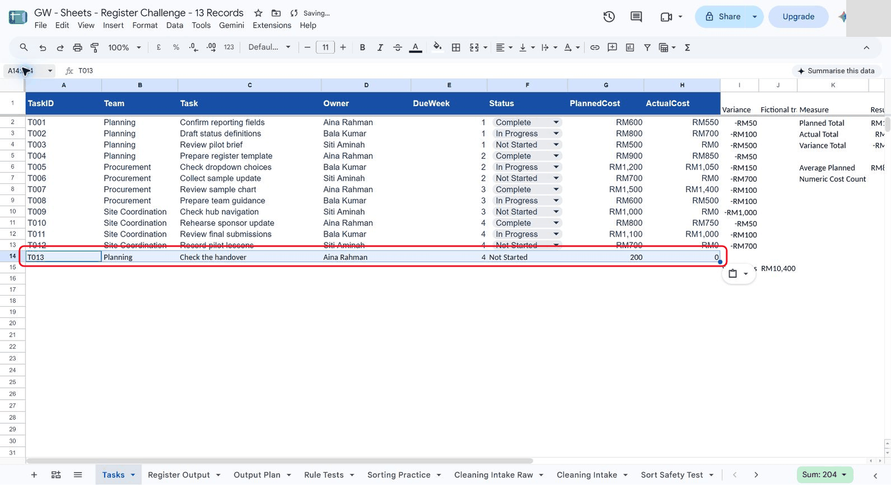

*The task is in, but nothing else knows about it yet. L2 still says RM10,400.*

2. Click the name box, type `I13:I14`, press **Enter**, then press **Ctrl+D**. **I14** shows **-200**, from `=H14-G14`.

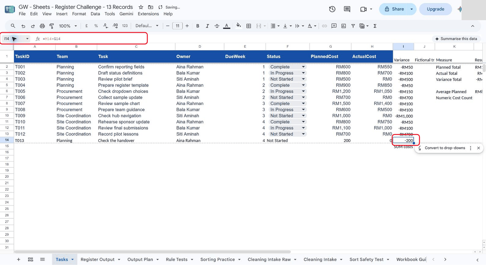

*The formula uses row 14's own costs.*

**Check:** row 14 has T013's eight fields and **I14** holds `=H14-G14`.

---

## 8.3 Extend the Rule, Totals and Named Range

1. Click **Data**, then **Data validation**. Click the status rule (**Tasks!F2:F13, Tasks!N2**).
2. Click the grid icon in **Apply to range**. Change the first range to `Tasks!F2:F14`, keep **Tasks!N2**, and click **OK**. Click **Done** and close the panel.

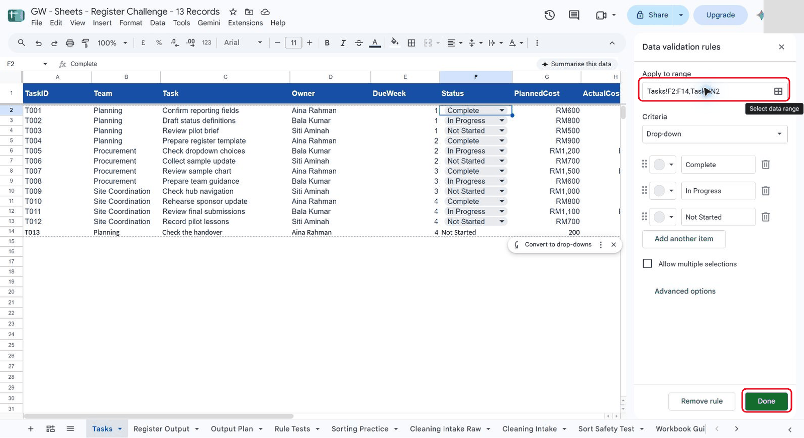

*Use the grid icon. Typing straight into the box doesn't always save. You'll test it in 8.6.*

3. Change these formulas on **Tasks** so they end at row 14, pressing **Enter** after each:
   - **L2**: `=SUM(G2:G14)`
   - **L3**: `=SUM(H2:H14)`
   - **L4**: `=SUM(I2:I14)`
   - **L6**: `=AVERAGE(G2:G14)`
   - **L7**: `=COUNT(G2:G14)`
   - **J15**: `=SUM(G2:G14)`

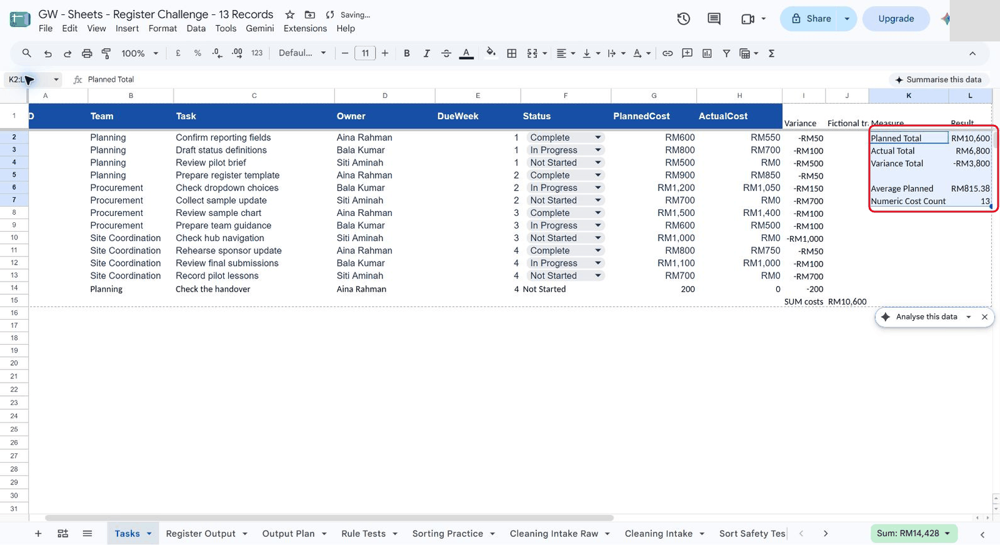

*Planned goes up by T013's RM200. Actual doesn't change, because T013 has spent nothing yet.*

4. Click **Data**, then **Named ranges**, and click **PlannedCosts**. It still points at **Sorting Practice!G2:G13**, the old practice copy. Change it to `Tasks!G2:G14` and click **Done**.

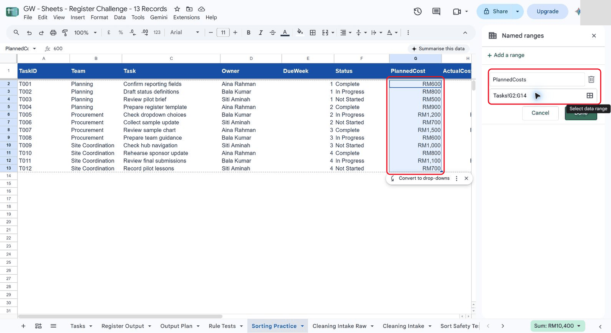

*Now the name points at the real register, including T013.*

**Check:** **L2** shows **RM10,600**, **L7** shows **13**, and **PlannedCosts** is **Tasks!G2:G14**.

---

## 8.4 Extend the Summary

1. Click the **Summary** tab. Click **B2**, type `=COUNTIF(Tasks!$F$2:$F$14,A2)` and press **Enter**. Select **B2:B4** and press **Ctrl+D**.
2. Click **E2**, type `=SUMIF(Tasks!$B$2:$B$14,D2,Tasks!$G$2:$G$14)` and press **Enter**. Select **E2:E4** and press **Ctrl+D**.
3. Click **I3** and type `=COUNTA(Tasks!A2:A14)`. Click **I4** and type `=SUM(Tasks!G2:G14)`.

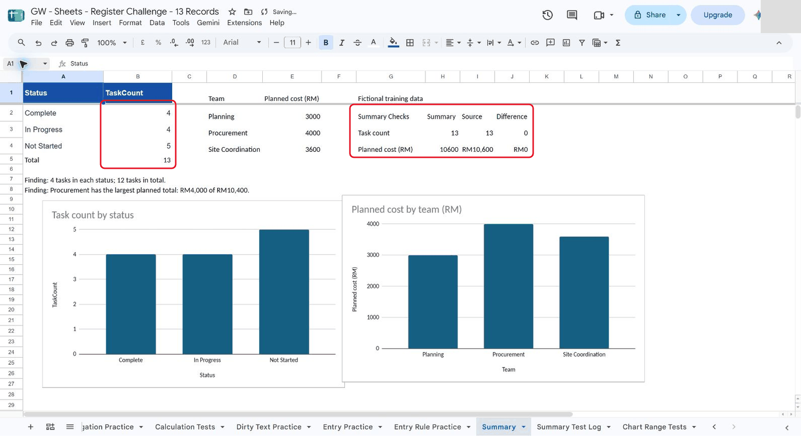

*Not Started is now 5 and Planning is 3000. Both differences are still 0. The charts updated themselves.*

**Check:** **B2:B5** show **4**, **4**, **5**, **13**; **E2** shows **3000**; **J3** and **J4** show **0**.

---

## 8.5 Catch a Wrong Reference

1. Predict first: if **I14** used **G13** (T012's planned cost, 700) instead of **G14**, what would it show, and what would **L4** become?
2. Click **I14**, type `=H14-G13` and press **Enter**. **I14** shows **-RM700**, and **L4** shows **-RM4,300**.

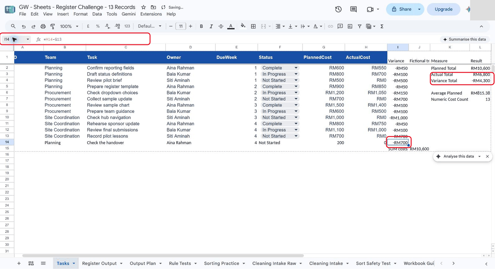

*Nothing looks broken, but the variance total is RM500 out.*

3. Repair it: type `=H14-G14` in **I14** and press **Enter**. It shows **-200** again.

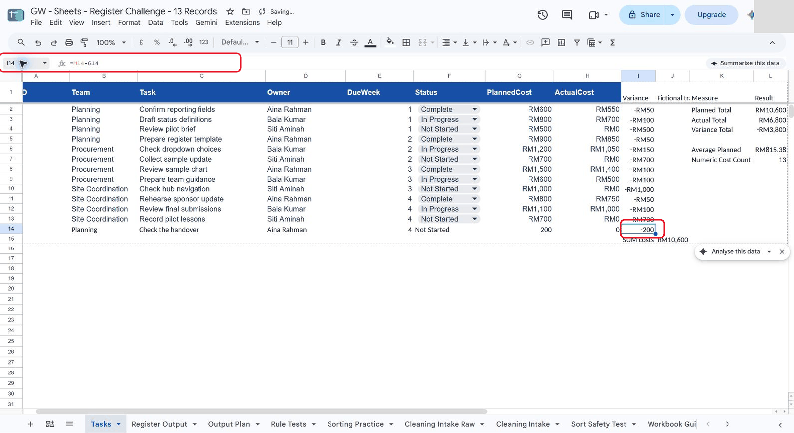

*Repair the formula; never type the answer over it.*

4. Check the totals: planned **RM10,600**, actual **RM6,800**, variance **-RM3,800**. Actual minus planned is 6,800 - 10,600 = -3,800, so they agree.


*Two routes to the variance total give the same answer.*

**Check:** **I14** holds `=H14-G14` and **L4** shows **-RM3,800**.

---

## 8.6 Update the Findings and Test the New Row

1. On **Summary**, rewrite the two findings in **A7** and **A8** for thirteen tasks. One should give the status counts; the other should say what T013 added.

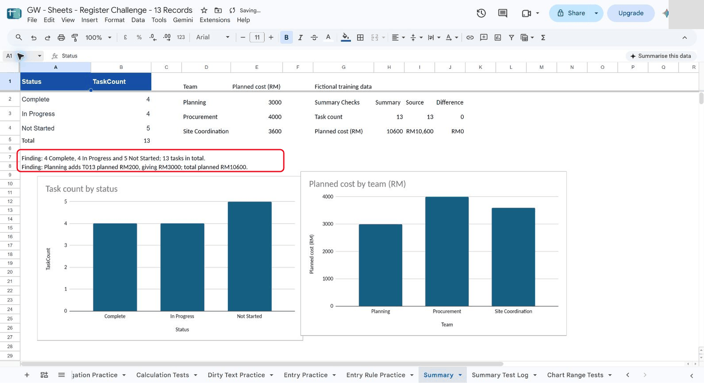

*Findings are typed text, so they never update on their own.*

2. Click the **Tasks** tab. Click **F14**, type `Done` and press **Enter**. The **There was a problem** message appears.

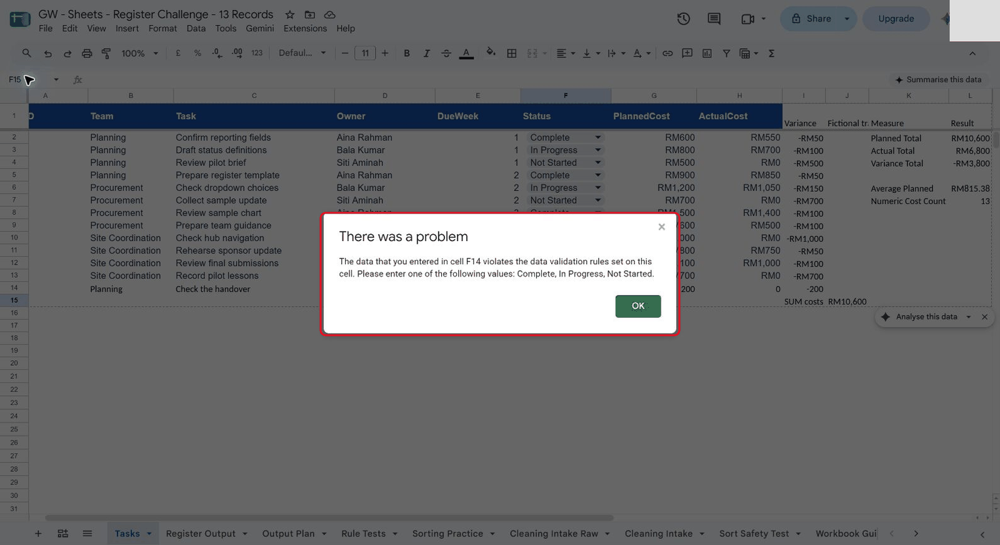

*This proves the rule now covers row 14.*

3. Click **OK**. **F14** still says **Not Started**.

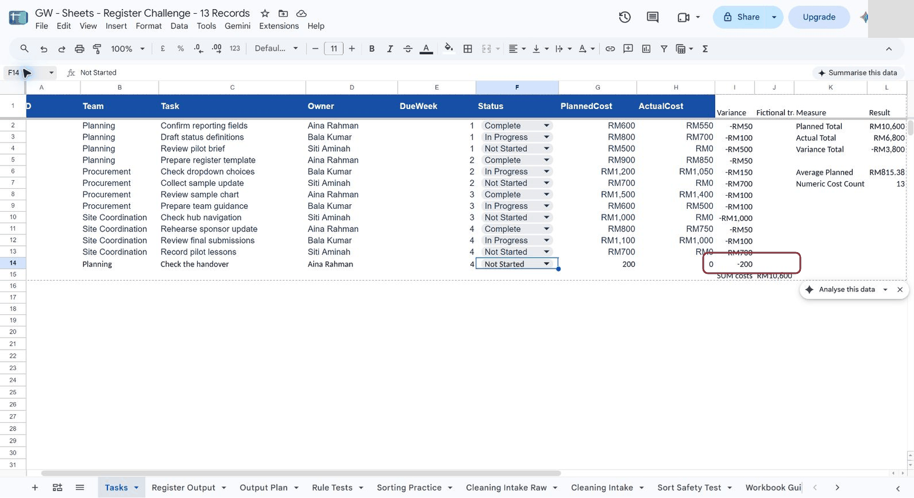

*The bad value was refused and the good one kept.*

4. Click the **Summary** tab and click **B4**. Explain to yourself, or a partner, which part of `=COUNTIF(Tasks!$F$2:$F$14,A4)` stayed fixed and which moved, and why it now shows **5**.

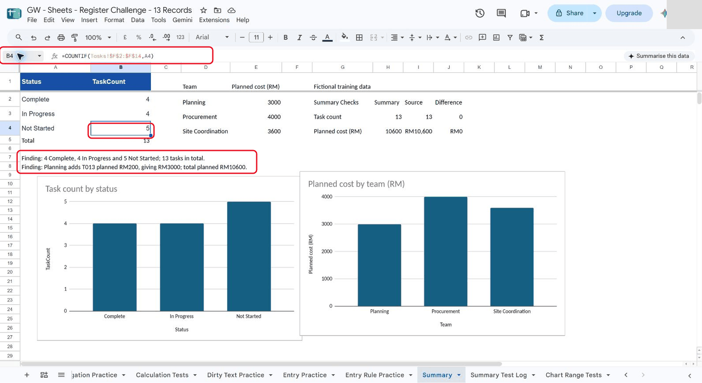

*The range is fixed and now reaches row 14; the criterion is A4, Not Started.*

<details markdown="1">
<summary>What should you see?</summary>

Findings along these lines:

- `Finding: 4 Complete, 4 In Progress and 5 Not Started; 13 tasks in total.`
- `Finding: Planning adds T013 planned RM200, giving RM3000; total planned RM10600.`

If **F14** accepted `Done`, the rule didn't save. Go back to 8.3 step 2 and use the grid icon.

</details>

---

## 8.7 Log What Changed

1. Click **+** (Add sheet). Rename the new tab `Change Log`.
2. Copy the block below, click **A1** and press **Ctrl+V**. It lists every range that had to change for T013.

```text
Feature	Challenge coverage / check	Result
Row variance	Tasks I14 =H14-G14; check I2:I14	Every row uses its own costs.
Source totals	Tasks L2:L4 and J15 use rows 2 to 14	10600 / 6800 / -3800 before correction.
Other controls	Tasks L6 AVERAGE(G2:G14); L7 COUNT(G2:G14)	Average RM815.38; 13 numbers.
Status validation	Tasks F2:F14, plus the spare rule in N2	Done rejected in F14; Not Started kept.
Named range	PlannedCosts moved from Sorting Practice!G2:G13 to Tasks!G2:G14	Total 10600 from Tasks.
Conditional summaries	Summary B2:B4 and E2:E4 use rows 2 to 14	Counts 4/4/5; planned 3000/4000/3600.
Source reconciliation	Summary I3 COUNTA(Tasks!A2:A14); I4 SUM(Tasks!G2:G14)	13 and 10600; differences 0.
Charts	Chart ranges stay Summary A1:B4 and D1:E4	The formulas under them now include T013.
Filter view coverage	Incomplete tasks and Planning incomplete tasks	Checked in 8.10.
Old tabs and outputs	Practice tabs, Register Output, Output Plan, Lab 07 PDFs	History only; the handover uses Tasks, Summary and Change Log.
Fault test	I14 =H14-G13 gave -700 and variance total -4300	Repaired to =H14-G14: -200 and -3800.
```

3. Widen columns **A** to **C** and turn on **Format**, **Wrapping**, **Wrap**.

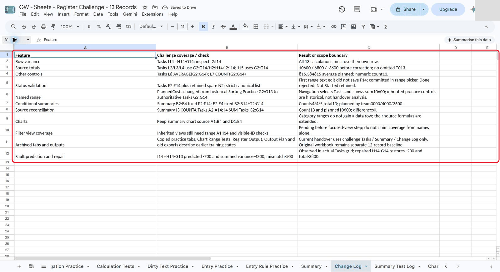

*The screenshot's wording is longer than the block you pasted.*

4. Click the **Tasks** tab. Click **View**, **Show**, **Formulae**. Check every cell in **I2:I14** reads `=H` and `=G` with its own row number. Then turn **Formulae** off again.

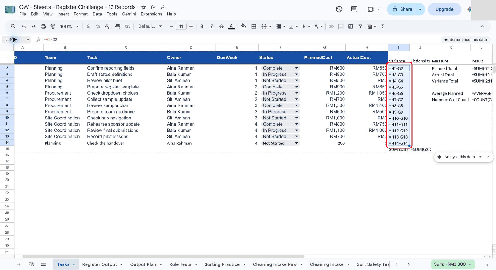

*Seeing every formula at once makes a wrong row easy to spot.*

**Check:** **Change Log** has eleven readable rows, and every variance formula uses its own row.

---

## 8.8 Add Two-Way Checks

1. Click the **Summary** tab. Copy the block below, click **G5** and press **Ctrl+V**. It adds checks for actual cost and variance, with their formulas.

```text
Actual cost (RM)	=SUM(Tasks!H2:H14)	=SUMIF(Tasks!B2:B14,"Planning",Tasks!H2:H14)+SUMIF(Tasks!B2:B14,"Procurement",Tasks!H2:H14)+SUMIF(Tasks!B2:B14,"Site Coordination",Tasks!H2:H14)	=H5-I5
Variance (RM)	=SUM(Tasks!I2:I14)	=H5-H4	=H6-I6
```

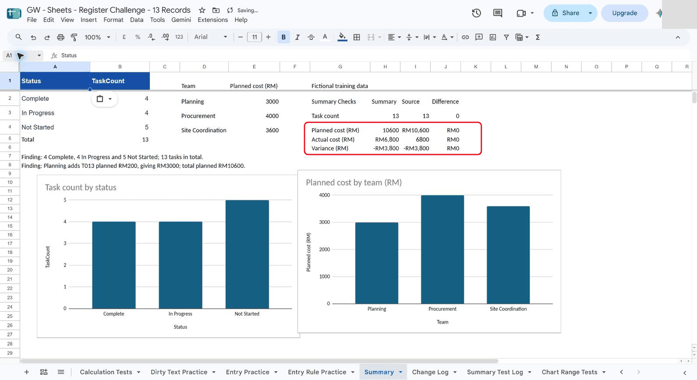

*Each row works out the same figure two different ways.*

2. Click the **Change Log** tab. Copy the block below, click **A15** and press **Ctrl+V**. Each row compares two methods, and column **D** shows the difference.

```text
Control	Method one	Method two	Difference
Record count	=COUNTA(Tasks!A2:A14)	=COUNT(Tasks!G2:G14)	=B16-C16
Unique task IDs	=COUNTUNIQUE(Tasks!A2:A14)	=COUNTA(Tasks!A2:A14)	=B17-C17
Planned cost	=SUM(Tasks!G2:G14)	=SUM(Summary!E2:E4)	=B18-C18
Actual cost	=SUM(Tasks!H2:H14)	=Summary!I5	=B19-C19
Variance	=SUM(Tasks!I2:I14)	=SUM(Tasks!H2:H14)-SUM(Tasks!G2:G14)	=B20-C20
Status population	=SUM(Summary!B2:B4)	=COUNTA(Tasks!A2:A14)	=B21-C21
Named range	=SUM(PlannedCosts)	=SUM(Tasks!G2:G14)	=B22-C22
```

3. Click **A24** and type `Correction prediction`. In **B24**, write what you expect if T013's actual cost changes from **0** to **150**: its variance, the actual total, the variance total, and whether either chart changes.

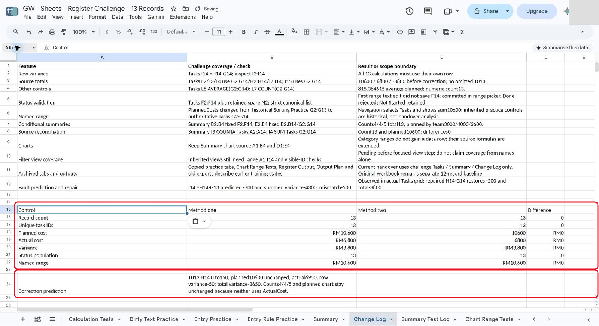

*Every difference is zero. Write the prediction before you change anything.*

**Check:** **D16:D22** are all **0**, and **B24** has your prediction.

---

## 8.9 Correct T013's Actual Cost

1. Click the **Tasks** tab. Click **H14**, type `150` and press **Enter**. **I14** shows **-50**.
2. Select **G13:H13** and press **Ctrl+C**. Select **G14:H14**, then **Edit**, **Paste special**, **Format only**. T013's costs now show as **RM200** and **RM150**.

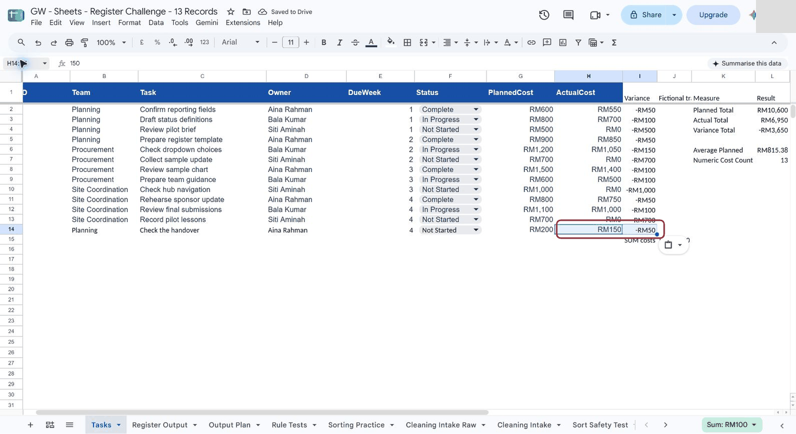

*Format only gives row 14 the ringgit look without changing its numbers.*

3. Click the **Summary** tab. Actual is now **6950** and variance **-3650**; planned is still **10600** and all differences are **0**.

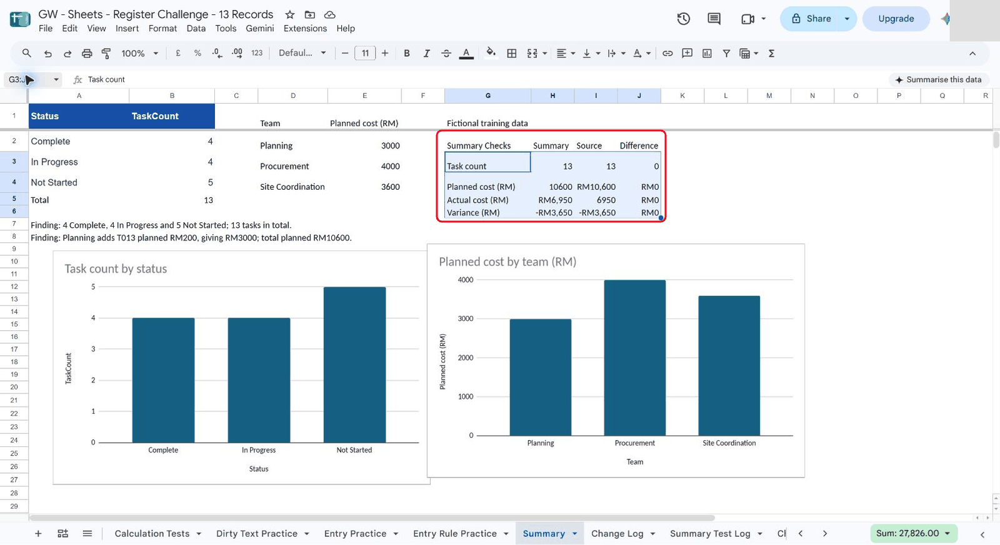

*Neither chart changed: one counts statuses and the other shows planned cost.*

4. Click the **Change Log** tab. Click **A26** and type `Observed correction`. In **B26**, write what actually happened, and whether it matched your prediction.

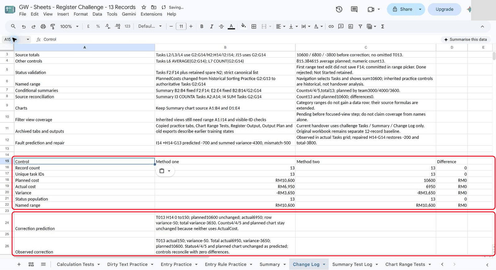

*All differences are still zero after the change.*

<details markdown="1">
<summary>What should you see?</summary>

T013's variance becomes **-50**. Actual total becomes **6950** and variance total **-3650**. Planned stays **10600**, status counts stay **4/4/5**, and neither chart changes, because neither uses ActualCost.

</details>

---

## 8.10 Check the Filter Views

1. Click the **Tasks** tab. Click **Filter views** on the toolbar and choose **Incomplete tasks**. Look at **Range** in the green bar. If it says **A1:I13**, click it, change it to `A1:I14` and press **Enter**.
2. Nine tasks are shown, ending with **T013**, and the bottom right says **9 of 13 rows displayed**.

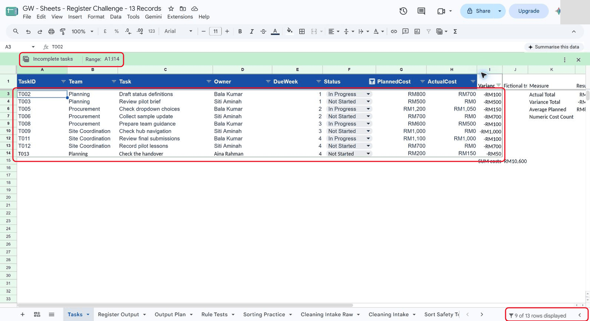

*A view that stops at row 13 would hide T013 from everyone using it.*

3. Close the view. Open **Planning incomplete tasks** and check its range the same way. It shows **T002**, **T003** and **T013**: **3 of 13 rows displayed**.

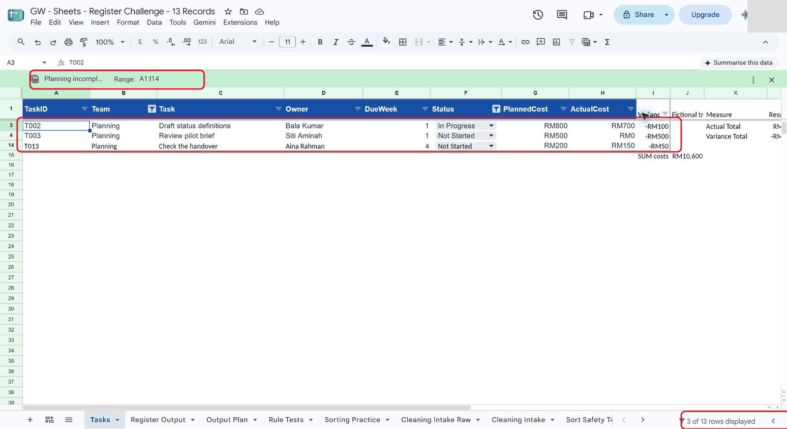

*The new Planning task appears where it should.*

4. Close the view. All thirteen tasks are visible.

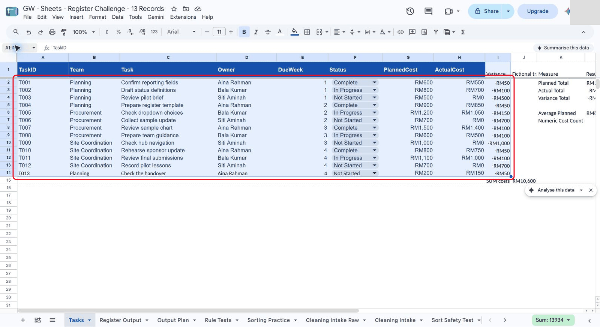

*Back to the full register.*

5. On **Change Log**, update **C10** (Filter view coverage) with what you found, such as `Both views A1:I14; 9 and 3 IDs including T013; closed.`

**Check:** both views cover **A1:I14** and include **T013**, and all thirteen rows are visible.

---

## 8.11 Export the Corrected Summary

1. Click the **Summary** tab. Click **G1** and type `13-record challenge - corrected`.
2. Change the finding in **A8** to give the corrected figures: planned **RM10,600**, actual **RM6,950**, variance **-RM3,650**.

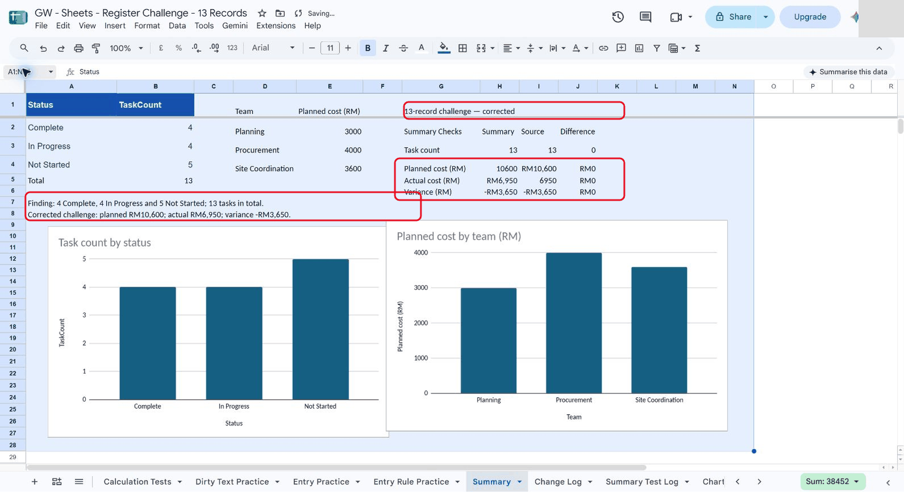

*The label in G1 means nobody will mistake this for the 12-task summary.*

3. Select `A1:N28` with the name box. Click **File**, **Download**, **PDF (.pdf)**. Choose **Selected cells (A1:N28)**, **A3**, **Landscape** and **Fit to width**.

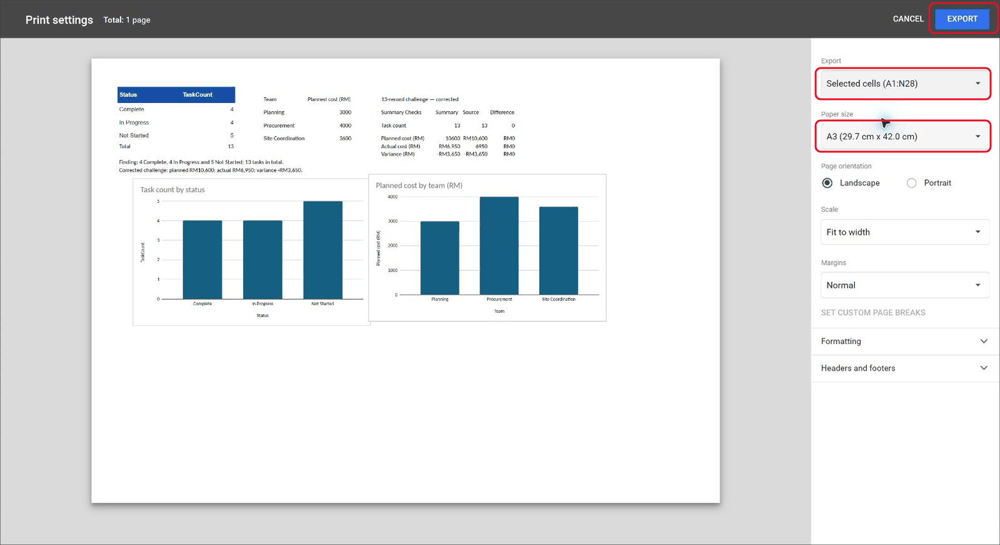

*Same settings as the sponsor summary in Lab 07.*

4. Click **Export** and rename the file `GW-Register-Challenge-Corrected-r1.pdf`. Open it and check it.

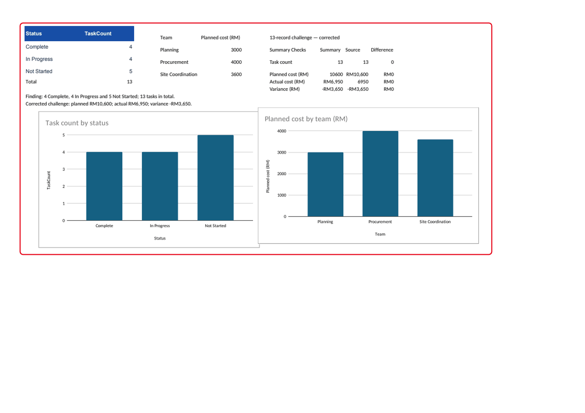

*13 tasks, 4/4/5, planned 10,600, actual 6,950, variance -3,650, both charts complete.*

**Check:** `GW-Register-Challenge-Corrected-r1.pdf` is one page with the corrected figures and the **13-record challenge - corrected** label.

---

## 8.12 Write the Operating Guide and Hand Over

1. Click the **Change Log** tab. Copy the block below, click **A29** and press **Ctrl+V**.

```text
Operating guide	Current corrected challenge / next-record procedure
Current source	GW - Sheets - Register Challenge - 13 Records: Tasks, Summary and Change Log. The original GW - Sheets - Task Register stays at 12 records.
Enter another record	Make a further copy first. Give the task a new TaskID, all eight fields, numeric costs and one of the three statuses.
Extend calculations	Fill the variance down; extend every total, average, count, PlannedCosts, COUNTIF, SUMIF and source check to the new last row. Chart ranges stay on the summary rows.
Check entry rules	Extend the status rule with the grid icon, then type Done in the new row: it must be rejected.
Sort and view safely	Sort whole records only. Reopen both filter views and check their range and TaskIDs.
Reconcile before export	Every difference in the control table must be 0.
Export current sponsor copy	Summary A1:N28, Selected cells, A3 landscape, Fit to width; give the PDF a new name.
Fixed copy identity	GW-Register-Challenge-Corrected-r1.pdf: 1 page, 13 records, planned 10600, actual 6950, variance -3650, status 4/4/5.
```

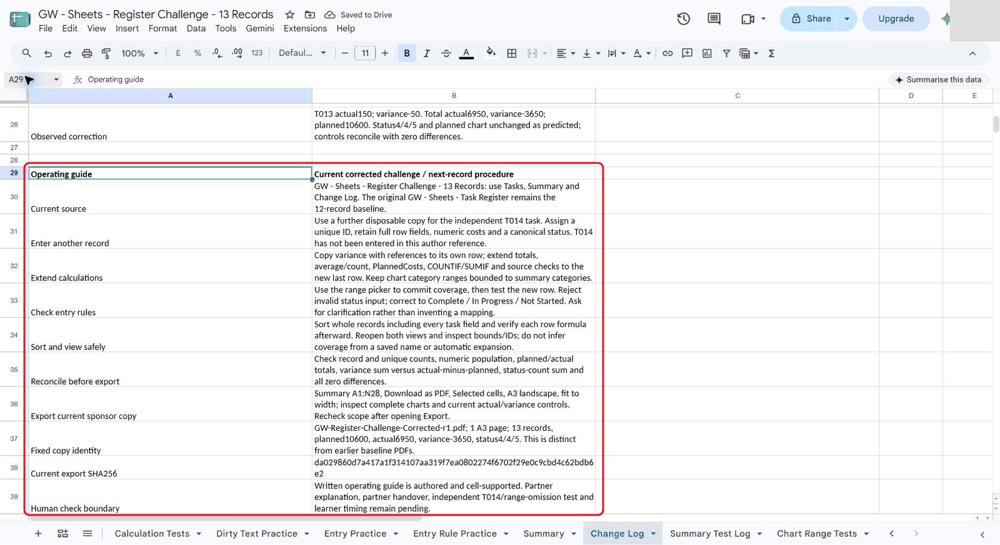

*The screenshot has two extra rows, a file fingerprint (SHA256) and a note for the trainer. You don't need them.*

2. Scroll up and read the whole **Change Log** once: coverage, control table, prediction, observation and guide.

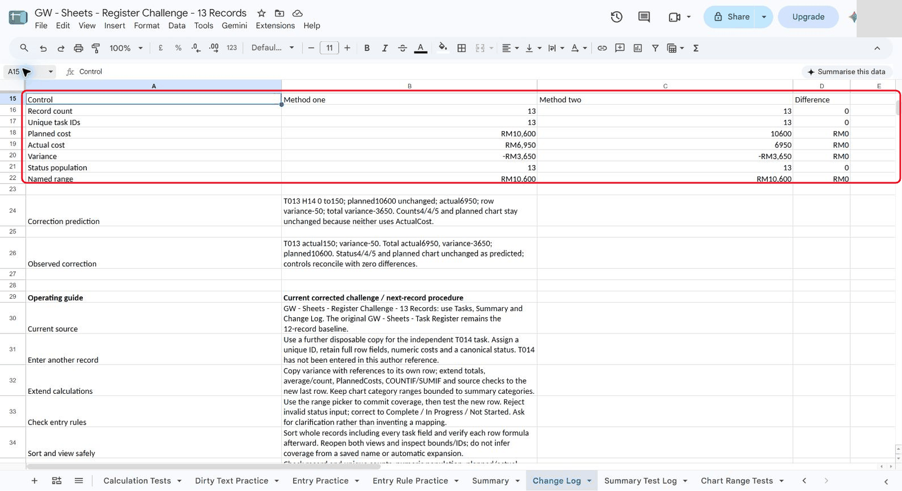

*Everything the next person needs to add task 14.*

3. Switch to the browser tab with `GW - Sheets - Task Register`, the original. On **Summary** it still shows **4**, **4**, **4**, **12** and **10400**.

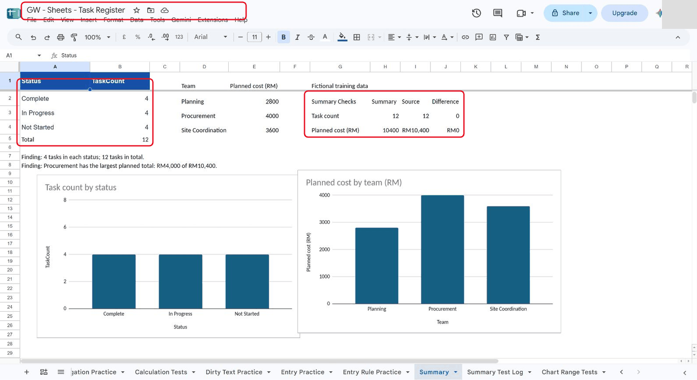

*None of the challenge changes touched the original.*

4. Switch back to the challenge copy. Leave it on **Summary** in its corrected state.

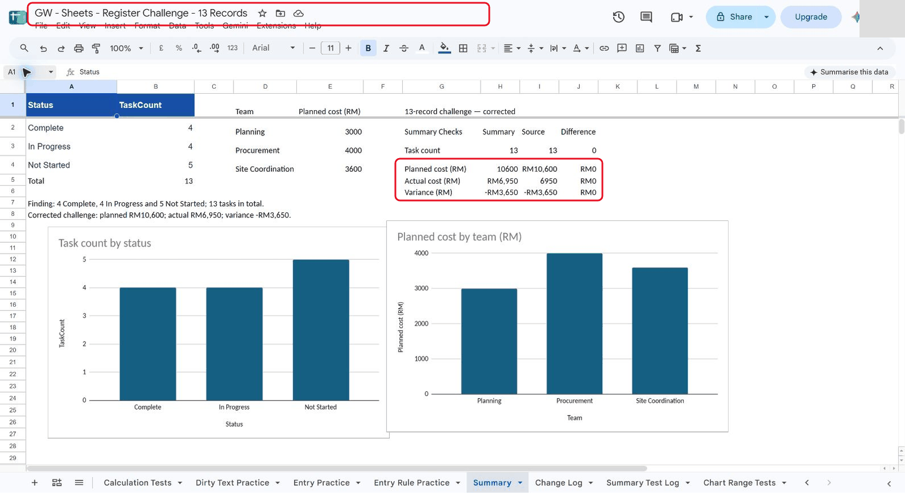

*Two workbooks, clearly named, each in the state it should be.*

**Check:** the original still has twelve tasks, and the challenge copy has thirteen, with a complete **Change Log** and its PDF saved.

> **Download:** [GW-Register-Challenge-Corrected-r1.pdf](./reference-output/GW-Register-Challenge-Corrected-r1.pdf), an example export to compare with yours.

---

## Independent Practice

Try these without the step lists, using your operating guide instead.

1. **Add T014.** Make a further copy called `GW - Sheets - Register Challenge - 14 Records`. Add the task below in row 15, then extend and test every feature, as your guide says.

```text
T014	Procurement	Verify submission checklist	Bala Kumar	4	In Progress	300	100
```

2. **Catch a short range.** Ask a partner to shorten one range on your 14-record copy so it stops at row 14 (a total, a COUNTIF or **PlannedCosts**). Use the control table to find it, fix it and explain which difference gave it away.
3. **Hand over.** Give a partner only your **Change Log**. Without your help, they should name the current source, the current PDF and the checks for the next new task. Write one improvement to your guide based on what they found unclear.

<details markdown="1">
<summary>What should you see?</summary>

With T014 in place and every range extended to row 15: **14** tasks, status **4 / 5 / 5**, Procurement planned **4300**, planned total **10900**, actual **7050**, variance **-3850**, T014's variance **-200**, and every control difference **0**. A range left at row 14 shows a difference such as **-300** (planned) or **-1** (count).

</details>

### Evidence to Hand Over

- `GW - Sheets - Register Challenge - 13 Records`, corrected, with a complete **Change Log**
- `GW-Register-Challenge-Corrected-r1.pdf`
- The original `GW - Sheets - Task Register`, unchanged at twelve tasks
- Your 14-record copy with zero differences, and the short range you caught
- One improvement to the operating guide

## Troubleshooting

| Problem | What to try |
|---|---|
| **F14** accepted `Done` | The rule didn't save. Edit it with the grid icon in **Apply to range**, click **OK**, then **Done**, and test again. |
| A total didn't change when you added T013 | Its range still ends at row 13. Change it to row 14. |
| **PlannedCosts** shows the old total | It still points at **Sorting Practice**. Change it to **Tasks!G2:G14**. |
| A pasted formula shows as text | Click the cell, check it starts with `=` with nothing before it, and press **Enter**. |
| A filter view doesn't show T013 | Change its range in the green bar to **A1:I14**. |
| You changed the original register by mistake | Use **Ctrl+Z**, or **File** > **Version history** to go back. Check the name at the top before every edit. |

## Lesson Summary

You added a task on a separate copy and found every range that had to grow with it: the variance, totals, average, count, status rule, named range, summaries, checks and filter views. You proved each one on the new row, caught a wrong reference, applied a cost correction, and checked every total two ways. The corrected summary is saved as its own PDF, and the original register is untouched. That's the full Foundation course.

**Check yourself:** which ranges needed extending after T013 was added?
