# 01 - Audit the Source Register

In this chapter you will check types, blanks, duplicates and keys before analysis.

> **Prompts:** the [prompts page](./prompts.md) has every value and prompt for this chapter, each with a Copy button.

**Estimated time:** 45 minutes, planned as 10 explanation and demonstration, 15 guided build and casework, 15 independent practice and 5 verification and repair, with 35 active minutes by design. Not yet timed with learners.

**Your result:** An audited source, preserved snapshot and empty Analysis workspace.

> **Status:** author reference with 30 staged application captures through 1.4. Native conversion, baseline diagnostics, preserved snapshot, empty Analysis, six raw intake cases, training contract and evidence-backed proposed dispositions checked. Upload required instructor handoff. Independent disposition/release-condition work, reviewer challenge and learner timing remain pending.

---

## What You Will Learn

- Inspect dataset grain and keys.
- Check types and baseline controls.
- Preserve the source before analysis.

## Before You Begin

Read the [case input](./prompts.md) and use a separate named casework copy for destructive tests or altered datasets. Keep the baseline unchanged for later chapters. Record source facts, proposed practice and unresolved questions separately.

Download [ProcurementRegister.xlsx](../../shared/sample-files/ProcurementRegister.xlsx). It contains 24 fictional order lines and a six-item rate table, separate from the pilot budget.

## 1.1 Prepare the Workbook

1. In the training account, create a separate **GW - Sheets Advanced - Practice** folder in My Drive. Keep it separate from the Foundation register.

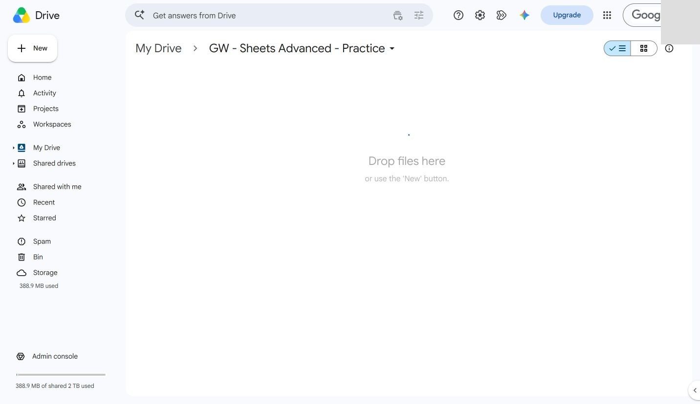

*Open a separate empty Advanced practice folder.*

2. Upload **ProcurementRegister.xlsx** from the supplied practice files. This is a handoff, not a verified automated upload.

> **Reference run:** The extension blocked local-file uploads, so the instructor uploaded the file manually.

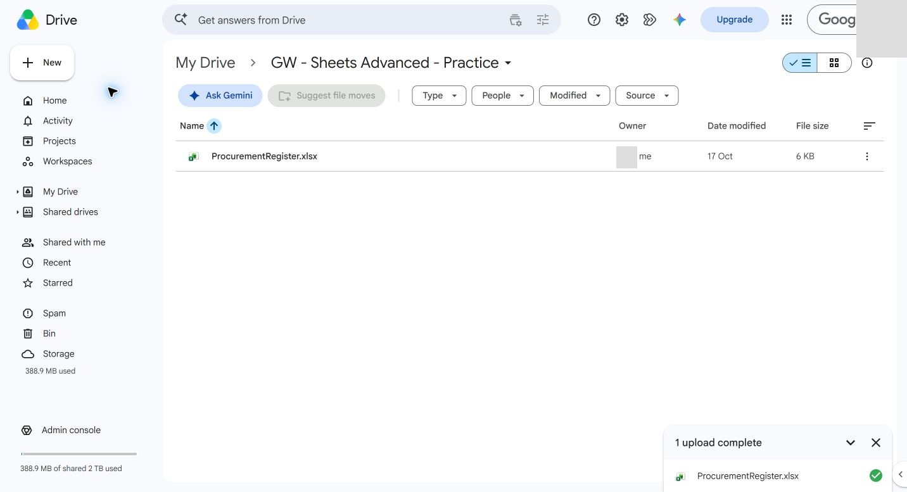

*Inspect the manually uploaded starter workbook.*

3. Open the Excel workbook and use **File > Save as Google Sheets**. Preserve the original XLSX. This creates a distinct native file; do not simply rename the Excel source.

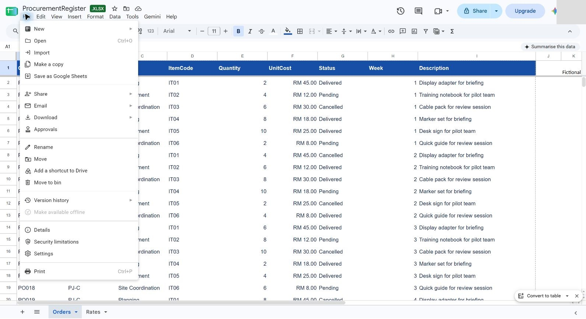

*Save the Excel source as a separate native Sheets file.*

4. Rename the native file **GW - Sheets Advanced - Analysis**. On **Orders**, confirm the nine working headers in **A1:I1** and inspect the records. The supplied **K1** fictional-data label is outside that working table.

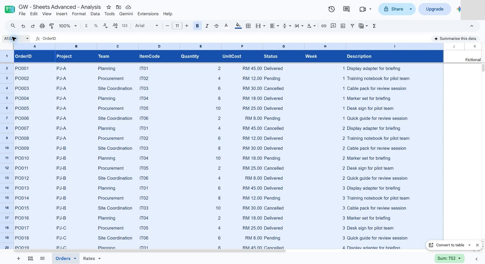

*Inspect the named native Orders baseline.*

5. Navigate to **A25:I25**. Confirm **PO024** is the final supplied order, with 24 data rows in **2:25**. One row represents a fictional order line, not a project subtotal or purchase commitment.

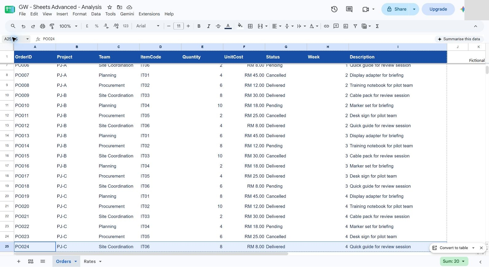

*Check the final supplied order PO024.*

6. Open **Rates** and inspect **A1:D7**: six item codes **IT01–IT06** in A2:A7, with item, unit cost and category fields. Keep the supplied **F1** label outside the table.

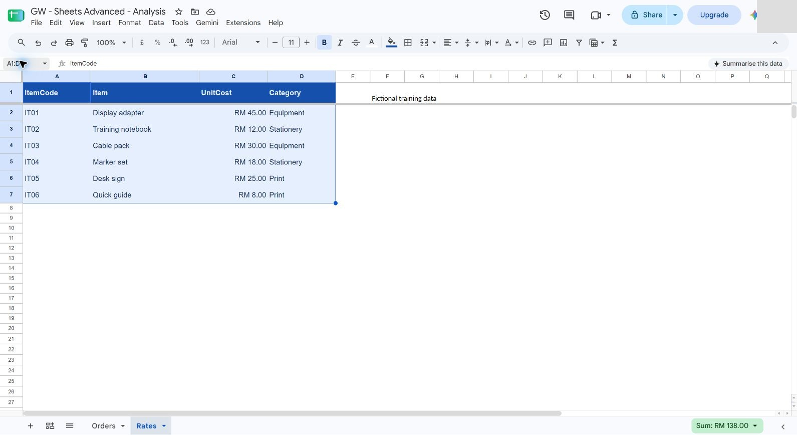

*Inspect the six original Rates keys.*

## 1.2 Audit Key Fields

1. Create **Audit Checks** so the diagnostics do not alter Orders. Paste the baseline diagnostic card from the prompts page into **A1:G25**. It references each source row and checks ID occurrences, numeric Quantity/UnitCost/Week, exact item-key counts and allowed statuses. Make A:G wide enough to read the headings; the first captured stage uses 155-pixel columns.

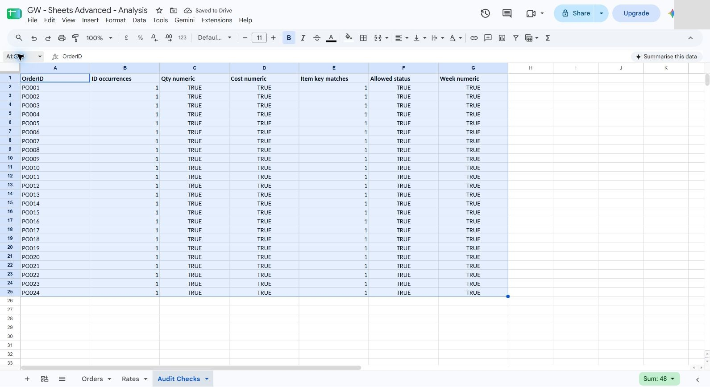

*Check every baseline row with native formulas.*

2. Paste the population-control card into **A28:B48**. Confirm **24 rows / 24 unique IDs / 0 blanks / 0 non-unique ID rows**, 24 numeric values in each required field, 24 matched item keys, and six unique nonblank Rates keys. The status population is **12 Delivered / 6 Pending / 6 Cancelled**, total 24. Quantity sums to **140**; the unit-price sum is **RM552**, which is a diagnostic checksum, not spend. Week is the numeric practice index **1–4**, not a date. Use a wider label column and navigate to B48 to see the complete control block.

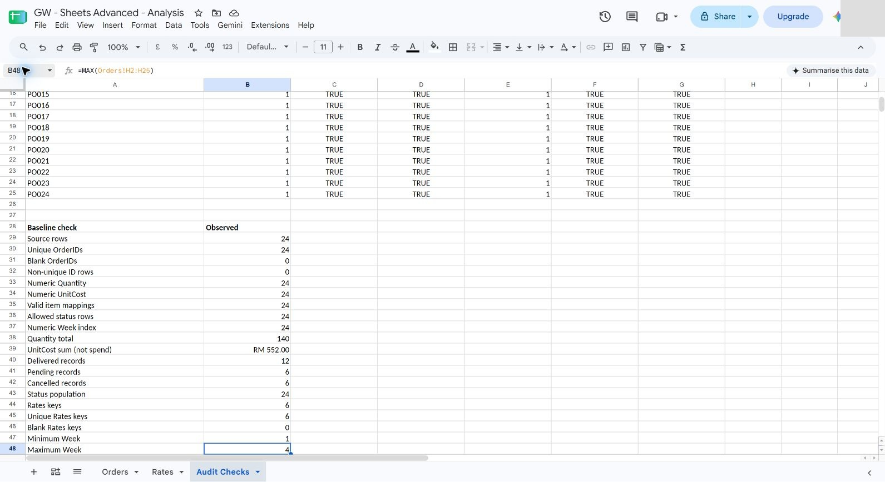

*Reconcile baseline population and numeric controls.*

3. Inspect **B2 =COUNTIF(Orders!$A$2:$A$25,A2)**. Each baseline ID occurs once. The anchored source population stays fixed while each row tests its own relative ID. A count of one inside intake alone would not prove that an ID is new to Orders; the later casework checks both populations.

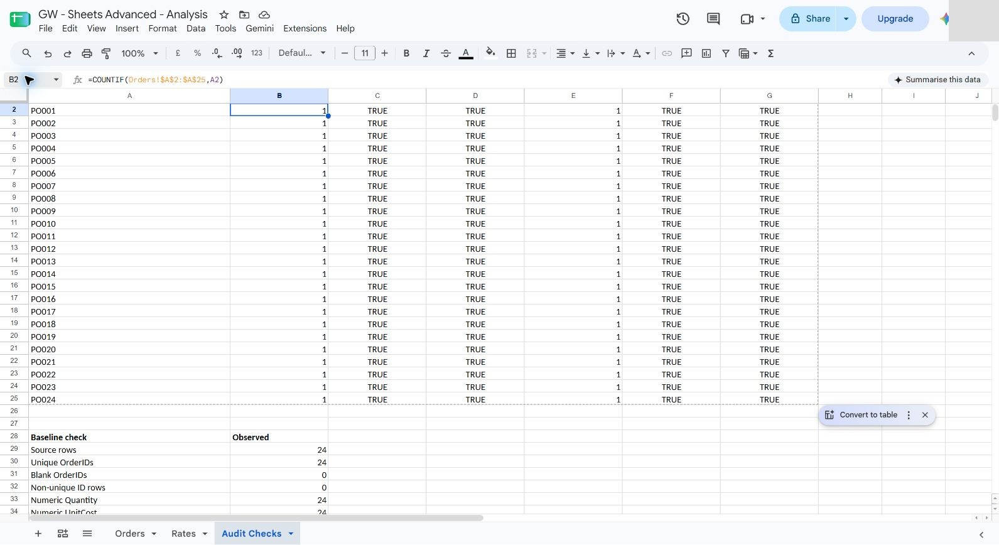

*Inspect the anchored duplicate diagnostic.*

4. Inspect **C2 =ISNUMBER(Orders!E2)** and its results down to row 25. Verify Quantity and UnitCost are actual numbers. Keep Cancelled records visible; validity and the population chosen for a later question are separate decisions.

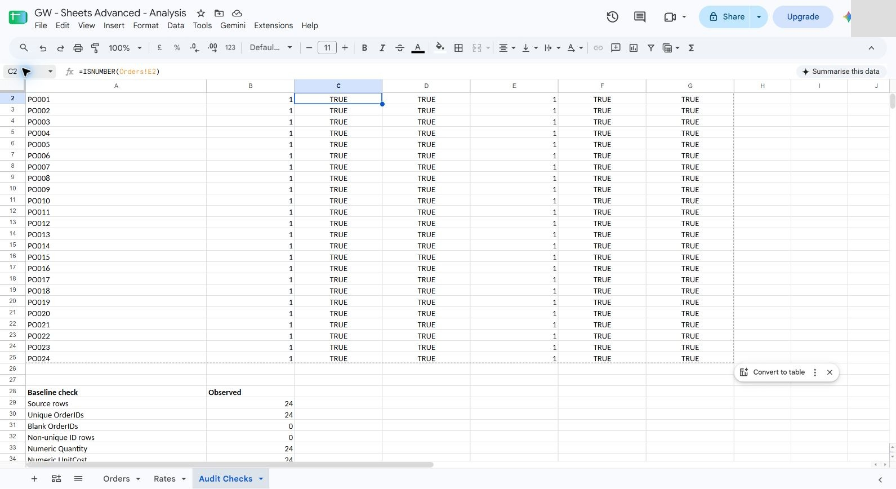

*Inspect a numeric type check.*

## 1.3 Protect the Analysis Trail

1. Return to **Orders**. Open its tab menu and choose **Duplicate** before adding any analysis calculation to that source.

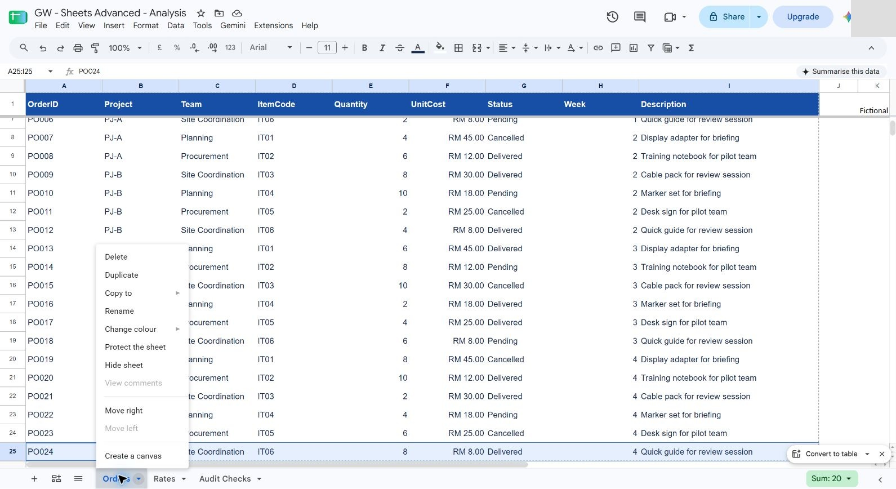

*Duplicate Orders before adding analysis calculations.*

2. Rename the duplicate **Source Snapshot**. It retains the supplied Orders values and formatting. This is a preserved comparison copy; naming it does not create a protected-range permission or automatic version archive.

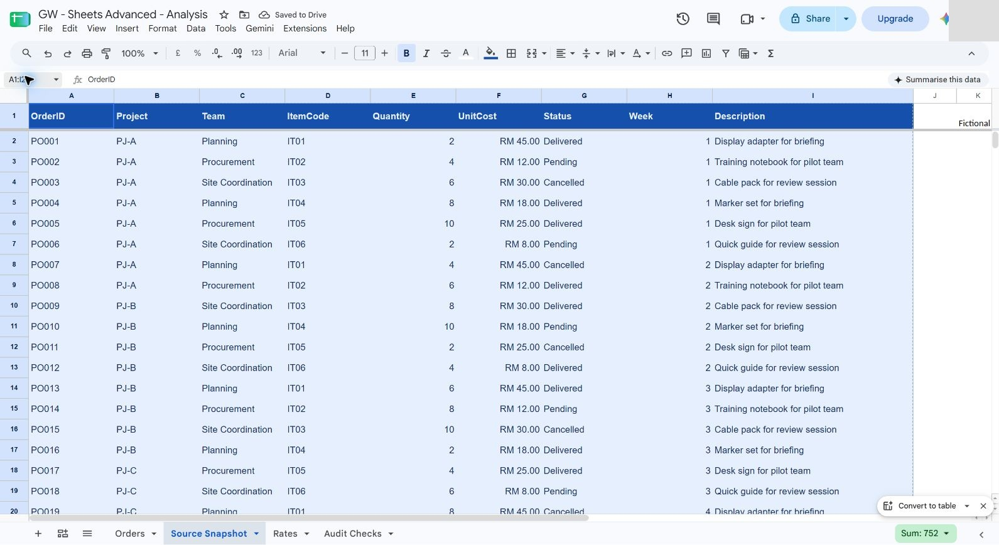

*Retain the original Source Snapshot.*

3. Create **Analysis** and leave it empty for later summaries. Keep diagnostics in Audit Checks rather than prebuilding later course outputs.

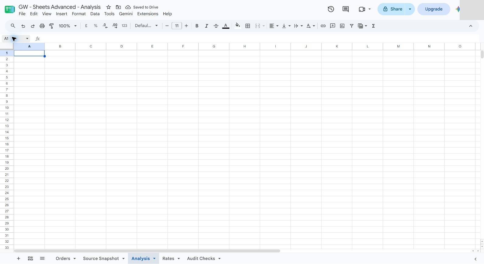

*Create an empty Analysis workspace.*

4. In **Audit Checks A51:B57**, record the source **Orders!A1:I25**, rate table **Rates!A1:D7**, order-line grain, snapshot purpose and empty Analysis workspace. Wrap the note text; in the captured workbook A is 320 pixels and B is 400 pixels. Source facts, training rules and unresolved questions must remain distinguishable.

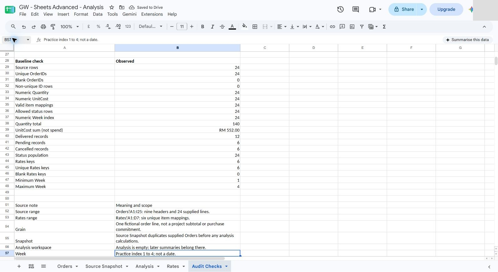

*Record source grain range and tab purpose.*

## 1.4 Quarantine Bad Rows and Write a Data Contract

1. Create **Audit Intake** and paste the six-row raw card into **A1:I7**. These are labelled practice copies of PO001–PO006, altered only as described in the card. Preserve the blank ID, **IT99**, text **four**, numeric **0** and **Cancelled** exactly. Use the practice IDs QA003–QA006 only in intake. Add **Issue / Evidence / Disposition** in J1:L1. Do not append any of these rows to Orders. The captured raw view uses 130-pixel A:I columns with wrapped Description cells.

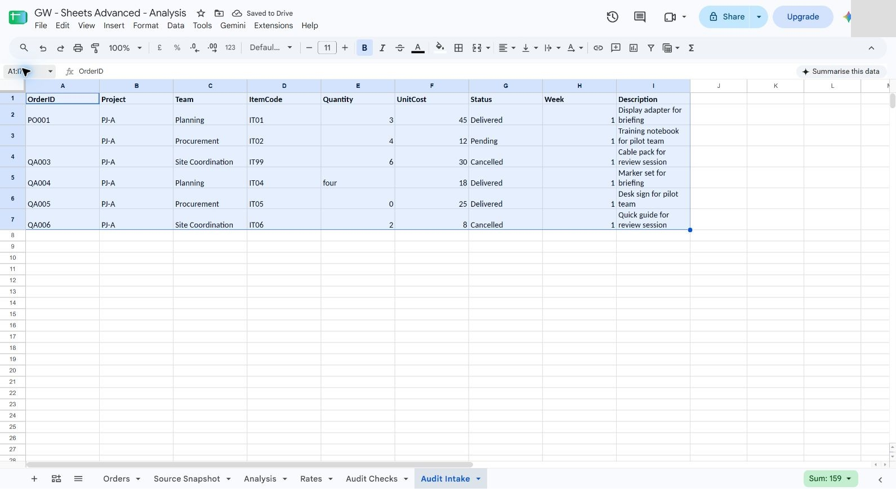

*Preserve the six isolated raw intake scenarios.*

2. Create **Data Contract** and record the stated training rules: one order line per required unique OrderID; exactly one Rates mapping; numeric non-negative whole-number Quantity; numeric non-negative UnitCost; statuses Delivered, Pending or Cancelled. **Zero Quantity is explicitly valid for this fictional training rule.** Distinguish a repeated identical row from the same key with a conflicting field. Preserve raw evidence and record proposed corrections separately. This is a training contract, not a real purchasing policy. Use A about 280 pixels and B about 900 pixels, with wrapped text.

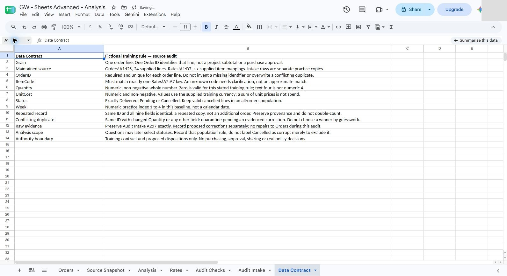

*Define the explicit fictional data contract.*

3. Create **Intake Checks** and paste its diagnostic card into **A1:J7**. The source-ID count tests Orders, the intake-ID count tests the separate six-row intake, and the rate-key count tests Rates. Inspect both numeric type and the non-negative whole-number rule. A zero key count or FALSE result is evidence to investigate; a set of TRUE checks does not by itself approve a record for release.

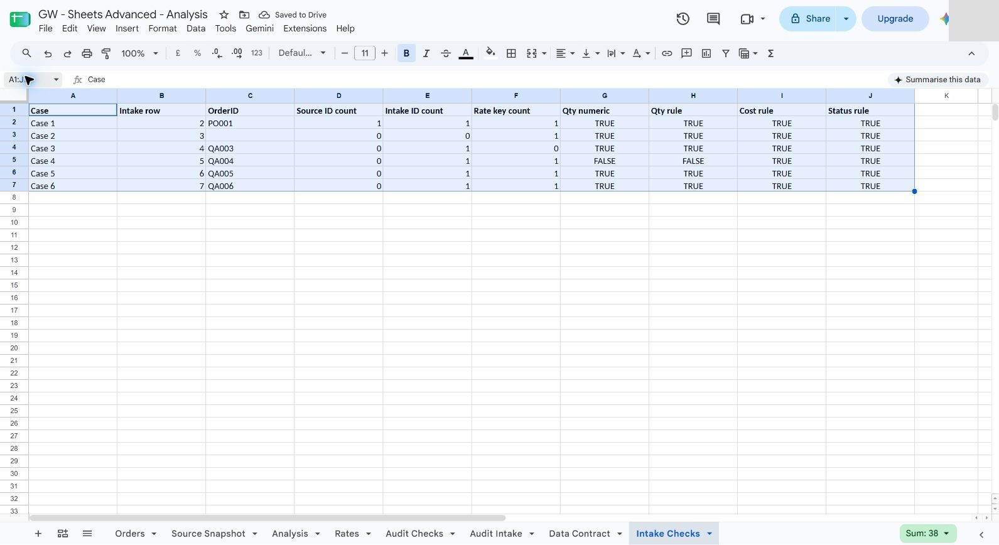

*Inspect intake key and rule diagnostics.*

4. Compare the conflicting **PO001**: source Quantity **2**, intake Quantity **3**, equality **FALSE**. The supplied Orders row and its unaltered Source Snapshot have **9 of 9 identical fields**, illustrating a repeated copy. Preserve the conflicting intake row and request evidence; do not overwrite the baseline or count both as separate orders. The supporting comparison cells are on the prompts page.

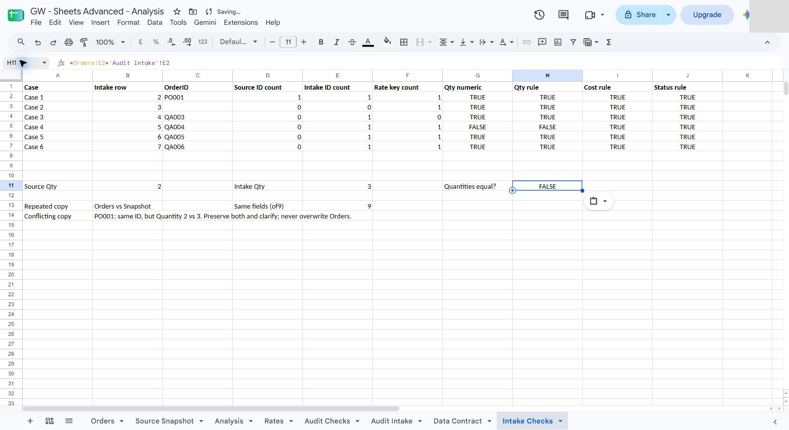

*Distinguish a conflicting duplicate from an identical copy.*

5. Inspect **F4 =COUNTIF(Rates!$A$2:$A$7,'Audit Intake'!D4)**. **IT99** has **0** exact matches. Its Cancelled status is valid, but that does not repair the unknown item key. Keep it quarantined pending clarification.

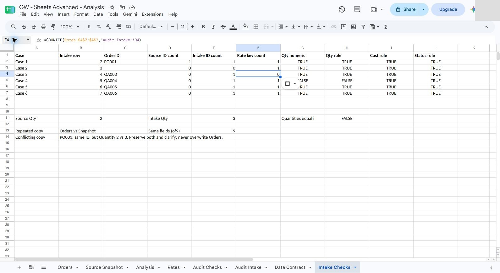

*Check the unknown IT99 key.*

6. Inspect **G5 =ISNUMBER('Audit Intake'!E5)**: text **four** returns **FALSE**, as does its Quantity rule. Do not replace it with 4 without source evidence. Record the proposed next action separately.

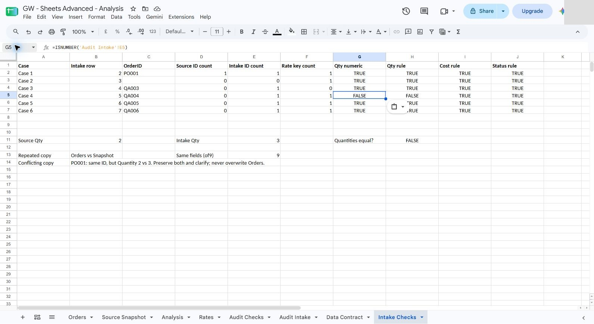

*Verify text four fails the numeric test.*

7. Inspect the zero-quantity row: ISNUMBER and the non-negative whole-number rule are both **TRUE**. Retain it as a valid training example under the stated contract; do not infer a delivery or purchasing decision from a zero.

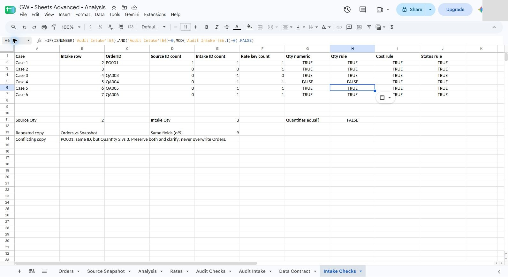

*Verify zero quantity passes the stated training rule.*

8. Complete **Audit Intake J2:L7** with each Issue, supporting cell evidence and proposed Disposition. The first four cases remain quarantined pending evidence; the last two are valid training cases retained separately. Clarification requests are recorded as next actions, not sent. Wrap the text, widen J/K/L to about **260/560/500 pixels**, and navigate to **L1** to see the complete disposition column.

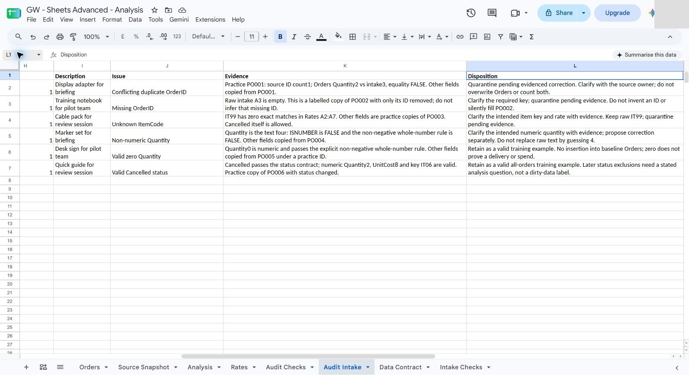

*Record issues evidence and proposed dispositions beside raw intake.*

9. Inspect **J7** on Intake Checks. The QA006 Cancelled example passes the allowed-status test, as do its numeric and key checks. A later analysis may choose a status population, but a valid Cancelled record is not automatically corrupt.

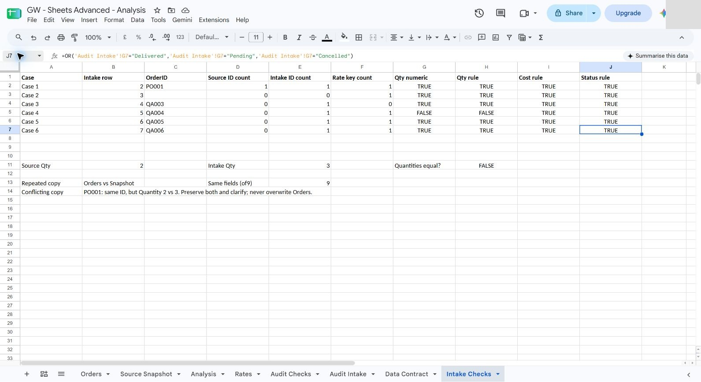

*Verify Cancelled is an allowed status.*

10. Reopen **Audit Intake A1:I7** and verify every raw value remains intact beside the recorded issues. No repair has been applied to the raw examples or maintained source.

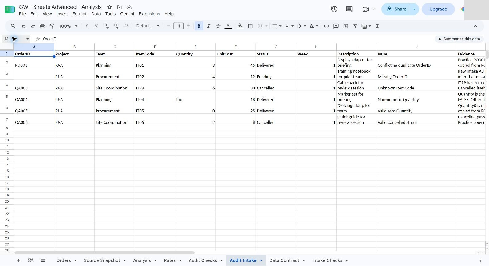

*Recheck the preserved raw intake values.*

11. Return to **Orders** and recheck its original 24 records through PO024.

> **Reference run:** Native readback confirms its supplied values and formatting are unchanged.

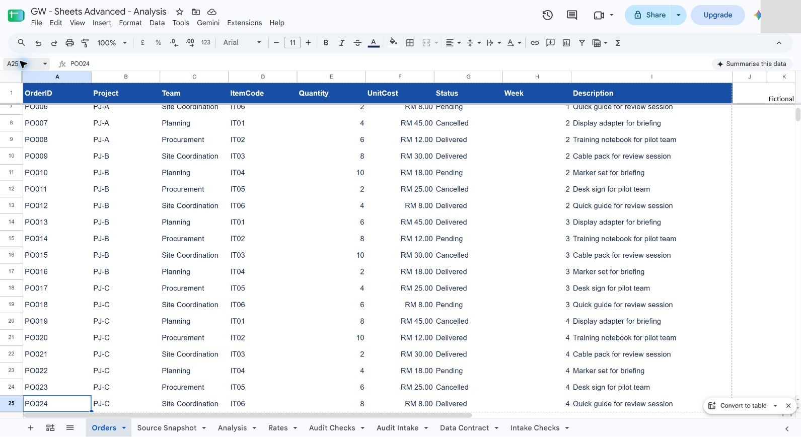

*Retain all original order lines.*

12. Recheck the original six **Rates** keys and supplied values. The unknown intake code has not been added to the reference table to make a test pass.

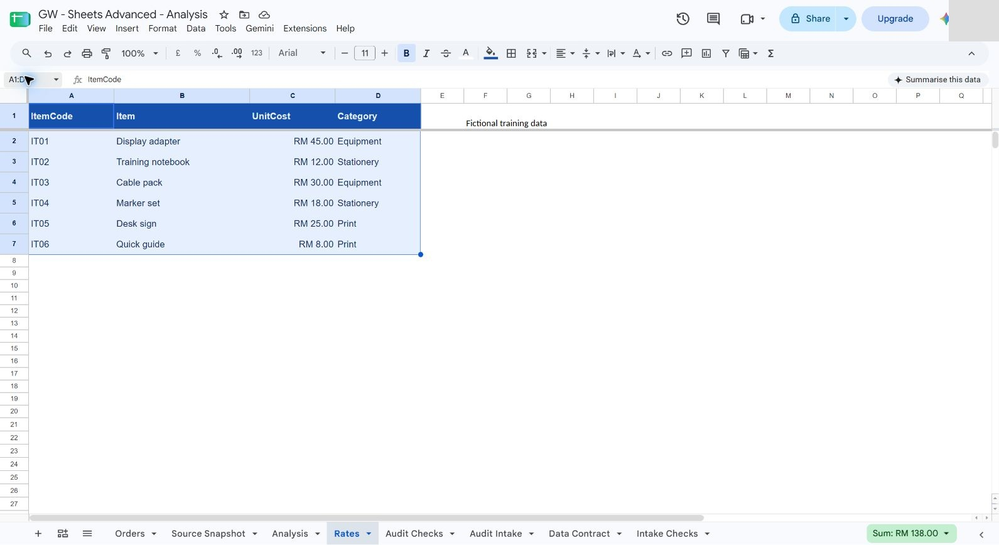

*Recheck the unchanged Rates table.*

13. Reopen the baseline population controls. Counts, types, key coverage, status population, Quantity 140 and the unit-price checksum 552 remain unchanged. Intake anomalies are excluded from these bounded controls.

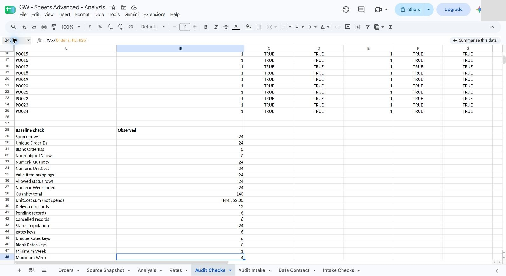

*Reconcile the baseline after auditing intake.*

14. Record the current source integrity, evidence locations and intake boundary in **Audit Checks A60:B68**. Label independent disposition decisions, release conditions, reviewer challenge and learner timing as pending.

> **Reference run:** The author walkthrough does not substitute for those checks.

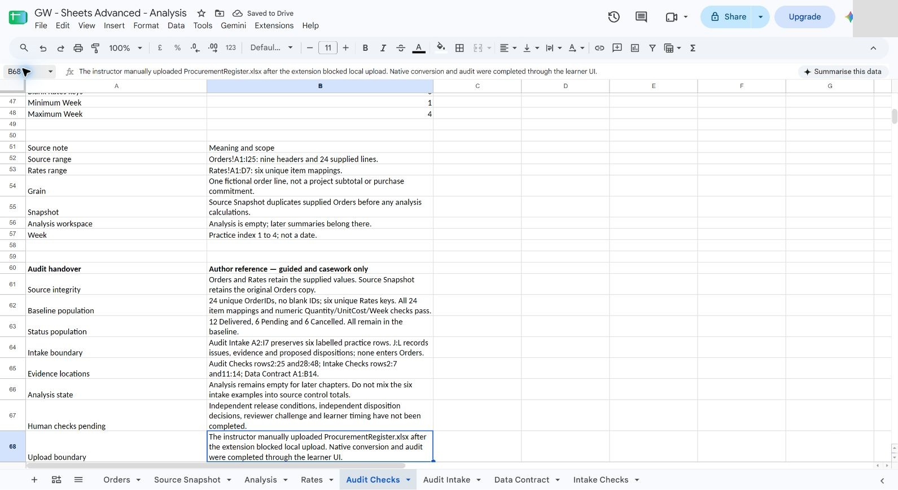

*Record evidence locations and unfinished human checks.*

15. Confirm **Analysis** remains empty. Leave the current workbook ready for conditional calculations in the next lab, with no later summary or dashboard prebuilt.

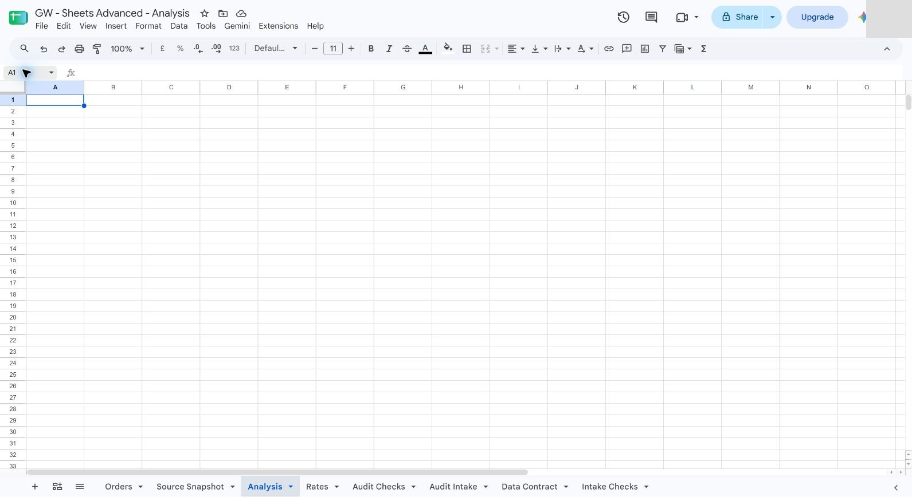

*Leave Analysis empty for later chapters.*

16. Leave the saved workbook with its **Data Contract**, isolated intake and diagnostics available. The source snapshot and original XLSX remain available for comparison.

*Leave the saved source audit ready for the next lab.*

> **Validation boundary:** guided 1.1–1.3 and author casework 1.4 are checked in the learner UI, supplemented by bounded read-only native-cell verification. Upload used an instructor handoff. Independent release conditions and disposition decisions, reviewer challenge and learner timing are not completed.

## Independent Practice

Close the earlier step lists for the first attempt. Use the case input and your own reasoning. If you need help, record the hint and repeat the affected check independently.

1. Independently decide whether each anomaly should enter the analysis, remain pending or be retained as a valid case. Justify every decision against the contract.

2. Write a release condition for the source: what must be true before conditional calculations and lookups can be trusted?

3. Have a reviewer challenge one disposition and resolve it using source evidence or an explicit unresolved label.

### Evidence to Hand Over

- Data contract and six-row anomaly audit with preserved raw values.
- Baseline uniqueness/type/key checks and a justified quarantine policy.
- Independent release conditions and a recorded challenged decision.

Record the defect or uncertainty you investigated, the evidence used, the repair or reasoned no-change decision, and the final state. Restore temporary changes or keep them in a clearly named scenario copy.

## Troubleshooting

| Symptom | What to check |
|---|---|
| A cancelled row is removed as dirty data | Separate data validity from the inclusion rule of the analysis question. |
| An input or earlier result is missing | Reopen the input named in Before You Begin; do not substitute private company data |
| A menu or feature is unavailable | Confirm the account and the shared access notes; record the missing step and ask the trainer for its fallback |
| The result differs from the checkpoint | Compare the exact source range, wording and conditions before repeating the action |

## Lesson Summary

An analysis begins with data meaning, types and source coverage.

**Check yourself:** What does one row represent, and which field identifies it?
