# 02 - Build Conditional Calculations

In this chapter you will revise mixed references and apply IF, SUMIF, COUNTIF, SUMIFS and COUNTIFS with test cases.

> **Prompts:** the [prompts page](./prompts.md) has every value and prompt for this chapter, each with a Copy button.

**Estimated time:** 75 minutes, planned as 15 explanation and demonstration, 32 guided build and casework, 20 independent practice and 8 verification and repair, with 60 active minutes by design. Not yet timed with learners.

**Your result:** Checked line amounts, a project/status summary grid and tested logic bands.

> **Status:** author reference with 37 staged application captures through 2.4. Row formulas, mixed-reference grids, distinct populations, manual six-ID checks, 21 expected-versus-actual logic cases and isolated anchor-fault repair verified. Original input fields and Lab 1 evidence preserved. Independent threshold summary, 250/restoration test, reviewer and learner timing remain pending.

---

## What You Will Learn

- Build row calculations.
- Apply conditional totals with mixed references.
- Test a nested rule at its boundaries.

## Before You Begin

Read the [case input](./prompts.md) and use a separate named casework copy for destructive tests or altered datasets. Keep the baseline unchanged for later chapters. Record source facts, proposed practice and unresolved questions separately.

Use Orders A1:I25 and the Analysis tab from Chapter 1.

## 2.1 Calculate Line Amounts

1. Reopen **GW - Sheets Advanced - Analysis** from Chapter 1. Inspect Orders. The supplied **K1** contains a fictional-data label, so preserve it before using K for a calculation. Keep A:I, Rates and Source Snapshot unchanged.

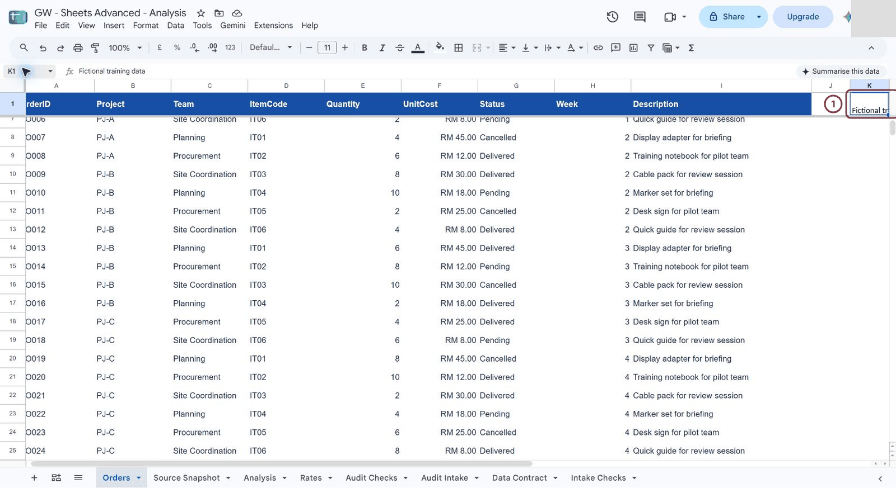

*Inspect the starter label before calculation columns.*

2. Cut **K1** and paste it into **M1**, outside the calculation columns. This preserves the label rather than silently overwriting it with ActiveAmount. Source Snapshot retains the original label at K1.

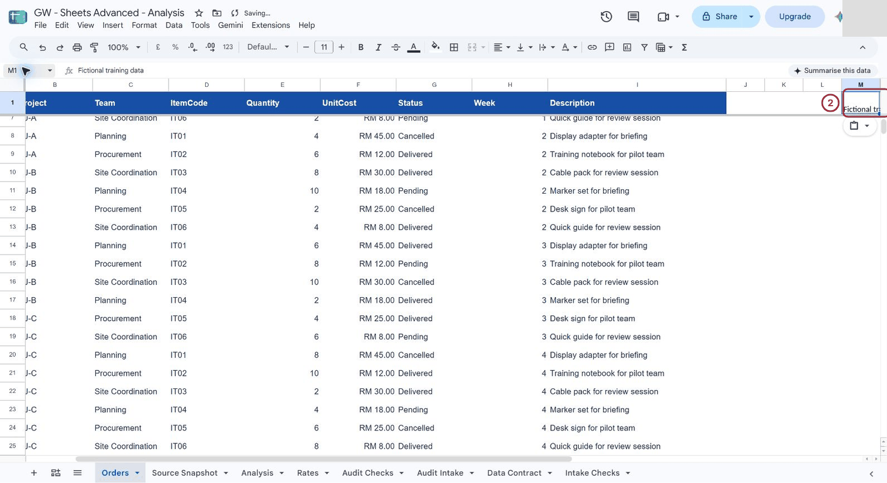

*Preserve the fictional-data label outside the calculations.*

3. Enter **Amount** in J1 and **=E2*F2** in J2. For PO001, Quantity 2 times UnitCost 45 gives **90**.

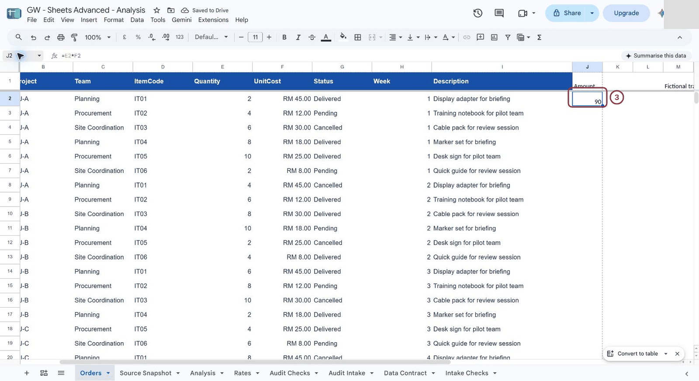

*Calculate the first line amount.*

4. Select **J2:J25** and use **Fill down** (Ctrl+D). Check that every formula multiplies its own row's Quantity and UnitCost.

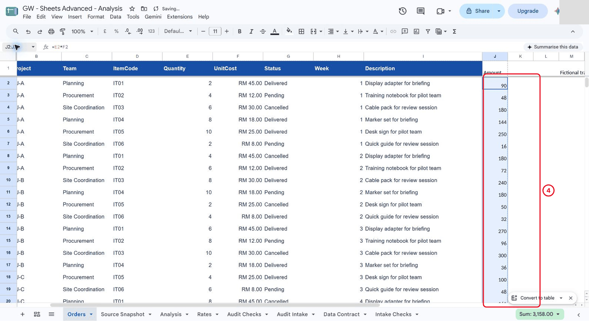

*Fill line-amount formulas through all 24 records.*

5. Enter **ActiveAmount** in K1 and **=IF(G2="Cancelled",0,J2)** in K2, then fill K2:K25 down. Inspect **K4**: PO003 remains in Orders with Amount 180, while ActiveAmount is **0**. This applies a population rule; it does not delete or declare the source row corrupt. Widen new J/K columns as needed. For explicit RM display, apply custom number format **"RM" #,##0.00** to J2:K25; do not change the supplied numeric values.

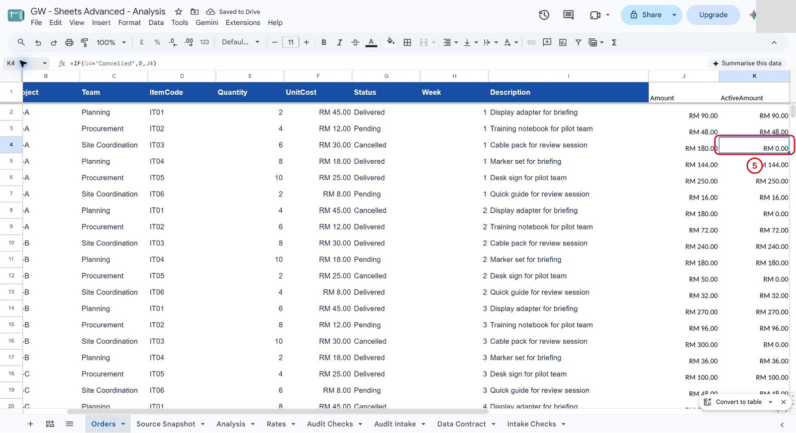

*Keep a Cancelled record with zero ActiveAmount.*

6. Outside the 24-row table, put **All Amount / Active Amount** in J26:K26 and **=SUM(J2:J25) / =SUM(K2:K25)** in J27:K27. Expect **RM3158 / RM1938**. Keep these helper totals outside later bounded source calculations.

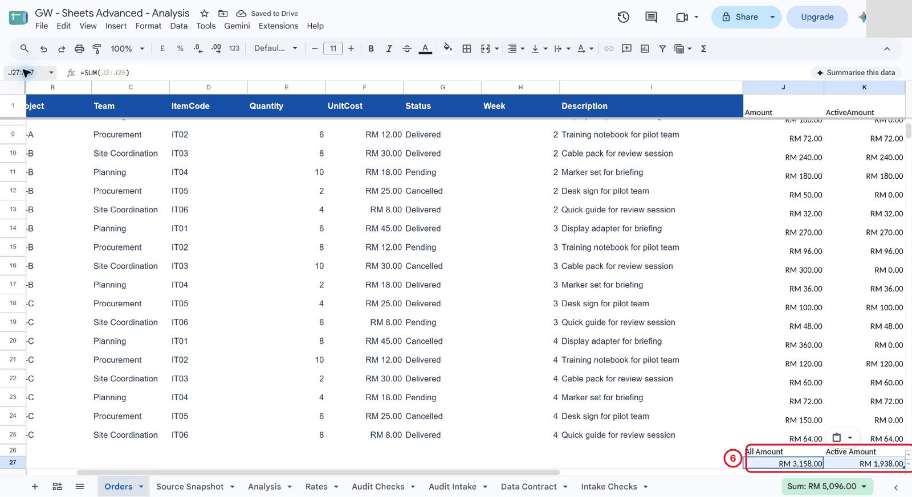

*Reconcile all-orders and active source totals.*

7. Inspect **J13 =E13*F13** for PO012: **4 × 8 =32**. Compare the referenced source fields, not only the displayed amount.

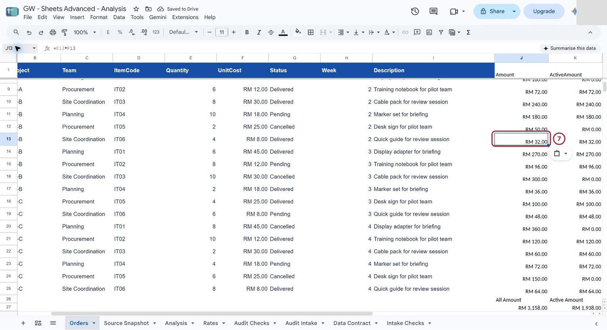

*Spot-check the middle source order.*

8. Inspect **J25 =E25*F25** for PO024: **8 × 8 =64**. The last row must be included in both filled columns and totals.

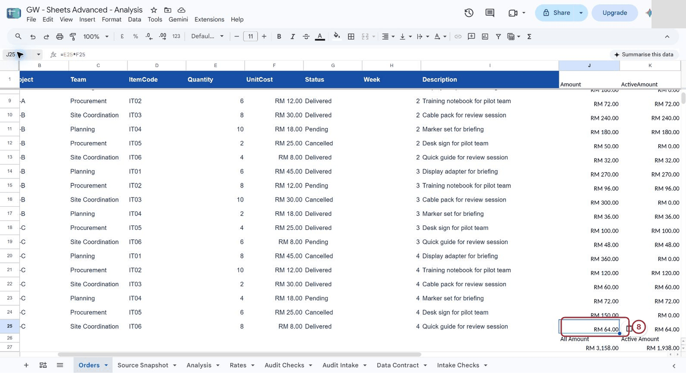

*Spot-check the final source order.*

## 2.2 Create a Summary Grid

1. On **Analysis**, enter Project in A3, Delivered/Pending/Cancelled in B3:D3, and PJ-A/PJ-B/PJ-C in A4:A6. In B4 enter **=SUMIFS(Orders!$J$2:$J$25,Orders!$B$2:$B$25,$A4,Orders!$G$2:$G$25,B$3)**. Its first result is **556**. The source ranges are fully anchored; the project column is fixed but its row can move; the status row is fixed but its column can move.

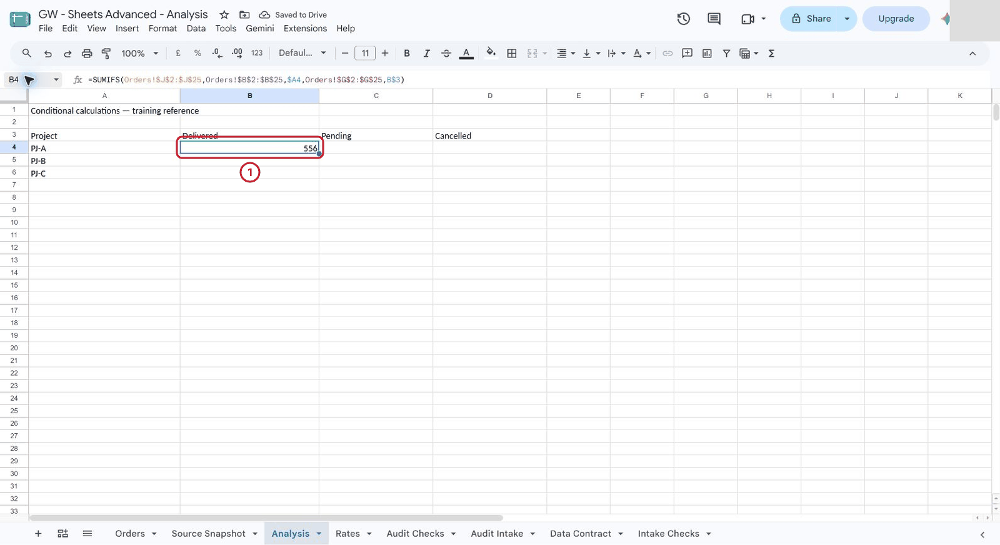

*Enter the first project-status SUMIFS.*

2. Select **B4:D4** and **Fill right** (Ctrl+R), then select **B4:D6** and **Fill down** (Ctrl+D). Expected rows are **556/64/360**, **578/276/350** and **344/120/510**. Label the amount grid as RM. These nine intersections sum to **3158** across every status.

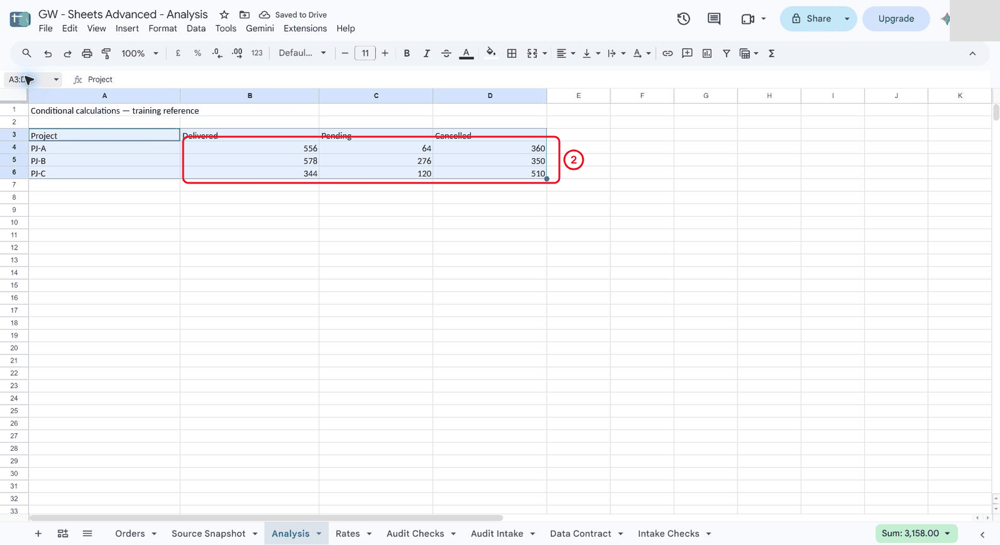

*Fill the amount grid across and down.*

3. Inspect **D6**. It must use **$A6** for PJ-C and **D$3** for Cancelled, while both source criteria ranges and the sum range remain fixed. Its value is **510**. After populating Analysis, update the Chapter 1 Audit Checks notes that previously described Analysis as empty; preserve the Chapter 1 audit evidence as a historical checkpoint.

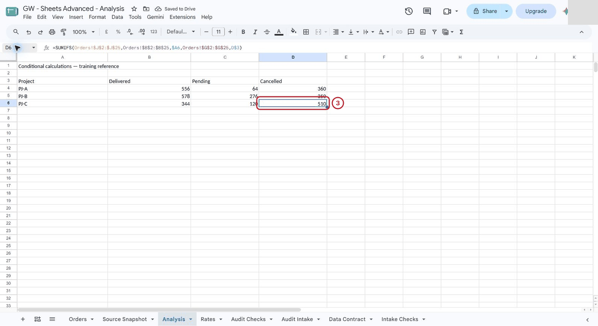

*Inspect the final mixed-reference formula.*

## 2.3 Test Logic Boundaries

1. In the separate practice area on Analysis, label **F1/G1** Practice amount / Hypothetical band. Put **99** in F2 and **=IF(F2<100,"Low",IF(F2<200,"Medium","High"))** in G2. Expect **Low**. These are fictional training bands, not procurement policy.

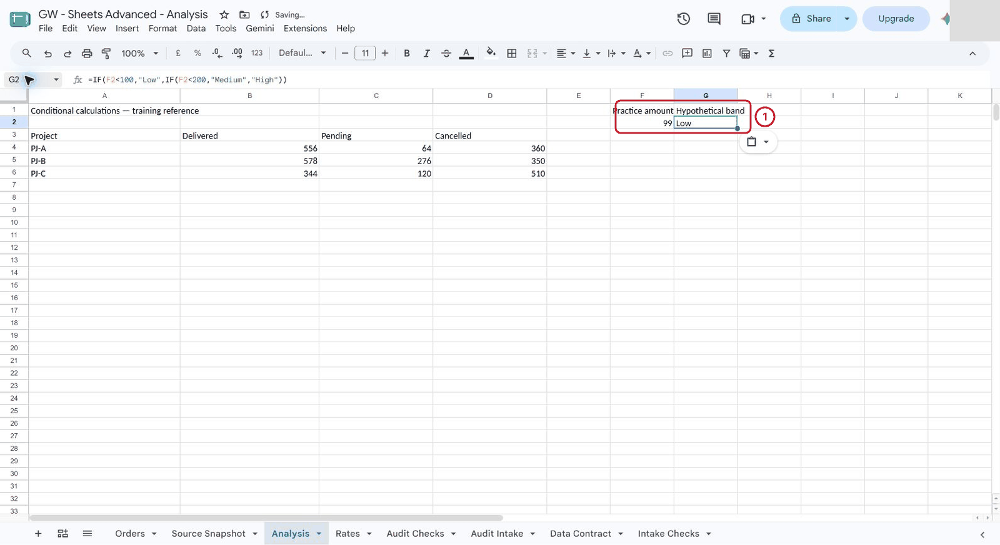

*Test 99 as Low.*

2. Change only F2 to **100**. The lower Medium boundary is inclusive: expect **Medium**.

*Test 100 as Medium.*

3. Change F2 to **199**. It remains below 200: expect **Medium**.

*Test 199 as Medium.*

4. Change F2 to **200**. The High boundary is inclusive: expect **High**. Retain the tested formula; the cross-stage captures record the four separate results.

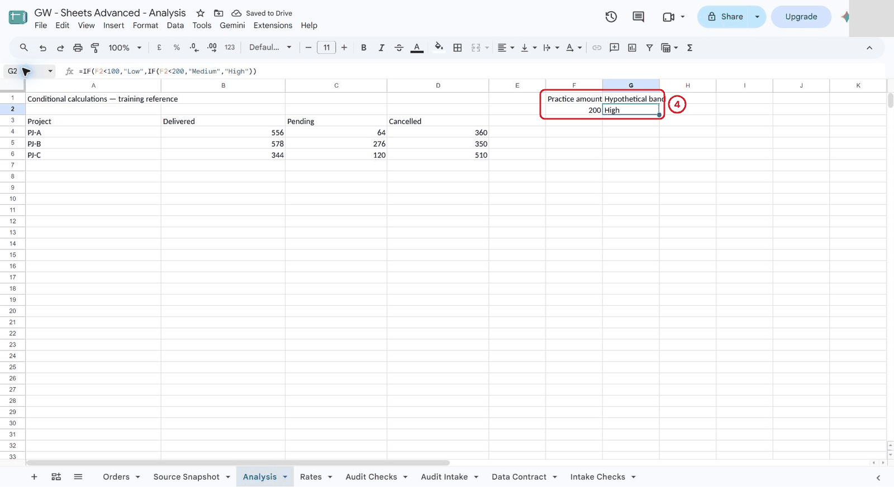

*Test 200 as High.*

## 2.4 Reconcile Three Populations and Test Conditional Boundaries

1. Write the population definitions on **Analysis A13:D18 before calculating**: all 24 order lines; Active excludes Cancelled; Delivered-only excludes both Pending and Cancelled. Keep Cancelled and Pending controls explicit too. Do not treat totals for different populations as interchangeable.

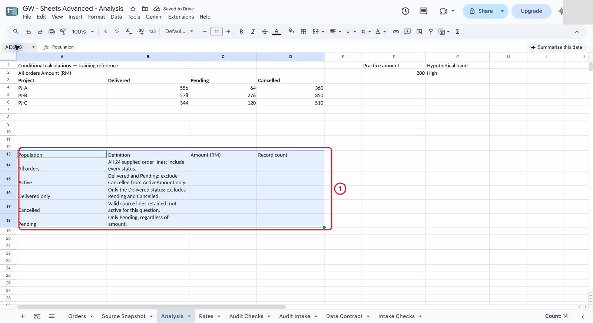

*Define populations before calculating their controls.*

2. Fill the amount and count controls using the population control card in Part 3 of the [prompts page](./prompts.md). Expected amount/count pairs are **All 3158/24**, **Active 1938/18**, **Delivered 1478/12**, **Cancelled 1220/6**, **Pending 460/6**. The SUMIF/COUNTIF checks use the exact status vocabulary; ActiveAmount is summed separately from all-orders Amount.

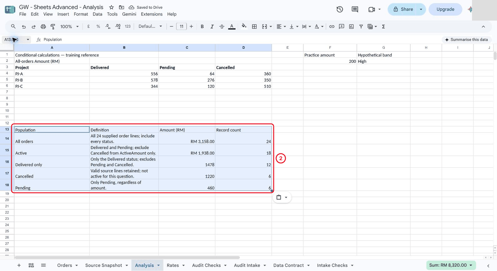

*Compare all active delivered cancelled and pending totals.*

3. Build the matching COUNTIFS grid in **A8:D11**. Use Project count / Delivered / Pending / Cancelled in row 8 and the three projects in A9:A11. Enter **=COUNTIFS(Orders!$B$2:$B$25,$A9,Orders!$G$2:$G$25,B$8)** in B9, fill right through D9 and down through row 11. Each project has **4/2/2** records. Keep the amount and count grids separate, with clear units.

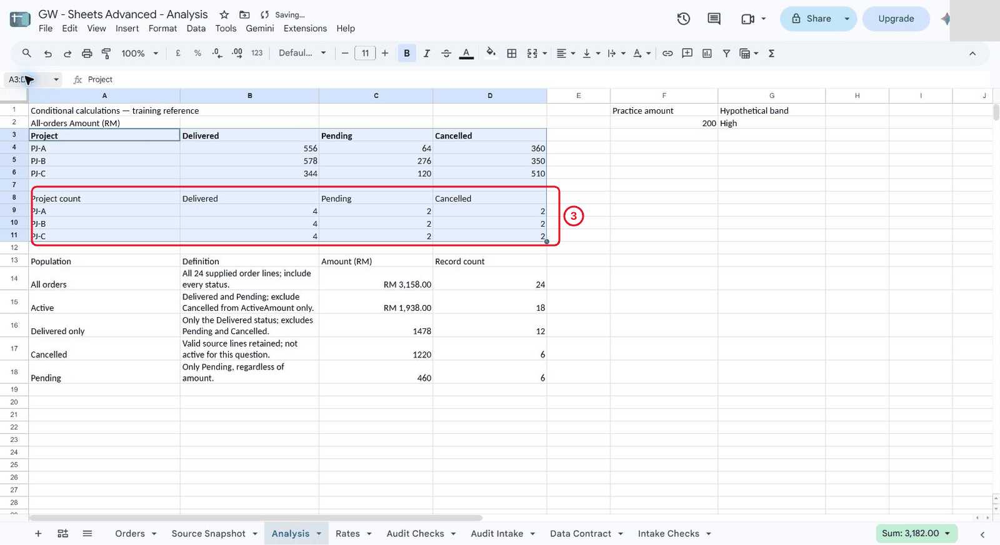

*Build matching count and amount grids.*

4. In **A21:D26**, paste the reconciliation card (Part 3 of the prompts page) to reconcile the amount grid to 3158 and count grid to 24. Verify **Active = Delivered + Pending** and **All = Active + Cancelled**, with zero differences. In B28, **=COUNTIFS(Orders!G2:G25,"Pending",Orders!J2:J25,">=200")** returns **0**. This is a valid baseline result; positive-branch tests belong in the separate synthetic matrix.

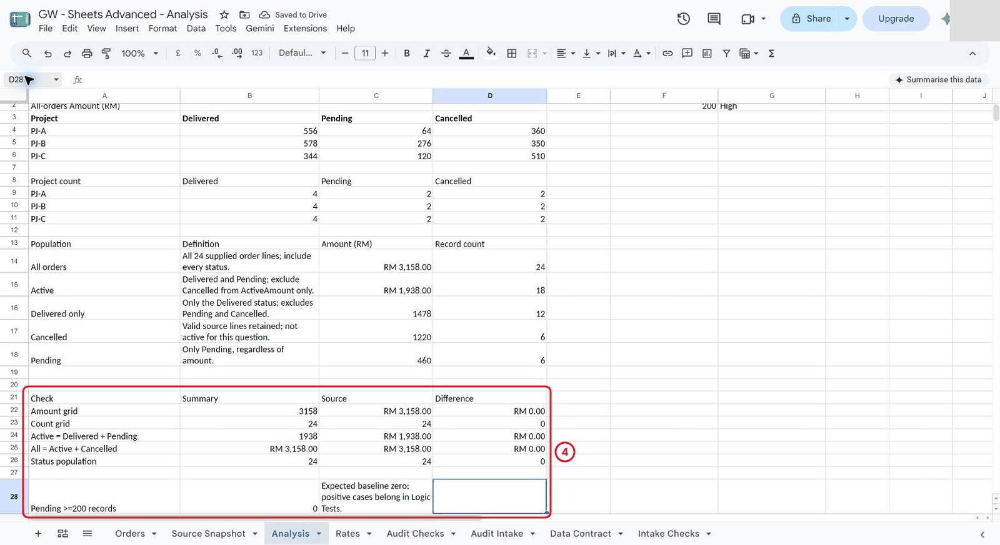

*Reconcile grid totals and population identities.*

5. Create **Subset Checks** and paste the manual subset inputs (Part 3 of the prompts page) to list the qualifying OrderIDs for two intersections. PJ-A Delivered is **PO001/PO004/PO005/PO008**, with manual products **90/144/250/72**. PJ-B Pending is **PO010/PO014**, with **180/96**. Inspect their actual source Quantity and UnitCost values. Record the manually checked products before entering the formula comparisons.

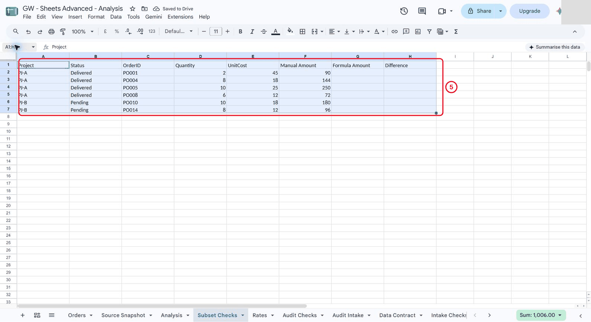

*List qualifying order IDs and manual products.*

6. In Subset Checks G2 enter **=D2*E2**, H2 **=G2-F2**, and fill G2:H7 down. Compare the two manual totals to the maintained grid: **556** to Analysis B4, **276** to Analysis C5; compare qualifying-ID counts **4** and **2** to Analysis B9/C10. Every line and subset difference is zero. This is author-supported manual casework, not an independent learner validation.

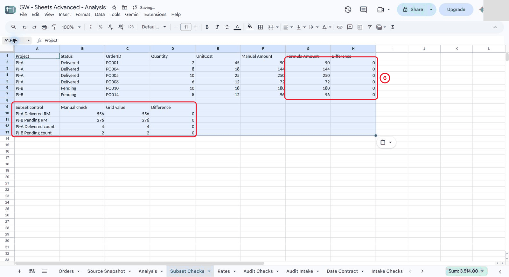

*Compare manual subsets with summary intersections.*

7. Create **Logic Tests**. Paste the 21-case expected-input card from Part 3 of the prompts page, leaving actual band/flag/pass columns empty initially. It crosses amounts **0,99,100,101,199,200,201** with all three statuses. The zero cases use **Quantity 0 × known UnitCost 100**, rather than an unknown rate disguised as 0. Type the expected classifications and flags before running the actual formulas.

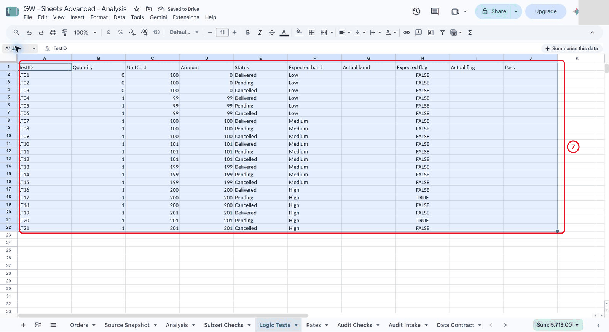

*Record all 21 test expectations before actual formulas.*

8. Enter **G2 =IF(D2<100,"Low",IF(D2<200,"Medium","High"))**, **I2 =AND(E2="Pending",D2>=200)** and **J2 =AND(F2=G2,H2=I2)**. Fill each actual-formula column through row 22. Compare expected and actual results; inspect the boundary cases rather than trusting only a total pass count.

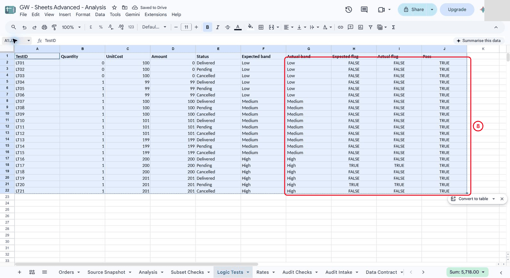

*Execute the full logic matrix.*

9. Reconcile the matrix controls in **A25:D34**: **21 cases /21 passes /0 mismatches**, two Pending High flags, three zero-quantity cases, **6 High /9 Medium /6 Low**. The two positive flag cases are synthetic Pending amounts 200 and 201; the maintained source still has 0 qualifying records. No baseline row is changed to force a positive result.

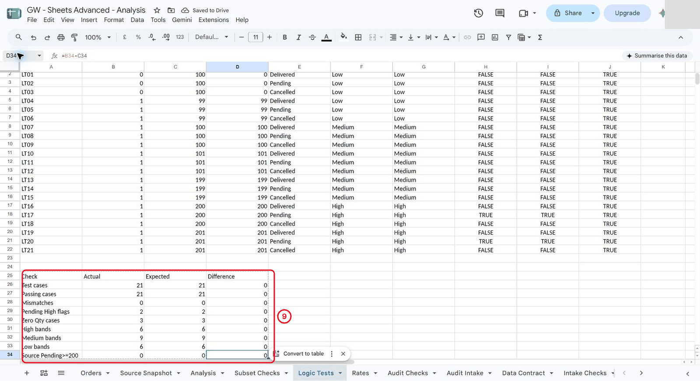

*Reconcile matrix results and baseline zero match.*

10. Duplicate the **Analysis** tab as **Mixed Reference Tests**, a named scenario copy. Record the fault prediction before editing: removing the column anchor from **$A4** will leave B4 at 556, make C4 use numeric B4 as its project criterion and return 0, and reduce the copied grid total to **1478**, a **-1680** discrepancy from 3158. Add the copied-grid control **A37:D38** and prediction notes outside the working grid.

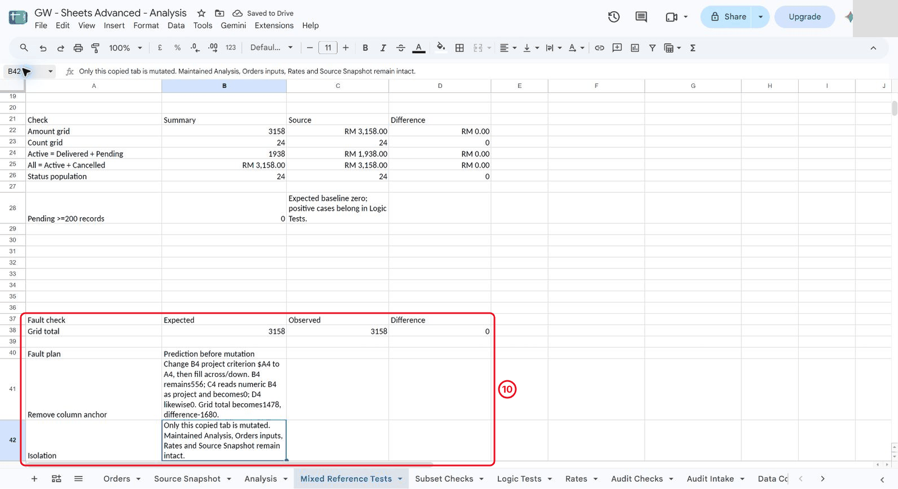

*Record an isolated anchor-fault prediction.*

11. On the copied tab only, change B4's project criterion from **$A4** to **A4**. Fill right and down again. Inspect **C4**: the project criterion has shifted to **B4**, a numeric amount rather than PJ-A. The first incorrect intersection is **0**. Do not damage the maintained Analysis grid.

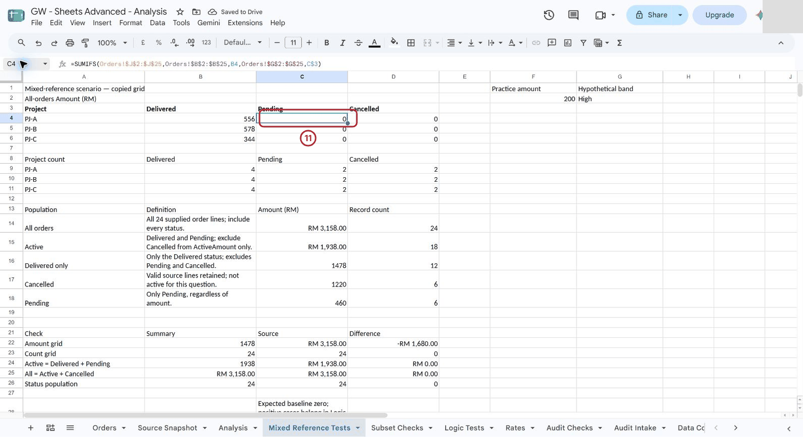

*Inspect the first incorrect project criterion.*

12. Inspect the copied-grid total control: expected 3158, observed **1478**, difference **-1680**. The actual fault state was captured and read back before repair; a correct first cell alone did not prove that copying preserved the logic.

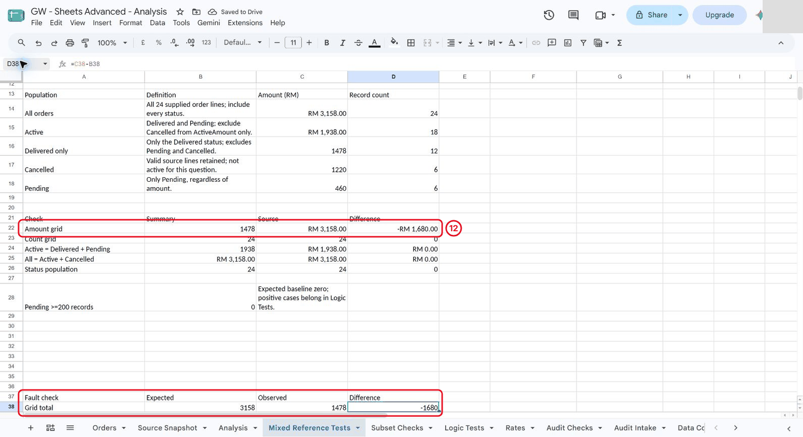

*Observe the predicted grid-total discrepancy.*

13. Restore **$A4** in copied B4 and refill right/down. Inspect the repaired D6 using **$A6 / D$3**, value 510.

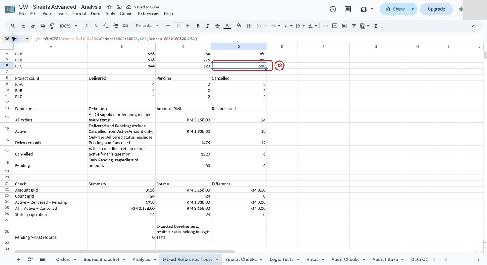

*Restore the project anchor and filled grid.*

14. Recheck the copied total: **3158**, difference **0**. Keep the scenario clearly named as a repaired copy.

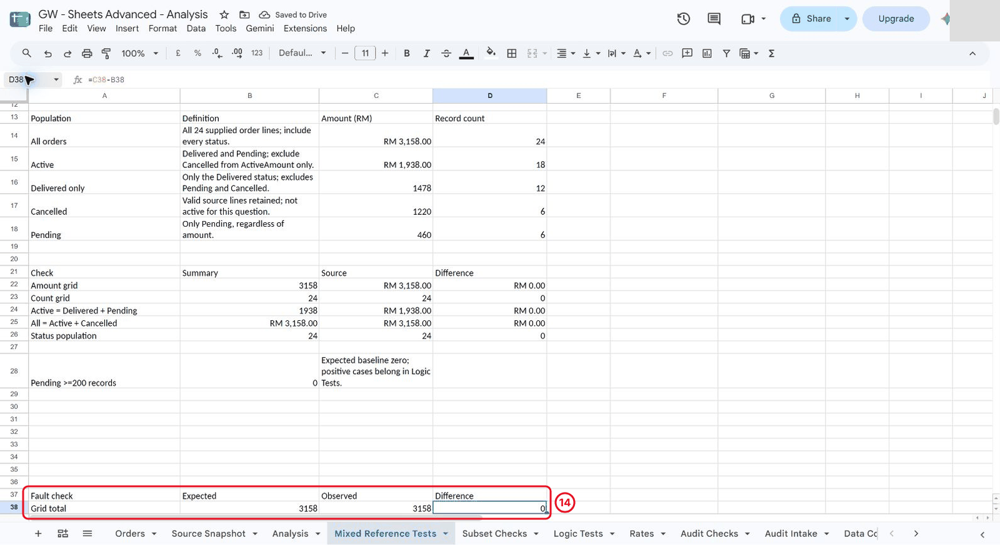

*Reconcile the repaired grid total.*

15. Record the predicted error, observed criterion/value and repair in **A40:B46**, following the repaired mixed-reference scenario in Part 3 of the prompts page. Label the tab's title cell **Mixed-reference scenario — repaired copy**. The maintained Analysis never required repair.

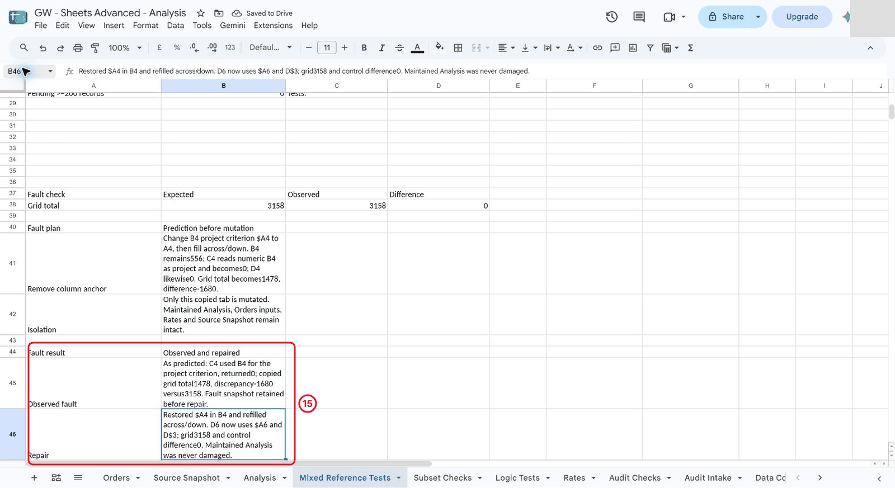

*Record the actual fault and repair.*

16. On maintained Analysis, record why a **known numeric zero** differs from an unresolved **IT99** rate mapping, and why the all-orders, active and delivered-only totals answer different questions. Keep the training bands separate from source policy. Label the independent project threshold summary, filtered-source reconciliation and 250/restoration challenge as pending.

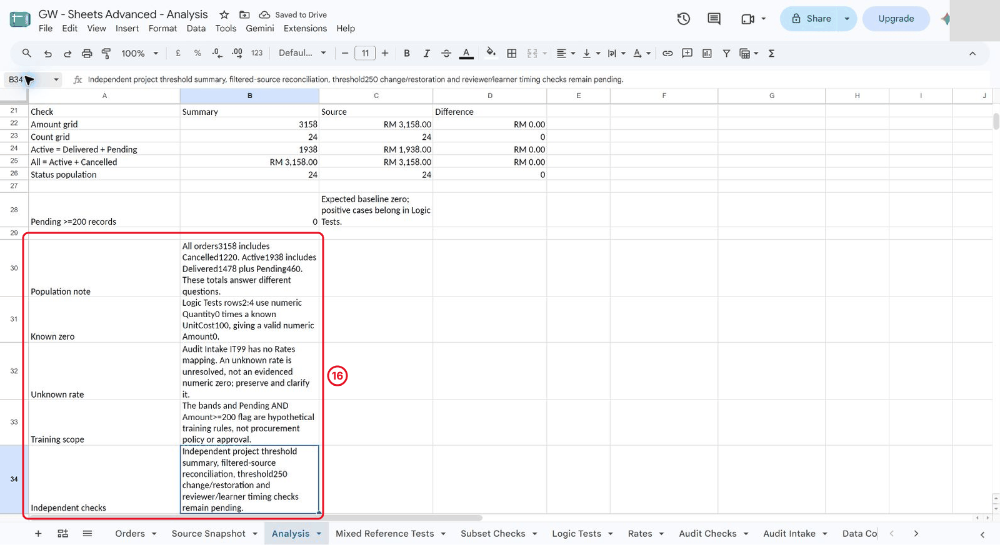

*Explain populations and valid zero versus unknown rate.*

17. Reinspect the maintained amount and count grids. The nine intersections still match the source, with amount total 3158 and count 24.

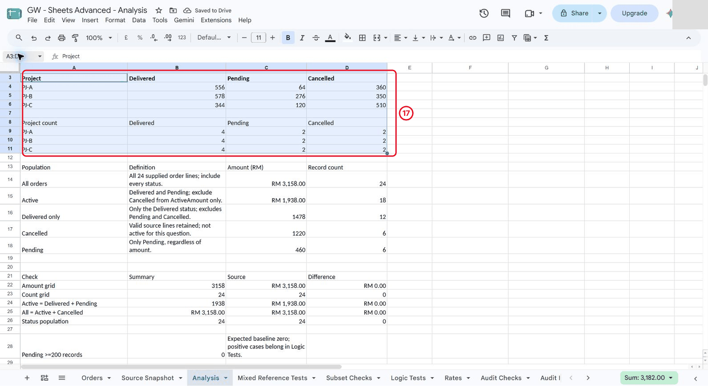

*Recheck maintained amount and count grids.*

18. Finish readable amount formats and inspect all five zero-difference control rows. In the captured Analysis layout A/B/C/D are approximately 240/220/180/180 pixels, with wrapped definition and note cells; money formats are applied only to amount ranges, not the count grid.

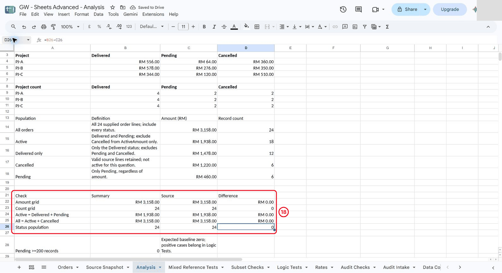

*Inspect final maintained analysis controls.*

19. Recheck Orders A:I through PO024. Original input values and formats, Rates, intake evidence and the training contract remain unchanged; only the new calculation columns, outside-table controls and preserved label location were added to Orders.

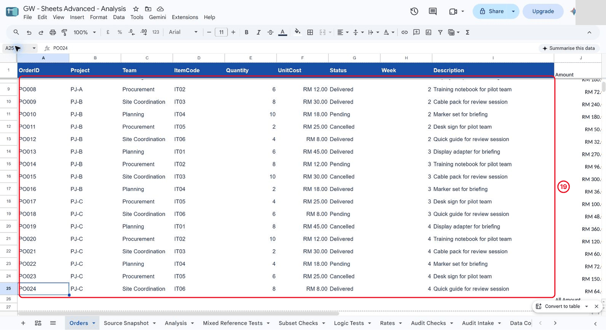

*Preserve original source input fields.*

20. Inspect **Source Snapshot**. It retains the original source values and original K1 label, without the new calculation columns. It remains a comparison copy, not the maintained calculation source.

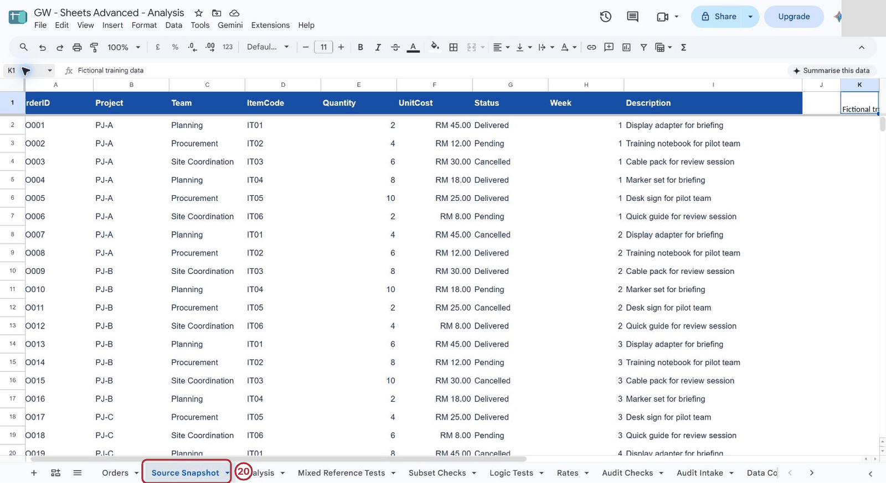

*Retain the original source snapshot.*

21. Leave all 21 Logic Tests passing. Preserve the synthetic cases separately from Orders and the repaired reference scenario separately from Analysis.

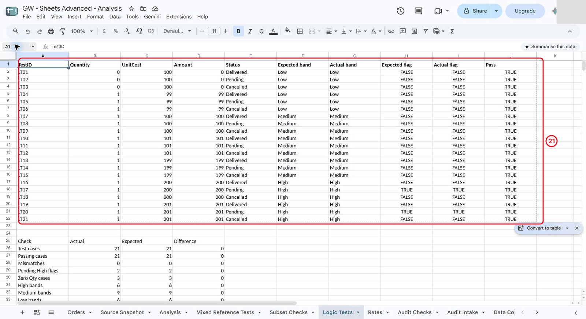

*Leave all 21 logic cases passing.*

22. Leave the saved maintained **Analysis** ready for the next lab. Source inputs are preserved; hypothetical tests and historical audit notes are clearly scoped. Independent threshold work, reviewer checks and learner timing remain unfinished.

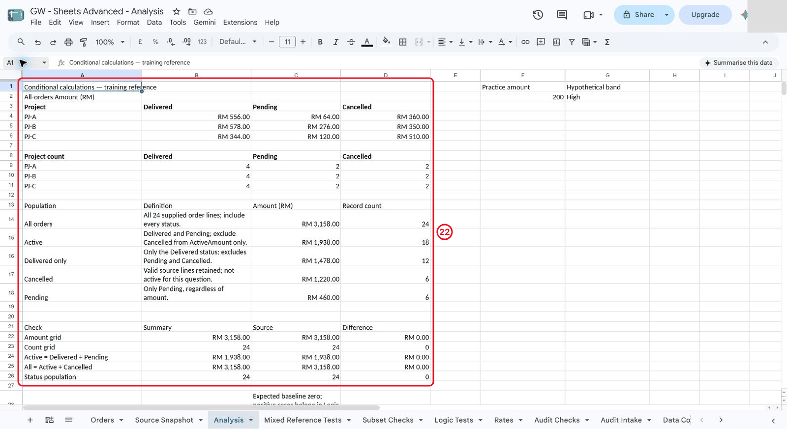

*Leave maintained analysis ready for the next lab.*

> **Validation boundary:** guided 2.1–2.3 and author casework 2.4 are verified through actual learner UI and bounded read-only native-cell evidence. The independent project/threshold summary, filtered-source reconciliation, 250/restoration test and human checks were not performed. Planned 75-minute classroom timing remains unmeasured.

## Zero-Match Check

The supplied baseline has no Pending record with Amount at least 200. Record that result explicitly. Use a separately labelled synthetic case to prove the positive branch; do not edit baseline records just to obtain a highlight.

## Independent Practice

Close the earlier step lists for the first attempt. Use the case input and your own reasoning. If you need help, record the hint and repeat the affected check independently.

1. Build a second summary answering count and amount for Pending orders of at least 200 by project. Keep threshold logic explicit.

2. Use a filtered source list as an independent reconciliation. A zero-match baseline is a valid result; create a separate synthetic qualifying case and a non-qualifying boundary case to test the rule.

3. Change the threshold to 250 in a labelled assumption cell, repair references so the grid follows it, then restore 200 and verify restoration.

### Evidence to Hand Over

- Reconciled count/amount grids for clearly defined populations.
- Expected-versus-actual boundary matrix and repaired mixed-reference defect.
- Independent threshold summary with supporting OrderIDs and a restored assumption.

Record the defect or uncertainty you investigated, the evidence used, the repair or reasoned no-change decision, and the final state. Restore temporary changes or keep them in a clearly named scenario copy.

## Troubleshooting

| Symptom | What to check |
|---|---|
| Correct totals conceal the wrong population | Reconcile counts and contributing IDs as well as the monetary total. |
| An input or earlier result is missing | Reopen the input named in Before You Begin; do not substitute private company data |
| A menu or feature is unavailable | Confirm the account and the shared access notes; record the missing step and ask the trainer for its fallback |
| The result differs from the checkpoint | Compare the exact source range, wording and conditions before repeating the action |

## Lesson Summary

Visible row calculations and explicit criteria make advanced logic checkable.

**Check yourself:** Which references in the summary grid must stay fixed when copied across and down?
