# 03 - Validate Entries and Flag Exceptions

In this chapter you will use dropdowns, custom validation and formula-based conditional formatting.

> **Prompts and values:** use the [copy-paste page](./prompts.md) for the exact values used below.

**Target allocation:** 65 minutes: 15 explanation/demonstration, 22 guided build and casework, 20 independent challenge, 8 verification and repair. The active portion is 50 minutes by design. These are unmeasured targets awaiting a learner pilot.

**Your result:** Validation rules and a tested pending-order exception highlight.

> **Status:** author reference with 39 staged application captures through 3.4. Separate practice copy, strict categorical/numeric rules, actual rejection behavior, ten input observations including blank clearing, five exception cases, first/final-row coverage and flag/highlight/filtered-ID agreement checked. Temporary values restored; maintained source preserved. Independent appended-row repair, bulk-paste/CSV numeric-text behavior, reviewer and learner timing remain pending.

## What You Will Learn

- Validate categorical and numeric inputs.
- Highlight exceptions using a rule.
- Test an invalid and boundary value.

## Before You Begin

Read the [case input](./prompts.md) and use a separate named casework copy for destructive tests or altered datasets. Keep the baseline unchanged for later chapters. Record source facts, proposed practice and unresolved questions separately.

Use a practice copy of Orders. Restore all temporary tests before completing the chapter.

## 3.1 Validate New Entries

1. Duplicate **Orders** as **Validation Practice** in the existing Advanced workbook. Verify the separate tab name before editing. It retains the 24 original records, Amount/ActiveAmount formulas and outside-table totals. Maintain Orders, Analysis, Rates and Source Snapshot unchanged.

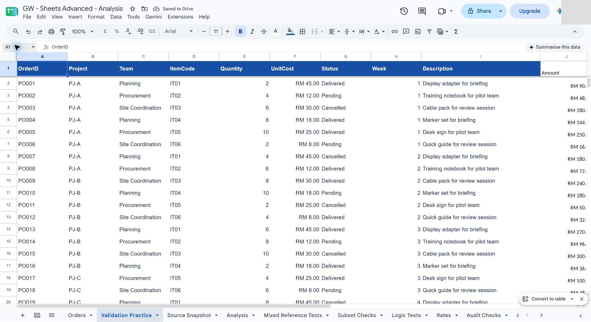

2. Select **G2:G25**, open **Data > Data validation** and add a rule. Use a single-choice **Drop-down** with **Delivered / Pending / Cancelled**. Inspect **Advanced options > Reject the input**, then save with **Done**. The canonical set matters; auto-populated order may differ.

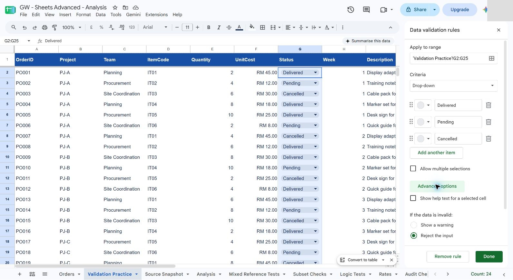

3. Select **E2:E25** and add a separate rule. Choose **Custom formula is** and enter **=AND(ISNUMBER(E2),E2>=0,MOD(E2,1)=0)**. Set **Reject the input** explicitly: this custom-rule editor defaulted to **Show a warning** in the author account. Save with Done. The row-relative E2 corresponds to the first cell of the apply-to range. Numeric zero is permitted; do not substitute a positive-only restriction.

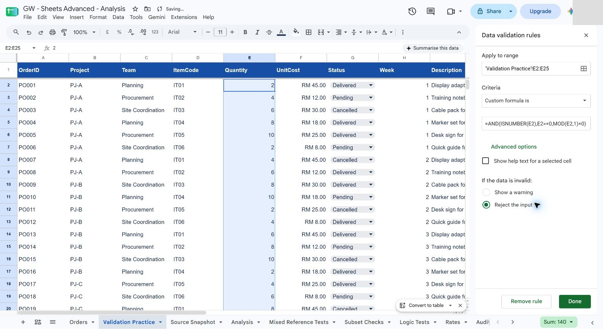

4. Inspect the saved rules for **E2:E25 / G2:G25**. A visible dropdown or coloured cell alone does not prove rejection behavior.

> **Reference run:** Native readback later confirms strict rules on every cell through row 25, with the quantity reference adjusted per row.

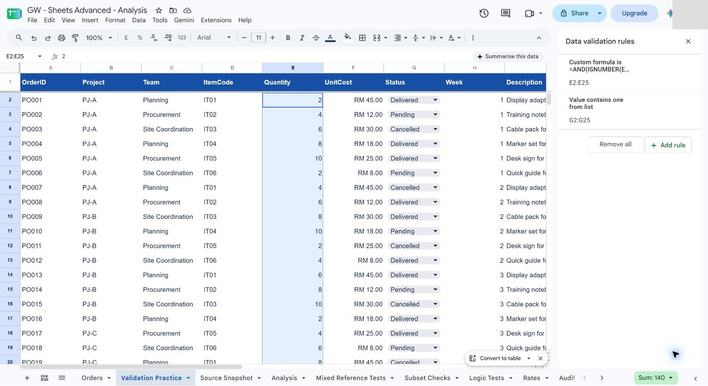

## 3.2 Flag Pending High Amounts

1. Select **A2:K25**, open **Format > Conditional formatting**, choose **Custom formula is**, and enter **=AND($G2="Pending",$J2>=200)**. Use a readable light fill; the captured rule uses **#b7e1cd**. Save with Done. Columns G/J are fixed while the row follows each record, starting at source row 2.

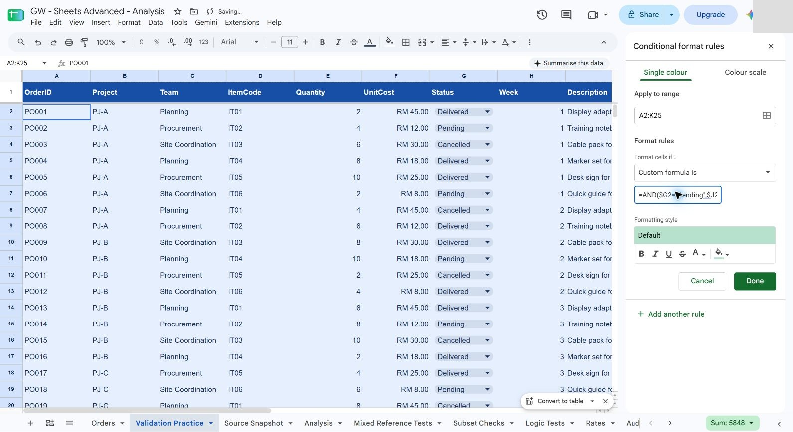

2. Close the rule sidebar and inspect the baseline. It contains **no Pending record with Amount at least 200**, so no row qualifies. Keep this valid zero-match result; do not change the maintained source merely to obtain a highlight.

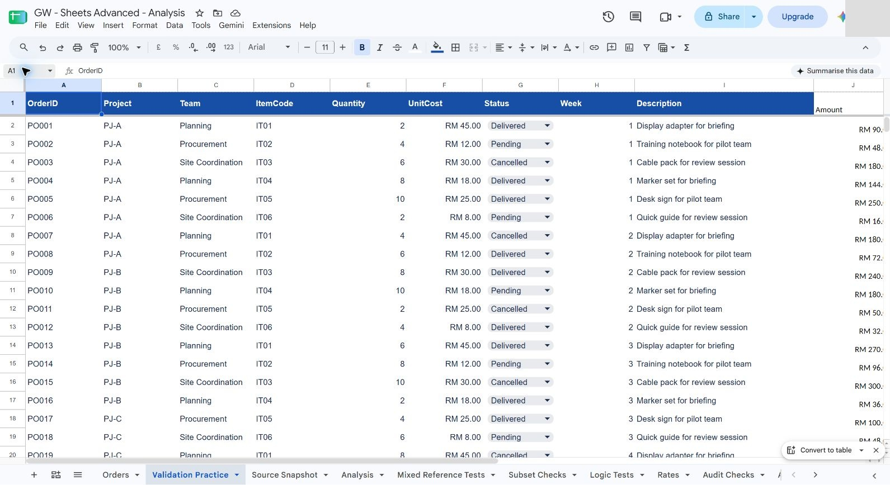

## 3.3 Test the Rules

1. On the practice copy, edit **G3** to **Ready**. The actual native dialog rejects it and lists the three allowed statuses. Dismiss **OK**, then **Escape** from editing so Pending is retained. The input method in this walkthrough is cell-edit mode (F2), pasted text inside the editor, then Enter; this is not a bulk-range paste test.

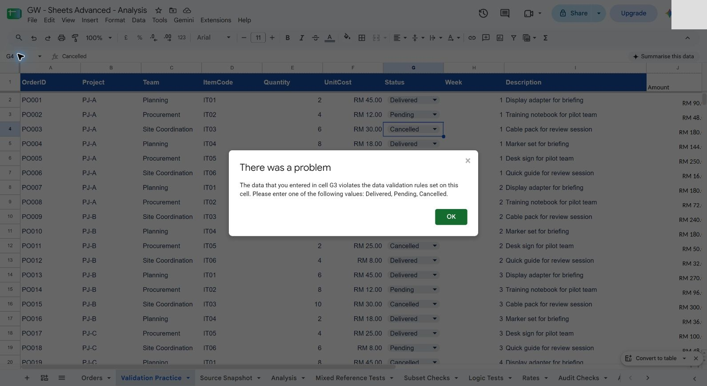

2. Try **1.5** in E3 using the same method. The native validation dialog rejects it. Dismiss and exit editing; original Quantity 4 remains. A rejected value was not saved, so do not blindly undo the newly configured rule.

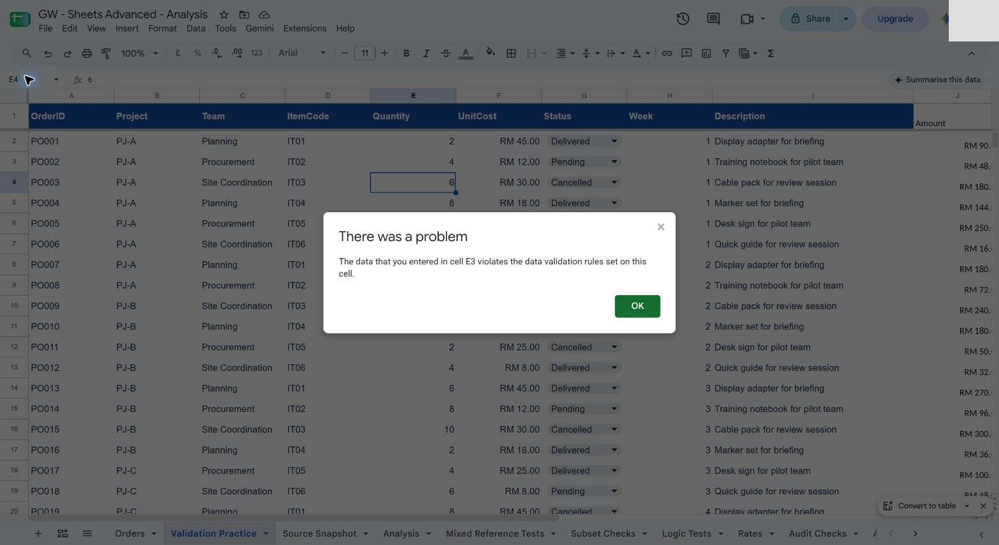

3. In the practice row only, set **E3=1 / F3=199**, keeping Pending. J3 is 199 and the row is not highlighted.

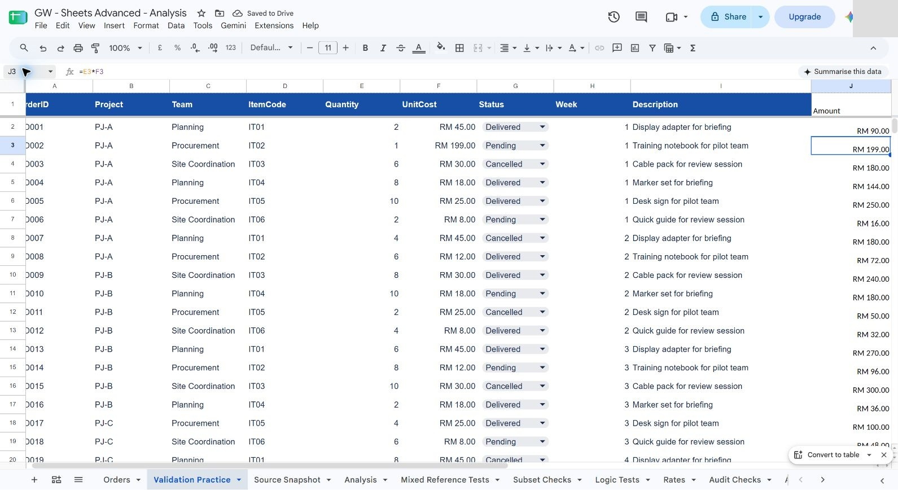

4. Change F3 to **200**. J3 becomes 200 and the intended row is highlighted. Delivered and Cancelled records elsewhere do not qualify merely because their amount is high.

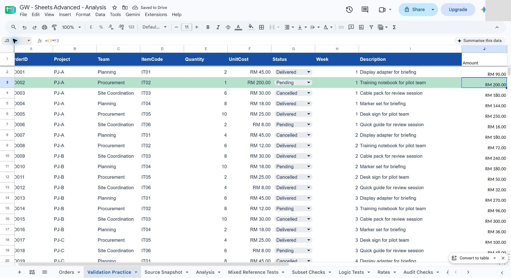

5. Restore **E3=4 / F3=12 / G3=Pending**. Amount returns to 48 and the highlight disappears. The maintained source was never changed.

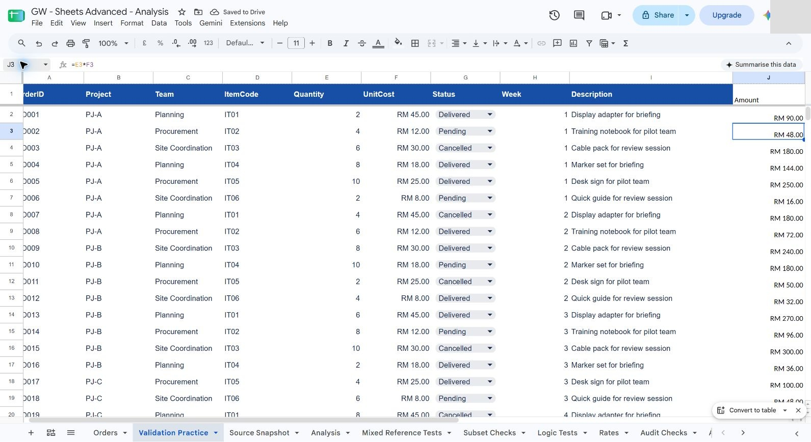

## 3.4 Create a Rule Test Harness and Reconcile Exceptions

1. Create **Validation Tests** and paste the input-expectations card into **A1:H11**. It includes nine ordinary entry cases and one separate blank-clearing observation. Record expected results before trying each input; leave observed-result cells empty until after testing. A blank is not a numeric Quantity for a completed row, but clearing behavior must be observed separately from entered-value rejection.

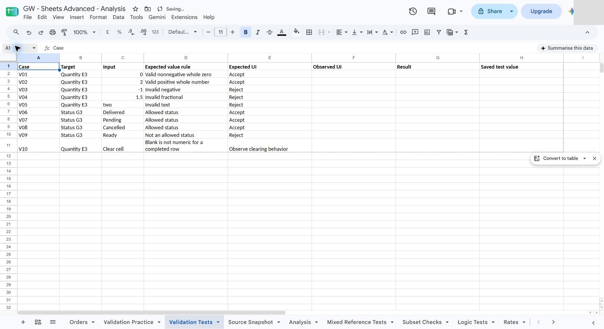

2. On practice E3, enter numeric **0**. It is accepted by the nonnegative whole-number rule. Record the result, then restore 4.

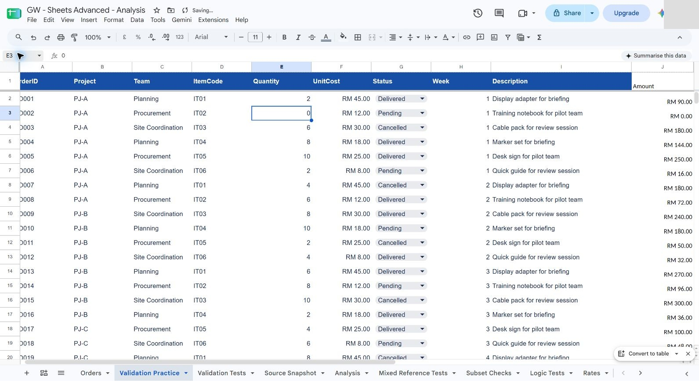

3. Enter **2**. It is accepted. Record the result, then restore 4.

4. Enter **-1**. The actual dialog rejects it; dismiss and retain 4.

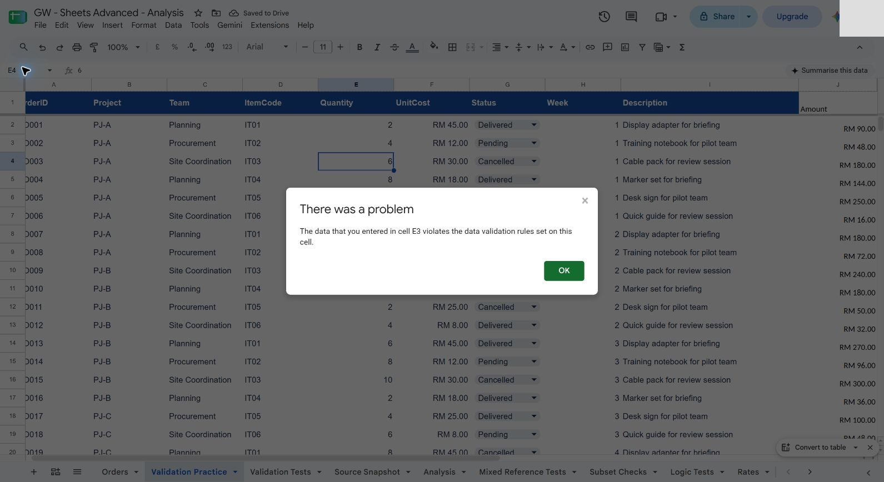

5. Enter **1.5**. It is rejected in the harness test too; retain 4.

6. Enter the text **two**. It is rejected. Preserve the observed input and result in the report rather than silently translating it into numeric 2.

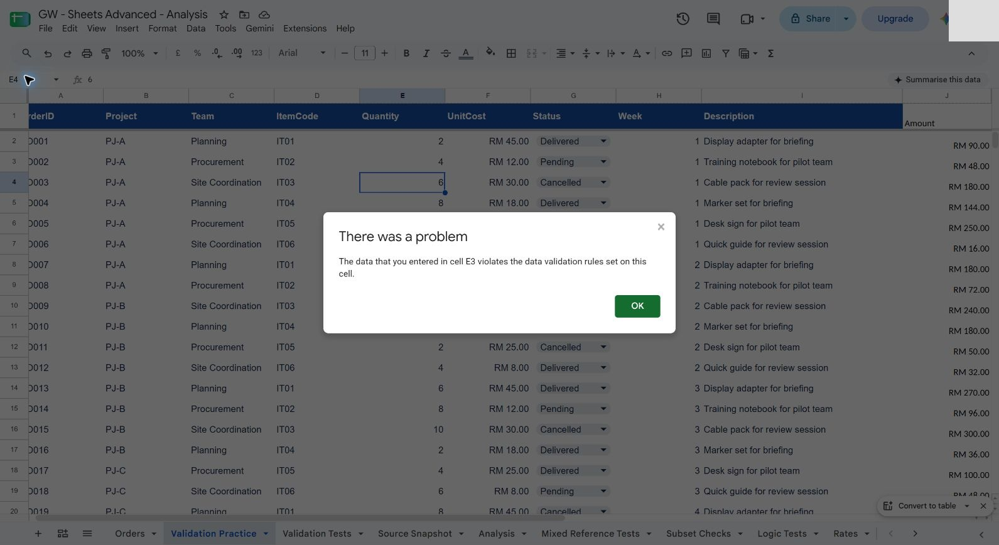

7. Test **Delivered** in G3. It is accepted; restore Pending after recording the result.

8. Test **Pending**. It is an allowed value and remains selected.

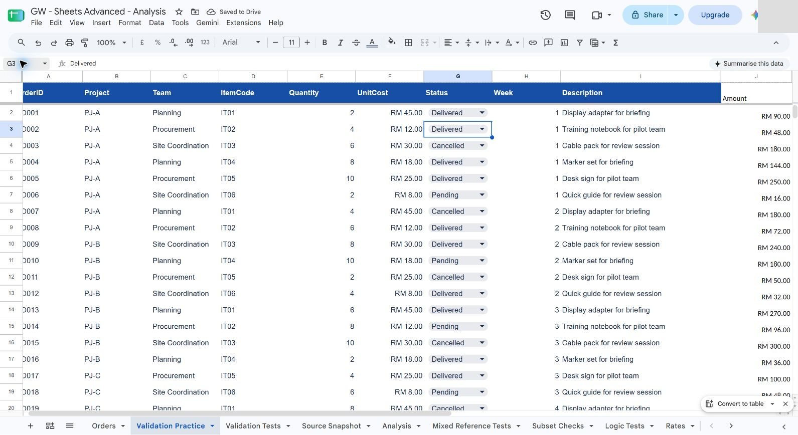

9. Test **Cancelled**. It is accepted; restore Pending. Cancelled remains a valid source status, even though the current exception condition excludes it.

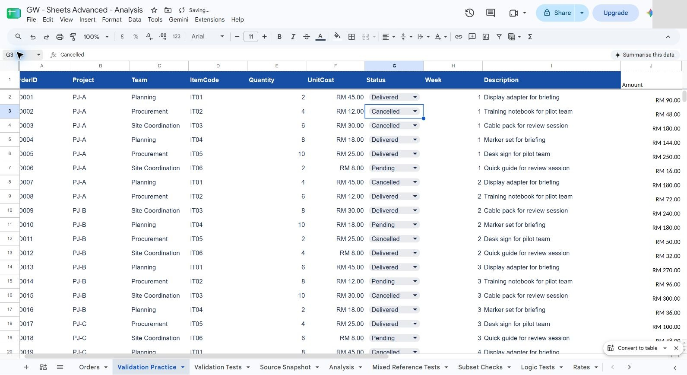

10. Test **Ready**. It is rejected and Pending is retained.

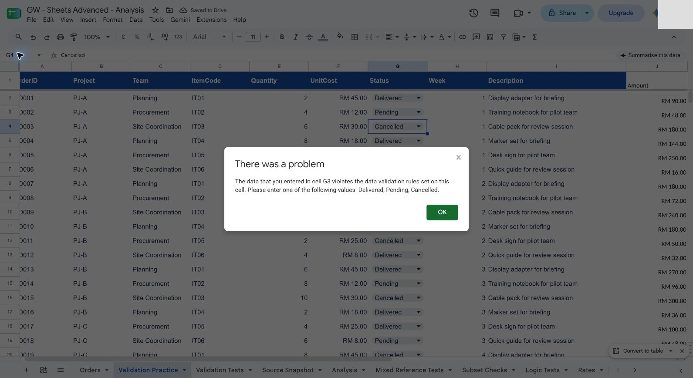

11. Select E3 and use **Delete** to clear it. In this account the cell became blank **without a blocking dialog**, while the custom validation rule remained. Record this limit: the input rule does not enforce requiredness against clearing, and a complete row still needs a numeric Quantity check. Save the blank observation before restoring 4. Do not report this as a successful blank-rejection test.

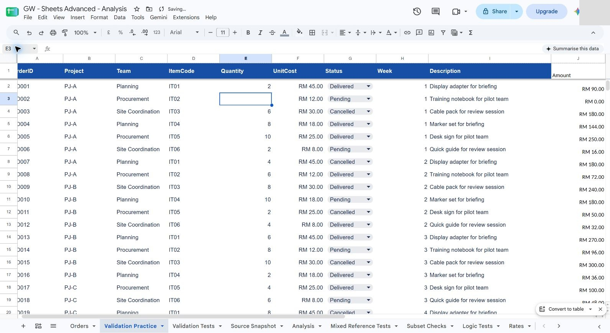

12. Complete the observed-result columns. Nine ordinary cases match the expected accept/reject behavior; the tenth records the separate completeness gap. Restore E3/F3/G3 to **4/12/Pending**. Bulk-range paste and numeric text imported from CSV were not tested.

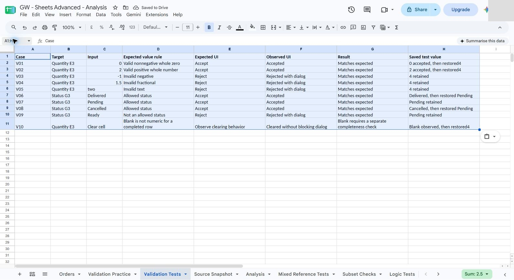

13. In Validation Practice, enter **PendingHigh** in L1 and **=AND($G2="Pending",$J2>=200)** in L2, then fill through L25. The restored baseline has 24 FALSE flags, agreeing with no highlighted rows. For a full-width view, adjust only practice columns: A:H about 110 pixels, C 150, I 220, J:L 120; later G140/H80 makes the status labels readable. Keep maintained-source widths unchanged.

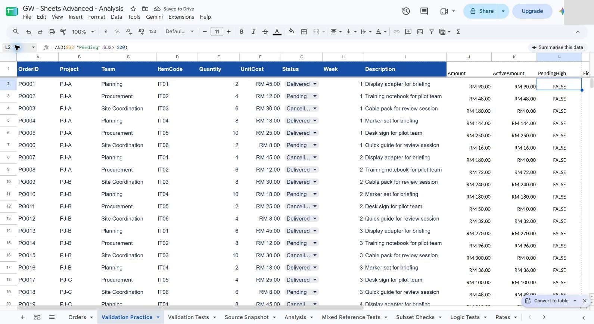

14. On Validation Tests, enter the five exception expectations in **A15:H20** before trying them: Pending 199 FALSE; Pending 200 TRUE; Pending 201 TRUE; Delivered 200 FALSE; Cancelled 200 FALSE. Actual flag/highlight/ID/result columns start empty. These are sequential temporary versions of practice PO002, not additional source records.

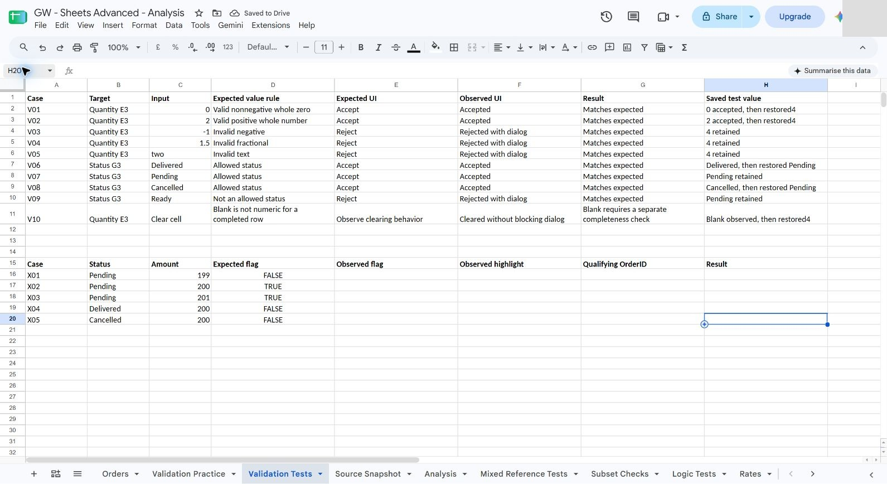

15. With E3=1, test **Pending / F3=199**. L3 is FALSE and the row is not highlighted. The amount condition excludes it.

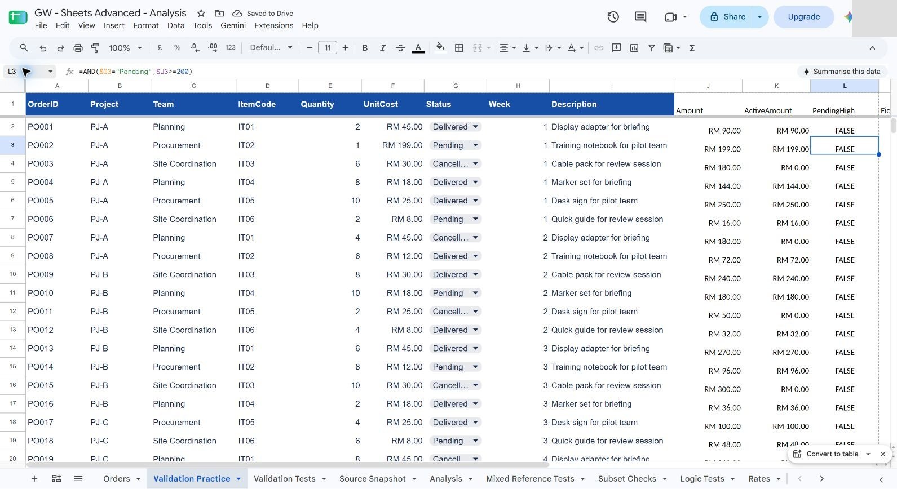

16. Test **Pending /200**. L3 is TRUE and PO002 is highlighted; the threshold is inclusive.

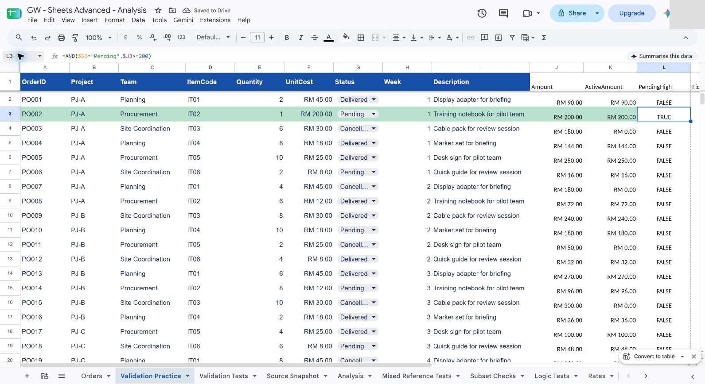

17. Test **Pending /201**. L3 remains TRUE and the row remains highlighted.

18. Test **Delivered /200**. L3 is FALSE and the highlight is absent because the status condition fails.

19. Test **Cancelled /200**. L3 is FALSE, the highlight is absent and ActiveAmount is 0. Record the observed cases, then restore E3/F3/G3 to **4/12/Pending**.

20. Check both range boundaries without appending a record. Temporarily set **PO001 row 2** to Quantity 1, UnitCost 200, Pending, and **PO024 row 25** to Quantity 1, UnitCost 201, Pending. Both flags and row highlights are TRUE. Inspect the final row explicitly; the first cell alone does not prove full coverage.

> **Reference run:** Native readback retained both positive boundary states before restoration.

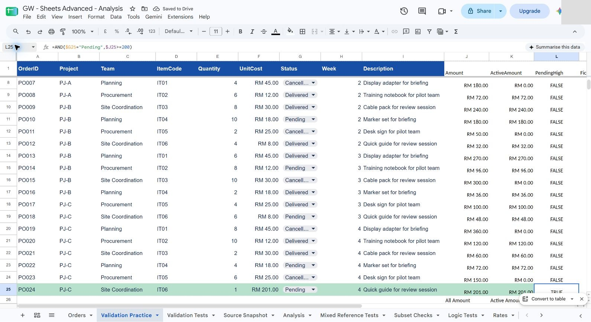

21. Create a native filter over **A1:L25** and filter PendingHigh to **TRUE**. Navigate to A2 so both records are visible. Expect **2 of 24 rows displayed: PO001 and PO024**, with matching TRUE flags and highlights. The ordinary SUM controls still include the full practice population while rows are hidden; they are not filtered subtotals.

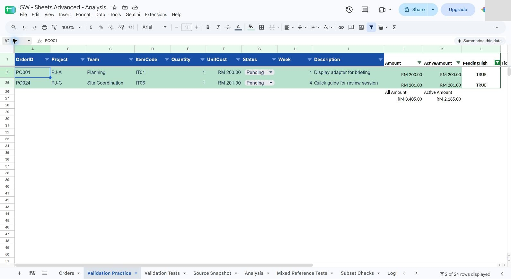

22. Remove the filter. Restore row 2 to **2/45/Delivered** and row 25 to **8/8/Delivered**; row 3 remains **4/12/Pending**. Leave every original OrderID intact.

23. Reinspect the final row's FALSE flag after restoration. The practice totals return to **3158 /1938**, with no current exceptions. No temporary test value is retained in the source table.

24. Record exact ranges, restoration and limitations in **Validation Tests J1:K9**, outside the matrices. Use wide wrapped note columns (about 250/1000 pixels) so they remain readable without widening the test tables. State that the independent appended PO-TEST row, new-row coverage repair, bulk paste, CSV numeric text and human/timing checks remain pending.

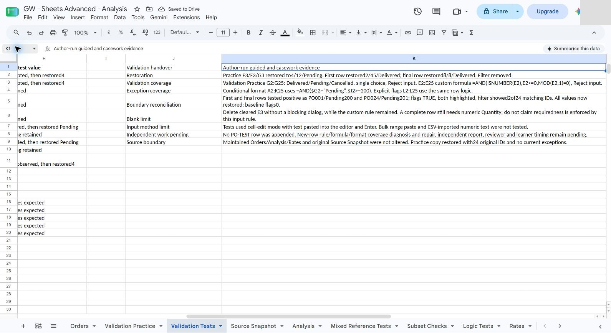

25. Inspect the completed ten input observations. Separate the nine expected entry results from the blank-clearing limit; a no-highlight row is not proof that every field is valid.

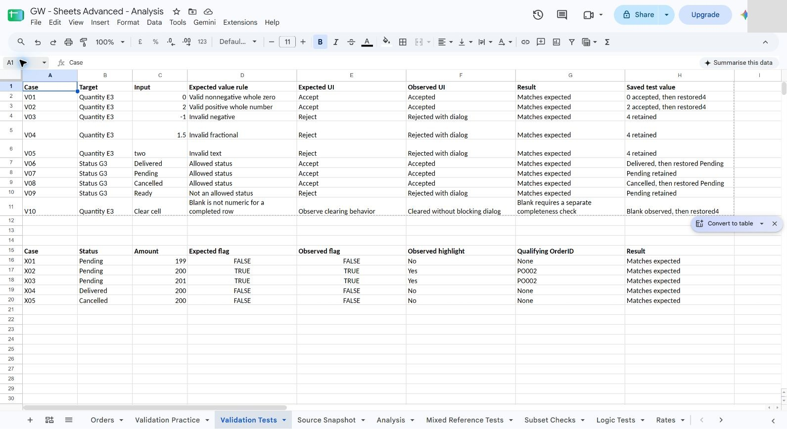

26. Inspect all five exception cases. Expected flags, actual flags and actual highlights agree. Two qualifying entries in the sequential matrix refer to two different temporary amounts on the same PO002, not two simultaneous source records.

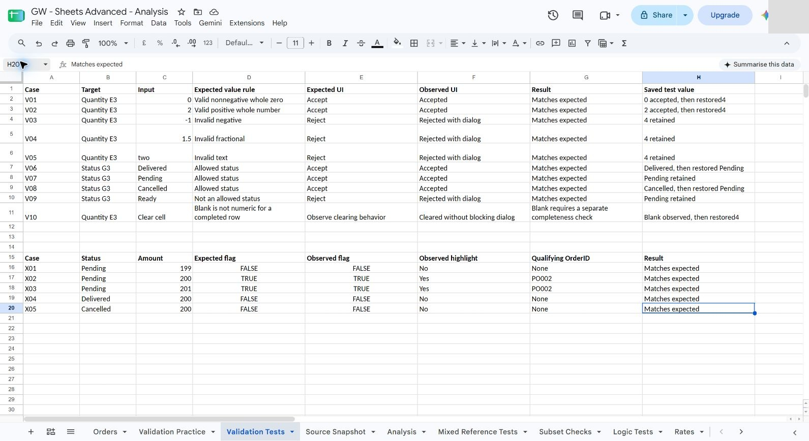

27. Recheck maintained **Orders**. Native verification confirms its values, formulas, formats and original controls remain unchanged, as do maintained Analysis, Rates and Source Snapshot.

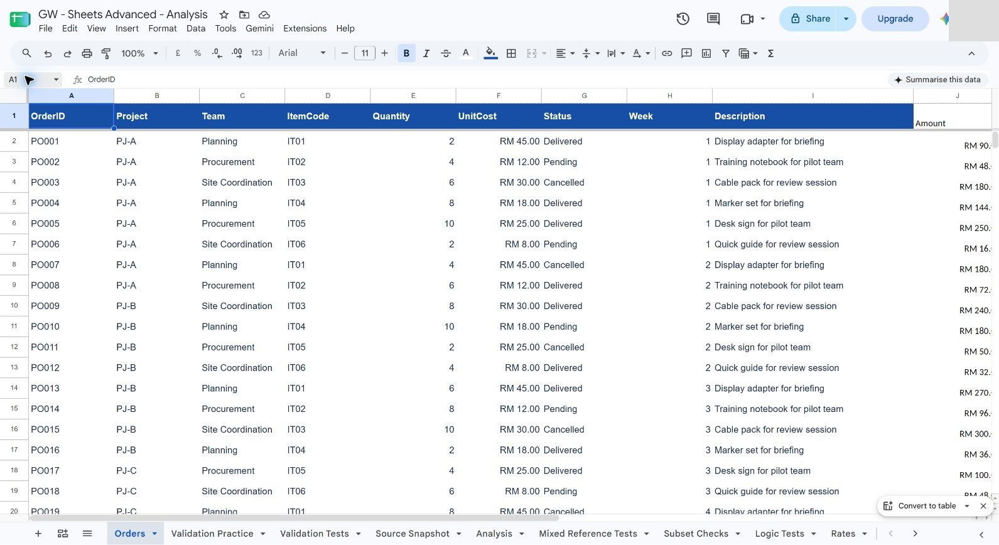

28. Leave **Validation Practice** saved with 24 original records, original Amount/ActiveAmount formulas, the two strict validation rules, the conditional format and 24 FALSE explicit flags. All temporary values and the filter are removed.

> **Validation boundary:** guided 3.1–3.3 and author casework 3.4 are checked in the learner UI. Nine ordinary entry cases match expectations; blank clearing is allowed and explicitly documented as a completeness limit. Five exception cases and first/final-row flag/highlight/filtered-ID agreement are checked. Independent appended-row coverage diagnosis/repair, bulk-paste/CSV numeric-text behavior, reviewer and learner timing remain pending. The 65-minute classroom allocation is unmeasured.

## Independent Challenge

Close the earlier step lists for the first attempt. Use the case input and your own reasoning. If you need help, record the hint and repeat the affected check independently.

1. Append a synthetic pending record only to the test copy and diagnose whether input validation, flag formulas and conditional formatting extend to it.

2. Repair coverage and produce a test report containing at least eight input cases and five exception cases.

3. State whether blanks and pasted values were actually tested and list any behaviour still requiring confirmation in the customer account.

## Evidence to Hand Over

- Eight-case input validation matrix and five-case exception matrix.
- Agreement between explicit flags, highlighted rows and filtered IDs.
- New-row coverage repair and restored source values.

Record the defect or uncertainty you investigated, the evidence used, the repair or reasoned no-change decision, and the final state. Restore temporary changes or keep them in a clearly named scenario copy.

## Troubleshooting

| Symptom | What to check |
|---|---|
| The colour rule flags the wrong row | Check the apply-to start row and the relative row in the custom formula. |
| An input or earlier result is missing | Reopen the input named in Before You Begin; do not substitute private company data |
| A menu or feature is unavailable | Confirm the account and the shared access notes; record the missing step and ask the trainer for its fallback |
| The result differs from the checkpoint | Compare the exact source range, wording and conditions before repeating the action |

## Lesson Summary

Data rules constrain entry; conditional formatting draws attention to defined exceptions.

**Check yourself:** How does a validation rule differ from a coloured warning?

## Zero-Match Check

The supplied baseline has no Pending record with Amount at least 200. Record that result explicitly. Use a separately labelled synthetic case to prove the positive branch; do not edit baseline records just to obtain a highlight.
