# 04 - Combine and Clean Text

In this chapter you will use LEFT, RIGHT, MID and concatenation; check AI categorisation against explicit rules.

> **Prompts and values:** use the [copy-paste page](./prompts.md) for the exact values used below.

**Target allocation:** 60 minutes: 15 explanation/demonstration, 17 guided build and casework, 20 independent challenge, 8 verification and repair. The active portion is 45 minutes by design. These are unmeasured targets awaiting a learner pilot.

**Your result:** Text extraction and labels with checked category mappings.

> **Status:** author reference with32 staged application captures through4.4. Leading-zero text, raw/clean provenance, actual Gemini proposals, explicit category comparisons, NBSP exception and separate identifier syntax/reference checks verified. Maintained source preserved. Independent mixed intake, reviewer reconstruction, native file import and learner timing remain pending.

## What You Will Learn

- Extract parts of identifiers.
- Combine readable labels.
- Check AI categories against a visible mapping.

## Before You Begin

Read the [case input](./prompts.md) and use a separate named casework copy for destructive tests or altered datasets. Keep the baseline unchanged for later chapters. Record source facts, proposed practice and unresolved questions separately.

Use Orders and Rates. The supplied IDs follow PO plus three digits; this is a training convention.

## 4.1 Extract Identifier Parts

1. Create a separate **Text Practice** tab. Copy OrderID, Project and ItemCode values from Orders rows2,3,25 using the card. Put headers OrderID / Project / ItemCode / Prefix / Right suffix / Mid suffix in A1:F1. Leave the original Orders fields unchanged.

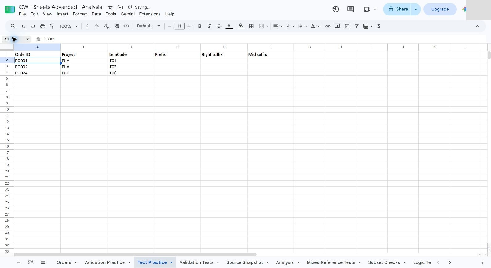

2. In D2 enter **=LEFT(A2,2)**. It returns **PO**.

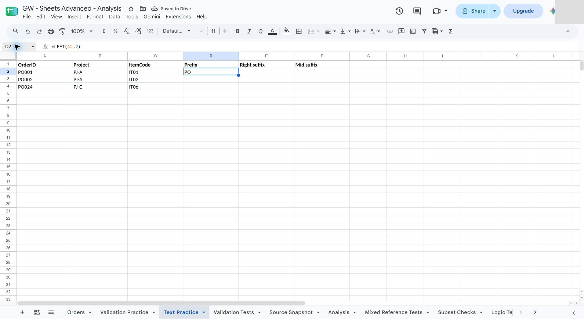

3. In E2 enter **=RIGHT(A2,3)**. The result is the text **001**, retaining its leading zeros.

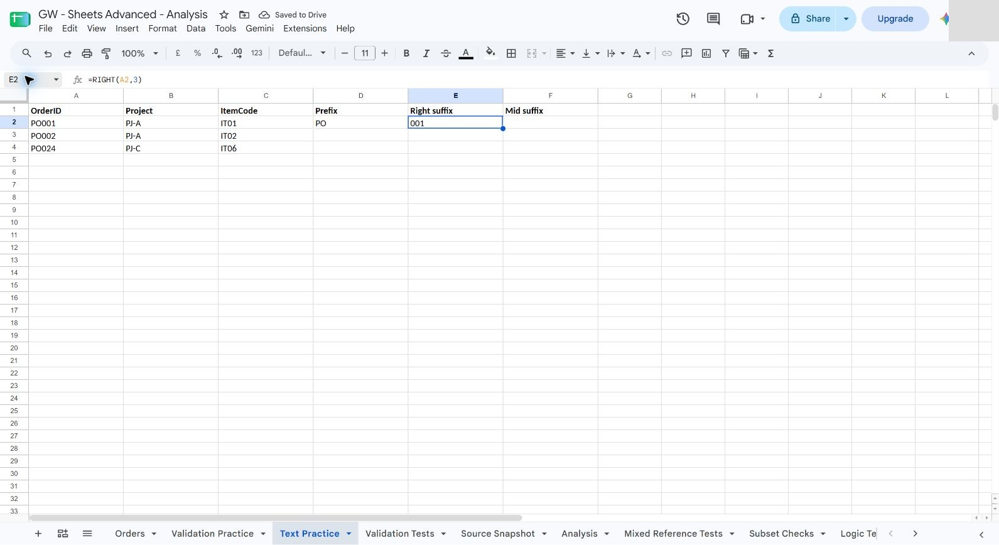

4. In F2 enter **=MID(A2,3,3)**. It also returns **001**. Extracted text is not a newly assigned identifier and does not prove that the entire key is valid.

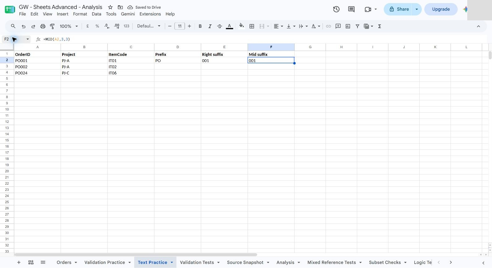

5. Select D2:F4 and **Fill down** (Ctrl+D). The two suffix columns show **001 /002 /024**. Inspect the final sample's own-row formula.

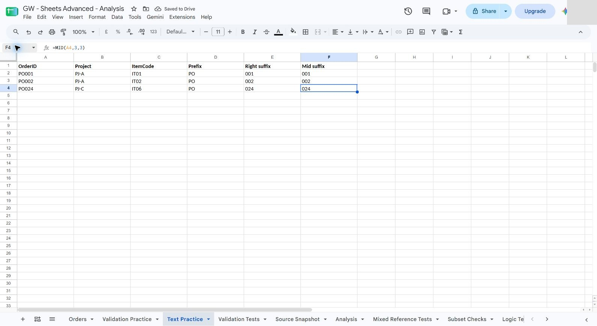

## 4.2 Combine and Clean Text

1. On Text Practice put Raw team / TRIM team / Raw length / Clean length in A7:D7. Enter Planning from DirtyText.csv into A8 with one leading and one trailing ordinary space, as a single-cell value. Use **=TRIM(A8)** in B8, **=LEN(A8)** in C8 and **=LEN(B8)** in D8. Expect Planning and lengths **10 /8**. Do not lose the raw spaces during entry.

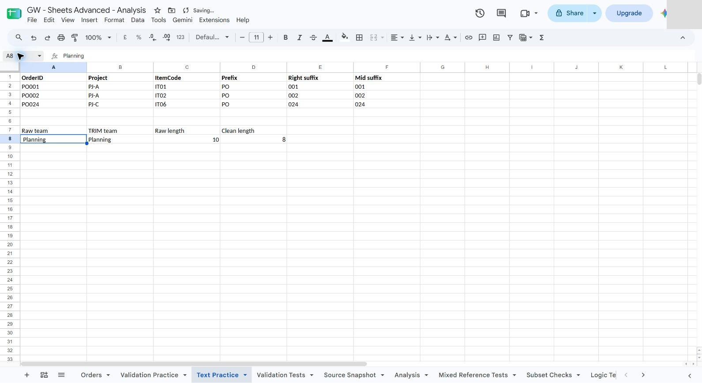

2. Add Display label in G1 and **=A2&" - "&B2** in G2. This combines OrderID and Project on the practice tab; do not add display-only fields to the maintained source for this test.

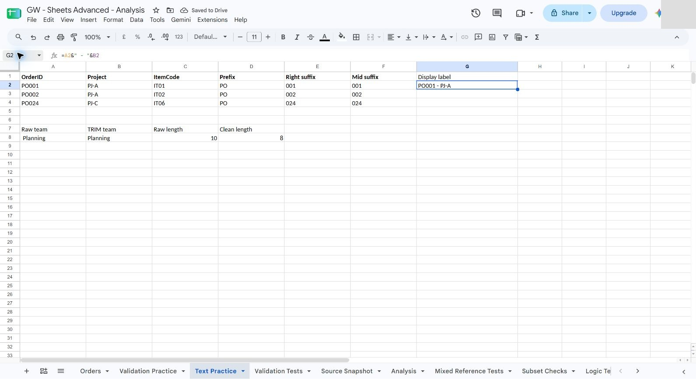

3. Fill G2:G4 down. Verify labels **PO001 - PJ-A**, **PO002 - PJ-A**, **PO024 - PJ-C** while separate OrderID/Project/ItemCode fields remain available. Add the source-row traceability note outside the table.

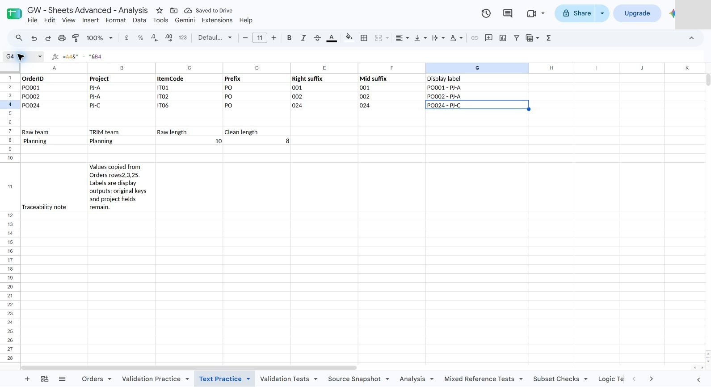

## 4.3 Check Categorisation

1. Inspect **Rates A1:D7**. Its six ItemCodes map to Equipment / Stationery / Equipment / Stationery / Print / Print in code order IT01–IT06. Rates is the reference, not an AI answer.

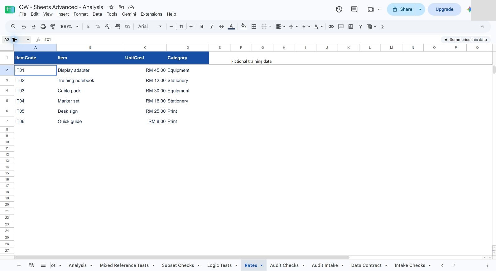

2. If Gemini is available, open **Ask Gemini** and submit the supplied proposal-only prompt. It includes the explicit six-item mapping and requests no spreadsheet edits. Keep the request visible before submitting; do not apply an Insert suggestion to the maintained Rates table.

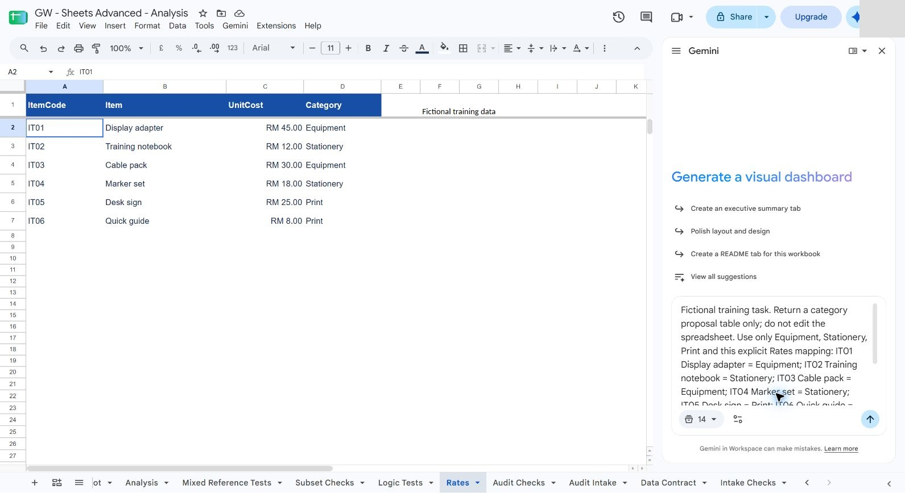

3. Read the actual six proposals. In the captured author run Gemini repeated all six supplied categories and advised review for unmapped or conflicting inputs. Model output can vary. This prompt tests adherence to a provided mapping, not independent classification of unseen items.

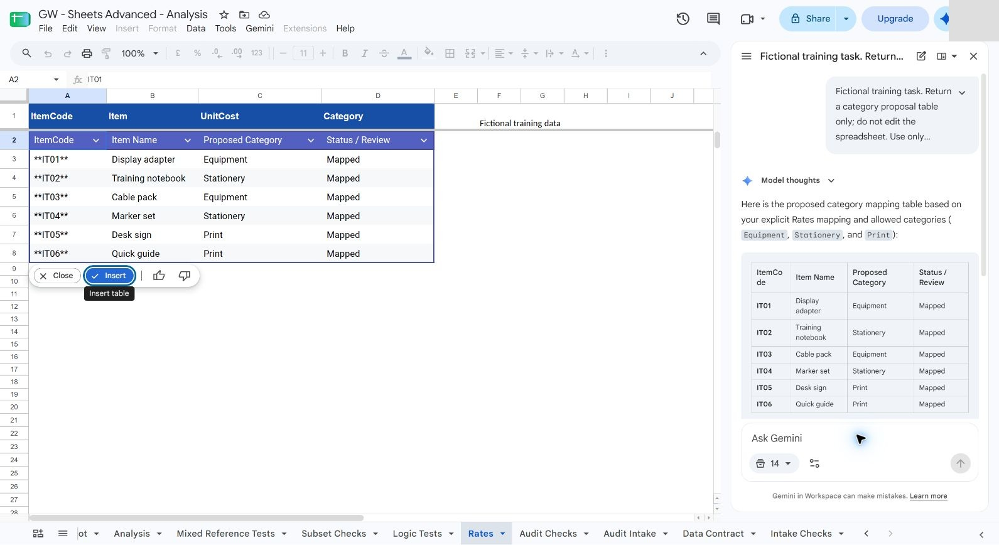

4. Create **Category Checks** with ItemCode / Item / Gemini proposal / Rates category / Matches reference in A1:E1. Record the six actual proposals in A2:C7 before calculating comparisons. If Gemini is unavailable, label the fallback as a manual reference exercise; do not invent an AI response.

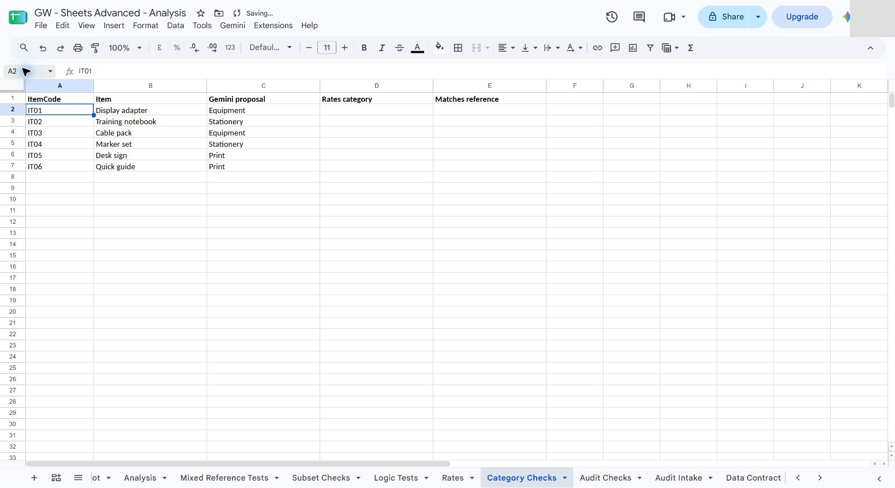

5. In D2 enter **=VLOOKUP(A2,Rates!$A$2:$D$7,4,FALSE)** and E2 **=C2=D2**. Fill D2:E7 down and inspect every row. All six comparisons are TRUE in this author run. Record the limited scope of that evidence.

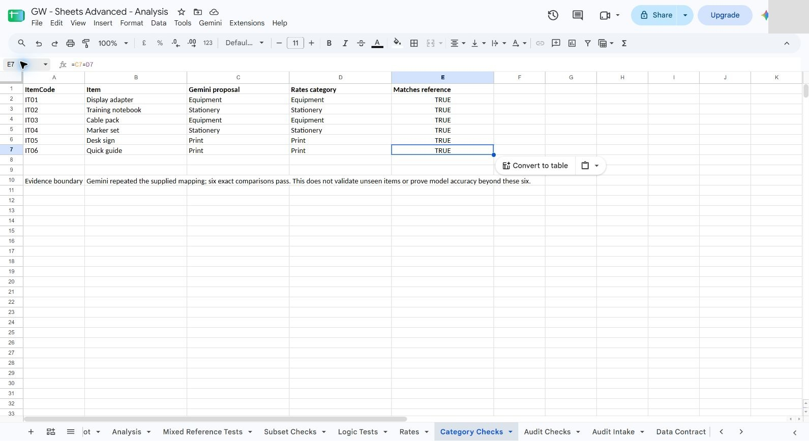

## 4.4 Build a Reversible Text Normalisation Pipeline

1. Create **Text Audit**. Retain exact DirtyText.csv raw columns TaskID / Raw team / Raw status in A1:C4. In this author run, TSV block paste removed surrounding spaces; single-cell entry restored B2 to Planning with one leading and one trailing ordinary space, and B4 to Site Coordination with one trailing ordinary space, before adding formulas. The verified route is clipboard entry, not a completed native CSV file-import test. Use the raw-length checks to detect entry loss.

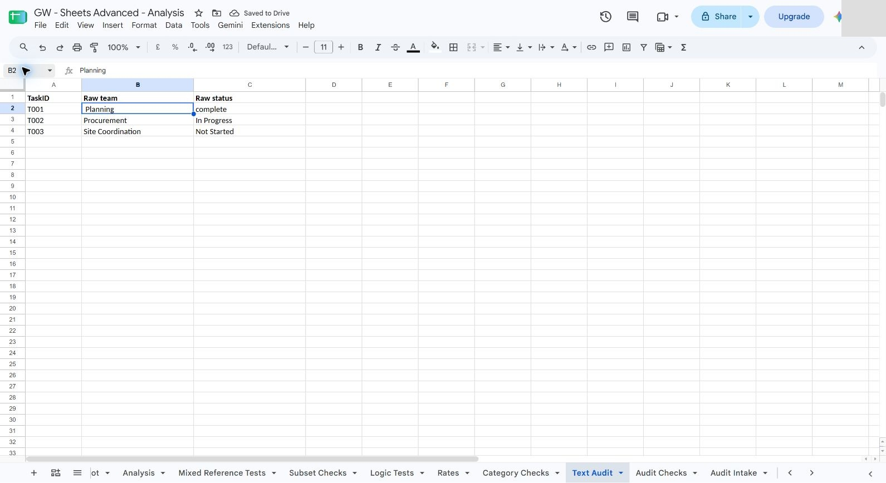

2. Add D:H headers Normalised team / Normalised status / Decision / Raw team length / Clean team length. In D2 use **=TRIM(B2)**. E2 uses the exact explicit-case formula on the card for **Complete /In Progress /Not Started**. These are task statuses from DirtyText.csv, separate from the Orders status vocabulary; do not infer a mapping to Delivered/Pending/Cancelled.

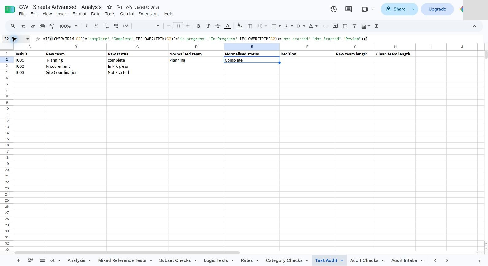

3. F2 accepts only the three known team names and a recognised task status. G2/H2 compare LEN(B2)/LEN(D2). Fill D2:H4 down. All three sample rows are Accepted; raw/clean team lengths are **10/8**, **11/11**, **18/17**. Add the source-entry and vocabulary notes outside the data.

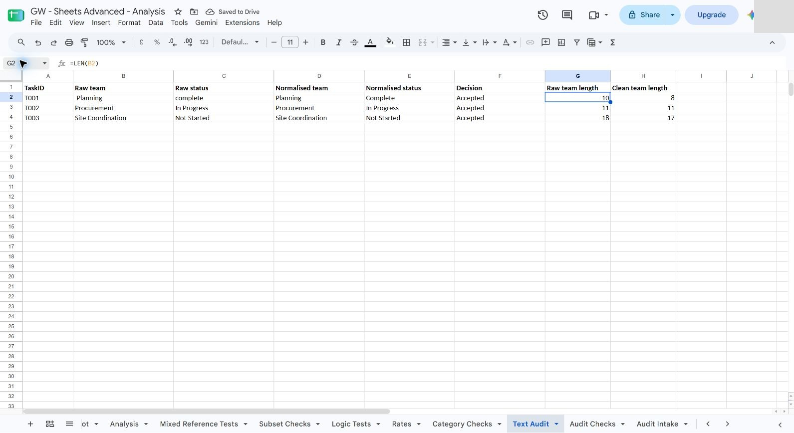

4. In A12:H15 create the whitespace test card. Record expected post-TRIM lengths **8 /17 /10** before actual formulas. Enter raw values individually to retain their characters. The third case is a literal non-breaking-space character before and after Planning; it is labelled as synthetic author casework, not an additional CSV row.

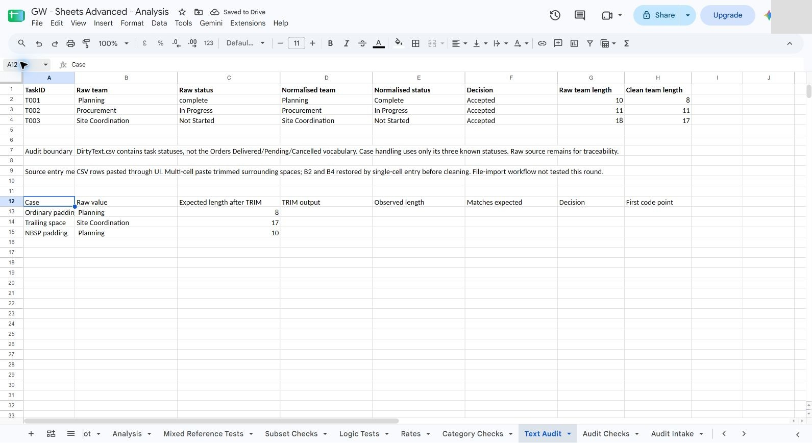

5. Use D13 **=TRIM(B13)**, E13 **=LEN(D13)**, F13 **=E13=C13**, H13 **=UNICODE(LEFT(B13,1))**; fill the formula columns through row15. Ordinary spaces are removed. The NBSP result remains length **10**, with first code point **160**. Keep that exception for review rather than silently treating TRIM as universal whitespace cleaning.

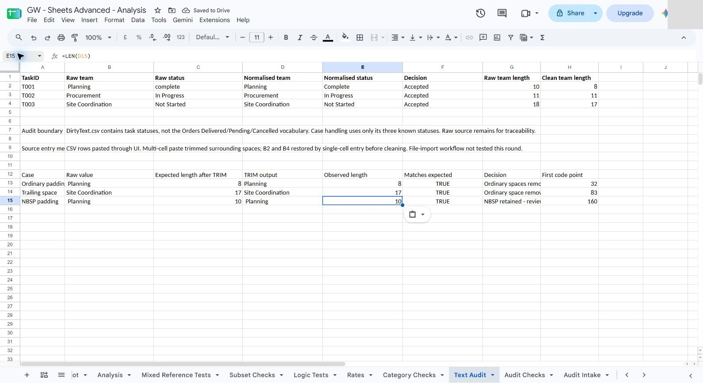

6. Wrap A12:H15 to make every case and decision readable. All three expected-length comparisons pass, including the expected retained-NBSP behavior; this does not make the unusual space an accepted team value.

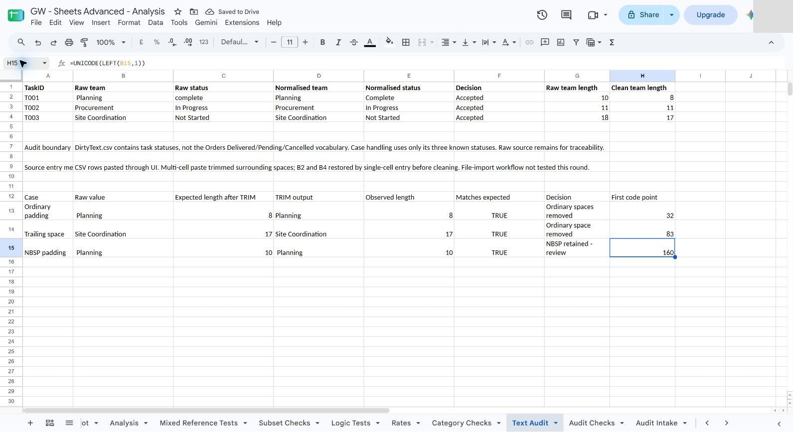

7. Create **Identifier Tests** using the eight-row card, with expected outcomes recorded before formulas. Keep B5 truly blank and enter B9 as IT03 with one leading and one trailing ordinary space separately. Order keys require PO plus three digits; item keys require IT plus two digits and a mapping entry.

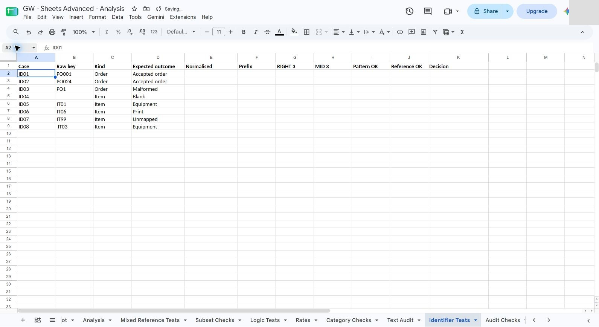

8. Normalise B with TRIM in E; apply LEFT(E2,2), RIGHT(E2,3) and MID(E2,3,3) in F:H and fill through row9. **PO1** still yields substrings despite being malformed. For IT01, RIGHT3 returns **T01**, while MID returns **01**; the three-digit order-suffix convention must not be applied blindly to item keys.

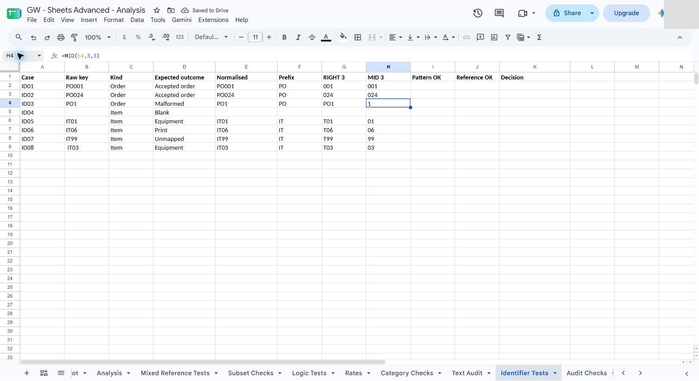

9. Use the card's complete-pattern REGEXMATCH formula in I2 and fill down. PO1 and the blank fail. IT99 passes its pattern, which proves syntax only.

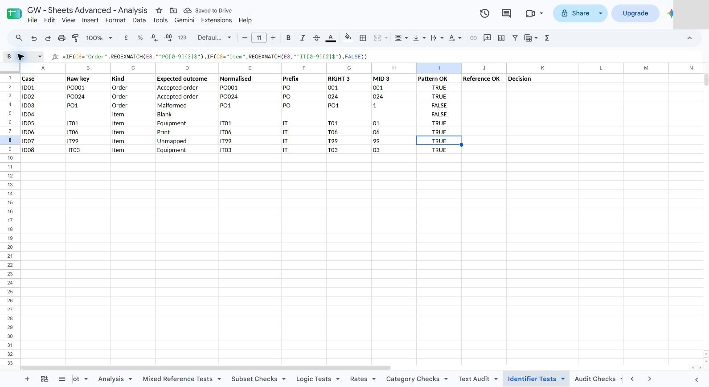

10. In J2 check membership against bounded Orders A2:A25 or Rates A2:A7 only after the pattern passes. Fill down. **IT99 is TRUE for pattern and FALSE for reference membership**. A plausible-looking code is not a valid category mapping.

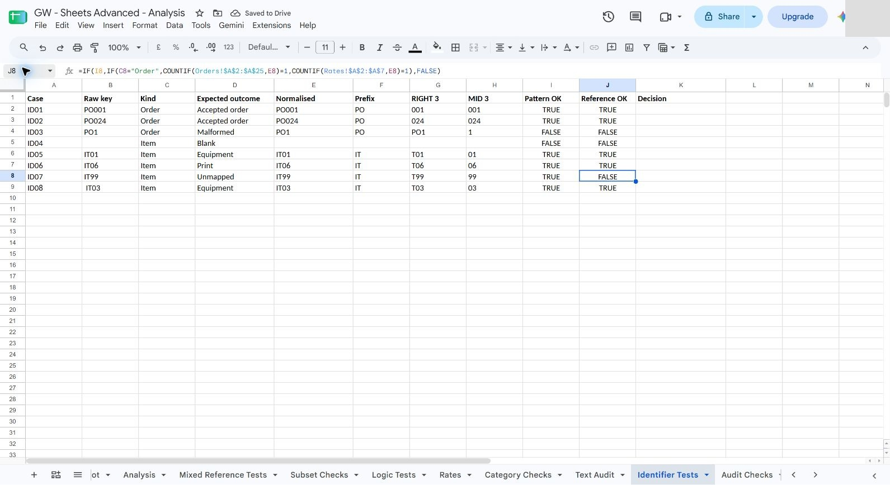

11. Use K2's decision formula and fill down. It keeps **Blank /Malformed /Unmapped** separate, accepts the two existing order keys and returns exact Rates categories for the three mapped item cases. Raw values and extraction columns remain available for audit.

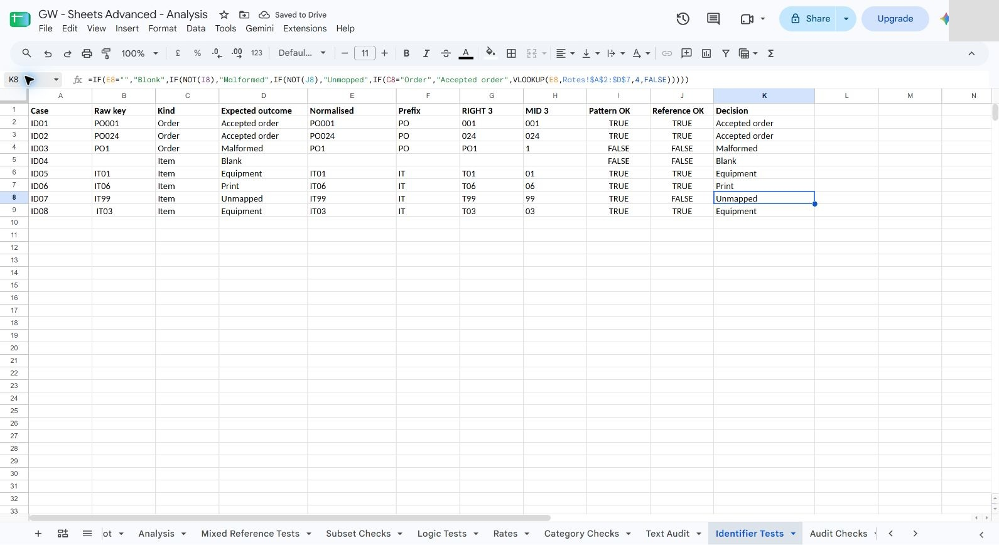

12. In L2 compare **=K2=D2** and fill through row9. All eight decisions match their recorded expected outcomes. These are guided author cases, not the independent mixed-intake challenge.

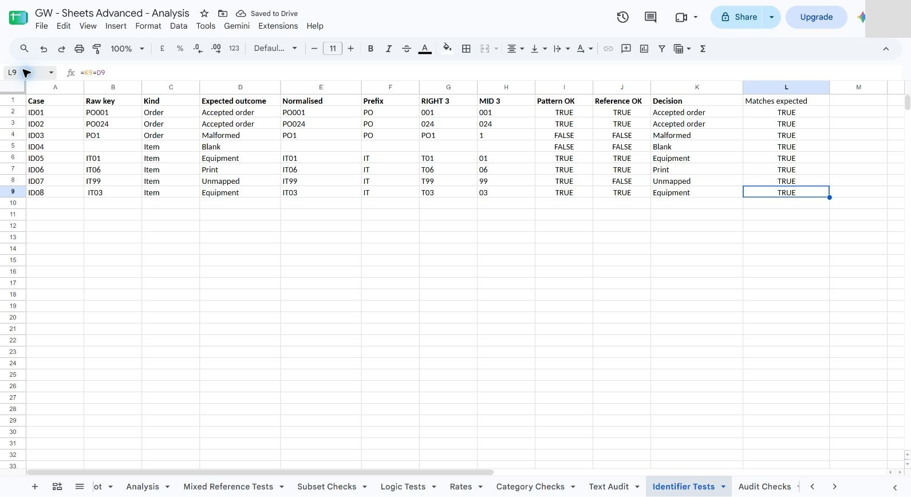

13. Add A12:D21 controls: **8 cases /8 matches /2 accepted orders /3 mapped item cases /1 malformed /1 blank /1 unmapped /6 pattern passes /5 reference matches**. Compare each actual to its expected count. All nine differences are zero; inspect contributing rows as well as totals.

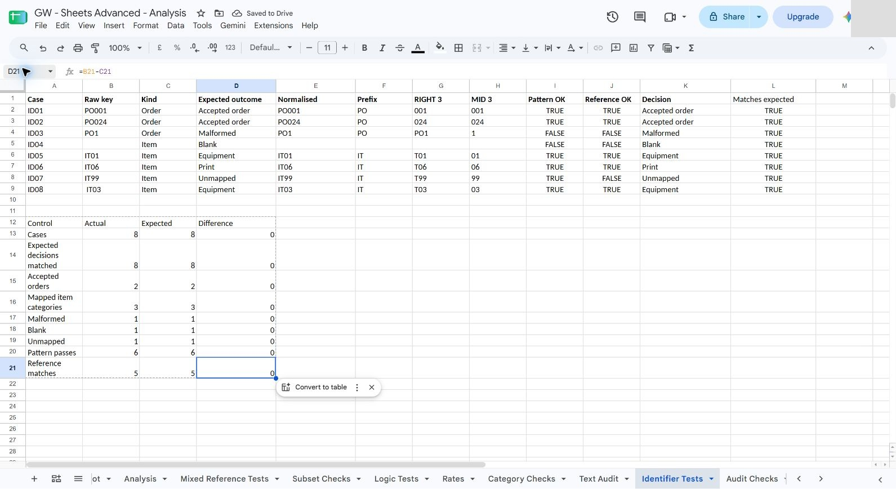

14. Create **Pipeline Notes** with the traceability card. Explain raw → normalised → validated → category/display output. TRIM and case changes require raw input for reconstruction; keeping raw alongside output preserves traceability but does not make TRIM itself invertible. The display label never replaces the separate keys.

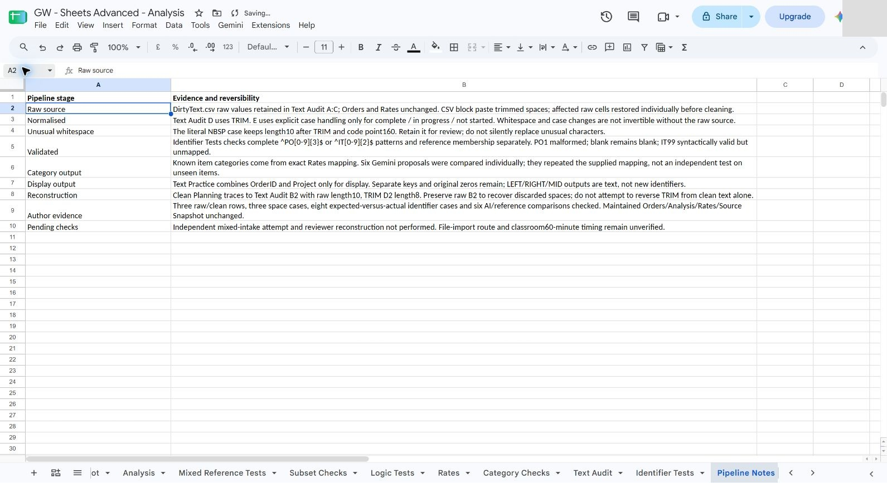

15. Inspect the final Text Audit with wrapped headings and decisions. Check raw spaces remain and the NBSP example still records review rather than a silently repaired source value.

16. Inspect the final Identifier Tests table and zero-difference controls. Blank is not an item category; unmapped is not zero; extracted text is not membership proof.

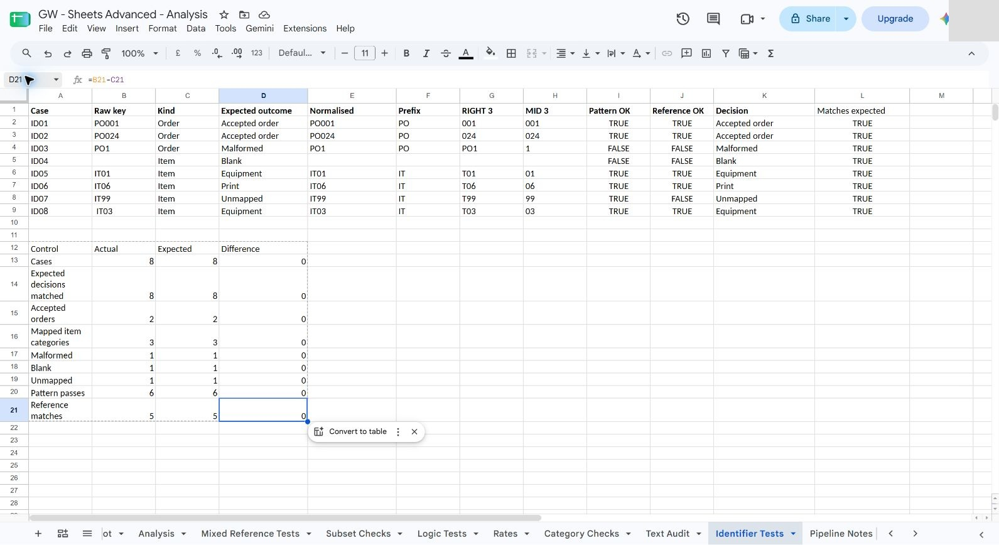

17. Reinspect maintained Orders. This lab adds practice/audit tabs only; Orders, Analysis, Rates and Source Snapshot retain their original values and formats.

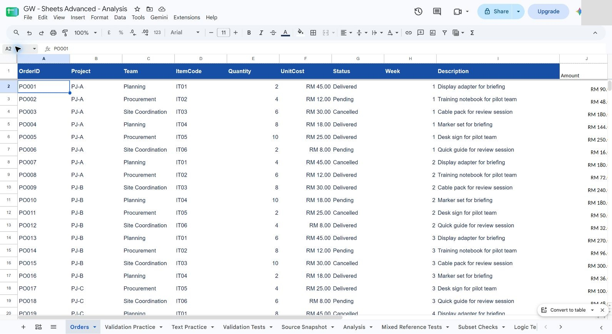

18. Reinspect Text Practice's leading-zero suffixes and separate label inputs.

19. Leave the six Category Checks comparisons and saved Pipeline Notes ready for handover. Retain the actual Gemini response as author evidence without claiming reliability on untested items.

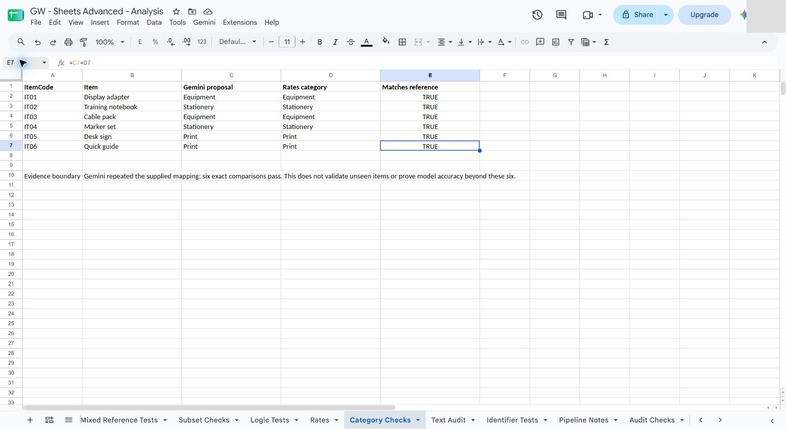

> **Validation boundary:** guided4.1–4.3 and author casework4.4 were executed through learner UI with bounded read-only native-cell proof. Independent mixed-intake work, human reviewer reconstruction, native CSV file import and planned60-minute learner timing remain unverified. Clipboard whitespace loss was detected and repaired before cleaning; the raw three-row CSV now matches exactly.

## Independent Challenge

Close the earlier step lists for the first attempt. Use the case input and your own reasoning. If you need help, record the hint and repeat the affected check independently.

1. Independently process the mixed identifier intake into accepted keys and an exception list. Do not rely on string length alone for validity.

2. Demonstrate that IT99 is syntactically plausible but absent from the supplied mapping, and that a blank key is not a category.

3. Have a reviewer reconstruct one clean value’s origin from your raw and transformation columns. Repair any missing trace.

## Evidence to Hand Over

- Raw/clean text audit and identifier extraction tests.
- Separate syntax and mapping validation with explicit exceptions.
- Traceable category/display outputs and an independent mixed-intake result.

Record the defect or uncertainty you investigated, the evidence used, the repair or reasoned no-change decision, and the final state. Restore temporary changes or keep them in a clearly named scenario copy.

## Troubleshooting

| Symptom | What to check |
|---|---|
| Text extraction succeeds on a bad identifier | Validate the complete pattern and reference mapping separately from substring extraction. |
| An input or earlier result is missing | Reopen the input named in Before You Begin; do not substitute private company data |
| A menu or feature is unavailable | Confirm the account and the shared access notes; record the missing step and ask the trainer for its fallback |
| The result differs from the checkpoint | Compare the exact source range, wording and conditions before repeating the action |

## Lesson Summary

Text functions reshape fields while source keys and mappings preserve meaning.

**Check yourself:** Why should an ID suffix such as 001 remain text?
