# 05 - Match Records and Handle Errors

In this chapter you will compare exact-match VLOOKUP, HLOOKUP and INDEX/MATCH; distinguish a missing key from bad input.

> **Prompts and values:** use the [copy-paste page](./prompts.md) for the exact values used below.

**Target allocation:** 80 minutes: 15 explanation/demonstration, 37 guided build and casework, 20 independent challenge, 8 verification and repair. The active portion is 65 minutes by design. These are unmeasured targets awaiting a learner pilot.

**Your result:** Exact-match lookup examples and an explicit missing-item result.

> **Status:** author reference with36 staged application captures through5.4.24 order rates reconcile, nine key cases match expectations, duplicate first-match and omitted-mode failures are observed, and distinct formula defects are captured and repaired. Maintained source preserved. Independent zero-rate/output/column-move work, reviewer and learner timing remain pending.

## What You Will Learn

- Use exact-match lookups.
- Compare vertical and horizontal lookup layouts.
- Distinguish missing keys from broken formulas.

## Before You Begin

Read the [case input](./prompts.md) and use a separate named casework copy for destructive tests or altered datasets. Keep the baseline unchanged for later chapters. Record source facts, proposed practice and unresolved questions separately.

Use Orders and Rates. Rates A2:D7 has unique item codes and numeric unit costs.

## 5.1 Look Up a Rate

1. Duplicate **Orders** as **Lookup Practice**. Verify the separate tab before editing. Keep maintained Orders, Rates, Analysis and Source Snapshot unchanged. The training-data label remains in M1, so new practice calculations start at **N1**.

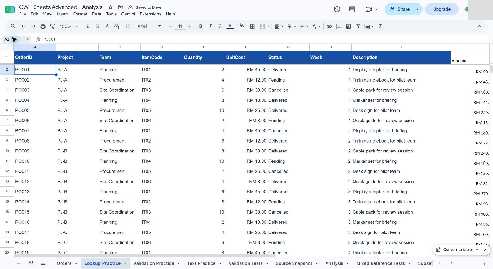

2. Label N1 **LookupRate** and enter **=VLOOKUP(D2,Rates!$A$2:$D$7,3,FALSE)** in N2. IT01 returns45. FALSE requests an exact key match; the key must be in the first column of A:D and the requested return column is3.

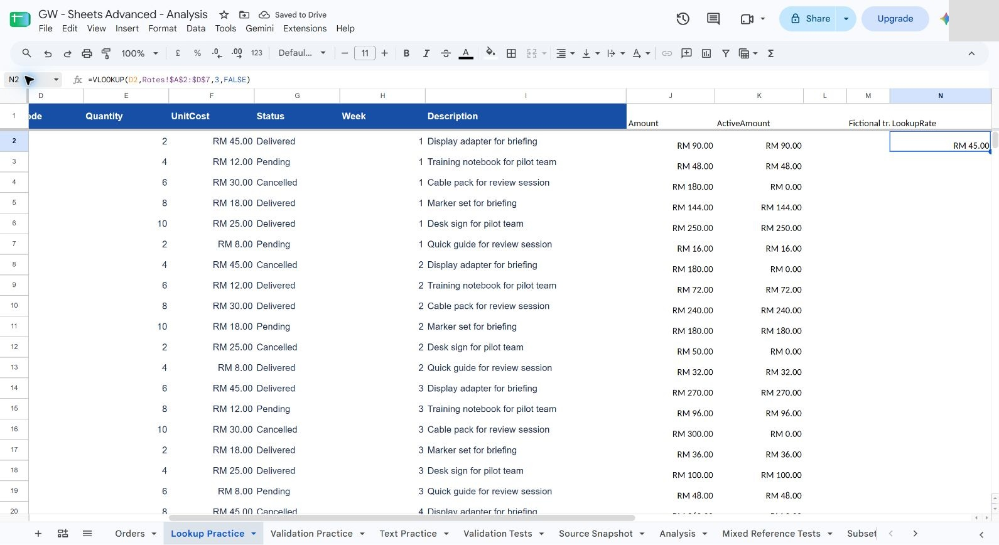

3. Fill **N2:N25** down. Inspect the final IT06 rate8 as well as the first result; a correct first row alone is not the complete check.

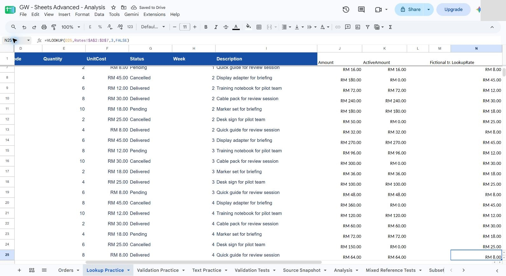

4. Label O1 **IndexMatchRate**. In O2 enter **=INDEX(Rates!$C$2:$C$7,MATCH(D2,Rates!$A$2:$A$7,0))** and fill O2:O25 down. MATCH0 is exact; the key and return ranges must be aligned.

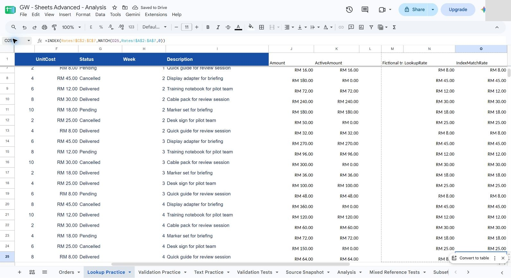

5. Label P1/Q1 **VLookup difference /Index difference**. Enter **=N2-F2 / =O2-F2** in P2/Q2 and fill through row25. All24 pairs are zero against the original UnitCost values. Widen only the new practice columns as needed.

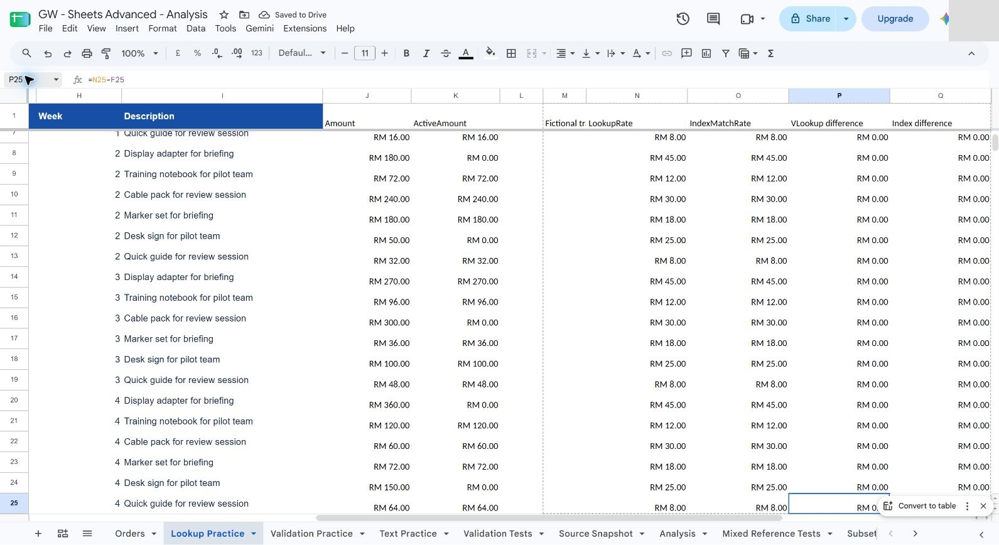

## 5.2 Practise a Horizontal Lookup

1. Create a blank **Horizontal Lookup** tab. The original guide's Analysis F/G cells now contain Lab2 work, so use the same address pattern on this isolated tab. Enter IT01–IT06 in **G1:L1** and rates **45 /12 /30 /18 /25 /8** in G2:L2. Put Test key / Horizontal rate in F3:G3 and **IT03** in F4.

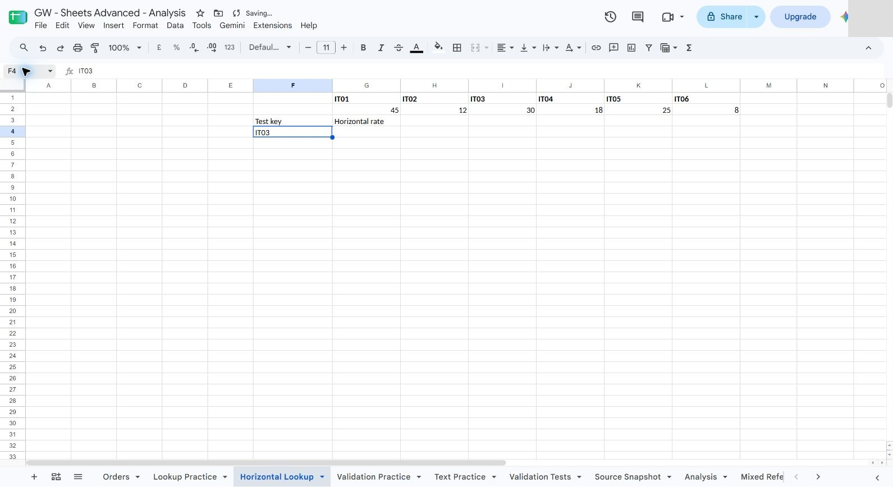

2. In G4 enter **=HLOOKUP(F4,$G$1:$L$2,2,FALSE)**. The exact lookup searches the first row and returns from the second row: **30**.

3. Change only F4 to **IT06**. Expect **8**.

4. Restore F4 to **IT03** and confirm30. Preserve this restored key for the later three-method comparison.

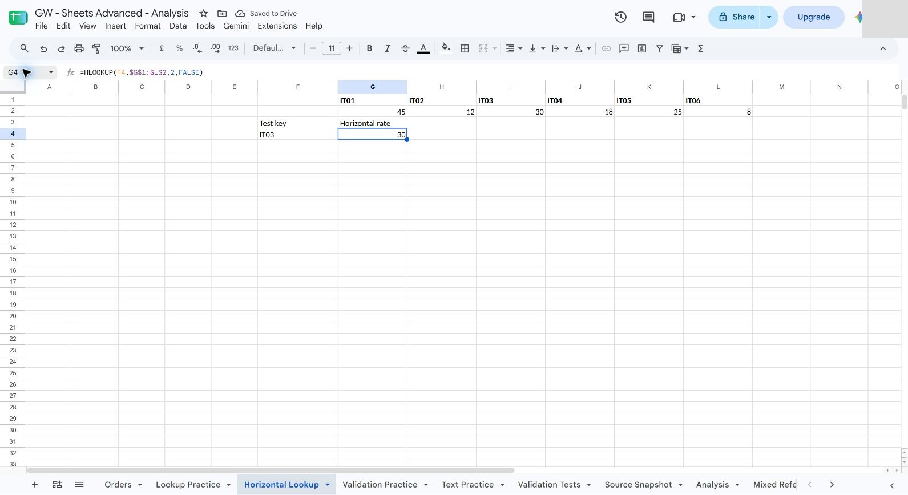

## 5.3 Handle an Expected Missing Key

1. Create **Lookup Errors** with the case/meaning/action card. In B2 enter **=VLOOKUP("IT99",Rates!$A$2:$D$7,3,FALSE)**. Observe the actual **#N/A** missing-match result; it is not an evidenced zero rate.

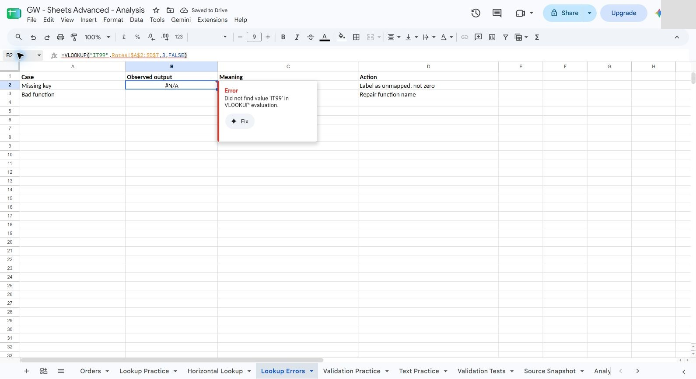

2. Change B2 to **=IFNA(VLOOKUP("IT99",Rates!$A$2:$D$7,3,FALSE),"Unmapped item")**. This labels the intended missing-match case.

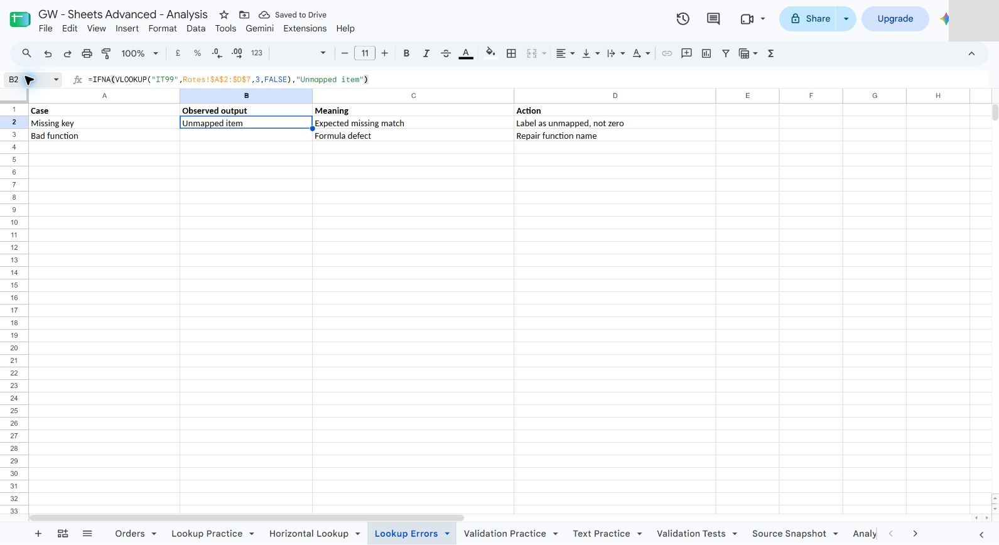

3. In B3 deliberately enter **=VLOKUP("IT03",Rates!$A$2:$D$7,3,FALSE)**. The native result is **#NAME?**, with the message **Unknown function: 'VLOKUP'.** Capture the actual defect before repair.

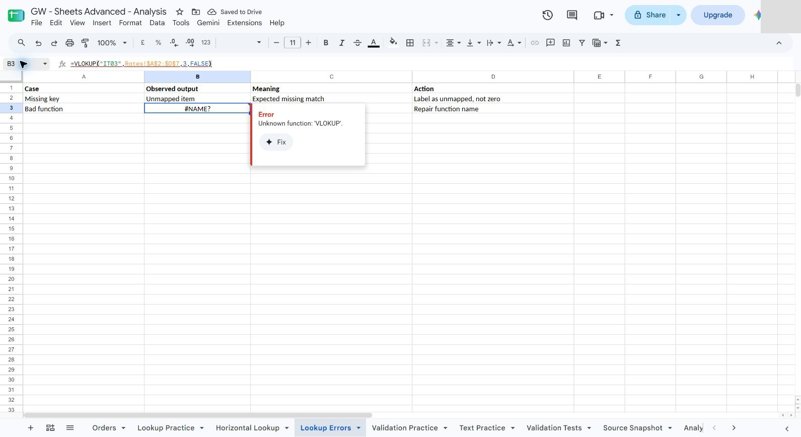

4. Correct VLOKUP to **VLOOKUP**. B3 now returns30. Repairing a formula defect is different from labelling a genuinely absent key.

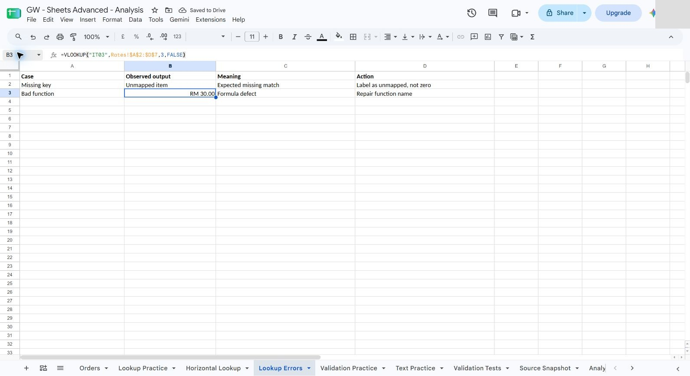

## 5.4 Challenge Exact Lookups With Missing and Duplicate Keys

1. Create **Lookup Tests** from the nine-row expectation card. It includes all six known keys, IT99, a truly blank key and IT03 with one leading/trailing ordinary space. Preserve raw input B beside normalised C. Enter the padded B10 separately if block paste strips its spaces. Keep expected D values before populating actual formula columns.

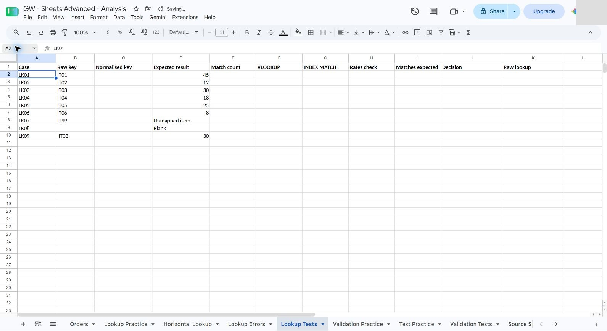

2. In C2 use **=TRIM(B2)** and fill down. In K2 use the raw-key exact lookup card and fill through row10. The raw padded key returns **Unmapped item**, while its normalised key is IT03. Keep that distinction visible instead of overwriting raw B10.

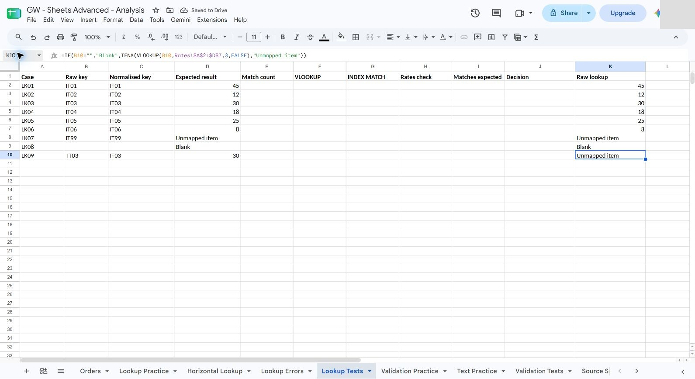

3. Fill E2:G10 using the card: count matches only for nonblank keys, then use exact VLOOKUP and INDEX/MATCH on normalised C. Handle an explicit blank separately from a missing mapping. The six known keys and cleaned IT03 return their numeric rates; IT99 remains Unmapped item.

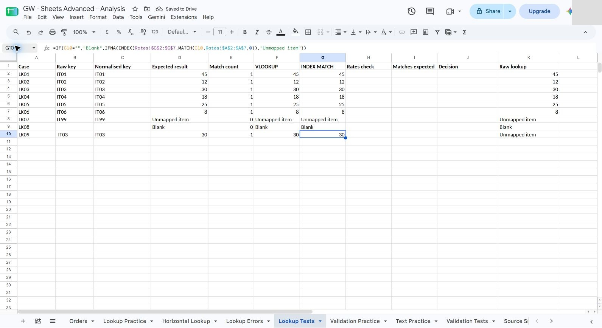

4. H checks the bounded Rates values only after the match count is one. I compares the expected result with both lookup methods and H; J records Accepted / Unmapped item / Blank. Fill all three columns through row10. All nine expected-versus-actual checks are TRUE. This is guided author casework, not an independent learner attempt.

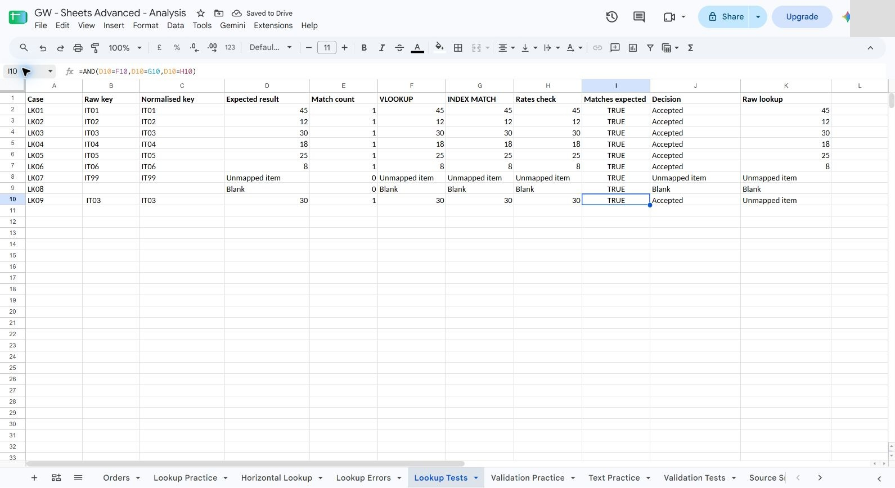

5. Add A13:D19 controls: **9 cases /9 matches /0 disagreements /7 accepted cases /1 unmapped /1 blank**. All six differences are zero. The seven accepted cases include the repeated, space-normalised IT03 input; they are not seven unique source keys.

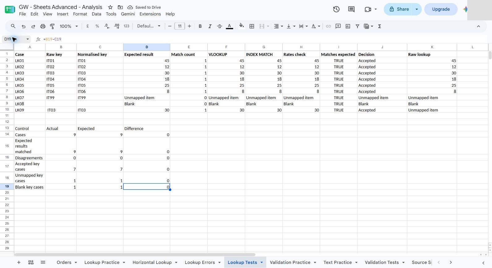

6. Duplicate baseline **Rates** as **Rates Duplicate Test**. Confirm the separate name and six original rows before introducing a conflict. Do not edit maintained Rates.

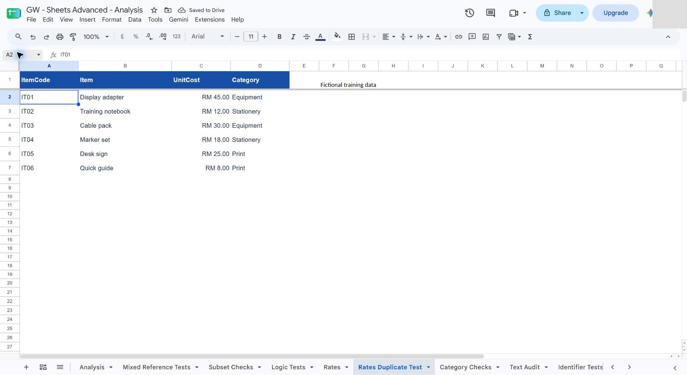

7. Append **IT03 /Cable pack duplicate /99 /Equipment** to A8:D8 on the copy only. The original IT03 row still has30.

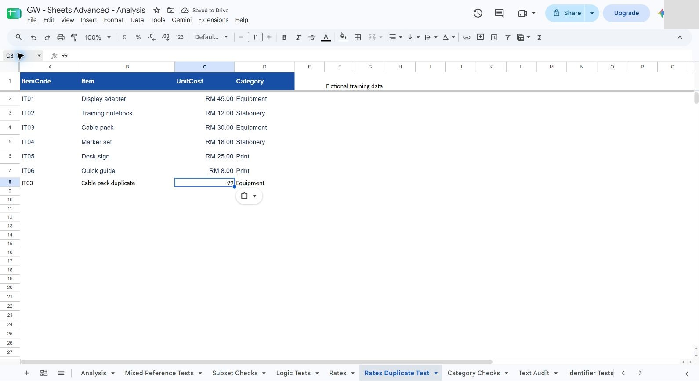

8. Add the duplicate diagnostic card at A11:F12. Exact VLOOKUP and INDEX/MATCH both return the first IT03 rate **30**, but COUNTIF over A2:A8 returns **2**. The decision is **Review duplicate**. Returning a value does not establish uniqueness; do not accept either30 or99 as an authoritative repair. Keep the labelled experimental copy.

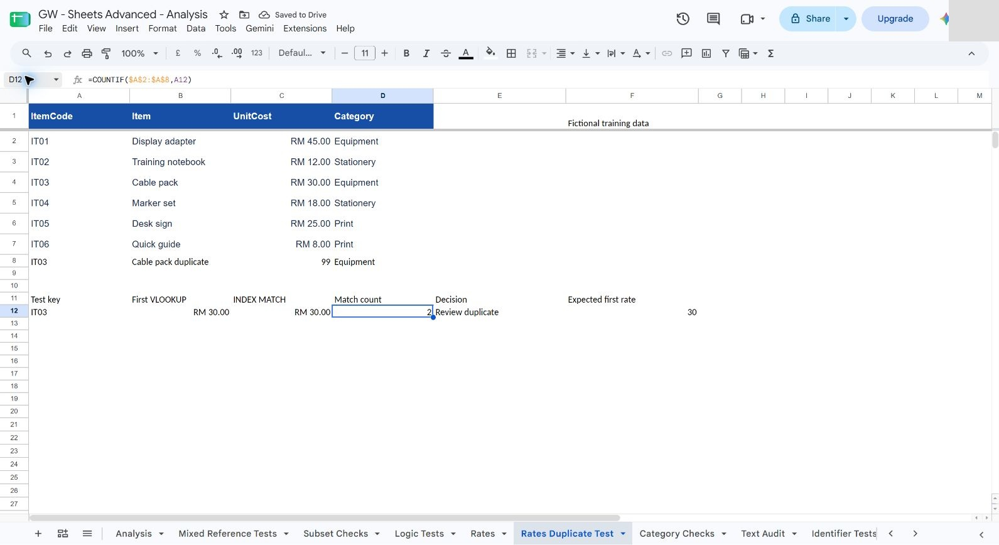

9. Make a second copy of baseline Rates named **Rates Reordered**. Select **A2:D7 only**, then **Data > Sort range > Sort range by column A (Z to A)**. Keep the header and outside-table data label separate. The keys become IT06 down to IT01, with the corresponding rows moving together.

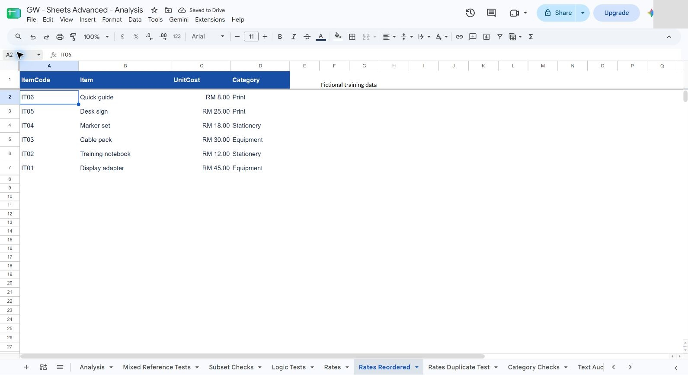

10. At A10:F11 compare IT03 using **=VLOOKUP(A11,$A$2:$D$7,3,FALSE)** with **=VLOOKUP(A11,$A$2:$D$7,3)**. In this actual descending-copy test, exact mode returns **30** while omitted mode returns the plausible but wrong **45**. The omitted mode assumes approximate matching on ascending keys; its precondition is violated here. Record this observation without generalising that every unsorted table will return45. Keep the experiment separate from the authoritative mapping.

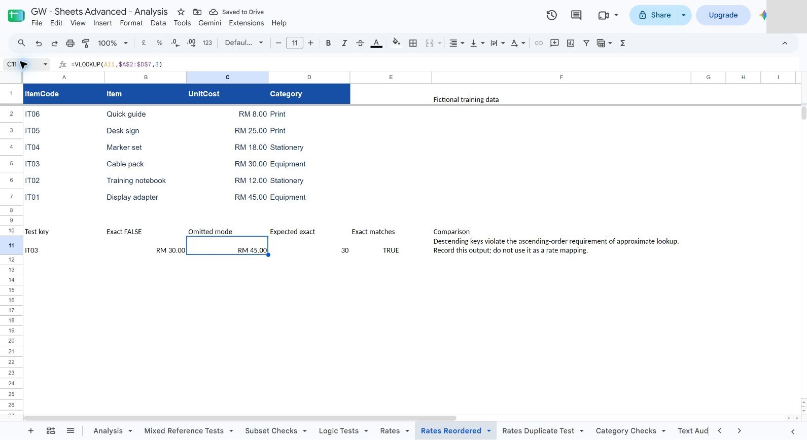

11. Return to Lookup Errors. Create the A6:E9 wrapper comparison. First run the raw missing-key formula in B7, **=IFNA(B7,"Unmapped item")** in C7 and **=IFERROR(B7,"Fallback")** in D7. NA becomes an explicit unmapped result under IFNA; a generic fallback is less specific.

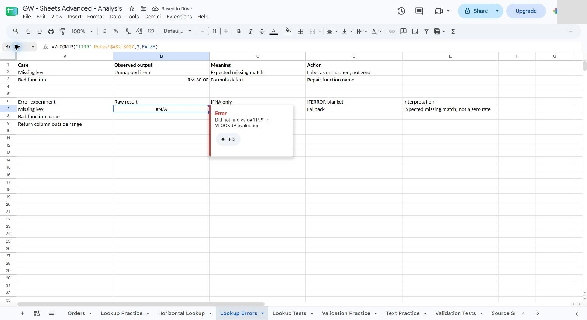

12. In B8 enter the misspelled VLOKUP case. Apply the same IFNA/IFERROR wrappers in C8/D8. The native **#NAME?** persists through IFNA but IFERROR hides it as Fallback. Retain actual error evidence before correcting it.

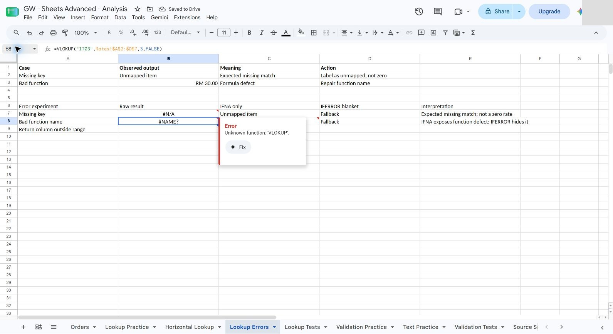

13. In B9 enter **=VLOOKUP("IT03",Rates!$A$2:$B$7,3,FALSE)**. Return column3 lies outside the two-column range. The native **#REF!** message is **VLOOKUP evaluates to an out of bounds range.** C9's IFNA preserves that defect; D9's IFERROR hides it. This is a range-shape defect, not a missing item.

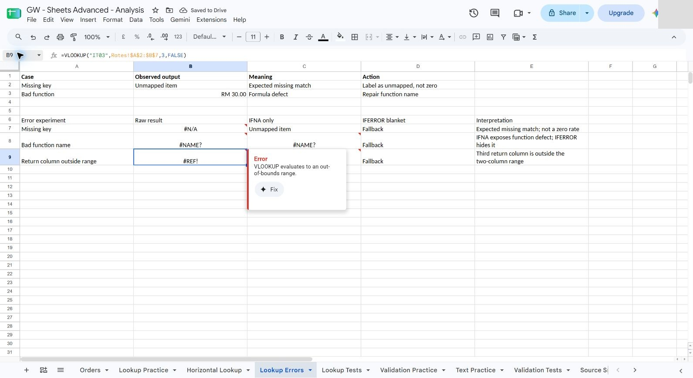

14. Repair B8's function spelling and expand B9's source range back to **Rates A2:D7**. B8:C9 and their broad wrappers now return30. Add the observed-error/repair notes. Retain B7's raw **#N/A** only as a clearly labelled expected missing-key demonstration; do not claim all error cells were removed.

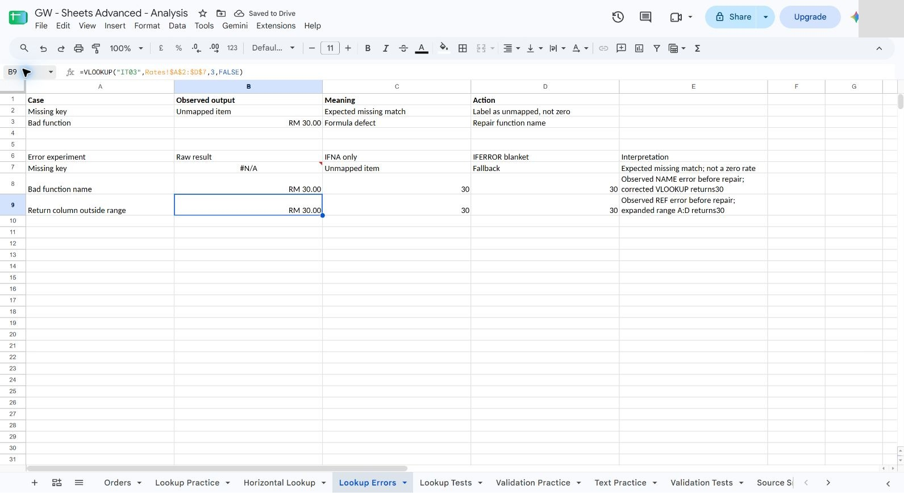

15. On Horizontal Lookup, add Vertical rate / INDEX MATCH / All equal in H3:J3. With F4 restored to IT03, use the card's exact vertical and INDEX/MATCH formulas in H4/I4 and **=AND(G4=H4,H4=I4)** in J4. All three results are30 and the comparison is TRUE.

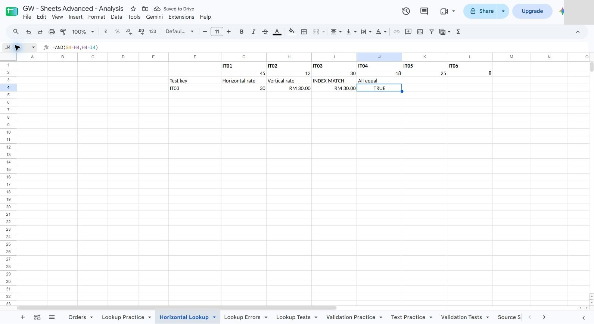

16. Create **Lookup Notes**. Record key/return range alignment, VLOOKUP first-column and column-index assumptions, HLOOKUP row orientation, explicit exact modes, raw-key handling, uniqueness diagnostic, experiment results and the final repair state. Exact matching also does not, by itself, prove a matched return value is populated; these supplied baseline rates were checked as numeric.

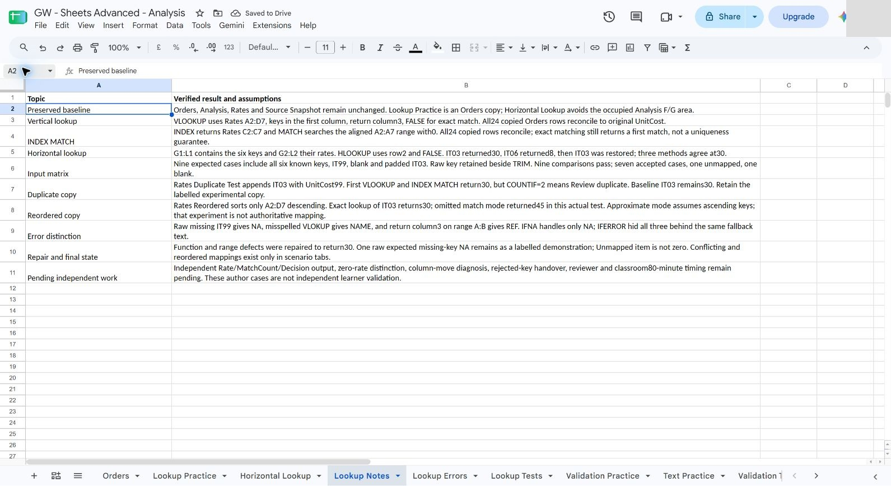

17. Inspect the final nine-key matrix and controls. Unmapped item and Blank remain distinct from a numeric rate. The independent zero-rate/output/column-move challenge is still pending.

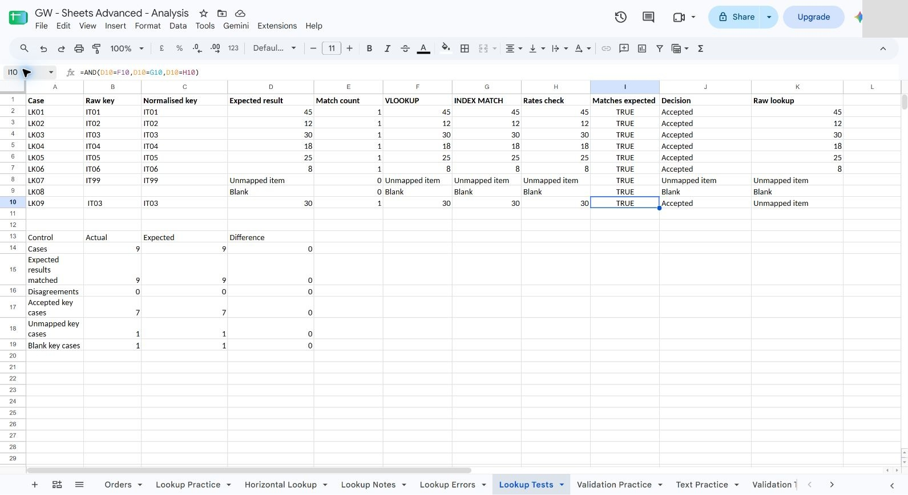

18. Recheck the final copied order's two zero rate differences, then the first order. All24 rows reconcile to the maintained source.

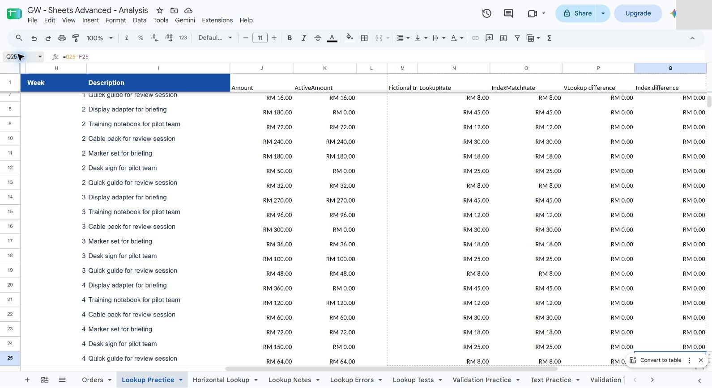

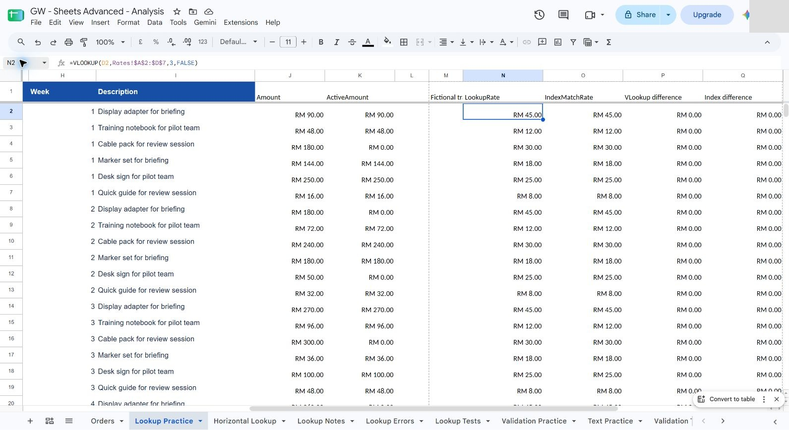

19. Inspect maintained Rates: exactly the original six unique items, with IT03 still30. No duplicate or reordering experiment changed this mapping.

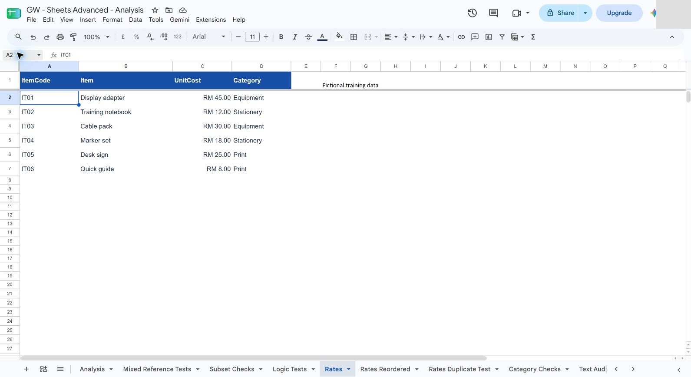

20. Inspect maintained Analysis F2. Its Lab2 band test remains200/High and the earlier grids are intact; the horizontal exercise used a separate tab.

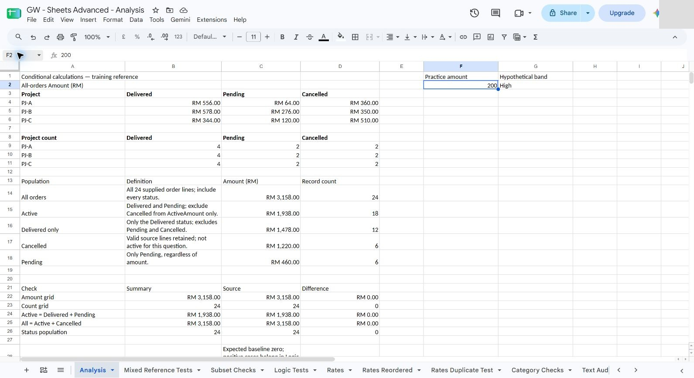

21. Leave Lookup Errors with repaired function/range cases and the one labelled raw missing case. The broad wrapper did not repair the defects; the underlying formulas were corrected.

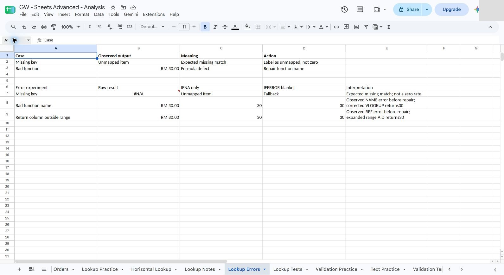

22. Leave saved Lookup Notes ready for handover. Retain the labelled duplicate/reordered scenario tabs as teaching evidence, with their limitations stated.

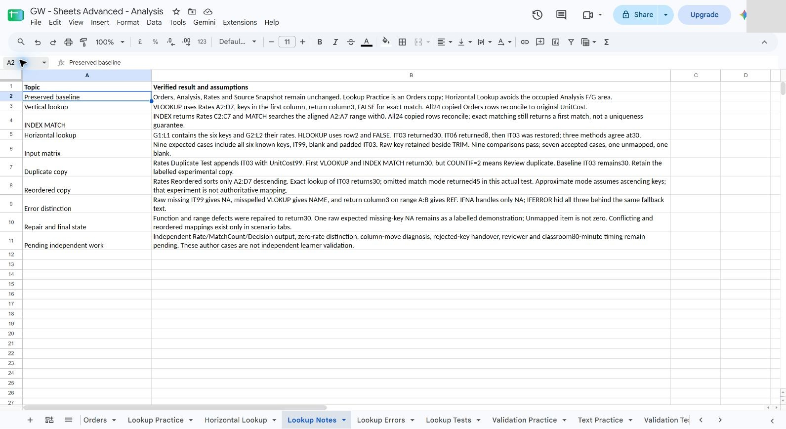

> **Validation boundary:** guided5.1–5.3 and author casework5.4 were executed through learner UI and bounded read-only native-cell evidence. Independent output, zero-rate distinction, column-move diagnosis, rejected-key handover, reviewer and planned80-minute learner timing remain unverified. Baseline Orders/Analysis/Rates/Source Snapshot remain unchanged.

## Independent Challenge

Close the earlier step lists for the first attempt. Use the case input and your own reasoning. If you need help, record the hint and repeat the affected check independently.

1. Design an independent lookup output with Rate, MatchCount and Decision for the mixed intake. A zero rate, unknown key and duplicate key must remain distinguishable.

2. Move a column only on a disposable mapping copy and inspect which lookup formula needs repair. Explain why the original column-index assumption failed.

3. Hand over a rejected-key list and source-mapping check, leaving baseline Rates unchanged.

## Evidence to Hand Over

- Known/missing/blank/padded-key test matrix with exact-method reconciliation.
- Duplicate-key and column-move diagnosis on labelled copies.
- Independent lookup result that never silently turns unknown rates into zero.

Record the defect or uncertainty you investigated, the evidence used, the repair or reasoned no-change decision, and the final state. Restore temporary changes or keep them in a clearly named scenario copy.

## Troubleshooting

| Symptom | What to check |
|---|---|
| A lookup returns a plausible but wrong rate | Inspect exact-match mode, key uniqueness, whitespace and the lookup column position. |
| An input or earlier result is missing | Reopen the input named in Before You Begin; do not substitute private company data |
| A menu or feature is unavailable | Confirm the account and the shared access notes; record the missing step and ask the trainer for its fallback |
| The result differs from the checkpoint | Compare the exact source range, wording and conditions before repeating the action |

## Lesson Summary

Reliable lookups depend on clean keys, explicit match behaviour and deliberate error handling.

**Check yourself:** Does an exact-match lookup prove that a matched source value is populated?
