# 07 - Summarise with Pivot Tables

In this chapter you will group project costs and status; inspect filters, calculated fields and source coverage.

> **Prompts and values:** use the [copy-paste page](./prompts.md) for the exact values used below.

**Target allocation:** 75 minutes: 15 explanation/demonstration, 32 guided build and casework, 20 independent challenge, 8 verification and repair. The active portion is 60 minutes by design. These are unmeasured targets awaiting a learner pilot.

**Your result:** A native pivot with checked filters and a calculated-field demonstration or recorded limitation.

> **Status:** author reference with 34 staged application captures through 7.4. Native amount/count pivots, Delivered filter, Custom average field, actual drilldown and PO025 coverage tests are verified. Maintained baseline unchanged; new record retained only on a separate scenario copy. Independent challenge, reviewer and learner timing remain pending.

## What You Will Learn

- Create a native pivot summary.
- Choose filters and aggregation deliberately.
- Check a calculated field against row calculations.

## Before You Begin

Read the [case input](./prompts.md) and use a separate named casework copy for destructive tests or altered datasets. Keep the baseline unchanged for later chapters. Record source facts, proposed practice and unresolved questions separately.

Use Orders A1:K25 after calculating Amount in J and ActiveAmount in K. A recovery route is to repeat Advanced Chapter 2 on the supplied workbook.

## 7.1 Build the Pivot

1. On the maintained Advanced workbook, select **Orders A1:K25**. Choose **Insert > Pivot table**. Verify the data range and select **New sheet** before Create. This includes 24 records plus their header and the existing Amount/ActiveAmount columns; it excludes the summary cells below them.

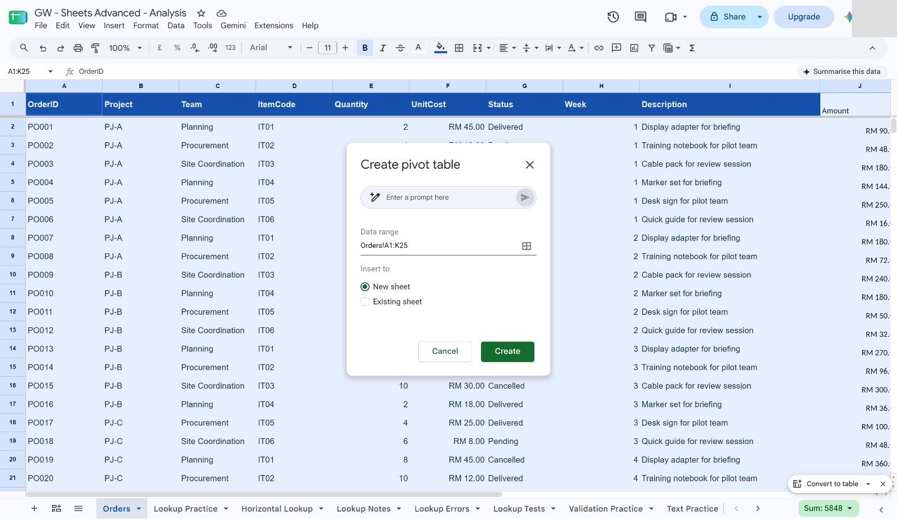

2. Rename the new **Pivot Table 1** tab **Pivot Review**. Keep the empty native pivot and editor visible before adding fields. Do not type a summary grid in place of a pivot.

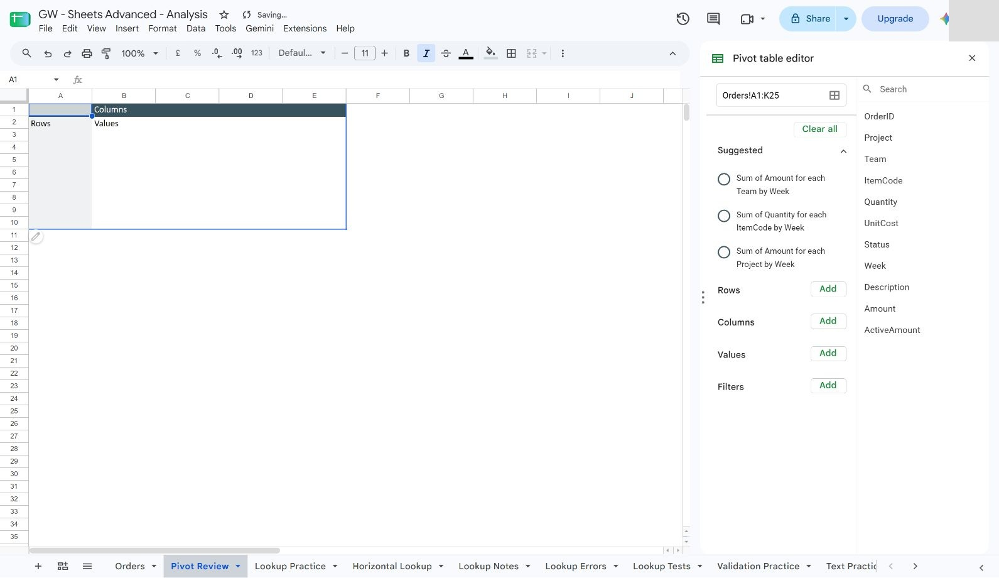

3. In the editor, use **Rows > Add > Project**.

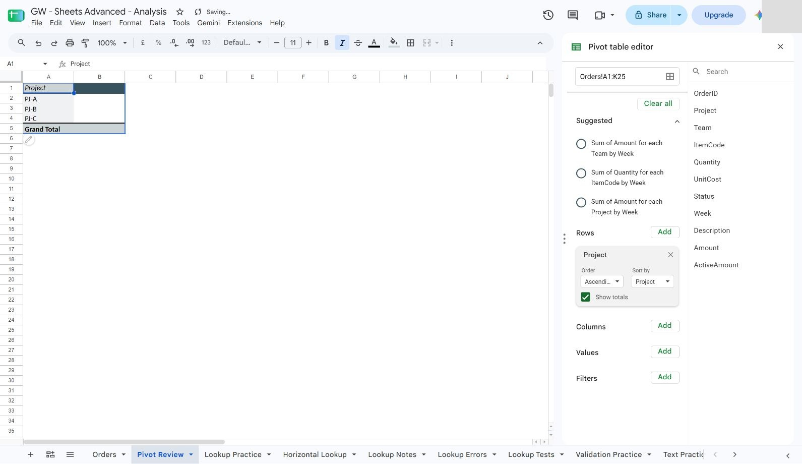

4. Use **Columns > Add > Status**. Keep Show totals enabled for both groups.

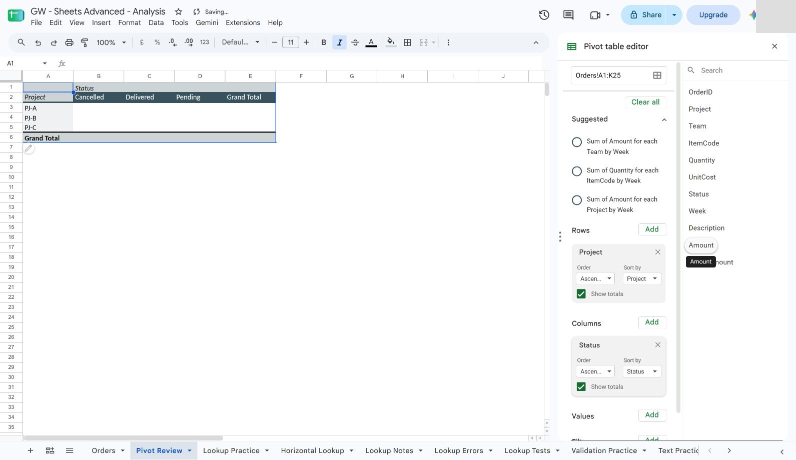

5. Use **Values > Add > Amount** and inspect **Summarise by SUM**. The native grand total is **3,158**: Cancelled1,220, Delivered1,478 and Pending460. PJ-A totals980, PJ-B1,204 and PJ-C974. Cancelled records remain part of the all-orders population.

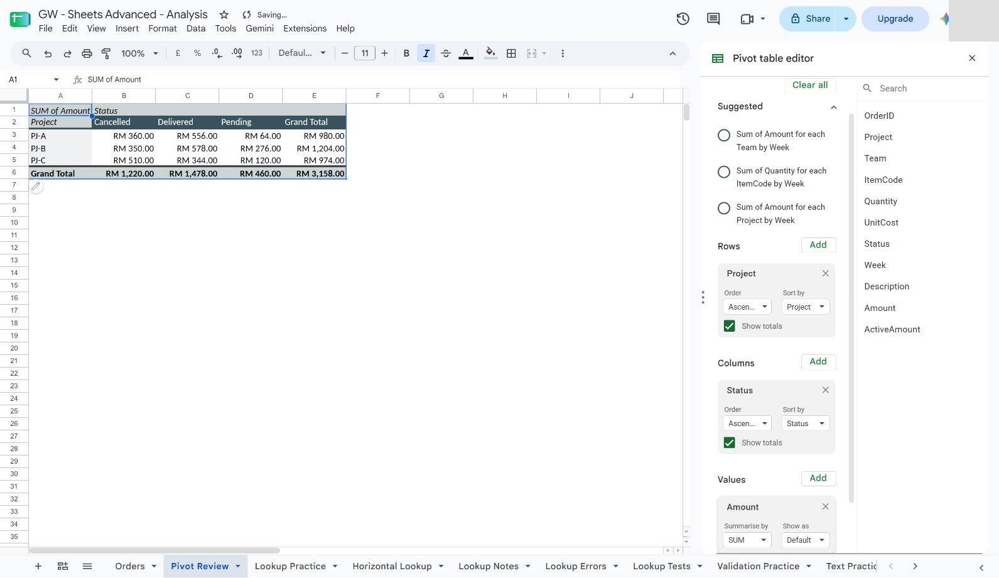

## 7.2 Filter and Compare

1. Use **Filters > Add > Status**. Open Showing all items, choose Clear, select **Delivered** only and confirm OK. The grand total becomes **1,478**; project amounts are **556 /578 /344**. This is a pivot filter, not deletion from Orders.

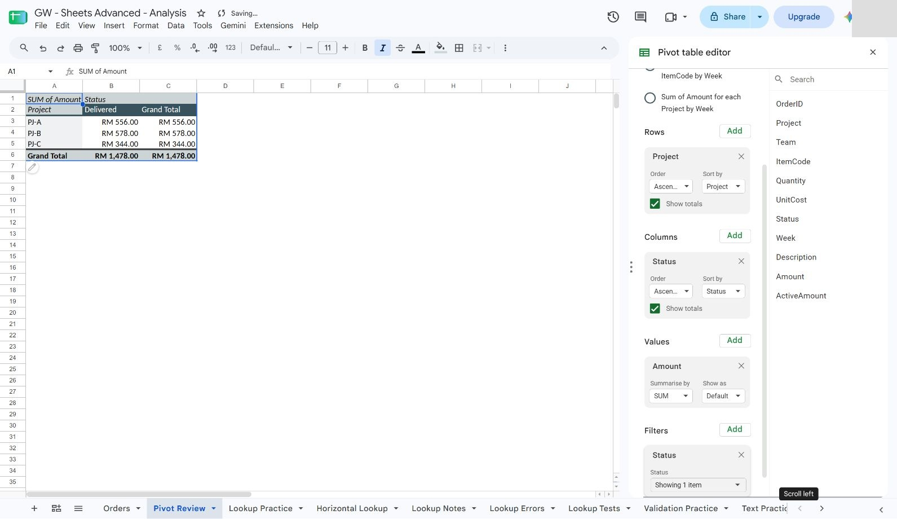

2. On **Analysis A3:D6**, inspect the earlier SUMIFS grid. Its Delivered column gives the same three project amounts. Note that this grid orders its status columns differently from the pivot; compare labels rather than column positions.

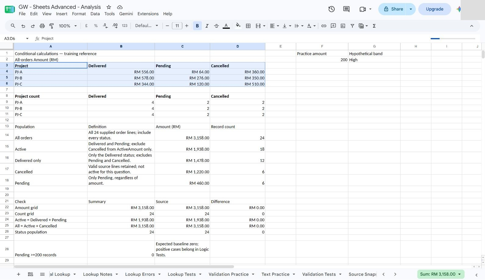

3. Return to Pivot Review and remove only the **Filter Status** card with its close/remove button. Do not remove the Status column grouping. All statuses and the **3,158** grand total return.

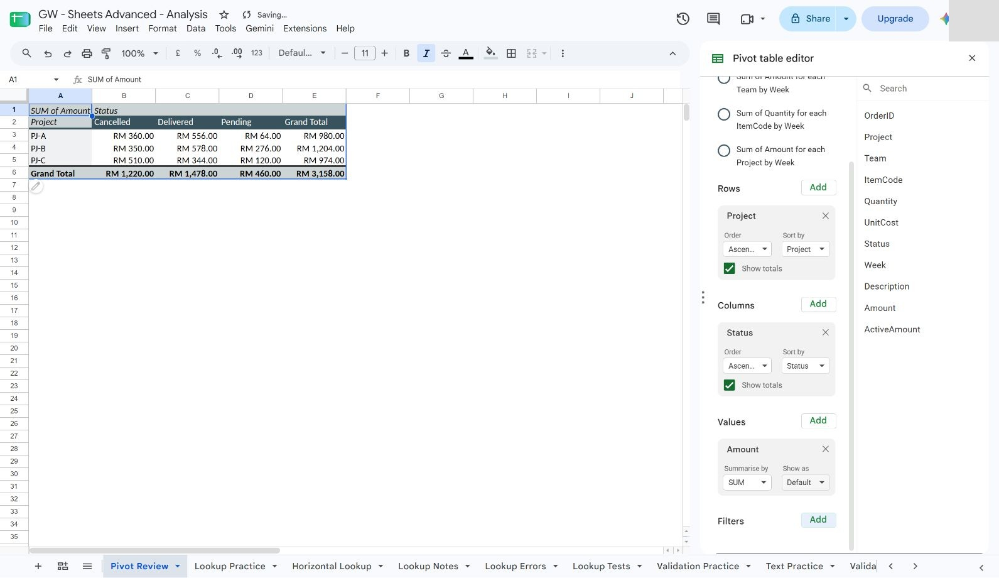

## 7.3 Inspect a Calculated Field

1. Select Orders A1:K25 and create another native pivot on a new sheet named **Pivot Calculations**. Add Project as rows and Amount as values, SUM. Keep this authoritative row-amount sum alongside the demonstration.

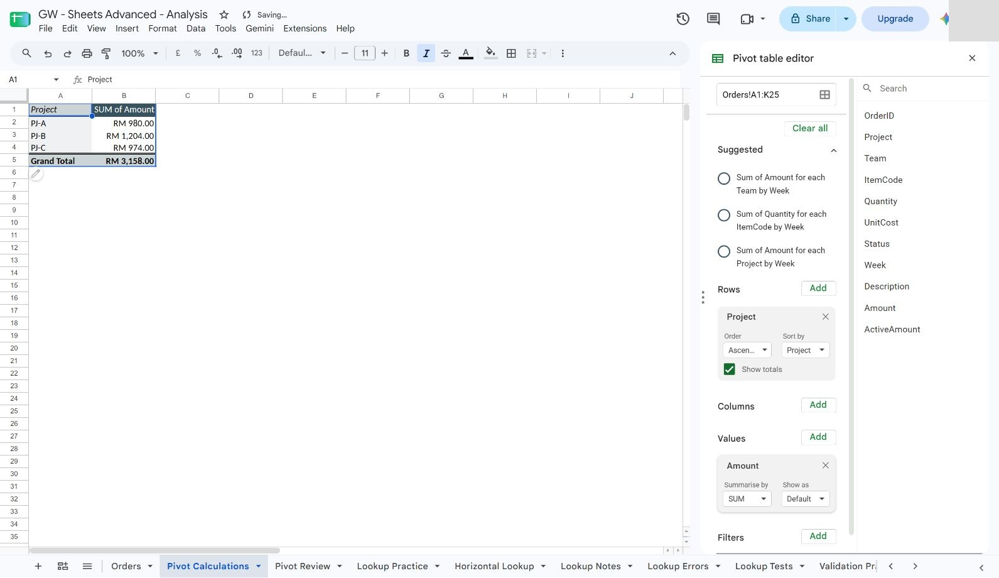

2. Choose **Values > Add > Calculated Field**. The current UI opens **Add calculated field**. Name it **Average line amount**, enter **=SUM(Amount)/COUNTA(OrderID)**, choose **Summarise by Custom**, and inspect Formula is valid before Add. Use the bounded source with populated unique OrderID values; COUNTA counts nonblank lines, not distinct identifiers.

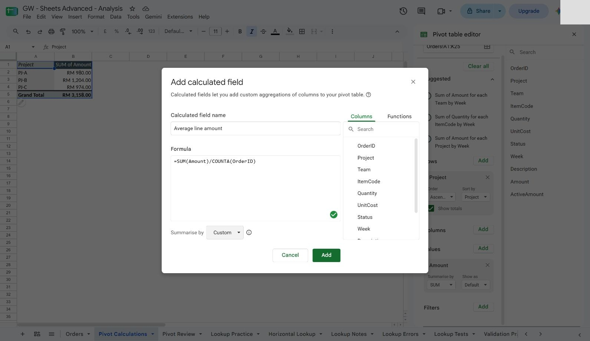

3. Inspect the native results: **122.5 /150.5 /121.75** for PJ-A/B/C and **131.5833333** overall. The overall result is total Amount divided by all24 lines; it is not a sum of the project averages.

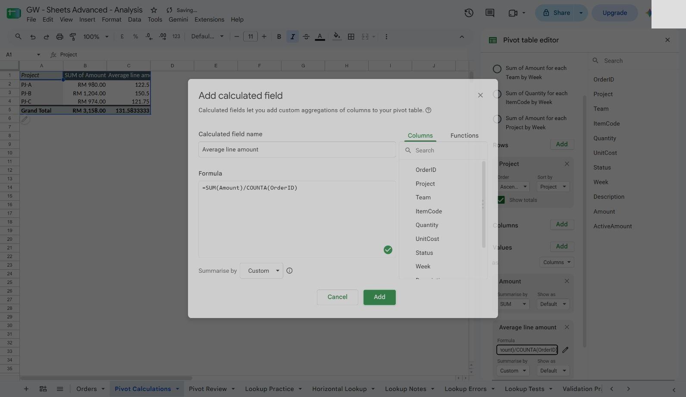

4. Widen column C to190 pixels so its heading is readable. Preserve the unrounded calculated result for reconciliation; display rounding alone is not a formula repair.

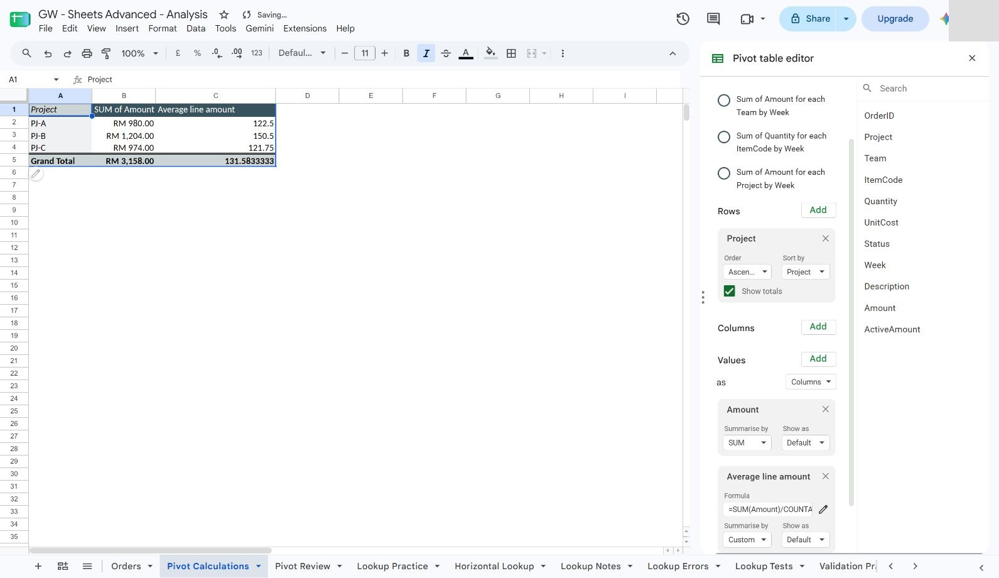

5. Create **Pivot Checks**. Record the expected project and overall averages in A1:B5 before adding actual calculations. Use the copy-paste card; C:E start blank.

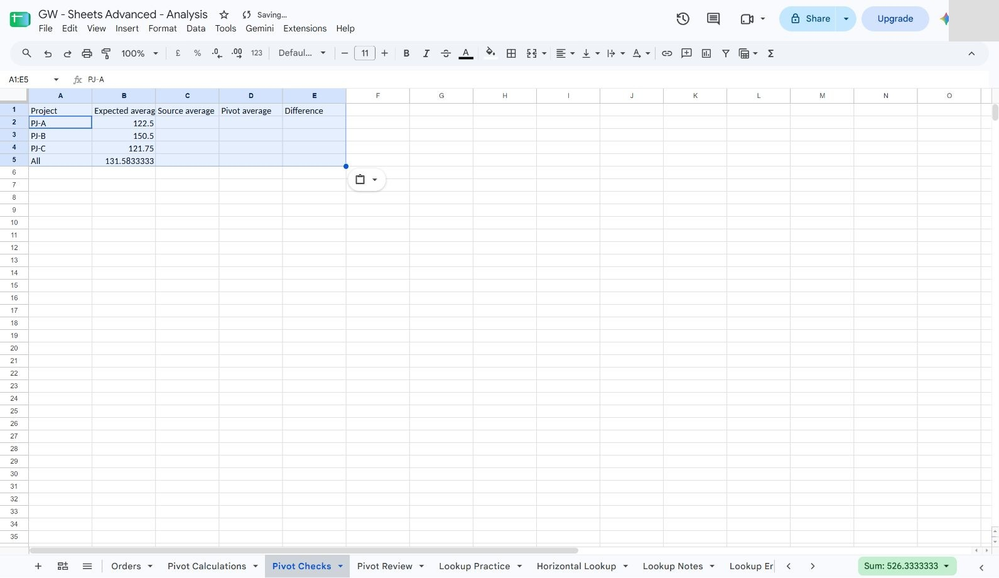

6. Add source SUMIF/COUNTIF averages in C, native Pivot Calculations references in D, and D minus C in E. All four differences are0. Widen A:E to170 pixels. This target UI supports the specified calculated field, so an unavailable-feature fallback was not needed in this author run.

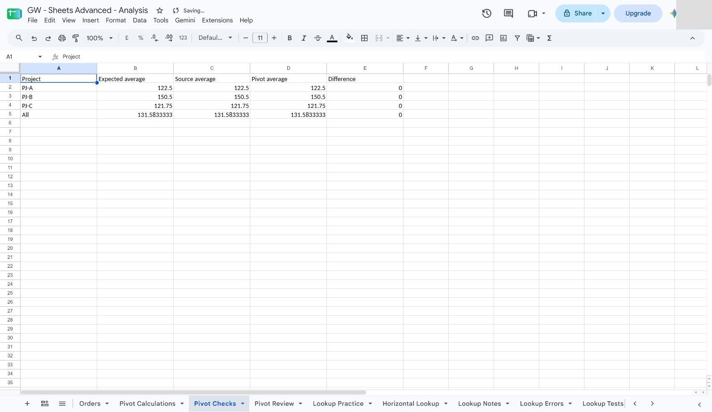

## 7.4 Reconcile Pivot Semantics and New-Row Coverage

1. Duplicate **Pivot Review** as **Pivot Counts**. Select A1 and open its Edit control if the editor is closed. Remove Amount from Values, then add **OrderID**, inspecting **COUNTA**. Keep Project rows, Status columns and source Orders A1:K25. The grand total is24: Cancelled6, Delivered12 and Pending6. Each project has8 lines.

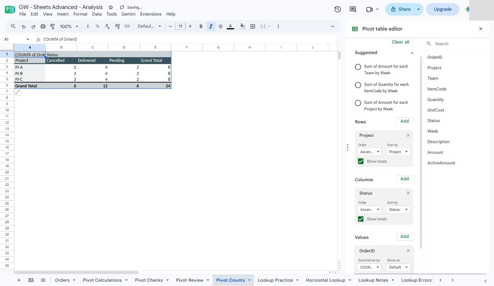

2. In Pivot Checks A8:D18, compare all nine project/status categories with bounded source **COUNTIFS** and the corresponding count-pivot cells. Add a total COUNTA check. All ten differences are0. COUNT on text OrderID would answer a different question, so inspect the aggregation explicitly.

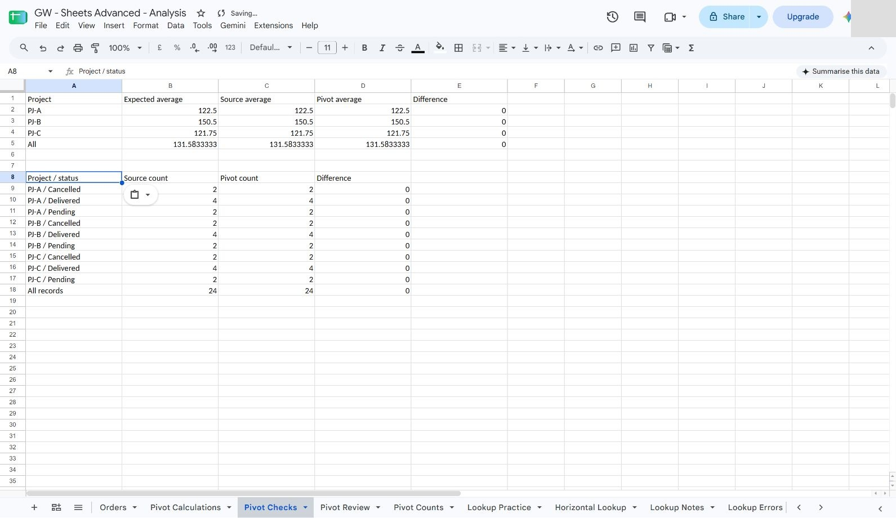

3. Return to Pivot Review and double-click the **PJ-A / Delivered** value556 in C3. The application creates **Detail1-PJ-A-Delivered** with actual contributing records **PO001 /PO004 /PO005 /PO008**. This is a snapshot of the drilldown at this point; do not treat it as a live refreshable source table.

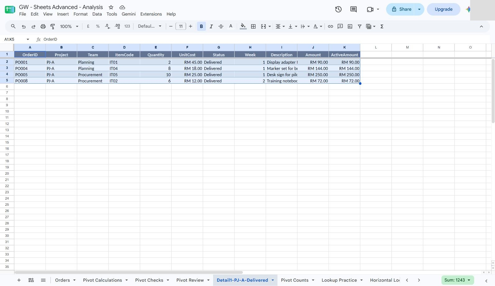

4. In Pivot Checks A21:F25, record the four manually inspected quantities, costs and amounts **90 /144 /250 /72** before formula comparisons. These are guided author checks; they do not replace an independent learner attempt.

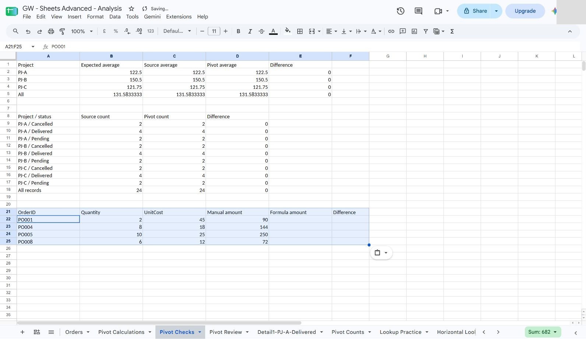

5. Calculate each row product and difference in E/F. At A27:D28 compare the manual sum556 with SUM of the actual detail sheet's J2:J5. All four row differences and the total difference are0.

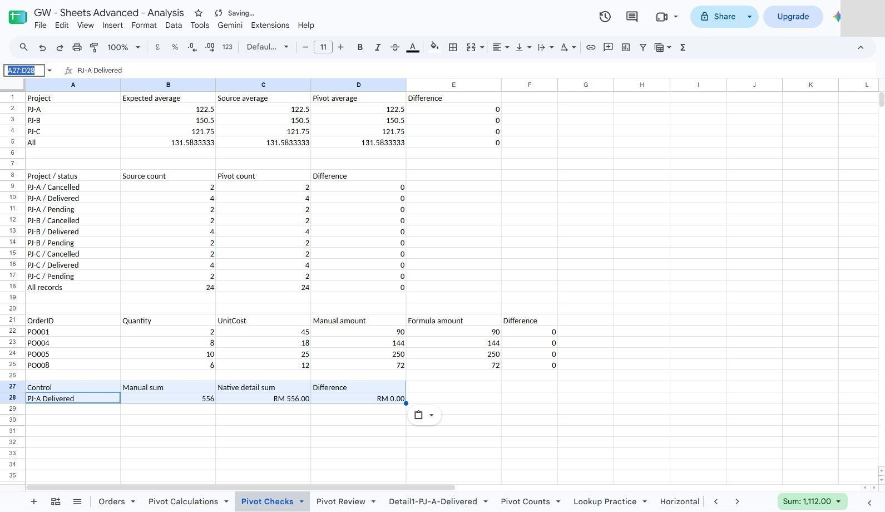

6. Build the separate two-row practice table at A31:D33: **2×45=90** and **4×12=48**. Record expected138, SUM the row products, and separately calculate **SUM(Quantity)*SUM(UnitCost)**. The first returns138; the second342 includes cross-products that do not belong to either order. Retain SUM of source row Amount as the authoritative total. Do not substitute this product-of-sums calculation for it.

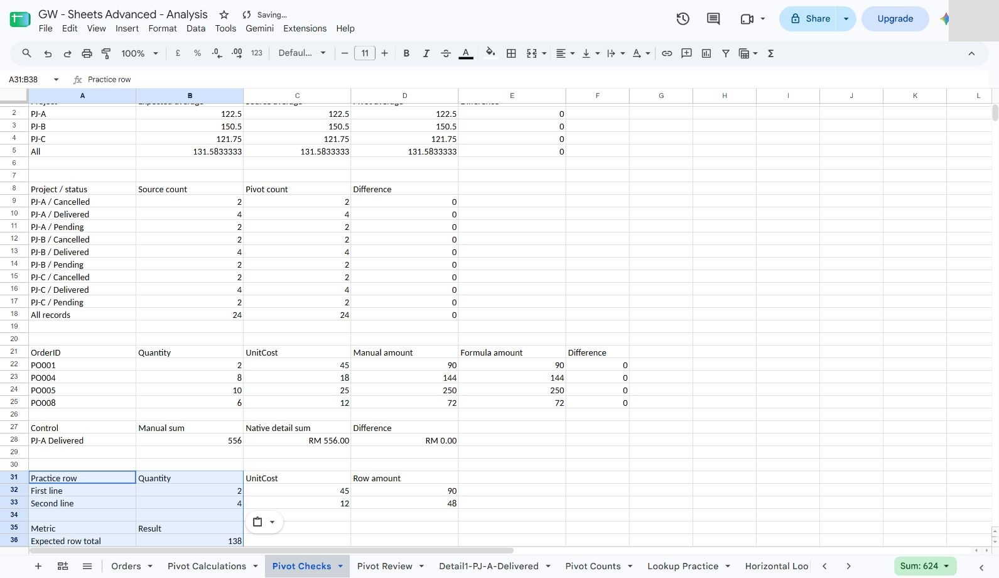

7. Use **File > Make a copy** of the workbook. Name it **GW - Sheets Advanced - Pivot Coverage** in the practice folder. Keep sharing and comments unchecked. This copies the whole workbook, including native pivots; keep the maintained workbook unchanged during the following source experiment.

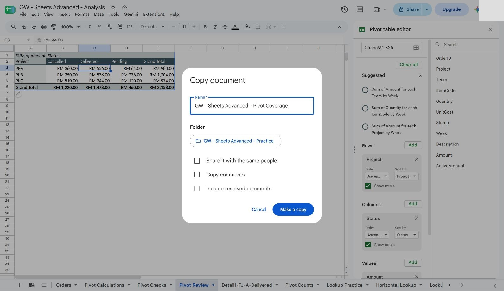

8. Verify the new title and separate file URL before editing. On its Orders, select row26 and **Insert1 row above**. This reserves a new data row before the existing summary labels; those labels move to row27 and their totals to row28.

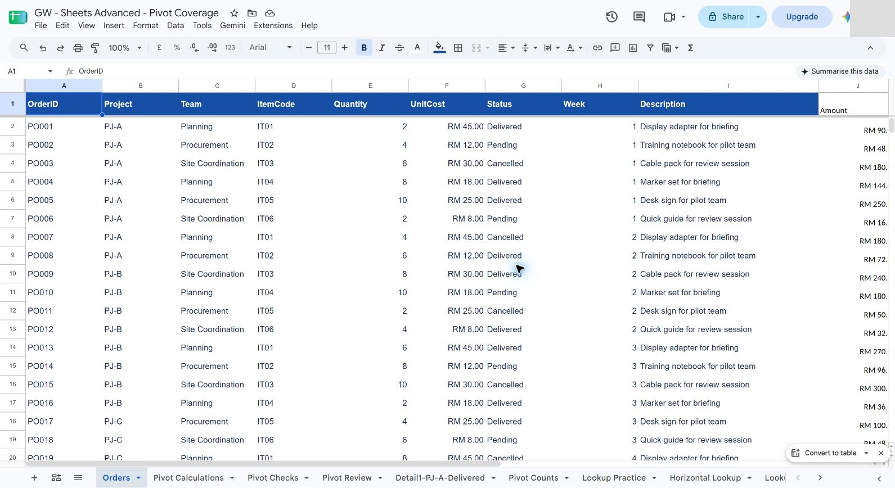

9. Enter the supplied **PO025** record in A26:I26, **=E26*F26** in J26 and **=IF(G26="Cancelled",0,J26)** in K26. Its amount is90. Expect all Amount3,248, Delivered1,568, count25 and Delivered count13 once coverage is repaired. The copied summary J28 still uses J2:J25 at this point, so it remains3,158.

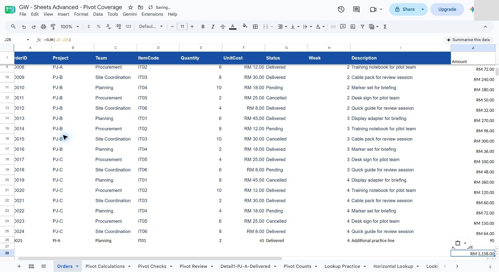

10. Inspect the copied **Pivot Review**. Its source is still Orders A1:K25, its total3,158 and PJ-A Delivered556: the new record has not entered the pivot.

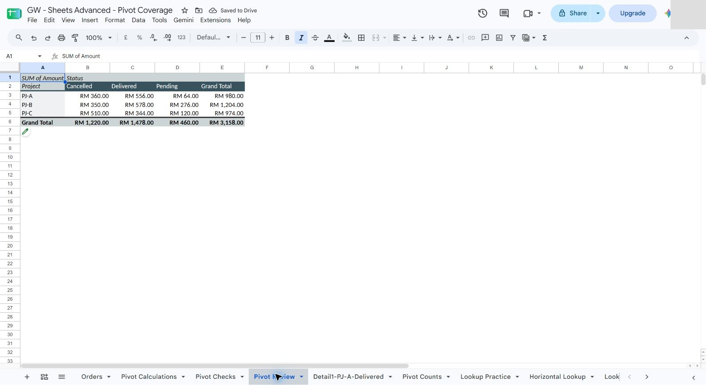

11. Inspect copied **Pivot Counts**. It still counts24 and Delivered12. Matching the old total is not proof that a new source record was included.

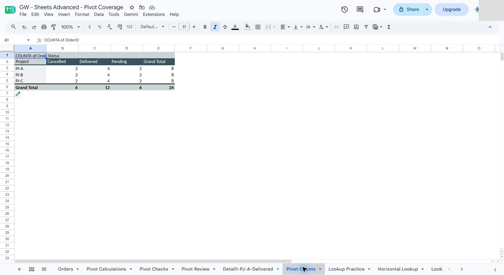

12. Use the editor's **Select data range** button, enter **Orders!A1:K26** in the Range dialog and confirm **OK** for each pivot. In the captured intermediate state, the count editor displayed typed A1:K26 text but the count was still24. Verify the applied native definition and recalculated results; typed field text alone is insufficient evidence.

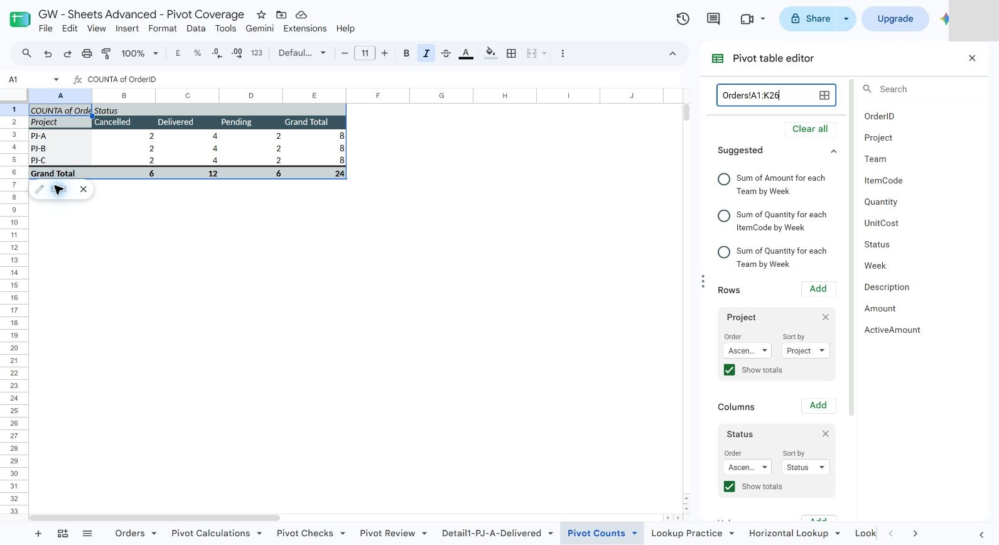

13. After confirming the Amount pivot range, inspect **3,248** overall, **1,568** Delivered, and **646** PJ-A Delivered. This is the original556 plus the new90.

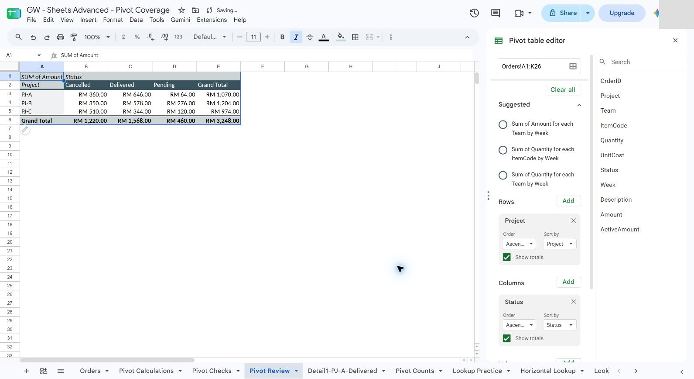

14. Confirm the count pivot's range through the same dialog. It now counts **25** overall, **13** Delivered and **5** PJ-A Delivered. Both pivots must cover row26.

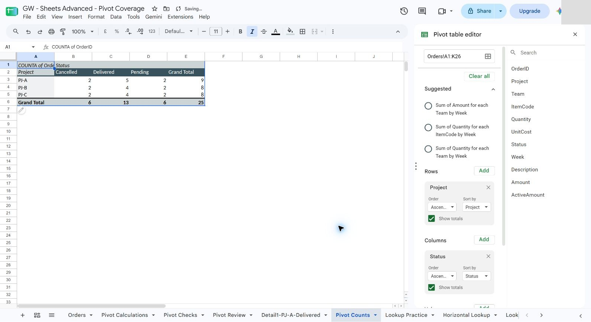

15. Repair only the scenario Orders summaries to **=SUM(J2:J26)** and **=SUM(K2:K26)** in J28/K28. They become **3,248 /2,028**. ActiveAmount excludes Cancelled; it is not the same population as Delivered.

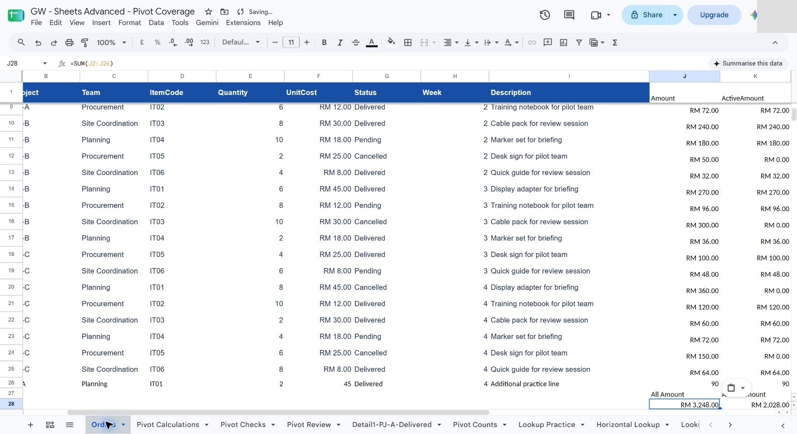

16. In the scenario Pivot Checks A41:D47, compare expanded source formulas and both native pivots for all/Delivered amount and count plus the changed PJ-A contribution. All six differences are0.

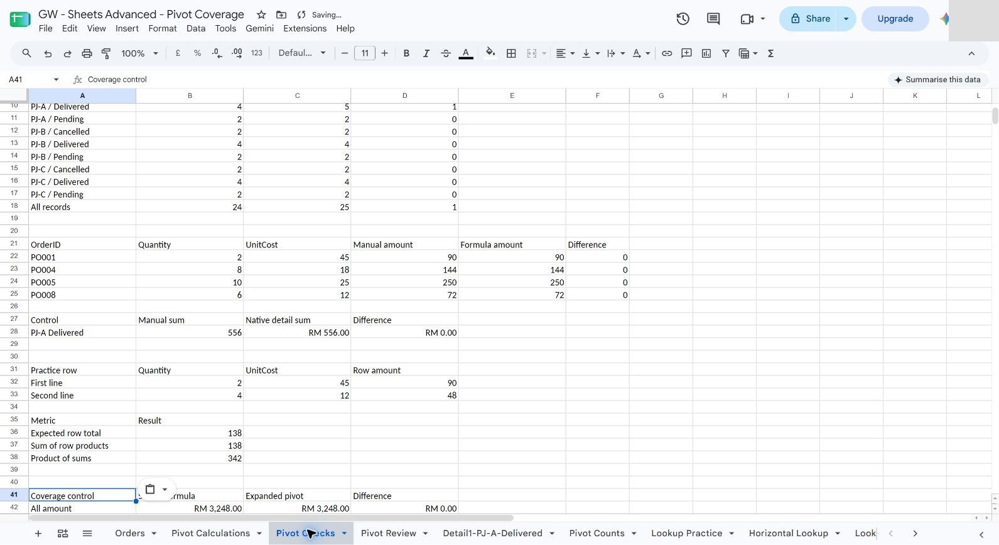

17. Create a clearly separate **Coverage Controls** tab containing the same six expanded controls at A1:D7. Widen A:D to200 pixels. Record scenario scope below it: earlier copied checks/calculated pivots still describe the24-row baseline and must not be presented as fully refreshed25-row analysis. The expanded controls are the authoritative checks for this experiment. Retain PO025 only on this named scenario copy.

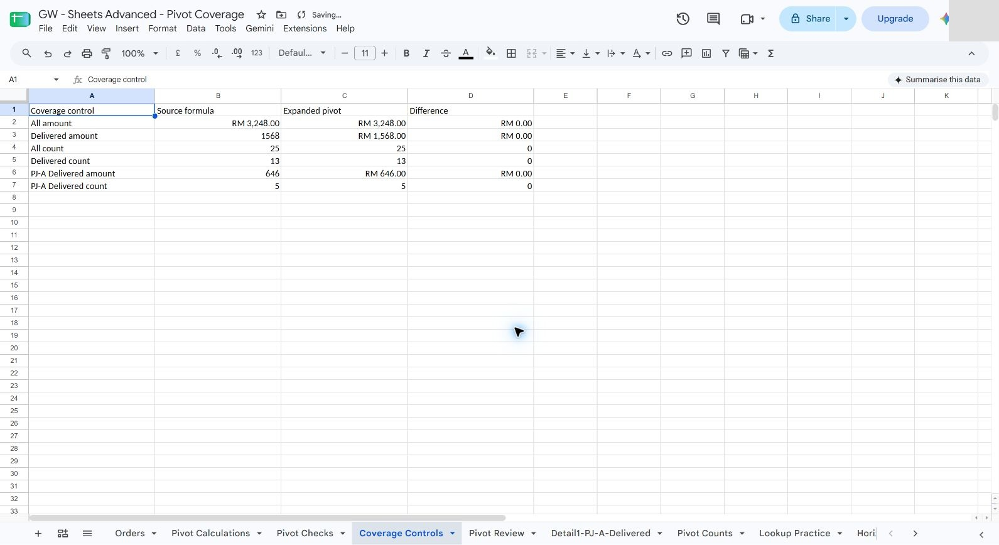

18. In the maintained workbook create **Pivot Notes**. Record source range, groups, filter experiment/restoration, SUM versus COUNTA, Custom average definition, drilldown evidence, aggregation trap and the separate coverage result. State the validation boundary.

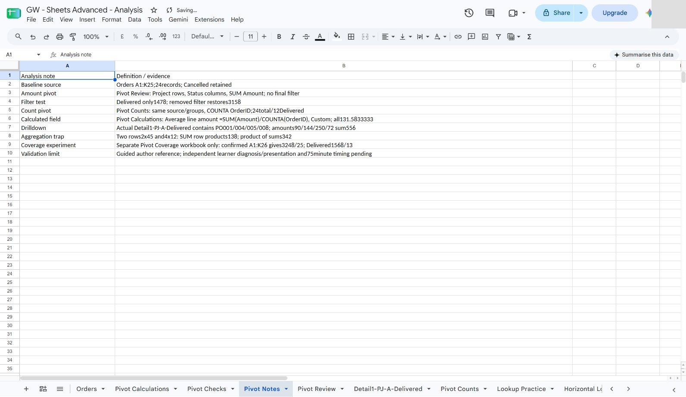

19. Inspect the maintained Pivot Review: still **3,158** overall and **1,478** Delivered. Original Orders, Rates, Source Snapshot and Analysis values/formats are unchanged.

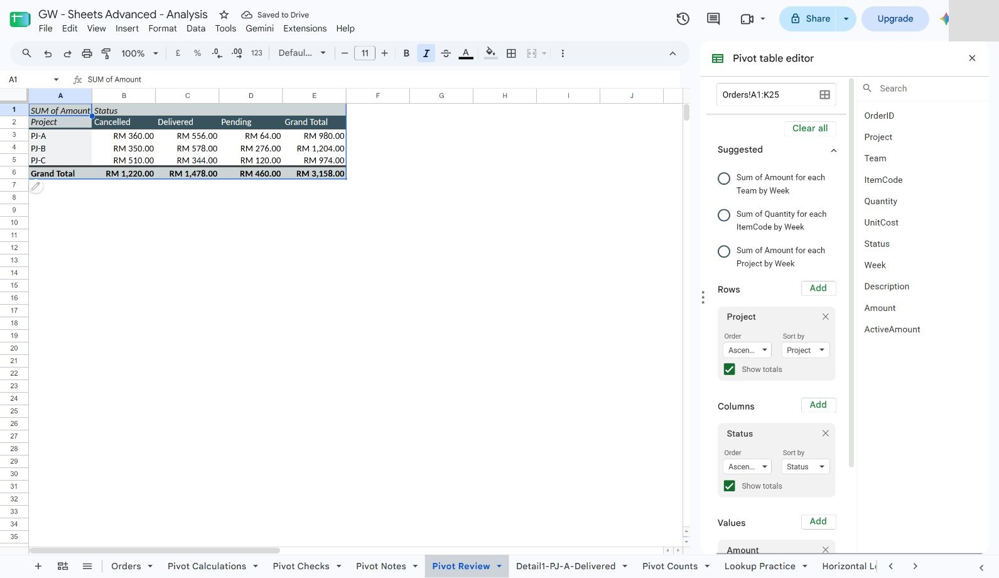

20. Inspect maintained Pivot Counts: still **24 /12**. Leave the baseline pivots and named coverage experiment available for trainer review. The independent challenge below remains a fresh learner task.

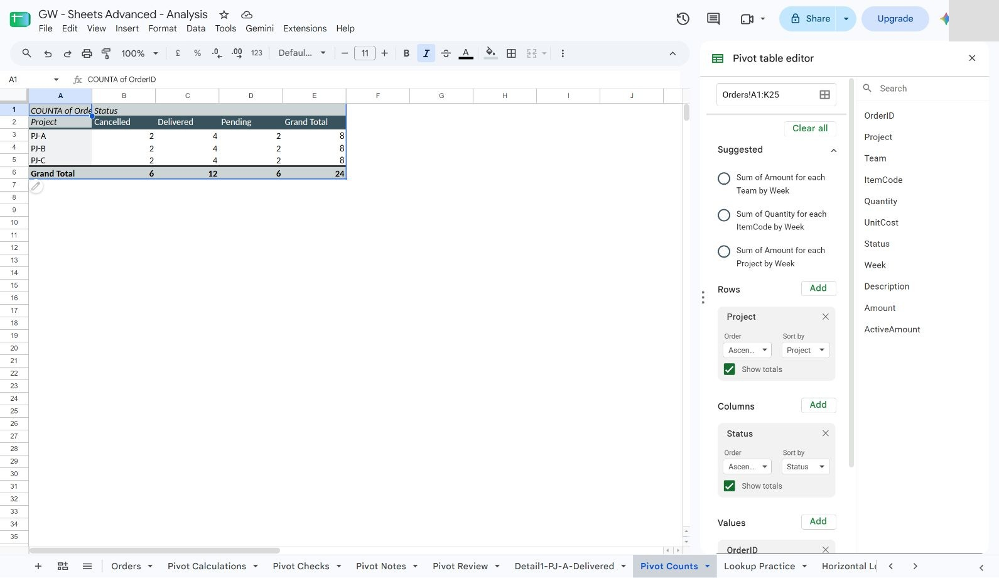

> **Validation boundary:** guided7.1–7.3 and author casework7.4 were executed through learner UI and bounded native pivot/cell evidence. Custom average is supported in this target UI. PO025 is retained only in the separate coverage workbook; baseline source and pivots are preserved. Independent Delivered-output construction, diagnosis/presentation, human reviewer and the planned75-minute learner allocation remain unverified.

## Independent Challenge

Close the earlier step lists for the first attempt. Use the case input and your own reasoning. If you need help, record the hint and repeat the affected check independently.

1. Build a fresh pivot independently answering Delivered amount by Project, with a count of contributing order lines.

2. On the challenge copy include PO025 and show the source row, count, total and changed project contribution. Leave the baseline pivot unchanged.

3. Explain one aggregation trap and use contributing rows to prove the correct result.

## Evidence to Hand Over

- Amount and count pivots reconciled to formulas and contributing source rows.
- Safe calculated-field comparison or documented unavailable route.
- Separate new-record pivot with repaired coverage and demonstrated aggregation semantics.

Record the defect or uncertainty you investigated, the evidence used, the repair or reasoned no-change decision, and the final state. Restore temporary changes or keep them in a clearly named scenario copy.

## Troubleshooting

| Symptom | What to check |
|---|---|
| A pivot total is wrong even though the row appears | Inspect aggregation, filters, source range and calculated-field meaning separately. |
| An input or earlier result is missing | Reopen the input named in Before You Begin; do not substitute private company data |
| A menu or feature is unavailable | Confirm the account and the shared access notes; record the missing step and ask the trainer for its fallback |
| The result differs from the checkpoint | Compare the exact source range, wording and conditions before repeating the action |

## Lesson Summary

Native pivots summarise a defined source. Their filters and formulas need the same checks as ordinary calculations.

**Check yourself:** Why must the pivot's source range include every record and calculated column?
