# 08 - Query Structured Criteria

In this chapter you will use DSUM, DCOUNT and DAVERAGE with a visible criteria range and reconcile against a manual subset.

> **Prompts and values:** use the [copy-paste page](./prompts.md) for the exact values used below.

**Target allocation:** 60 minutes: 15 explanation/demonstration, 17 guided build and casework, 20 independent challenge, 8 verification and repair. The active portion is 45 minutes by design. These are unmeasured targets awaiting a learner pilot.

**Your result:** A visible criteria area and reconciled database function results.

> **Status:** author reference with 36 staged application captures through 8.4. DSUM/DCOUNT/DAVERAGE, exact AND/OR ID sets, overlap, field types, weighted means and an actual header fault/repair are verified. A wrong mean prediction is explicitly investigated and corrected. Maintained source and earlier pivots unchanged. Independent question, reviewer and learner timing remain pending.

## What You Will Learn

- Build a visible database criteria range.
- Use DSUM, DCOUNT and DAVERAGE.
- Reconcile criteria-based results.

## Before You Begin

Read the [case input](./prompts.md) and use a separate named casework copy for destructive tests or altered datasets. Keep the baseline unchanged for later chapters. Record source facts, proposed practice and unresolved questions separately.

Use Orders A1:J25, including Amount. Keep criteria outside the source table.

## 8.1 Build the Criteria

1. Create a separate tab named **Database Analysis**. The draft's Analysis A10:D12 locations already contain earlier count/population work, so use the same addresses on this new tab. Keep maintained Analysis unchanged. Widen A/B/C/D to 180/140/310/180 pixels. Create the blank tab before entering criteria.

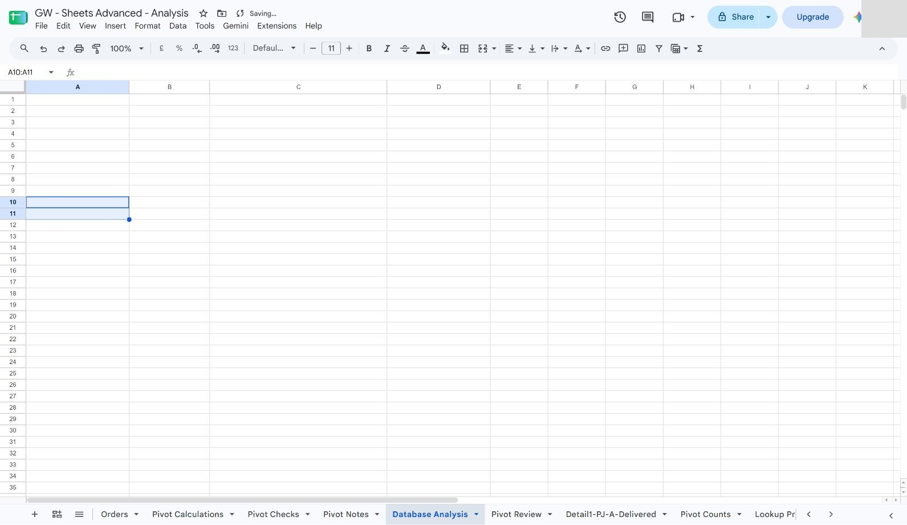

2. In **A10:A11** enter **Status / Delivered**. Match the Orders header exactly. This visible one-column criteria block is ready before entering the result formulas.

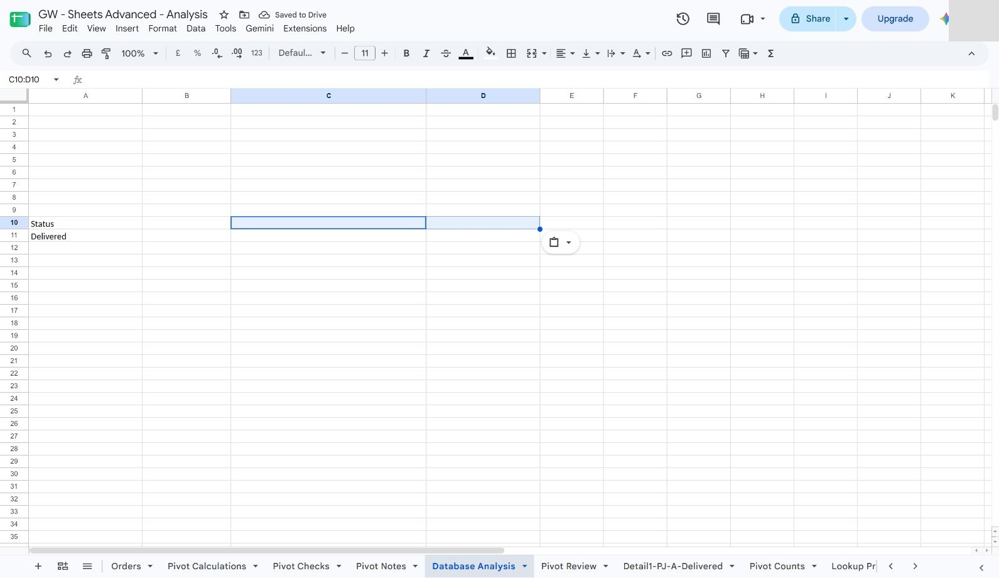

3. In C10 enter **Delivered amount** and D10 **=DSUM(Orders!A1:J25,"Amount",A10:A11)**. Add the C14:E15 comparison card. Both DSUM and source **SUMIF** return **1,478**; their difference is 0. The source includes the header and 24 data records, with criteria outside it.

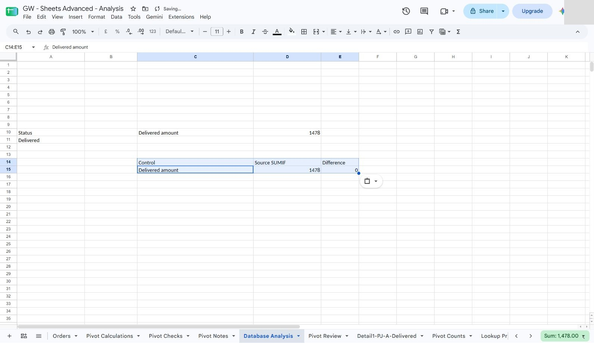

## 8.2 Count and Average

1. Enter both metric rows: C11 **Delivered numeric quantity records**, D11 **=DCOUNT(Orders!A1:J25,"Quantity",A10:A11)**; C12 **Average delivered unit cost**, D12 **=DAVERAGE(Orders!A1:J25,"UnitCost",A10:A11)**. Inspect D11: **12 numeric Quantity entries**, not a count of text identifiers.

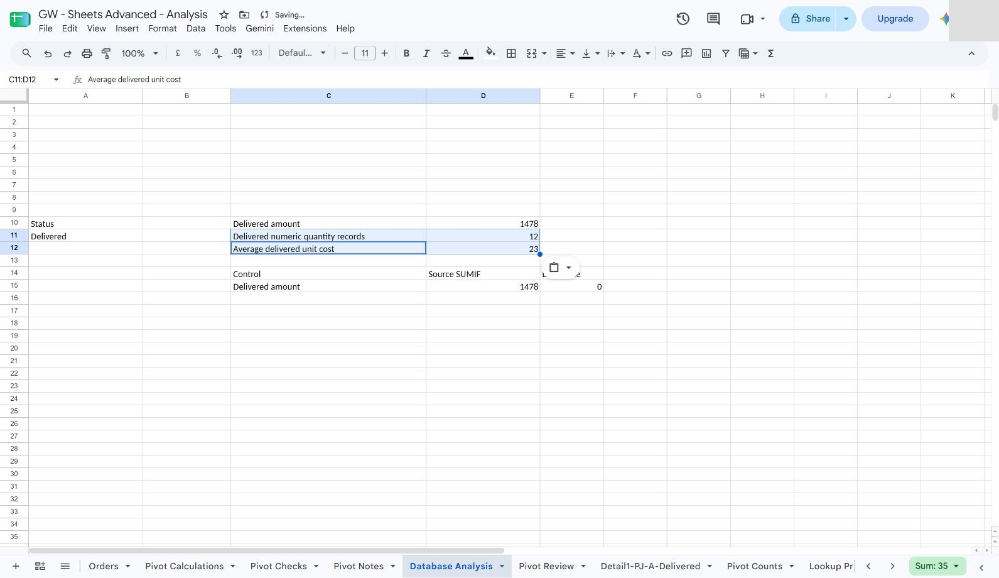

2. Select D12 and inspect its DAVERAGE formula. It returns **23**, the unweighted mean of 12 numeric UnitCost values. It is not an average line Amount or a quantity-weighted price.

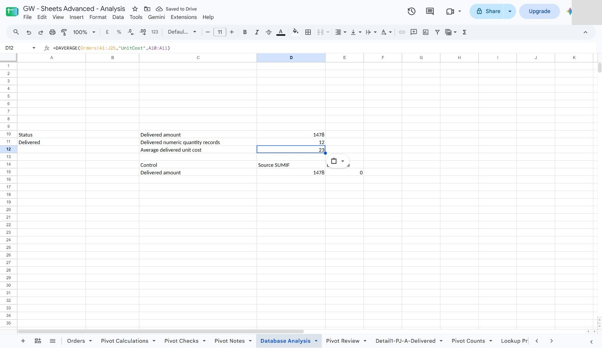

3. Add C17:D20. **DCOUNT of OrderID returns 0**, **DCOUNTA of OrderID returns 12**, and source COUNTIF Delivered returns 12. This baseline has populated text IDs and numeric quantities; those different fields happen to identify the same 12 records only when counted with the appropriate function.

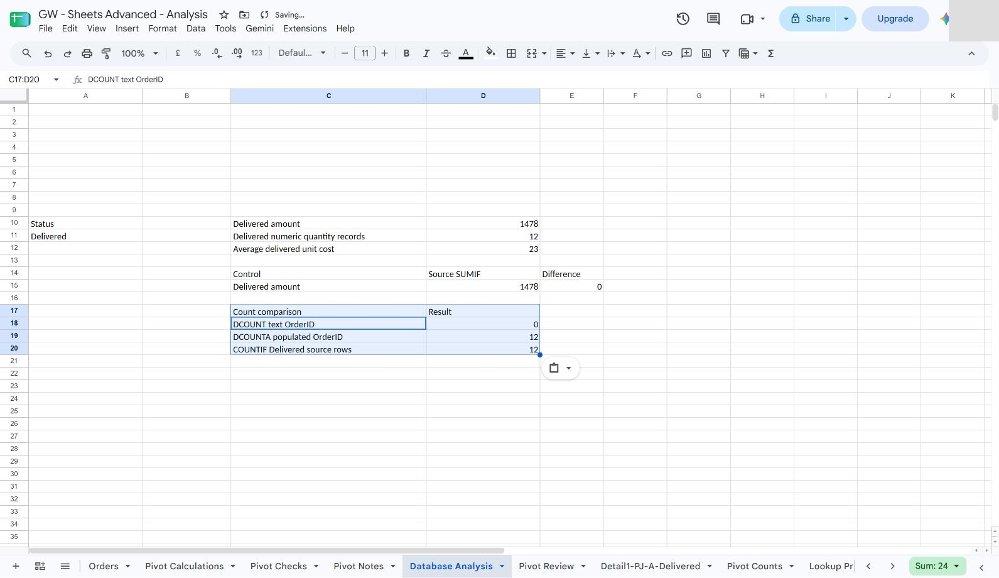

## 8.3 Check Criteria Semantics

1. On Orders select **A1:J25**, then **Data > Create filter view**. In the Status dropdown choose Clear, select Delivered only and OK. Inspect the 12 visible source records; the ordinary SUM below the table still totals all records. Do not delete the other statuses.

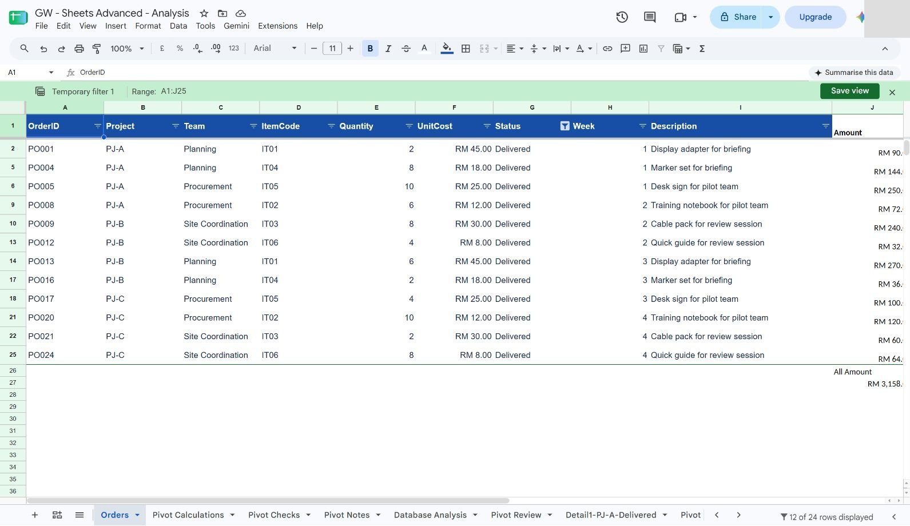

2. Choose **Save view**, name it **DB8 - Delivered**, and Save. Inspect the named view and then Exit the view toolbar so later work starts from the unfiltered source.

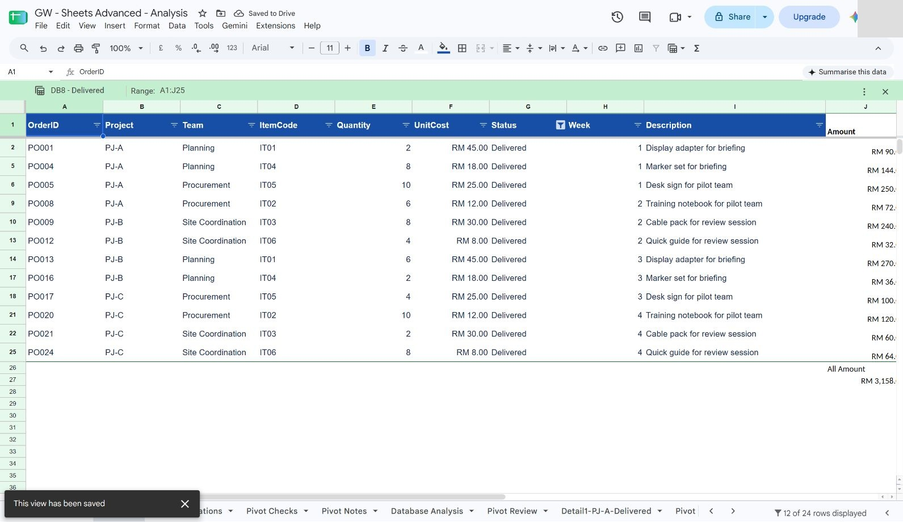

3. Return to Database Analysis. Add **Project / PJ-A** in **B10:B11**, on the same header/data rows as Status/Delivered. Keep the earlier one-column formulas unchanged. Add the new C23:D26 block using **A10:B11**: DSUM Amount **556**, DCOUNT Quantity **4**, DAVERAGE UnitCost **25**. Two conditions on the same criteria row mean both must hold.

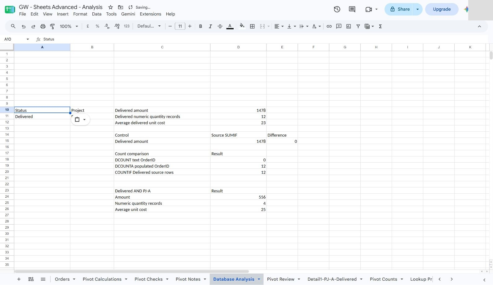

4. Add C28:E29. Source **SUMIFS** for Delivered and PJ-A returns 556 and the difference is 0. Label this expanded criterion explicitly; the original A10:A11 formulas still answer Delivered across all projects.

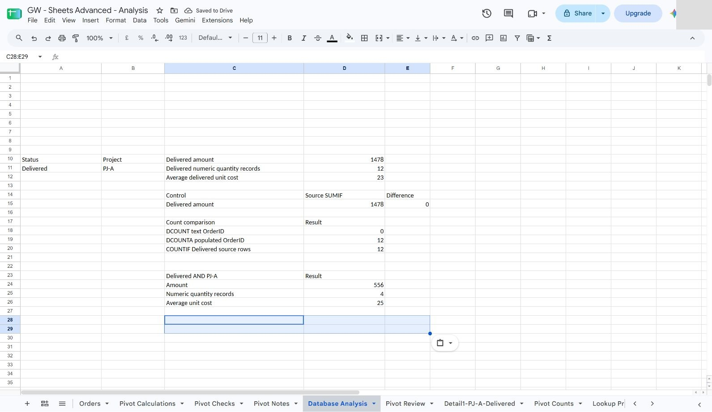

## 8.4 Prove AND, OR and Overlapping Criteria

1. Create **Database Semantics**, with separate labelled blocks: A2:B3 for **Delivered AND PJ-A**; A8:A10 for **Delivered OR Pending**; A15:B17 for **Delivered OR PJ-A**. The OR cases use separate data rows. In the overlapping block, put Delivered alone on row 16 and PJ-A alone in B17; leave the other cell on each row blank. Those blanks mean the corresponding field is unrestricted on that OR row, not a requirement for a blank source value.

2. Record predictions before actual formulas. Treat it as a prediction to investigate, not an answer key. Final source-derived expectations are **556 /4 /25**, **1938 /18 /352÷18**, and **1902 /16 /23.1875**. The later audit-repair stages show why that one prediction changed.

> **Reference run:** The reference's initial prediction card below contains a mistaken disjoint-OR mean of 23.

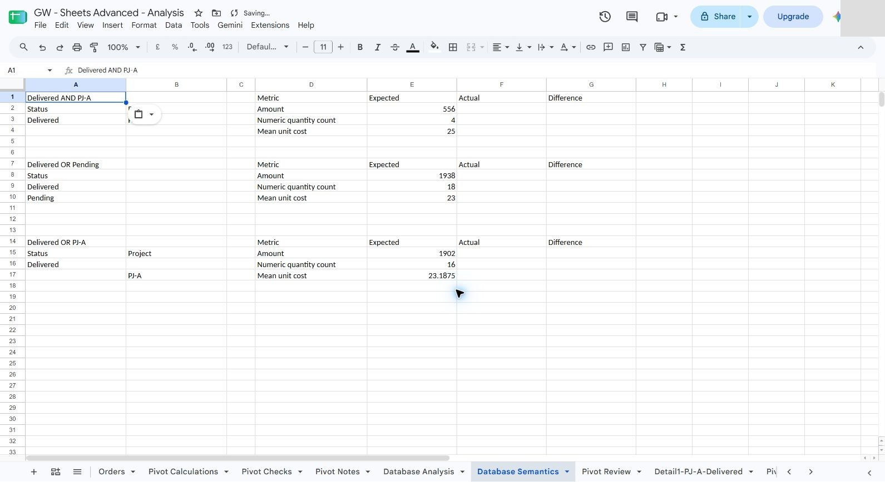

3. For the AND block, calculate DSUM Amount, DCOUNT Quantity and DAVERAGE UnitCost against **A2:B3**. The three results are **556 /4 /25**, with zero differences.

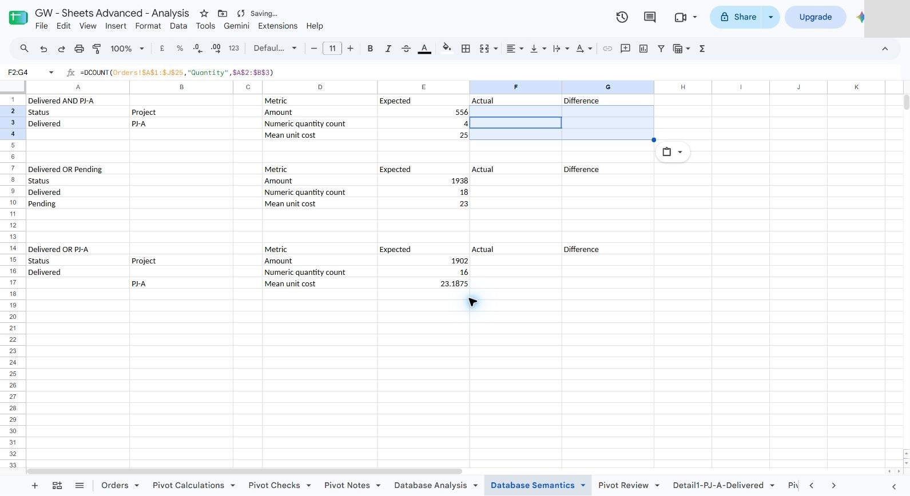

4. For disjoint OR, use **A8:A10**. Amount is **1,938**, numeric count **18**, and the observed mean is **19.55555556**. In the captured first pass, its mean difference is nonzero because the prediction 23 was wrong. Keep that mismatch visible until source costs explain it; do not force the actual formula to the prediction.

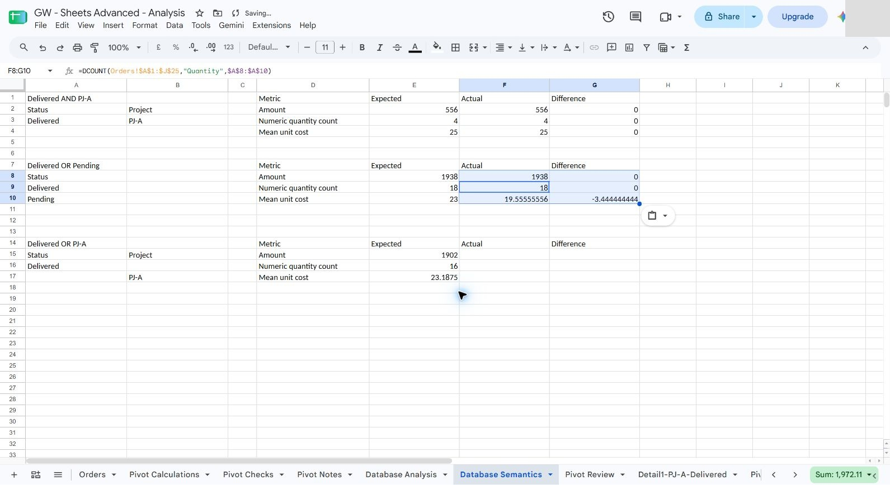

5. For overlapping OR, use **A15:B17**. Results are **1,902 /16 /23.1875**. A record satisfying both Delivered and PJ-A qualifies once.

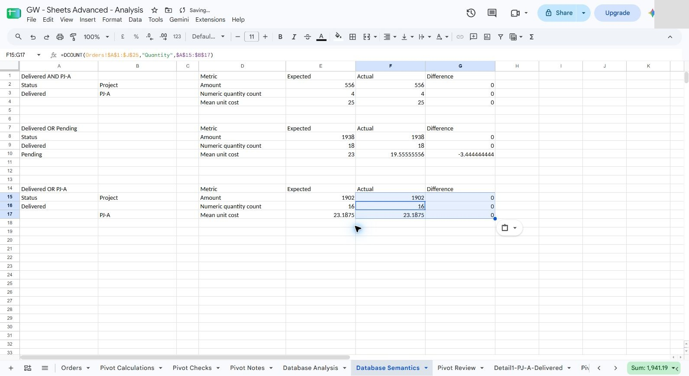

6. Add the inclusion–exclusion card at A21:D25. Delivered 1,478 plus PJ-A980 minus their shared 556 gives **1,902**. Counts 12+8−4 give **16**. Adding the two sets without removing the shared membership would overstate the population.

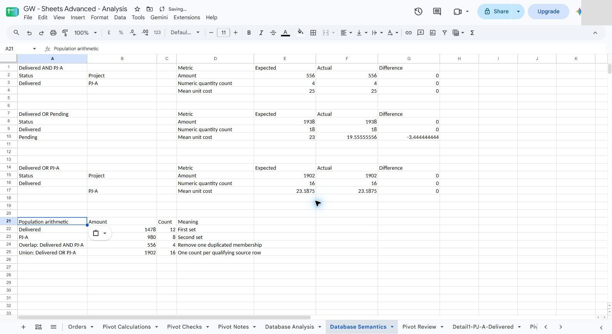

7. Reconcile the disjoint statuses in D28:G30: Delivered 1,478 + Pending 460 = **1,938**, and 12+6 = **18**. These status sets do not overlap. This checks amount and count; it does not yet explain the mean prediction.

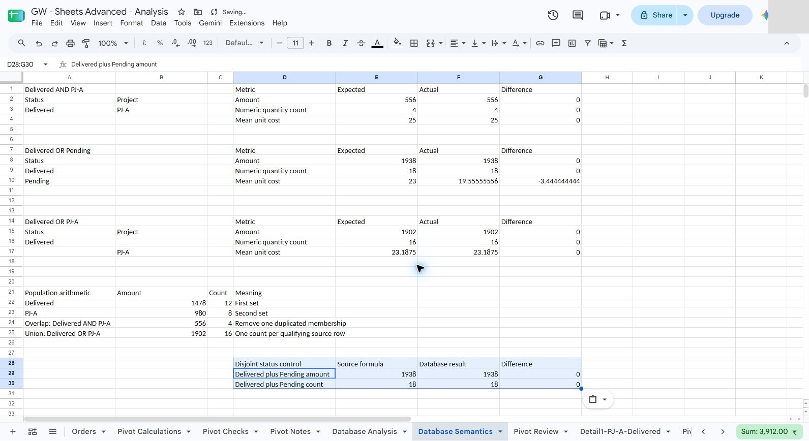

8. Create a second actual Orders **A1:J25** filter view. Select Delivered in Status and PJ-A in Project. Inspect the four visible IDs **PO001 /PO004 /PO005 /PO008** and their amounts 90/144/250/72, which sum to 556.

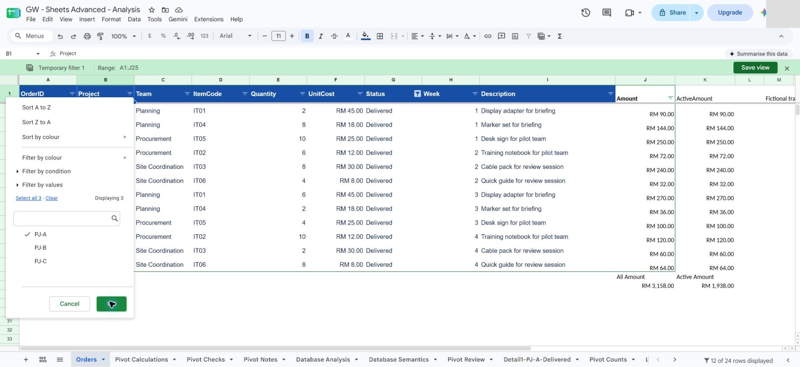

9. Save it as **DB8 - Delivered AND PJ-A** and Exit. Retain both named views for trainer inspection while leaving the source unfiltered.

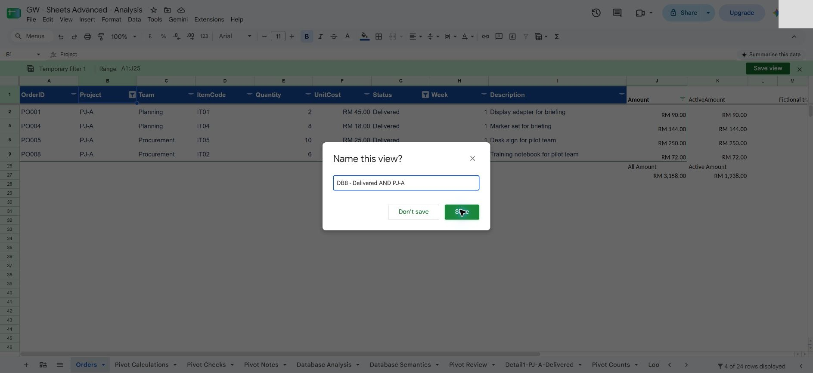

10. Create **Database IDs**. Use the FILTER cards in A2/C2/E2 to list the AND, disjoint-OR and overlapping-OR IDs from the source in their original order. Each OR condition is converted to a boolean membership test rather than concatenating two lists with duplicates.

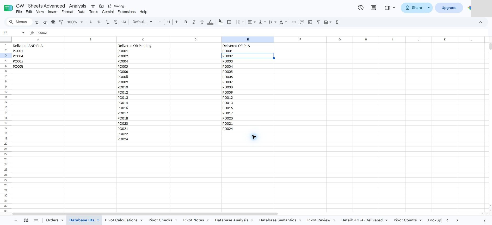

11. Add A23:F26 controls. COUNTA and COUNTUNIQUE both return **4 /18 /16** for the three ID sets. Sum Amount by the listed IDs and compare with the database results: **556 /1938 /1902**. The baseline has unique source IDs, so this key-based reconciliation is valid for these supplied data.

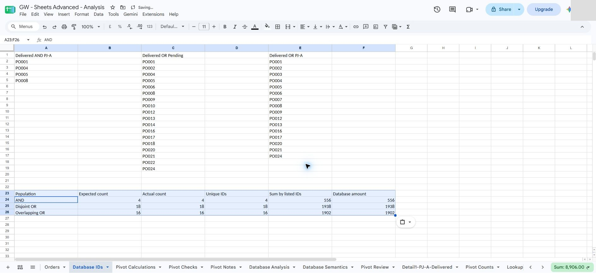

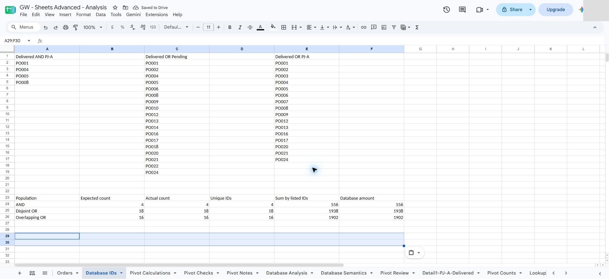

12. Create **Database Tests** with the explicit four-row type table at A1:D5 and Status/Delivered criteria in F1:F2. Keep its intentionally invalid text/blank cases separate from maintained Orders. Record expected field counts and means before filling actuals: numeric Quantity 2, populated Quantity 3, numeric UnitCost 2, mean UnitCost 15, numeric OrderID 0 and populated OrderID 4.

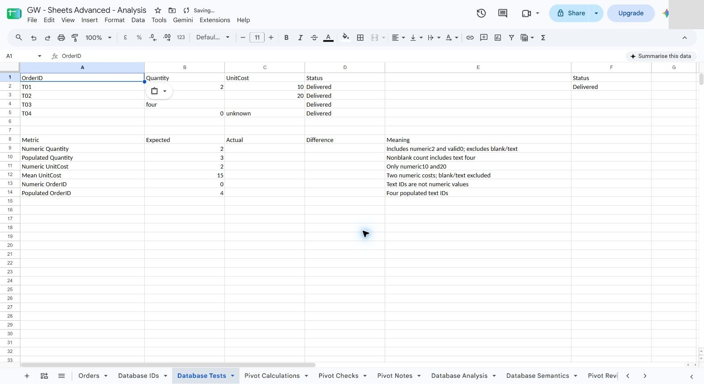

13. Enter the six database formulas in C9:C14 and C minus B differences in D. Numeric zero is included by DCOUNT; a blank and literal four are excluded from its numeric Quantity count. DCOUNTA includes the nonblank text four. DAVERAGE uses only the two numeric costs 10 and 20, giving15; blank/text costs do not enter that denominator. Invalid source types still require review even when a numeric result appears.

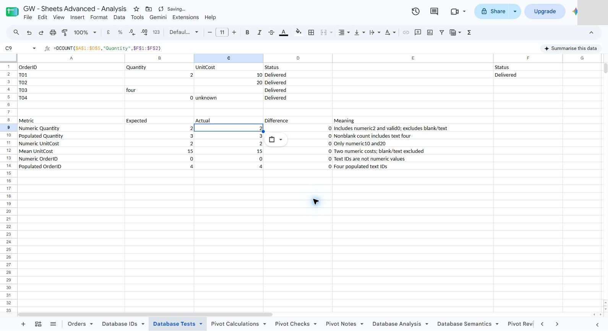

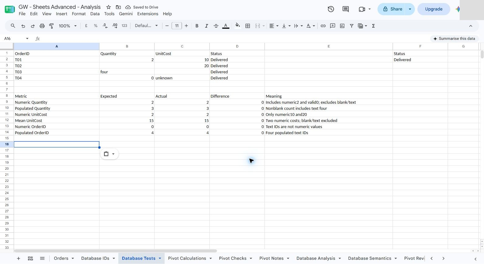

14. Build a separate disposable header test at A18:A20: label, exact **Status**, then Delivered. D19 uses **=DSUM(Orders!A1:J25,"Amount",A19:A20)** and returns 1,478.

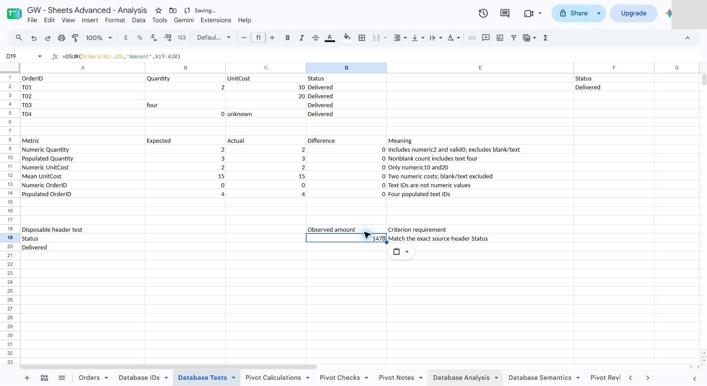

15. Change only test header A19 to **Statuz**. In this actual native experiment, D19 returns **0**, with no formula error. Save the observation before repair. Do not generalise this one result to every malformed header; a plausible or error-free output is insufficient evidence of correct criteria.

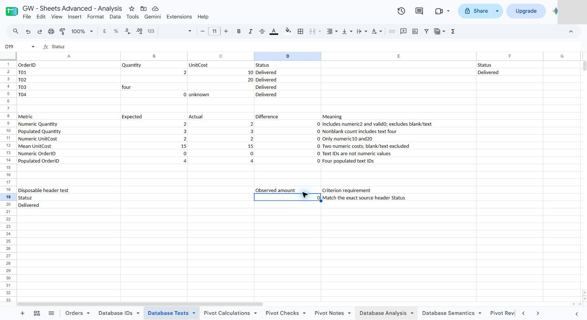

16. Restore A19 to exact **Status**. The same DSUM formula returns **1,478** again. Record the observed zero and repair rather than hiding it with an error wrapper.

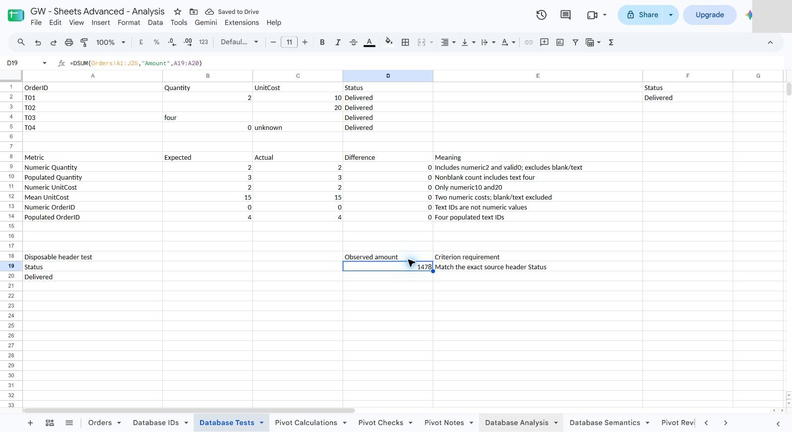

17. Add the explicit two-row weighted-price table at A26:D28: quantity 2 at cost 10 and quantity 8 at cost 30. Row costs are 20 and 240. The rows are labelled practice data, not replacements for source Orders.

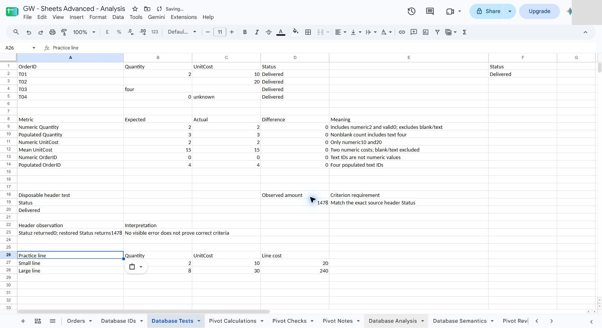

18. Compare **AVERAGE(C27:C28)=20** with **SUM(D27:D28)/SUM(B27:B28)=26**. The first asks the mean price per line; the second asks cost per unit across 10 units. Total line cost is 260. Both results are correct for their stated questions, and their expected-versus-actual differences are 0.

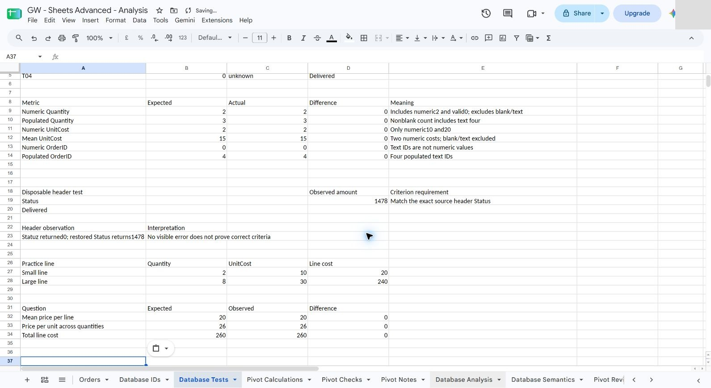

19. Create **Database Notes** with source scope, criteria definitions, ID reconciliation, type tests and validation limits. The first handover retained the incorrect disjoint mean prediction, so the final audit below is required before accepting it.

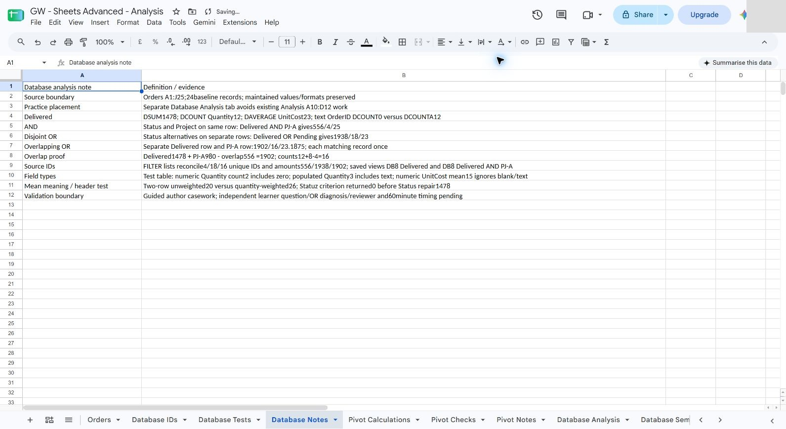

20. Review the three criteria blocks and their difference cells. The initial disjoint-OR mean mismatch remains visible in this first-pass checkpoint. The next steps investigate it rather than accepting the handover as complete.

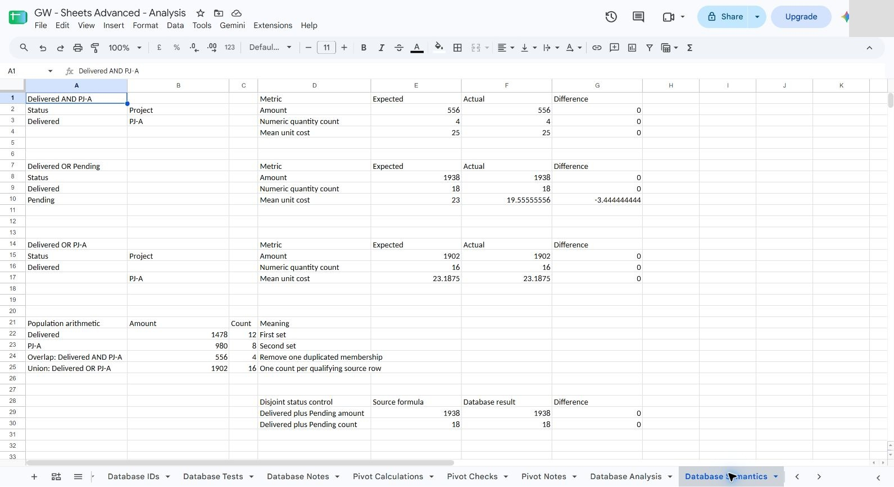

21. Inspect maintained Orders unfiltered: the all-record Amount remains **3,158**. Earlier Analysis, Rates, Source Snapshot and native pivots remain intact. The discrepancy is in the prediction for a defined subset, not a changed source baseline.

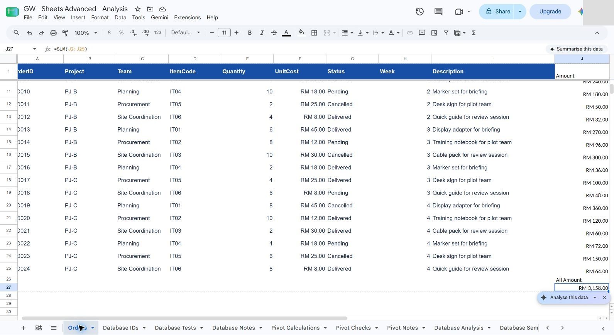

22. In Database Semantics D31:G32, reconcile the OR population's UnitCost sum. Source SUMIF totals and DSUM both give **352**: Delivered contributes276 and Pending 76. Divide by 18 numeric costs to obtain **19.55555556**, matching DAVERAGE. The statuses do not have the same UnitCost distribution, so copying Delivered's mean 23 was an invalid expectation.

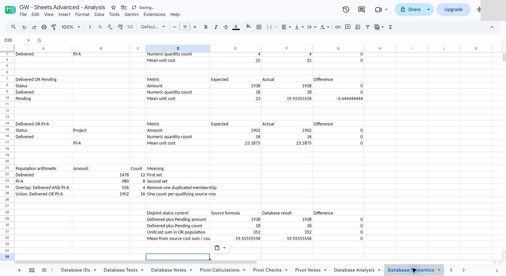

23. Correct **E10 to =352/18**. Keep F10 as the original DAVERAGE formula. All nine metric differences now reconcile to 0, and the separate source-cost mean check also has zero difference. The preserved first-pass evidence distinguishes a wrong prediction from a formula repair.

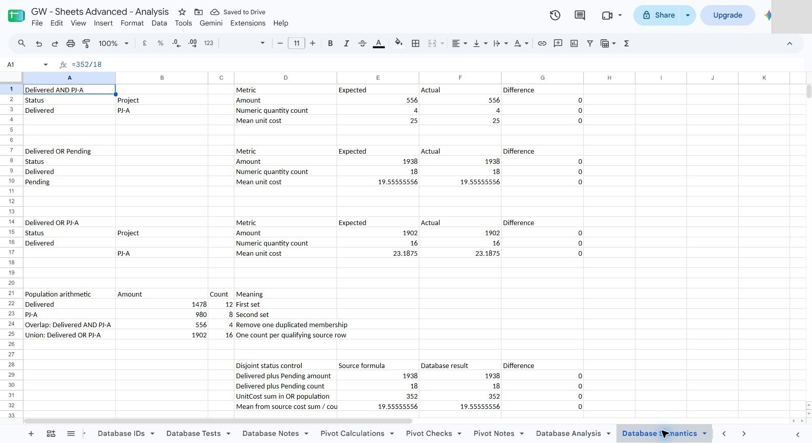

24. Correct the disjoint-OR entry in Database Notes and append the prediction-repair explanation. Leave the exact Status test header restored and the source unfiltered, with the two named filter views retained. The independent challenge below remains unperformed.

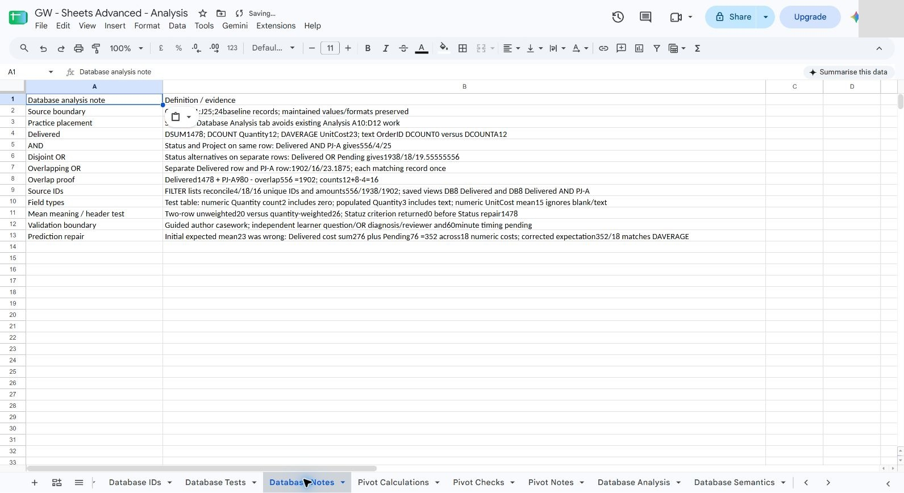

25. Finish by inspecting **Database Analysis** with all Delivered and AND formulas visible. DSUM/SUMIF 1478 and AND DSUM/SUMIFS556 have zero differences; the numeric/text count distinction remains explicit. This final view confirms the completed results after the earlier entry-stage captures.

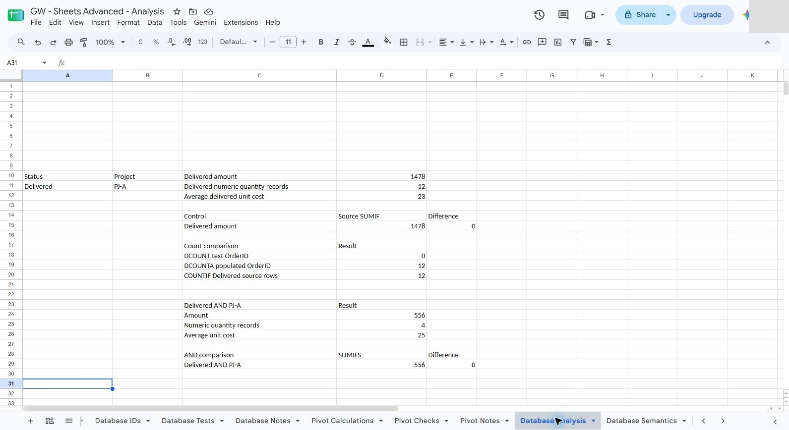

> **Validation boundary:** guided 8.1–8.3 and author casework 8.4 were executed through learner UI with bounded native-cell evidence. A mistaken author prediction was caught and corrected using source UnitCost sums; it was not a source-data defect. The Statuz 0/Status1478 observation is specific to the captured test. Independent learner question/OR diagnosis, human reviewer and the planned 60-minute allocation remain unverified.

## Independent Challenge

Close the earlier step lists for the first attempt. Use the case input and your own reasoning. If you need help, record the hint and repeat the affected check independently.

1. Write a new analysis question requiring two conditions and design its database criteria without copying a finished block.

2. Create a second version that uses OR instead of AND, predict the population difference and verify it through contributing IDs.

3. Explain the numeric field counted by DCOUNT, the average’s denominator and one overlap risk.

## Evidence to Hand Over

- Three labelled criteria blocks with source-ID reconciliation.
- AND/OR and overlap proof, plus weighted/unweighted meaning comparison.
- Independent question and corrected criteria-header test.

Record the defect or uncertainty you investigated, the evidence used, the repair or reasoned no-change decision, and the final state. Restore temporary changes or keep them in a clearly named scenario copy.

## Troubleshooting

| Symptom | What to check |
|---|---|
| An OR total double-counts overlapping rows | Compare the contributing ID sets and count each qualifying source record once. |
| An input or earlier result is missing | Reopen the input named in Before You Begin; do not substitute private company data |
| A menu or feature is unavailable | Confirm the account and the shared access notes; record the missing step and ask the trainer for its fallback |
| The result differs from the checkpoint | Compare the exact source range, wording and conditions before repeating the action |

## Lesson Summary

Database functions are useful when their header matching, criteria logic and field meaning are explicit.

**Check yourself:** Why is an average unit cost different from a quantity-weighted average?
