# 09 - Build a Dashboard

In this chapter you will choose charts, sparklines and filter views; distinguish source-linked charts from generated analysis snapshots.

> **Prompts and values:** use the [copy-paste page](./prompts.md) for the exact values used below.

**Target allocation:** 70 minutes: 15 explanation/demonstration, 27 guided build and casework, 20 independent challenge, 8 verification and repair. The active portion is 55 minutes by design. These are unmeasured targets awaiting a learner pilot.

**Your result:** A compact source-linked dashboard with a tested update path.

> **Status:** author reference with 31 staged application captures through 9.4. Native column chart, weekly sparkline, distinct KPI populations and recalculating Checks are verified. Existing-row +45 and scenario-copy +90 tests were restored. Independent PO025 coverage, reviewer and learner timing remain pending.

## What You Will Learn

- Choose source-linked visuals.
- Use a sparkline for a defined time sequence.
- Explain how a dashboard refreshes.

## Before You Begin

Read the [case input](./prompts.md) and use a separate named casework copy for destructive tests or altered datasets. Keep the baseline unchanged for later chapters. Record source facts, proposed practice and unresolved questions separately.

Use the checked advanced workbook with all-orders and delivered controls reconciled.

## 9.1 Build a Compact View

1. Create **Dashboard Data** separately from the maintained Analysis tab. Link A2:A4 to the three project labels PJ-A/PJ-B/PJ-C. In B2:B4 sum each checked Analysis project row across Delivered/Pending/Cancelled; C links Delivered and D links Pending. All project amounts are **980 /1204 /974**. Keep **Cancelled included** explicit.

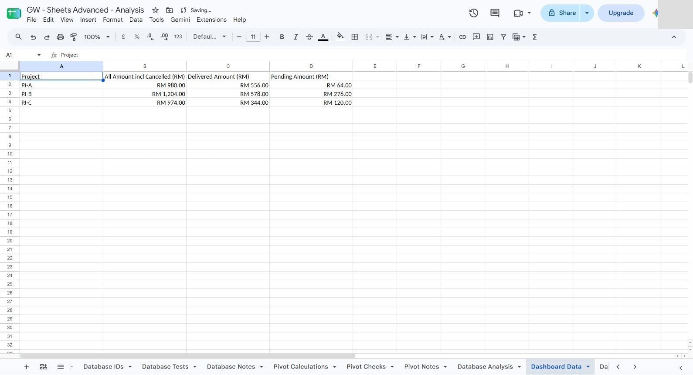

2. Create **Dashboard**. Set column A to 220 pixels and B:H to 140. Add the title and scope label. Link **A5:D8** to Dashboard Data A1:D4; this is a formula-linked view rather than copied static numbers.

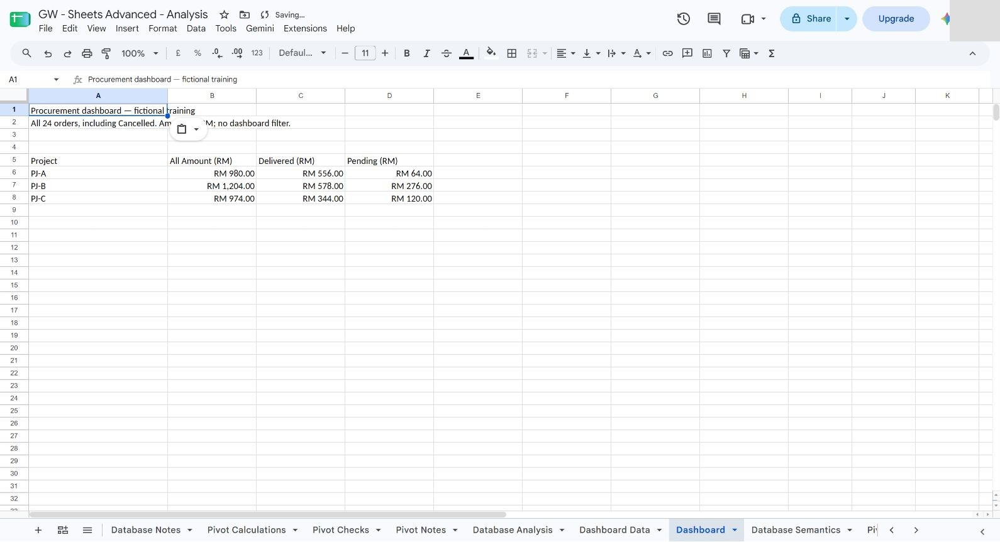

3. Select Dashboard **A5:B8 > Insert chart**. In the Chart editor Setup, choose **Column chart**, retaining header row 5 and project labels in column A. The automatic initial suggestion may be Pie; change the type explicitly.

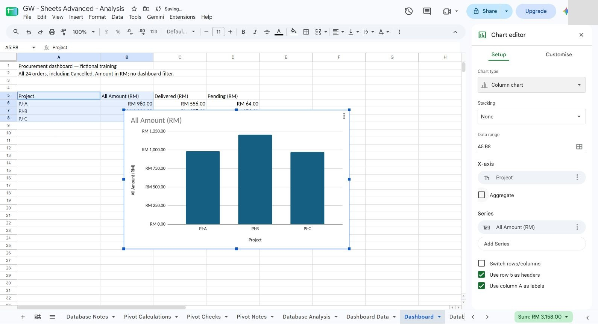

4. Under **Customise > Chart and axis titles**, set **Amount by Project - incl. Cancelled (RM)**. Under **Series**, enable **Data labels**. The captured title uses an em dash separator; its meaning and population are the same.

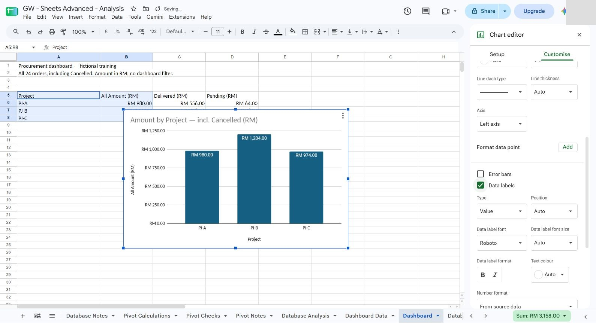

5. Select the chart border and drag its blank upper margin to the right of the working tables. Verify all three amount labels are visible and that the chart does not cover source cells or later controls.

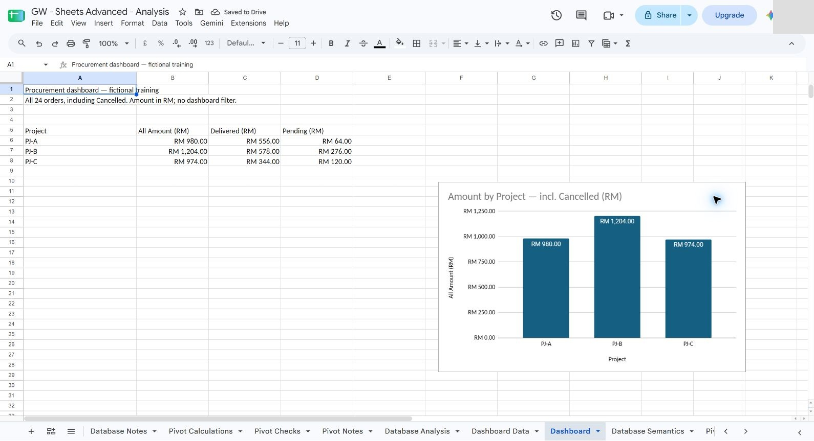

6. In Dashboard Data A7:B10 create a status record-count table using **COUNTIF(Orders!$G$2:$G$25,A8)** and corresponding status labels. Link it to Dashboard F5:G8. **Delivered 12 /Pending6 /Cancelled6** reconcile to 24 records.

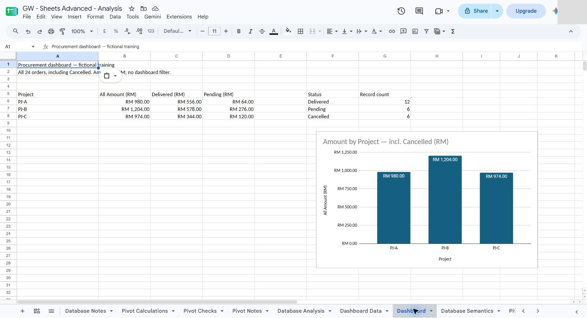

## 9.2 Show the Weekly Sequence

1. Use **Dashboard Data A15:E16**, because the draft's Analysis B16:E16 cells already contain earlier work. Put numeric week labels 1/2/3/4 in B15:E15. B16 is **=SUMIFS(Orders!$J$2:$J$25,Orders!$H$2:$H$25,B$15)**; fill across. The four practice-week totals are **728 /754 /850 /826**.

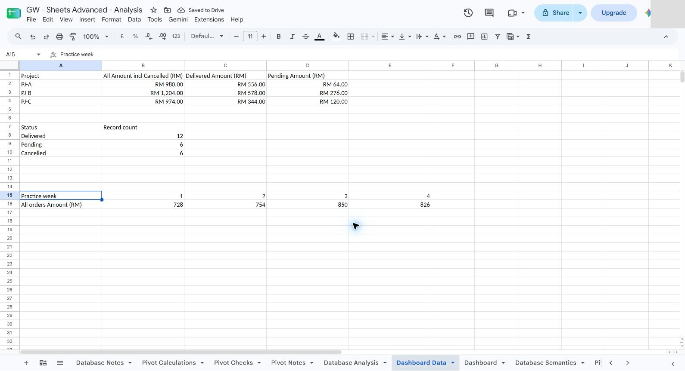

2. Add the A18:D19 control: source SUM of Orders J2:J25 and SUM of B16:E16 both return **3158**; their difference is **0**. These weeks are numeric practice periods, not an invented calendar.

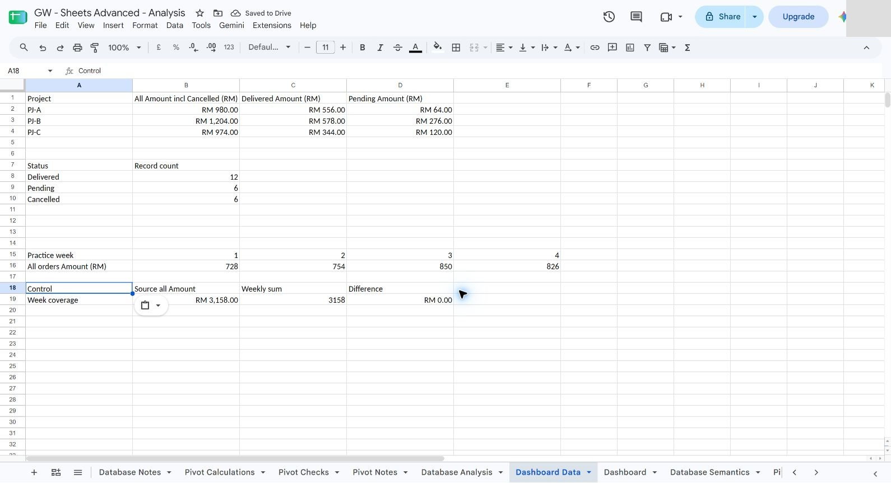

3. Link Dashboard B12:E13 to the week labels and amounts. Merge B15:E15 and enter **=SPARKLINE('Dashboard Data'!B16:E16)** in B15. Set row 15 height40 and label the trend in A15. B16 **=SUM(B13:E13)** returns 3158.

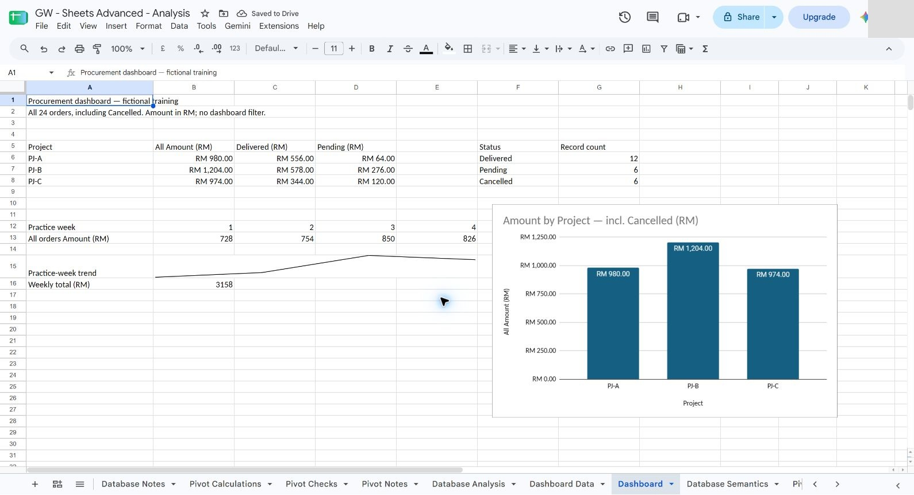

## 9.3 Test a Refresh

1. Before changing source, record the predicted **+45** delta for PO001 Quantity **2 to 3** at UnitCost 45. Expected line 135, PJ-A all amount 1025, Week 1 amount 773, total 3203 and unchanged record count 24.

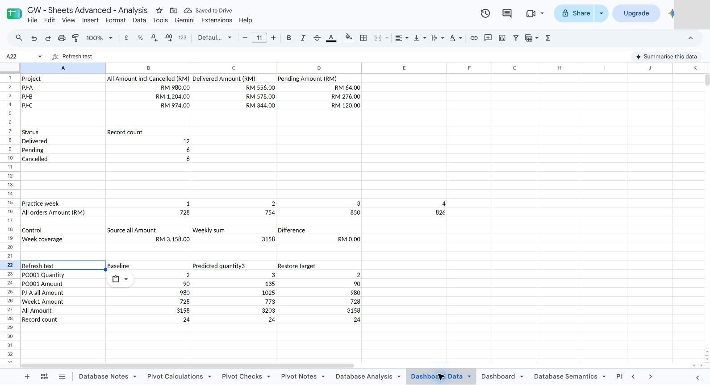

2. On maintained Orders, change **E2 to 3**. Inspect the PO001 source line and its calculated **Amount 135**. This is a temporary change to an existing record, not a new-row coverage test.

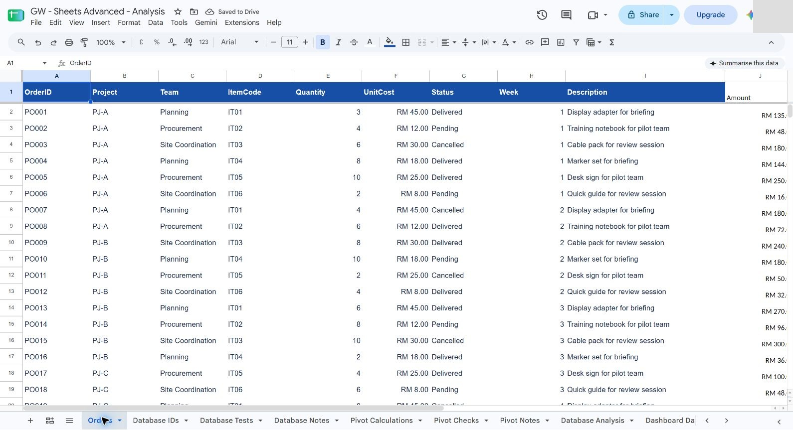

3. Inspect Dashboard. The project table and chart update PJ-A to **1025**; Week 1 becomes **773**, the sparkline shape changes and the weekly total becomes **3203**.

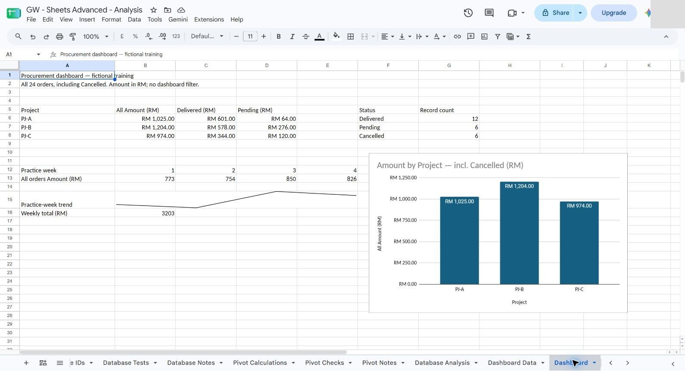

4. Inspect the existing native **Pivot Review**: its all-record total also becomes 3203 without a manual refresh in this captured test. Its source bounds remain the same 24-record table.

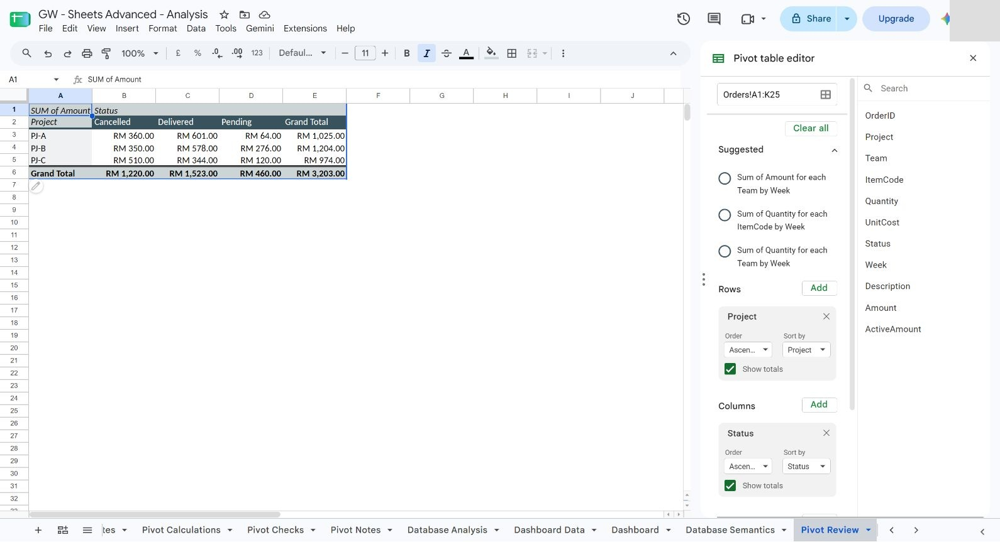

5. Inspect Dashboard Data's weekly totals and source comparison. Both totals are 3203 and the difference remains 0. Preserve the transient observation before restoration.

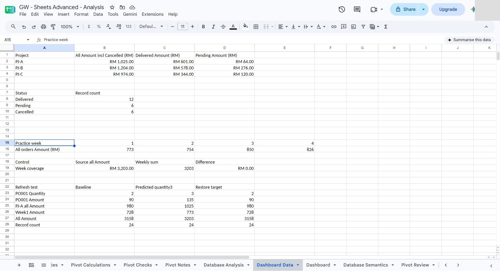

6. Restore **Orders E2 to 2**, returning the line Amount to 90.

7. Verify Dashboard returns to PJ-A980, Week 1 = 728 and total 3158; the chart and sparkline return to baseline.

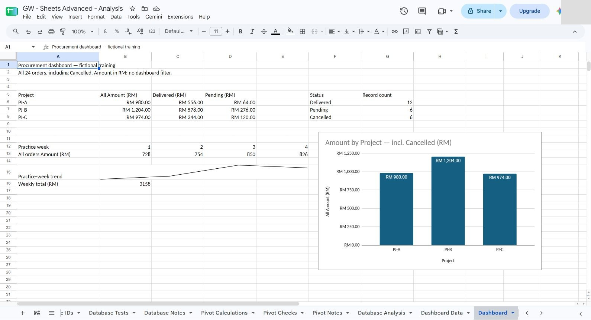

8. Confirm Pivot Review also returns to **3158**. Existing-row value refresh was automatic in this run; this does not establish automatic range extension for appended records.

## 9.4 Design a Dashboard With a Visible Refresh Contract

1. Create **Dashboard Contract** and record the audience, source **Orders A1:K25**, units RM,24-record population and practice weeks. Keep **all orders including Cancelled**, **ActiveAmount excluding Cancelled**, and **Delivered only** distinct. Predict the separate copy test before editing: Quantity 2 to 4 adds 90, giving line 180, PJ-A = 1,070, Week 1 = 818, total 3248, Active 2028 and Delivered 1568. Count remains 24.

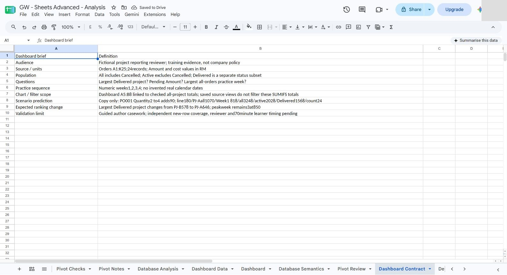

2. Add Dashboard A18:B22 KPI formulas: **COUNTA(Orders!A2:A25)=24**, **SUM('Dashboard Data'!B2:B4)=3158**, **SUM(Orders!K2:K25)=1938**, and **SUM('Dashboard Data'!C2:C4)=1478**. Label each population.

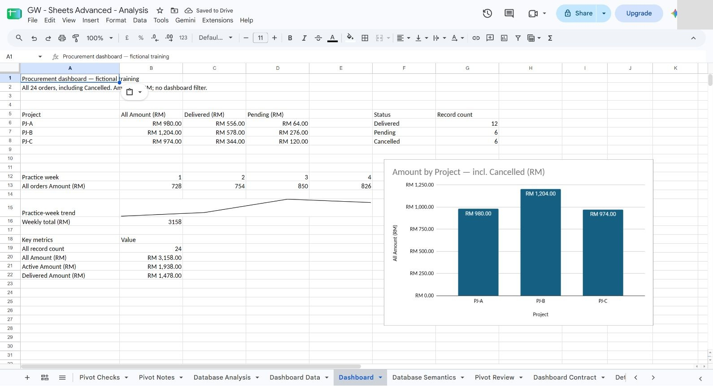

3. Add D18:E23 **Checks**. Compare count with Pivot Counts E6, all amount with source SUM J2:J25, active with Analysis C15, and Delivered with Database Analysis D10. All four differences are 0. E23 uses **=IF(COUNTIF(E19:E22,0)=4,"All checks pass","Review mismatch")**; it is a recalculating result, not typed assurance.

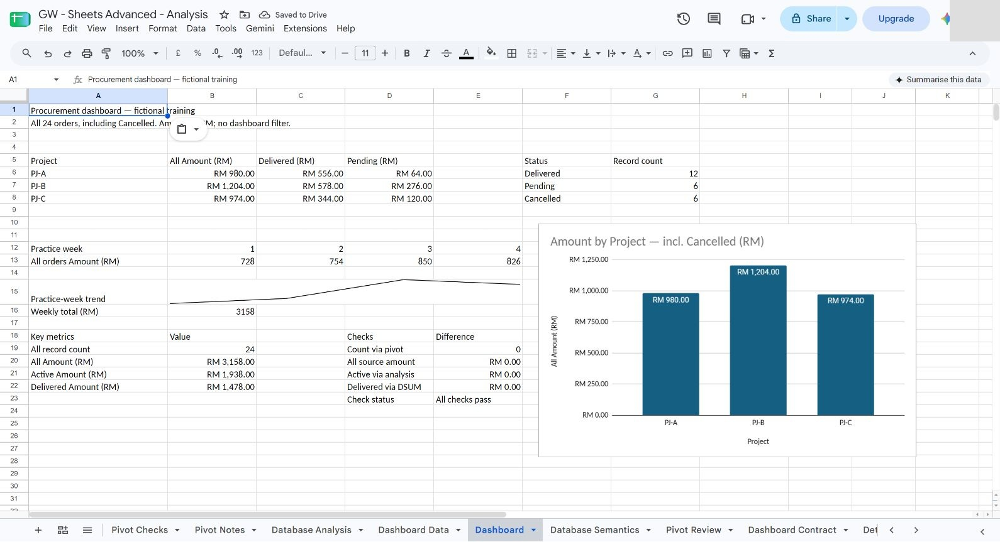

4. Answer the audience questions using formulas in A24:C27. Largest Delivered project is **PJ-B = 578**; total Pending Amount is **460**; largest practice week is **3 at 850**. Keep the chart's all-orders comparison distinct from the Delivered ranking.

5. Choose **File > Make a copy**, name it **GW - Sheets Advanced - Dashboard Refresh**, and retain the default practice folder. Leave sharing and comment-copy boxes unchecked.

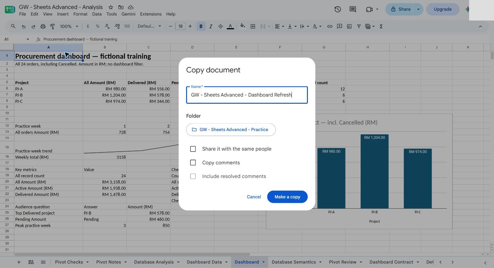

6. Open the new workbook and inspect Dashboard before editing. It starts at the same 24/3158/1938/1478 baseline and has its own source, formulas and chart.

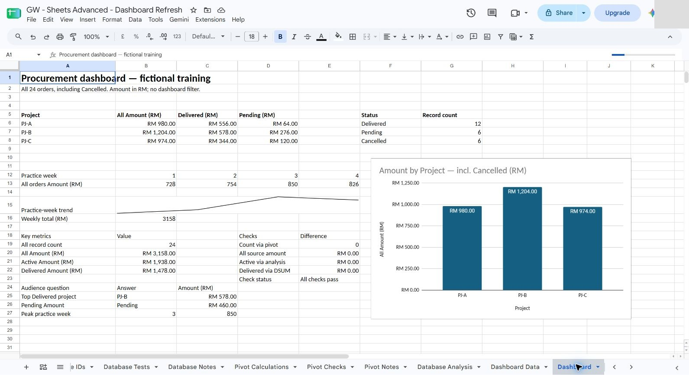

7. In this **copy only**, change Orders **E2 to 4**. PO001 Amount becomes **180**, a90 increase.

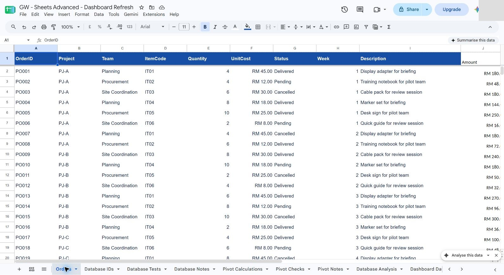

8. Inspect the copied dashboard: PJ-A all amount **1070**, Week 1 **818**, all amount **3248**, active **2028**, Delivered **1568**, count 24 and all Checks differences 0. The chart label and sparkline change. Largest Delivered project changes to **PJ-A = 646**; Pending remains 460 and week 3 remains largest at 850.

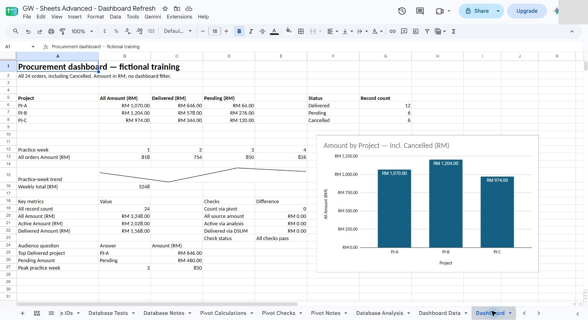

9. Check the copied native Pivot Review total **3248**. Pivot Counts remains 24. The copy retains its native source and pivot relationships.

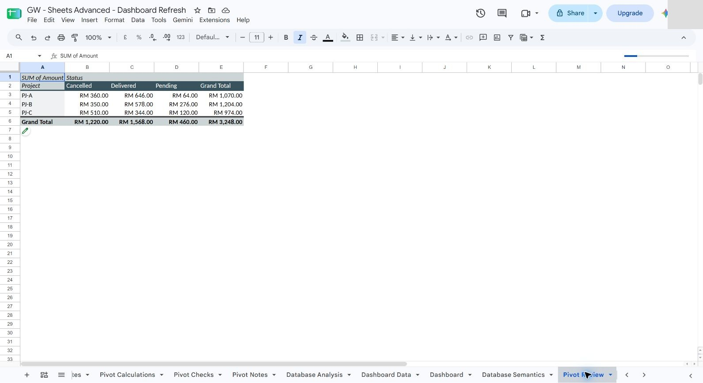

10. Check copied Dashboard Data: weekly amounts **818 /754 /850 /826**, weekly sum and source amount 3248, difference 0.

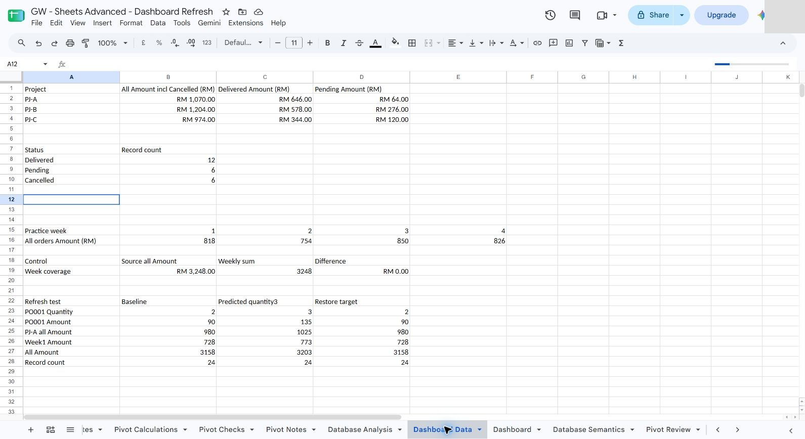

11. Restore the copy's **Orders E2 to 2**, returning line Amount 90.

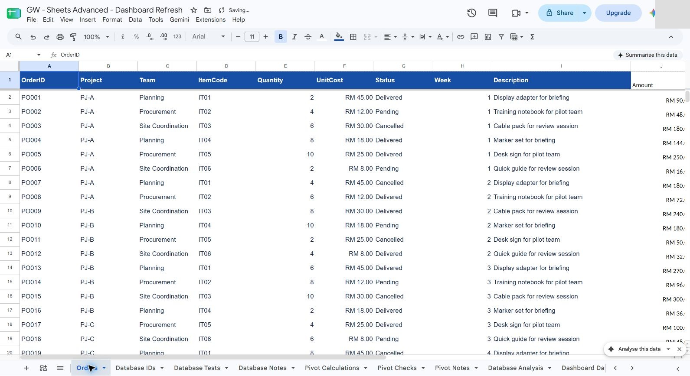

12. Confirm the copied Dashboard returns to **24 /3158 /1938 /1478**, PJ-B = 578, Pending = 460, peak week 3 at 850 and four zero differences. Retain the restored copy as evidence of the controlled test.

13. Complete the visible refresh contract in both workbooks. Record source/formula/pivot bounds, **Dashboard A5:B8** chart source, **Dashboard Data B16:E16** sparkline source and no dashboard filter. Named source filter views do not filter these SUMIFS totals. Static exports or generated snapshots need regeneration and verification; no generated snapshot was tested. New records require checking every dependent range. The independent PO025 challenge below remains unperformed.

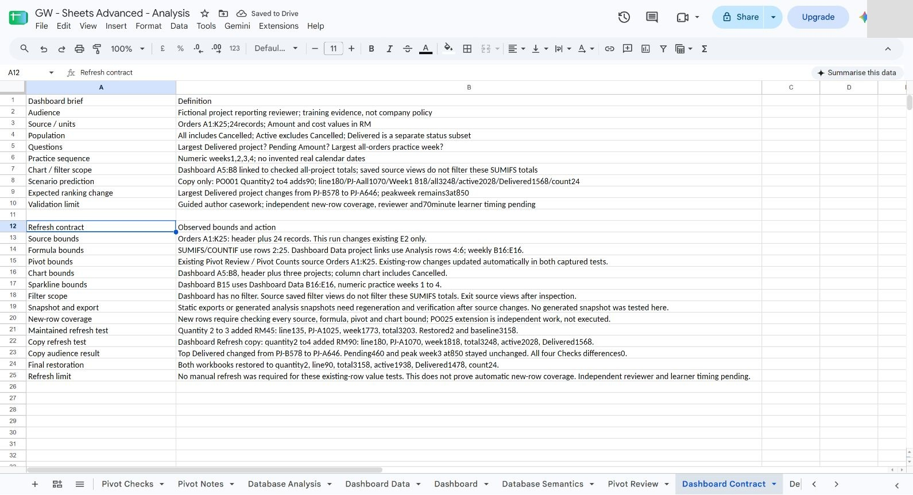

14. Finish on the maintained Dashboard and verify the reconciled baseline. Native bounded readback confirms source values/formats and earlier pivot definitions match their pre-test state. The two captured value-change tests needed no manual refresh; future row coverage and human comprehension still require separate checks.

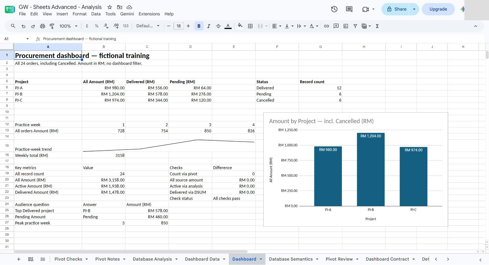

> **Validation boundary:** guided 9.1-9.3 and author casework 9.4 were executed through learner UI, with read-only native evidence of both temporary changes and restoration. This is not an independent learner attempt. PO025 range extension, human reviewer and the planned 70-minute classroom allocation remain unverified.

## Independent Challenge

Close the earlier step lists for the first attempt. Use the case input and your own reasoning. If you need help, record the hint and repeat the affected check independently.

1. Build an independent dashboard view answering the three audience questions on the card, with at least one visible reconciliation check.

2. Append PO025 only on a challenge copy and repair source-range coverage across KPIs, pivots, charts and the weekly sequence.

3. Ask a reviewer to identify the population and a stale component using the labels/checks, then revise any misleading element.

## Evidence to Hand Over

- Defined dashboard with distinct populations, units and recalculating controls.
- Source-change/restoration trace across line, summary and visuals.
- Independent new-row coverage test and a usable refresh contract.

Record the defect or uncertainty you investigated, the evidence used, the repair or reasoned no-change decision, and the final state. Restore temporary changes or keep them in a clearly named scenario copy.

## Troubleshooting

| Symptom | What to check |
|---|---|
| A dashboard looks current but omits the new line | Trace range coverage through every KPI and visual rather than checking only one total. |
| An input or earlier result is missing | Reopen the input named in Before You Begin; do not substitute private company data |
| A menu or feature is unavailable | Confirm the account and the shared access notes; record the missing step and ask the trainer for its fallback |
| The result differs from the checkpoint | Compare the exact source range, wording and conditions before repeating the action |

## Lesson Summary

A dashboard is useful when its totals, populations and update path are understandable.

**Check yourself:** Which dashboard objects depend on which source calculations?
