# 11 - Complete the Analysis Capstone

In this chapter you will answer a new project question, substantiate the finding and deliver a checked dashboard.

> **Prompts and values:** use the [copy-paste page](./prompts.md) for the exact values used below.

**Target allocation:** 80 minutes: 15 explanation/demonstration, 37 guided build and casework, 20 independent challenge, 8 verification and repair. The active portion is 65 minutes by design. These are unmeasured targets awaiting a learner pilot.

**Your result:** A source-traceable capstone analysis and checked presentation.

> **Status:** author reference with 32 staged application captures through 11.4. Baseline rankings, independent pivot/ID controls, zero/boundary cases, duplicate/missing keys and a separate PO025 ranking/week scenario are verified. Independent challenge, human review, spoken delivery and learner timing remain pending.

## What You Will Learn

- Answer a new analysis question.
- Reconcile a result independently.
- Communicate assumptions and limitations.

## Before You Begin

Read the [case input](./prompts.md) and use a separate named casework copy for destructive tests or altered datasets. Keep the baseline unchanged for later chapters. Record source facts, proposed practice and unresolved questions separately.

Create a challenge copy. Use the same 24-order source and six-item Rates table; do not import real purchasing data.

## 11.1 Define and Calculate

1. In the maintained analysis workbook choose **File > Make a copy**. Name it **GW - Sheets Advanced - Capstone** in the practice folder. Leave sharing and comments unchecked. Work in this isolated copy; retain the original baseline.

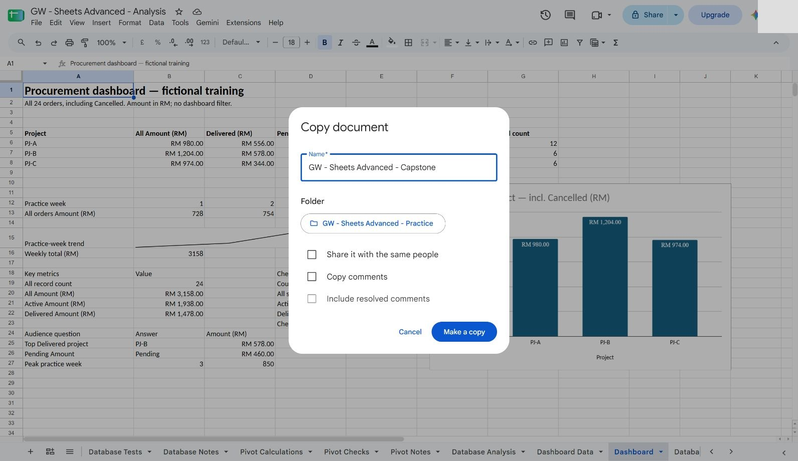

2. Add **Capstone Spec**. Before calculating, write the three populations: Delivered Amount by Project; Pending records with Amount >=200 and their IDs; all-order Amount by numeric practice week. Use Orders A1:K25 (24 records) and Rates A1:D7 (six item keys). Weekly totals include Cancelled; Delivered totals exclude Pending and Cancelled. These are practice periods, not calendar dates. Record the metric, threshold, exclusions, tie rule, source bounds and interpretation limits.

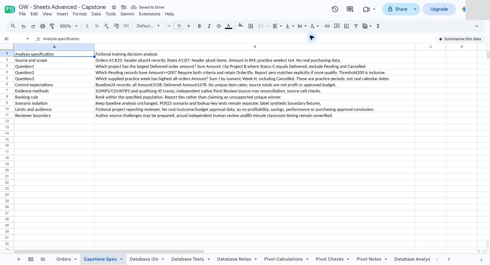

3. Add **Capstone Calculations**. Put PJ-A, PJ-B and PJ-C in A2:A4. Calculate Delivered Amount in B2 and copy down, keeping source ranges fixed:

```text
=SUMIFS(Orders!$J$2:$J$25,Orders!$B$2:$B$25,A2,Orders!$G$2:$G$25,"Delivered")
```

Count Delivered records with COUNTIFS using the same Project and Status criteria. The amounts are **556 / 578 / 344**, four records each, total **1,478**. Use MAX with INDEX/MATCH to identify **PJ-B, RM578**. Count ties at the maximum; the baseline has one leader. If a future dataset ties, report all tied projects rather than silently choosing the first match.

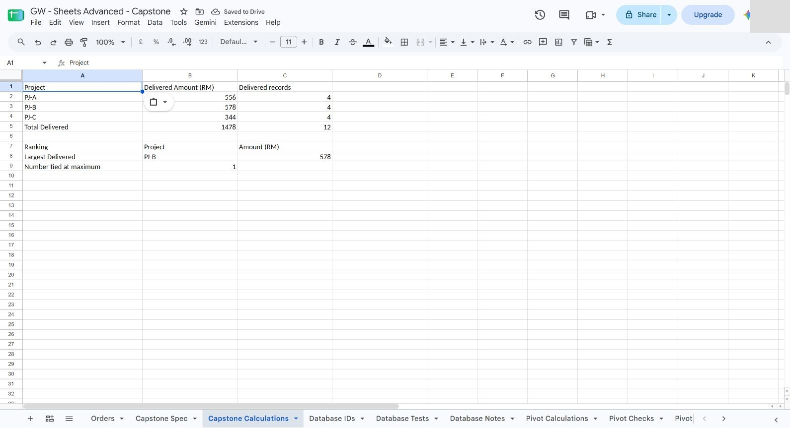

4. Use COUNTIFS and SUMIFS for Status=Pending AND Amount>=200. The actual baseline has **0 qualifying records and RM0**, with **No qualifying baseline records** as the ID-list outcome. Keep a genuine empty result distinct from a missing-data or formula error.

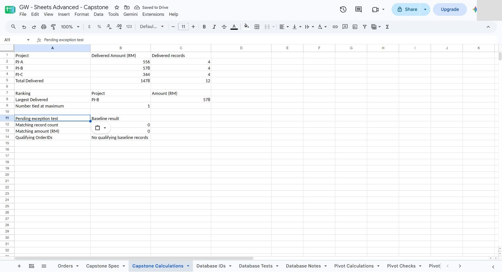

5. Add **Capstone Trace**. In A2 filter OrderID, Project and Amount for Status=Delivered and the winning project. Retain the contributing IDs **PO009, PO012, PO013 and PO016**; their amounts **240+32+270+36=578**. Check both sum and record count against the ranking. The copy-paste page supplies exact cells and formulas; do not paste later sections before their stage.

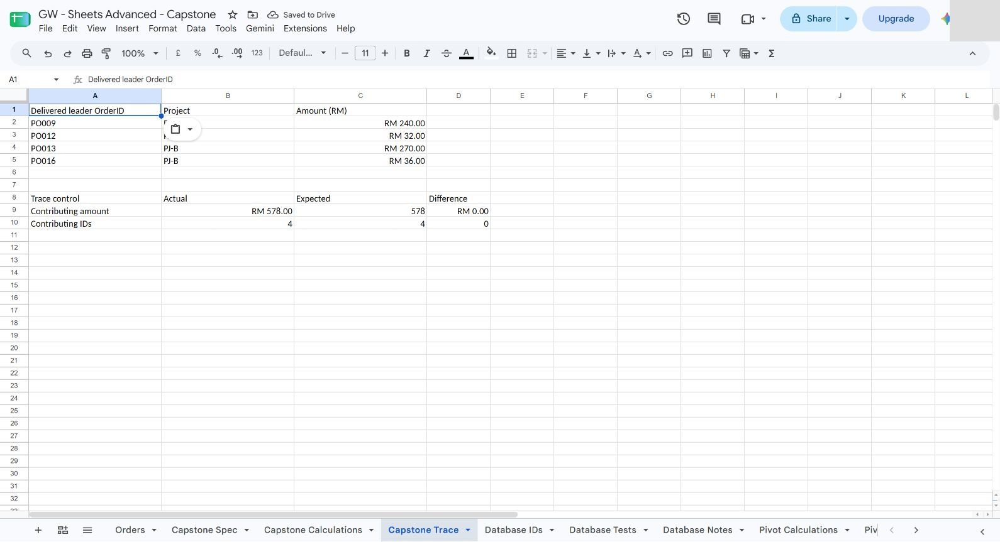

## 11.2 Challenge the Result

1. Inspect the existing **Pivot Review** in this copy. Confirm its source is Orders A1:K25, Project rows, Status columns and SUM of Amount. Delivered is column C: **556 / 578 / 344**, total **1,478**. Its all-order grand total is **3,158**. This retained native pivot supplies an independent aggregation method; the new formula table alone is not an independent check.

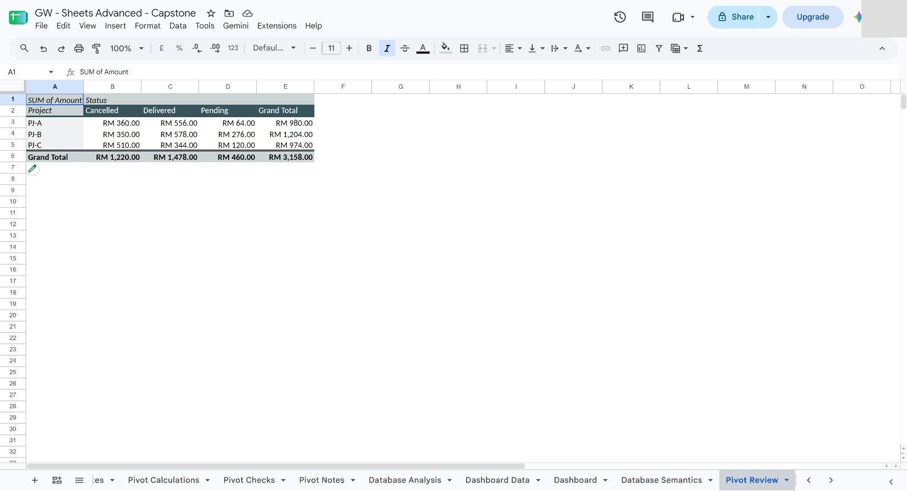

2. Link pivot controls into Capstone Calculations. Compare project Delivered amounts and the total, all-order Amount, record count and rate-key count. Differences must be zero: all Amount **3,158**, Delivered **1,478**, **24 records**, **six unique rate keys**. Investigate any difference before interpreting the ranking.

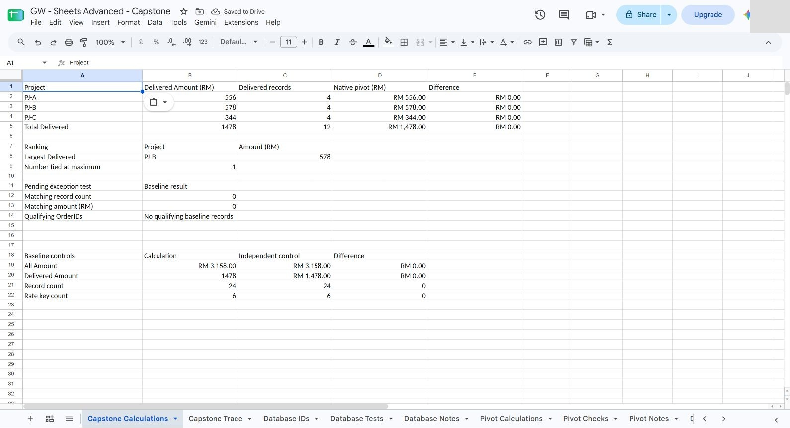

3. Add **Capstone Tests**. Inspect baseline **PO010**, Pending Amount **180**. It fails Amount>=200 even though its status is Pending. Both conditions must hold.

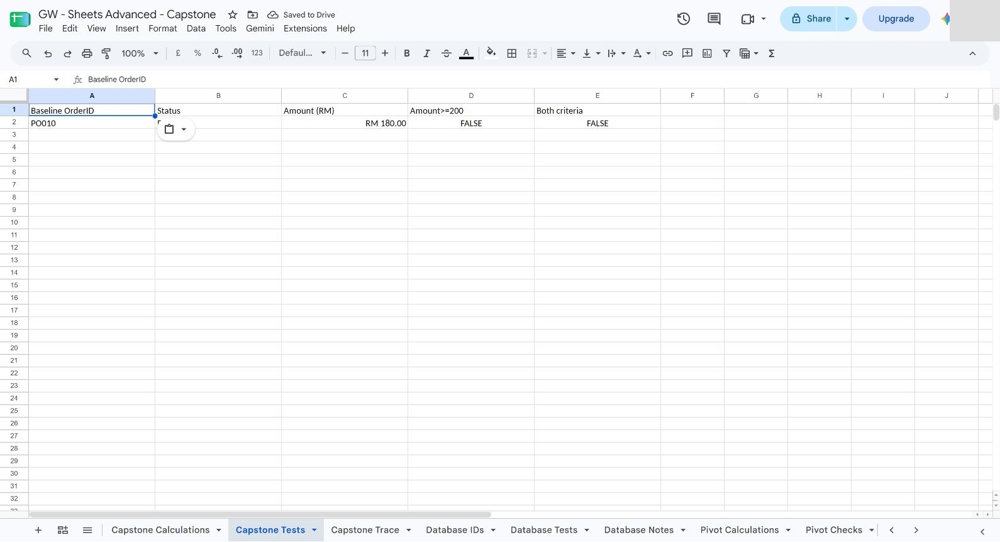

4. Below the baseline check, prepare a separate synthetic fixture. Predict outcomes before entering the actual-test formulas: Pending 199.99 FALSE; Pending 200 TRUE; Pending 250 TRUE; Delivered 250 FALSE. These synthetic values stay outside Orders and the baseline totals.

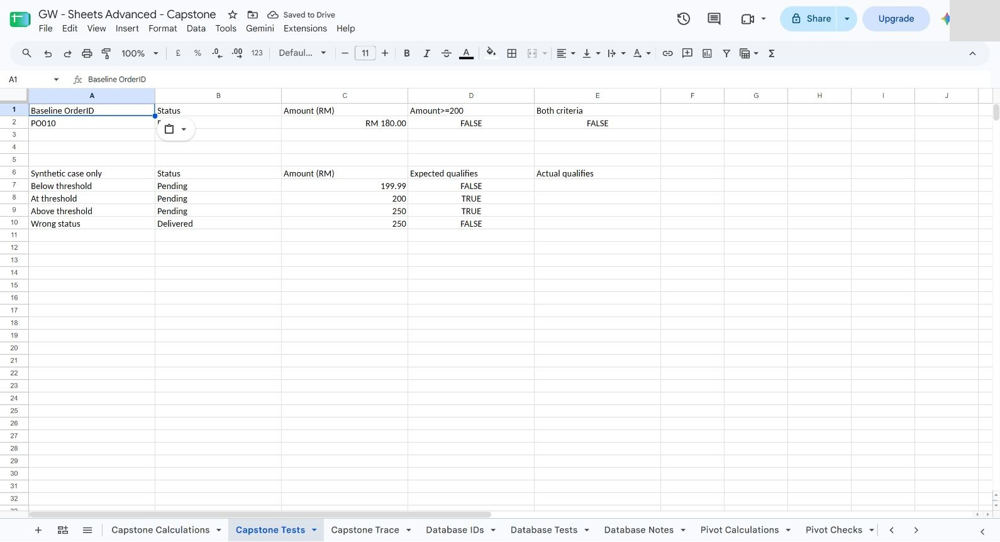

5. Calculate the actual AND tests. COUNTIFS should give **2 matches** and SUMIFS **450**, with zero differences from the predictions. This verifies the inclusive boundary and the status condition without manufacturing a positive baseline record.

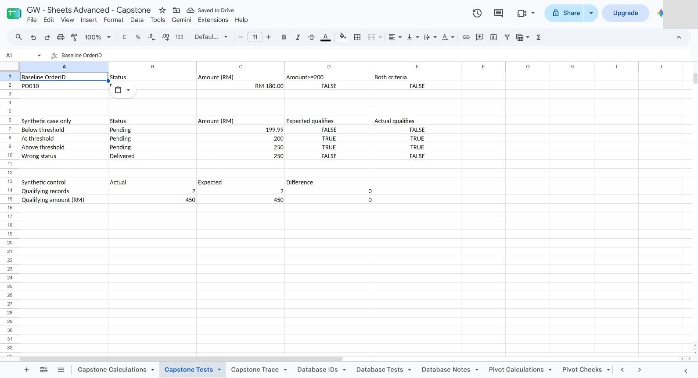

6. Duplicate the **Rates** tab through its tab menu and rename the duplicate **Capstone Key Test**. Keep the baseline Rates tab unchanged.

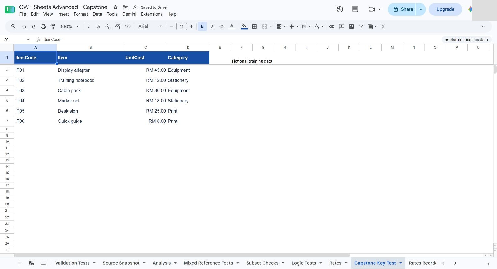

7. Add a conflicting **IT01** fixture at row8 with rate 99. Test keys IT01, IT99 and IT02 in F2:F4. Count matches before accepting a lookup result. IT01 has two matches, IT99 none, IT02 one. The raw exact VLOOKUP returns the first IT01 rate 45, **Missing rate** for IT99, and 12 for IT02. A guarded result must show **Review key** whenever the match count is not one. A missing rate is not a confirmed numeric zero.

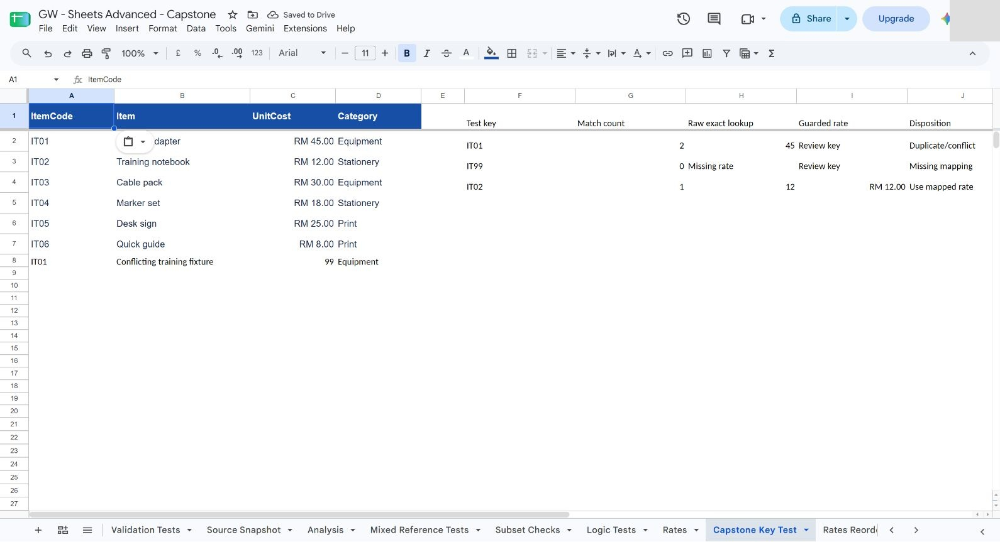

8. On this fixture only, exchange the two conflicting IT01 rate values: C2=99 and C8=45. Observe the raw first-match lookup change **45 to 99** while the guard still reports Review key. A plausible numeric answer does not resolve a duplicate-key conflict.

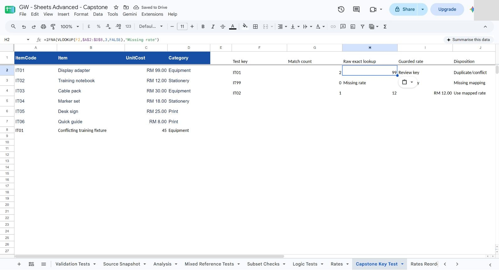

9. Restore fixture ordering to C2=45 and C8=99. Retain the labelled conflict for discussion, with its duplicate/missing dispositions. Do not choose an authoritative price automatically. The baseline Rates and Orders tables remain unchanged.

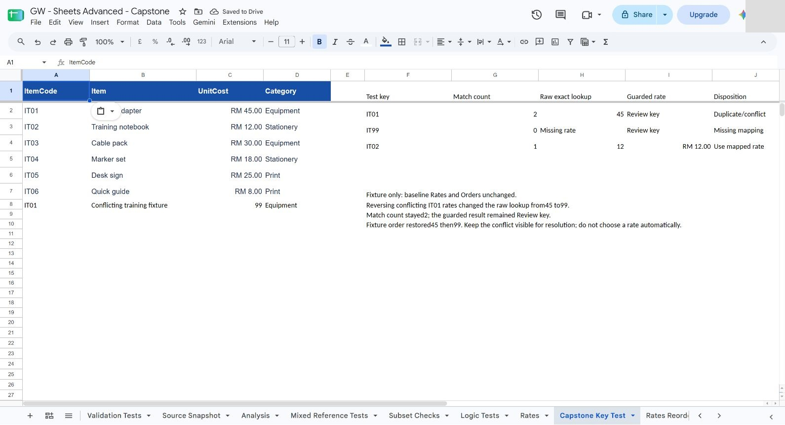

## 11.3 Present the Analysis

1. Extend Capstone Calculations with numeric weeks 1–4. Use SUMIFS on Orders H2:H25 and J2:J25, including all statuses. Compare each result with the existing Dashboard Data weekly control: **728 / 754 / 850 / 826**, total **3,158**. Week **3** is largest at **RM850**. Keep chronological order; these practice periods do not establish a forecast.

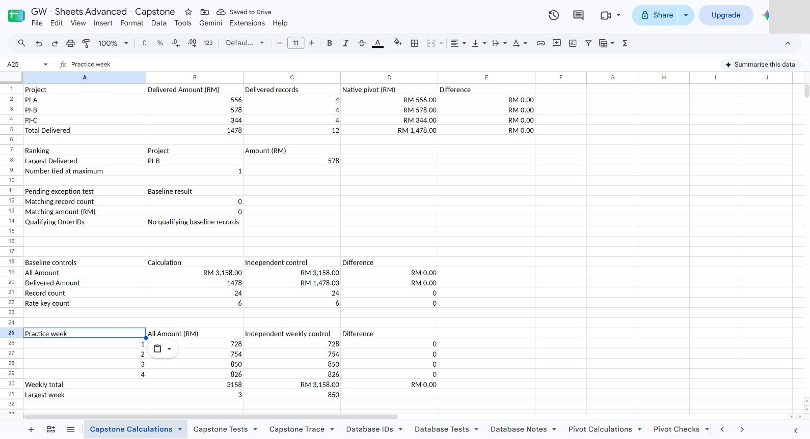

2. Add **Capstone Executive**. Prepare a clear table with project names, Amount in RM, Delivered record counts and the three checked answers. Show source population, a limitation and a refresh contract. The baseline answers are **PJ-B 578**, **Pending>=200 zero**, and **week 3 850**. A table meets this section's presentation requirement.

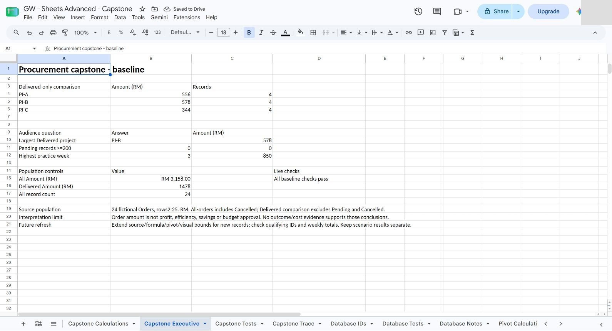

3. Add **Capstone Audit**. Record source bounds, population definitions, pivot reconciliation, source IDs, zero-match and boundary evidence, lookup assumptions and unresolved data issues. Explain that new records require source, formula, pivot, trace, visual and control coverage checks. Order Amount does not establish profit, savings, efficiency or budget approval. Leave independent review, spoken recommendation and the 80-minute classroom target explicitly pending.

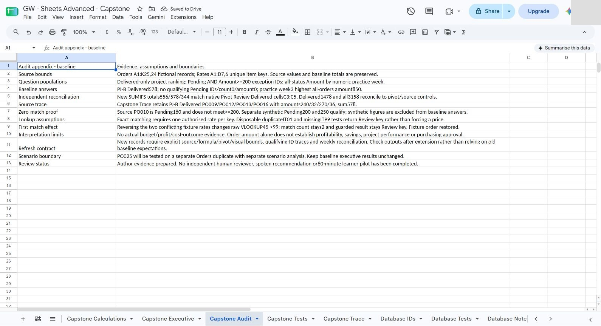

## 11.4 Complete a Decision Analysis With Independent Evidence

1. Add **PO025 Plan** before changing any source. Predict the supplied case: PJ-A, Planning, IT01, quantity 2, unit cost 45, Delivered, week 4; Amount 90 and ActiveAmount 90. Baseline Delivered project amounts are 556/578/344. Predict **PJ-A 646** becoming the Delivered leader, total Delivered **1,568**, all Amount **3,248**, ActiveAmount **2,028**, **25 records**. Week4 should become **916**, exceeding week 3 850. Pending>=200 remains zero.

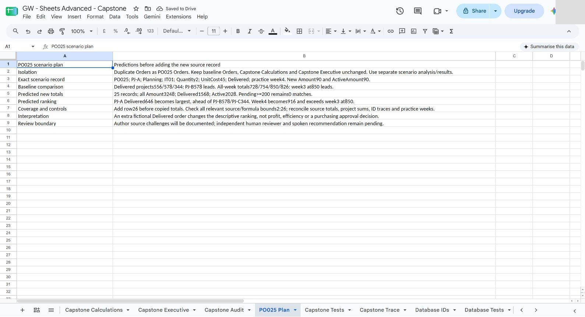

2. Duplicate Orders as **PO025 Orders**. Keep Capstone Calculations and Capstone Executive on the unchanged 24-record baseline. Add **PO025 Analysis** for scenario calculations.

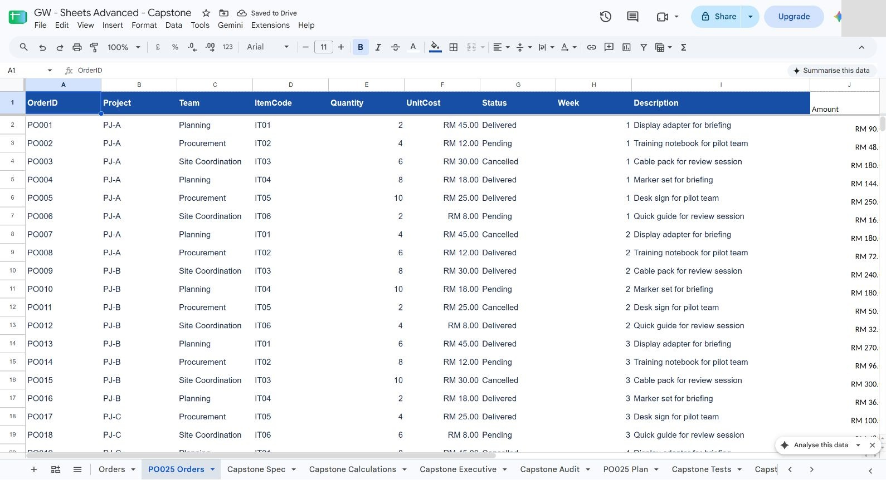

3. Before appending, record original-bound scenario controls using rows2:25. They agree with the baseline: all 3158, Delivered 1478, Active 1938, count 24, week 4 826. A zero difference here describes only the original population.

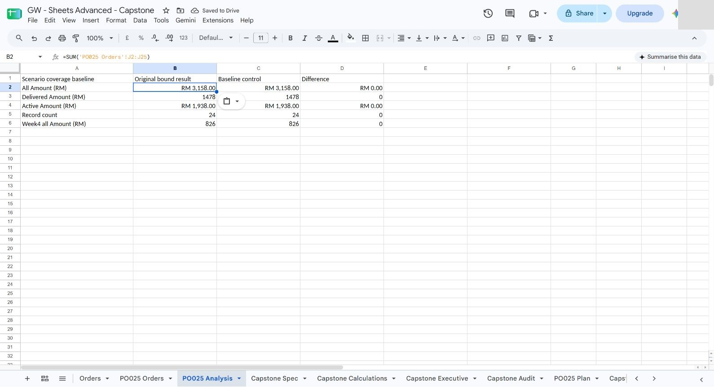

4. In PO025 Orders select row26 and use **Insert 1 row above** to preserve the copied totals below it. Enter PO025 at A26:K26 using the exact case row on the copy-paste page. J26=E26*F26 and K26 excludes Cancelled. Check Amount and ActiveAmount are 90. Do not add this record to baseline Orders.

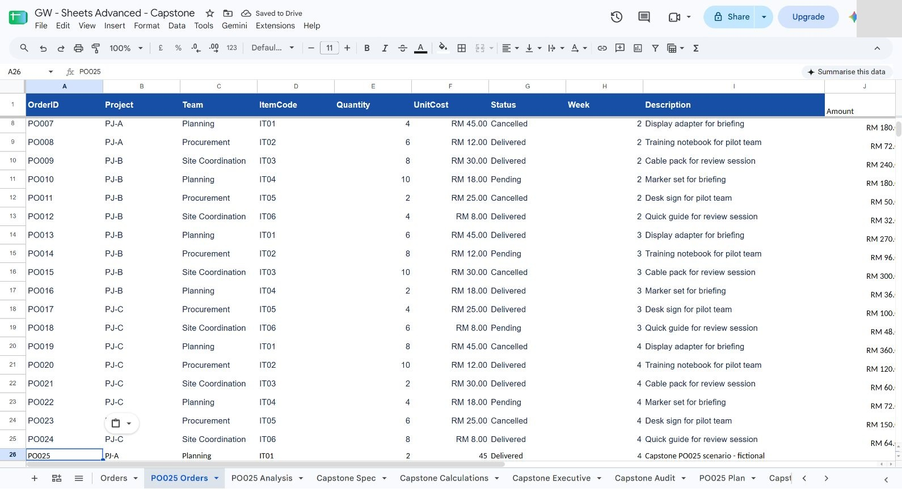

5. Revisit PO025 Analysis without changing its formulas. In the captured run, fixed ranges ending at25 still returned **3158 / 1478 / 1938 / 24 / 826**. They still matched the old baseline despite omitting PO025. Verify the actual range text in your own run; an old zero-difference control does not prove new-row coverage.

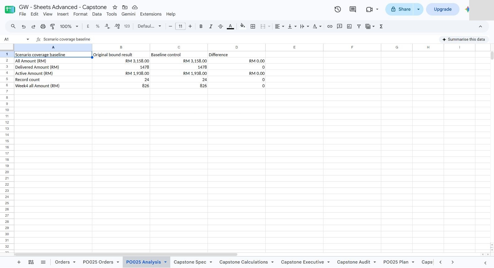

6. Expand scenario ranges consistently to row26, including the copied source totals now at J28/K28. Compare scenario results against baseline with expected deltas **90 / 90 / 90 / 1 / 90**. Differences against these new expectations must be zero. Label baseline comparisons as deltas, rather than treating every legitimate scenario difference as an error.

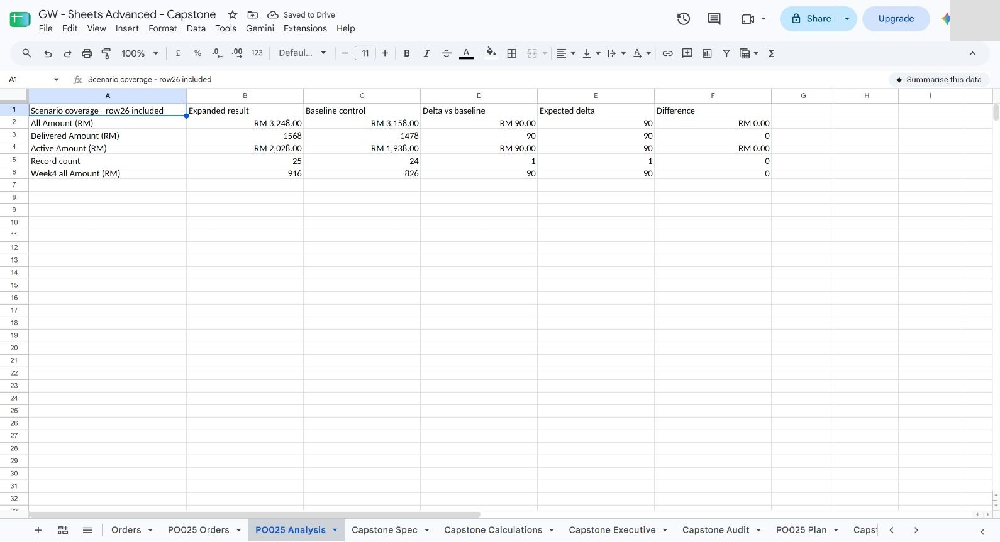

7. Build project Delivered and all-order weekly comparisons. Reconcile SUMIFS with SUM(FILTER) over the same scenario population. Project Delivered amounts are **646 / 578 / 344**; weeks 1–4 are **728 / 754 / 850 / 916**. Calculate the leader and largest week from the checked values. Confirm 25 unique IDs, Pending>=200 count 0 and Amount 0.

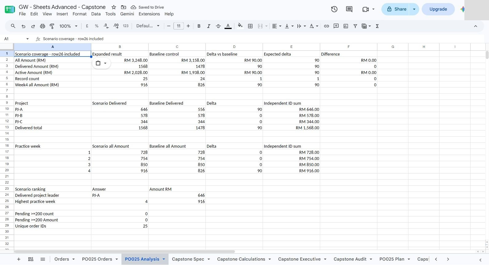

8. Align the comparison columns and use short, readable headers. Formatting must retain the populations and control meaning.

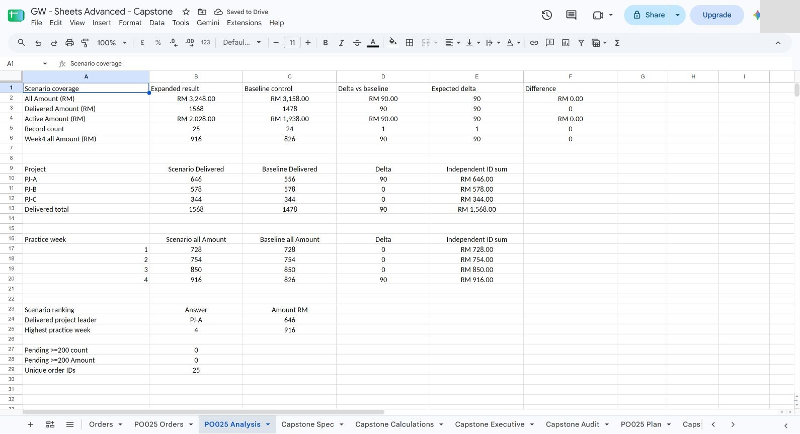

9. Extend Capstone Trace in separate columns E:H. Preserve the baseline trace at A:D. The new PJ-A leader consists of **PO001 / PO004 / PO005 / PO008 / PO025**, amounts **90 / 144 / 250 / 72 / 90**, sum **646**, five contributing records. Check the sum and count independently. These staged views show the new trace beside the unchanged baseline trace.

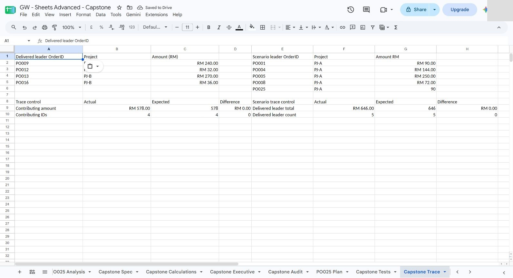

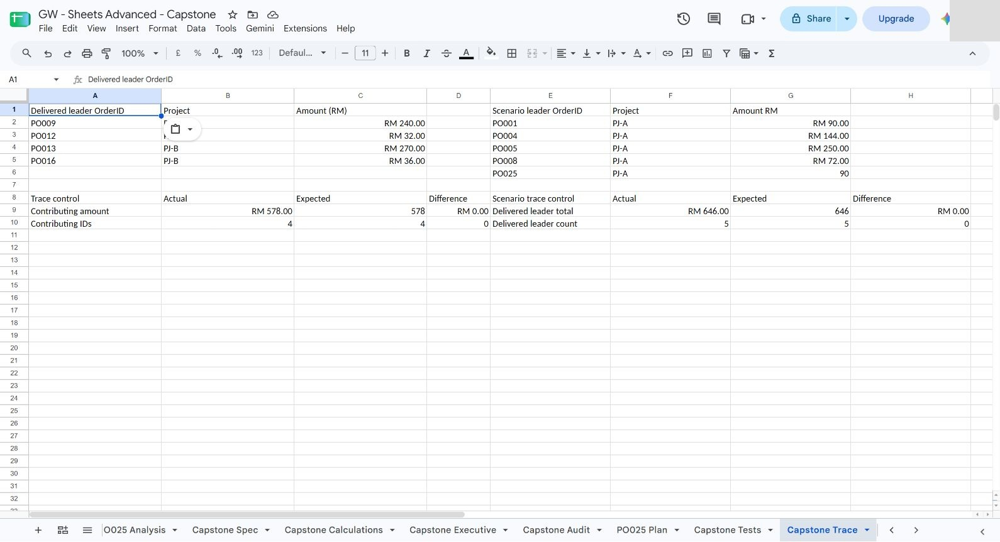

10. Add **PO025 Comparison**, with linked baseline and scenario values. Report **PJ-B 578 to PJ-A 646** as a change of leader, and **week 3 850 to week 4 916** as a change of period. Those maxima represent different populations; their numeric difference is not a price, performance or profit change. Include all 3158→3248, Delivered 1478→1568, Active 1938→2028 and count 24→25.

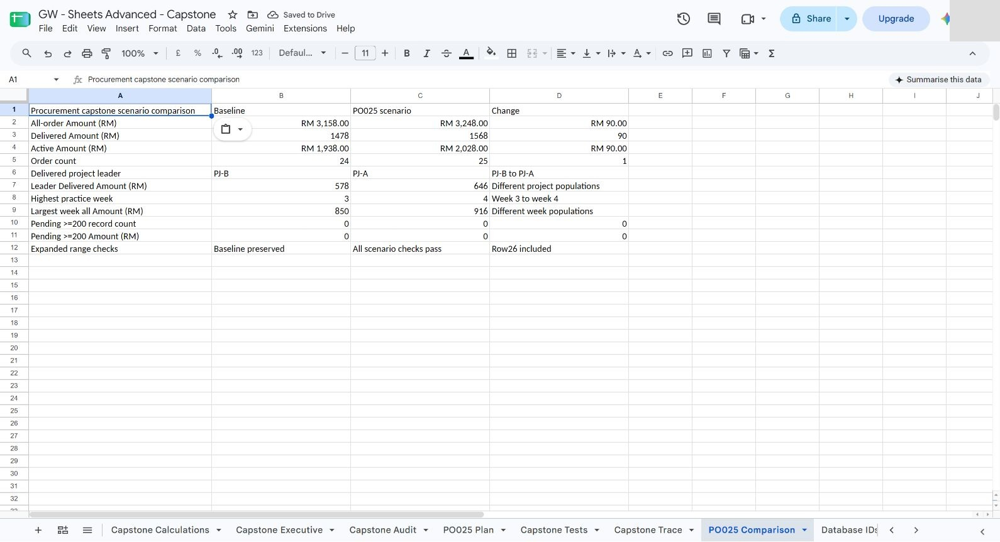

11. Add the source populations, fictional-data limitation, row26 refresh contract and pending review status. Keep the baseline executive output separate.

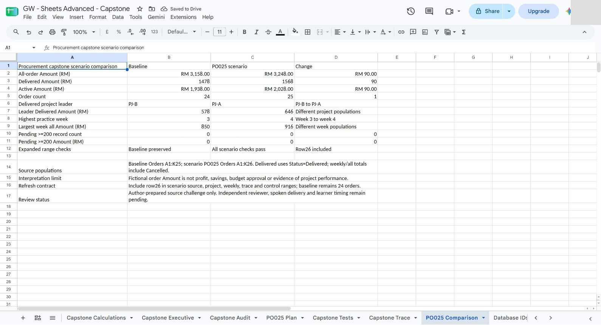

12. Complete the audit appendix with observed scenario results and source-backed challenge responses. For example: why PJ-B originally? Four source IDs sum to 578 and the native pivot agrees. Why zero Pending exceptions? Inspect actual baseline rows and the separate inclusive-boundary fixture. Why the week shift? **826+90=916>850**, corroborated by expanded source calculations. These are author-prepared responses; ask a real reviewer to challenge one answer during the class and record their question and your evidence. That human review was not performed in the captured walkthrough.

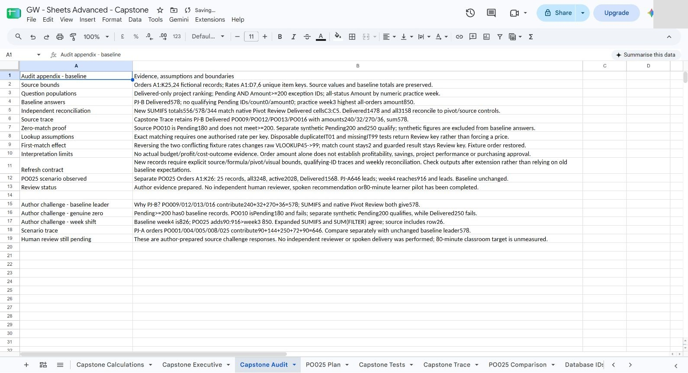

13. Reopen Capstone Executive and confirm the baseline remains **PJ-B 578 / zero qualifying Pending / week 3 850**, with all baseline checks passing.

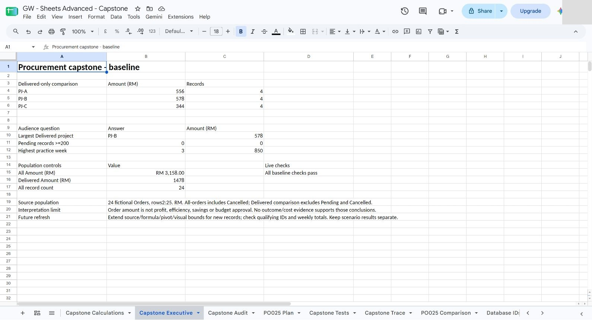

14. Finish with the unobscured source traces: baseline four IDs 578 beside scenario five IDs 646. Retain the baseline, labelled fixture, scenario, controls and audit together. No real purchasing decision, sharing action or budget approval is established.

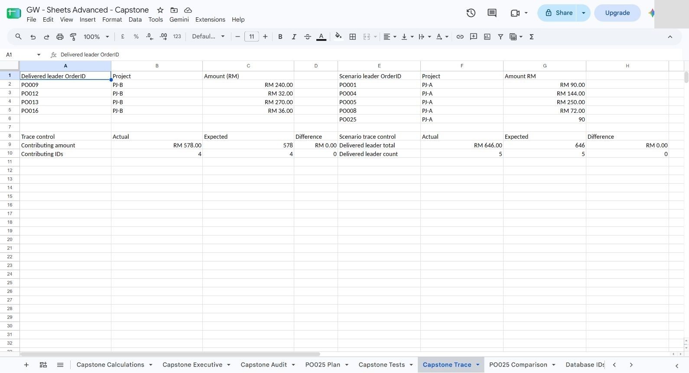

**Author verification:** guided 11.1–11.4 calculations and scenario were executed in the learner UI. Source/formats, previous pivots/dashboard and baseline executive calculations were checked unchanged. New capstone/scenario formulas are error-free. Independent challenge, actual reviewer, spoken delivery and classroom timing remain unperformed.

## Independent Challenge

Close the earlier step lists for the first attempt. Use the case input and your own reasoning. If you need help, record the hint and repeat the affected check independently.

1. Independently compare all-orders and active populations and explain how excluding Cancelled changes the question and results.

2. Stress-test an unknown rate key and a duplicate lookup key in a scenario copy. Demonstrate the warning/disposition rather than forcing a numeric answer.

3. Deliver a three-minute recommendation limited to what the data supports, plus one next question requiring additional evidence.

## Evidence to Hand Over

- Three-question specification and independently reconciled results.
- Separate added-row and key-quality scenarios with audit evidence.
- Executive output, reviewer challenge response and a bounded recommendation.

Record the defect or uncertainty you investigated, the evidence used, the repair or reasoned no-change decision, and the final state. Restore temporary changes or keep them in a clearly named scenario copy.

## Troubleshooting

| Symptom | What to check |
|---|---|
| A recommendation claims savings or profitability | Return to dataset meaning and request missing cost/outcome evidence before making that claim. |
| An input or earlier result is missing | Reopen the input named in Before You Begin; do not substitute private company data |
| A menu or feature is unavailable | Confirm the account and the shared access notes; record the missing step and ask the trainer for its fallback |
| The result differs from the checkpoint | Compare the exact source range, wording and conditions before repeating the action |

## Lesson Summary

The capstone combines reliable data, explicit calculations and a defensible explanation.

**Check yourself:** Would the same result follow if Cancelled records were included?


## Zero-Match Check

The supplied baseline has no Pending record with Amount at least 200. Record that result explicitly. Use a separately labelled synthetic case to prove the positive branch; do not edit baseline records just to obtain a highlight.
