# 12 - Review and Handover

In this chapter you will explain assumptions, refresh steps and known data limitations.

> **Prompts and values:** use the [copy-paste page](./prompts.md) for the exact values used below.

**Target allocation:** 50 minutes: 10 explanation/demonstration, 20 guided build and casework, 15 independent challenge, 5 verification and repair. The active portion is 40 minutes by design. These are unmeasured targets awaiting a learner pilot.

**Your result:** A restored baseline and an update-tested workbook handover.

> **Status:** author reference with 37 staged application captures through 12.4. Recovery baseline, runbook/range inventory, whole-workbook PO025 extension, committed native pivots, chart/sparkline, unresolved-key route and release manifest are verified. Independent PO026, actual partner review, spoken delivery and learner timing remain pending.

## What You Will Learn

- Explain the workbook update path.
- Identify future maintenance work.
- Leave a checked final state.

## Before You Begin

Read the [case input](./prompts.md) and use a separate named casework copy for destructive tests or altered datasets. Keep the baseline unchanged for later chapters. Record source facts, proposed practice and unresolved questions separately.

Use your baseline workbook and separate capstone copy.

## 12.1 Review the Baseline

1. Open **GW - Sheets Advanced - Analysis** and inspect Orders. Restore any temporary source edits from your exercises. In this author run, the maintained source was already restored; no source values needed changing. Keep the 24 supplied records and six-key Rates mapping intact. Labelled historical test tabs remain teaching evidence.

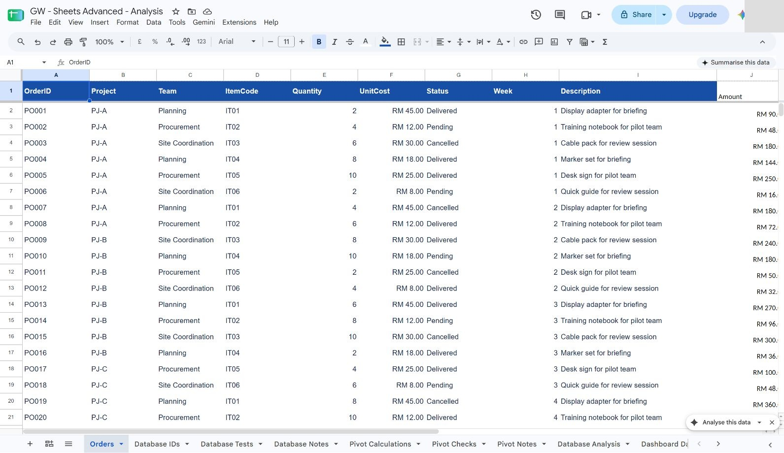

2. Inspect **Filter views**. The captured workbook has named views **DB8 - Delivered** and **DB8 - Delivered AND PJ-A**, both inactive. Keep these recognisable teaching views. Close an active view before interpreting all-order totals; do not delete a named view just because it exists.

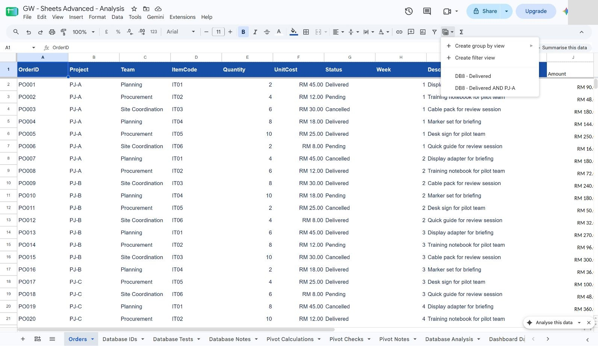

3. On Dashboard verify **24 records / all Amount 3,158 / Active 1,938 / Delivered 1,478**. Status counts are **12 Delivered /6 Pending /6 Cancelled**. The four control differences are zero and status reads **All checks pass**. Record these baseline values before any extension. The baseline chart shows project all-order amounts **980 /1,204 /974**; practice weeks are **728 /754 /850 /826**.

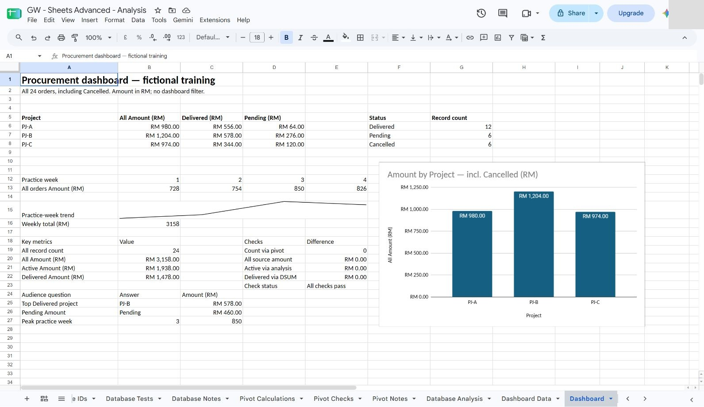

## 12.2 Write the Handover

1. Choose **File > Make a copy**, name it **GW - Sheets Advanced - Handover Baseline**, and retain it as a recovery copy. Leave sharing and comments unchecked. The maintained original and earlier capstone output remain separate.

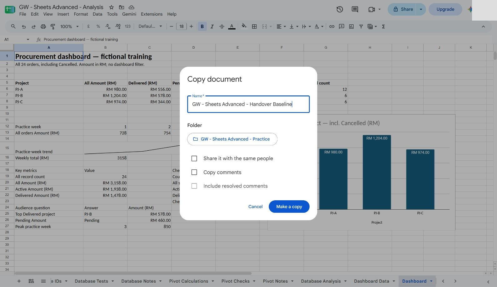

2. Add a **Runbook** sheet. Record source location and grain: Orders A1:K25 is one fictional order line per unique OrderID; Rates A1:D7 is one authoritative row per ItemCode. List accepted inputs, editable A:I fields, formula columns J:K, population definitions, pre-update controls and exception handling. Quantity must be a whole nonnegative number; weeks are numeric practice periods 1–4. Check a supplied UnitCost against its unique mapping; that check does not approve a purchase.

The copy-paste page contains the staged version 1 text. Read it before testing and record instructions that need interpretation. Keep missing or conflicting keys visibly unresolved rather than forcing a numeric answer.

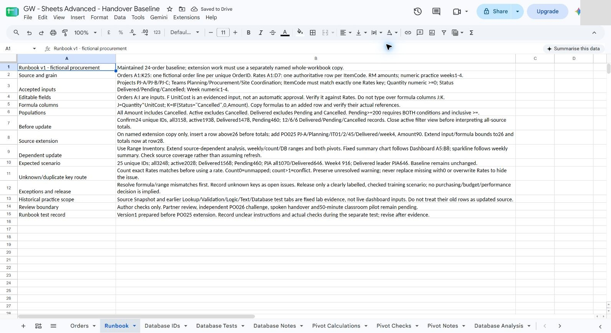

3. Add **Range Inventory**. Map the actual active refresh path: **Orders → Analysis / Database Analysis / Pivot Review / Pivot Counts → Dashboard Data → Dashboard**. Record exact source bounds, dependent formula cells, database header/criteria rectangles, both pivots, chart and weekly sources. The existing chart follows a fixed project summary; extending the underlying orders does not require adding a fourth project to that summary.

Distinguish live source checks from historical practice. Validation Practice has whole-number Quantity rules on E2:E25, a Status list on G2:G25 and a Pending AND Amount>=200 format rule on A2:K25. These rules belong to that separate practice sheet. Do not claim Orders has that dropdown/format protection. Orders requires the documented manual input checks. Source Snapshot, drill-through detail, old test tabs, Dashboard Contract and Dashboard Data rows 22:28 remain fixed earlier-lab evidence.

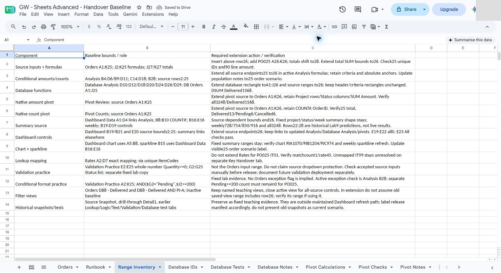

## 12.3 Demonstrate One Update

1. Make a whole-workbook copy of Handover Baseline called **GW - Sheets Advanced - PO025 Extension Test**. This carries the runbook and native workbook structures into a separate test. Do not overwrite the recovery baseline or combine this exercise with the independent PO026 challenge.

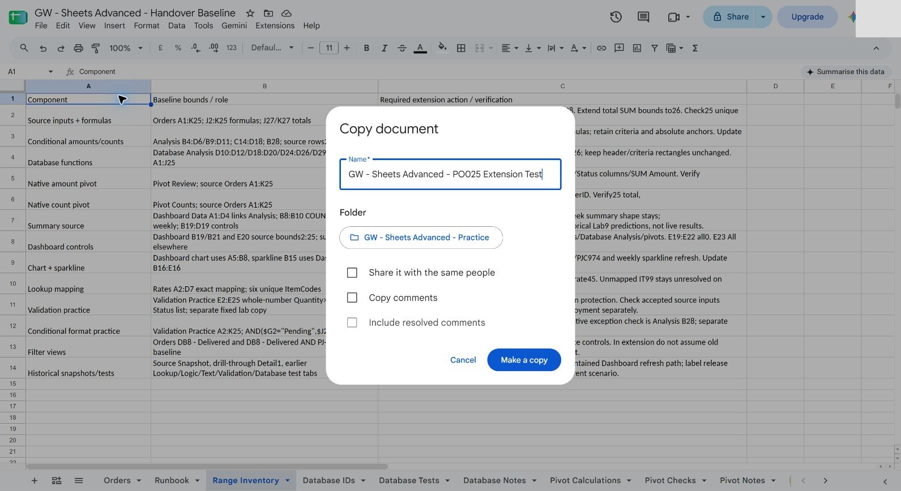

2. Add **Extension Checks** before editing Orders. Write predictions: **25 unique records, all 3,248, Active 2,028, Delivered 1,568, PJ-A Delivered 646, week 4 all Amount 916, Pending>=200 count 0**. Keep the original 2:25 calculations separate from the predicted and observed extension columns.

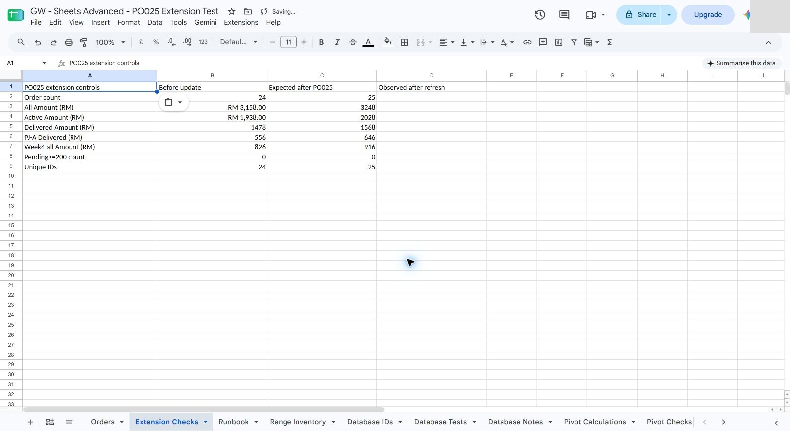

3. In this extension copy only, select Orders row 26 and **Insert 1 row above**. This preserves the copied total labels and totals below the new order. Enter **PO025 / PJ-A / Planning / IT01 / quantity 2 / UnitCost 45 / Delivered / week 4 / fictional handover description**. Use J26=E26*F26 and K26=IF(G26="Cancelled",0,J26). The new Amount and ActiveAmount are both 90.

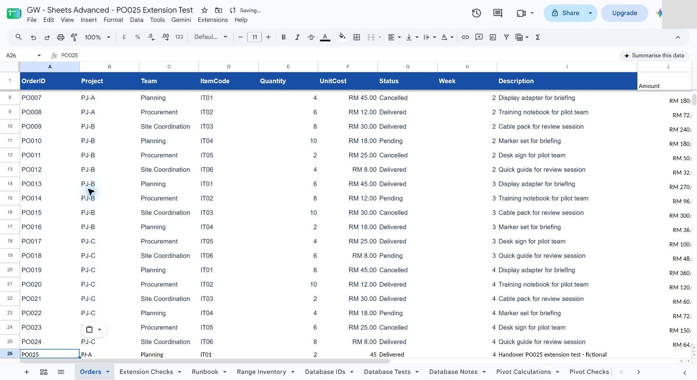

4. Inspect the formula cells and copied totals. The total labels now sit at row 27 and total formulas at row 28. Check actual formula bounds before assuming the row is included. This screenshot selects J26:K28, including both the new line and copied totals. Use the individual formula cells and defined population controls; the selection sum combines different measures.

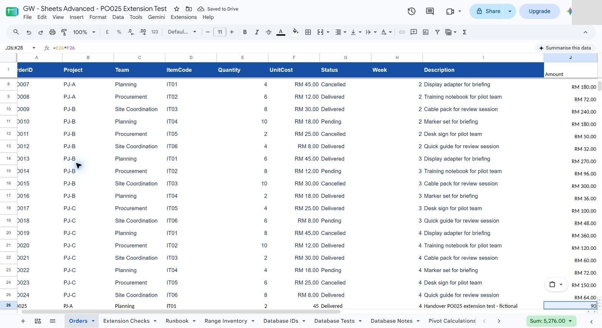

5. Reopen Dashboard **before** extending dependencies. In the captured run, the old source ranges still returned 24 records/all 3,158, old chart values and **All checks pass**. Both summaries and controls omitted PO025. This is a deliberately observed coverage failure: internal agreement is insufficient when all participating ranges are stale.

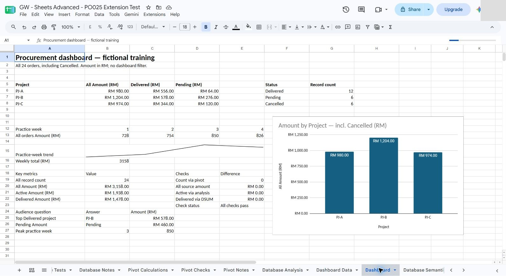

6. Follow the inventory. Extend Orders total SUM bounds through 26 at J28/K28. In Analysis extend source endpoints to 26 for B4:D6, B9:D11, C14:D18 and B28, preserving criteria and absolute anchors. Update scenario population wording. Check the all/status/active reconciliations; the expected all-order total is 3,248, not the old baseline total.

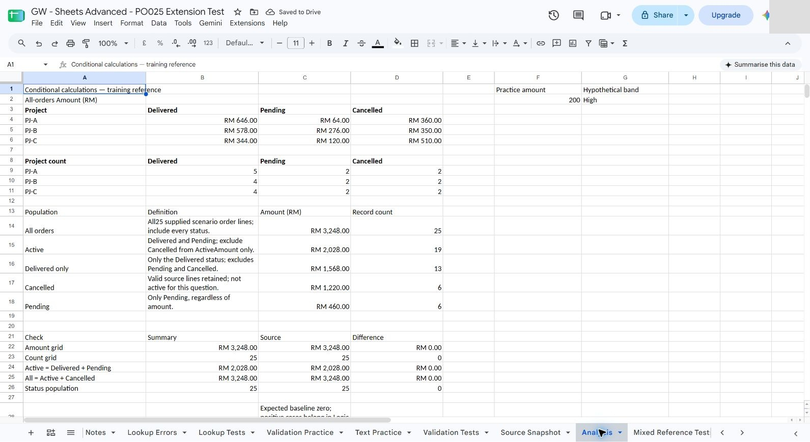

7. Extend the database rectangle to **Orders A1:J26**, retaining its header and criteria ranges. Update Database Analysis D10:D12, D15, D18:D20, D24:D26 and D29 using the supplied formulas. DSUM Delivered must become **1,568** and Delivered AND PJ-A **646**; their independent SUMIF/SUMIFS comparisons remain zero.

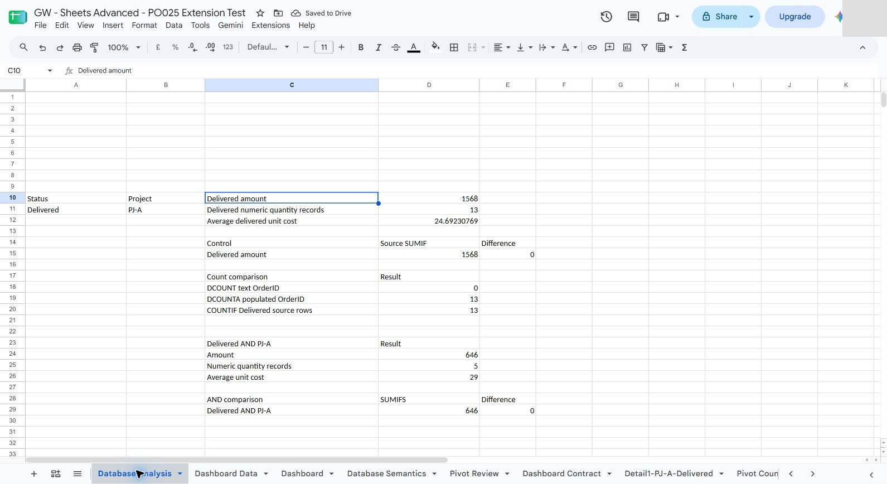

8. Extend Dashboard Data B8:B10 status-count bounds, B16:E16 weekly bounds and B19 source-total bounds. The project table continues to link to the updated Analysis summary. Confirm statuses **13 /6 /6**, weeks **728 /754 /850 /916**, and weekly/source total 3,248. Rows 22:28 are historical Lab 9 predictions; they are not refreshed scenario results.

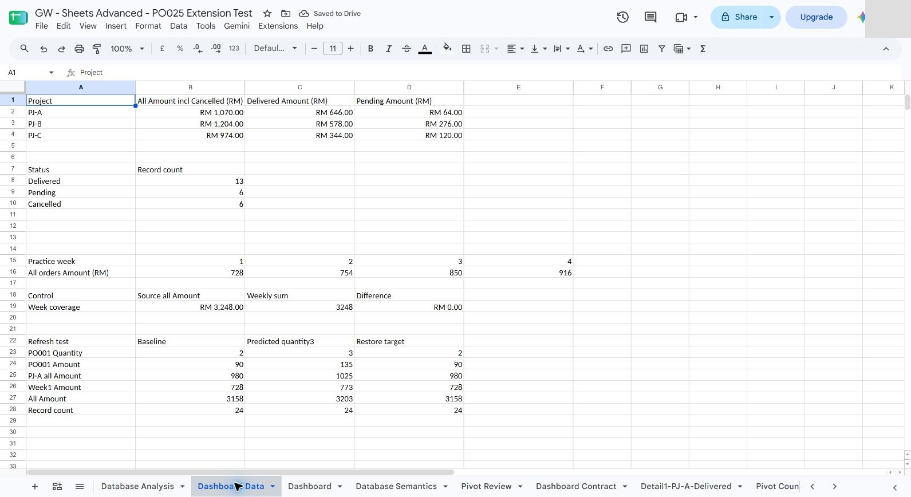

9. Extend Dashboard B19 record-count, B21 Active and E20 source-check bounds to 26. Keep the existing links to the updated summaries and database calculation. Label the view **PO025 extension test,25 orders**. The chart and sparkline now show the refreshed summaries, but the count control still reports **1** and **Review mismatch** until its independent pivot is updated. Do not remove the control to make the output look complete.

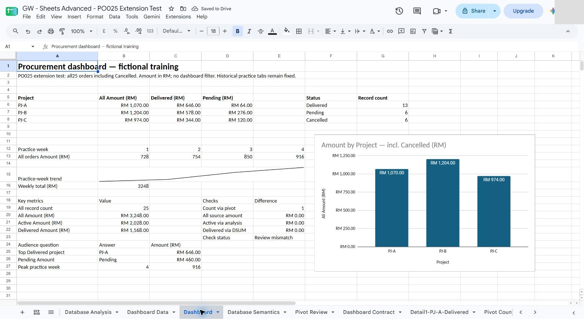

10. Inspect **Pivot Review**. Click inside the native pivot and use the pencil/**Edit pivot table** control. Its old source is **Orders!A1:K25**; Project rows, Status columns and SUM Amount remain appropriate.

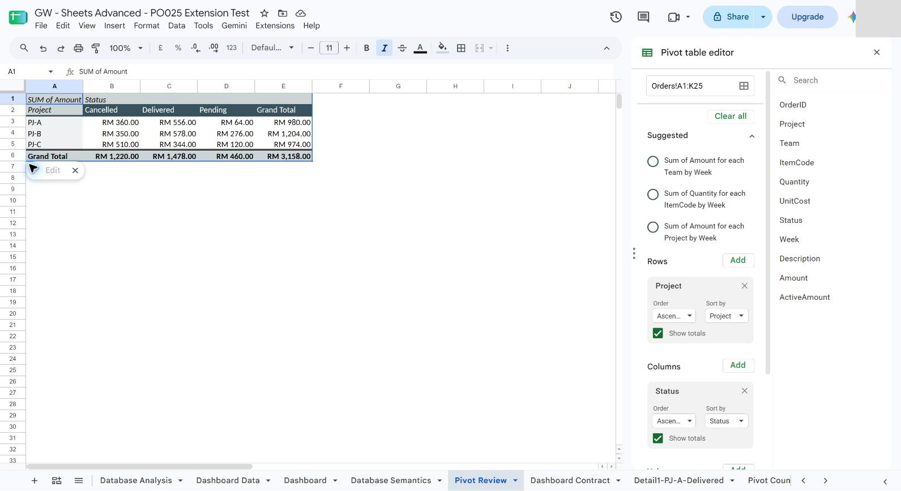

11. Inspect **Pivot Counts** as well. It has a separate source range and uses COUNTA OrderID. Updating only the amount pivot cannot repair the dashboard count comparison.

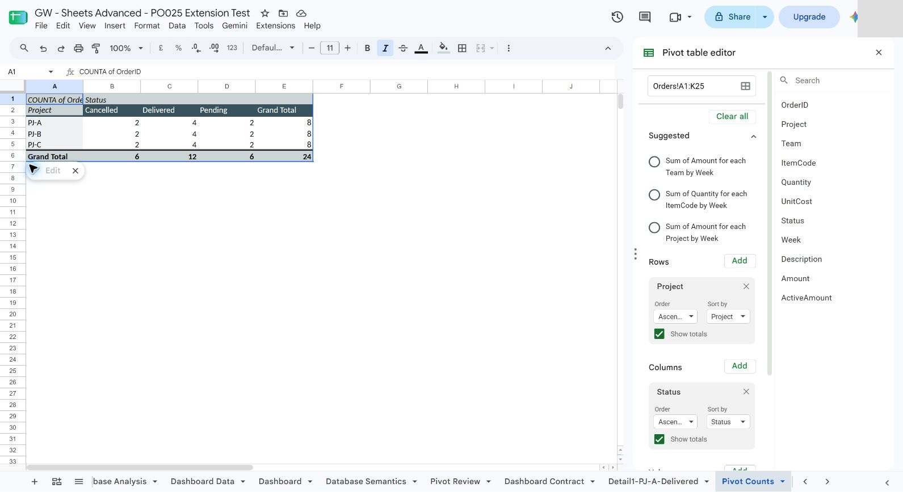

12. In Pivot Counts choose **Select data range**, enter **Orders!A1:K26** and click **OK**. Exclude the total rows 27:28 from the pivot source. The suggested larger rectangle may include totals, so verify the exact endpoint.

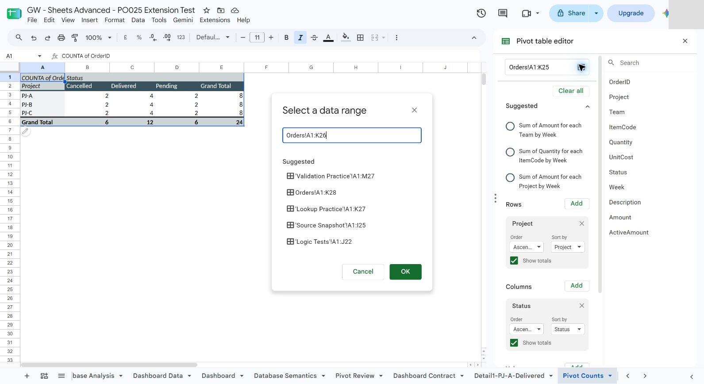

13. Confirm the committed count pivot now has **25** total records, **13 Delivered**,6 Pending and 6 Cancelled. Reopen the editor if necessary to confirm the saved source. Merely seeing26 typed in an uncommitted field is not success.

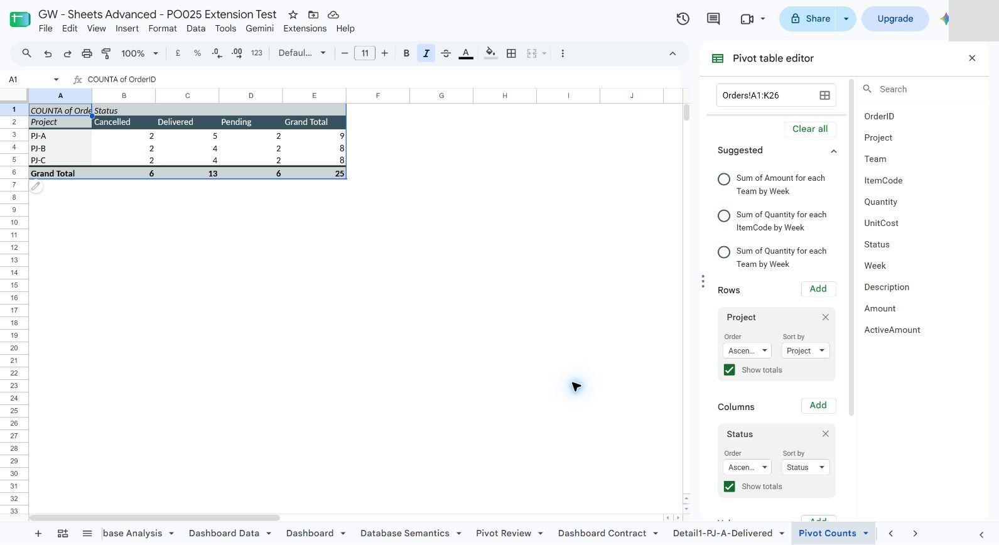

14. Repeat **Select data range → Orders!A1:K26 → OK** for Pivot Review, keeping SUM Amount and the existing row/column fields.

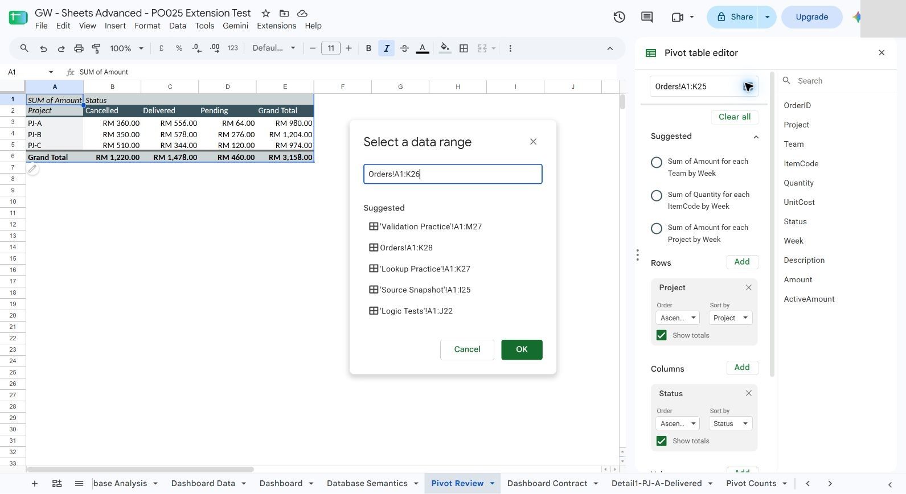

15. Verify the committed amount pivot: PJ-A all **1,070**, Delivered **646**; grand all **3,248**, Delivered **1,568**. The new record must appear in both amount and count populations.

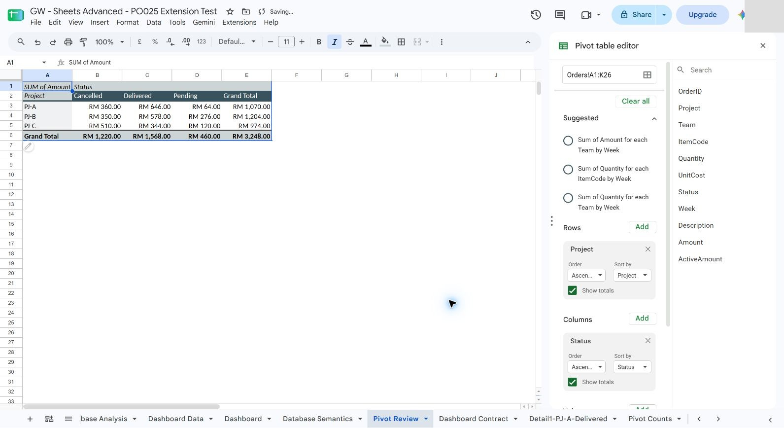

16. Return to Dashboard. All four differences must now be zero and status **All checks pass**, alongside the independently predicted 25-record totals. The all-order chart is **1,070 /1,204 /974**; the Delivered leader is **PJ-A646**; the largest practice week is **4 at 916**. These are fictional Amount comparisons, not profit, savings or project-performance conclusions.

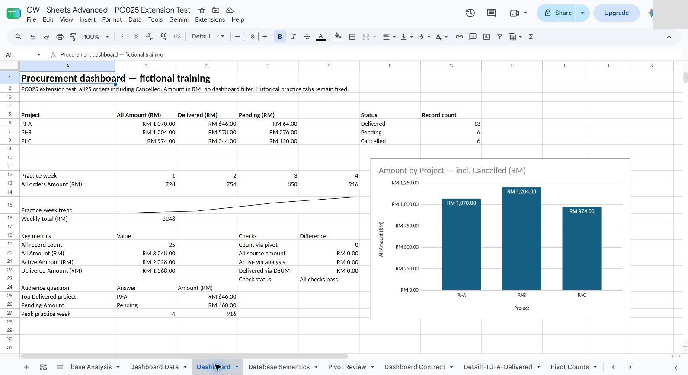

17. Inspect **Chart editor > Setup**. Its data range remains **A5:B8** on Dashboard, using the fixed three-project summary. Confirm actual refreshed values rather than assuming the chart is linked. Dashboard B15 SPARKLINE follows Dashboard Data B16:E16, whose week 4 value is now 916.

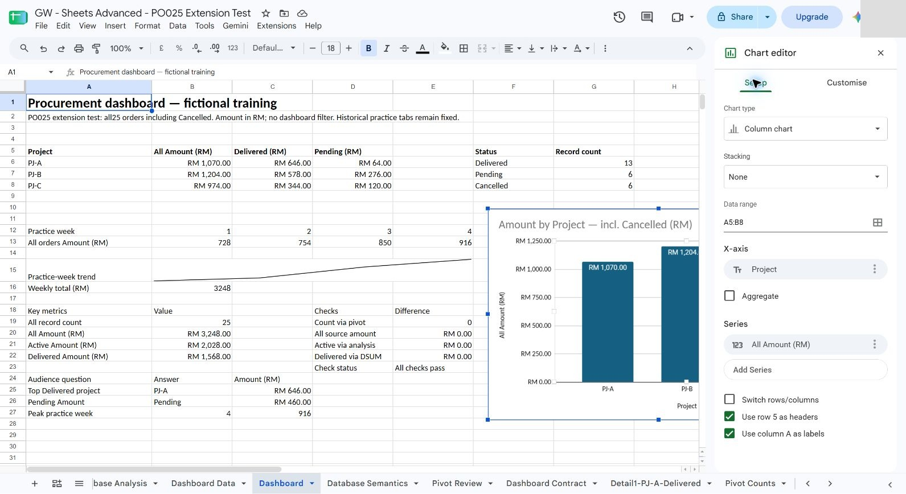

18. Complete Extension Checks observed columnD with expanded 2:26 calculations and compare with predictions inC. All eight differences inE must be zero. Retain a second arithmetic check: baseline 3,158+new90=3,248 and baseline Delivered 1,478+90=1,568; compare with the native pivots. Keep original-bound calculations inB labelled as such rather than relabelling them current.

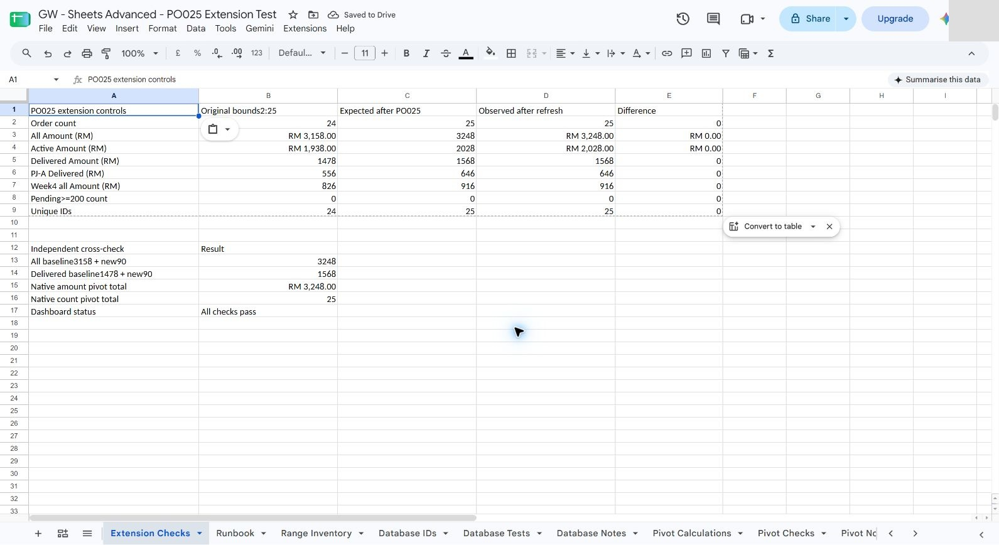

## 12.4 Make the Analysis Operable by Another Analyst

1. Add **Key Handover**. Test IT01, unknown IT99 and IT02 against unchanged Rates A2:A7. Count exact matches before accepting a price: **1 /0 /1**. This separate fixture is outside Orders and all scenario totals.

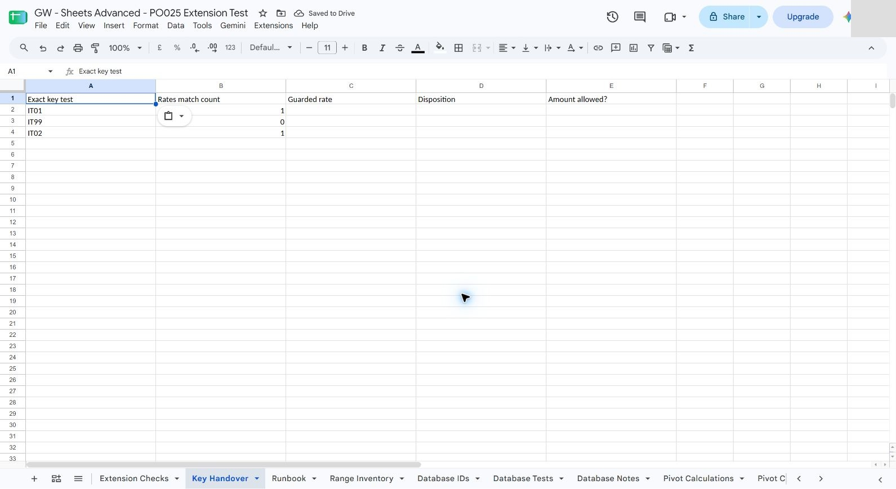

2. Guard the exact lookup: when match count is not one, return **Unresolved rate**. IT99 must display **Open - unmapped key** and **Hold - no numeric amount**. Known keys yield45 and 12. Record open issueK01 and the evidence needed to resolve it. Do not add an invented Rates mapping or convert the missing rate to 0. No source-owner response was requested during this walkthrough.

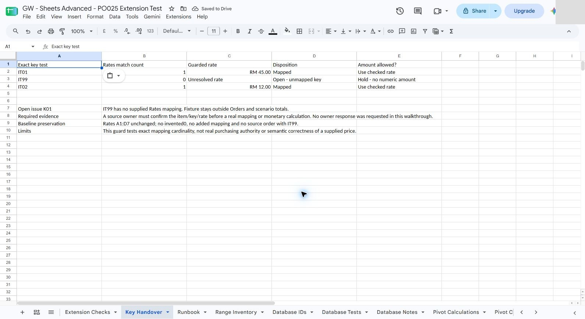

3. Add **Handover Issues**. Record what failed, the evidence and the repair. Version 1 needed an explicit pivot confirmation action and a separate count-pivot check. The stale green dashboard also justified a release gate based on independently predicted totals. Clarify historical-tab and manual-validation boundaries. Keep K01 open; a numeric-looking fallback would conceal it.

In this author attempt, typing a range in the sidebar and pressing Enter did not persist. The author corrected the interaction using the range picker and OK, then verified actual totals. This is an automation correction, not evidence that a student made an error or that every future interface behaves identically. Uncommitted captures are excluded from the lesson.

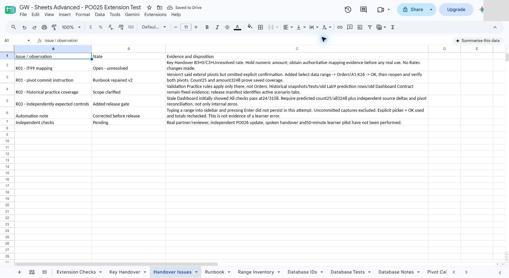

4. Revise Runbook to **version 2** in both retained copies. Add exact pivot actions, saved-range verification, chart/sparkline checks and the predicted-total release gate. The initial added instructions may need wrapping to remain readable.

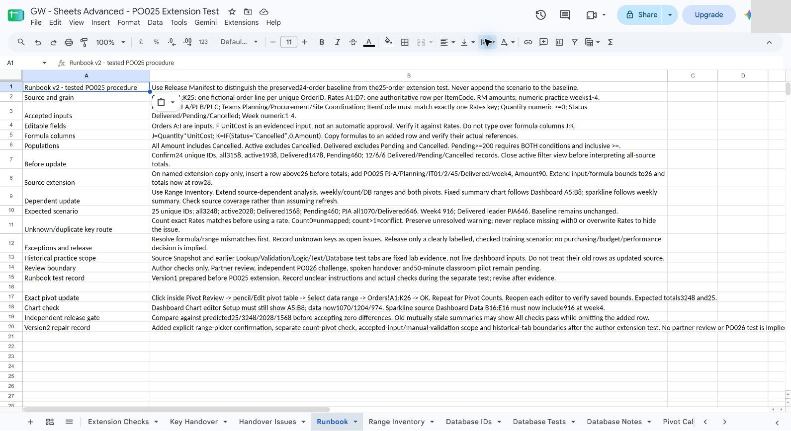

5. Apply **Text wrapping > Wrap** to the authored instructions and inspect them at normal zoom. Preserve the rest of the workbook formatting.

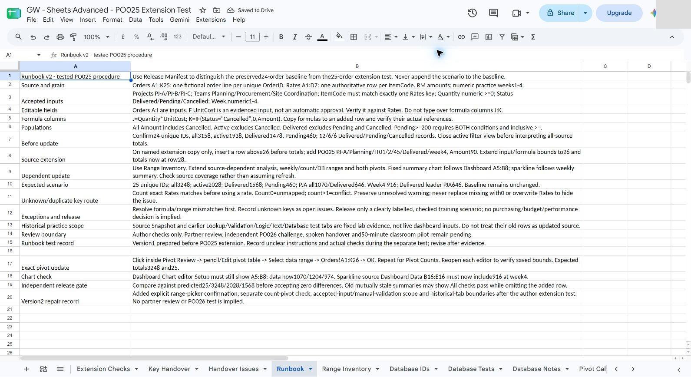

6. Retain the revised runbook in Handover Baseline as well. Its source remains the 24-record recovery population. Keep the role distinction visible; a scenario procedure is not a reason to append PO025 to that baseline.

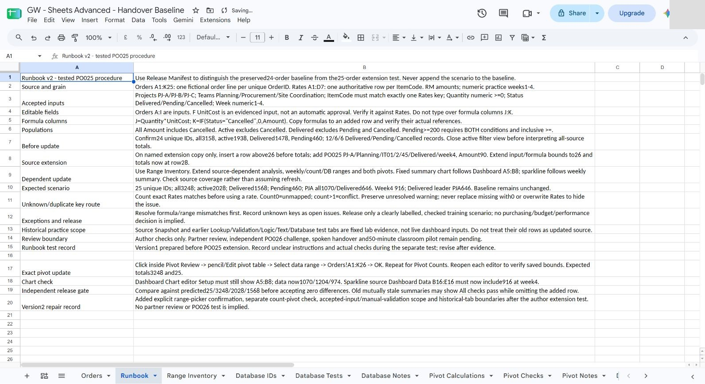

7. In the extension add **Release Summary**. ColumnB is a dated, fixed snapshot of the checked PO025 results. ColumnsC:D are live comparisons to Dashboard. Label these roles explicitly: a later update requires regenerating snapshotB. Do not present a fixed snapshot as another live data source.

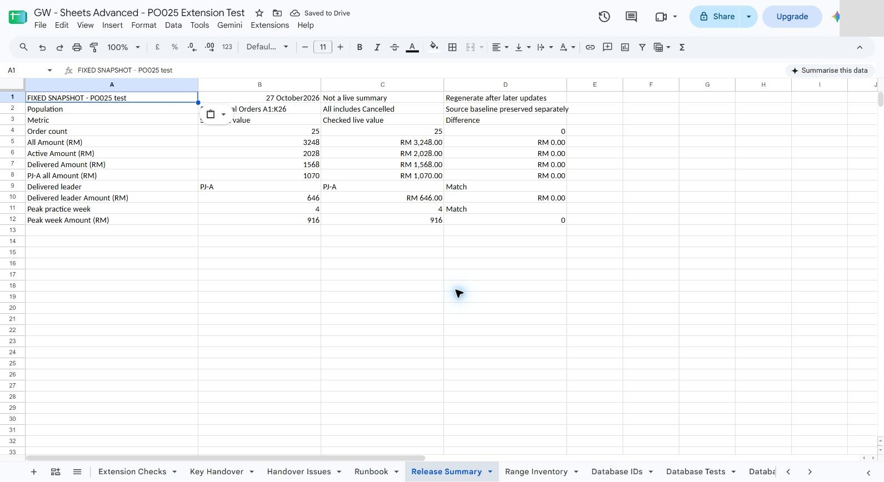

8. Issue a **Release Manifest** in both copies. Name the maintained recovery baseline, separate PO025 test and the fixed summary located in the extension workbook. Identify the active refresh path, exact range contract, open K01 and historical evidence. Mark actual partner review, independent PO026, spoken handover and the 50-minute learner pilot pending.

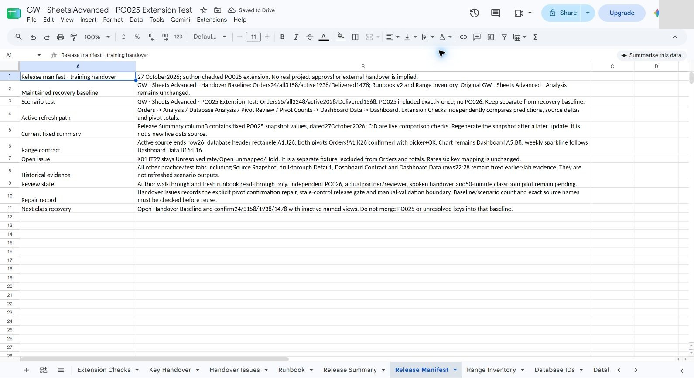

9. Return to the recovery Dashboard and confirm **24 /3,158 /1,938 /1,478**, zero differences and unchanged original chart/weekly values. The recovery baseline must not acquire PO025 through the handover process.

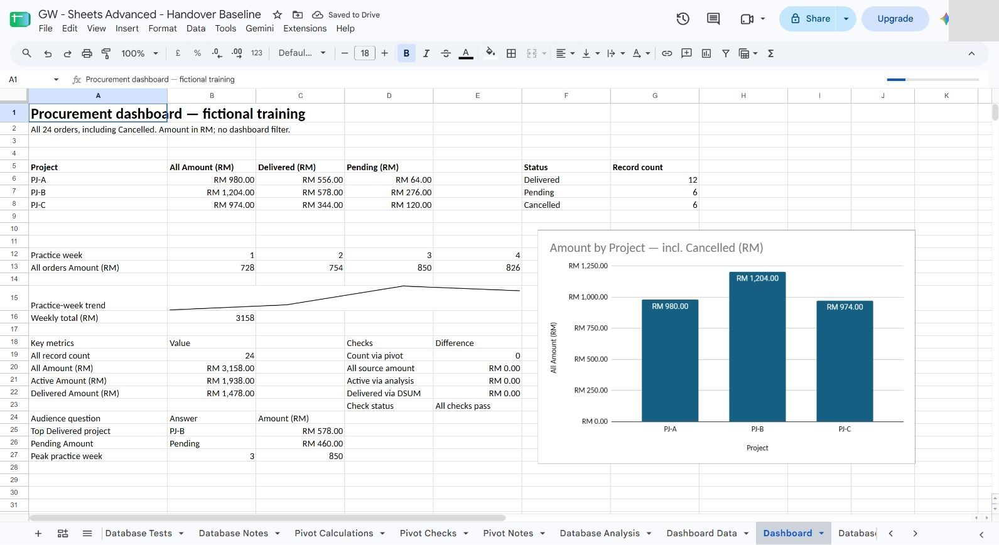

10. If working alone, open a fresh workbook view on Runbook, close the previous extension working browser tab and read the instructions again before navigating. This author did a fresh-view read-through; it is not an independent cold test or a substitute for another analyst's review. Unrelated existing browser tabs were left alone.

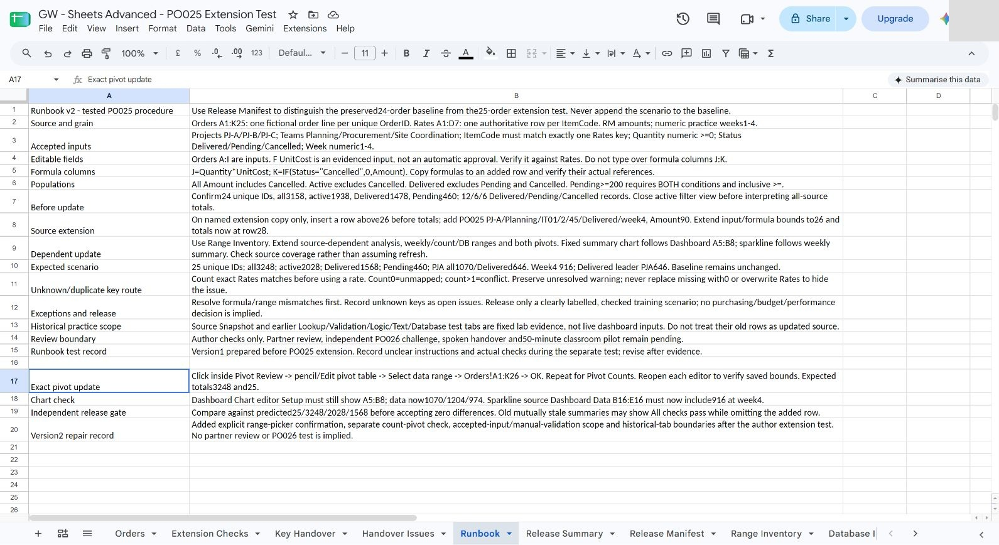

11. Use the runbook to locate Orders and inspect PO025 source/formula cells. Confirm the line is present once, IT01 maps uniquely, and J/K each equal 90. Keep baseline and scenario sources distinct.

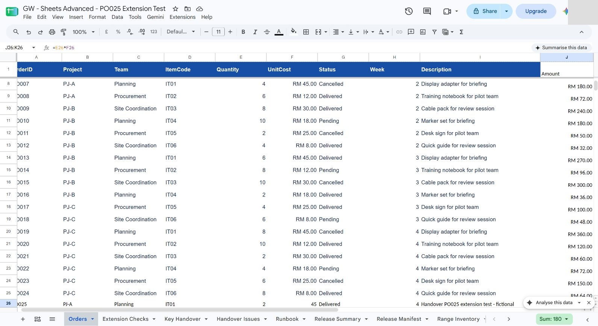

12. Locate Key Handover and explain why IT99 remains unresolved. A correct handover includes an understandable failure route as well as successful totals.

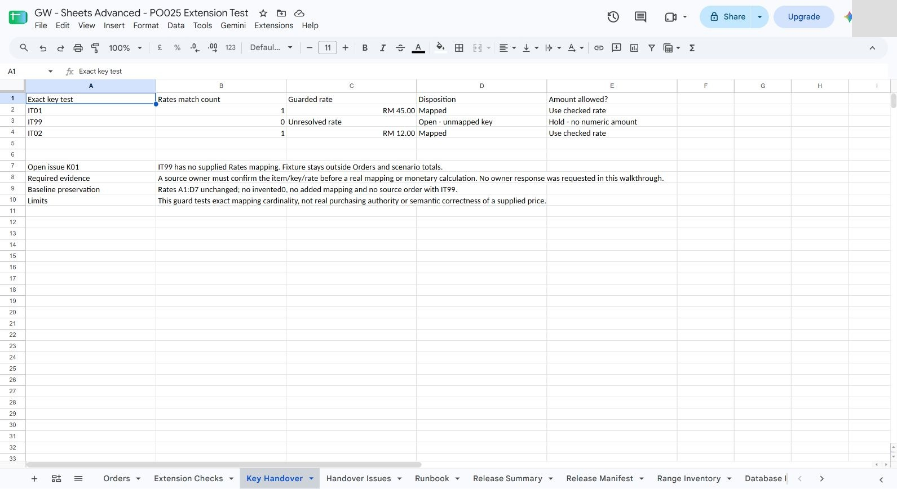

13. Finish on the fixed Release Summary with its live comparisons. Numeric differences must be zero and leader/week comparisons **Match**. Keep the live Dashboard, snapshot, runbook, inventory, issues and manifest together. No external handover or sharing was performed.

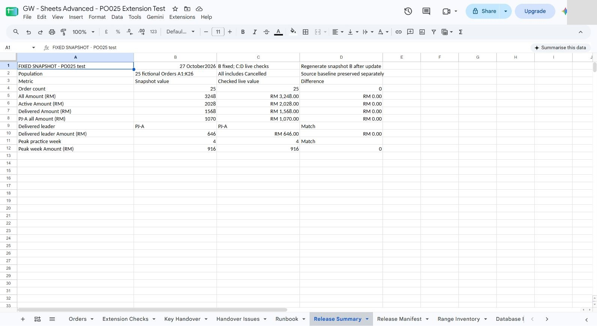

**Author verification:** guided 12.1–12.4 was executed in the learner UI. Recovery baseline values/formats and original source rows/Rates are preserved; active extension/new formulas are error-free; native amount/count pivots and refreshed chart/sparkline were checked. Independent PO026, actual partner review, spoken delivery and classroom timing remain unperformed.

## Independent Challenge

Close the earlier step lists for the first attempt. Use the case input and your own reasoning. If you need help, record the hint and repeat the affected check independently.

1. Use the different PO026 line on the card in another disposable copy and update the analysis without returning to the lesson steps.

2. Verify how Pending amount and exception flags change, including any new-row coverage failure. Record and repair the cause.

3. Hand over the runbook, controls, open issues and manifest. Another analyst must be able to reproduce both a successful update and an unresolved-key outcome.

## Evidence to Hand Over

- Complete range inventory and a runbook tested on PO025.
- Independent PO026 update with reconciled controls and exception coverage.
- Recorded handover repair, open-issue route and clear scenario manifest.

Record the defect or uncertainty you investigated, the evidence used, the repair or reasoned no-change decision, and the final state. Restore temporary changes or keep them in a clearly named scenario copy.

## Troubleshooting

| Symptom | What to check |
|---|---|
| The next analyst must guess a range extension | Record exact current bounds, the new-row action and the expected checks in the runbook. |
| An input or earlier result is missing | Reopen the input named in Before You Begin; do not substitute private company data |
| A menu or feature is unavailable | Confirm the account and the shared access notes; record the missing step and ask the trainer for its fallback |
| The result differs from the checkpoint | Compare the exact source range, wording and conditions before repeating the action |

## Lesson Summary

You can maintain and hand over a checked analysis rather than a collection of unexplained formulas.

**Check yourself:** Which assumption would you check first if a future total unexpectedly drops?
