# 01 - Prepare the AI Workspace

In this chapter you will check approved tools, permitted data and the supplied evidence pack.

> **Prompts:** the [prompts page](./prompts.md) has every value and prompt for this chapter, each with a Copy button.

**Estimated time:** 40 minutes, planned as 10 explanation and demonstration, 10 guided build and casework, 15 independent practice and 5 verification and repair, with 30 active minutes by design. Not yet timed with learners.

**Your result:** An account/feature availability record, selected fictional source pack and structured review plan.

> **Status:** author reference with 23 staged application captures through 1.4. One-source preflight, native manifest/task contract, six predictions, unscored evaluation plan and saved folder placement verified. Other feature tests, independent challenge, reviewer agreement and classroom timing remain pending.

---

## What You Will Learn

- Distinguish observed AI access from organisational approval.
- Prepare an independent source pack.
- Record what each source can establish.

## Before You Begin

Read the [case input](./prompts.md) and use a separate named casework copy for destructive tests or altered datasets. Keep the baseline unchanged for later chapters. Record source facts, proposed practice and unresolved questions separately.

Download the [project facts](../../shared/sample-files/project-facts.txt), [meeting record](../../shared/sample-files/meeting-record.txt) and [reporting guidance](../../shared/sample-files/reporting-guidance.txt). This course does not require output from another course.

## 1.1 Check the Tools

1. In Drive, confirm the account approved for training and create **GW - AI - Practice**. Account access establishes availability in this environment, not your organisation's approval or customer licensing.

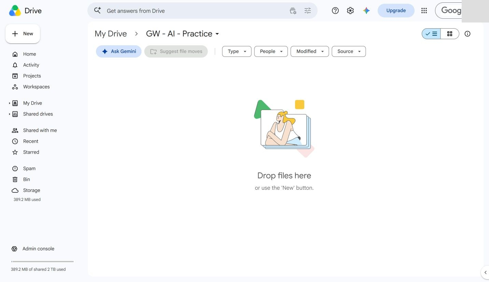

*isolated training drive folder.*

2. Open Gemini with the same account. Confirm that its prompt surface is available. Do not generate the FAQ yet.

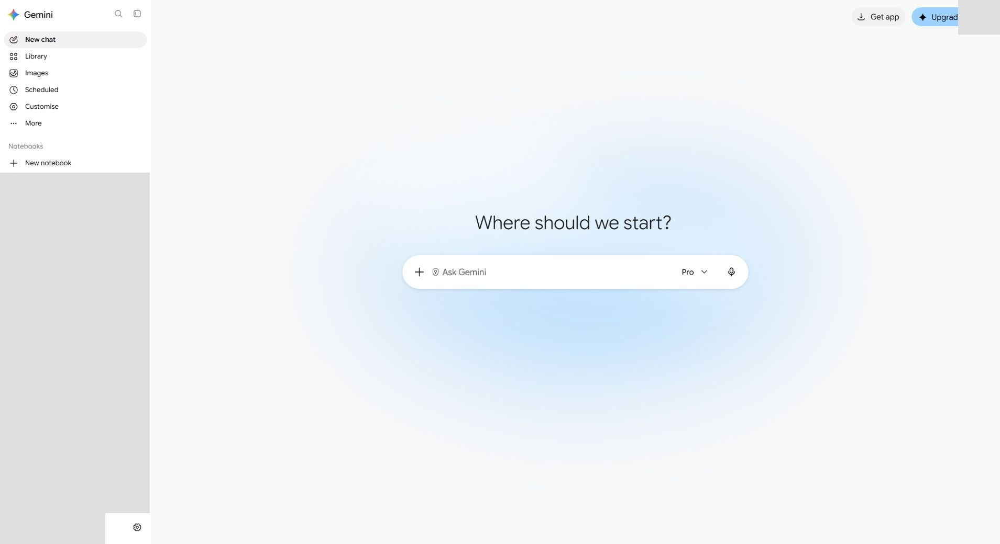

*gemini training account surface.*

3. Open [Gemini Notebook](https://notebook.google.com/). Create **GW - AI - Source Preflight**. Start with zero sources.

> **Reference run:** The older NotebookLM address redirected to this application during the author run.

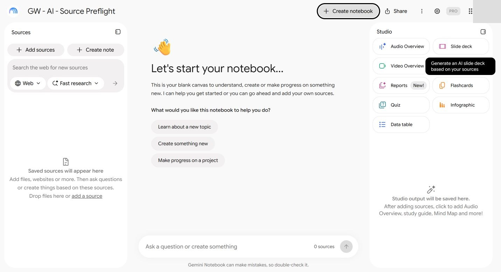

*new notebook zero sources.*

4. Open **Add sources**. Record the offered source types. Availability of a button does not establish a successful import.

> **Reference run:** The author account showed Upload files, Websites, Play Books, Drive and Copied text; only **Copied text** was tested in this lab.

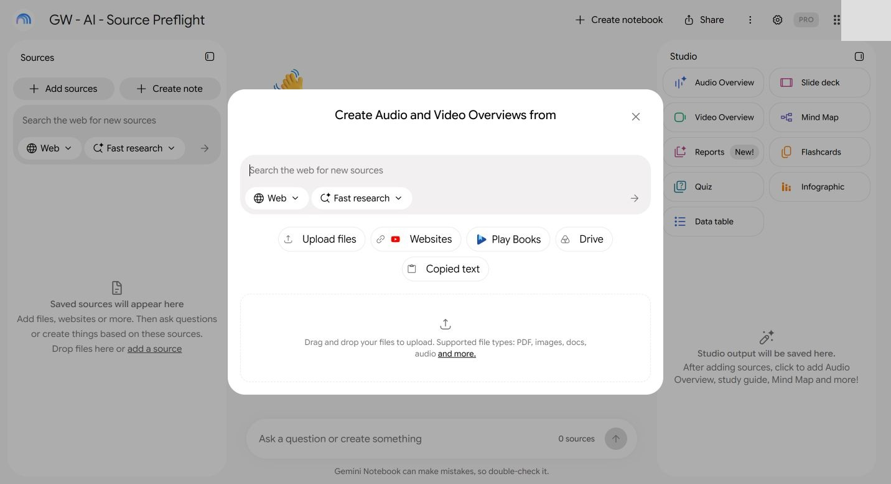

*advertised source types.*

5. Open the supplied **project-facts.txt** locally. Select **Copied text**, paste that original fictional text and inspect it before inserting. Exclude review examples, generated drafts and unrelated sensitive material.

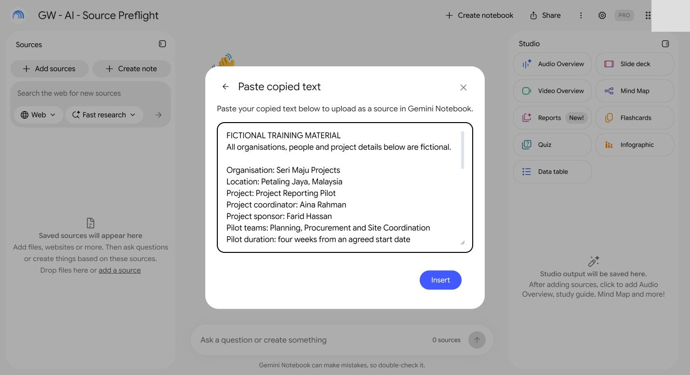

*original fictional fact sheet only.*

6. Insert the text. In this interface it becomes an editable note/source. Set its **Note title** to **SOURCE - project-facts.txt - supplied, unversioned**. Check the source body against the original file; a renamed source is not independently verified evidence.

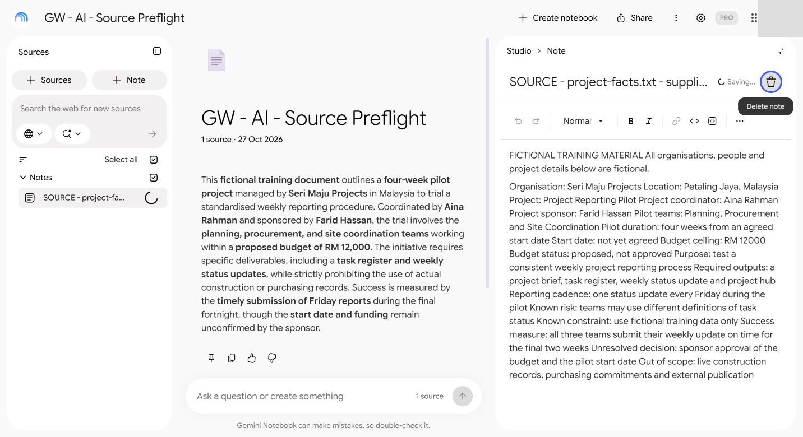

*imported original source labelled.*

7. Confirm **one selected source**. An automatic overview may appear: that is generated output to check, not a new original source. This one-source preflight does not complete the later three-source notebook exercise. Leave other imports, Studio tools, generated media, sharing and source updates marked **untested**.

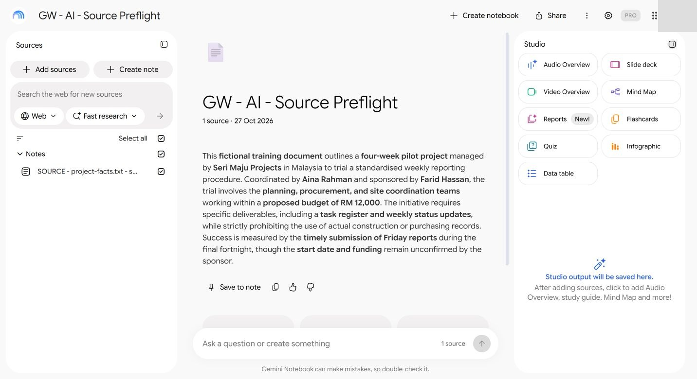

*one source preflight complete.*

If a service is unavailable, record the missing objective and use the trainer's demonstration or read the supplied originals manually. Manual reading supports source analysis but does not prove that the missing AI feature works. Keep the approved account and settings.

## 1.2 Inspect the Pack

1. In the training account, create a blank Google Doc and name it **AI Evidence Log - Project Reporting Pilot**. Use the prompts page one section at a time. Keep real editable tables; do not paste a screenshot of a table.

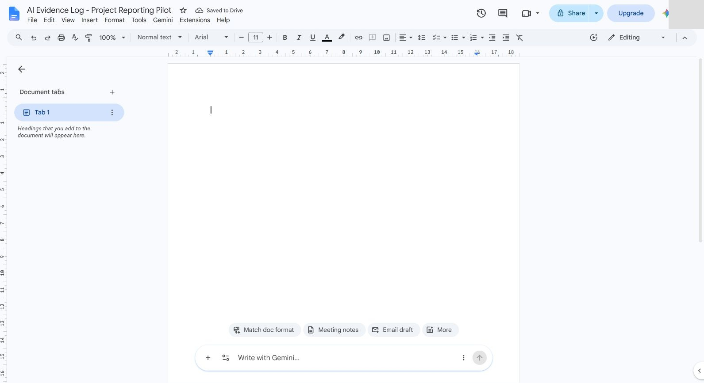

*native evidence log created.*

2. Add **Source Manifest**. Register **S1: project-facts.txt**, supplied fact sheet, original plain text, **no version stated**. Record permitted use, what it can establish and its limits. It establishes the fictional purpose, four-week duration, three teams, Friday cadence, success measure and proposed RM 12,000 ceiling. It does not establish approval or an agreed calendar start.

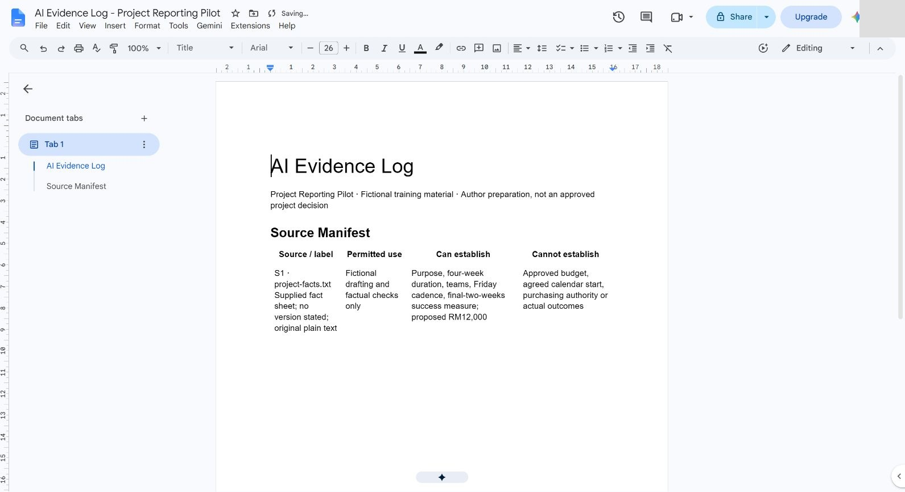

*fact sheet authority and limits.*

3. Add **S2: meeting-record.txt**, supplied scripted discussion, original plain text, **no version stated**. It records Aina's template in week 1, Bala's status-definition review in week 1 and Siti's fictional sample update in week 2. Those are scripted commitments, not completed work or a real meeting.

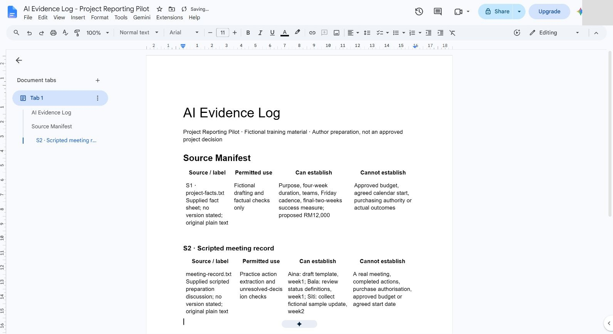

*scripted action source registered.*

4. Add **S3: reporting-guidance.txt**, **version 1**, proposed training guidance. It supports proposed status definitions, exception handling and the relative-week workflow. It is not an approved policy. Add a source-boundary paragraph: only S1-S3 are core originals; review-examples.txt is critique material, AI drafts are outputs, and change cards require separately labelled contexts.

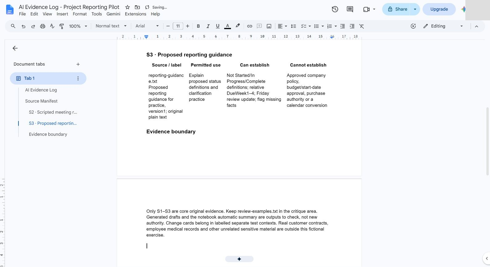

*proposed guidance and evidence boundary.*

## 1.3 Define the Task

1. Add **Task Contract** for fictional coordinator Aina. Plan a **five-question FAQ and short briefing for a later lab**. Specify original-source boundaries, intended reader, required topics, format and human review gate.
2. Combine purpose/duration/teams into FAQ topic 1; then cover cadence/success measure, proposed budget, unresolved start and the three action-owner-week triples. The six test questions remain separate checks even though the output has five FAQ topics.

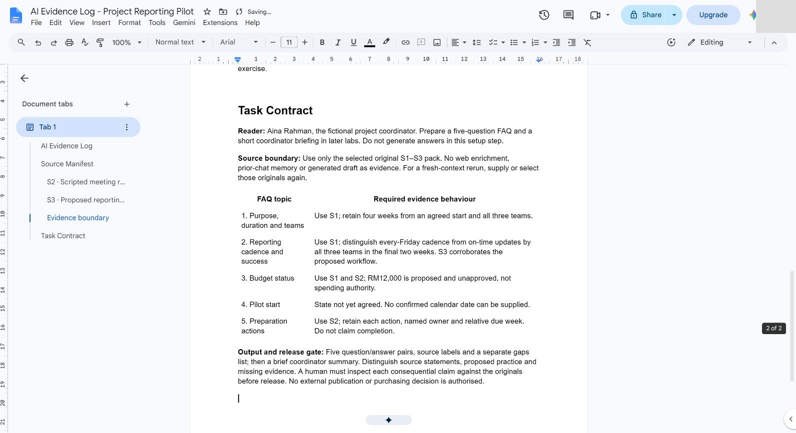

*five question coordinator task contract.*

3. List facts to preserve and missing information: proposed/unapproved budget, unresolved calendar start, relative due weeks, no supplied ROI or actual outcome, and no agreed cut-off time, submission channel or clarification deadline.
4. Add **Review Results** with Question, Source, Claim, Check and Decision columns. Use a single **Not generated / Not run** placeholder. Do not record invented scores before an answer exists.

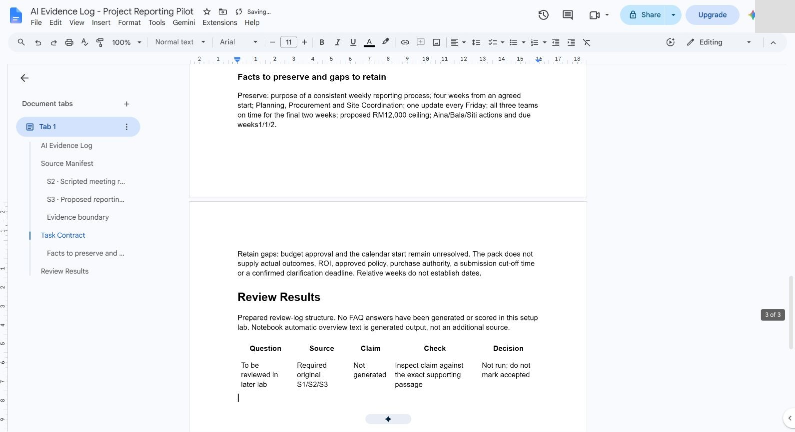

*fixed facts gaps and review log.*

## 1.4 Create an Evaluation Plan and Verify the Saved Log

1. Add **Tests** and a feature preflight table. Record the observed account, editable Doc, Gemini prompt surface, current Gemini Notebook label and the single Copied text import. Mark advertised but untested source types and Studio features explicitly. Organisation policy, customer edition and real reviewer acceptance remain unverified.

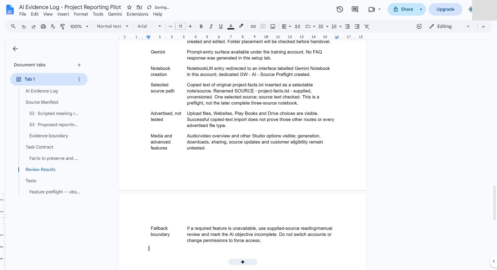

*observed feature preflight and untested routes.*

2. Use the Doc's folder control to move it to **GW - AI - Practice**. Navigate into the destination, then commit **Move**. Opening a destination in the picker alone does not save the move. Wait for the moved confirmation; verify the file in Drive before handover.

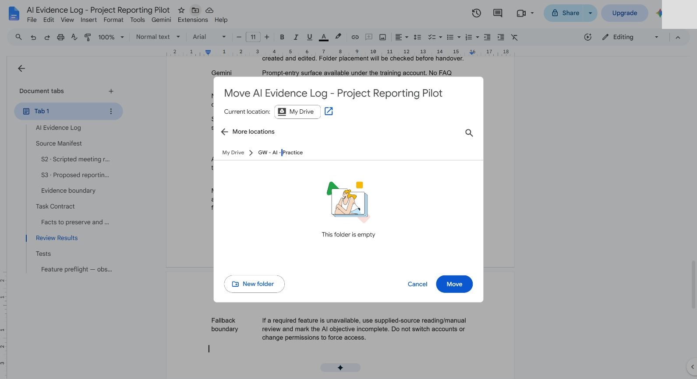

*evidence log practice folder destination.*

3. Prepare the six-row scoring structure: **TestID, Required facts, Unsupported claims, Citation support, Decision, Repair**. Keep **Not assessed**, **unchecked**, **Not run** and **Await response** where appropriate. Add acceptance rules before generating anything: inspect the actual cited passage; classify support as Supported, Partial, Absent or Contradicted; require zero unsupported consequential claims.

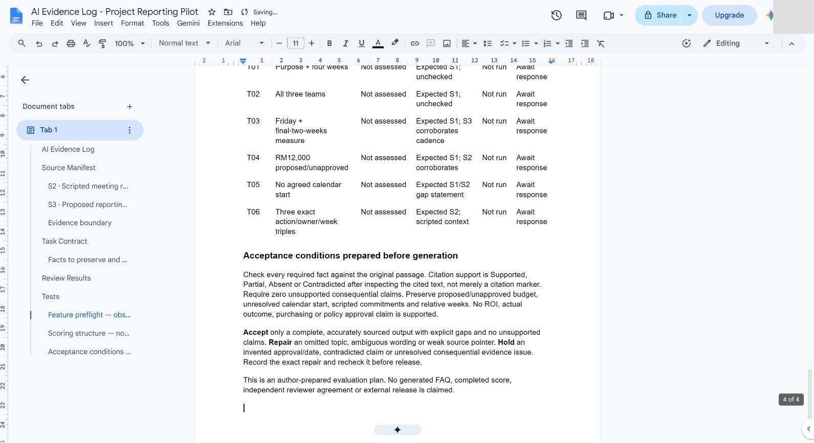

*scoring table not run and acceptance gates.*

4. Add **Open Questions** for the budget, start, operational gaps, policy/access and future reviewer decision. Record the prepared final state: original sources preserved, one source imported for preflight, no generated FAQ scored, no external release.

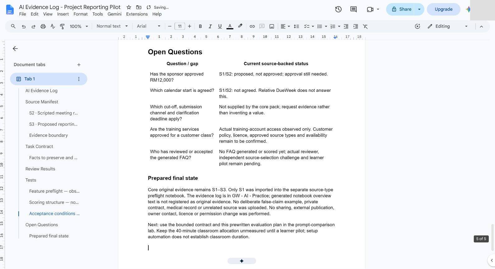

*open questions and prepared final state.*

5. Use the document outline to inspect section structure. This intermediate capture predates the final insertion of the question bank; an outline or a scoring skeleton alone does not prove that all six predictions are present.

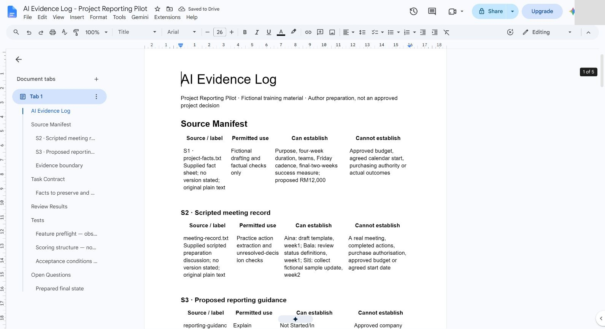

*intermediate section outline before question bank repair.*

6. Verify the successful folder move. The confirmation below is the saved move, rather than the earlier picker preview.

> **Reference run:** The author run caught an uncommitted move during readback and completed it before handover.

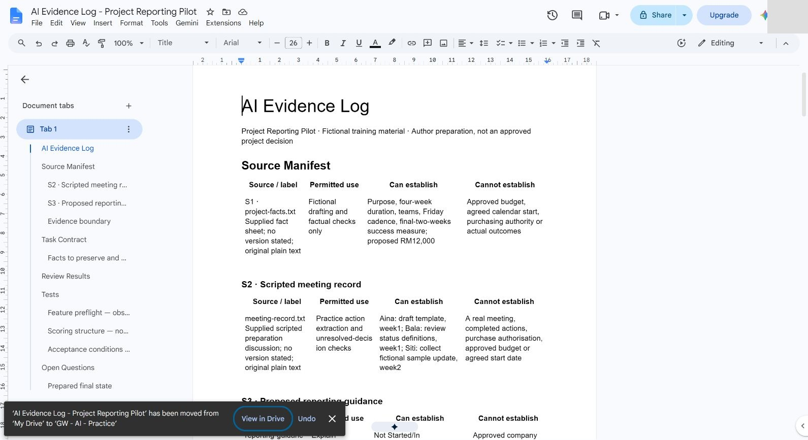

*evidence log move confirmed.*

7. Insert **Six-question test bank - predictions before generation** before the scoring section. Read the six original questions and record a predicted answer, source and evidence behaviour for each. Check that **T01-T06 occur in both the prediction bank and scoring plan**.

> **Reference run:** The author readback caught a missed insertion and repaired it before final verification.

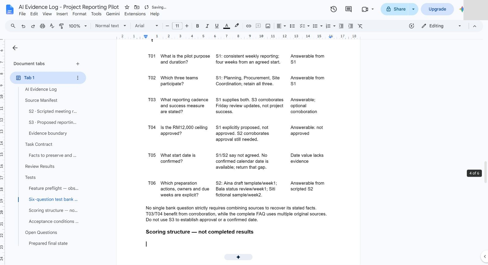

*six question bank inserted before scoring.*

The purpose, teams, cadence/success measure and budget are answerable from S1; S3 corroborates cadence and S2 corroborates the lack of approval. The exact action triples are in S2. T05 has no confirmed calendar date: state that the start is not agreed. None of these six questions individually requires combining sources to recover its facts. The complete FAQ uses multiple originals; do not force S3 to prove an approval or date it does not contain.

8. Keep the scoring heading with its table; use a page break if needed. Fit the table inside the page and inspect every row. Leave outcomes **Not run**. **Accept** requires complete supported facts and explicit gaps; **Repair** addresses omissions or weak pointers; **Hold** applies to invented approval/date, contradiction or unresolved consequential evidence.

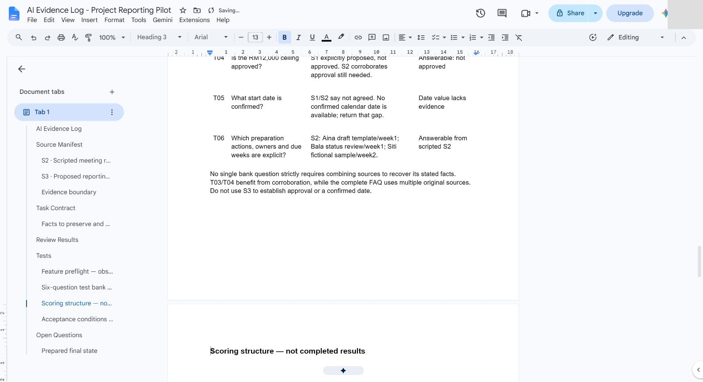

*scoring section kept with table.*

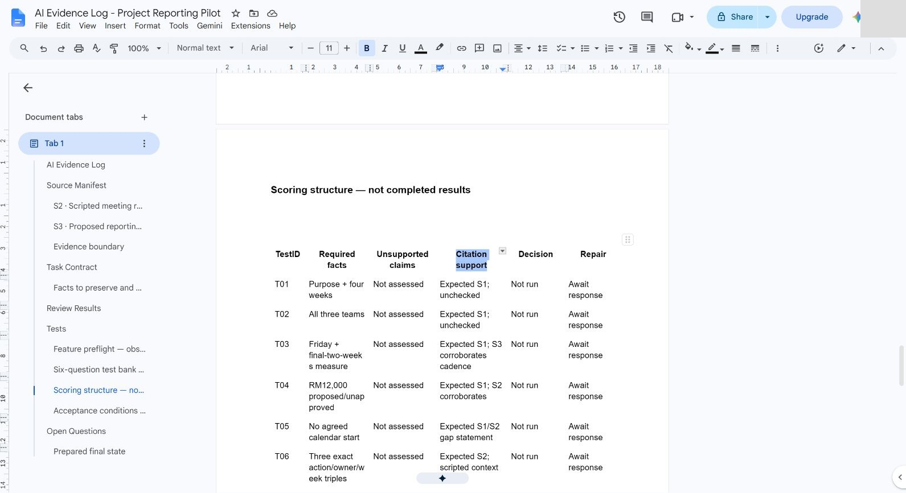

*final six test scoring plan.*

9. Reopen the practice folder and confirm the named native Doc. Recheck its nine editable tables, five main sections, six predictions, six unscored rows and unresolved questions. This verifies the prepared log, not FAQ correctness or independent reviewer success.

> **Reference run:** A native PDF export was inspected offline across all six pages in the author run; no blank pages or text outside page bounds were found.

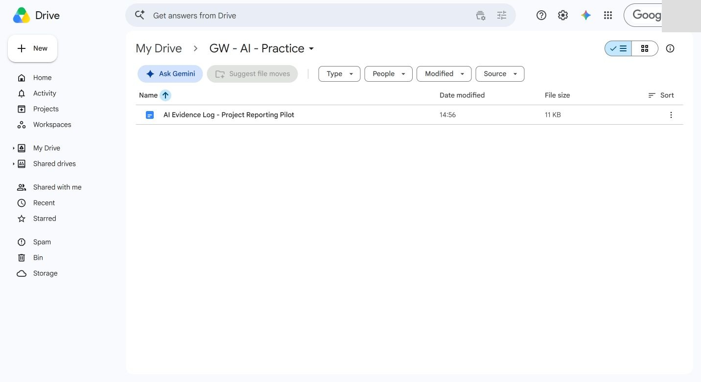

*evidence log saved in practice folder.*

**Verified author result:** isolated practice folder, one-original-source notebook preflight and a saved native evidence log with bounded task contract, source manifest, feature record, predictions, scoring plan and open questions. Automated guided actions took about 12 minutes; verification and automation repairs added about 19 minutes. These are author-operation timings, not evidence that learners meet the 40-minute classroom target. Independent source classification, two extra tests, actual reviewer agreement and learner timing remain pending.

## Independent Practice

Close the earlier step lists for the first attempt. Use the case input and your own reasoning. If you need help, record the hint and repeat the affected check independently.

1. Independently classify the source-selection card into authoritative facts, proposed guidance, scripted commitments, generated content and unrelated sensitive material.

2. Design two additional test questions: one answerable and one deliberately unanswerable from the pack. Write expected evidence behaviour before running them.

3. Have a reviewer use the manifest to select only the three core fictional sources. Repair any label that could lead them to include a false-claim example.

### Evidence to Hand Over

- Source manifest, bounded task contract and feature preflight record.
- Six predicted tests plus two independently designed evidence tests.
- Scoring structure and a checked source-selection exercise.

Record the defect or uncertainty you investigated, the evidence used, the repair or reasoned no-change decision, and the final state. Restore temporary changes or keep them in a clearly named scenario copy.

## Troubleshooting

| Symptom | What to check |
|---|---|
| A generated draft is treated as source authority | Keep outputs in the review area and trace consequential claims to the original source manifest. |
| An input or earlier result is missing | Reopen the input named in Before You Begin; do not substitute private company data |
| A menu or feature is unavailable | Confirm the account and the shared access notes; record the missing step and ask the trainer for its fallback |
| The result differs from the checkpoint | Compare the exact source range, wording and conditions before repeating the action |

## Lesson Summary

Useful AI work starts with approved inputs and a clear evidence boundary.

**Check yourself:** Which source could establish sponsor approval if approval has not yet occurred?
