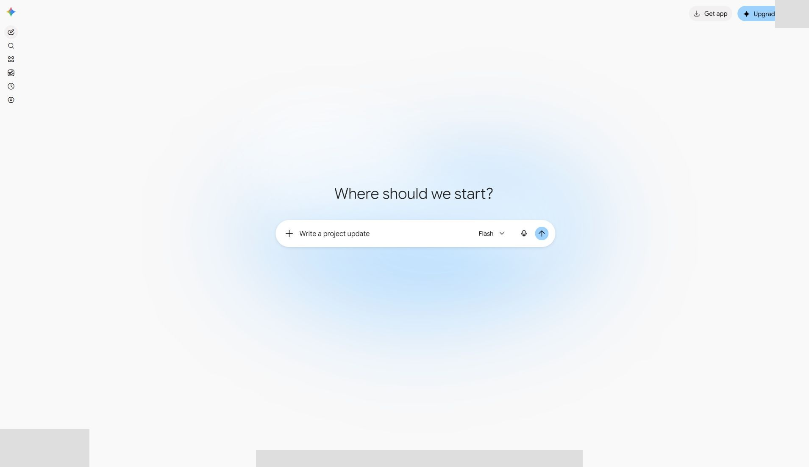
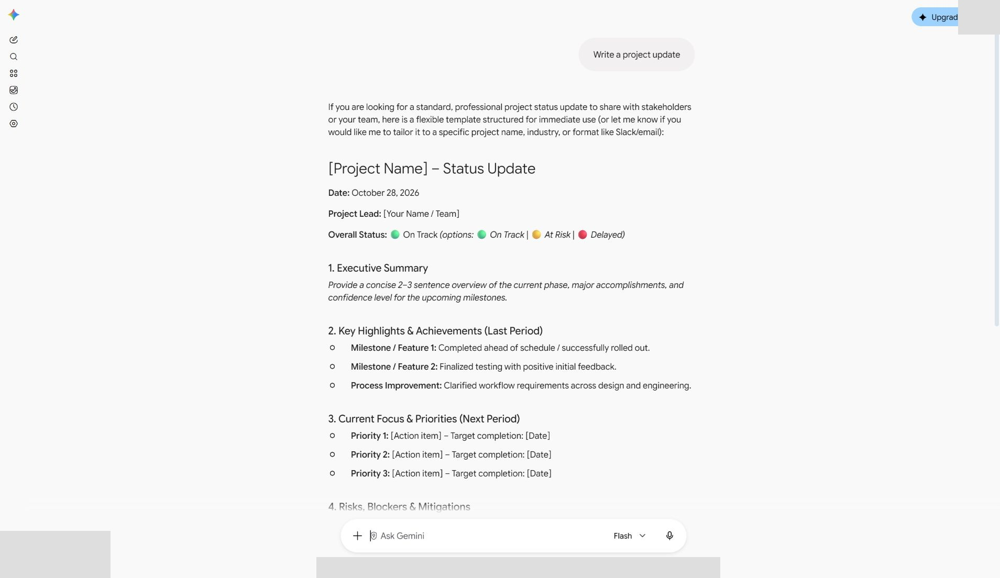
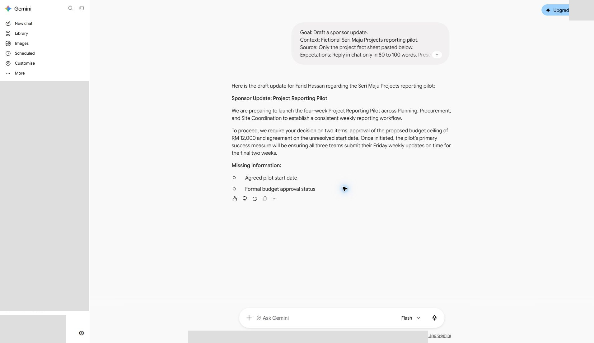
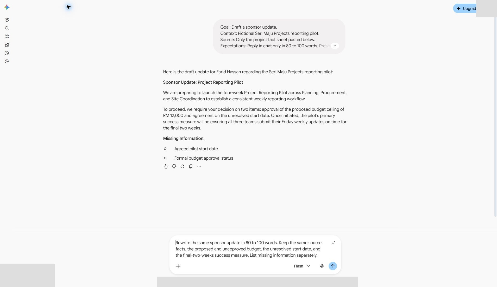
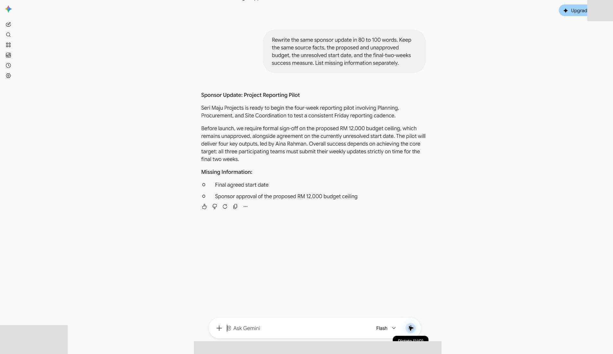
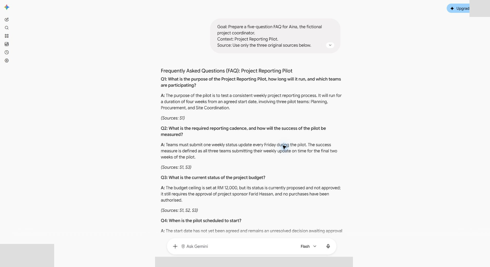
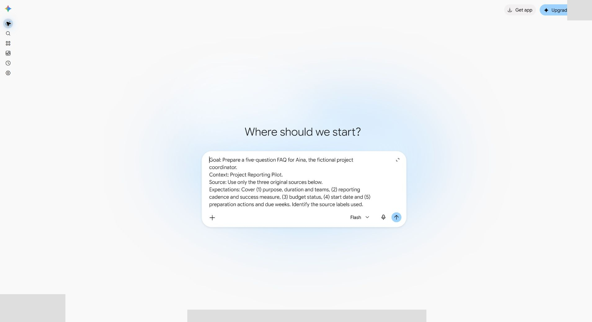
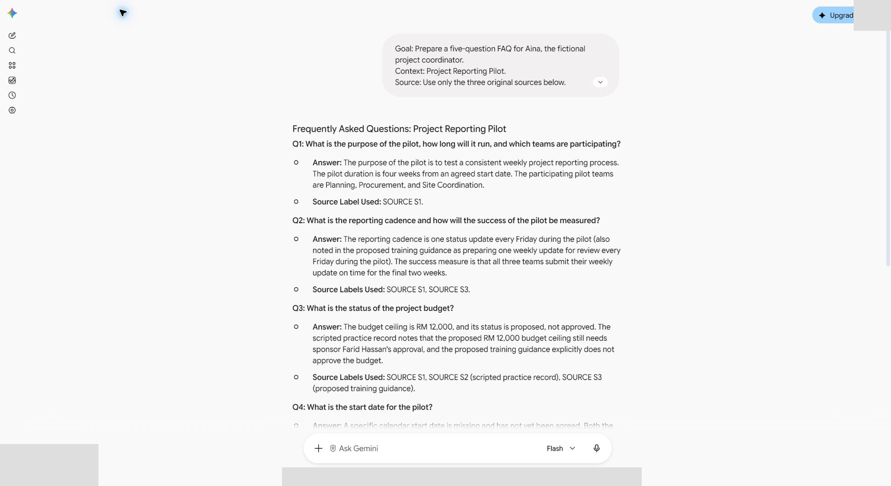
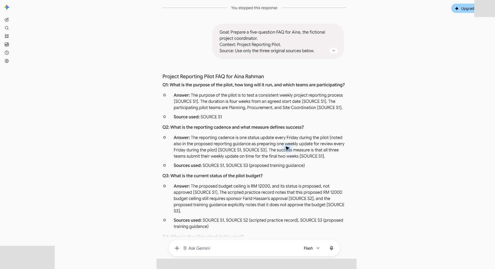
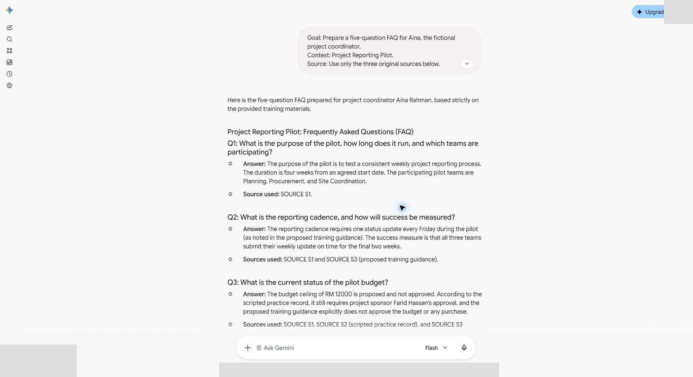

# 02 - Write and Refine Useful Prompts

In this chapter you will use Goal, Context, Source and Expectations; compare a vague prompt with a bounded prompt.

> **Prompts and values:** use the [copy-paste page](./prompts.md) for the exact values used below.

**Target allocation:** 50 minutes: 10 explanation/demonstration, 20 guided build and casework, 15 independent challenge, 5 verification and repair. The active portion is 40 minutes by design. These are unmeasured targets awaiting a learner pilot.

**Your result:** A bounded prompt and a checked comparison with a vague request.

> **Status:** author reference with ten staged captures. Source-grounded sponsor and FAQ outputs were checked, with user-assisted retries and limitations recorded below. Independent challenge, reviewer and classroom timing remain pending.

## What You Will Learn

- Use Goal, Context, Source and Expectations.
- Compare a vague and bounded request.
- Evaluate an answer independently.

## Before You Begin

Read the [case input](./prompts.md) and use a separate named casework copy for destructive tests or altered datasets. Keep the baseline unchanged for later chapters. Record source facts, proposed practice and unresolved questions separately.

Use the supplied project fact sheet. Use a fresh approved AI conversation for each comparison.

## 2.1 Try a Vague Request

1. In a fresh Gemini conversation using your approved training account, type **Write a project update**. The author run used Flash. Record the model, date, prompt and what the response assumes or asks.

2. A later fresh Flash run produced a generic status template, including “On Track”, example completed milestones and positive feedback. No project source was supplied, so these are example text, not evidence of the pilot. Do not copy them as facts. Earlier attempts returned service errors and cannot be scored as answers.

## 2.2 Write a Bounded Request

1. Open a fresh conversation. Paste the **Part 2** prompt from the copy-paste page with the full supplied project fact sheet, replacing the placeholder. Check Goal, Context, Source and Expectations before submission.
2. Read the answer against S1. In the observed Flash response, the update kept the three teams, proposed RM 12,000 ceiling, unagreed start, Friday cadence and final-two-weeks measure. The response was obtained after an instructor retry.

3. Count the update body separately from the missing-information list: this response had **73 words**, below the requested 80–100. The source already says the budget is proposed and not approved; the outstanding item is the sponsor decision. Identify any phrase that invents readiness or an approval gate.

## 2.3 Refine One Dimension

1. The initial prompt already asks for 80–100 words, so treat the next request as a **length-compliance repair**, not a new audience or length dimension. Ask for the same sponsor update in 80–100 words, preserving the original facts and unresolved decisions.

2. Check the new response and count the update body. The recorded refinement had **84 words**, but introduced “ready to begin”, “four key outputs, led by Aina Rahman”, and a formal sign-off prerequisite. The source identifies Aina as coordinator and lists outputs; it does not establish readiness, universal output ownership or that prerequisite. Mark **Repair** and remove the unsupported claims.

3. A better length alone does not establish factual accuracy. Compare the exact original text each time; do not treat AI assurance as evidence.

## 2.4 Run a Controlled Prompt Comparison

1. Use the three supplied original sources and the five-topic coordinator FAQ task on the prompts page. Run the bounded FAQ in a fresh conversation. Record the actual model and retry any service error without scoring it. The recorded response was obtained by the instructor using **Redo**.

2. Audit the six question-bank facts and cite the original passages. The response retained the required facts and relative weeks, but its question said actions must be completed “prior to the pilot”, which the sources do not establish. Remove that prerequisite and mark the answer **Repair**. A source label is a pointer to inspect, not proof.
3. In another fresh conversation, keep the same FAQ task, same S1–S3 originals and model. Add the **Output checks** block from the prompts page. Capture the prompt before submission.

4. Compare the checked output with the first FAQ. In this recorded run, both preserved the six tested facts; the checked version did not impose the earlier prerequisite and labelled the meeting record scripted and the guidance proposed. User-assisted retries and AI variation mean one pair does not prove the instruction caused the difference.

5. Run the checked prompt again with the original sources. In the recorded repeat the conversation contains an earlier stopped request and then the identical prompt again; it is a repeat, but not a completely clean-context test. Its response preserved the six facts and used claim-level source labels. Inspect the underlying passages; S3 corroborates Friday cadence but does not establish budget approval or a calendar start.

6. In a further fresh conversation, resupply the same originals and checked prompt. After two service errors, a user-assisted **Redo** produced version 3. No earlier substantive answer was in this conversation. The repeat retained all six tested facts, the unagreed date and relative weeks, and omitted the unsupported before-pilot condition. Recheck source passages; a source label by itself is not proof.

7. Record a comparison table: prompt, model/source route, six source checks, exact unsupported claims, citation support and Accept/Repair/Hold decision. The vague request lacked the pack and requested a different output; it is an illustrative baseline, not a controlled FAQ comparison. The two FAQ prompts share task, sources and model; only the output-check block changes. The successful vague response is a generic template; earlier failed runs cannot be scored as answers.

**Author-run scope:** sponsor response and refinement, bounded FAQ, checked FAQ and repeat inspected; user-assisted retries were needed. The recorded 50-minute allocation is an unmeasured classroom target. Independent challenge, reviewer agreement and learner timing remain pending.

## Independent Challenge

Close the earlier step lists for the first attempt. Use the case input and your own reasoning. If you need help, record the hint and repeat the affected check independently.

1. Design an independent prompt for an 80 to 100 word sponsor update, preserving budget/date uncertainty and the success measure.

2. Test it against a request to sound more confident. Reject a rewrite that turns a proposal into approval or an unknown date into a commitment.

3. Submit the prompt, output, factual audit and one revision reason as a reproducible test record.

## Evidence to Hand Over

- Three-prompt comparison with preserved outputs and a consistent score table.
- Final prompt rerun with observed variation and source-based corrections.
- Independent sponsor prompt that survives the confidence-rewrite test.

Record the defect or uncertainty you investigated, the evidence used, the repair or reasoned no-change decision, and the final state. Restore temporary changes or keep them in a clearly named scenario copy.

## Troubleshooting

| Symptom | What to check |
|---|---|
| A prompt comparison changes task and sources together | Record the changed variable and rerun with the same source pack so the comparison is interpretable. |
| An input or earlier result is missing | Reopen the input named in Before You Begin; do not substitute private company data |
| A menu or feature is unavailable | Confirm the account and the shared access notes; record the missing step and ask the trainer for its fallback |
| The result differs from the checkpoint | Compare the exact source range, wording and conditions before repeating the action |

## Lesson Summary

A clear prompt makes the task and evaluation criteria explicit.

**Check yourself:** Which prompt element limits the source of the answer?
