# 03 - Apply Gemini Across Workspace

In this chapter you will draft and revise from supplied files; verify cross-file references where available.

> **Prompts and values:** use the [copy-paste page](./prompts.md) for the exact values used below.

**Target allocation:** 55 minutes: 10 explanation/demonstration, 25 guided build and casework, 15 independent challenge, 5 verification and repair. The active portion is 45 minutes by design. These are unmeasured targets awaiting a learner pilot.

**Your result:** A checked project update and communication draft from explicit sources.

> **Status:** author reference with 11 staged captures. The guided route, a native lineage table and a separate delay scenario were checked. The independent challenge, reviewer agreement and classroom timing remain pending.

## What You Will Learn

- Draft and refine across Workspace.
- Use explicit file references where supported.
- Check an action proposal before execution.

## Before You Begin

Read the [case input](./prompts.md) and use a separate named casework copy for destructive tests or altered datasets. Keep the baseline unchanged for later chapters. Record source facts, proposed practice and unresolved questions separately.

Use a new practice Google Doc containing the supplied fact sheet. The reference can be pasted if file grounding is unavailable.

## 3.1 Draft in Context

1. Create a practice Doc containing the complete fictional project fact sheet. Open **Ask Gemini**.

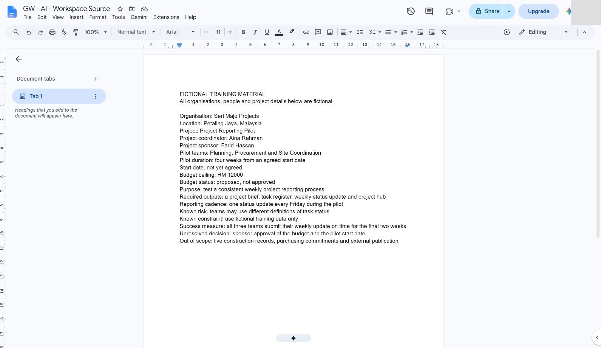

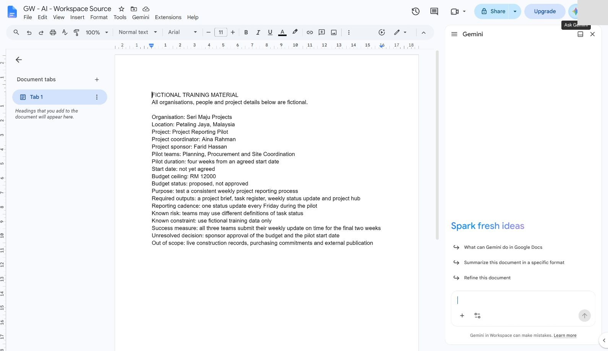

2. Create a separate Doc from the supplied proposed reporting guidance. In the panel choose **Add sources → Add from Drive**, select the exact guidance document and confirm its chip. In the author run it was named **GW - AI - Proposed Reporting Guidance v1**. If the picker is unavailable, paste the complete guidance and record that fallback.

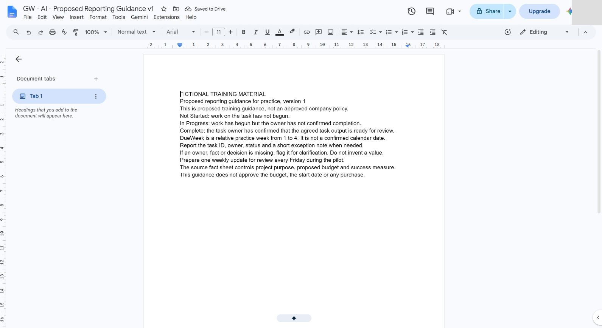

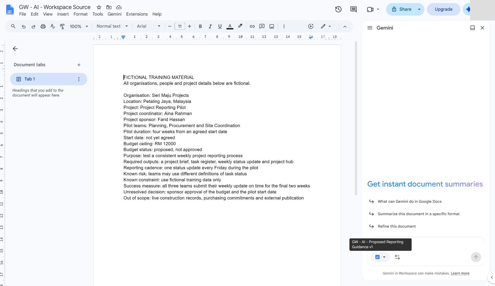

3. Request a coordinator update using both the current document and the named source. Ask for plain chat text only, without document edits, and review any proposed change before accepting it.

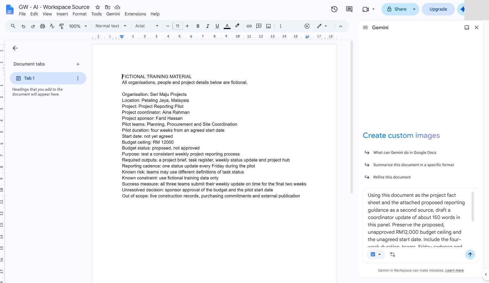

4. The first author request said panel only, yet Gemini proposed inserting text into the source document. The author rejected it and verified that the original remained intact. A second request explicitly saying “Do not insert, edit, or propose changes” returned a panel answer with links to both documents. A link is a pointer, not proof: inspect the original passages.

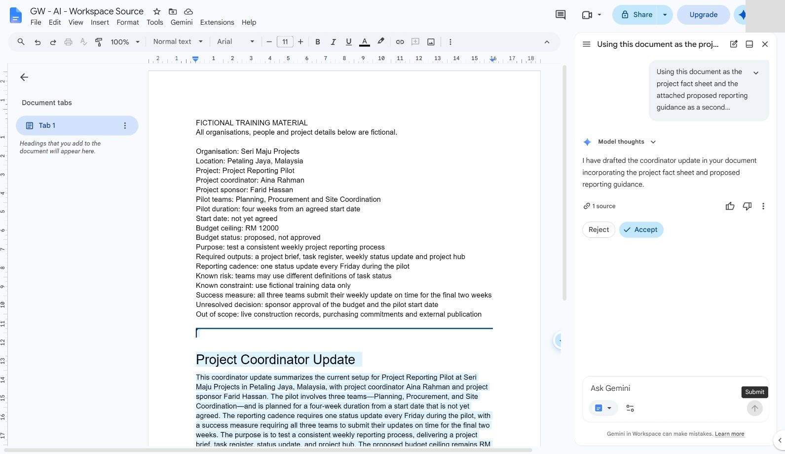

5. Check the unagreed start, proposed and unapproved RM 12,000 ceiling, four-week duration, Friday cadence and final-two-week success measure. The answer stated “Operations follow” the proposed guidance; the author corrected this to describe proposed training practice, not established operations or approved policy.

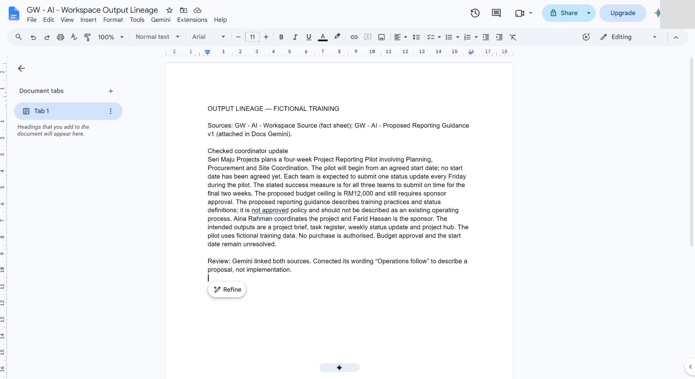

## 3.2 Adapt a Communication

1. Ask for example message wording based on the checked update. Keep recipients blank and do not send. Explicitly request plain chat text and prohibit creating a Gmail draft, using tools or editing a file; inspect the result before proceeding.
2. **Observed behaviour:** despite a panel-only request, Gemini created an unaddressed Gmail draft before the author could cancel. It remained unsent. A more explicit no-tools, no-draft request produced text in the panel. Instructions alone do not guarantee that Gemini will avoid actions; inspect the interface and saved drafts, and stop an unintended action when possible.
3. Copy or manually adapt the checked wording to a playbook. Preserve the unresolved decisions and proposed guidance; do not claim a launch or accepted commitment.

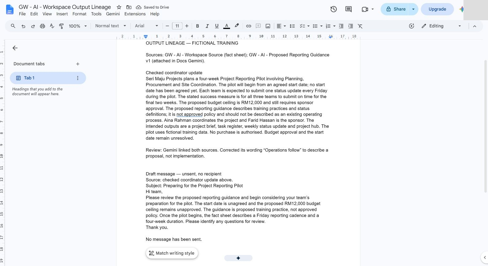

## 3.3 Review Cross-App Actions

1. Paste the complete scripted meeting record into the panel and ask Gemini to extract action, owner and relative practice week in chat only. Explicitly prohibit creating tasks, events, drafts or file changes.
2. Check the output against the original: Aina prepares a draft template in week 1, Bala reviews status definitions in week 1, and Siti collects a fictional sample update in week 2. The author response correctly extracted those rows, but grouped “no purchase authorised” and “no external announcement planned” with unresolved decisions; those are stated constraints, not proof of additional pending approvals.
3. Record the checked list as text. A proposed action or extracted owner is not an assigned task, and a practice week is not a calendar date.

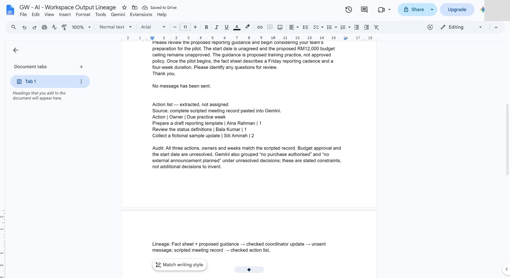

## 3.4 Trace One Evidence Set Through Three Outputs

1. Create an **Output Lineage** table mapping each output to its input and check: fact sheet and proposed guidance → checked coordinator update; checked update → unsent message; scripted meeting record → action list. The author used an editable Google Docs table after building the three outputs.

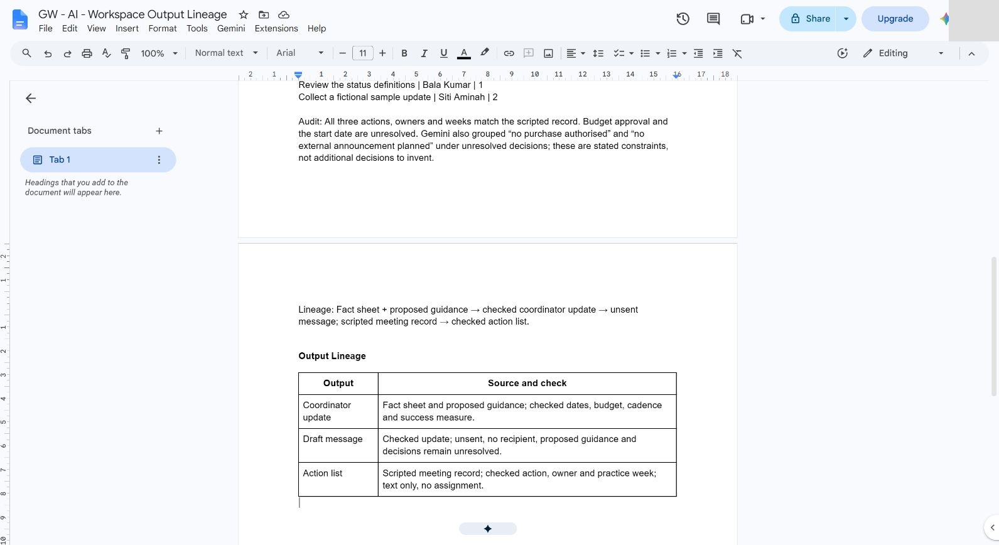

2. Compare the three outputs. Ensure that proposed practice has not become approved policy, an unsent request has not become an accepted commitment, and an extracted row is not an assigned task. Record the exact attached source title and the pasted meeting-record route.
3. Make a separate named scenario copy. Apply the delay card: Bala’s status-definition review is delayed and no replacement week is confirmed. Update the related follow-up wording and Bala’s row; retain Aina’s and Siti’s actions, the budget status and the unagreed start date. Keep the original baseline intact.

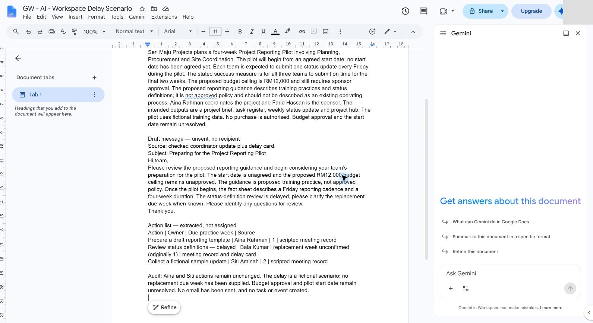

**Author-run scope:** source attachment, panel response, manually checked update and message, meeting-record extraction, lineage table and separate scenario copy were verified. The Gmail draft side effect and rejected document proposal are recorded above. The independent challenge, separate human review and 55-minute classroom allocation have not been validated.

## Independent Challenge

Close the earlier step lists for the first attempt. Use the case input and your own reasoning. If you need help, record the hint and repeat the affected check independently.

1. Independently prepare a short escalation note for the delayed action with no new due week. Identify what is known, unknown and requested next.

2. Audit the Doc, unsent email and action table for consistency after the scenario change. Correct one mismatch or record evidence for each consistent field.

3. Explain which steps would require a deliberate separate application action before sending, assigning or scheduling anything.

## Evidence to Hand Over

- Lineage table and three checked output types with consistent facts.
- Delay-scenario update retaining an unknown replacement deadline.
- Independent escalation note and explicit distinction between text and application actions.

Record the defect or uncertainty you investigated, the evidence used, the repair or reasoned no-change decision, and the final state. Restore temporary changes or keep them in a clearly named scenario copy.

## Troubleshooting

| Symptom | What to check |
|---|---|
| A downstream email adds a commitment absent from the checked update | Compare the output lineage and remove the unsupported assertion before using the draft. |
| An input or earlier result is missing | Reopen the input named in Before You Begin; do not substitute private company data |
| A menu or feature is unavailable | Confirm the account and the shared access notes; record the missing step and ask the trainer for its fallback |
| The result differs from the checkpoint | Compare the exact source range, wording and conditions before repeating the action |

## Lesson Summary

Cross-app drafting is useful when sources and proposed actions remain explicit.

**Check yourself:** How can you tell which file a cross-file answer actually used?
